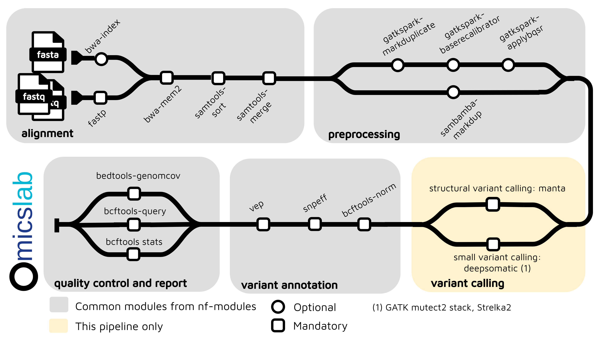

:::info
We use `deep-somatic` as one of the somatic variant callers in this pipeline. DeepSomatic is a deep-learning method for detecting somatic small nucleotide variations and insertions and deletions from both short-read and long-read data. It consistently outperforms existing callers across samples and sequencing technologies.

Here, we adopt `deep-somatic` as the primary engine for somatic variant calling, while reusing proven modules from earlier pipelines to deliver a state-of-the-art workflow.

Reference: [DeepSomatic: Accurate somatic variant calling with deep learning](https://www.nature.com/articles/s41587-025-02839-x)
:::

nf-core/sarek is widely regarded as a leading pipeline for short-read variant calling across both germline and somatic workflows, backed by a large and active community. However, it does come with several limitations:

- Reputation bias: Widely adopted tools are often retained as defaults, even when they may no longer offer the best performance. This can lead to unnecessary resource consumption and suboptimal efficiency in certain steps.
- Legacy features: Some integrated tools have not been actively maintained for years, resulting in performance gaps. Despite this, they are often preserved for backward compatibility, increasing codebase complexity and the maintenance burden when introducing new features.
- Customization constraints: The pipeline is designed for general-purpose and research-oriented use. In industrial production settings, workflows typically need to be streamlined—retaining only essential steps and achieving near-linear scalability with resources. In such cases, a more minimal and purpose-built approach is often more effective.

Therefore, we developed the `nf-somatic-short-read-variant-calling pipeline` specifically to support large-scale somatic variant calling from tumor-normal paired short-read sequencing data.

## Architecture



**Key Features**

- **Multiple Input Formats**: FASTQ (full pipeline), BAM, and CRAM (skip alignment, auto-convert)
- **Multiple Variant Callers**: Mutect2, Strelka, DeepSomatic (default)
- **Structural Variant Calling**: Manta
- **Quality Control**: FastQC, MultiQC, bcftools stats, bedtools genomecov
- **Variant Annotation**: SnpEff, VEP
- **Tumor-Normal Pairing**: Built-in support for matched tumor-normal samples
- **CRAM Compression**: Built-in CRAM→BAM conversion for efficient variant re-calling
- **Flexible Configuration**: Container support (Docker/Singularity), multiple profiles

## Variant Callers

### DeepSomatic

[DeepSomatic](https://www.nature.com/articles/s41587-025-02839-x) is a deep-learning method for detecting somatic small nucleotide variations and insertions and deletions from both short-read and long-read data. The method has modes for whole-genome and whole-exome sequencing and can run on tumor–normal, tumor-only and formalin-fixed paraffin-embedded samples.

Key advantages:

- Consistently outperforms existing callers across samples and sequencing technologies
- Supports both short-read (Illumina) and long-read (PacBio HiFi, Oxford Nanopore) data
- Available for WGS and WES workflows

### Mutect2

GATK Mutect2 is a widely-used somatic variant caller that uses local assembly to detect somatic variants. It is the gold standard for short-read somatic variant calling.

### Strelka

Strelka is a fast somatic variant caller optimized for small variant detection in tumor-normal samples.

## Quick Start

### Configuration for Primary Use Case

Default configuration uses:

- Mutect2 as small variant caller
- Manta as structural variant caller
- GRCh38 reference genome
- FASTP quality filtering
- Preprocessing skipped (skip_preprocessing: true)
- SnpEff + VEP annotation enabled

```bash
pixi run nextflow run main.nf -profile docker -resume
```

### Prepare a Samplesheet

Create a CSV samplesheet with your input. The pipeline requires tumor-normal paired samples and supports three input modes:

**- FASTQ Input (Full Pipeline)**

```csv
patient,sex,status,sample,lane,fastq_1,fastq_2
P001,M,0,P001_N,L001,/path/to/P001_N_R1.fastq.gz,/path/to/P001_N_R2.fastq.gz
P001,M,1,P001_T,L001,/path/to/P001_T_R1.fastq.gz,/path/to/P001_T_R2.fastq.gz
```

**- BAM Input (Skip Alignment)**

```csv
patient,sex,status,sample,lane,bam,bai
P001,M,0,P001_N,L001,/path/to/P001_N.bam,/path/to/P001_N.bam.bai
P001,M,1,P001_T,L001,/path/to/P001_T.bam,/path/to/P001_T.bam.bai
```

**- CRAM Input (Skip Alignment + Auto-Convert)**

```csv
patient,sex,status,sample,lane,cram,crai
P001,M,0,P001_N,L001,/path/to/P001_N.cram,/path/to/P001_N.cram.crai
P001,M,1,P001_T,L001,/path/to/P001_T.cram,/path/to/P001_T.cram.crai
```

**CRAM Benefits**:

- **Compressed input**: CRAM files are ~4x smaller than BAM (78% compression)
- **Faster pipeline**: Skip alignment step when re-running variant calling
- **Automatic conversion**: CRAM→BAM conversion integrated into pipeline
- **Supported for all callers**: Mutect2, Strelka, DeepSomatic, and Manta

**Samplesheet Columns**:

- `patient`: Patient identifier (same for normal/tumor pairs)
- `sex`: Sex of the patient (M/F)
- `status`: Sample type (0 = normal, 1 = tumor)
- `sample`: Sample identifier
- `lane`: Sequencing lane (optional, defaults to L001)
- **FASTQ mode**: `fastq_1`, `fastq_2` (gzipped FASTQ files)
- **BAM mode**: `bam`, `bai` (aligned BAM + index)
- **CRAM mode**: `cram`, `crai` (compressed alignment + index)

### Run the Pipeline

It will automatically detect the input format (FASTQ, BAM, or CRAM) to run the appropriate steps:

```bash
nextflow run main.nf \
  --input samplesheet.csv \
  --profile docker \
  -resume
```

**Advanced Options**

```bash
# Use DeepSomatic with WGS model
nextflow run main.nf \
  --input samplesheet.csv \
  --small_variant_caller deepsomatic \
  --deepsomatic_model_type WGS \
  --profile docker \
  -resume

# Use Strelka instead of Mutect2
nextflow run main.nf \
  --input samplesheet.csv \
  --small_variant_caller strelka \
  --profile docker \
  -resume

# With Manta for structural variants
nextflow run main.nf \
  --input samplesheet.csv \
  --structural_variant_caller manta \
  --profile docker \
  -resume

# Skip annotation for faster processing
nextflow run main.nf \
  --input samplesheet.csv \
  --skip_annotation \
  --profile docker \
  -resume

# Enable alignment preprocessing (e.g., BQSR)
nextflow run main.nf \
  --input samplesheet.csv \
  --preprocessor gatk \
  --profile docker \
  -resume
```

For test mode with sample data:

```bash
nextflow run main.nf -profile docker,test -resume
```

### View Results

Output files will be generated in the `results/` directory. File structure depends on input mode:

**-FASTQ Input Results:**

- `results/alignment/*.bam` - Aligned BAM files
- `results/variant_calling/*.vcf.gz` - Raw variant calls
- `results/variant_annotation/*.vcf` - Annotated variants
- `results/qc/` - Quality metrics (variant stats, coverage bedgraph)

**-CRAM Input Results:**

- `results/variant_calling/*.vcf.gz` - Raw variant calls (from converted BAM)
- `results/variant_annotation/*.vcf` - Annotated variants
- `results/qc/` - Quality metrics (variant stats, coverage bedgraph)
- No intermediate BAM files (discarded after variant calling unless configured otherwise)

**-Common output files:**

- `results/multiqc_report.html` - Interactive quality control report
- `results/pipeline_info/` - Execution timeline and trace logs

For more advanced usage and configuration options, see the [Pipeline Architecture](docs/architecture.md) documentation.

## References

1. **[nf-core/sarek](https://github.com/nf-core/sarek/tree/master)**: Analysis pipeline to detect germline or somatic variants (pre-processing, variant calling and annotation) from WGS / targeted sequencing
2. **[DeepSomatic: Accurate somatic variant calling with deep learning](https://www.nature.com/articles/s41587-025-02839-x)**: Nature Biotechnology paper on DeepSomatic
3. **https://github.com/gianglabs/nf-somatic-short-read-variant-calling**: The production-grade pipeline for somatic short-read variant calling using Nextflow
