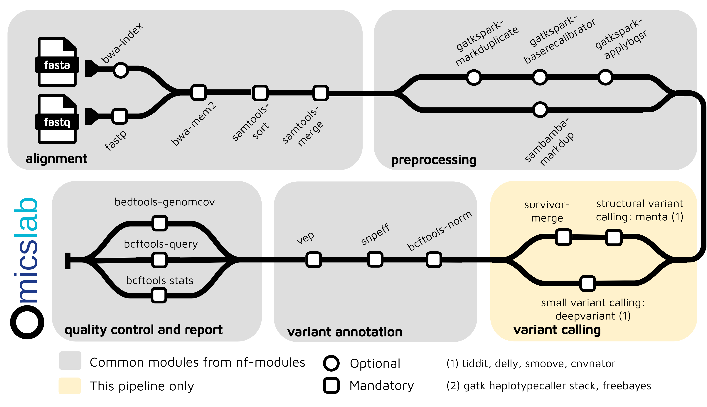

:::info
We demonstrate that using `fastp`, `bwa-mem2`, and `deep-variant` can achieve comparable performance on the HG002 GIAB dataset, demonstrating a minimal tool set while matching the results of `nf-core/sarek` with full profile support.
:::

nf-core/sarek is widely regarded as a leading pipeline for short-read variant calling across both germline and somatic workflows, backed by a large and active community. However, it does come with several limitations:

- Reputation bias: Widely adopted tools are often retained as defaults, even when they may no longer offer the best performance. This can lead to unnecessary resource consumption and suboptimal efficiency in certain steps.
- Legacy features: Some integrated tools have not been actively maintained for years, resulting in performance gaps. Despite this, they are often preserved for backward compatibility, increasing codebase complexity and the maintenance burden when introducing new features.
- Customization constraints: The pipeline is designed for general-purpose and research-oriented use. In industrial production settings, workflows typically need to be streamlined—retaining only essential steps and achieving near-linear scalability with resources. In such cases, a more minimal and purpose-built approach is often more effective.

Therefore, we developed the `nf-germline-short-read-variant-calling pipeline` specifically to support large-scale population cohort construction for biobank projects, optimized for germline variant calling from ~30× coverage short-read sequencing data.

## Architecture



**Key Features**

- **Multiple Input Formats**: FASTQ (full pipeline), BAM, and CRAM (skip alignment, auto-convert)
- **Multiple Variant Callers**: DeepVariant (default), GATK HaplotypeCaller, FreeBayes
- **Quality Control**: Fastp, bcftools stats, bcftools query, bedtools genomecov
- **Variant Annotation**: SnpEff, VEP
- **Structural Variants**: Manta, Delly, TIDDIT, LUMPY, CNVnator (multi-caller support)
- **CRAM Compression**: Built-in CRAM→BAM conversion for efficient variant re-calling
- **Flexible Configuration**: Container support (Docker/Singularity), multiple profiles
- **Benchmarking Tools**: Integrated Truvari for SV benchmarking

## Benchmark

:::info
For benchmarking results: https://github.com/gianglabs/nf-germline-short-read-variant-calling/tree/main/benchmark
:::

### SNP and INDEL Benchmarking Performance

:::info
Both pipelines achieve excellent SNP and INDEL accuracy with DeepVariant. The nf-germline-short-read pipeline performs comparably to nf-core/sarek while maintaining a **simpler, streamlined workflow** optimized specifically for germline variant calling.
:::

This pipeline is specifically optimized for **SNP and small INDEL detection** using **DeepVariant** with preprocessing skipped. Benchmark results against HG002 (Genome in a Bottle) demonstrate competitive performance with nf-core/sarek:

#### SNP Detection Performance (HG002 - DeepVariant)

| Pipeline                               | Recall | Precision | F1 Score | TP        | FN     |
| -------------------------------------- | ------ | --------- | -------- | --------- | ------ |
| nf-germline-short-read-variant-calling | 99.39% | 99.82%    | 99.60%   | 3,344,672 | 20,455 |
| nf-core/sarek                          | 99.39% | 99.84%    | 99.61%   | 3,344,549 | 20,578 |

#### INDEL Detection Performance (HG002 - DeepVariant)

| Pipeline                               | Recall | Precision | F1 Score | TP      | FN    |
| -------------------------------------- | ------ | --------- | -------- | ------- | ----- |
| nf-germline-short-read-variant-calling | 98.78% | 99.38%    | 99.08%   | 519,079 | 6,390 |
| nf-core/sarek                          | 98.97% | 99.46%    | 99.21%   | 520,048 | 5,421 |

### Structural Variant Calling

**HG002 Benchmarking Results**:

- Sensitivity: 7.88% (1,082 TP out of 13,732 variants)
- Precision: 36.8% (1,082 TP out of 2,940 calls)
- Genotype Concordance: 90.39%

## Quick Start

### Configuration for Primary Use Case

Default configuration uses:

- DeepVariant as variant caller
- GRCh38 reference genome
- FASTP quality filtering
- Preprocessing skipped (skip_preprocessing: true)
- SnpEff + VEP annotation enabled

```bash
pixi run nextflow run main.nf -profile docker -resume
```

### Prepare a Samplesheet

Create a CSV samplesheet with your input. The pipeline supports three input modes:

**FASTQ Input (Full Pipeline)**

```csv
sample,lane,fastq_1,fastq_2
HG002,L001,/path/to/HG002_R1.fastq.gz,/path/to/HG002_R2.fastq.gz
HG003,L001,/path/to/HG003_R1.fastq.gz,/path/to/HG003_R2.fastq.gz
```

**BAM Input (Skip Alignment)**

```csv
sample,lane,bam,bai
HG002,L001,/path/to/HG002.bam,/path/to/HG002.bam.bai
HG003,L001,/path/to/HG003.bam,/path/to/HG003.bam.bai
```

**CRAM Input (Skip Alignment + Auto-Convert)**

```csv
sample,lane,cram,crai
HG002,L001,/path/to/HG002.cram,/path/to/HG002.cram.crai
HG003,L001,/path/to/HG003.cram,/path/to/HG003.cram.crai
```

**CRAM Benefits**:

- **Compressed input**: CRAM files are ~4x smaller than BAM (78% compression)
- **Faster pipeline**: Skip alignment step when re-running variant calling
- **Automatic conversion**: CRAM→BAM conversion integrated into pipeline
- **Supported for all callers**: DeepVariant, GATK, FreeBayes, and all SV callers (Manta, Delly, TIDDIT, LUMPY, CNVnator)

**Samplesheet Columns**:

- `sample`: Sample identifier
- `lane`: Sequencing lane (if multiple lanes, create separate rows per lane)
- **FASTQ mode**: `fastq_1`, `fastq_2` (gzipped FASTQ files)
- **BAM mode**: `bam`, `bai` (aligned BAM + index)
- **CRAM mode**: `cram`, `crai` (compressed alignment + index)

### Run the Pipeline

It will automatically detect the input format (FASTQ, BAM, or CRAM) to run the appropriate steps:

```bash
nextflow run main.nf \
  --input samplesheet.csv \
  --profile docker \
  -resume
```

**Advanced Options**

```bash
# With multiple SV callers
nextflow run main.nf \
  --input samplesheet_cram.csv \
  --structural_variant_caller "manta,delly,lumpy" \
  --profile docker \
  -resume

# Skip annotation for faster processing
nextflow run main.nf \
  --input samplesheet.csv \
  --skip_annotation \
  --profile docker \
  -resume

# Use alternative variant caller (GATK or FreeBayes)
nextflow run main.nf \
  --input samplesheet.csv \
  --small_variant_caller gatk \
  --profile docker \
  -resume
```

For test mode with sample data:

```bash
nextflow run main.nf -profile docker,test -resume
```

### View Results

Output files will be generated in the `results/` directory. File structure depends on input mode:

**FASTQ Input Results:**

- `results/alignment/*.bam` - Aligned BAM files
- `results/alignment_qc/` - Alignment quality reports
- `results/variant_calling/*.vcf.gz` - Raw variant calls
- `results/variant_annotation/*.vcf` - Annotated variants

**CRAM Input Results:**

- `results/variant_calling/*.vcf.gz` - Raw variant calls (from converted BAM)
- `results/variant_annotation/*.vcf` - Annotated variants
- No intermediate BAM files (discarded after variant calling unless configured otherwise)

**Common output files:**

- `results/multiqc_report.html` - Interactive quality control report
- `results/pipeline_info/` - Execution timeline and trace logs

For more advanced usage and configuration options, see the [Pipeline Architecture](docs/architecture.md) documentation.

## References

1. **[nf-core/sarek](https://github.com/nf-core/sarek/tree/master)**: Analysis pipeline to detect germline or somatic variants (pre-processing, variant calling and annotation) from WGS / targeted sequencing
2. **https://github.com/gianglabs/nf-germline-short-read-variant-calling**: The production-grade pipeline for germline short-read variant calling using nextflow 30X coverage
