In [Part 1](/blogs/how-to-build-slurm-hpc-part-1), we learned the fundamentals by building a single-node Slurm cluster. Now it's time to scale up to a production-ready, multi-node cluster with automated deployment, monitoring, and alerting.

In this post, we'll use Ansible to automate the entire deployment process, making it reproducible and maintainable.

## Series Overview

- **[Part 1](/blogs/how-to-build-slurm-hpc-part-1)**: Introduction, Architecture, and Single Node Setup
- **Part 2 (This Post)**: Scaling to Production with Ansible
- **[Part 3](/blogs/how-to-build-slurm-hpc-part-3)**: Administration and Best Practices

Moving from a single-node setup to a multi-node production cluster involves:

- Configuring multiple machines identically
- Managing dependencies and installation order
- Keeping configurations synchronized
- Handling user management across nodes
- Setting up monitoring and logging infrastructure

Doing this manually is error-prone and time-consuming. Infrastructure automation tools like Ansible, Puppet, or Terraform solve this problem. We chose **Ansible** because:

- **Agentless**: No software to install on managed nodes
- **Declarative**: Describe the desired state, not the steps
- **Idempotent**: Safe to run multiple times
- **YAML-based**: Easy to read and version control
- **Large ecosystem**: Many pre-built roles available

For quick review what is the Ansible, follow this video https://www.youtube.com/watch?v=xRMPKQweySE

## Production Cluster Architecture

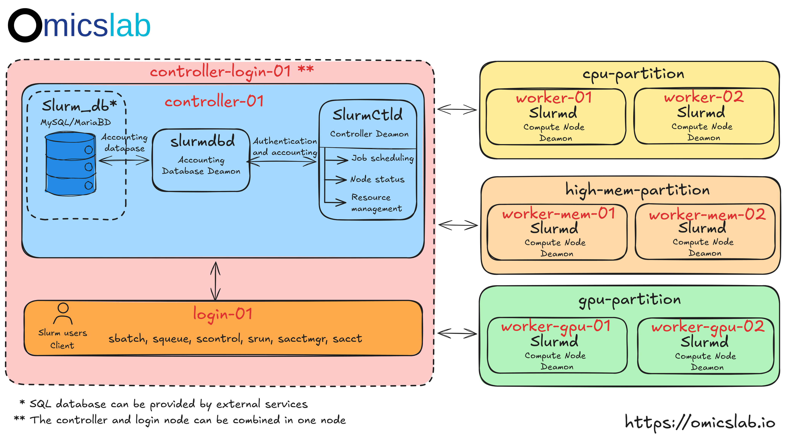

_Figure 1: The standard architecture of a multi-node Slurm cluster_

The above Figure 1 shows how the multiple nodes can be setup related to the Slurm cluster architecture only. However, on the real production, there
are some additional steps that are required for the bioinformatics services, include: **Shared Storage** and **Monitoring**. It will be explained more details as below

### Sharing Storage System

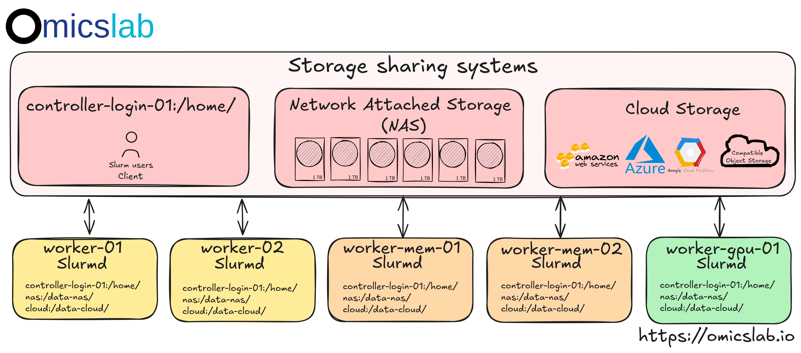

_Figure 2: The standard sharing storage system accross multiple node_

A shared storage system is needed because when a job runs on a worker, it needs to access the data. Later, when we stop to work or request a higher
resource system, we still be able to access the data. In advanced task, we need to analyze on multiple compute nodes, we need the raw data, intemediate files can be shared
and storaged to be analyzed accross multiple machine.

Normally, the standardized setup can be showed as Figure 2, with:

- Network File Syste (NFS): With Local Area Network (LAN) wiht high network routers between nodes, it can be configured to share the specific folders from a machine to multiple nodes. It is usually configured
  on the controller nodes where it shares the `HOME` directory, then your user home folder will be available on the target nodes.
- Network Attached Storage (NAS) (Optional): Similar to NFS, it can be configured to the share files. Commonly, they are configured by specific device where it has the related NAS software to manage and monitor.
  Eventually, it can be shared with the public network. While it also can support the high accessibility to read/write between nodes and also support the backup the data using multiple replication of data. However,
  the cost for running the NAS can be considered where users can use the cloud storage directly. They can first download the raw data on the NFS, uploaded the nessesary files on the cloud when it done
- Cloud storage: Although the HPC is designed to use locally, using cloud storage is nessessary when user can store the data. In bioinformatics, it is quite special that the data can be reused to extract the new inside
  when the new tools are developed. While HPC is powered for computing to investigate, later, configuring cloud computing can be used for the production cost optimization.

### Monitoring Stack

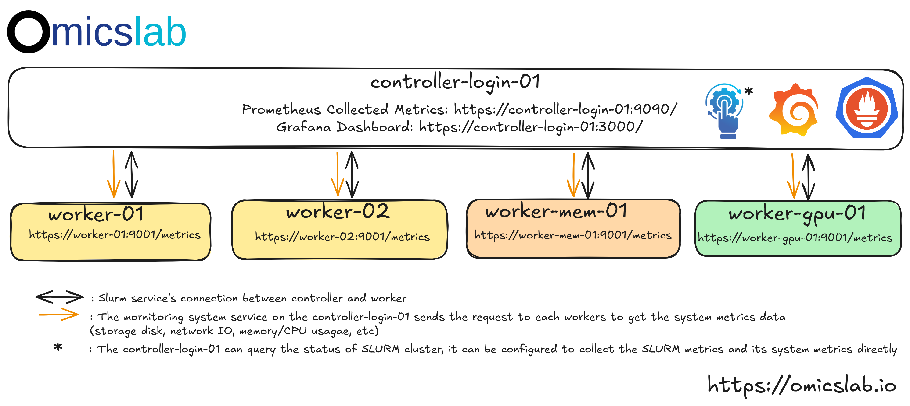

_Figure 3: The monitoring system designed for multiple nodes to collect the system and Slurm metrics_

**As the administrator of the HPC, you should not login into the HPC, then check the status of the cluster. According to Figure 3, Normally, for the HPC, the administrator will:**

- System monitoring: It is meant to check whether the users can use the HPC efficiently and effectively. It can be checked by the disk, memory and cpus usage. If the disk is full while, it can be the signal to increase
  HPC node size. If the analysis can not be optimized, it is time to upgrade the system. It can detect whether the users use the HPC correctly. For example, running the Nextflow bioinformatics pipeline can be used with `executor=slurm`
  it can help to automatically submit and monitor tasks while submitting a single job with high computing resources while running the pipeline with `executor=local` can waste resources when a few steps do not require too many resouces while it takes time to run.
- Slurm monitoring: If the nodes are busy most of the time (>80%) and expected to use more, it can be considered to update the HPC. Especially, the administrator can encourage and guild the users to submit job at night for extensive tasks while
  at this time, not much people use it

**How the metrics can be collected:**

- System metrics: It can be configured via `promethus-node-exporter` at each node where it collect the system metrics and exposed as web api service at `https://<node name>:3000`. Then, the head node can send the
  request to collect these metrics.
- Slurm metrics: It can be configured via `promethus-slurm-exporter` at the node in the Slurm cluster. It is usually the controller node.
- Collected metrics and dashboard: Then the `prometheus` will collect these metrics and can be the source for the `Grafana` with configured dasboard for interactive analysis

<figure markdown="span">
    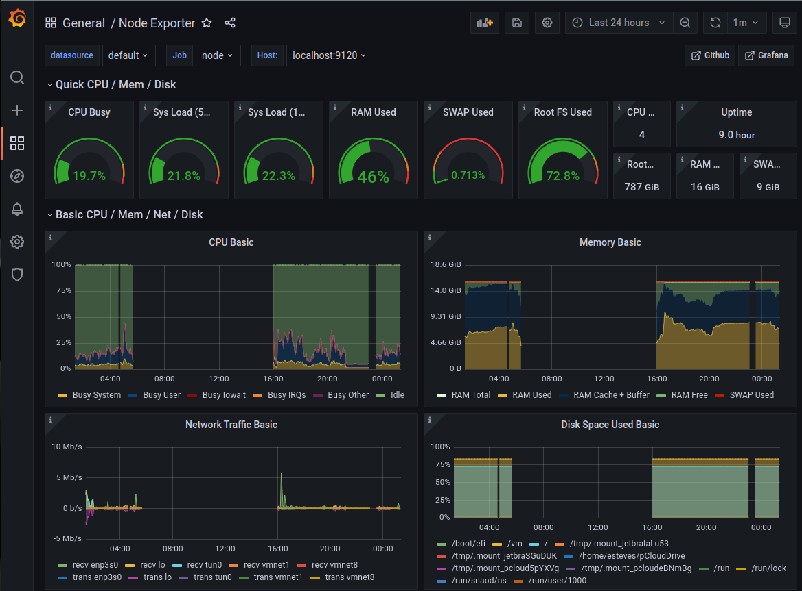
</figure>
Source: https://swsmith.cc/posts/grafana-slurm.html

- **Prometheus**: Time-series metrics database
- **Grafana**: Dashboards for visualization
- **Alertmanager**: Sends alerts to Slack when issues occur
- **Node Exporter**: System-level metrics (CPU, memory, disk)
- **Slurm Exporter**: Slurm-specific metrics (jobs, partitions, nodes)

### Alert System

The HPC does not always work properly. If a worker not does not work, the administrator should get the notification as soon as possible instead of waiting for the users to report the incidents. Therefore, `prometheus` can be
intergrated with `alertmanager`. We can configure the rule: If the system metric can not be collected from a node, it does not response, then it should mark as the `down` node and send the alert message to
the chat application. It can be `Slack` or `Zalo` (Vietnam region) that can be quickly fix the issue.

## Scale To Multiple Node HPC

It can be done step by step, via:

- Step 1: Clone the repo
- Step 2: Install Ansible which is the tool that will connect and run the command line to setup on the remote machine (nodes)
- Step 3: Create the Slack app where it has the API that `Promethus` when it see the `healthy` condition is failed, will call the API to alert the administrators and users
- Step 4: Connect your machine to be able to connect with nodes, create the `inventories` which store the information of how your machine can connect and set up on the nodes, decide which node should be configured as the controller, login, worker to install with relative services.
- Step 5: Now you are able to build the cluster, using Ansible, read the `inventories` file and install/configure the softwares on the remote machine automatically instead of
  manually login to each nodes and install softwares
- Step 6: Now the cluster can be ready to run, you need to add the users to correctly matched with the Linux users accross nodes for approriate permissons to work on the cluster.
- Step 7: Using the created Slurm user, verify the cluster can be submitted job and ran the simple analysis
- Step 8: Double check at the dasboard to see that each nodes system metrics and Slurm HPC metrics are visualized by Grafana

### Prerequisites

- Multiple Ubuntu 20.04 or 24.04 machines (or VMs)
- SSH access to all nodes
- Sudo privileges on all nodes
- A Slack workspace (for alerts)

### Step 1: Clone the Repository

```bash
git clone https://github.com/vieomics/omicslab-hpc -b 1.0.0
cd omicslab-hpc
```

### Step 2: Install Ansible and Dependencies

```bash
# pixi is similar to conda
# install pixi
make ${HOME}/.pixi/bin/pixi

# activate environment
pixi shell

# install dependencies, start up example instances with cluster os, support multiple version
# bash scripts/setup.sh 22.04
# bash scripts/setup.sh 20.04
bash scripts/setup.sh 24.04
# or
make vm-start
```

This script installs:

- Community Ansible collections
- Galaxy roles (geerlingguy.docker, etc.)

### Step 3: Set Up Slack Alerts

:::info

- For `alertmanager` Slack is used by default. Contact us at `contact@omicslab.io` that we provide the customized solution if you want to use another solution (Zalo, Discord, etc)
  :::

**Create a Slack App**

1. Go to [Slack API](https://api.slack.com/apps) and create a new app
2. Choose "From scratch"
3. Name it (e.g., "Slurm Cluster Monitor")
4. Select your workspace

<figure markdown="span">
    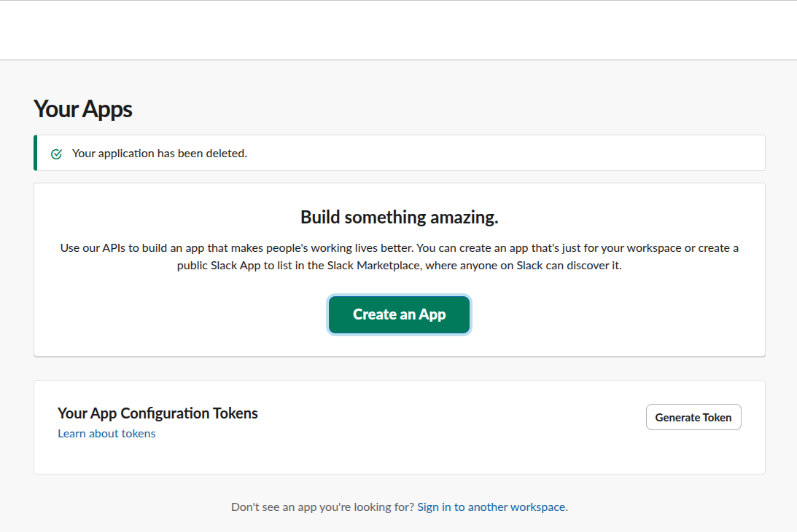
</figure>

**Enable Incoming Webhooks**

1. Navigate to "Incoming Webhooks" in your app settings
2. Activate incoming webhooks
3. Click "Add New Webhook to Workspace"
4. Select the channel for notifications (e.g., `#cluster-alerts`)
5. Copy the webhook URL

<figure markdown="span">
    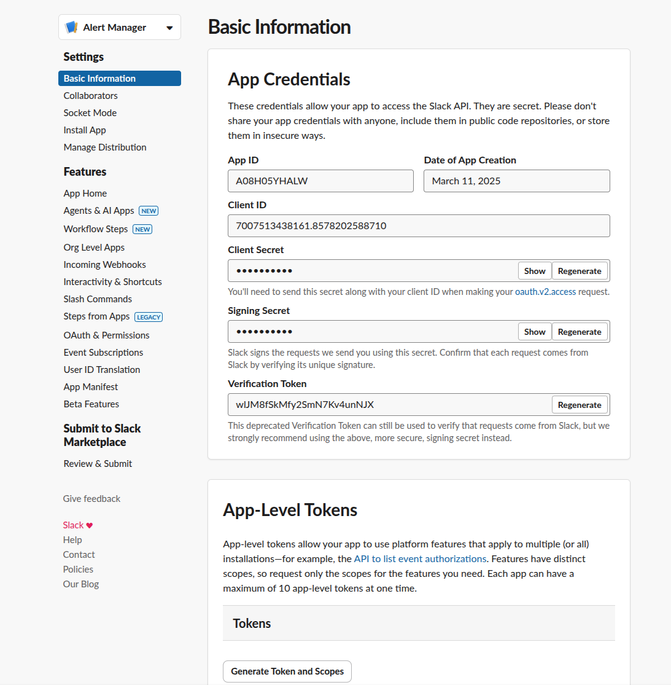
</figure>

<figure markdown="span">
    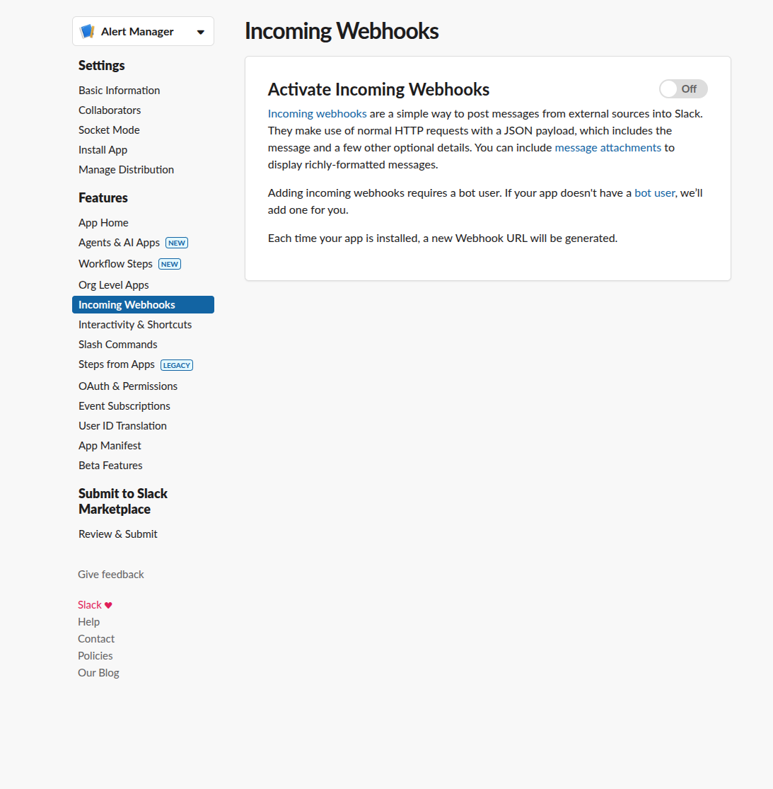
</figure>

<figure markdown="span">
    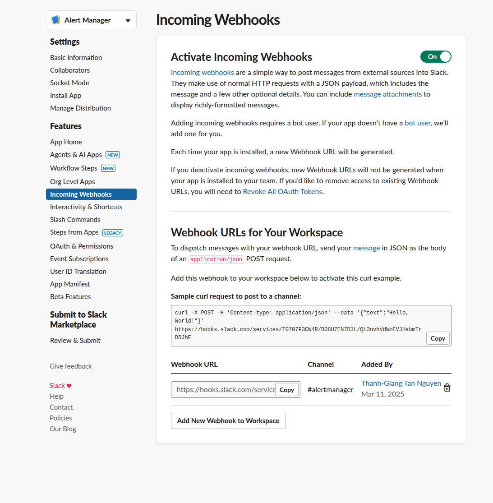
</figure>

**Manually Test The Webhook**

```bash
curl -X POST -H 'Content-type: application/json' \
  --data '{"text":"Hello from Slurm cluster!"}' \
  https://hooks.slack.com/services/YOUR/WEBHOOK/URL
```

You should see the message appear in your Slack channel!

### Step 4: Configure Your Inventory

Create `inventories/hosts` (or copy from `inventories/hosts.example`):

```text
[slurm_master]
controller-01 ansible_host=192.168.58.10

[slurm_worker]
worker-01 ansible_host=192.168.58.11
worker-02 ansible_host=192.168.58.12

[slurm:children]
slurm_master
slurm_worker

\[all:vars] # remove the backflash that html turbopack failed to render as code block
ansible_user=your_username
slurm_password=secure_munge_password
slurm_account_db_pass=secure_db_password
slack_api_url=https://hooks.slack.com/services/YOUR/WEBHOOK/URL
slack_channel=#cluster-alerts
admin_user=admin
admin_password=secure_grafana_password
```

:::warning
Use [Ansible Vault](https://docs.ansible.com/ansible/latest/user_guide/vault.html) to encrypt sensitive variables like passwords and API keys.
:::

```bash
# create encrypted vault, add your vault password,  content, then exit with vim key :wq
ansible-vault create inventories/hosts.prod

# edit exisiting files, add your vault password to work directly inside
ansible-vault edit inventories/hosts.prod
```

</div>

#### Optional Parameters

```ini
default_password=temporary_user_password  # Forces change on first login
users=alice,bob,charlie                   # Comma-separated list
```

### Step 5: Deploy the Cluster

Now deploy your entire cluster with one command:

```bash
# If you have passwordless sudo configured
ansible-playbook -i inventories/hosts cluster_slurm.yml

# If you need to enter sudo password
ansible-playbook -i inventories/hosts cluster_slurm.yml --ask-become-pass --ask-vault-pass
```

What this playbook does:

1. **Prepares all nodes**:
   - Updates packages
   - Installs dependencies
   - Configures firewalls
2. **Sets up the controller**:
   - Installs slurmctld and slurmdbd
   - Configures MariaDB for accounting
   - Sets up NFS server
   - Installs monitoring stack
3. **Configures compute nodes**:
   - Installs slurmd
   - Mounts NFS shares
   - Configures metrics exporters
4. **Deploys monitoring**:
   - Prometheus for metrics collection
   - Grafana with pre-configured dashboards
   - Alertmanager with Slack integration
5. **Synchronizes configurations**:
   - Copies slurm.conf to all nodes
   - Sets up Munge authentication
   - Configures log aggregation

### Step 6: Add Users

```bash
ansible-playbook -i inventories/hosts cluster_account.yml
```

This creates Linux users on all nodes with:

- Synchronized UID/GID across nodes
- Home directories on shared NFS
- Slurm accounting associations

:::info
For production, consider integrating with LDAP or Active Directory. However, NIS and LDAP setup can be complex on Ubuntu. Our Ansible approach provides a simpler alternative that works well for small to medium clusters.
:::

### Step 7: Verify the Setup

SSH into the controller node and run:

```bash
# Check cluster status
sinfo

# Expected output:
# PARTITION AVAIL  TIMELIMIT  NODES  STATE NODELIST
# compute*     up   infinite      2   idle worker-01,worker-02

# View job queue
squeue

# Submit a test job
srun --nodes=1 --ntasks=1 hostname

# Check accounting
sacct

# View cluster configuration
scontrol show config | head -20
```

### Step 8: Access Grafana Dashboards

Grafana runs on the controller node at port 3000. To access it securely from your local machine:

```bash
# Create SSH tunnel
ssh -N -L 3001:localhost:3000 your_user@controller_ip

# Now open in browser: http://localhost:3001
# Login: admin / your_grafana_password
```

You'll see pre-configured dashboards showing:

#### Node Metrics Dashboard

- CPU usage per node
- Memory utilization
- Disk I/O
- Network traffic
- System load

<figure markdown="span">
    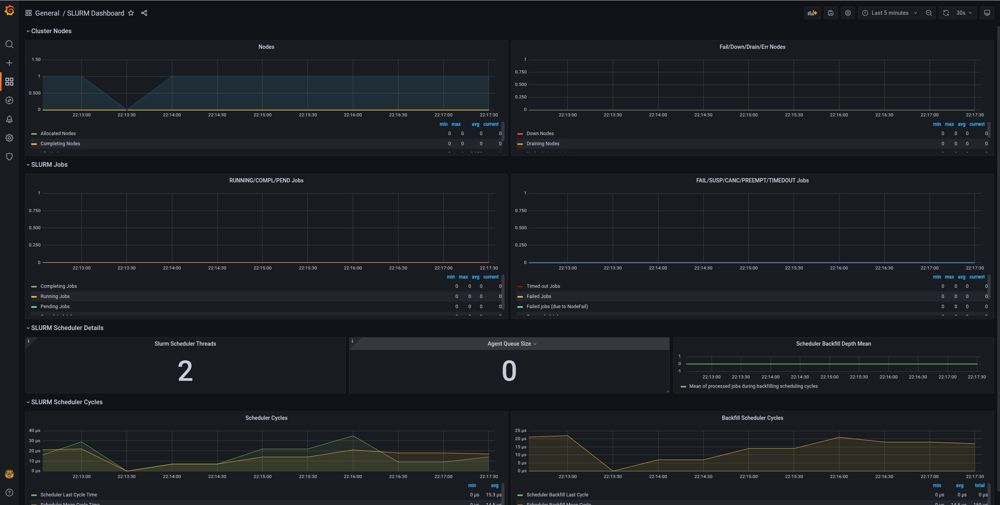
</figure>

#### Slurm Metrics Dashboard

- Active jobs
- Job queue length
- Node states (idle, allocated, down)
- CPU allocation
- Memory usage
- Job completion rates

<figure markdown="span">
    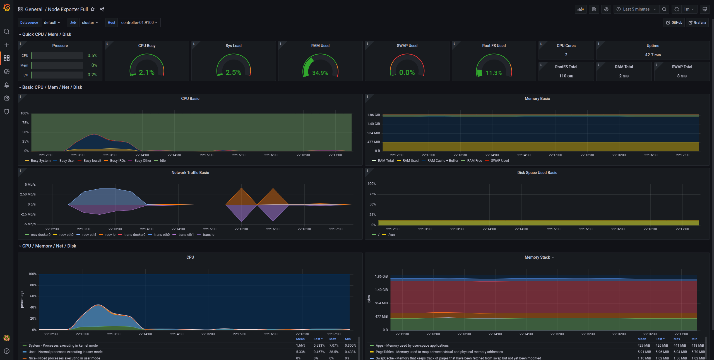
</figure>

### What About Alerts?

Alertmanager is configured to send Slack notifications for:

- **Node down**: When a compute node becomes unresponsive
- **Node resumed**: When a node comes back online
- **High CPU usage**: Sustained high CPU across cluster
- **High memory usage**: Memory pressure warnings
- **Disk space low**: Storage running out

Example alert in Slack when a node goes down:

<figure markdown="span">
    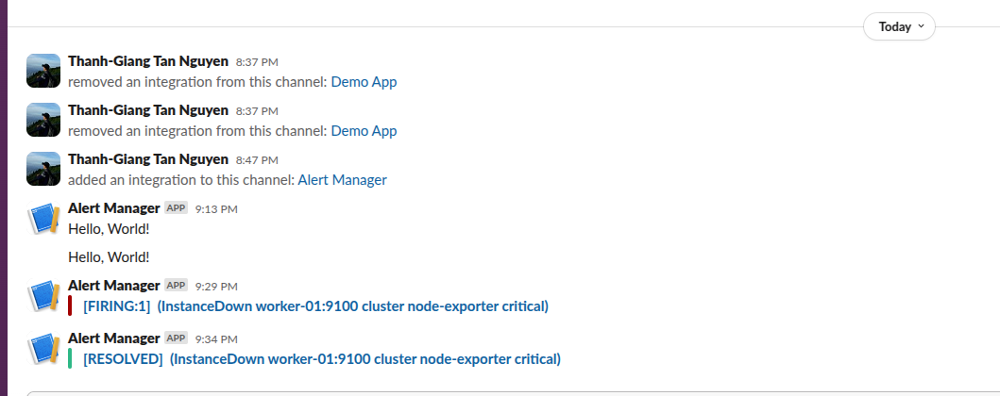
</figure>

For detailed information, check the Grafana dashboard:

<figure markdown="span">
    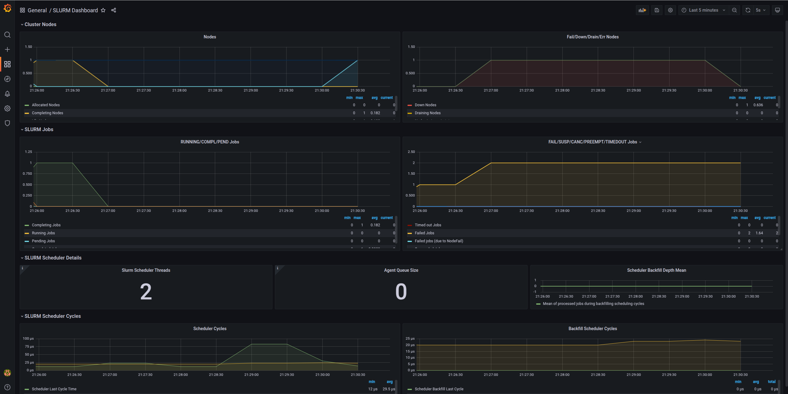
</figure>

## Testing Your Cluster

Let's run some tests to verify everything works:

### Test 1: Simple Job

```bash
srun hostname
```

### Test 2: Multi-node Job

```bash
srun --nodes=2 --ntasks=2 hostname
```

### Test 3: Interactive Session

```bash
srun --nodes=1 --cpus-per-task=2 --mem=2G --pty bash

# Inside the session
hostname
nproc
free -h
exit
```

### Test 4: Batch Job

Create `test_job.sh`:

```bash
#!/bin/bash
#SBATCH --job-name=test
#SBATCH --output=test_%j.out
#SBATCH --error=test_%j.err
#SBATCH --nodes=1
#SBATCH --ntasks=1
#SBATCH --cpus-per-task=2
#SBATCH --mem=1G
#SBATCH --time=00:05:00

echo "Job started at $(date)"
echo "Running on node: $(hostname)"
echo "CPUs allocated: $SLURM_CPUS_PER_TASK"
echo "Memory allocated: $SLURM_MEM_PER_NODE MB"

# Do some work
sleep 60

echo "Job finished at $(date)"
```

Submit it:

```bash
sbatch test_job.sh

# Check status
squeue

# When done, view output
cat test_*.out
```

### Test 5: Resource Limits

```bash
# Submit job requesting more resources than available
srun --mem=999999 --pty bash

# Should fail with:
# srun: error: Unable to allocate resources: Requested node configuration is not available
```

### Test 6: Accounting

```bash
# View your jobs
sacct

# Detailed accounting info
sacct --format=JobID,JobName,User,State,Start,End,Elapsed,CPUTime,MaxRSS

# Cluster usage summary
sreport cluster utilization
```

## Key Takeaways

In this post, we've covered:

1. **Why Automation**: The benefits of using Ansible for cluster management
2. **Production Architecture**: Multi-node setup with monitoring and alerting
3. **Slack Integration**: Proactive monitoring with notifications
4. **Automated Deployment**: One command to deploy the entire cluster
5. **Verification**: Testing your cluster thoroughly

:::info

In [Part 3](/blogs/how-to-build-slurm-hpc-part-3), we'll cover daily administration tasks, troubleshooting, security best practices, and advanced resource management.
:::

## References

**1.[Slurm Overview](https://slurm.schedmd.com/overview.html)** — Official documentation for Slurm workload manager

**2.[NVIDIA/deepops](https://github.com/NVIDIA/deepops)** — Open-source cluster deployment toolkit (BSD-3-Clause License)

**3.[elasticluster](https://github.com/elasticluster/elasticluster)** — Elastic cluster provisioning tool (GPL-3.0 License)

**4.[Ansible](https://docs.ansible.com/)**- Ansible for IT Automation DevOps

**5.[GitHub Repository-Omicslab HPC](https://github.com/vieomics/omicslab-hpc)**- Ansible scripts for setting up the Slurm HPC

---

_This is Part 2 of the Omicslab series on building Slurm HPC clusters. Continue to [Part 3](/blogs/how-to-build-slurm-hpc-part-3) for administration and best practices._
