This is Part 1 of a two-part series on version control in bioinformatics. Part 1 covers the history of Git, its use with GitHub, and a hands-on worked example. Part 2 looks at real-world bioinformatics workflows and the practices we have found useful when a repository is shared by a team.

The worked example is deliberately small: a repository that installs FastQC and MultiQC, so that the quality-control step of a short-read NGS workflow can be reproduced by anyone who clones it.

<!--truncate-->

## Series overview

- **Part 1 (this post)**: history, fundamentals, GitHub integration, and a hands-on walkthrough
- **[Part 2](/en/blogs/how-to-version-control-git-bioinformatics-part-2)**: real-world bioinformatics examples and workflow practices

## A short history of version control

Version control tools fall into two broad generations, and the distinction explains much of how Git is used today.

The **first generation was centralised**: a single repository on a server held the history, and users checked files in and out of it. Examples include SCCS (1972), RCS (1982), CVS (1990) and Subversion (2000). These systems are straightforward to reason about, but they depend on the server being reachable, and branching is comparatively expensive.

The **second generation is distributed**. In a distributed system every clone carries the full history, so committing, branching and inspecting history happen locally, without a network round-trip. Git was created in 2005 by Linus Torvalds to manage the Linux kernel source tree; Mercurial appeared the same year. Git stores the repository as a sequence of snapshots addressed by content hash, which makes branching and merging inexpensive.

Hosting platforms came next. GitHub launched in 2008, adding a web interface on top of Git and, with it, the pull request — a way to propose, discuss and review a set of changes before they are merged. This post uses Git and GitHub, but the underlying model is shared with other distributed systems such as Mercurial.

## Create a repository

The person who creates the repository is its administrator and can configure who may read or modify it. A few settings are worth deciding at the start:

:::tip

- **Visibility**: `public` if the work is meant to be shared with the community, otherwise `private`.
- **README**: helps others understand how the repository is organised. Besides the `README.md` for general users, a `README.developer.md` can carry developer-specific notes.
- **.gitignore**: lists the files and folders that should not be pushed to GitHub.
- **License**: defines how others may use the work. MIT, for example, permits free use, while some licences require a purchase for commercial use.
  :::

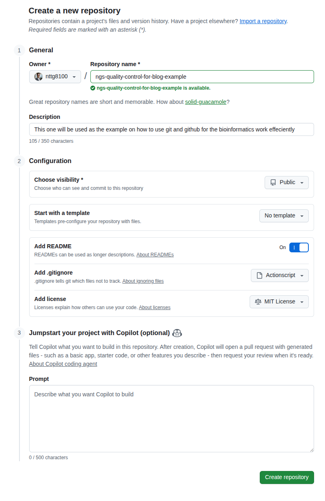

## Clone

Cloning copies the repository to a local computer. When several people work together, each keeps their own copy and GitHub acts as the shared central location — similar to a cloud drive — that keeps the copies in sync.

GitHub offers SSH authentication for transferring resources, but it does not behave like a remote server with shell access.

:::info

- After creating a repository, clone it before starting work.
- Authentication on a laptop or an HPC system is well served by an SSH key.
- In GitHub, open the green **Code** button, choose the **SSH** tab, copy the URL, and clone with it.
  :::

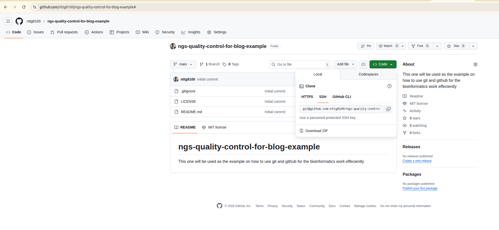

The official GitHub documentation describes how to add an SSH key to an account:
[adding a new SSH key to your GitHub account](https://docs.github.com/en/authentication/connecting-to-github-with-ssh/adding-a-new-ssh-key-to-your-github-account).

Add the public key under **Settings → SSH and GPG keys**:

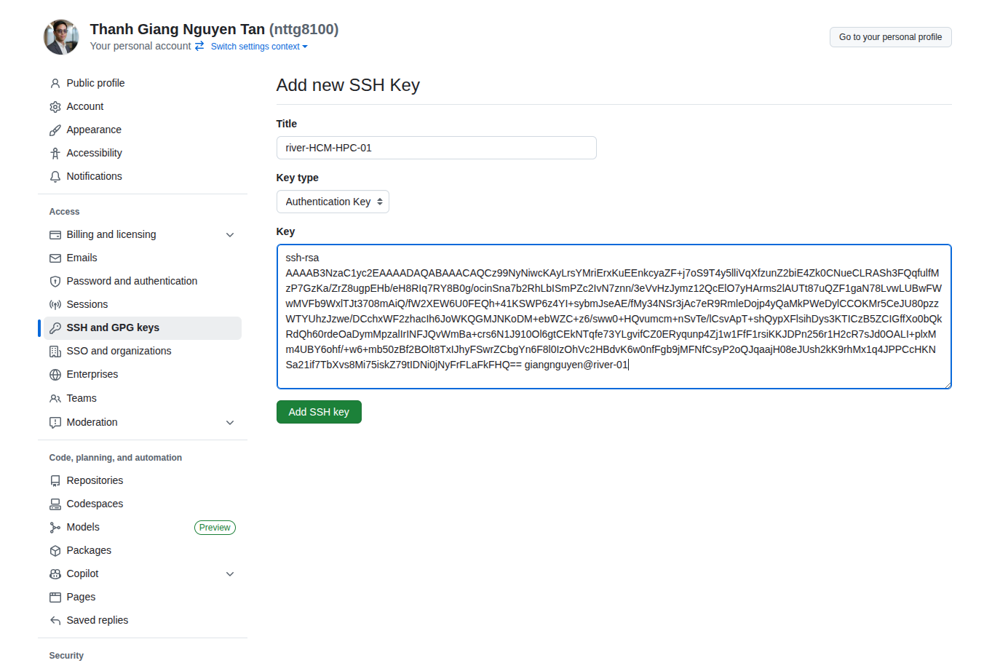

Then test the connection:

```bash
ssh git@github.com
# PTY allocation request failed on channel 0
# Hi nttg8100! You've successfully authenticated, but GitHub does not provide shell access.
# Connection to github.com closed.
```

With authentication working, clone the repository:

:::tip

- To clone a specific branch or tag, add `-b <branch-name>`.
  :::

```bash
# clone (equivalent to: git clone git@github.com:nttg8100/ngs-quality-control-for-blog-example.git -b main)
git clone git@github.com:nttg8100/ngs-quality-control-for-blog-example.git
cd ngs-quality-control-for-blog-example
```

Open the folder in an editor. The examples here use Visual Studio Code ([download](https://code.visualstudio.com/download)):

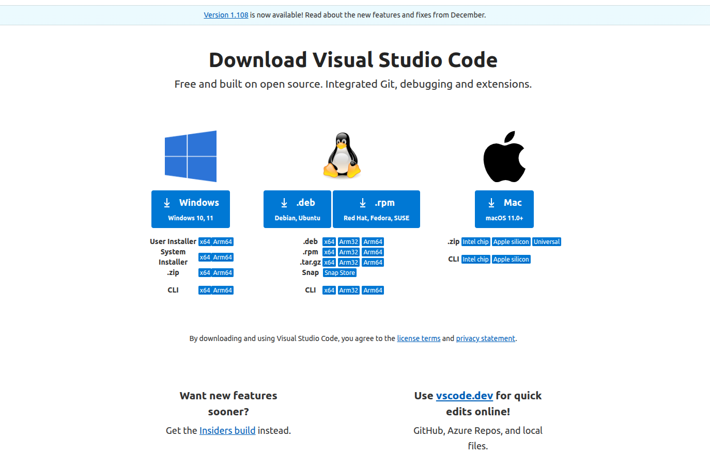

## The code editor

A repository is just a folder, so it can be opened in a terminal-based editor. In Visual Studio Code, that is:

```bash
code .
```

Everything in the repository is a text file and can be edited directly.

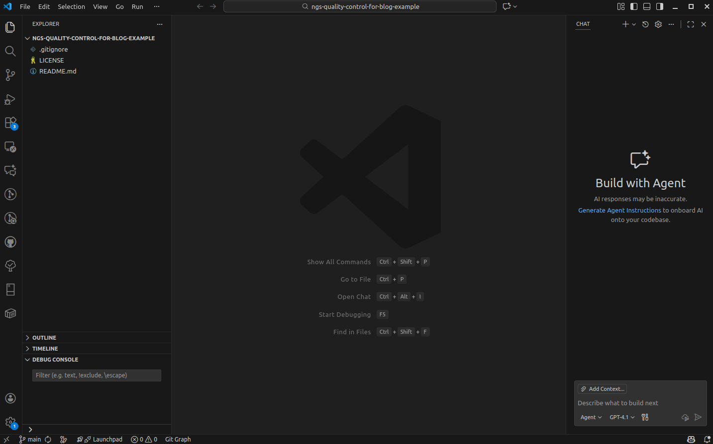

## Branching strategy

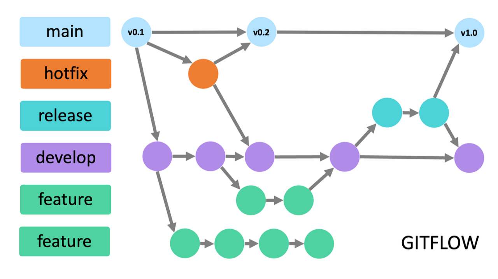

A branching strategy is a workflow for handling changes to a codebase in a structured way. Branches allow work on a feature, a fix, or an experiment without disturbing the main codebase.

Common branch types:

- **Main branch (`main` or `master`)**: the stable branch that holds production-ready code.
- **Feature branches**: one branch per feature or task (for example `feature/quality-control`), keeping development isolated until the work is complete.
- **Development branch**: some teams keep a `develop` branch to integrate features before they reach `main`.
- **Hotfix/bugfix branches**: for urgent fixes, branched from `main` (for example `hotfix/fix-typo`) and merged back after testing.

A typical workflow:

1. Create a branch from `main` for the feature or fix.
2. Commit changes to that branch.
3. Open a pull request (PR) to merge the branch into `main` (or `develop`).
4. Review, test, and merge the PR.

This keeps `main` stable, makes collaboration easier, and lets changes be reviewed before they are merged.

For the small project used here, feature branches are merged directly into `main`:

```bash
# Create and switch to a new branch from main
git switch -c feature/environment-setup
```

## New branch: environment setup

The environment is created with Pixi rather than conda. A `Makefile` records the installation so it can be repeated; it can be written by hand or generated from the shell. In the example below the target is named after the Pixi binary it installs, so the command `make ~/.pixi/bin/pixi` runs that recipe.

:::info
A `Makefile` is used by the `make` build tool. It defines rules for building and managing a project — commonly C or C++ code, but it works equally well for Node.js, React, or TypeScript projects when repetitive tasks need automating.

**Key concepts:**

- **Targets**: what to build (a file, or a label for a task).
- **Dependencies**: files or targets that must be up to date first.
- **Recipes**: the shell commands that build the target.
  :::

```bash
cat << EOF >> Makefile
${HOME}/.pixi/bin/pixi:
  mkdir -p ${HOME}/.pixi/bin
  curl -sSL https://pixi.sh/install.sh | sh
EOF

# Verify the newly created file content
cat Makefile
```

:::tip
Two habits make a `Makefile` easier to maintain: use `.PHONY` for targets that do not produce a file of the same name, so the recipe always runs; and keep the steps modular, separating environment setup, tool installation, and analysis into distinct targets.
:::

```bash
# Install pixi
make ~/.pixi/bin/pixi

# Initialize pixi in your current repository
pixi init --channel conda-forge --channel bioconda

# Install multiqc and fastqc
pixi add fastqc multiqc

# Activate the pixi shell
pixi shell

# Verify tools are installed
which fastqc
which multiqc
# <repo>/.pixi/envs/default/bin/fastqc
# <repo>/.pixi/envs/default/bin/multiqc
```

## Common Git commands

:::warning
Git history records who made each change, which is useful when a change needs to be traced later.
:::

`git status` shows the files that have not yet been committed:

```bash
git status
```

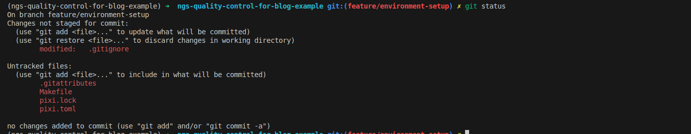

Files are staged for a commit with `git add`. They can be added one at a time, or all at once:

```bash
# Add files one by one
git add .gitignore
git add .gitattributes
git add Makefile
git add pixi.lock
git add pixi.toml

# Or add all files/folders in the current repository
git add .

# Verify staged files
git status
```

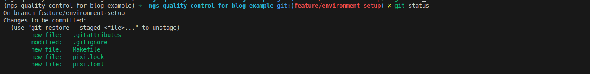

If a file is staged by mistake, it can be removed from the staging area without losing the file:

```bash
# Create a wrong file
touch wrong_file.txt
git add wrong_file.txt

# Restore it to unstaged status
git restore --staged wrong_file.txt
```

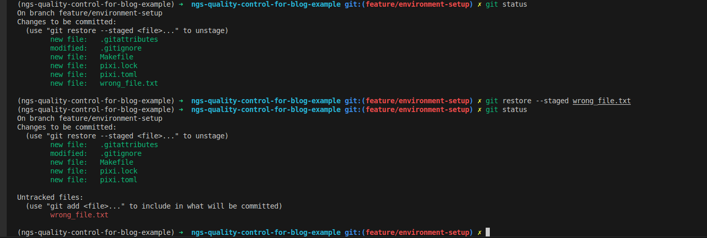

Files that should stay local can be listed in `.gitignore`, which prevents them from being committed even when `git add .` is used. `.gitignore` accepts both files and folders.

:::tip

- For finer control, place a `.gitignore` in the specific folder where the unwanted files live.
- Common patterns include environment folders (`.env`, `.pixi`), `node_modules`, data folders (`data`), archives (`*.tar.gz`), and caches (`__pycache__`).
- To ignore a folder but keep selected files, negate them with `!`:

```
folder
!folder/file.txt
```

:::

```bash
# Add to gitignore
echo "wrong_file.txt" > .gitignore

# View the file
cat .gitignore

# Try to add the file again—it won't be staged now and will show a warning
git add wrong_file.txt

# Check status
git status
```

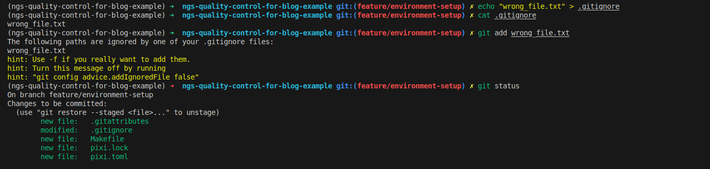

Create a commit from the staged files:

```bash
git commit -m "feat: add pixi setup"
```

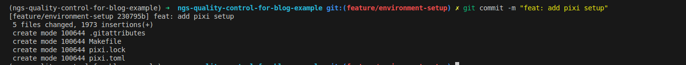

Push the branch to GitHub:

```bash
# Push to remote
git push origin feature/environment-setup

# View your remote origin to confirm where updates are pushed
# This shows I cloned using the SSH credential
git config --get remote.origin.url
# git@github.com:nttg8100/ngs-quality-control-for-blog-example.git
```

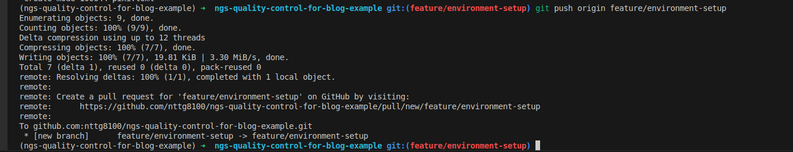

## Check the update on GitHub

The new branch appears in the GitHub repository. In this example:
<https://github.com/nttg8100/ngs-quality-control-for-blog-example>

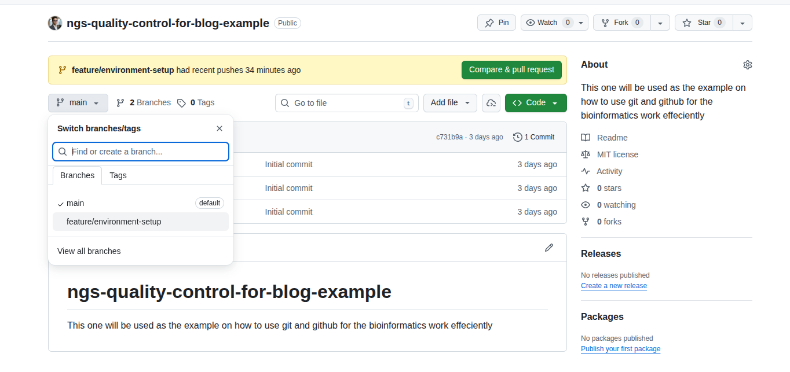

## Pull request

A pull request (PR) compares a branch's changes with the target branch. GitHub shows what has been added or removed, so the change can be reviewed by the author, by a teammate, or with assistance such as Copilot.

Practices that tend to make review easier:

- **Keep PRs small**: one feature or fix per PR.
- **Clear description**: a concise summary of what the PR does, why it is needed, and any relevant context.
- **Reference issues**: link related issues or tickets (for example `Closes #123`).
- **Self-review** before submitting, checking for errors, style, and unnecessary changes.
- **Add tests** where they apply.
- **Follow conventions**: the team's coding and commit-message guidelines.

To open a PR, use the **Pull requests** tab, click **New pull request**, then choose the source and target branches:

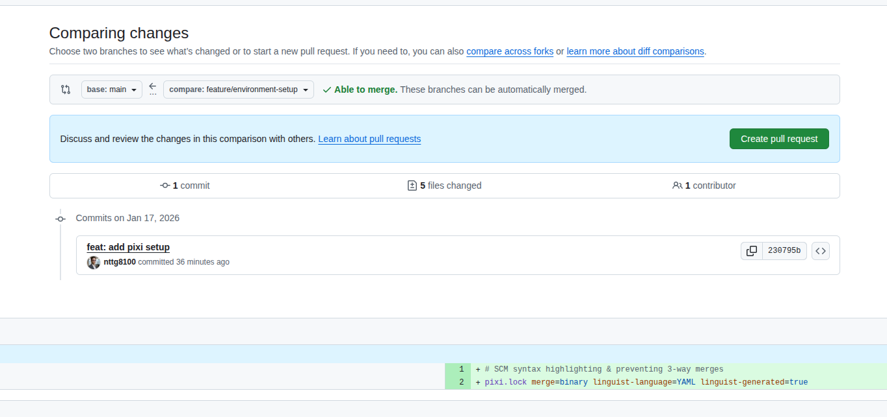

The pull request is now open:

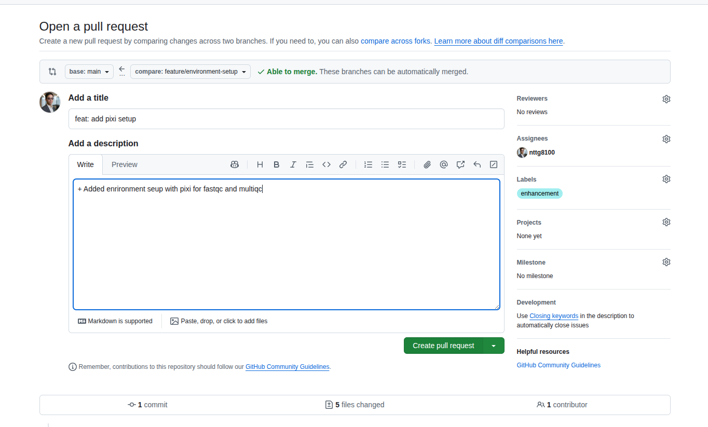

## Review

Reviewing a PR is as much about the description as the diff:

- **Understand the context**: read the PR description and any linked issues.
- **Check for clarity**: is the code readable and well structured?
- **Test locally** where possible.
- **Suggest improvements** constructively and specifically.
- **Check for side effects** on existing functionality.
- **Keep feedback about the code**, not the person.

Click **Files changed** to review and comment on specific lines. When the author is also the reviewer, GitHub disables self-approval, so in practice another person reviews the work. `LGTM` (Looks Good To Me) is a common way to signal approval before the branch is merged.

:::tip

- Request a review from teammates.
- Configure the repository so a PR must be approved before merging.
  :::

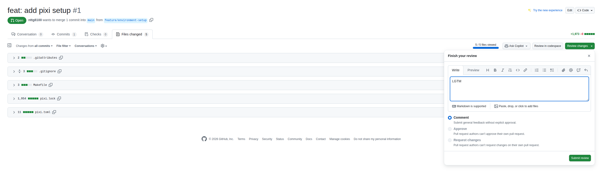

## Merge

Branch protection rules are configured in the repository settings; GitHub documents the options in
[configuring pull request merges](https://docs.github.com/en/repositories/configuring-branches-and-merges-in-your-repository/configuring-pull-request-merges).

GitHub offers three merge strategies for a pull request:

| Strategy             | Description                                                                                   | Use case                                   |
| -------------------- | --------------------------------------------------------------------------------------------- | ------------------------------------------ |
| **Merge commit**     | Combines all commits from the feature branch into the target branch, preserving full history. | Default; keeps detailed commit history.    |
| **Squash and merge** | Combines all changes from the feature branch into a single commit on the target branch.       | Clean, concise history for small features. |
| **Rebase and merge** | Reapplies the branch's commits on top of the target branch, creating a linear history.        | Linear history, avoids merge commits.      |

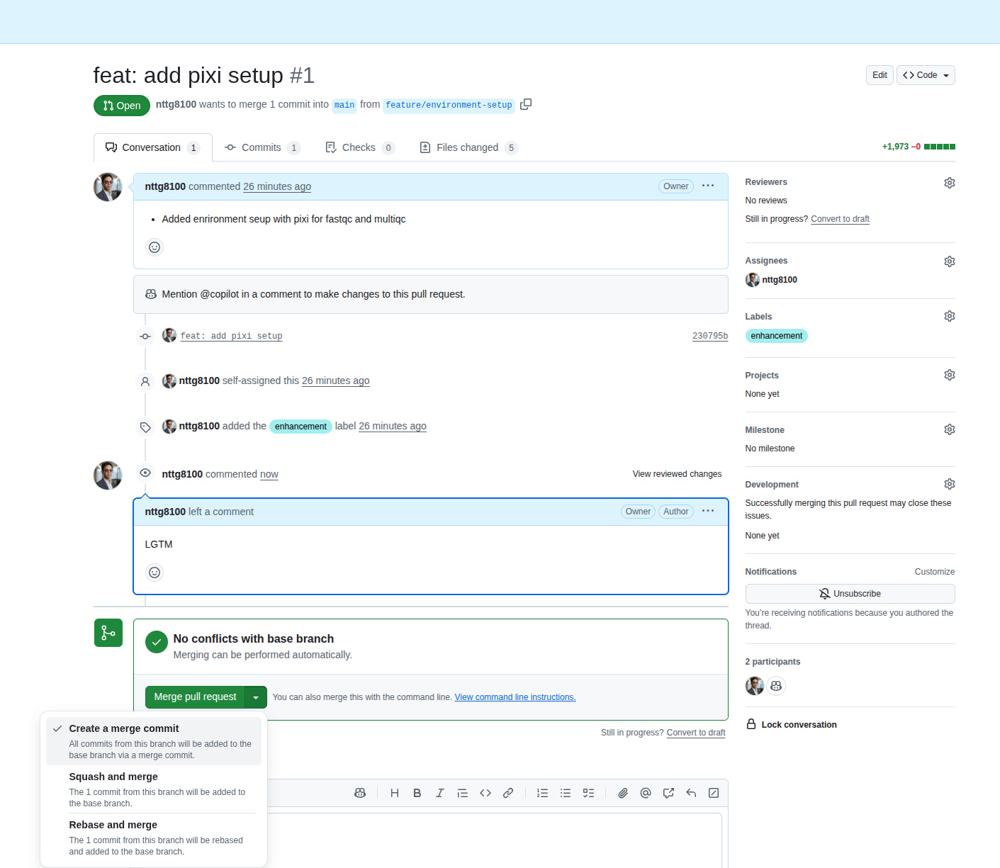

On a larger team, a merge commit integrates a branch directly into the target branch, which works well when the target has not changed much since the branch was created. If teammates have merged work that touches the same files, conflicts appear; in that case it is often better to rebase the branch onto the latest target before merging. When a branch holds many small incremental commits, squash and merge collects them into a single commit and keeps the history tidier.

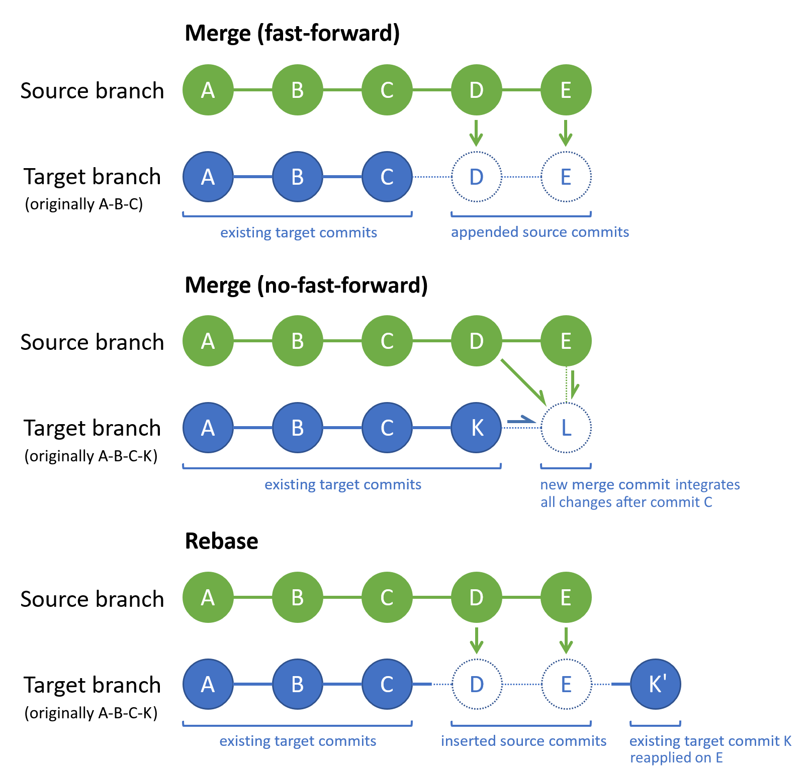

After the merge, `main` shows the change from the pull request:

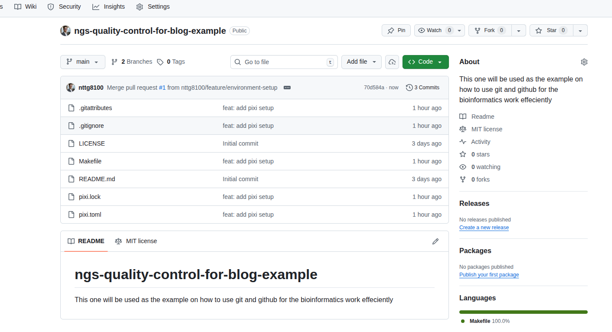

## Rebase

In a shared repository, `main` may receive updates while a feature branch is being developed. Rebasing replays the branch's commits on top of the latest `main`, which keeps the history linear and reduces the chance of a complex conflict later.

For example, suppose a branch `feature/testing-rebase` was started from an older `main`, and new commits have since landed on `main`. To update the feature branch:

```bash
# Make sure you're on your feature branch
git checkout feature/testing-rebase

# Fetch the latest changes from the remote repository
git fetch origin

# Rebase your branch onto the updated main branch
git rebase origin/main
```

If a conflict occurs, Git pauses the rebase. After resolving it:

```bash
git add <resolved-files>
git rebase --continue
```

To abandon the rebase:

```bash
git rebase --abort
```

Rebasing keeps the branch history linear and easier to review, and reduces the likelihood of tangled merges later. Because the commit history changes, the branch usually needs a force-push afterwards:

```bash
git push --force-with-lease
```

Force-pushing deserves care, particularly on a branch that others are also using.

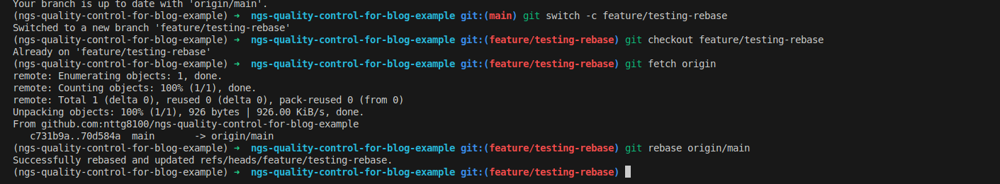

## Starting the next branch

Once the branch is merged and the local copy is in sync, the next piece of work starts from an updated `main`:

```bash
# check out on base branch where feature is updated
git checkout main

# pull to update, add rebase for better organization on commits
git pull --rebase origin main

# create new branch
git switch -c feature/add-cicd-setup
```

This is Part 1 of a two-part series on version control in bioinformatics. [Part 2](/en/blogs/how-to-version-control-git-bioinformatics-part-2) continues with real-world examples and shared-repository workflows.

## References

- Chacon & Straub, *Pro Git* (2nd ed.) — [git-scm.com/book](https://git-scm.com/book/en/v2)
- Git documentation — [git-scm.com/doc](https://git-scm.com/doc)
- GitHub docs — [Adding a new SSH key](https://docs.github.com/en/authentication/connecting-to-github-with-ssh/adding-a-new-ssh-key-to-your-github-account); [Configuring pull request merges](https://docs.github.com/en/repositories/configuring-branches-and-merges-in-your-repository/configuring-pull-request-merges)
- Pixi — reproducible environments: [pixi.sh](https://pixi.sh)
- Worked example repository — [nttg8100/ngs-quality-control-for-blog-example](https://github.com/nttg8100/ngs-quality-control-for-blog-example)
