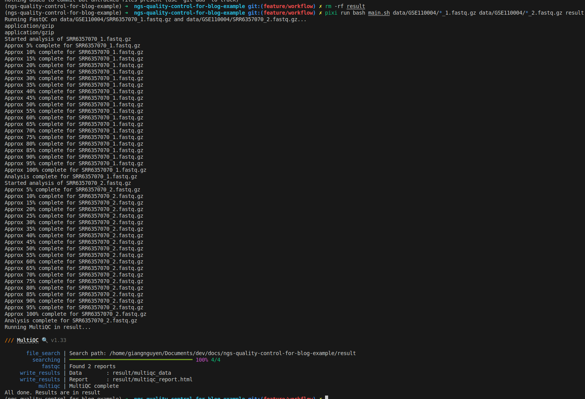
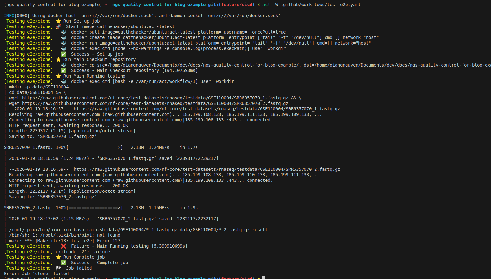
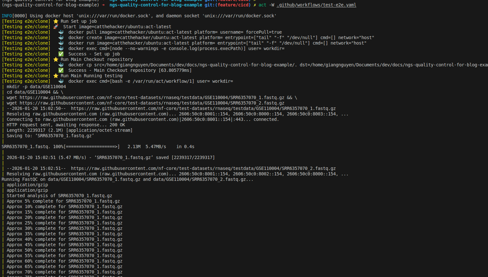
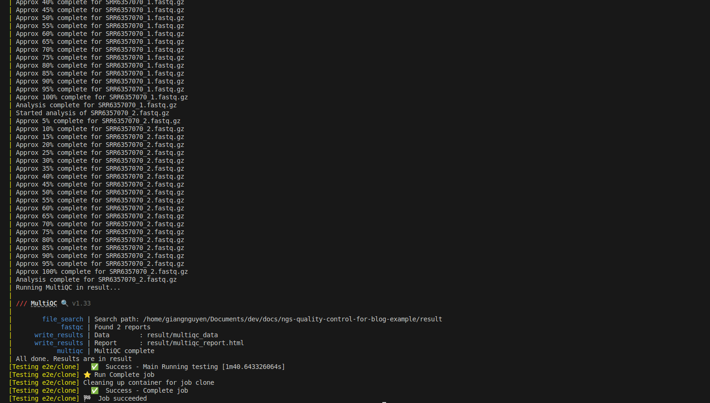
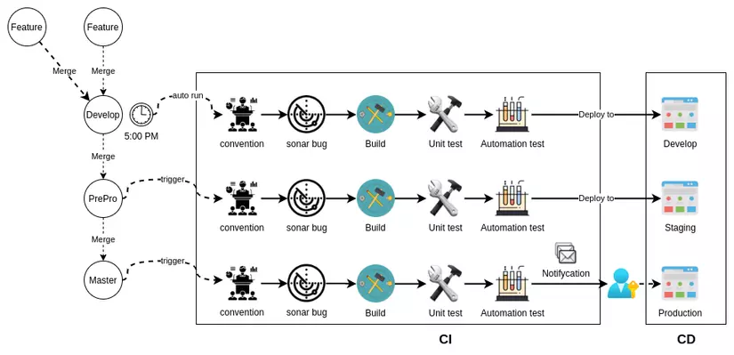
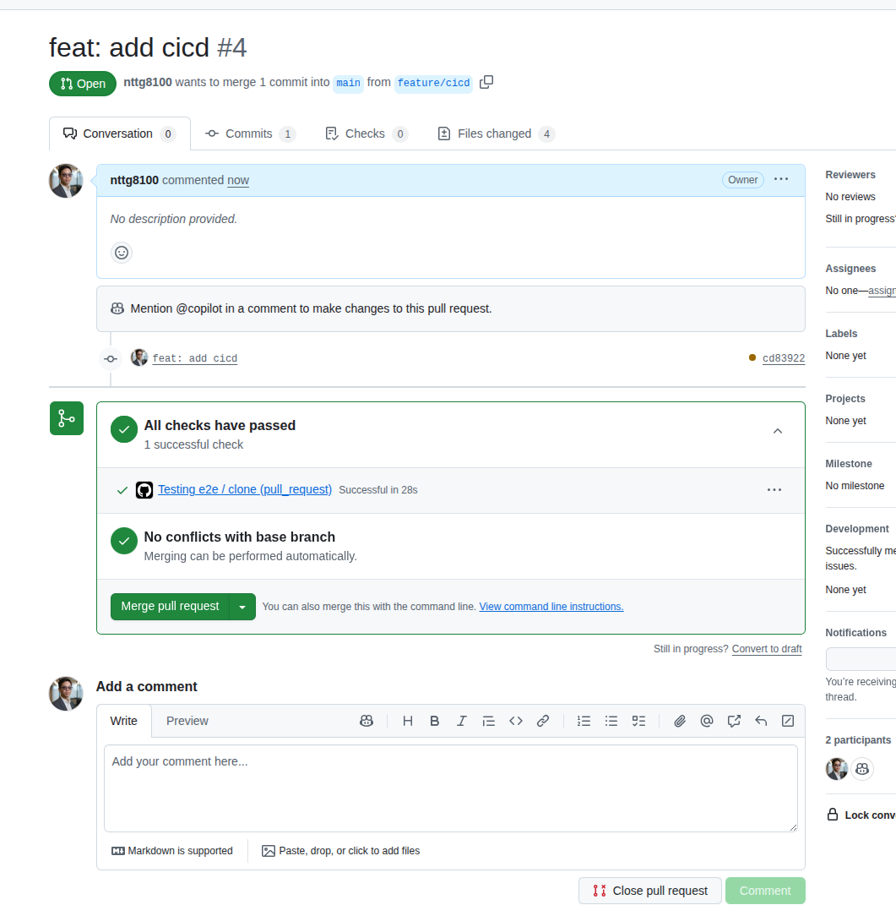
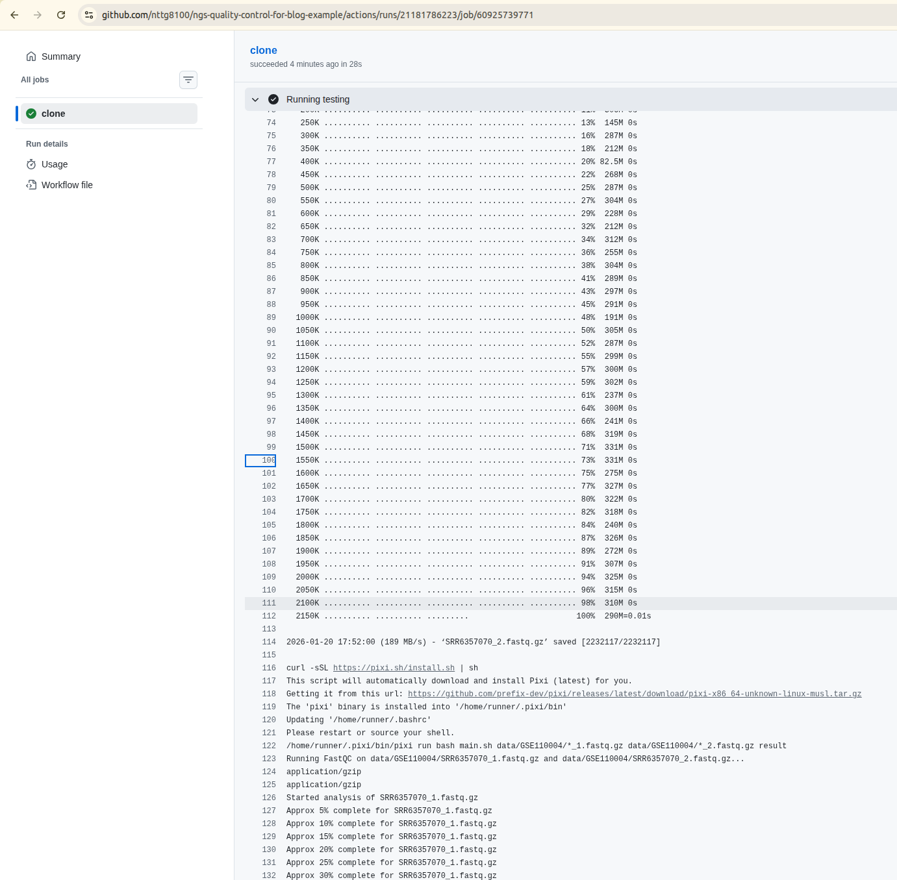

In [Part 1](/en/blogs/how-to-version-control-git-bioinformatics-part-1) of this series we looked at Git fundamentals, branching and collaborative workflows. Here we continue with the same small project and add a layer of automation: a Makefile that downloads test data and runs the pipeline, an end-to-end test, and a GitHub Actions workflow.

Continuous integration (CI) and continuous delivery (CD) are terms borrowed from software engineering. Applied to a bioinformatics repository, they usually mean that every change re-runs the pipeline on a small dataset, so that a broken step is caught before it reaches a larger analysis. A useful side effect is that a fresh machine — or a server that has been wiped — can rebuild and re-run the work from the repository alone.

<!--truncate-->

- **Part 1**: history, basics, GitHub integration and hands-on exercises
- **Part 2 (this post)**: local testing, CI/CD, automated tests and reproducible pipelines

:::info
In this tutorial we will:
+ add commands to download the test data
+ write a small script that runs FastQC and MultiQC
:::

## Git commands

The example repository is committed step by step. Cloning it and checking out the branches is one way to follow how the work was developed.

```bash
# clone
git clone git@github.com:nttg8100/ngs-quality-control-for-blog-example.git
cd ngs-quality-control-for-blog-example

# checkout to branch for the relevant tutorial step, e.g. feature/add-data
git checkout feature/add-data
```

:::tip
+ To quit the `git log` pager, type `q`
+ Creating your own repository gives a more practical exercise
+ Compare the files with the tutorial repository, then copy the parts you need into your own repository
:::

### How to show the commit log

Git provides commands to view the history and to compare two commits.

```bash
git log
```

The output looks roughly like this:

```bash
commit ca29351295a4148bda73b6bf76a42cc7b834d1b6 (HEAD -> feature/add-data, origin/feature/add-data)
Author: <Author> <author@example.com>
Date:   Mon Jan 19 23:34:58 2026 +0700

    feat: add makefile to get data

commit 70d584a726fb5418274448a4f51ca07d94b104be (origin/main, origin/HEAD, main, feature/testing-rebase)
Merge: c731b9a 230795b
Author: <Author> <author@example.com>
Date:   Sat Jan 17 16:42:11 2026 +0700

    Merge pull request #1 from nttg8100/feature/environment-setup

    feat: add pixi setup

commit 230795b7b8b03087ef7ee938d333161c9fcc0731 (origin/feature/environment-setup)
Author: <Author> <author@example.com>
Date:   Sat Jan 17 15:05:28 2026 +0700

    feat: add pixi setup

commit c731b9a80dfb22936bfcf94442bdf9b488a90d3c (feature/tesing-rebase)
Author: <Author> <author@example.com>
Date:   Wed Jan 14 23:09:30 2026 +0700
```

For a more compact overview:

```bash
git log --oneline
```

The one-line format is usually enough:

```bash
ca29351 (HEAD -> feature/add-data, origin/feature/add-data) feat: add makefile to get data
70d584a (origin/main, origin/HEAD, main, feature/testing-rebase) Merge pull request #1 from nttg8100/feature/environment-setup
230795b (origin/feature/environment-setup) feat: add pixi setup
c731b9a (feature/tesing-rebase) Initial commit
```

Checking out a specific commit is then a way to inspect the repository at an earlier point in the tutorial.

### How to check out a specific commit

Using the commit hash is enough. For example, to see all files from commit `230795b`:

```bash
git checkout 230795b
```

The editor then shows the files as they were at that commit.

### How to view the difference between two commits, or against the current state

If files have been changed but not yet committed:

```bash
git diff
```

One uncommitted change looks like this:

```bash
diff --git a/Makefile b/Makefile
index ae08113..c2e5b87 100644
--- a/Makefile
+++ b/Makefile
@@ -10,4 +10,6 @@ data/GSE110004:
        wget https://raw.githubusercontent.com/nf-core/test-datasets/rnaseq/testdata/GSE110004/SRR6357070_2.fastq.gz
 
 clean:
-       rm -rf data/GSE110004
\ No newline at end of file
+       rm -rf data/GSE110004
+
+Change here
\ No newline at end of file
```

To compare two branches or commits:

```bash
git diff ca29351..70d584a
```

The changes between the two commits above:

```bash
diff --git a/.gitignore b/.gitignore
index cfca1e8..1c3ecb3 100644
--- a/.gitignore
+++ b/.gitignore
@@ -19,5 +19,3 @@ bin-release/
 # pixi environments
 .pixi/*
 !.pixi/config.toml
-data
-
diff --git a/Makefile b/Makefile
index ae08113..bcaa6d7 100644
--- a/Makefile
+++ b/Makefile
@@ -1,13 +1,3 @@
 ${HOME}/.pixi/bin/pixi:
        mkdir -p ${HOME}/.pixi/bin
-       curl -sSL https://pixi.dev/install.sh | sh
-
-
-data/GSE110004:
-       mkdir -p data/GSE110004
-       cd data/GSE110004 && \
-       wget https://raw.githubusercontent.com/nf-core/test-datasets/rnaseq/testdata/GSE110004/SRR6357070_1.fastq.gz && \
-       wget https://raw.githubusercontent.com/nf-core/test-datasets/rnaseq/testdata/GSE110004/SRR6357070_2.fastq.gz
-
-clean:
-       rm -rf data/GSE110004
\ No newline at end of file
+       curl -sSL https://pixi.sh/install.sh | sh
\ No newline at end of file
```

### How to roll back

If a commit has been checked out and some exploratory changes were made, `git` will ask you to commit them before switching. Rolling back to the original version is straightforward:

```bash
git checkout -- .
```

Sometimes only a single file is wanted from another branch:

```bash
git checkout <branch name> <relative file path>
# ex: git checkout main .gitignore
```

## Add data

Create a new branch from an updated `main`:

```bash
git checkout main
git pull origin main
git switch -c feature/add-data
```

We now add a couple of targets to the Makefile that automate data download and cleanup:

- **`data` target**: downloads example FASTQ files into the `data/GSE110004` directory. Everyone working on the project then uses the same input data.
- **`clean` target**: removes the downloaded directory, which makes it easy to reset the environment or free disk space.

An updated `Makefile`:

```Makefile
${HOME}/.pixi/bin/pixi:
	mkdir -p ${HOME}/.pixi/bin
	curl -sSL https://pixi.sh/install.sh | sh

data:
	mkdir -p data/GSE110004
	wget -O data/GSE110004/SRR6351937_1.fastq.gz https://ftp.sra.ebi.ac.uk/vol1/fastq/SRR635/007/SRR6351937/SRR6351937_1.fastq.gz
	wget -O data/GSE110004/SRR6351937_2.fastq.gz https://ftp.sra.ebi.ac.uk/vol1/fastq/SRR635/007/SRR6351937/SRR6351937_2.fastq.gz

clean:
	rm -rf data
```

Following the same workflow as in Part 1, commit, push, open a pull request and merge to `main`:

```bash
git commit -m "feat: add makefile to get data"
git push origin feature/add-data
```

## Add workflow

Create another branch:

```bash
git checkout main
git pull
git switch -c feature/workflow
```

### Add the `main.sh` workflow script and test it

The script below runs FastQC and MultiQC for one paired-end sample, taking its inputs as arguments.

```bash
# create workflow file using bash script, this runs for only paired reads of 1 sample
cat << EOF >> main.sh
#!/bin/bash

# Usage: ./main.sh <read1.fastq.gz> <read2.fastq.gz> <output_folder>

set -e

if [ "\$#" -ne 3 ]; then
    echo "Usage: $0 <read1.fastq.gz> <read2.fastq.gz> <output_folder>"
    exit 1
fi

READ1="\$1"
READ2="\$2"
OUTDIR="\$3"

mkdir -p "\$OUTDIR"

echo "Running FastQC on \$READ1 and \$READ2..."
fastqc "\$READ1" "\$READ2" -o "\$OUTDIR"

echo "Running MultiQC in \$OUTDIR..."
multiqc "\$OUTDIR" -o "\$OUTDIR"

echo "All done. Results are in \$OUTDIR"
EOF

# chmod to be executed
chmod +x main.sh

# get help script
bash main.sh
# Usage: main.sh <read1.fastq.gz> <read2.fastq.gz> <output_folder>

# test it with your data
# activate pixi
pixi shell
# run interactively
bash main.sh data/GSE110004/*_1.fastq.gz data/GSE110004/*_2.fastq.gz result

# run with pixi directly
pixi run bash main.sh data/GSE110004/*_1.fastq.gz data/GSE110004/*_2.fastq.gz result
```



### Use the Makefile to add tests

Tests can then be run through the Makefile:

```Makefile
.PHONY: install-pixi test-e2e clean
${HOME}/.pixi/bin/pixi:
	mkdir -p ${HOME}/.pixi/bin
	curl -sSL https://pixi.sh/install.sh | sh

data/GSE110004:
	mkdir -p data/GSE110004
	cd data/GSE110004 && \
	wget https://raw.githubusercontent.com/nf-core/test-datasets/rnaseq/testdata/GSE110004/SRR6357070_1.fastq.gz && \
	wget https://raw.githubusercontent.com/nf-core/test-datasets/rnaseq/testdata/GSE110004/SRR6357070_2.fastq.gz

test-e2e: data/GSE110004
	${HOME}/.pixi/bin/pixi run bash main.sh data/GSE110004/*_1.fastq.gz data/GSE110004/*_2.fastq.gz result

clean:
	rm -rf data/GSE110004
```

Run the test:

```bash
make test-e2e
```

Add the generated results to `.gitignore` so they are not committed:

```bash
# Build and Release Folders
bin-debug/
bin-release/
[Oo]bj/
[Bb]in/

# Other files and folders
.settings/

# Executables
*.swf
*.air
*.ipa
*.apk

# Project files, i.e. `.project`, `.actionScriptProperties` and `.flexProperties`
# should NOT be excluded as they contain compiler settings and other important
# information for Eclipse / Flash Builder.
# pixi environments
.pixi/*
!.pixi/config.toml
data
result
```

Commit, push, open a pull request and merge to `main` as before:

```bash
git add .
git commit -m "feat: add workflow"
git push origin feature/workflow
```

Then, from the repository root, download and check the data:

:::tip
+ The make targets are currently simple and can be run directly. As the project grows it is worth extending them, for example so that `make clean` removes more files and folders.
:::

```bash
git checkout
# download data
make data
# test that data is downloaded
ls -lah  data/GSE110004
# total 4.3M
# drwxrwxr-x 2 <user> <group> 4.0K Jan 19 01:00 .
# drwxrwxr-x 3 <user> <group> 4.0K Jan 19 01:00 ..
# -rw-rw-r-- 1 <user> <group> 2.2M Jan 19 01:00 SRR6357070_1.fastq.gz
# -rw-rw-r-- 1 <user> <group> 2.2M Jan 19 01:00 SRR6357070_2.fastq.gz

# delete data folder
make clean
```

## Configure testing

So far everything has been done locally. When a new feature is added — for example, adding `trimmomatic` to trim the reads — the test has to be run again to confirm that the pipeline still completes without errors. This is the simplest form of testing for a bioinformatics project.

GitHub Actions is one service that can run this test automatically:

:::info
+ The official quickstart covers GitHub Actions in more detail: https://docs.github.com/en/actions/get-started/quickstart
+ Here we only introduce how it works and how to apply it in a small project
:::

### Create the GitHub Actions files

Create a branch for CI/CD:

```bash
git checkout main
git pull
git switch -c feature/cicd
```

Then create the workflow:

```bash
mkdir -p .github/workflows
# create workflow file
cat << EOF >> .github/workflows/test-e2e.yaml
name: Testing e2e

on:
  push:
    branches: [ main ]
  pull_request:
    branches: [ main ]

jobs:
  clone:
    runs-on: ubuntu-latest
    steps:
      - name: Checkout repository
        uses: actions/checkout@v4

      - name: Running testing
        run: |
          make test-e2e
EOF
```

What this workflow does:

+ runs a workflow named `Testing e2e`
+ triggers on pull requests to `main`
+ triggers on pushes or merges into `main`
+ starts a job on an `ubuntu-latest` runner
+ clones the repository using `actions/checkout`
+ runs the end-to-end test via `make test-e2e`
+ passes if the tests succeed, and fails if they return a non-zero exit code

### Running GitHub Actions locally

Running tests only when a pull request is opened or a push reaches `main` can mean several small commits are needed just to trigger the test. `act` is a local command-line tool that runs a GitHub Actions workflow on the local machine instead, which shortens that loop:

:::info
+ Further details on `act` are at https://nektosact.com
+ Install Docker on the local machine first
:::

```bash
# install
pixi add act
# run e2e test locally, it will run this on your local machine
act -W .github/workflows/test-e2e.yaml
```



:::warning
As the log shows, the run failed because `pixi` was not installed: the `make test-e2e` target did not depend on the Pixi installation target. The Makefile in the earlier commit also pointed at an outdated installer URL (`https://pixi.dev/install.sh`); the current installer is `https://pixi.sh/install.sh`. Adding the Pixi installation as a dependency of `test-e2e` resolves the failure.
:::

Update the `test-e2e` dependencies in the `Makefile`:

```Makefile
.PHONY: test-e2e clean
${HOME}/.pixi/bin/pixi:
	mkdir -p ${HOME}/.pixi/bin
	curl -sSL https://pixi.sh/install.sh | sh

data/GSE110004:
	mkdir -p data/GSE110004
	cd data/GSE110004 && \
	wget https://raw.githubusercontent.com/nf-core/test-datasets/rnaseq/testdata/GSE110004/SRR6357070_1.fastq.gz && \
	wget https://raw.githubusercontent.com/nf-core/test-datasets/rnaseq/testdata/GSE110004/SRR6357070_2.fastq.gz

test-e2e: data/GSE110004 ${HOME}/.pixi/bin/pixi
	${HOME}/.pixi/bin/pixi run bash main.sh data/GSE110004/*_1.fastq.gz data/GSE110004/*_2.fastq.gz result

clean:
	rm -rf data/GSE110004
```

Re-running `act` then completes successfully:





## What is CI/CD in bioinformatics?

### In software development



CI (continuous integration) and CD (continuous delivery/deployment) are commonly used software-development terms. In the diagram above, software development proceeds through many new features, each of which triggers a set of jobs. In the example used here, the workflow clones the repository on a GitHub Actions runner and runs the tests. The exact jobs depend on the project's use cases.

### In bioinformatics

A bioinformatics project that develops software follows the same general CI/CD process. More often, however, bioinformatics combines existing tools: scripts (bash, Nextflow, WDL, Snakemake, and so on) chain tools into a workflow. In that setting the release is often the repository itself, with the scripts inside it (CD), while CI is the pipeline that runs on a testing dataset.

Once the workflow is in place, opening a pull request triggers the test, which reports whether the change is likely to break the pipeline:



:::tip
+ Use secrets in `Settings` for credentials (passwords, usernames, keys)
+ Keeping the Makefile and the GitHub Actions environment in sync makes it easier to change the CI/CD runner
+ A matrix strategy can run tests faster
:::

The GitHub Actions logs are the place to look when a run fails:



## Review

This walkthrough turned a small bioinformatics project into a reproducible, testable pipeline using Git, a Makefile and GitHub Actions. The main points:

### Git commands for project management
- `git log` and `git log --oneline` show the commit history
- checking out a specific commit makes it possible to inspect an earlier state
- `git diff` compares the working tree with a commit, or two commits with each other
- `git checkout -- .` rolls back the working tree
- `git checkout <branch> <file>` copies a file from another branch

### Makefile automation
- targets for data download (`make data`) and cleanup (`make clean`)
- a test target (`make test-e2e`) that chains its dependencies
- standardised commands help keep environments comparable

### Workflow scripts
- bash scripts can accept command-line arguments
- tools such as FastQC and MultiQC can be combined in one script
- the script can be tested locally before pushing

### CI/CD with GitHub Actions
- workflow files live in `.github/workflows/`
- tests can be triggered on push to `main` or on pull requests
- the same Makefile commands can be used locally and in CI
- the Actions logs are used to debug a failing run

### Local testing with `act`
- `act` runs a GitHub Actions workflow locally
- problems can be caught before pushing
- fewer commits are usually needed to fix a CI failure

### CI/CD in a bioinformatics context
- unlike conventional software, the emphasis is often on pipeline validation
- the "delivery" is frequently the repository itself, with its reproducible workflows
- testing typically means running the whole pipeline on a test dataset
- this is one way to detect changes that break existing analyses

A project structured this way is easier to reproduce on another machine, to test automatically, and to maintain over time.

## References

- Git documentation: [git-scm.com/doc](https://git-scm.com/doc)
- GitHub Actions quickstart: [docs.github.com/en/actions/get-started/quickstart](https://docs.github.com/en/actions/get-started/quickstart)
- `nektos/act` repository: [github.com/nektos/act](https://github.com/nektos/act)
- `act` documentation: [nektosact.com](https://nektosact.com)
- GNU Make manual: [gnu.org/software/make/manual](https://www.gnu.org/software/make/manual/make.html)
- Pixi: [pixi.sh](https://pixi.sh)
- FastQC: [bioinformatics.babraham.ac.uk/projects/fastqc](https://www.bioinformatics.babraham.ac.uk/projects/fastqc/)
- MultiQC: [multiqc.info](https://multiqc.info/)
