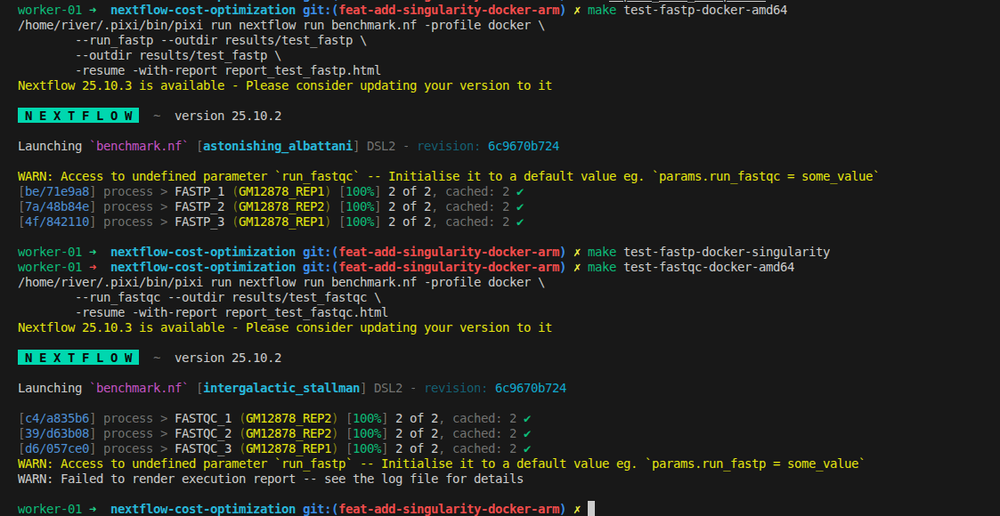
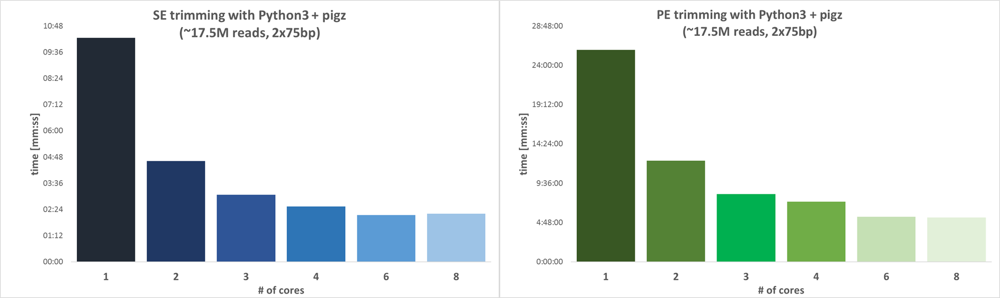

Many bioinformatics tools expose options for the number of threads or CPU cores. Increasing them can shorten execution time, but usually at a modest increase in resource cost. Whether doubling computational resources halves the runtime is a different question: in practice the speed-up is typically sub-linear, and each tool behaves differently.

<!--truncate-->

In this post we benchmark a small workflow to see how tuning CPU and memory per tool affects runtime and resource use. The aim is a practical routine for making a workflow production-ready without paying for resources a tool does not use.

Nextflow, a widely used workflow manager, includes built-in features for tracing and reporting resource usage. These make it possible to measure CPU, memory and wall-clock time for each step, and to base optimization decisions on measurements rather than assumptions.

## Getting started with a simple workflow

nf-core and Nextflow pipelines have become increasingly complex. Rather than jumping directly to a pipeline such as nf-core/rnaseq, we use a small workflow to introduce the concepts first. The lessons learned here can then be applied to larger pipelines.

The demonstration workflow combines two common tools that accept thread or core options.

:::info
+ **Tools**: FastQC and fastp
+ **Benchmarking approach**: Run each tool with increasing CPU and memory allocations (2x and 3x) and observe resource consumption and execution time
+ **Repository**: https://github.com/nttg8100/nextflow-cost-optimization
:::

### Workflow structure

```bash
├── LICENSE
├── Makefile
├── README.md
├── benchmark.nf    # Main workflow file
├── inputs
│   ├── 1_samplesheet.csv
│   └── full_samplesheet.csv
├── modules
│   ├── fastp.nf
│   └── fastqc.nf
├── nextflow.config
├── pixi.lock
├── pixi.toml
```

## Workflow overview

The workflow below runs FastQC and fastp. It accepts a CSV file containing metadata and file paths for each sample, then runs FastQC and fastp independently.

:::tip
+ **Aliasing strategy**: Use aliases with the prefix `_\<number>` (e.g. FASTQC_1, FASTQC_2) to assign increasing computing resources for the benchmark
:::

```bash
include { FASTQC as FASTQC_1 } from './modules/fastqc.nf'
include { FASTQC as FASTQC_2 } from './modules/fastqc.nf'
include { FASTQC as FASTQC_3 } from './modules/fastqc.nf'
include { FASTP as FASTP_1 } from './modules/fastp.nf'
include { FASTP as FASTP_2 } from './modules/fastp.nf'
include { FASTP as FASTP_3 } from './modules/fastp.nf'

// Parse CSV; skip header, split by comma, expand to tuple for process
Channel
    .fromPath(params.input)
    .splitCsv(header:true)
    .map { row ->
        // Compose the meta map and reads list
        def meta = [ id: row.sample, strandedness: row.strandedness ]
        def reads = [ row.fastq_1, row.fastq_2 ]
        tuple(meta, reads)
    }
    .set { sample_ch }

workflow {
    if (params.run_fastqc) {
        // fastqc benchmarks
        FASTQC_1(sample_ch)
        FASTQC_2(sample_ch)
        FASTQC_3(sample_ch)
    }
    
    if (params.run_fastp) {
        // fastp benchmarks
        FASTP_1(sample_ch,[], false, false, false)
        FASTP_2(sample_ch,[], false, false, false)
        FASTP_3(sample_ch,[], false, false, false)
    }
}
```

## Modules

### FastQC

This module uses containers to run FastQC with configurable resources.

```bash
process FASTQC {
    tag "${meta.id}"
    label 'process_medium'

    conda "${moduleDir}/environment.yml"
    container "${ workflow.containerEngine == 'singularity' && !task.ext.singularity_pull_docker_container ?
        'https://depot.galaxyproject.org/singularity/fastqc:0.12.1--hdfd78af_0' :
        'biocontainers/fastqc:0.12.1--hdfd78af_0' }"

    input:
    tuple val(meta), path(reads)

    output:
    tuple val(meta), path("*.html"), emit: html
    tuple val(meta), path("*.zip") , emit: zip
    path  "versions.yml"           , emit: versions

    when:
    task.ext.when == null || task.ext.when

    script:
    def args          = task.ext.args ?: ''
    def prefix        = task.ext.prefix ?: "${meta.id}"
    // Make list of old name and new name pairs to use for renaming in the bash while loop
    def old_new_pairs = reads instanceof Path || reads.size() == 1 ? [[ reads, "${prefix}.${reads.extension}" ]] : reads.withIndex().collect { entry, index -> [ entry, "${prefix}_${index + 1}.${entry.extension}" ] }
    def rename_to     = old_new_pairs*.join(' ').join(' ')
    def renamed_files = old_new_pairs.collect{ _old_name, new_name -> new_name }.join(' ')

    // The total amount of allocated RAM by FastQC equals the number of threads defined (--threads) times the amount of RAM defined (--memory)
    // https://github.com/s-andrews/FastQC/blob/1faeea0412093224d7f6a07f777fad60a5650795/fastqc#L211-L222
    // Dividing task.memory by task.cpus allows us to stick to the requested amount of RAM in the label
    def memory_in_mb = task.memory ? task.memory.toUnit('MB') / task.cpus : null
    // FastQC memory value allowed range (100 - 10000)
    def fastqc_memory = memory_in_mb > 10000 ? 10000 : (memory_in_mb < 100 ? 100 : memory_in_mb)

    """
    printf "%s %s\\n" ${rename_to} | while read old_name new_name; do
        [ -f "\${new_name}" ] || ln -s \$old_name \$new_name
    done

    fastqc \\
        ${args} \\
        --threads ${task.cpus} \\
        --memory ${fastqc_memory} \\
        ${renamed_files}

    cat <<-END_VERSIONS > versions.yml
    "${task.process}":
        fastqc: \$( fastqc --version | sed '/FastQC v/!d; s/.*v//' )
    END_VERSIONS
    """

    stub:
    def prefix = task.ext.prefix ?: "${meta.id}"
    """
    touch ${prefix}.html
    touch ${prefix}.zip

    cat <<-END_VERSIONS > versions.yml
    "${task.process}":
        fastqc: \$( fastqc --version | sed '/FastQC v/!d; s/.*v//' )
    END_VERSIONS
    """
}
```

Overall, this script builds a command with thread and memory options. Note that memory here is allocated per thread, not as a total. If the task is allocated 8 threads and 16 GB RAM, it runs the command as follows:

```bash
#!/bin/bash -ue
printf "%s %s\n" SRX1603630_T1_1.fastq.gz GM12878_REP2_1.gz SRX1603630_T1_2.fastq.gz GM12878_REP2_2.gz | while read old_name new_name; do
    [ -f "${new_name}" ] || ln -s $old_name $new_name
done

fastqc \
     \
    --threads 8 \
    --memory 2048 \
    GM12878_REP2_1.gz GM12878_REP2_2.gz

cat <<-END_VERSIONS > versions.yml
"FASTQC_3":
    fastqc: $( fastqc --version | sed '/FastQC v/!d; s/.*v//' )
END_VERSIONS
```

### fastp

fastp is simpler with respect to CPUs and memory. It allows direct specification without recalculating memory per thread.

```bash
process FASTP {
    tag "$meta.id"
    label 'process_medium'

    conda "${moduleDir}/environment.yml"
    container "${ workflow.containerEngine == 'singularity' && !task.ext.singularity_pull_docker_container ?
        'https://community-cr-prod.seqera.io/docker/registry/v2/blobs/sha256/88/889a182b8066804f4799f3808a5813ad601381a8a0e3baa4ab8d73e739b97001/data' :
        'community.wave.seqera.io/library/fastp:0.24.0--62c97b06e8447690' }"

    input:
    tuple val(meta), path(reads)
    path  adapter_fasta
    val   discard_trimmed_pass
    val   save_trimmed_fail
    val   save_merged

    output:
    tuple val(meta), path('*.fastp.fastq.gz') , optional:true, emit: reads
    tuple val(meta), path('*.json')           , emit: json
    tuple val(meta), path('*.html')           , emit: html
    tuple val(meta), path('*.log')            , emit: log
    tuple val(meta), path('*.fail.fastq.gz')  , optional:true, emit: reads_fail
    tuple val(meta), path('*.merged.fastq.gz'), optional:true, emit: reads_merged
    path "versions.yml"                       , emit: versions

    when:
    task.ext.when == null || task.ext.when

    script:
    def args = task.ext.args ?: ''
    def prefix = task.ext.prefix ?: "${meta.id}"
    def adapter_list = adapter_fasta ? "--adapter_fasta ${adapter_fasta}" : ""
    def fail_fastq = save_trimmed_fail && meta.single_end ? "--failed_out ${prefix}.fail.fastq.gz" : save_trimmed_fail && !meta.single_end ? "--failed_out ${prefix}.paired.fail.fastq.gz --unpaired1 ${prefix}_1.fail.fastq.gz --unpaired2 ${prefix}_2.fail.fastq.gz" : ''
    def out_fq1 = discard_trimmed_pass ?: ( meta.single_end ? "--out1 ${prefix}.fastp.fastq.gz" : "--out1 ${prefix}_1.fastp.fastq.gz" )
    def out_fq2 = discard_trimmed_pass ?: "--out2 ${prefix}_2.fastp.fastq.gz"
    // Added soft-links to original fastqs for consistent naming in MultiQC
    // Use single ended for interleaved. Add --interleaved_in in config.
    if ( task.ext.args?.contains('--interleaved_in') ) {
        """
        [ ! -f  ${prefix}.fastq.gz ] && ln -sf $reads ${prefix}.fastq.gz

        fastp \\
            --stdout \\
            --in1 ${prefix}.fastq.gz \\
            --thread $task.cpus \\
            --json ${prefix}.fastp.json \\
            --html ${prefix}.fastp.html \\
            $adapter_list \\
            $fail_fastq \\
            $args \\
            2>| >(tee ${prefix}.fastp.log >&2) \\
        | gzip -c > ${prefix}.fastp.fastq.gz

        cat <<-END_VERSIONS > versions.yml
        "${task.process}":
            fastp: \$(fastp --version 2>&1 | sed -e "s/fastp //g")
        END_VERSIONS
        """
    } else if (meta.single_end) {
        """
        [ ! -f  ${prefix}.fastq.gz ] && ln -sf $reads ${prefix}.fastq.gz

        fastp \\
            --in1 ${prefix}.fastq.gz \\
            $out_fq1 \\
            --thread $task.cpus \\
            --json ${prefix}.fastp.json \\
            --html ${prefix}.fastp.html \\
            $adapter_list \\
            $fail_fastq \\
            $args \\
            2>| >(tee ${prefix}.fastp.log >&2)

        cat <<-END_VERSIONS > versions.yml
        "${task.process}":
            fastp: \$(fastp --version 2>&1 | sed -e "s/fastp //g")
        END_VERSIONS
        """
    } else {
        def merge_fastq = save_merged ? "-m --merged_out ${prefix}.merged.fastq.gz" : ''
        """
        [ ! -f  ${prefix}_1.fastq.gz ] && ln -sf ${reads[0]} ${prefix}_1.fastq.gz
        [ ! -f  ${prefix}_2.fastq.gz ] && ln -sf ${reads[1]} ${prefix}_2.fastq.gz
        fastp \\
            --in1 ${prefix}_1.fastq.gz \\
            --in2 ${prefix}_2.fastq.gz \\
            $out_fq1 \\
            $out_fq2 \\
            --json ${prefix}.fastp.json \\
            --html ${prefix}.fastp.html \\
            $adapter_list \\
            $fail_fastq \\
            $merge_fastq \\
            --thread $task.cpus \\
            --detect_adapter_for_pe \\
            $args \\
            2>| >(tee ${prefix}.fastp.log >&2)

        cat <<-END_VERSIONS > versions.yml
        "${task.process}":
            fastp: \$(fastp --version 2>&1 | sed -e "s/fastp //g")
        END_VERSIONS
        """
    }

    stub:
    def prefix              = task.ext.prefix ?: "${meta.id}"
    def is_single_output    = task.ext.args?.contains('--interleaved_in') || meta.single_end
    def touch_reads         = (discard_trimmed_pass) ? "" : (is_single_output) ? "echo '' | gzip > ${prefix}.fastp.fastq.gz" : "echo '' | gzip > ${prefix}_1.fastp.fastq.gz ; echo '' | gzip > ${prefix}_2.fastp.fastq.gz"
    def touch_merged        = (!is_single_output && save_merged) ? "echo '' | gzip >  ${prefix}.merged.fastq.gz" : ""
    def touch_fail_fastq    = (!save_trimmed_fail) ? "" : meta.single_end ? "echo '' | gzip > ${prefix}.fail.fastq.gz" : "echo '' | gzip > ${prefix}.paired.fail.fastq.gz ; echo '' | gzip > ${prefix}_1.fail.fastq.gz ; echo '' | gzip > ${prefix}_2.fail.fastq.gz"
    """
    $touch_reads
    $touch_fail_fastq
    $touch_merged
    touch "${prefix}.fastp.json"
    touch "${prefix}.fastp.html"
    touch "${prefix}.fastp.log"

    cat <<-END_VERSIONS > versions.yml
    "${task.process}":
        fastp: \$(fastp --version 2>&1 | sed -e "s/fastp //g")
    END_VERSIONS
    """
}
```

This generates the command to run fastp with 2 reads, where memory is allocated automatically.

```bash
#!/bin/bash -ue
[ ! -f  GM12878_REP2_1.fastq.gz ] && ln -sf SRX1603630_T1_1.fastq.gz GM12878_REP2_1.fastq.gz
[ ! -f  GM12878_REP2_2.fastq.gz ] && ln -sf SRX1603630_T1_2.fastq.gz GM12878_REP2_2.fastq.gz
fastp \
    --in1 GM12878_REP2_1.fastq.gz \
    --in2 GM12878_REP2_2.fastq.gz \
    --out1 GM12878_REP2_1.fastp.fastq.gz \
    --out2 GM12878_REP2_2.fastp.fastq.gz \
    --json GM12878_REP2.fastp.json \
    --html GM12878_REP2.fastp.html \
     \
     \
     \
    --thread 2 \
    --detect_adapter_for_pe \
     \
    2>| >(tee GM12878_REP2.fastp.log >&2)

cat <<-END_VERSIONS > versions.yml
"FASTP_1":
    fastp: $(fastp --version 2>&1 | sed -e "s/fastp //g")
END_VERSIONS
```

## Configuration

This configuration allows the workflow to run with:

+ Docker/Singularity for containerization
+ Tracing and reporting capabilities
+ Named processes for memory and CPU allocation

```bash
params{
    outdir = "result"
    trace_report_suffix = new java.util.Date().format( 'yyyy-MM-dd_HH-mm-ss')
    input = "inputs/full_samplesheet.csv"
}

profiles {
    singularity {
        singularity.enabled     = true
        singularity.autoMounts  = true
        conda.enabled           = false
        docker.enabled          = false
        podman.enabled          = false
        shifter.enabled         = false
        charliecloud.enabled    = false
        apptainer.enabled       = false
    }
    docker {
        docker.enabled          = true
        conda.enabled           = false
        singularity.enabled     = false
        podman.enabled          = false
        shifter.enabled         = false
        charliecloud.enabled    = false
        apptainer.enabled       = false
        docker.runOptions       = '-u $(id -u):$(id -g)'
    }
    emulate_amd64 {
        // Run AMD64 containers on ARM hardware using emulation (slower but more compatible)
        docker.runOptions       = '-u $(id -u):$(id -g) --platform=linux/amd64'
    }

}

singularity.registry = 'quay.io'
docker.registry = 'quay.io'

process{
    withName:FASTQC_1{
        cpus = 2
        memory = 4.GB
    }
    withName:FASTQC_2{
        cpus = 4
        memory = 8.GB
    }
    withName:FASTQC_3{
        cpus = 8
        memory = 16.GB
    }
    withName:FASTP_1{
        cpus = 2
        memory = 4.GB
    }
    withName:FASTP_2{
        cpus = 4
        memory = 8.GB
    }
    withName:FASTP_3{
        cpus = 8
        memory = 16.GB
    }
}

timeline {
    enabled = true
    file    = "${params.outdir}/pipeline_info/execution_timeline_${params.trace_report_suffix}.html"
}
report {
    enabled = true
    file    = "${params.outdir}/pipeline_info/execution_report_${params.trace_report_suffix}.html"
}
trace {
    enabled = true
    file    = "${params.outdir}/pipeline_info/execution_trace_${params.trace_report_suffix}.txt"
}
```

## Input data

The sample sheet below includes two RNA-seq samples, each with input files ranging from 6 to 7 GB, representing realistic data sizes.

```bash
sample,fastq_1,fastq_2,strandedness
GM12878_REP1,s3://ngi-igenomes/test-data/rnaseq/SRX1603629_T1_1.fastq.gz,s3://ngi-igenomes/test-data/rnaseq/SRX1603629_T1_2.fastq.gz,reverse
GM12878_REP2,s3://ngi-igenomes/test-data/rnaseq/SRX1603630_T1_1.fastq.gz,s3://ngi-igenomes/test-data/rnaseq/SRX1603630_T1_2.fastq.gz,reverse
```

## Running the benchmark

The scripts are stored in the GitHub repository: https://github.com/nttg8100/nextflow-cost-optimization

Clone the repository:

```bash
git clone https://github.com/nttg8100/nextflow-cost-optimization.git
cd nextflow-cost-optimization
```

:::tip
+ **Requirements**: At least 8 CPUs and 16 GB RAM (adjust based on your computing resources in `nextflow.config`)
+ **Alternative**: If you don't have Docker, run with Singularity
:::

Run the workflow, which executes commands using Nextflow (installed via pixi). Docker is required on your machine.

```bash
# docker
make test-fastqc-docker-amd64
make test-fastp-docker-amd64

# if you use MacBook with ARM
make test-fastqc-docker-arm64
make test-fastp-docker-arm64

# if you do not have Docker installed, use Singularity
make test-fastqc-singularity
make test-fastp-singularity
```



## How to evaluate performance

What we want to optimize is the minimal CPU and memory allocation that runs a task efficiently without becoming too slow. The HTML reports generated by the workflow support this analysis. The metrics below are the ones we use for evaluation:

:::info
- **`%cpu`**:
  The average percentage of CPU usage by the process during its execution. For multi-threaded jobs, this value can exceed 100% (e.g. 400% for a process using all 4 allocated CPUs fully).

- **`rss`**:
  "Resident Set Size" — the maximum amount of physical memory (RAM) used by the process, measured in bytes. This shows how much memory the process actually consumed at peak.

- **`realtime`**:
  The total elapsed (wall-clock) time taken by the process, from start to finish, including waiting and processing time.

These metrics help tune and optimize a pipeline by revealing the actual resource usage for each step.
:::

### FastQC

In this run, the execution time barely changed when memory and CPUs were increased. From this experiment, one option is to use the minimal setup — 2 CPUs and 4 GB RAM — which gave nearly the same performance.

:::warning
+ **Note**: The module is taken directly from nf-core. There may be a bug related to FastQC that has not been identified yet.
+ **Finding**: With these datasets, minimal resources (much cheaper) could be used without a significant impact on running time.
:::


### fastp

With fastp, increasing memory and CPUs showed a slight reduction in running time.


## External benchmarks

The example above can be adapted to other tools. The following external benchmarks report that adjusting computing resources reduced running time while keeping costs nearly the same.

### TrimGalore

Reference: https://github.com/FelixKrueger/TrimGalore/blob/master/CHANGELOG.md#version-060-release-on-1-mar-2019

The changelog reports that using 4 CPUs reduced time by nearly 4x compared with 1 CPU only.



### STAR

Reference: https://academic.oup.com/bioinformatics/article/29/1/15/272537

The STAR paper reports that using 12 threads aligned nearly 2x the reads compared with 6 threads, while memory usage remained unchanged.

## Applying this to nf-core

:::tip
+ If you run a workflow on HPC, consider the ratio between CPUs and memory. If a job consumes all of the memory, there are no CPUs left for another job.
:::

nf-core is one of the largest and most active bioinformatics workflow communities. Its pipelines often use generic resource labels to define CPU and memory requirements for each process. For instance, the [**nf-core/rnaseq**](https://github.com/nf-core/rnaseq/blob/master/conf/base.config) pipeline assigns default resources using labels such as medium for tools like FASTQC and FASTP.

Without tuning these settings for each specific tool, a workflow can waste resources and increase costs. In the runs above, both FASTQC and FASTP typically needed only 2 CPUs and 4 GB RAM — less than the default medium allocation.

This matters especially when running batch jobs in the cloud (AWS, Google Cloud, Azure, etc.), where virtual machines are often configured with a CPU:Memory ratio of 1:2. Requesting resources with a higher ratio, such as 1:6, can increase queue times and lead to inefficient use of resources, as you may wait longer for an available instance and still not fully use the extra memory.

```bash
withLabel:process_single {
    cpus   = { 1                   }
    memory = { 6.GB * task.attempt }
    time   = { 4.h  * task.attempt }
}
withLabel:process_low {
    cpus   = { 2     * task.attempt }
    memory = { 12.GB * task.attempt }
    time   = { 4.h   * task.attempt }
}
withLabel:process_medium {
    cpus   = { 6     * task.attempt }
    memory = { 36.GB * task.attempt }
    time   = { 8.h   * task.attempt }
}
withLabel:process_high {
    cpus   = { 12    * task.attempt }
    memory = { 72.GB * task.attempt }
    time   = { 16.h  * task.attempt }
}
withLabel:process_long {
    time   = { 20.h  * task.attempt }
}
withLabel:process_high_memory {
    memory = { 200.GB * task.attempt }
}
```

To overwrite the existing workflow process cpus and memory, use `withName` for specific tasks or adjust the label resources:

```bash
process{
    cpus   = { 1      * task.attempt }
    memory = { 2.GB   * task.attempt }
    time   = { 4.h    * task.attempt }

    errorStrategy = { task.exitStatus in ((130..145) + 104 + 175) ? 'retry' : 'finish' }
    maxRetries    = 1
    maxErrors     = '-1'

    withLabel:process_single {
        cpus   = { 1                   }
        memory = { 2.GB * task.attempt }
        time   = { 4.h  * task.attempt }
    }
    withLabel:process_low {
        cpus   = { 2     * task.attempt }
        memory = { 4.GB * task.attempt }
        time   = { 4.h   * task.attempt }
    }
    withLabel:process_medium {
        cpus   = { 8     * task.attempt }
        memory = { 16.GB * task.attempt }
        time   = { 8.h   * task.attempt }
    }
    withLabel:process_high {
        cpus   = { 16    * task.attempt }
        memory = { 32.GB * task.attempt }
        time   = { 16.h  * task.attempt }
    }
    withLabel:process_long {
        time   = { 20.h  * task.attempt }
    }
    withLabel:process_high_memory {
        memory = { 32.GB * task.attempt }
    }
    withLabel:error_ignore {
        errorStrategy = 'ignore'
    }
    withLabel:error_retry {
        errorStrategy = 'retry'
        maxRetries    = 2
    }
    withLabel: process_gpu {
        ext.use_gpu = { workflow.profile.contains('gpu') }
        accelerator = { workflow.profile.contains('gpu') ? 1 : null }
    }
    withName: FASTQC{
        cpus   = { 2     * task.attempt }
        memory = { 4.GB  * task.attempt }
        time   = { 4.h   * task.attempt }
    }
    withName: '.*:ALIGN_STAR:STAR_ALIGN|.*:ALIGN_STAR:STAR_ALIGN_IGENOMES'{
        container = "docker.io/nttg8100/star:2.7.11b"
    }
}
```

## Lessons learned

The two modules above make it easier to choose CPU and memory. For cost-based optimization, a few observations from these runs:

+ For tasks shorter than 20 minutes, increasing CPUs and memory did not significantly reduce running time — minimal resources were sufficient.
+ Some tools benefit considerably from multiple CPUs and more memory. For these, increasing computing resources is worthwhile.
+ Using around 80% of available resources was typically sufficient. When the input was slightly larger, the tools still completed without crashing.

## References

- Nextflow documentation: [nextflow.io/docs](https://www.nextflow.io/docs/latest/)
- nf-core pipelines: [nf-core.com](https://nf-core.com)
- nf-core/rnaseq default resource configuration: [github.com/nf-core/rnaseq/blob/master/conf/base.config](https://github.com/nf-core/rnaseq/blob/master/conf/base.config)
- FastQC: [bioinformatics.babraham.ac.uk/projects/fastqc](https://www.bioinformatics.babraham.ac.uk/projects/fastqc/)
- fastp: Chen S. et al., *Bioinformatics* (2018): [academic.oup.com/bioinformatics/article/34/17/i884/5093234](https://academic.oup.com/bioinformatics/article/34/17/i884/5093234)
- STAR: Dobin A. et al., *Bioinformatics* (2013): [academic.oup.com/bioinformatics/article/29/1/15/272537](https://academic.oup.com/bioinformatics/article/29/1/15/272537)
- TrimGalore changelog: [github.com/FelixKrueger/TrimGalore/blob/master/CHANGELOG.md](https://github.com/FelixKrueger/TrimGalore/blob/master/CHANGELOG.md)
- Benchmark repository: [github.com/nttg8100/nextflow-cost-optimization](https://github.com/nttg8100/nextflow-cost-optimization)
