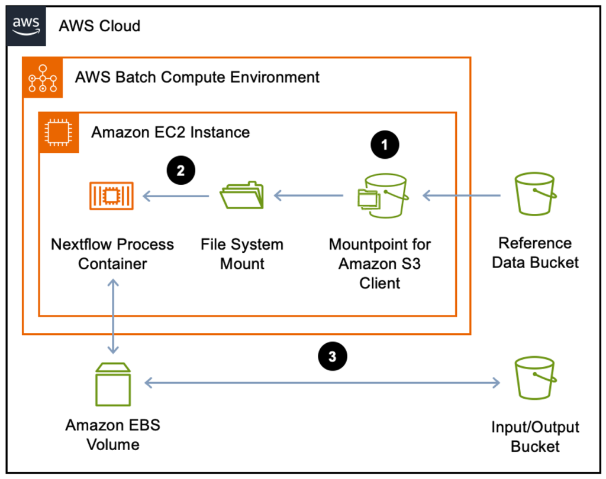

Amazon S3 (Simple Storage Service) stores files as objects, each identified by a unique key rather than a traditional file-system path. This design scales well for storage, but it can create friction when S3 is used as an ordinary file system, especially in bioinformatics workflows. When Nextflow uses S3 as its input/output backend, there are trade-offs to consider, particularly with large numbers of small files. In those cases Nextflow may spend a noticeable amount of time on downloads and uploads through the AWS CLI v2, which affects overall workflow performance. This post starts with the input side.

<!--truncate-->

## AWS CLI

### Install

The AWS CLI is the command-line tool for working with AWS services. Within Nextflow it can be used to download inputs and upload outputs. To follow the tutorial, clone the repository. The repository uses pixi and Docker to set up the environment quickly.

```bash
git clone https://github.com/nttg8100/nextflow-cost-optimization.git
cd nextflow-cost-optimization
pixi shell
which aws
```

The `Makefile` below starts the Docker service, uploads files, and builds a tar archive of 10,000 small files that is used for benchmarking later.

```bash
aws-config: start-minio
	export AWS_ACCESS_KEY_ID="minioadmin"; \
	export AWS_SECRET_ACCESS_KEY="minioadmin"; \
	export AWS_DEFAULT_REGION="us-east-1"; \
	export AWS_ENDPOINT_URL="http://localhost:9000" ; \
	sleep 10 && aws s3 mb s3://io-benchmark --endpoint-url http://localhost:9000

results/tarball.tar:
	@mkdir -p results/tarball
	@count=10000; size=1M; index=1; \
	for k in $$(seq $$count); do \
		dd if=/dev/zero of=results/tarball/$${size}-$${index}-$$k.data bs=1 count=0 seek=$$size; \
	done
	tar -cvf results/tarball.tar -C results/tarball .

upload-tar:
	aws s3 cp results/tarball.tar s3://io-benchmark/ --endpoint-url http://localhost:9000

upload-10k-files:
	aws s3 cp results/tarball  s3://io-benchmark/tarball --endpoint-url http://localhost:9000 --recursive
```

### Start the S3 service

At this point you can work with S3 object storage. The command launches MinIO, an S3-compatible service, which reduces errors that would otherwise come from differences between a local machine and a remote bucket. It creates a bucket called `io-benchmark` and also generates the many small files used later to illustrate the issue.

```bash
make aws-config
```

To test the S3 service:

```bash
# export env
export AWS_ACCESS_KEY_ID="minioadmin"
export AWS_SECRET_ACCESS_KEY="minioadmin"
export AWS_DEFAULT_REGION="us-east-1"
export AWS_ENDPOINT_URL="http://localhost:9000"
# configure threads
aws configure set default.s3.max_concurrent_requests 8
# test bucket
aws s3 ls  --endpoint-url http://localhost:9000
# 1026-01-27 10:29:58 io-benchmark
```

### Testing download independently

The `Makefile` above creates a folder of 10,000 files, each 1 MB, together with a tar archive of the same files. Nextflow can be slow with input for two main reasons:

+ It verifies the download of each file
+ It calculates an input cache for all of the small files

:::tip
The `Makefile` also creates a tar file of these 10,000 files. The benchmark below shows why this matters and how it can make a workflow easier.
:::

Before involving Nextflow, it is useful to measure how long the same operation takes with the AWS CLI v2 alone.

#### Download 10k files

Run this command to download:

```bash
make upload-10k-files
for i in {1..3}; do /usr/bin/time -f "%e" aws s3 cp s3://io-benchmark/tarball ./tarball --endpoint-url http://localhost:9000 --recursive 2>&1 | tail -n 1; rm -rf ./tarball; done
```

The stderr shows that downloading the files took around 110 seconds:

```bash
110.62
109.62
110.59
```

#### Download the tar file

Running the same operation on a single tar file was much faster:

```bash
make upload-tar
for i in {1..3}; do /usr/bin/time -f "%e" aws s3 cp s3://io-benchmark/tarball.tar . --endpoint-url http://localhost:9000 2>&1 | tail -n 1; rm -rf ./tarball.tar; done
```

The stderr shows that it took less than 30 seconds to download the tar file:

```bash
27.50
26.96
25.35
```

However, the individual files are still needed inside. A pipe (`|`) can be used to stream and extract them while downloading:

```bash
for i in {1..3}; do /usr/bin/time -f "%e" bash -c 'mkdir -p tarball && aws s3 cp s3://io-benchmark/tarball.tar - --endpoint-url http://localhost:9000 | tar -xvf - -C tarball' 2>&1 | tail -n 1; rm -rf ./tarball; done
```

The stderr shows that it took less than 35 seconds to download and untar, producing all the small files:

```bash
33.43
31.80
33.20
```

#### FUSE-based system

Besides downloading individual files or a tar file with the `aws` command, a FUSE-based system is an alternative approach.

:::tip
+ For small files: FUSE lets applications access individual files on demand without downloading an entire archive or using complex commands, which reduces overhead and makes access fast and convenient.
+ For large files: FUSE filesystems can fetch only the needed data chunks, allowing efficient partial reads, sequential streaming, and avoiding unnecessary full downloads.
+ General advantage: because FUSE exposes cloud storage as a standard directory tree, workflows and tools that use local files work with it in the same way, enabling parallel access and integration with caching and prefetching.
:::

This can be useful for applications that work with a large file, or a folder containing many small files, but do not load it entirely. For example, annotating variants for whole-exome data uses an annotation database built for the entire genome; a FUSE mount lets the tool read only the regions needed for the annotated variants. Distributed engines that use a FUSE-based system can also benefit from loading data on demand.

The `Makefile` below installs `mount-s3` through pixi. It mounts the whole bucket at `/mnt/vep_cache`. The mount point is named after `vep` because it is used later in the VEP annotation example.

```bash
mount-s3-vep-cache: ${HOME}/.pixi/bin/pixi
	mkdir -p ./mnt/vep_cache
	mkdir -p ./mnt/tmp
	${HOME}/.pixi/bin/pixi run -e mount mount-s3 --endpoint-url http://localhost:9000 --region us-east-1 --force-path-style io-benchmark ./mnt/vep_cache --read-only --cache ./mnt/tmp --max-threads 8
```

Run this command to mount the remote S3 bucket:

```bash
make mount-s3-vep-cache
# check
df
# Filesystem                            1K-blocks      Used     Available Use% Mounted on
# io-benchmark                      1099511627776         0 1099511627776   0% /scratch/data/nextflow-cost-optimization/mnt/vep_cache
```

With the mount in place, the 10,000 files can be copied locally:

```bash
for i in {1..3}; do /usr/bin/time -f "%e" bash -c 'cp -r ./mnt/vep_cache/tarball tarball ' 2>&1 | tail -n 1; rm -rf ./tarball; done
```

The stderr shows that it took less than 45 seconds:

```bash
44.94
46.06
45.46
```

A single tar file can also be read through the mount:

```bash
for i in {1..3}; do /usr/bin/time -f "%e" bash -c 'mkdir -p tarball && cp ./mnt/vep_cache/tarball.tar tarball' 2>&1 | tail -n 1; rm -rf ./tarball; done
```

The stderr shows that it took less than 20 seconds:

```bash
15.60
15.37
15.74
```

Combining FUSE with streaming untar also works:

```bash
for i in {1..3}; do /usr/bin/time -f "%e" bash -c 'mkdir -p tarball && cat ./mnt/vep_cache/tarball.tar|tar -xvf - -C tarball' 2>&1 | tail -n 1; rm -rf ./tarball; done
```

The stderr shows that it took around 20 seconds:

```bash
19.68
21.86
20.31
```

### Recap

The table below summarises the approaches for downloading 10,000 small files from S3, with their observed performance and typical use cases:

| Method                                 | Download Time (s) | Pros                                    | Cons                                 | When to Use                                    |
| -------------------------------------- | ----------------- | --------------------------------------- | ------------------------------------ | ---------------------------------------------- |
| **AWS CLI (recursive, 10k files)**     | ~110              | Simple, no extra setup                  | Very slow for many small files       | Rarely; only for small numbers of files        |
| **AWS CLI (tarball + untar via pipe)** | ~33               | Fast, single download + extraction      | Needs tar/untar logic                | When workflow can handle tar extraction        |
| **FUSE (cp -r 10k files)**             | ~45               | Transparent, works like local FS        | Needs FUSE setup, not always fastest | When random access or partial reads are needed |
| **FUSE (cat tarball \| tar -xvf -)**   | ~20               | Fast, combines FUSE and streaming untar | Needs FUSE setup, tar logic          | For large archives with extraction             |

:::info
**Recommendations:**
- For many small files, avoid direct recursive downloads; use tarballs or FUSE-based solutions.
- Use tarball + untar (via pipe) for best performance if you can bundle files.
- FUSE is a good fit for workflows needing random access or partial reads, or when you can't change file structure.
- Nextflow (v25.04+) reportedly improves small-file handling, but bundling or FUSE still offers gains for large numbers of files.
:::

## Nextflow integration

### Workflow

The workflow below accepts inputs from S3, downloads them for use in the process, and counts the number of files inside.

```bash
include { COUNT_FILES }  from './modules/count_files_tar.nf'
include { COUNT_FILES_TAR } from './modules/count_files_tar.nf'

workflow {
    main:        
        // benchmark files input
        // normal files
        if (params.benchmark_input){
            ch_files = COUNT_FILES(Channel.fromPath(params.inputs).collect())
        }

        // tarball and untar
        if (params.benchmark_input_tar){
            ch_files = COUNT_FILES_TAR(Channel.fromPath(params.inputs).collect())
        }
}
```

### Modules

#### COUNT_FILES

It accepts a list of files directly from S3.

```bash
process COUNT_FILES {
    cpus 2

    input:
    path(file_path)

    script:
    """
    ls -lah tarball/**.data|wc -l > num_files.txt
    """
}
```

#### COUNT_FILES_TAR

It downloads the tar file first, then untars it inside the process.

:::info
Downloading the file and using a pipe to untar quickly is applied later.
:::

```bash
process COUNT_FILES_ {
    cpus 2

    input:
    path(file_path)

    script:
    """
    tar -xf ${file_path}
    ls -lah tarball/**.data|wc -l > num_files.txt
    """
}
```

### Remaining materials

The remaining materials include the Nextflow configurations:

+ `nextflow.config`: standard config to run with Docker, Singularity and different platforms
+ `nextflow_s3.config`: S3 credentials for MinIO storage
+ `nextflow_tar.config`: the config that runs with the local file later

These are standard setups, so they are not explained in detail here. The structure is shown below.

```bash
├── benchmark_computing_resource.nf
├── benchmark_input.nf
├── inputs
│   ├── 1_samplesheet.csv
│   └── full_samplsheet.csv
├── LICENSE
├── Makefile
├── modules
│   ├── count_files.nf
│   ├── count_files_tar.nf
│   ├── fastp.nf
│   ├── fastqc.nf
│   └── vep.nf
├── nextflow.config
├── nextflow_s3.config
├── nextflow_tar.config
├── pixi.lock
├── pixi.toml
├── README.md
```

### Testing

The `Makefile` runs the workflow with different configurations. For a proof of concept, one run is enough.

```bash
test-input-standard: ${HOME}/.pixi/bin/pixi
	${HOME}/.pixi/bin/pixi run -e standard nextflow run benchmark_input.nf \
		-c nextflow_s3.config \
		--benchmark_input \
		--inputs="s3://io-benchmark/tarball"

test-input-tar: ${HOME}/.pixi/bin/pixi
	${HOME}/.pixi/bin/pixi run -e standard nextflow run benchmark_input.nf \
		-c nextflow_s3.config \
		--benchmark_input_tar \
		--inputs="s3://io-benchmark/tmp.txt"
```

#### Running with 10k files as input

```bash
time make test-input-standard
# 42,34s user 7,04s system 77% cpu 1:03,97 total

```

#### Running with one large file, untar in the process

```bash
time make test-input-tar
# 11,80s user 3,42s system 66% cpu 22,965 total
```

### Configuration-only improvement

We have shown that a single large tar file can be used as input and untarred inside the process. That required changing the module. Is there a configuration that avoids that? Building on the pipe approach above, the following configuration keeps the same module while the files are ingested using `beforeScript`.

```bash
process{
    withName:COUNT_FILES{
        beforeScript = "mkdir -p tarball && aws s3 cp s3://io-benchmark/tarball.tar - --endpoint-url http://localhost:9000 | tar -xvf - -C tarball"
    }
}
```

To run the workflow, a file can be used as a placeholder for Nextflow to accept the input, and the `nextflow_tar.config` config is added:

```Makefile
test-input-tar-pipe: ${HOME}/.pixi/bin/pixi
	${HOME}/.pixi/bin/pixi run -e standard nextflow run benchmark_input.nf \
		-c nextflow_s3.config -c nextflow_tar.config \
		--benchmark_input \
		--inputs="s3://io-benchmark/tmp.txt"
```

Remember to create the temporary file and upload it to the bucket:

```bash
touch tmp.txt
aws s3 cp tmp.txt  s3://io-benchmark --endpoint-url http://localhost:9000 
```

Running the new setup:

```bash
time make test-input-tar-pipe
# 11,33s user 2,85s system 82% cpu 17,166 total
```

### Recap

:::tip
+ Using a tar file with a Nextflow config reduced download time roughly threefold for multiple small files used as input.
+ The existing module did not need to be modified.
:::

## Genomics England case study

Reference: **https://aws.amazon.com/blogs/hpc/optimize-nextflow-workflows-on-aws-batch-with-mountpoint-for-amazon-s3/**

### The problem

The same pattern appears in real workloads. The AWS HPC blog post describes how Genomics England addressed a similar issue when using VEP to annotate variants. The database they used contains many small files, and the download took longer than the annotation itself, which ran in a few minutes.

The pseudo code:

```bash
process VEP {

    input:
    path(vcf)
    val(vep_cache)

    script:
    """
    vep \
        --input_file $vcf \
        --fasta $params.human_reference_fasta \
        --dir_cache $vep_cache 
    """

}
```

### Workflow and modules

The workflow uses only the VEP module. To keep it quick to reproduce, all parameters are hard coded.

```bash
include { ENSEMBLVEP_VEP } from './modules/vep.nf'

workflow {
    main:
        ENSEMBLVEP_VEP(
            Channel.of(tuple([id: 'HCC1395N'], file("inputs/vep_test_data.vcf.gz"), file("inputs/vep_test_data.vcf.gz.tbi"))), // tuple val(meta), path(vcf), path(custom_extra_files)
            Channel.value("GRCh38"), // val genome
            Channel.value("homo_sapiens"), // val species
            Channel.value(114), // val cache_version
            Channel.fromPath("s3://io-benchmark/vep_cache"), // path cache
            Channel.of(tuple([:], [])), // tuple val(meta2), path(fasta)
            Channel.of([]) // path extra_files
        )
}
```

The VEP module is taken from [**nf-core**](https://github.com/nf-core/sarek/blob/20f41d1ce8b7ba296ee22adc71fe2da2ebcae93f/modules/nf-core/ensemblvep/vep/main.nf).

```bash
process ENSEMBLVEP_VEP {
    tag "${meta.id}"
    label 'process_medium'

    conda "${moduleDir}/environment.yml"
    container "${workflow.containerEngine == 'singularity' && !task.ext.singularity_pull_docker_container
        ? 'https://community-cr-prod.seqera.io/docker/registry/v2/blobs/sha256/4b/4b5a8c173dc9beaa93effec76b99687fc926b1bd7be47df5d6ce19d7d6b4d6b7/data'
        : 'community.wave.seqera.io/library/ensembl-vep:115.2--90ec797ecb088e9a'}"

    input:
    tuple val(meta), path(vcf), path(custom_extra_files)
    val genome
    val species
    val cache_version
    path cache
    tuple val(meta2), path(fasta)
    path extra_files

    output:
    tuple val(meta), path("*.vcf.gz"), emit: vcf, optional: true
    tuple val(meta), path("*.vcf.gz.tbi"), emit: tbi, optional: true
    tuple val(meta), path("*.tab.gz"), emit: tab, optional: true
    tuple val(meta), path("*.json.gz"), emit: json, optional: true
    path "*.html", emit: report, optional: true
    path "versions.yml", emit: versions

    when:
    task.ext.when == null || task.ext.when

    script:
    def args = task.ext.args ?: ''
    def args2 = task.ext.args2 ?: ''
    def file_extension = args.contains("--vcf") ? 'vcf' : args.contains("--json") ? 'json' : args.contains("--tab") ? 'tab' : 'vcf'
    def compress_cmd = args.contains("--compress_output") ? '' : '--compress_output bgzip'
    def prefix = task.ext.prefix ?: "${meta.id}"
    def dir_cache = cache ? "\${PWD}/${cache}" : "/.vep"
    def reference = fasta ? "--fasta ${fasta}" : ""
    def create_index = file_extension == "vcf" ? "tabix ${args2} ${prefix}.${file_extension}.gz" : ""
    """
    vep \\
        -i ${vcf} \\
        -o ${prefix}.${file_extension}.gz \\
        ${args} \\
        ${compress_cmd} \\
        ${reference} \\
        --assembly ${genome} \\
        --species ${species} \\
        --cache \\
        --cache_version ${cache_version} \\
        --dir_cache ${dir_cache} \\
        --fork ${task.cpus}

    ${create_index}

    cat <<-END_VERSIONS > versions.yml
    "${task.process}":
        ensemblvep: \$( echo \$(vep --help 2>&1) | sed 's/^.*Versions:.*ensembl-vep : //;s/ .*\$//')
        tabix: \$(echo \$(tabix -h 2>&1) | sed 's/^.*Version: //; s/ .*\$//')
    END_VERSIONS
    """

    stub:
    def prefix = task.ext.prefix ?: "${meta.id}"
    def file_extension = args.contains("--vcf") ? 'vcf' : args.contains("--json") ? 'json' : args.contains("--tab") ? 'tab' : 'vcf'
    def create_index = file_extension == "vcf" ? "touch ${prefix}.${file_extension}.gz.tbi" : ""
    """
    echo "" | gzip > ${prefix}.${file_extension}.gz
    ${create_index}
    touch ${prefix}_summary.html

    cat <<-END_VERSIONS > versions.yml
    "${task.process}":
        ensemblvep: \$( echo \$(vep --help 2>&1) | sed 's/^.*Versions:.*ensembl-vep : //;s/ .*\$//')
        tabix: \$(echo \$(tabix -h 2>&1) | sed 's/^.*Version: //; s/ .*\$//')
    END_VERSIONS
    """
}
```

Their solution is shown below.



### Inputs

The VCF file is prepared in the `inputs` folder, while the VEP cache database can be prepared through the `Makefile` below.

```bash

vep/114_GRCh38: ${HOME}/.pixi/bin/pixi
	mkdir -p vep
	touch vep/vep_cache
	cd vep && ${HOME}/.pixi/bin/pixi run -e core aws s3 --no-sign-request cp s3://annotation-cache/vep_cache/114_GRCh38 114_GRCh38 --recursive

vep/vep_cache.tar: vep/114_GRCh38
	tar -cvf vep/vep_cache.tar -C vep/114_GRCh38 .

upload-vep-cache: vep/vep_cache.tar
	${HOME}/.pixi/bin/pixi run -e core aws s3 cp vep/114_GRCh38 s3://io-benchmark/ --endpoint-url http://localhost:9000 --recursive
	${HOME}/.pixi/bin/pixi run -e core aws s3 cp vep/vep_cache.tar s3://io-benchmark/ --endpoint-url http://localhost:9000
	
mount-s3-vep-cache: ${HOME}/.pixi/bin/pixi
	mkdir -p ./mnt/vep_cache
	mkdir -p ./mnt/tmp
	${HOME}/.pixi/bin/pixi run -e mount mount-s3 --endpoint-url http://localhost:9000 --region us-east-1 --force-path-style io-benchmark ./mnt/vep_cache --read-only --cache ./mnt/tmp --max-threads 8
```

Then run:

```bash
# download and upload to local s3
make upload-vep-cache

# mount to local folder from local s3 via mountpoint-s3 
make mount-s3-vep-cache
```

### Benchmark

The `Makefile` commands below benchmark the options quickly:

```bash
test-vep-local: ${HOME}/.pixi/bin/pixi
	${HOME}/.pixi/bin/pixi run -e core nextflow run benchmark_vep.nf -profile docker --vep_cache "./vep/114_GRCh38"

test-vep-mount-cache: ${HOME}/.pixi/bin/pixi
	${HOME}/.pixi/bin/pixi run -e core nextflow run benchmark_vep.nf \
		-c nextflow_s3.config -c nextflow_vep_mount.config --vep_cache "./mnt/vep_cache/114_GRCh38" -profile docker

test-vep-direct-s3: ${HOME}/.pixi/bin/pixi
	${HOME}/.pixi/bin/pixi run -e core  nextflow run benchmark_vep.nf \
		-c nextflow_s3.config --vep_cache "s3://io-benchmark/114_GRCh38" -profile docker

test-vep-tar-cache: ${HOME}/.pixi/bin/pixi
	${HOME}/.pixi/bin/pixi run -e core nextflow run benchmark_vep.nf \
		-c nextflow_s3.config -c nextflow_vep_tar.config --vep_cache "s3://io-benchmark/vep_cache" -profile docker

test-vep-mount-tar: ${HOME}/.pixi/bin/pixi
	${HOME}/.pixi/bin/pixi run -e core nextflow run benchmark_vep.nf \
		-c nextflow_s3.config -c nextflow_vep_mount_tar.config --vep_cache "s3://io-benchmark/vep_cache" -profile docker
```

Then run the example under test:

```bash
make <test-vep-benchmark>
```

The table below summarises the benchmark results for the different approaches to accessing the VEP cache database during analysis:

| Method              | Command                     | Time (min:sec) |
| ------------------- | --------------------------- | :------------: |
| Local cache         | `make test-vep-local`       |    2:26.20     |
| S3 mount (FUSE)     | `make test-vep-mount-cache` |    2:31.08     |
| S3 mount tar (FUSE) | `make test-vep-mount-tar`   |    5:57.18     |
| Direct S3 access    | `make test-vep-direct-s3`   |    6:32.63     |
| S3 tar cache        | `make test-vep-tar-cache`   |    6:02.52     |

:::info
+ As noted above, the full database cache does not need to be downloaded to annotate a small VCF region file. That is why mounting the whole database was the fastest option in this case.
+ Replacing the VEP command with `cp \$(readlink $cache) tmp -r` in the module took `4:16.09` to read from the mount point and copy the whole folder to a new temporary folder.
+ Depending on your specific infrastructure, customise these options for your needs.
:::

### Recap

+ Using tar files and untarring large inputs does not always guarantee a significant performance improvement. The benefit depends on the number of files and the total size of your input folder.
+ If the tool only accesses a subset of the input files (rather than the entire folder), performance may be similar to having the database already available locally.

## Overall recap

### Performance analysis

- **Small files vs large files**: Nextflow handles large single files efficiently but is slower with many small files because of per-file operations.
- **Download methods**: for this collection of small files, a tar file was considerably faster than recursive download.
- **FUSE benefits**: mount points provide transparent access with good performance and do not require local disk space for the whole dataset.

### Optimization strategies

- **Bundle small files**: use tar archives when dealing with numerous files (10k+ small files).
- **Stream processing**: pipe extraction for immediate processing without a full download.
- **Caching**: use FUSE-based caching for databases and reference data.
- **Choose the right method**: select the download method based on file count and access patterns.

### Practical applications

- **Genomics England case study**: FUSE-based VEP annotation.
- **Bioinformatics pipelines**: the principles apply to any workflow using remote data storage.
- **Cost considerations**: reduced download time and smaller disk footprint reduce compute costs on cloud platforms.

### Key takeaways

1. **Profile before optimizing**: measure the actual bottlenecks in your specific workflows.
2. **Consider file distribution**: many small files are not the same as a few large files when choosing download strategies.
3. **Consider Nextflow v25.04+**: reported improvements to small-file handling reduce the need for workarounds.
4. **Use FUSE where it fits**: it can provide transparent access with better performance than CLI tools.
5. **Design for scale**: build workflows that work efficiently with your data characteristics.

Whether the data consists of thousands of small files or terabytes of reference data, these patterns help in designing workflows that use input more efficiently.

## References

- Nextflow documentation: [nextflow.io/docs](https://www.nextflow.io/docs/latest/)
- Mountpoint for Amazon S3: [github.com/awslabs/mountpoint-s3](https://github.com/awslabs/mountpoint-s3)
- AWS HPC blog, *Optimize Nextflow workflows on AWS Batch with Mountpoint for Amazon S3*: [aws.amazon.com/blogs/hpc/optimize-nextflow-workflows-on-aws-batch-with-mountpoint-for-amazon-s3](https://aws.amazon.com/blogs/hpc/optimize-nextflow-workflows-on-aws-batch-with-mountpoint-for-amazon-s3/)
- MinIO object storage: [min.io](https://min.io)
- nf-core ensemblvep module: [github.com/nf-core/sarek](https://github.com/nf-core/sarek)
- AWS CLI S3 documentation: [docs.aws.amazon.com/cli/latest/reference/s3](https://docs.aws.amazon.com/cli/latest/reference/s3/)
- Benchmark repository: [github.com/nttg8100/nextflow-cost-optimization](https://github.com/nttg8100/nextflow-cost-optimization)
