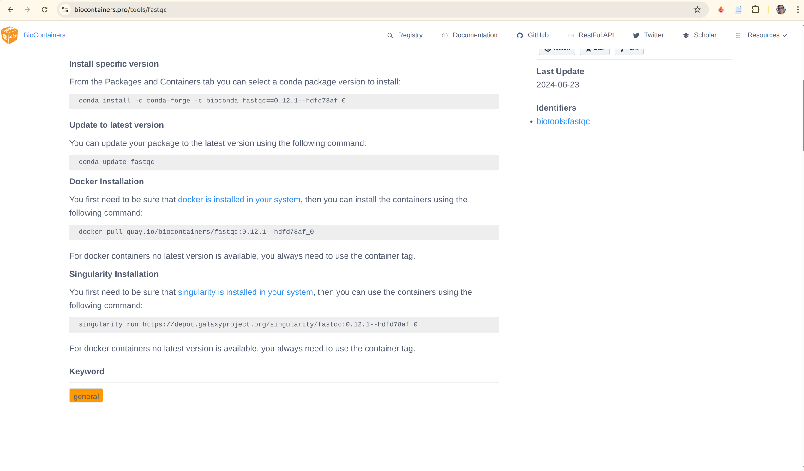
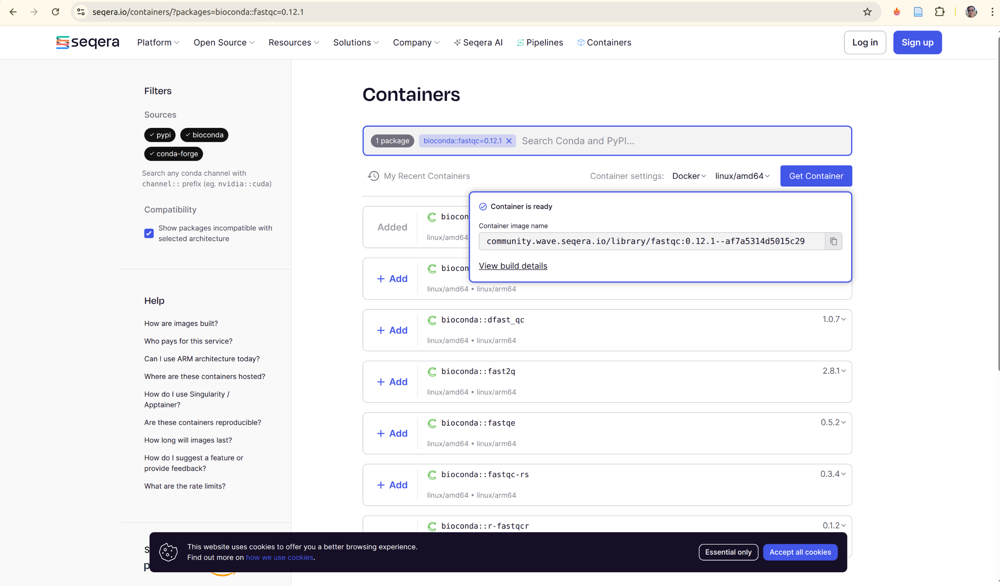

Docker containers are widely used in bioinformatics to make analyses reproducible and portable across platforms. This post looks at the problems containers solve in practice, shows how to run and debug bioinformatics tools inside them, and covers efficient ways to build images, including with Micromamba and Pixi.

<!--truncate-->

## Prerequisites: get Docker installed and running

This post assumes Docker is already installed and running, and focuses on using containers for bioinformatics work.

### Start here first

If Docker is not yet installed, the official documentation is the place to begin:

**https://docs.docker.com/get-started/get-docker/**

That guide covers:

- **Installing Docker Desktop** (macOS, Windows, Linux)
- **Verifying the installation** with `docker --version`
- **Running a first container** with `docker run hello-world`
- **Docker basics** (images, containers, registries)

### What you need to know

After installing Docker, verify that it works:

```bash
# Check Docker version
docker --version
# Output: Docker version 24.0.0, build 12345abc

# Run a test container
docker run hello-world
# Output: Hello from Docker! This message shows that your installation appears to be working correctly.
```

### About this post

Once Docker is installed and working, this post covers:

1. **Why manual installation is fragile**, and how containers help with reproducibility
2. **How to use Docker containers** for bioinformatics data analysis
3. **How to build efficient Docker images**
4. **How to build containers with Micromamba and Pixi**
5. **How to find pre-built containers** before building from scratch

### Prerequisites checklist

Before continuing, verify you have:

- Docker installed (`docker --version` works)
- The Docker daemon running (or Docker Desktop active)
- The ability to pull images (`docker pull hello-world` works)
- Basic familiarity with the command line
- (Optional) Nextflow installed for the pipeline examples

If not, start with https://docs.docker.com/get-started/get-docker/ and come back here afterwards.

---

## 1. Why manual installation fails: the old way vs. modern containers

Traditionally, bioinformatics labs installed software on shared servers or laptops with commands like:

```bash
sudo apt-get install samtools bwa python3
```

That looks simple, but it creates reproducibility, portability, and maintenance problems:

- **Manual steps**: each researcher or lab installs software slightly differently. Written instructions, scripts, and troubleshooting notes are easily lost, mixed up, or outdated.
- **Not reproducible**: there is no reliable record of what was installed, which versions, or in what order. Over time, updates and dependency conflicts accumulate, producing the "works for me" problem.
- **Hard to debug**: version mismatches and library conflicts are difficult to diagnose once the environment has drifted.
- **Not portable**: scripts break on macOS, Windows, or other Linux variants. HPC systems often restrict sudo/root access, which makes traditional installs hard.

The result is that collaboration across labs, institutions, or countries becomes fragile, and reproducing results — even on your own machine — can be a challenge.

### The modern approach: containers and community tooling

Much of bioinformatics has moved from manual installs to containers and environment managers:

- **BioConda**: over 8,000 bioinformatics packages can be installed reproducibly via Conda.
- **BioContainers**: automatically generates Docker containers for each tool, available at [quay.io/biocontainers](https://quay.io/organization/biocontainers).
    ```bash
    docker pull quay.io/biocontainers/samtools:1.15.1--h1170115_0
    ```
- **Seqera/Nextflow/nf-core**: pipelines with environment definitions (Conda, Docker, Singularity) are shared and run the same way everywhere.

In short, containers and Conda address many of the problems of manual installs, which makes reproducible collaboration more routine in bioinformatics.

---

## 2. Using Docker containers for bioinformatics data analysis

One advantage of Docker is the ability to run bioinformatics tools directly, without a full installation, on your own datasets. The example below uses FastQC, a widely used quality-control tool for sequencing data.

### Example: run FastQC from a container

1. **Pull the FastQC container (only needed once):**
   ```bash
   docker pull quay.io/biocontainers/fastqc:<version>
   # Replace <version> with the specific tag, e.g. 0.11.9--hdfd78af_1
   ```

2. **Run FastQC, mounting your data folder:**
   ```bash
   docker run --rm -v "$PWD:/data" quay.io/biocontainers/fastqc:<version> fastqc /data/my_reads.fastq
   ```
   - `--rm`: remove the container automatically after it exits.
   - `-v "$PWD:/data"`: mount the current directory (with your FASTQ file) into the container at `/data`.
   - The container runs the FastQC executable, analyses the file, and writes results back to your folder.

**Key benefits:**
- No software installation or dependency handling.
- The exact version and environment are guaranteed.
- The analysis can be shared or rerun anywhere Docker is available (Linux, Mac, Windows, cloud, HPC).

This approach works for thousands of bioinformatics containers: swap FastQC for Samtools, BWA, STAR, or other tools.

### Running containers interactively

Sometimes it is useful to run tools or explore interactively inside the container. Docker makes this possible with the `-it` flags:

- `-i` keeps STDIN open (interactive input)
- `-t` allocates a pseudo-terminal (TTY)

**Example: start an interactive shell inside the FastQC container:**

```bash
docker run --rm -it -v "$PWD:/data" quay.io/biocontainers/fastqc:<version> /bin/bash
```

Now you are inside the container shell:

```bash
fastqc /data/my_reads.fastq
ls /data
```

**Benefits:**
- Inspect files, experiment with commands, or troubleshoot in real time.
- Explore the container environment (dependencies, installed tools).
- The environment is still reproducible on each launch.

### Debugging and inspecting a running Docker container

If a container is already running (perhaps as part of a pipeline or a background process), Docker lets you connect and debug interactively with `docker exec`:

1. List running containers:
   ```bash
   docker ps
   ```
   Note the CONTAINER ID in the output.

2. Start a bash shell inside the running container:
   ```bash
   docker exec -it <CONTAINER_ID> /bin/bash
   ```
   You can then inspect files, check logs, and run additional commands inside the live container.

---

### ENTRYPOINT and overriding commands

Many containers run a specific tool as their default ENTRYPOINT; FastQC containers, for example, launch FastQC automatically. You can temporarily override the ENTRYPOINT and start a shell with:

```bash
docker run --rm -it --entrypoint /bin/bash quay.io/biocontainers/fastqc:<version>
```

This starts an interactive shell even when the Dockerfile specifies a different default command, which is useful for debugging or exploring the container environment.

**Summary:**
- Use `docker exec` to debug running containers.
- Override ENTRYPOINT for interactive shells.
- This enables real-time troubleshooting and inspection.

---

### Running containers with Nextflow: inspecting the actual Docker commands

When a Nextflow pipeline runs with Docker containers, Nextflow generates and executes Docker commands for each task. Understanding these commands is useful for debugging and profiling, and for seeing exactly what a pipeline is doing.

#### Where Nextflow stores Docker commands

Nextflow creates a work directory structure in which each task has its own folder containing:

- `.command.sh` - the shell script to execute
- `.command.run` - the wrapper script that Nextflow uses to run the task
- `.command.trace` - task execution trace
- `.exitcode` - exit code of the task
- output files from the task

**Directory structure:**
```
work/
├── ab/
│   ├── abc123def456.../
│   │   ├── .command.sh
│   │   ├── .command.run
│   │   ├── .command.trace
│   │   └── ... (output files)
│   └── def789ghi012.../
│       └── ...
└── fe/
    └── 949a78b06c5fd8284aeb2f87d14f7d/
        ├── .command.sh
        ├── .command.run
        └── ... (task outputs)
```

#### Viewing the actual Docker command

To see the exact Docker command that Nextflow executed for a specific task:

```bash
# 1. Find your task's work directory
# For example, in the pipeline output you might see:
#   vep (ensembl-vep:115.2) [fe/949a78b...]

# 2. Navigate to that directory
cd work/fe/949a78b06c5fd8284aeb2f87d14f7d/

# 3. View the command that was executed
cat .command.run
```

#### Example: Nextflow Docker command for VEP (Variant Effect Predictor)

Here is a complete example of how Nextflow runs a Docker container:

```bash
docker rm $NXF_BOXID &>/dev/null || true
docker stop $NXF_BOXID

docker run -i \
  --cpu-shares 8192 \
  --memory 14336m \
  -e "NXF_TASK_WORKDIR" \
  -e "NXF_DEBUG=${NXF_DEBUG:=0}" \
  -v <your project working directory>:<your project working directory> \
  -w "$NXF_TASK_WORKDIR" \
  -u $(id -u):$(id -g) \
  --name $NXF_BOXID \
  community.wave.seqera.io/library/ensembl-vep:115.2--90ec797ecb088e9a \
  /bin/bash <your project working directory>/work/fe/949a78b06c5fd8284aeb2f87d14f7d/.command.run nxf_trace
```

#### Breaking down the Docker command

Each component has a specific purpose:

| Component                      | Purpose                                                      |
| ------------------------------ | ------------------------------------------------------------ |
| `docker run`                   | Start a new container                                        |
| `-i`                           | Keep STDIN open (interactive)                                |
| `--cpu-shares 8192`            | Allocate CPU resources (set by Nextflow from cpus directive) |
| `--memory 14336m`              | Limit memory to 14GB (set by Nextflow from memory directive) |
| `-e NXF_TASK_WORKDIR`          | Pass Nextflow task work directory env var                    |
| `-e NXF_DEBUG=${NXF_DEBUG:=0}` | Pass debug flag                                              |
| `-v /project:/project`         | Mount project directory for input/output                     |
| `-w "$NXF_TASK_WORKDIR"`       | Set working directory inside container                       |
| `-u $(id -u):$(id -g)`         | Run as current user (file permissions)                       |
| `--name $NXF_BOXID`            | Name the container (cleanup reference)                       |
| `image:tag`                    | Container image to use                                       |
| `/bin/bash .command.run`       | Execute the task script                                      |
| `nxf_trace`                    | Nextflow tracing flag                                        |

#### Re-running a failed task manually

If a task fails in Nextflow, it can be re-run manually for debugging:

```bash
# 1. Navigate to the task work directory
cd work/fe/949a78b06c5fd8284aeb2f87d14f7d/

# 2. View the task script
cat .command.sh

# 3. View Nextflow's Docker wrapper
cat .command.run

# 4. Manually run the Docker command (copy from .command.run output)
# and inspect what went wrong
docker run -i \
  --cpu-shares 8192 \
  --memory 14336m \
  -e "NXF_TASK_WORKDIR" \
  -v <your project working directory>:<your project working directory> \
  -w "$NXF_TASK_WORKDIR" \
  -u $(id -u):$(id -g) \
  community.wave.seqera.io/library/ensembl-vep:115.2--90ec797ecb088e9a \
  /bin/bash <your project working directory>/work/fe/949a78b06c5fd8284aeb2f87d14f7d/.command.run

# 5. Check the exit code
cat .exitcode

# 6. View any error logs
cat .command.err  # (if exists)
cat .command.out  # (if exists)

# 7. If you run on HPC, (e.g SLURM ), run submit job
sbatch .command.run

# 8. You can debug manually by running container interactively
docker run -it -v $PWD:$PWD -w $PWD <your container> 

# 9. Modify .command.sh then inside your container, start to debug by running command directly
bash .command.sh
```

#### Key Nextflow Docker features

| Feature                   | How Nextflow uses it                                                     |
| ------------------------- | ------------------------------------------------------------------------ |
| **Resource limits**       | `--cpus` and `--memory` directives → `--cpu-shares` and `--memory` flags |
| **Volume mounts**         | Pipeline inputs/outputs → `-v` flags                                     |
| **User permissions**      | Current user → `-u $(id -u):$(id -g)`                                    |
| **Work directory**        | Task-specific directory → `-w "$NXF_TASK_WORKDIR"`                       |
| **Container cleanup**     | Automatic removal → `docker rm` commands                                 |
| **Environment variables** | Pipeline configuration → `-e` flags                                      |

#### Profiling and optimization

Examining the actual Docker commands can help you:

1. **Check resource allocation:**
   ```bash
   grep "cpu-shares\|memory" work/*/*/.command.run
   ```

2. **Verify mounted volumes:**
   ```bash
   grep "\-v" work/ab/abc123*/.command.run
   ```

3. **See container images being used:**
   ```bash
   grep "docker run" work/*/*/.command.run | grep -oE "image:[^ ]+"
   ```

4. **Profile task execution:**
   ```bash
   # Check how long each task took
   for dir in work/*/*/*/.command.trace; do
       echo "Task: $(dirname $dir)"
       cat "$dir"
   done
   ```

### Summary

- Nextflow generates Docker commands for each task automatically.
- Task commands are stored in `work/<task-id>/.command.run`.
- Failed tasks can be inspected and re-run manually.
- Understanding these commands helps with debugging and optimization.
- Resource limits from Nextflow directives are converted to Docker flags.
- Each task runs in isolation with its own work directory.

---

## 3. Efficient Docker image building for bioinformatics

Building efficient Docker images keeps them fast to download, run, and share.

### Best practices

- **Start with a lightweight, official base image**
  - Alpine, Debian-slim, Ubuntu LTS

- **Install only required tools**
  - Avoid extra utilities and unnecessary packages

- **Clean the cache and remove temporary files**
  - In the same RUN step: `rm -rf /var/lib/apt/lists/*`

- **Use multi-stage builds for large or compiled tools**
  - Build from source in a builder stage, then copy binaries into a slim final image

### Minimal example: install a tool

```dockerfile
FROM ubuntu:24.04
RUN apt-get update && \
    apt-get install -y --no-install-recommends samtools && \
    apt-get clean && rm -rf /var/lib/apt/lists/*
WORKDIR /data
CMD ["/bin/bash"]
```

### Multi-stage build example: build from source

```dockerfile
FROM ubuntu:24.04 AS builder
RUN apt-get update && apt-get install -y build-essential wget
RUN wget https://github.com/samtools/samtools/releases/download/1.18/samtools-1.18.tar.bz2 && \
    tar -xjf samtools-1.18.tar.bz2 && \
    cd samtools-1.18 && \
    ./configure --prefix=/usr/local && make && make install

FROM ubuntu:24.04
RUN apt-get update && apt-get install -y --no-install-recommends libbz2-1.0 liblzma5 zlib1g
COPY --from=builder /usr/local/bin/samtools /usr/local/bin/
WORKDIR /data
CMD ["/bin/bash"]
```

### Further optimizations

- Sort package lists alphabetically
- Use a `.dockerignore` file to reduce the build context size
- Pin exact tool/package versions for reproducibility

---

## 4. Building Docker images with Conda and Micromamba

Building Docker containers from Conda packages is one way to create reproducible bioinformatics environments. Micromamba is a lightweight alternative to Conda that works well inside containers.

### Why Micromamba for Docker images?

Micromamba has a few practical advantages over traditional Conda for container builds:

- **Fast**: dependency resolution is reported to be considerably faster than Conda.
- **Lightweight**: minimal footprint, suited to containerized deployments.
- **Reproducible**: environment lock files pin exact versions.
- **Widely used**: common in bioinformatics pipelines.
- **Small base image**: the official `mambaorg/micromamba` image is about 150 MB.

### The approach: conda.yml + Micromamba

Instead of writing complex RUN commands with inline package specifications, use a `conda.yml` environment file.

**conda.yml:**
```yaml
name: base
channels:
  - conda-forge
  - bioconda
dependencies:
  - bioconda::fastqc=0.12.1
  - bioconda::samtools=1.18
  - bioconda::bwa=0.7.17
  - conda-forge::procps-ng
```

**Dockerfile:**
```dockerfile
FROM mambaorg/micromamba:1.5.10-noble

# Copy environment file
COPY --chown=$MAMBA_USER:$MAMBA_USER conda.yml /tmp/conda.yml

# Install packages from environment file
RUN micromamba install -y -n base -f /tmp/conda.yml \
    && micromamba clean -a -y

# Export explicit lock file for reproducibility
RUN micromamba env export --name base --explicit > environment.lock \
    && echo ">> CONDA_LOCK_START" \
    && cat environment.lock \
    && echo "<< CONDA_LOCK_END"

# Set PATH
USER root
ENV PATH="$MAMBA_ROOT_PREFIX/bin:$PATH"

WORKDIR /data
CMD ["/bin/bash"]
```

### Understanding the Dockerfile

Each component in turn:

**1. Base image:**
```dockerfile
FROM mambaorg/micromamba:1.5.10-noble
```
- `mambaorg/micromamba` includes Micromamba pre-installed
- `1.5.10` is the version (pinned for reproducibility)
- `noble` is the Ubuntu 24.04 LTS variant
- This is lighter than installing Conda from scratch

**2. Copy the environment file:**
```dockerfile
COPY --chown=$MAMBA_USER:$MAMBA_USER conda.yml /tmp/conda.yml
```
- Copies your `conda.yml` into the container
- `$MAMBA_USER` is the non-root user set by the base image
- Preserves proper file ownership

**3. Install with Micromamba:**
```dockerfile
RUN micromamba install -y -n base -f /tmp/conda.yml \
    && micromamba clean -a -y
```
- `-y`: auto-confirm installation
- `-n base`: install into the base environment
- `-f /tmp/conda.yml`: use the environment file
- `micromamba clean -a -y`: remove cached packages, which reduces image size

**4. Generate a lock file (for reproducibility):**
```dockerfile
RUN micromamba env export --name base --explicit > environment.lock \
    && echo ">> CONDA_LOCK_START" \
    && cat environment.lock \
    && echo "<< CONDA_LOCK_END"
```
- Exports an explicit lock file with exact pinned versions and URLs
- The echo statements make the lock file visible in the build logs
- This file can be saved and used later for exact reproduction

**5. Set PATH and user:**
```dockerfile
USER root
ENV PATH="$MAMBA_ROOT_PREFIX/bin:$PATH"
```
- Ensures Micromamba binaries are in PATH
- `USER root` is required for some system monitoring (see `procps-ng` below)

### Why procps-ng is important for Nextflow

Notice `conda-forge::procps-ng` in the dependencies. The reason is:

```yaml
dependencies:
  - conda-forge::procps-ng
```

Nextflow uses `procps-ng` tools (such as `ps` and `top`) to monitor:

- CPU usage
- Memory consumption
- Process status

Without them, Nextflow cannot track task resource usage. It is worth including in bioinformatics containers.

### Complete multi-tool example

A fuller example with several bioinformatics tools:

**conda.yml:**
```yaml
name: base
channels:
  - conda-forge
  - bioconda
dependencies:
  - bioconda::fastqc=0.12.1
  - bioconda::samtools=1.18
  - bioconda::bwa=0.7.17
  - bioconda::bcftools=1.18
  - bioconda::picard=3.0.0
  - conda-forge::procps-ng
  - conda-forge::parallel
```

**Dockerfile:**
```dockerfile
FROM mambaorg/micromamba:1.5.10-noble

COPY --chown=$MAMBA_USER:$MAMBA_USER conda.yml /tmp/conda.yml

RUN micromamba install -y -n base -f /tmp/conda.yml \
    && micromamba install -y -n base conda-forge::procps-ng \
    && micromamba env export --name base --explicit > environment.lock \
    && echo ">> CONDA_LOCK_START" \
    && cat environment.lock \
    && echo "<< CONDA_LOCK_END" \
    && micromamba clean -a -y

USER root
ENV PATH="$MAMBA_ROOT_PREFIX/bin:$PATH"

WORKDIR /data
CMD ["/bin/bash"]
```

### Building and using your container

**1. Build the image:**
```bash
docker build -t myregistry.com/bioinformatics/biotools:1.0 .
```

**2. Test it locally:**
```bash
docker run --rm -v "$PWD:/data" myregistry.com/bioinformatics/biotools:1.0 \
    fastqc /data/sample.fastq
```

**3. Push to a registry:**
```bash
docker push myregistry.com/bioinformatics/biotools:1.0
```

**4. Use it in Nextflow:**
```groovy
process FASTQC {
    tag "${meta.id}"
    label 'process_medium'

    conda "${moduleDir}/environment.yml"
    container "${ workflow.containerEngine == 'singularity' && !task.ext.singularity_pull_docker_container ?
        'https://depot.galaxyproject.org/singularity/fastqc:0.12.1--hdfd78af_0' :
        'biocontainers/fastqc:0.12.1--hdfd78af_0' }"

    input:
    tuple val(meta), path(reads)

    output:
    tuple val(meta), path("*.html"), emit: html
    tuple val(meta), path("*.zip") , emit: zip
    path  "versions.yml"           , emit: versions

    when:
    task.ext.when == null || task.ext.when

    script:
    def args          = task.ext.args ?: ''
    def prefix        = task.ext.prefix ?: "${meta.id}"
    // Make list of old name and new name pairs to use for renaming in the bash while loop
    def old_new_pairs = reads instanceof Path || reads.size() == 1 ? [[ reads, "${prefix}.${reads.extension}" ]] : reads.withIndex().collect { entry, index -> [ entry, "${prefix}_${index + 1}.${entry.extension}" ] }
    def rename_to     = old_new_pairs*.join(' ').join(' ')
    def renamed_files = old_new_pairs.collect{ _old_name, new_name -> new_name }.join(' ')

    // The total amount of allocated RAM by FastQC is equal to the number of threads defined (--threads) time the amount of RAM defined (--memory)
    // https://github.com/s-andrews/FastQC/blob/1faeea0412093224d7f6a07f777fad60a5650795/fastqc#L211-L222
    // Dividing the task.memory by task.cpu allows to stick to requested amount of RAM in the label
    def memory_in_mb = task.memory ? task.memory.toUnit('MB') / task.cpus : null
    // FastQC memory value allowed range (100 - 10000)
    def fastqc_memory = memory_in_mb > 10000 ? 10000 : (memory_in_mb < 100 ? 100 : memory_in_mb)

    """
    printf "%s %s\\n" ${rename_to} | while read old_name new_name; do
        [ -f "\${new_name}" ] || ln -s \$old_name \$new_name
    done

    fastqc \\
        ${args} \\
        --threads ${task.cpus} \\
        --memory ${fastqc_memory} \\
        ${renamed_files}

    cat <<-END_VERSIONS > versions.yml
    "${task.process}":
        fastqc: \$( fastqc --version | sed '/FastQC v/!d; s/.*v//' )
    END_VERSIONS
    """

    stub:
    def prefix = task.ext.prefix ?: "${meta.id}"
    """
    touch ${prefix}.html
    touch ${prefix}.zip

    cat <<-END_VERSIONS > versions.yml
    "${task.process}":
        fastqc: \$( fastqc --version | sed '/FastQC v/!d; s/.*v//' )
    END_VERSIONS
    """
}
```

### Advantages of this approach

| Feature             | conda.yml + Micromamba  | Traditional Conda Dockerfile |
| ------------------- | ----------------------- | ---------------------------- |
| **Build speed**     | Fast                     | Slow                         |
| **Image size**      | Small for typical tools  | Larger                       |
| **Reproducibility** | Explicit lock file      | Dependency drift possible    |
| **Version pinning** | Easy in YAML            | Inline in Dockerfile         |
| **Readability**     | Clear, readable YAML    | Complex RUN statements       |
| **Channel support** | Multiple channels       | Limited                      |
| **Maintenance**     | Update conda.yml easily | Rebuild entire Dockerfile    |

### Saving and sharing explicit lock files

The generated `environment.lock` file can be saved in the project:

```bash
# Extract from build output and save
docker build . 2>&1 | grep -A 1000 "CONDA_LOCK_START" | grep -B 1000 "CONDA_LOCK_END" > environment.lock
```

Later, the exact environment can be reproduced:

```bash
# Rebuild from locked versions
micromamba install -y -n base --file environment.lock
```

### Pixi: a newer option for Conda-based containers

Pixi is a newer tool that combines aspects of Conda, Mamba, and lock-file management. It is increasingly used in bioinformatics for building reproducible containers.

**Why Pixi?**
- **Fast**: dependency resolution is reported to be fast.
- **Automatic lock files**: lock files are created automatically, with no manual export.
- **Single-step reproducibility**: one tool handles installation and reproducibility.
- **Cross-platform**: works across different architectures and systems.
- **Designed with containerization in mind.**

**Example Dockerfile with Pixi:**

```dockerfile
ARG PIXI_VERSION=0.63.2
ARG BASE_IMAGE=debian:bookworm-slim

FROM --platform=linux/amd64 ubuntu:24.04 AS builder
ARG PIXI_VERSION
RUN apt-get update && apt-get install -y curl
RUN curl -Ls \
    "https://github.com/prefix-dev/pixi/releases/download/v${PIXI_VERSION}/pixi-$(uname -m)-unknown-linux-musl" \
    -o /pixi && chmod +x /pixi
RUN /pixi --version

FROM --platform=linux/amd64 $BASE_IMAGE

# Add appuser with UID 1000
RUN useradd -u 1000 -m -s /bin/bash appuser
USER appuser
WORKDIR /home/appuser

# Copy pixi from builder
COPY --from=builder --chown=appuser:appuser --chmod=0555 /pixi /usr/local/bin/pixi

# Set up pixi with conda channels
ENV PATH="/home/appuser/.pixi/bin:${PATH}"
RUN pixi config set default-channels '["conda-forge", "bioconda"]' --global

# Install tools using pixi
RUN pixi global install fastqc=0.12.1 samtools=1.18 bwa=0.7.17

# Clean cache
RUN pixi clean cache -y

WORKDIR /data
CMD ["/bin/bash"]
```

**Key Pixi features in the Dockerfile:**
- **Multi-stage build**: the builder stage installs Pixi; the final stage stays lean
- **User management**: non-root `appuser` for security
- **Global channel setup**: pre-configures conda-forge and bioconda channels
- **Direct package installation**: `pixi global install` installs and locks versions
- **Automatic lock file**: a lock file is generated implicitly for reproducibility
- **Cache cleaning**: `pixi clean cache -y` removes temporary files

**Comparing container tools:**

| Feature              | Conda           | Micromamba     | Pixi         |
| -------------------- | --------------- | -------------- | ------------ |
| **Speed**            | Baseline        | Faster         | Fast         |
| **Lock file**        | Manual export   | Manual export  | Automatic    |
| **Image size**       | Large           | Small          | Small        |
| **Reproducibility**  | Good            | Strong         | Strong       |
| **Complexity**       | High            | Medium         | Low          |
| **Learning curve**   | Steep           | Medium         | Low          |
| **Production-ready** | Yes             | Yes            | Emerging     |

**Summary:**
- Use `conda.yml` with Micromamba for established, proven workflows.
- Use Pixi for newer projects that benefit from automatic lock files.
- Include `procps-ng` for Nextflow compatibility, regardless of the tool used.
- Generate and keep explicit lock files for reproducibility.
- Pin exact versions to prevent dependency drift.
- Multi-channel support (conda-forge + bioconda) handles complex dependencies.

---

## 5. Finding pre-built containers before building from scratch

Before spending time building Docker images from scratch, check whether the tool already exists in a public container registry. Many bioinformatics tools have pre-built, maintained containers ready to use.

### The container search strategy

A practical order is:

1. **Check BioContainers** (https://biocontainers.pro/registry) - the most comprehensive bioinformatics registry
2. **Check Seqera Containers** (https://seqera.io/containers/) - multi-tool combinations, modern builds
3. **Build yourself** - only if the tool does not exist

### 1. BioContainers (primary source)

**BioContainers** builds and maintains Docker containers for bioconda packages. It is a common first stop for bioinformatics tools.

**URL:** https://biocontainers.pro/registry

**How to find and use a tool:**

```bash
# Search for FastQC
docker search quay.io/biocontainers/fastqc

# Pull a specific version
docker pull quay.io/biocontainers/fastqc:0.12.1--hdfd78af_1

# Run the tool
docker run --rm -v "$PWD:/data" quay.io/biocontainers/fastqc:0.12.1--hdfd78af_1 \
    fastqc /data/sample.fastq
```



**Advantages:**
- Updated automatically when bioconda packages update
- Single-tool containers (clean, minimal)
- Stable and widely tested
- Available for most bioinformatics tools
- Free and publicly accessible

**Limitations:**
- One tool per image (no multi-tool combinations)
- Multiple containers must be orchestrated manually for a pipeline

**Example with multiple tools in a workflow:**

```bash
# Align reads with BWA
docker run --rm -v "$PWD:/data" quay.io/biocontainers/bwa:0.7.17--h5bf99c6_8 \
    bwa mem /data/ref.fa /data/reads.fq > /data/aligned.sam

# Sort BAM with Samtools
docker run --rm -v "$PWD:/data" quay.io/biocontainers/samtools:1.18--hd87286a_0 \
    samtools sort /data/aligned.sam > /data/aligned.bam
```

### 2. Seqera Containers (also supports multi-tool images)

**Seqera Containers** provides a registry of pre-built containers that often combine multiple tools, which suits complex workflows.

**URL:** https://seqera.io/containers/

**How to find and use containers:**

1. Visit https://seqera.io/containers/
2. Search for your tool(s)
3. Add multiple tools if needed (e.g. `fastqc` + `samtools` together)
4. Select your architecture (linux/amd64 or linux/arm64)
5. Get the container reference

**Example:**
```bash
# Pull a multi-tool container
docker pull wave.seqera.io/library/fastqc:0.12.1-samtools_1.18

# Or use in Nextflow
process analyzeReads {
    container 'wave.seqera.io/library/fastqc:0.12.1-samtools_1.18'
    script:
    '''
    fastqc input.fastq
    samtools view input.bam
    '''
}
```



**Advantages:**
- Combines multiple tools in one image
- Modern infrastructure
- Web interface for discovery
- Automatic lock file generation
- Multi-architecture support

**Limitations:**
- Fewer pre-built combinations than BioContainers
- Relies on Seqera infrastructure

### 3. When to build from scratch

Building your own container is reasonable when:

1. **The tool does not exist** in any public registry
2. **The version is not available** and you need an older or newer one
3. **Custom modifications** are required (additional dependencies, scripts)
4. **Performance optimizations** are needed for specific hardware

**Example scenario:**
```bash
# Check if tool exists
docker pull quay.io/biocontainers/myraretool:latest  # Not found

# Check Seqera Containers
# Visit https://seqera.io/containers/ - (tool not found)

# → NOW you build it yourself using the Section 4 approach
docker build -t myregistry.com/myraretool:1.0 .
docker push myregistry.com/myraretool:1.0
```

### Quick reference: where to find each tool

| Tool type                                               | Primary location                         | Alternative                   | Fallback       |
| ------------------------------------------------------- | ---------------------------------------- | ----------------------------- | -------------- |
| **Common bioinformatics** (FastQC, SAMtools, BWA, etc.) | https://biocontainers.pro/registry       | https://seqera.io/containers/ | Build yourself |
| **R/Bioconductor packages**                             | https://biocontainers.pro/registry       | https://seqera.io/containers/ | Build yourself |
| **Python bioinformatics**                               | https://biocontainers.pro/registry       | https://seqera.io/containers/ | Build yourself |
| **Specialized tools**                                   | https://biocontainers.pro/registry first | GitHub releases               | Build yourself |

### Practical workflow: search → pull → use

```bash
#!/bin/bash
# 1. Search for tool in BioContainers
TOOL="fastqc"
VERSION="0.12.1"
echo "Searching for $TOOL:$VERSION in BioContainers..."
docker pull quay.io/biocontainers/$TOOL:$VERSION--* 2>/dev/null && \
    echo "Found in BioContainers!" && \
    exit 0

# 2. Try Seqera Containers
echo "Trying Seqera Containers..."
# (Check https://seqera.io/containers/ manually or via API)

# 3. Build yourself
echo "Not found in public registries. Building from scratch..."
# Use the Section 4 approach with Micromamba or Pixi
docker build -t myregistry.com/$TOOL:$VERSION .
```

### Best practices for using pre-built containers

1. **Pin exact versions:**
   ```bash
   ✓ Good: docker pull quay.io/biocontainers/samtools:1.18--hd87286a_0
   ✗ Bad:  docker pull quay.io/biocontainers/samtools:latest
   ```

2. **Use the build digest in Nextflow:**
   ```groovy
   process myTask {
       // Include digest for reproducibility
       container 'quay.io/biocontainers/samtools:1.18--hd87286a_0@sha256:abc123...'
       script: 'samtools view input.bam'
   }
   ```

3. **Keep a local cache for offline work:**
   ```bash
   docker pull quay.io/biocontainers/samtools:1.18--hd87286a_0
   docker tag quay.io/biocontainers/samtools:1.18--hd87286a_0 \
       myregistry.com/samtools:1.18
   docker push myregistry.com/samtools:1.18
   ```

### Summary: container registry decision tree

```
Do you need a bioinformatics tool in a container?
│
├─→ Search https://biocontainers.pro/registry (BioContainers)
│   ├─→ Found? Use it
│   └─→ Not found?
│       │
│       ├─→ Search https://seqera.io/containers/ (Seqera Containers)
│       │   ├─→ Found? Use it
│       │   └─→ Not found?
│       │       │
│       │       └─→ Build using Section 4
│       │           (Micromamba or Pixi)
```

**Key takeaway:**
- **Check existing registries first**, which saves time and uses community-maintained containers.
- **BioContainers (https://biocontainers.pro/registry) is a good first stop** for common bioinformatics tools.
- **Seqera (https://seqera.io/containers/) supports multi-tool combinations** for complex workflows.
- **Build yourself as a last resort**, using the approach in Section 4.

## References

- Docker documentation: [docs.docker.com](https://docs.docker.com/)
- Docker Get Started (installation): [docs.docker.com/get-started/get-docker](https://docs.docker.com/get-started/get-docker/)
- BioContainers registry: [biocontainers.pro/registry](https://biocontainers.pro/registry)
- BioContainers on quay.io: [quay.io/organization/biocontainers](https://quay.io/organization/biocontainers)
- Seqera Containers: [seqera.io/containers](https://seqera.io/containers/)
- Bioconda: [bioconda.github.io](https://bioconda.github.io/)
- conda-forge: [conda-forge.org](https://conda-forge.org/)
- Micromamba documentation: [mamba.readthedocs.io](https://mamba.readthedocs.io/)
- Pixi: [pixi.sh](https://pixi.sh)
- Nextflow container documentation: [nextflow.io/docs/latest/container.html](https://www.nextflow.io/docs/latest/container.html)
