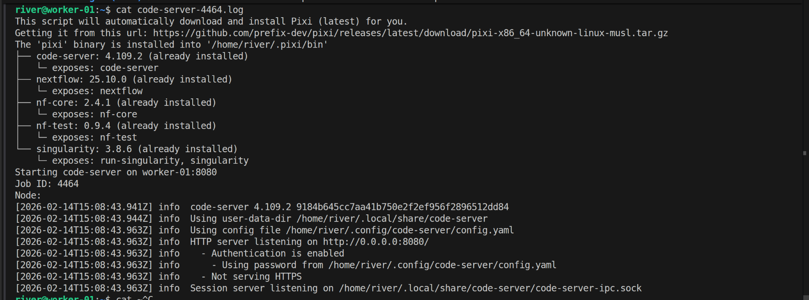
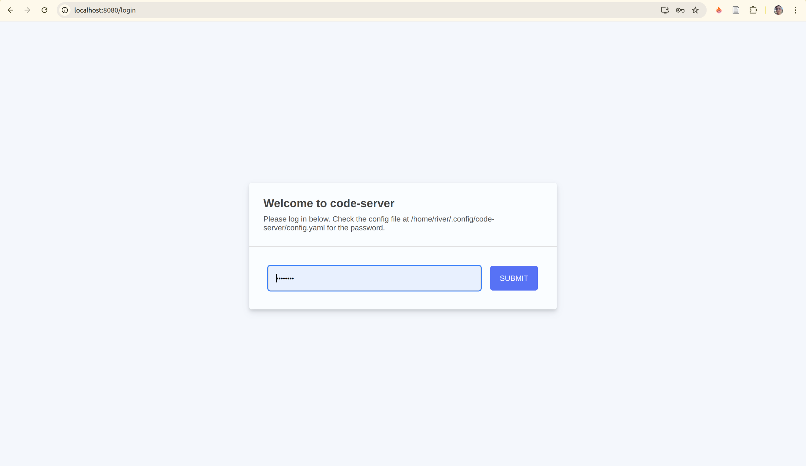
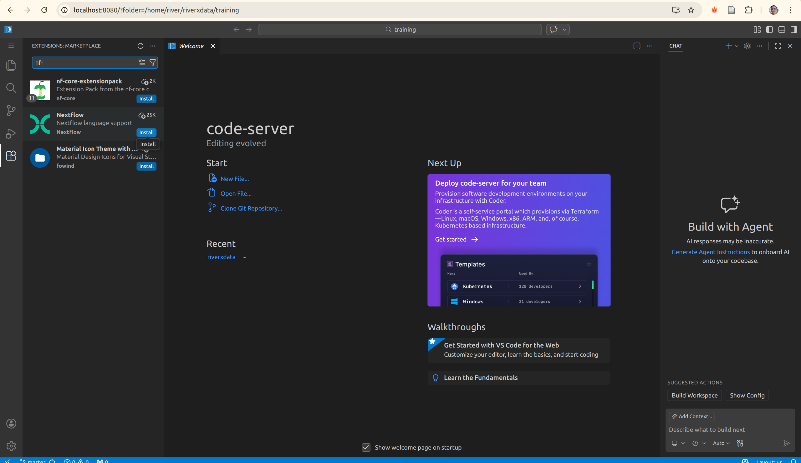
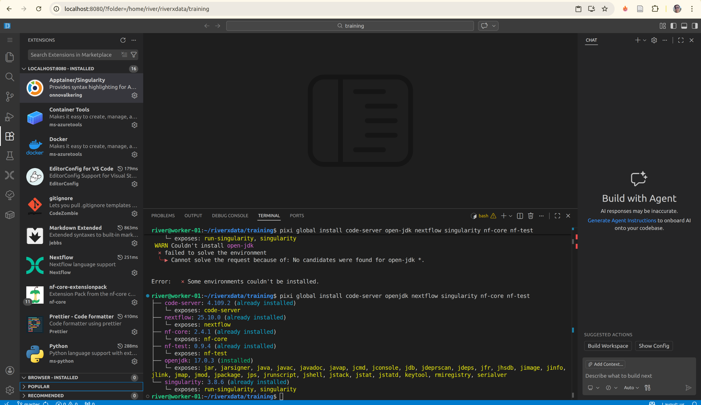
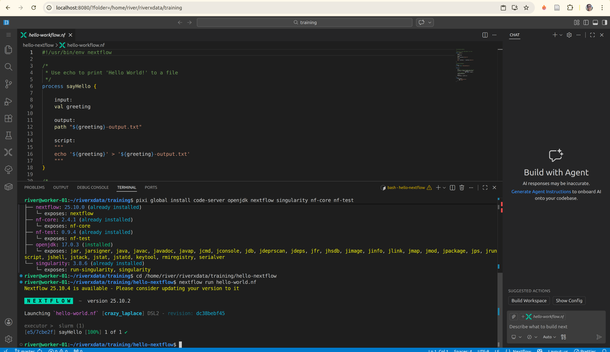

A Nextflow training environment that works both on a laptop and on an HPC cluster is convenient for a team working through the same exercises. [code-server](https://github.com/coder/code-server) runs VS Code in a browser and can be started as a Slurm job on a compute node, so trainees only need a browser and an SSH connection rather than a local installation.

This guide covers launching code-server as a Slurm job, reaching it from a local machine through an SSH tunnel, installing the relevant VS Code extensions, and verifying that Nextflow, Singularity, nf-core and nf-test are available.

For an introduction to Pixi and package management, see our post on [Pixi, a conda-based package manager](/en/blogs/pixi-is-new-conda-based-era).

<!--truncate-->

## 1. Install code-server with Pixi

Code-server runs VS Code in a browser, which makes it usable on a cluster without installing an editor locally. It is installed here through Pixi so that the tool versions are managed alongside the rest.

### 1.1. What is code-server?

Code-server runs VS Code in a browser, giving the familiar interface while working on a remote system. This suits:
- HPC cluster environments
- shared computing resources
- working from several machines
- team collaboration on training projects

### 1.2. Understanding Pixi

Pixi is a package manager that can install tools such as Nextflow and Singularity. For more detail on Pixi, see our post on [Pixi, a conda-based package manager](/en/blogs/pixi-is-new-conda-based-era).

In this guide, Pixi manages code-server, Nextflow, Singularity and the nf-core tools inside a SLURM job.

### 1.3. Launch code-server as a Slurm job

Submitting code-server as a Slurm batch job allocates the resources it needs and keeps it running on a compute node.

Create a Slurm job script that installs and starts code-server:

```bash
# Create sbatch script
cat > ~/code-server-job.sh << 'EOF'
#!/bin/bash
#SBATCH --job-name=code-server
#SBATCH --time=24:00:00
#SBATCH --cpus-per-task=2
#SBATCH --mem=4GB
#SBATCH --output=%x-%j.log

# Install Pixi (one time per node)
curl -fsSL https://pixi.sh/install.sh | bash
export PATH="$HOME/.pixi/bin:$PATH"

# Install code-server and all tools using Pixi
pixi global install code-server open-jdk nextflow singularity nf-core nf-test

# Create code-server configuration directory
mkdir -p ~/.config/code-server

# Create configuration file
cat > ~/.config/code-server/config.yaml << 'CONFIGEOF'
bind-addr: 127.0.0.1:8080
auth: password
password: your-secure-password
cert: false
CONFIGEOF

# Start code-server
echo "Starting code-server on $HOSTNAME:8080"
echo "Job ID: $SLURM_JOB_ID"
echo "Node: $SLURM_NODENAME"

code-server --bind-addr 0.0.0.0:8080
EOF

# Make script executable
chmod +x ~/code-server-job.sh

# Submit the job
sbatch ~/code-server-job.sh
```

Check the job status and find the node it is running on:

```bash
# Check running jobs
squeue -u $USER

# You should see output like:
# JOBID PARTITION     NAME     USER ST       TIME  NODES NODELIST(REASON)
# 12345       gpu code-serv    user  R       0:15      1 compute-node-05

# Check the log file for connection details
cat code-server-12345.log
```


## 2. Access code-server from a local machine via an SSH tunnel

Code-server is running on a compute node through the Slurm job. To reach it from a local machine, an SSH tunnel is created through the login node to that compute node.

### 2.1. Find the code-server job node

First, identify which compute node the code-server job is running on:

```bash
# SSH into HPC login node
ssh user@hpc.server.edu

# Check your running jobs
squeue -u $USER

# Output example:
# JOBID PARTITION     NAME     USER ST       TIME  NODES NODELIST(REASON)
# 12345      multi code-serv    user  R       5:30      1 worker-01

# Note the node name (worker-01 in this example)

# Verify code-server is running
ssh worker-01 'curl http://localhost:8080' 2>/dev/null | head -5
```

### 2.2. Create the SSH tunnel from the local machine

Port forwarding is set up from the local machine through the login node to the compute node running code-server:

```bash
# Replace worker-01 with your actual node name
# This creates a tunnel: local:8080 → login node → worker-01:8080
ssh -L 8080:worker-01:8080 user@hpc.server.edu

# Keep this terminal open while using code-server
# Open browser and navigate to: http://localhost:8080
# Enter password: your-secure-password (from sbatch script)
```

**The tunnel command format is:**
```bash
ssh -L local_port:compute_node:remote_port user@login_node
```

Where:
- `local_port`: port on the local machine (8080)
- `compute_node`: the node name from `squeue` (e.g. worker-01)
- `remote_port`: the port code-server listens on (8080)
- `login_node`: your HPC login node (hpc.server.edu)

### 2.3. Background tunnel (optional)

For a persistent tunnel that does not require keeping a terminal open:

```bash
# Run tunnel in background
ssh -L 8080:worker-01:8080 user@hpc.server.edu -N -f

# To close the tunnel later
killall ssh
```

:::warning
`killall ssh` terminates every `ssh` process owned by the current user, which may close other sessions as well. Consider closing the specific tunnel instead.
:::

### 2.4. SSH config convenience setup

For repeated access, add the HPC host to `~/.ssh/config` on the local machine:

```
Host hpc-dev
    HostName hpc.server.edu
    User your_username
    LocalForward 8080 localhost:8080
    ServerAliveInterval 60
    ServerAliveCountMax 3
```

Then connect with:

```bash
ssh hpc-dev
# Port 8080 is now forwarded to your HPC's code-server
```

**Note:** this SSH config method forwards to `localhost:8080` on the login node. For the SLURM compute-node setup, use the direct command instead, with the compute node hostname.

### 2.5. Access code-server

With the tunnel active, open a browser and navigate to:

```
http://localhost:8080
```

Enter the password from the code-server configuration. The VS Code welcome screen should appear.



## 3. Install extensions and verify the tools

With code-server reachable from the local machine, the next step is to install the relevant extensions and verify the tools.

### 3.1. Verify the tools

First, confirm that the tools were installed in the code-server job:

```bash
# In the code-server terminal (access via http://localhost:8080)
# Check installed tools

nextflow -v
singularity --version
nf-core --version
nf-test --version
```

If a tool is missing, it can be installed from the same terminal:

```bash
# Install any missing tools
pixi global install nextflow singularity nf-core nf-test
```

### 3.2. Install code-server extensions in the browser

Extensions can be installed directly in code-server:

1. Open the Extensions marketplace (Ctrl+Shift+X or Cmd+Shift+X) or the extensions panel in the sidebar, and search for **nf-core-extensionpack**, a collection of extensions that supports Nextflow development.



2. Confirm the installation:
   - **nf-core-extensionpack**: the set of extensions used for Nextflow training



### 3.3. Test the setup

With the tools and extensions installed, run a simple test:

```bash
# In the code-server terminal, run a simple test
nextflow run hello-world.nf
```


## 4. Practices and tips

For recurring training sessions, a few small scripts make the setup more convenient.

### 4.1. A persistent code-server alias

For regular training, an alias or script can streamline job submission:

```bash
# Add to ~/.bashrc
alias submit-code-server='sbatch ~/code-server-job.sh && sleep 5 && squeue -u $USER | grep code-server'

# Now you can easily submit with:
submit-code-server
```

### 4.2. A submission helper script

A script can also set up the tunnel automatically:

```bash
# Save as ~/tunnel-to-code-server.sh on your LOCAL machine
#!/bin/bash

# SSH to HPC and check code-server job
NODE=$(ssh user@hpc.server.edu "squeue -u \$USER --format=%N --noheader | grep compute" | head -1)

if [ -z "$NODE" ]; then
    echo "No compute node found. Submit code-server job first!"
    exit 1
fi

echo "Found code-server on node: $NODE"
echo "Creating tunnel to http://localhost:8080"
echo "Press Ctrl+C to close tunnel"

ssh -L 8080:$NODE:8080 user@hpc.server.edu
```

Make it executable and use it:

```bash
chmod +x ~/tunnel-to-code-server.sh
~/tunnel-to-code-server.sh
```

### 4.3. Security considerations

- use a strong, unique password in `config.yaml`
- forward only port 8080 over SSH; do not expose it to the internet
- rotate passwords regularly for training accounts
- set the Slurm job time limit to a suitable value (24 hours in the example)
- cancel unused code-server jobs to free resources

### 4.4. Resource allocation

The example Slurm script allocates:

- **2 CPUs**: enough for code-server and light development
- **4GB RAM**: comfortable for code-server and terminal work
- **24 hours**: a full day of work

These can be adjusted:

```bash
# For heavier computation (running larger workflows)
#SBATCH --cpus-per-task=4
#SBATCH --mem=8GB

# For shorter sessions (testing)
#SBATCH --time=4:00:00

# To use GPU (if available)
#SBATCH --gres=gpu:1
```

## 5. Recap

### What this setup provides

The result is a Nextflow training environment with:

**Infrastructure:**
- code-server running as a persistent Slurm job on HPC compute nodes
- SSH tunnelling for remote access from a local machine
- a browser-based VS Code interface reachable from anywhere with an SSH client

**Tools and frameworks:**
- the Nextflow workflow engine with Slurm integration
- Singularity for HPC-compatible containers
- the nf-core pipeline framework
- nf-test for pipeline validation

**Configuration:**
- Nextflow configured with Singularity support
- Slurm execution profiles for job submission
- code-server with password authentication

### Key points

1. **Single sbatch script deployment**: Pixi, code-server, Nextflow, Singularity, nf-core and nf-test are installed in one SLURM job.
2. **SSH tunnel access**: multi-hop SSH tunnelling (`local → login node → compute node`) reaches code-server without exposing the HPC system.
3. **Persistent development environment**: code-server runs as a managed Slurm job, so it survives network disconnections.
4. **Browser-based IDE**: VS Code in the browser works on any device with an SSH client, without a local installation.
5. **SLURM integration**: Nextflow is configured to submit individual workflow tasks to Slurm.
6. **Suitable for training**: the setup can be reused for team training and for reproducible Nextflow work.

### Quick reference workflow

```bash
# Step 1: Submit code-server job (one time)
sbatch ~/code-server-job.sh

# Step 2: Find compute node
squeue -u $USER

# Step 3: Create SSH tunnel (from local machine)
ssh -L 8080:worker-01:8080 user@hpc.server.edu

# Step 4: Access in browser
http://localhost:8080

# Step 5: Run workflows
nextflow run main.nf -profile singularity
```

### Next steps

1. **Customize the sbatch script** for the HPC environment (queue names, account information, and so on)
2. **Test the setup** with a simple `nf-core` workflow
3. **Create training pipelines** with `nf-core create`
4. **Invite trainees** to use the same environment
5. **Monitor resources** with Slurm commands (`squeue`, `sacct`, `sinfo`)

### Troubleshooting tips

- if code-server will not start, check the log file: `cat code-server-*.log`
- if the SSH tunnel fails, verify that the compute node is reachable: `ssh user@hpc.server.edu ssh worker-01 hostname`
- if a tool is missing, reinstall it with: `pixi global install nextflow singularity nf-core nf-test`
- for a persistent tunnel, the helper script in section 4.2 can be used

## References

- Nextflow documentation: [nextflow.io/docs/latest](https://www.nextflow.io/docs/latest/)
- nf-core: [nf-co.re](https://nf-co.re/)
- nf-test: [nf-test.com](https://www.nf-test.com/)
- Apptainer / Singularity: [apptainer.org](https://apptainer.org/)
- code-server: [github.com/coder/code-server](https://github.com/coder/code-server)
- Slurm documentation: [slurm.schedmd.com](https://slurm.schedmd.com/)
- OpenSSH manual pages: [openssh.com/manual.html](https://www.openssh.com/manual.html)
- Pixi: [pixi.sh](https://pixi.sh)
