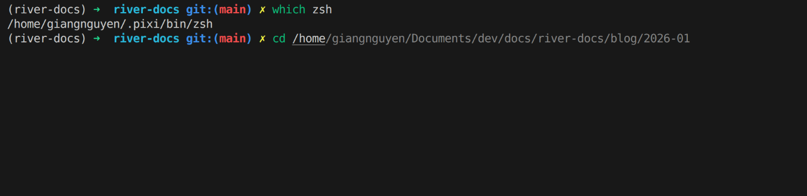

Bash is the default login shell on most Linux systems, and it remains the most portable choice for scripts. For interactive use, however, Zsh (Z Shell) adds features that Bash does not have by default: history-based suggestions, syntax highlighting, and a prompt that can show Git status and other context.

This guide covers installing Zsh with Pixi, which does not require administrator rights, then configuring Oh My Zsh, a few plugins and a theme. The same setup works on Linux, macOS, WSL, and HPC clusters, and the configuration can be kept in a dotfiles repository.

<!--truncate-->

After completing this setup, the terminal will have:

- **Admin-free installation:** works on systems where `sudo` is not available, including HPC clusters
- **Git awareness:** the current branch and status appear in the prompt
- **Suggestions:** history-based completion and live validation as commands are typed



## 1. Why use Zsh for interactive work?

Zsh is a shell designed for interactive use that extends Bash with:

- **Tab completion** - context-aware suggestions for commands, files and arguments
- **Spelling correction** - suggests corrections for typos
- **A plugin ecosystem** - plugins for Git, Docker, Python and more
- **Themes** - customisable prompts with Git status and system information
- **Improved history** - shared history across sessions and better search
- **Advanced globbing** - recursive patterns such as `**/*.txt`

For daily interactive terminal work, Zsh is a reasonable upgrade. For scripts, Bash remains the more portable choice, since it is available almost everywhere by default.

---

## 2. Installation: Zsh with Pixi (no administrator rights)

Pixi `global install` can install Zsh without `sudo` or administrator access. This works on Linux, macOS, WSL and HPC clusters.

### 2.1. Prerequisites

Before installing Zsh with Pixi:

1. **Pixi installed** - see [Pixi, a conda-based package manager](/en/blogs/pixi-is-new-conda-based-era) for setup
2. **No admin or sudo required**

**Verify Pixi is ready:**
```bash
pixi --version
# Should output: pixi X.X.X
```

### 2.2. Install Zsh globally with Pixi

The installation is a single command:

```bash
# Install Zsh globally from conda-forge
pixi global install zsh --channel conda-forge
```

### 2.3. Reload the terminal and use Zsh

After installation, open a new terminal or reload the current one:

```bash
# Option 1: Open a new terminal window
# Close current terminal and open a new one

# Option 2: Reload current terminal
exec bash

# Then verify Zsh is available
zsh --version

# Check where it's installed
which zsh
# Output: $HOME/.pixi/bin/zsh

# Launch Zsh
zsh
```

Pixi adds `~/.pixi/bin` to `PATH` in new terminals automatically.

### 2.4. Update or reinstall Zsh

```bash
# Update Zsh to latest version
pixi global upgrade zsh

# Reinstall with specific version
pixi global install zsh==5.9 --channel conda-forge --force

# List all globally installed packages
pixi global list

# Check Zsh version
zsh --version
```

### 2.5. Why use `pixi global install` for Zsh?

- **One-line installation** - no project required
- **No admin or sudo required** - installs into the user's home directory
- **Automatically available** - reload the terminal, no `PATH` export needed
- **Reproducible** - the same Zsh version across machines
- **Isolated** - does not affect the system Zsh
- **HPC-friendly** - works on restricted clusters
- **Easy updates** - `pixi global upgrade`
- **conda-forge channel** - a well-maintained package source

---

## 3. Oh My Zsh

With Zsh installed through Pixi, Oh My Zsh can manage plugins and themes.

### 3.1. What is Oh My Zsh?

[**Oh My Zsh**](https://ohmyz.sh/) is an open-source framework for managing Zsh configuration. It provides:

- a large collection of plugins (Git, Docker, Python, Node, kubectl and others)
- a large collection of themes
- an auto-update system
- configuration through a single `.zshrc` file

The main advantage is that it avoids writing complex Zsh configuration from scratch and offers community-maintained plugins and themes that work across Linux, macOS and WSL.

### 3.2. Install Oh My Zsh

```bash
# Install via curl
sh -c "$(curl -fsSL https://raw.githubusercontent.com/ohmyzsh/ohmyzsh/master/tools/install.sh)"

# Or via wget
sh -c "$(wget -O- https://raw.githubusercontent.com/ohmyzsh/ohmyzsh/master/tools/install.sh)"
```

What happens:

1. creates a `~/.oh-my-zsh/` directory
2. backs up an existing `~/.zshrc` to `~/.zshrc.pre-oh-my-zsh`
3. creates a new `~/.zshrc` with the default Oh My Zsh configuration
4. sets Zsh as the default shell (if it is not already)

**Verify the installation:**
```bash
# Open a new terminal (or run)
exec zsh

# You should see a colorful prompt with Oh My Zsh
```

### 3.3. The `.zshrc` file

The `~/.zshrc` file is Zsh's configuration file, analogous to `.bashrc` for Bash:

```bash
# Open in your favorite editor
nano ~/.zshrc
# or
vim ~/.zshrc
# or
code ~/.zshrc  # VS Code
```

**Key sections in `.zshrc`:**
```bash
# Path to Oh My Zsh installation
export ZSH="$HOME/.oh-my-zsh"

# Theme configuration
ZSH_THEME="robbyrussell"

# Plugins to load
plugins=(git)

# Load Oh My Zsh
source $ZSH/oh-my-zsh.sh

# Your custom aliases and functions go below
```

**Apply changes:**
```bash
# After editing .zshrc, reload configuration
source ~/.zshrc
```

---

## 4. Plugins

### 4.1. Built-in plugins

Oh My Zsh includes several plugins. The Git and Docker plugins can be enabled in `~/.zshrc`:

```bash
plugins=(
  git              # Git aliases: gst, ga ., gcmsg, gp, gl, glol
  docker           # Docker aliases: dps, di, dstop
)
```

**Reload:**
```bash
source ~/.zshrc
```

### 4.2. External plugins

Two external plugins are commonly added:

#### 1. **zsh-autosuggestions** - history-based completion

Shows suggestions from history as text is typed (in grey). Press the right arrow to accept.

```bash
git clone https://github.com/zsh-users/zsh-autosuggestions ${ZSH_CUSTOM:-~/.oh-my-zsh/custom}/plugins/zsh-autosuggestions

# Add to ~/.zshrc plugins
plugins=(... zsh-autosuggestions)
source ~/.zshrc
```

**Usage:**
```bash
# Type a previous command prefix
git c<press right arrow>  # Auto-completes: git commit

# Cycle through suggestions
git <press up/down>  # Cycle through previous 'git' commands
```

#### 2. **zsh-syntax-highlighting** - live command validation

Highlights commands as they are typed: green for valid, red for invalid.

```bash
git clone https://github.com/zsh-users/zsh-syntax-highlighting.git ${ZSH_CUSTOM:-~/.oh-my-zsh/custom}/plugins/zsh-syntax-highlighting

# Add to ~/.zshrc plugins (must be LAST)
plugins=(... zsh-syntax-highlighting)
source ~/.zshrc
```

This helps catch typos before pressing Enter.

### 4.3. Complete plugin setup

```bash
# Edit ~/.zshrc
plugins=(
  git
  docker
  zsh-autosuggestions
  zsh-syntax-highlighting
)

source ~/.zshrc
```

---

## 5. Themes

### 5.1. Powerlevel10k

[**Powerlevel10k**](https://github.com/romkatv/powerlevel10k) is a popular Zsh theme with Git status, Python version and an interactive configuration wizard.

```bash
# Install
git clone --depth=1 https://github.com/romkatv/powerlevel10k.git ${ZSH_CUSTOM:-$HOME/.oh-my-zsh/custom}/themes/powerlevel10k

# Set in ~/.zshrc
ZSH_THEME="powerlevel10k/powerlevel10k"

# Reload - configuration wizard will launch
source ~/.zshrc
```

**The prompt can show:**
```bash
┌──(user@hostname)-[~/my-repo]-[main ✓]-[🐍 3.11.4]
└─$ 
```

- `main ✓` - the Git branch with its status
- `🐍 3.11.4` - the active Python version
- Git icons: `✓` (clean), `!` (changes), `+` (staged)

**Reconfigure at any time:**
```bash
p10k configure
```

---

## 6. Developer workflows

### 6.1. Git integration

With Oh My Zsh's Git plugin and the Powerlevel10k theme:

**Git aliases (from the `git` plugin):**
```bash
# Common commands
gst       # git status
ga .      # git add .
gcmsg     # git commit -m "message"
gp        # git push
gl        # git pull
gco       # git checkout
gcb       # git checkout -b (new branch)
glog      # git log --oneline --graph
```

**Git status in the prompt:**
```bash
# Your prompt shows:
~/my-repo (main ✓)      # Clean repo
~/my-repo (main !)      # Uncommitted changes
~/my-repo (feat/new-feature +) # Staged changes
```

**View all Git aliases:**
```bash
alias | grep git
```

### 6.2. Docker workflows

Enable the `docker` and `docker-compose` plugins:

```bash
# ~/.zshrc
plugins=(... docker docker-compose)
```

**Docker aliases:**
```bash
# Common commands
dps       # docker ps
di        # docker images
dex       # docker exec -it
dstop     # docker stop
drm       # docker rm
drmf      # docker rm -f
```

**Docker autocomplete:**
```bash
docker <TAB>              # Shows all commands
docker run <TAB>          # Shows images
docker exec <TAB>         # Shows running containers
```

---

## 7. Syncing the Zsh configuration across machines

A dotfiles repository can keep the Zsh configuration the same on a laptop and an HPC cluster. Since HPC clusters usually mount home directories over NFS, the configuration is then available on compute nodes as well.

### 7.1. Create a dotfiles repository

**On the laptop:**

```bash
# Create dotfiles directory
mkdir -p ~/dotfiles
cd ~/dotfiles

# Initialize Git
git init

# Copy your Zsh config
cp ~/.zshrc zshrc

# Add and commit
git add zshrc
git commit -m "Initial commit: Zsh config"

# Create GitHub repo and push
git remote add origin https://github.com/yourusername/dotfiles.git
git branch -M main
git push -u origin main
```

### 7.2. Link the config on each machine

**On the laptop or HPC login node (after cloning):**

```bash
# Clone dotfiles
git clone https://github.com/yourusername/dotfiles.git ~/dotfiles

# Create symlink to Zsh config
rm ~/.zshrc  # Backup original if needed
ln -s ~/dotfiles/zshrc ~/.zshrc

# Verify
cat ~/.zshrc | head -5
```

### 7.3. HPC workflow

Most HPC clusters mount home directories over NFS, so the `~/dotfiles` repository is available on compute nodes without additional setup.

```bash
# On HPC login node
git clone https://github.com/yourusername/dotfiles.git ~/dotfiles
ln -s ~/dotfiles/zshrc ~/.zshrc

# Your config is now available on all compute nodes via shared home!
# Launch Zsh on any node:
zsh
```

**Benefits for HPC:**
- one config file for login and compute nodes
- no need to configure Zsh separately on each machine
- updates are a `git pull` in `~/dotfiles`

### 7.4. Update the config on all machines

```bash
# Edit ~/.zshrc on desktop
nano ~/.zshrc

# Commit and push changes
cd ~/dotfiles
git add zshrc
git commit -m "Update: Add new alias"
git push

# On HPC, pull latest config
cd ~/dotfiles
git pull

# Changes take effect in new terminal session
exec zsh
```

---

## 8. Next steps

The shell is now configured with Zsh and Oh My Zsh, without administrator privileges, and the same configuration can be used on a laptop, under WSL and on an HPC cluster.

**Suggested next steps:**
1. **Back up the config** - commit `~/.zshrc` to a dotfiles repository (section 7)
2. **Explore more plugins** - the Oh My Zsh catalogue is at https://github.com/ohmyzsh/ohmyzsh/wiki/Plugins
3. **Learn the Git shortcuts** - run `alias | grep git` to list the aliases from the plugin
4. **Use the same config on HPC** - clone the dotfiles repository on the cluster

**Related posts:**
- [Pixi, a conda-based package manager](/en/blogs/pixi-is-new-conda-based-era) - package management without admin rights
- [Containers on HPC: Docker to Singularity](/en/blogs/containers-hpc-docker-singularity-apptainer) - reproducible environments on clusters
- [Building a reproducible GATK variant-calling Bash workflow with Pixi (Part 1)](/en/blogs/gatk-variant-calling-bash-workflow-pixi-part1) - a worked Pixi + HPC example
- [Building a Slurm HPC cluster (Part 1)](/en/blogs/how-to-build-slurm-hpc-part-1) - HPC infrastructure guide

## References

- Zsh: [zsh.org](https://www.zsh.org/)
- Oh My Zsh: [ohmyz.sh](https://ohmyz.sh/)
- Oh My Zsh plugins wiki: [github.com/ohmyzsh/ohmyzsh/wiki/Plugins](https://github.com/ohmyzsh/ohmyzsh/wiki/Plugins)
- zsh-autosuggestions: [github.com/zsh-users/zsh-autosuggestions](https://github.com/zsh-users/zsh-autosuggestions)
- zsh-syntax-highlighting: [github.com/zsh-users/zsh-syntax-highlighting](https://github.com/zsh-users/zsh-syntax-highlighting)
- Powerlevel10k: [github.com/romkatv/powerlevel10k](https://github.com/romkatv/powerlevel10k)
- Pixi: [pixi.sh](https://pixi.sh)
