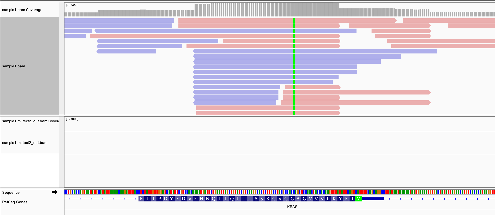

This post is a practical starting point for a germline variant calling workflow. It begins with a straightforward approach: bash scripts, plus a reproducible environment managed by Pixi. Later posts in the series look at moving the same workflow to Nextflow, where optimization, customization and additional tooling can be considered.

<!--truncate-->

:::info
The code for this tutorial is available in the GitHub repository: **https://github.com/nttg8100/nf-germline-short-read-variant-calling/tree/0.1.0**
:::

## Series overview

This is a five-part series that takes a germline variant calling workflow from a bash script to a production deployment:

1. **Part 1 (this post)** — a bash workflow with a reproducible Pixi environment.
2. [Part 2 — from Bash to Nextflow](/en/blogs/gatk-variant-calling-bash-to-nextflow-validation-part2): migrating the same steps and checking that the results agree.
3. [Part 3 — production-scale deployment](/en/blogs/gatk-variant-calling-production-slurm-optimization-part3): SLURM configuration and per-tool resource tuning.
4. [Part 4 — testing and linting](/en/blogs/gatk-variant-calling-production-slurm-optimization-part4): lint rules and `nf-test` snapshots.
5. [Part 5 — benchmarking](/en/blogs/gatk-variant-calling-production-slurm-optimization-part5): scoring the pipeline against the GIAB HG002 truth set.

## Prerequisites and related reading

Before starting, it helps to be familiar with:

1. [Pixi — a new conda-based era](/en/blogs/pixi-is-new-conda-based-era) — the package management setup used here.
2. [Containers on HPC: from Docker to Singularity and Apptainer](/en/blogs/containers-hpc-docker-singularity-apptainer) — container fundamentals for reproducibility.
3. [Version control — Git's role in reproducible bioinformatics (Part 1)](/en/blogs/how-to-version-control-git-bioinformatics-part-1) — version control basics.

## 1. The GATK variant calling workflow

### 1.1 Understanding the workflow

The [NGS101 GATK tutorial](https://ngs101.com/how-to-analyze-whole-genome-sequencing-data-for-absolute-beginners-part-1-from-raw-reads-to-high-quality-variants-using-gatk/) offers a clear introduction to germline variant calling. This section follows the ten steps described there so the structure of the pipeline is easy to follow.

Germline variant calling is a core part of DNA sequencing analysis on whole-genome data. DNA consists of 23 pairs of chromosomes and more than three billion base pairs. Individuals share the same overall structure, but the exact nucleotide sequence (A, T, C, G) differs between them; these differences are called variants.

The Human Genome Project established a reference genome, which is used as a template for comparing individual genomes. Variants are the differences between an individual's DNA and that reference. Most variants are benign and simply contribute to individual variation.

The figure below illustrates how paired-end reads (red and blue) are aligned to the reference genome. When a read differs from the reference at a position (highlighted in green), a variant may be present. If several reads support the same difference, the evidence for a real variant increases.



Reference: https://gatk.broadinstitute.org/hc/en-us/community/posts/360077647812-Why-do-a-clear-expected-variant-not-show-up-in-the-Mutect2-vcf-file

To identify variants with reasonable confidence, short sequencing reads must be aligned accurately to the reference. Germline variants are inherited and typically appear in roughly 40–50% of reads when heterozygous (inherited from one parent) or close to 100% when homozygous (inherited from both). Somatic mutations arise in cells that were not inherited, for example in cancer, and usually require comparing tumour and normal samples to separate true somatic variants from inherited ones.

Following these foundational steps provides a workable germline variant calling workflow and a basis for understanding the biology behind each stage.

### 1.2 Data

Many public datasets can be used to develop a variant calling workflow. For this tutorial we use the small test dataset provided by [nf-core/sarek](https://github.com/nf-core/sarek), which is intended for rapid pipeline prototyping.

Working with a manageable, representative subset is helpful during development. Datasets such as sarek's are typically built by extracting raw reads that align to a specific genomic region. One approach is to align the original FASTQ files to the reference genome with a short bash script, then keep only the reads mapped to a region such as `chr22:100,000-200,000`. In the same spirit, the reference genome can be subset to `chr22:1-250,000`. This reduces the input size considerably and speeds up testing and iteration. Once the workflow is validated on the small dataset, it can be run against the full dataset.

### 1.3 Step-by-step explanation

#### 1.3.1 Quality control of raw reads (FastQC)

- Assess read quality metrics.
- Identify potential sequencing issues.
- Generate HTML reports.

```bash
# download raw small data
wget https://raw.githubusercontent.com/nf-core/test-datasets/modules/data/genomics/homo_sapiens/illumina/fastq/test_1.fastq.gz
# view file
zcat test_1.fastq.gz|head
```

**Understanding the FASTQ file structure**

```
@normal#21#998579#1/1
CCTTCTCCCTGCTGGGGTTGCTTGTCAGTAGCGGGCAAGGTAGGAGTGTGGCGCTTTATTGCATTTACTTTCCCTCCCCCTTCCCCCCGGCCAAGAGAGG
+
102302000331;3333;23133320233330*33/233333333333333/313232333/3;3;3/333000;11/00;;01//103*1032323233
@normal#21#998572#2/1
CTCCTCTCCTTCTACCTGCTGGGGTTGCTTGTCAGTAGCGGGCAAGGTCGGAGTGTTGCGCTTTATTGCATTTACTTTCCCTCCCCCTTCCACCCGGCCA
+
/201302/0330;30033133333;230;333033333033300333203333333;*03133;223300;2;3/33211/210001;2/13/0133//3
@normal#21#998620#3/1
AGGAGTGGGCGCTTTATTGCATTTACTTTCCGTCCCCCTTCCACCCGGCCAAGAGAGGCAAAGAGGGAGGCCAGGAAGAATGAAATGAAAGAACTAAA
```

A FASTQ file is the standard format for storing raw sequencing reads from NGS platforms. Each read is represented by four lines:

1. **Sequence identifier** (starts with `@`): information about the read, for example instrument, run and coordinates.
2. **Nucleotide sequence**: the actual DNA bases (A, T, C, G or N).
3. **Separator line** (starts with `+`): may repeat the identifier or be a simple plus sign.
4. **Quality scores**: ASCII-encoded Phred quality scores for each base in the sequence.

**Example:**

```
@normal#21#998579#1/1
CCTTCTCCCTGCTGGGGTTGCTTGTCAGTAGCGGGCAAGGTAGGAGTGTGGCGCTTTATTGCATTTACTTTCCCTCCCCCTTCCCCCCGGCCAAGAGAGG
+
102302000331;3333;23133320233330*33/233333333333333/313232333/3;3;3/333000;11/00;;01//103*1032323233
```

- The **first line** is the read name.
- The **second line** is the sequence.
- The **third line** is a separator.
- The **fourth line** encodes the quality of each base (the same length as the sequence).

This structure repeats for every read in the file. Trimming is usually applied to reads of low quality; otherwise they may align poorly to the reference and reduce the reliability of variant calling.

#### 1.3.2 Trim reads (Trim Galore)

- The aim is simply to trim low-quality reads.
- With Trim Galore, FastQC is re-run on the trimmed data so the result can be checked — to confirm that reads were trimmed as expected and that not too much data was removed.

#### 1.3.3 Align to the reference genome

Download the reference genome and inspect its structure:

```bash
# Download reference genome
wget https://raw.githubusercontent.com/nf-core/test-datasets/modules/data/genomics/homo_sapiens/genome/genome.fasta
head genome.fasta
```

The first ten lines below simply show the reference as an ordered sequence of A, T, C and G. Comparing a read against the reference by eye is not practical, so we use `bwa`, which performs the comparison much faster. Ben Langmead's lecture series explains the algorithm behind this in more detail: https://www.youtube.com/watch?v=6BJbEWyO_N0&list=PL2mpR0RYFQsADmYpW2YWBrXJZ_6EL_3nu&index=4

```bash
>chr22
ACTCAAGATAATGATGAGTAAAGAATATATTTCTAACAACAAAAAGGAAATTTGATAGTA
TTTCTAAAGACAAAAAGGAAATTTGTATTCACATTCAGTTAGTCATTCCACCAGAATGAC
TTCATCACACAATATTTTGTGACAAGAACCTGAACAGCCTCATGTTTTACAATATTCTTT
TCATCTTTTATTATATGCACCAAAATTTTCTTTTTTAAATTTTCTTGAACCTCTAAATCT
ACTTTAAAAATTTACCTGATACACTTTTTAAATGGACAAATGCTGAAGGTAGCTGTGTAT
ACAAATGTGACTAGAAGGAAAAAGATGATGTAGAAATACAATAACTCCTTGAGTTGATCA
TTCTGATTGGCATTTATAGAGTAGAAATGTTTTGTAATTACAGAGGAAAAAAGATGGCCT
TTCCTTCAACAGTTATGAGCCGTCAGAATTTTCAAAAATATTGCATTTTGACAATGTAGT
TTCTAGTTTGACAATGATATATTTATCTTCAAAACCAGGAAAATGTAGATAAGGATTTGG
```

The reference should be indexed once and reused, rather than re-indexed on every run while the reference is unchanged:

```bash
# simple command, however, to install bwa, later we use pixi
bwa index genome.fasta
```

#### 1.3.4 Sort and index aligned reads (Samtools)

After alignment, reads are sorted by genomic coordinate with Samtools. Sorting is needed for downstream analysis, in particular for variant calling and visualization, because many tools expect sorted BAM files. Indexing creates a `.bai` file that acts as a table of contents, allowing fast access to specific regions of the BAM file.

#### 1.3.5 Mark duplicates (GATK MarkDuplicates)

GATK MarkDuplicates identifies PCR or optical duplicate reads — reads with identical sequences and alignment positions. Because DNA is fragmented into short reads, true duplicates are rare; most duplicates come from technical artefacts. Marking or removing them prevents them from inflating support for a variant. For example, if 14% of reads support a variant but 10% are duplicates, only 4% represent genuine evidence.

#### 1.3.6 Base quality score recalibration (GATK BaseRecalibrator)

This step models and corrects systematic errors in the base quality scores reported by the sequencer. Using known variant sites, GATK BaseRecalibrator produces a recalibration table that is used to adjust quality scores, which improves the accuracy of downstream variant calls.

```bash
# Download one db, we still have indel database
wget https://raw.githubusercontent.com/nf-core/test-datasets/modules/data/genomics/homo_sapiens/genome/vcf/dbsnp_146.hg38.vcf.gz
# Check first few line, it shows the variant at specific position
zcat dbsnp_146.hg38.vcf.gz|grep -v "#"|head|column -t 
```

```bash
chr22  66   rs568512106  A      G  .  PASS  RS=568512106;RSPOS=16570065;dbSNPBuildID=142;SSR=0;SAO=0;VP=0x050000000005040024000100;WGT=1;VC=SNV;ASP;VLD;KGPhase3;CAF=0.9994,0.000599;COMMON=0
chr22  67   rs371364157  A      G  .  PASS  RS=371364157;RSPOS=16570066;dbSNPBuildID=138;SSR=0;SAO=0;VP=0x050000000005000002000100;WGT=1;VC=SNV;ASP
chr22  68   rs536054182  A      C  .  PASS  RS=536054182;RSPOS=16570067;dbSNPBuildID=142;SSR=0;SAO=0;VP=0x050000000005040024000100;WGT=1;VC=SNV;ASP;VLD;KGPhase3;CAF=0.9994,0.000599;COMMON=0
chr22  91   rs149338188  ACATT  A  .  PASS  RS=149338188;RSPOS=16570091;dbSNPBuildID=134;SSR=0;SAO=0;VP=0x05000000000515003e000200;WGT=1;VC=DIV;ASP;VLD;G5;KGPhase1;KGPhase3;CAF=0.8083,0.1917;COMMON=1
chr22  91   rs75245162   ACATT  A  .  PASS  RS=75245162;RSPOS=16570093;dbSNPBuildID=131;SSR=0;SAO=0;VP=0x050000000005000002000200;WGT=1;VC=DIV;ASP;CAF=0.8083,0.1917;COMMON=1
chr22  96   rs150045226  C      T  .  PASS  RS=150045226;RSPOS=16570095;dbSNPBuildID=134;SSR=0;SAO=0;VP=0x050000000005000002000100;WGT=1;VC=SNV;ASP
chr22  103  rs563344083  TC     T  .  PASS  RS=563344083;RSPOS=16570103;dbSNPBuildID=142;SSR=0;SAO=0;VP=0x050000000005040026000200;WGT=1;VC=DIV;ASP;VLD;KGPhase3;CAF=0.997,0.002995;COMMON=1
chr22  140  rs370473918  T      C  .  PASS  RS=370473918;RSPOS=16570139;dbSNPBuildID=138;SSR=0;SAO=0;VP=0x050000000005000002000100;WGT=1;VC=SNV;ASP
chr22  177  rs553984036  C      A  .  PASS  RS=553984036;RSPOS=16570176;dbSNPBuildID=142;SSR=0;SAO=0;VP=0x050000000005040024000100;WGT=1;VC=SNV;ASP;VLD;KGPhase3;CAF=0.9996,0.0003994;COMMON=0
chr22  208  rs565829750  T      C  .  PASS  RS=565829750;RSPOS=16570207;dbSNPBuildID=142;SSR=0;SAO=0;VP=0x050000000005000024000100;WGT=1;VC=SNV;ASP;KGPhase3;CAF=0.9998,0.0001997;COMMON=0
```

#### 1.3.7 Apply BQSR (GATK ApplyBQSR)

The recalibration table is applied to the BAM file, updating the base quality scores. This produces an analysis-ready BAM file with more reliable quality metrics, which is central to confident variant detection.

#### 1.3.8 Quality assessment

Collect the alignment summary metrics.

#### 1.3.9 Variant calling (GATK HaplotypeCaller)

GATK HaplotypeCaller analyses the recalibrated BAM file to identify SNPs and indels. It performs local assembly of haplotypes and writes variants in VCF or GVCF format, providing the basis for further genotyping and filtering.

#### 1.3.10 Genotype (GATK GenotypeGVCFs)

Genotyping is the process of determining which alleles are present at specific positions in a sample's DNA. GATK GenotypeGVCFs combines variant calls from multiple samples (in GVCF format) into a final set of genotypes, which allows variants to be identified consistently across a cohort.

## 2. Installing the tools

### 2.1 Why Pixi

Pixi has several practical properties for bioinformatics workflows:

- **Fast**: environment resolution is usually much faster than with conda.
- **Reproducible**: lock files pin the exact environment.
- **Simple**: a single `pixi.toml` file describes everything.
- **Cross-platform**: works on Linux, macOS and Windows.

:::tip
For a more detailed discussion of Pixi, see [Pixi — a new conda-based era](/en/blogs/pixi-is-new-conda-based-era).
:::

### 2.2 Creating the project

Create a new directory and initialise the Pixi project:

```bash
mkdir bash-gatk
cd bash-gatk

# install Pixi if not already installed
curl -fsSL https://pixi.sh/install.sh | bash
pixi init
# activate env that is similar to conda
pixi shell
```

Create a `pixi.toml` file, either from the command line or in a code editor:

```toml
[workspace]
name = "bash-gatk"
version = "0.1.0"
description = "GATK variant calling workflow - from bash to Nextflow transformation"
channels = ["conda-forge", "bioconda"]
platforms = ["linux-64"]

[dependencies]
```

To install a tool, run the command below. Pinning a version is advisable; Pixi writes the resolved version into the lock file, so the exact version can be read back from the configuration later.

```bash
# add bwa tools, better with hard version, pixi add lock file while adding hard version that we can quickly check version on the config file
pixi add bwa==0.7.17
# show where you tool is installed
which bwa
```

Tools can be added one at a time. The full set used by the standard workflow described here is:

```toml
[workspace]
name = "bash-gatk"
version = "0.1.0"
description = "GATK variant calling workflow - from bash to Nextflow transformation"
channels = ["conda-forge", "bioconda"]
platforms = ["linux-64"]

[dependencies]
bwa = "==0.7.17"
samtools = "==1.16.1"
gatk4 = "==4.6.2.0"
fastqc = "==0.12.1"
curl = "*"
trim-galore = "==0.6.11"
r-base = "==4.4.0"
```

## 3. Preparing inputs and references

The input data is downloaded once and reused. It does not need to be downloaded on every run.

```bash
#!/bin/bash
#
# Download test data for GATK variant calling pipeline
# This script downloads reference genome, known sites, and test FASTQ files from nf-core
#

set -euo pipefail

echo "=========================================="
echo "Downloading GATK Pipeline Test Data"
echo "=========================================="
echo

# Create directories
echo "Creating directories..."
mkdir -p data reference
echo "✓ Directories created"
echo

# Download reference genome
echo "Downloading reference genome..."
cd reference

curl -L -o genome.fasta \
  https://raw.githubusercontent.com/nf-core/test-datasets/modules/data/genomics/homo_sapiens/genome/genome.fasta
echo "✓ genome.fasta downloaded"

curl -L -o genome.fasta.fai \
  https://raw.githubusercontent.com/nf-core/test-datasets/modules/data/genomics/homo_sapiens/genome/genome.fasta.fai
echo "✓ genome.fasta.fai downloaded"

curl -L -o genome.dict \
  https://raw.githubusercontent.com/nf-core/test-datasets/modules/data/genomics/homo_sapiens/genome/genome.dict
echo "✓ genome.dict downloaded"

# Download known sites for BQSR
echo ""
echo "Downloading known sites VCF files..."

curl -L -o dbsnp_146.hg38.vcf.gz \
  https://raw.githubusercontent.com/nf-core/test-datasets/modules/data/genomics/homo_sapiens/genome/vcf/dbsnp_146.hg38.vcf.gz
echo "✓ dbsnp_146.hg38.vcf.gz downloaded"

curl -L -o dbsnp_146.hg38.vcf.gz.tbi \
  https://raw.githubusercontent.com/nf-core/test-datasets/modules/data/genomics/homo_sapiens/genome/vcf/dbsnp_146.hg38.vcf.gz.tbi
echo "✓ dbsnp_146.hg38.vcf.gz.tbi downloaded"

curl -L -o mills_and_1000G.indels.vcf.gz \
  https://raw.githubusercontent.com/nf-core/test-datasets/modules/data/genomics/homo_sapiens/genome/vcf/mills_and_1000G.indels.vcf.gz
echo "✓ mills_and_1000G.indels.vcf.gz downloaded"

curl -L -o mills_and_1000G.indels.vcf.gz.tbi \
  https://raw.githubusercontent.com/nf-core/test-datasets/modules/data/genomics/homo_sapiens/genome/vcf/mills_and_1000G.indels.vcf.gz.tbi
echo "✓ mills_and_1000G.indels.vcf.gz.tbi downloaded"

cd ..

# Index the reference genome
echo ""
echo "Creating BWA index for reference genome..."
echo "This may take a few moments..."
bwa index reference/genome.fasta
echo "✓ BWA index created"

# Download test FASTQ files
echo ""
echo "Downloading test FASTQ files..."
cd data

curl -L -o sample1_R1.fastq.gz \
  https://raw.githubusercontent.com/nf-core/test-datasets/modules/data/genomics/homo_sapiens/illumina/fastq/test_1.fastq.gz
echo "✓ test_1.fastq.gz downloaded"

curl -L -o sample1_R2.fastq.gz \
  https://raw.githubusercontent.com/nf-core/test-datasets/modules/data/genomics/homo_sapiens/illumina/fastq/test_2.fastq.gz
echo "✓ test_2.fastq.gz downloaded"

cd ..

# Summary
echo ""
echo "=========================================="
echo "Data Download Completed Successfully!"
echo "=========================================="
echo ""
echo "Downloaded files:"
echo "Reference genome:"
ls -lh reference/genome.fasta* reference/genome.dict 2>/dev/null || true
echo ""
echo "BWA indices:"
ls -lh reference/genome.fasta.{amb,ann,bwt,pac,sa} 2>/dev/null || true
echo ""
echo "Known sites VCFs:"
ls -lh reference/*.vcf.gz* 2>/dev/null || true
echo ""
echo "Test FASTQ files:"
ls -lh data/*.fastq.gz 2>/dev/null || true
echo ""
echo "=========================================="
echo "You can now run the pipeline with: Nextflow workflow"
echo "  cd nextflow-gatk; pixi run nextflow run main.nf -profile singularity --input samplesheet.csv"
echo "You can now run the pipeline with: Bash workflow"
echo "  cd nextflow-gatk; pixi run bash gatk_pipeline.sh"
echo "=========================================="
```

## 4. Running the workflow end to end

### 4.1 Running the pipeline

The workflow has the following structure:

```bash
├── bash-gatk
│   ├── gatk_pipeline.sh
│   ├── pixi.lock
│   └── pixi.toml
├── README.md
└── scripts
    ├── download_data.sh
```

Download the data first, then run the variant calling pipeline:

```bash
# Activate env on this folder
pixi shell --manifest-path  bash-gatk
# Run the download script (uses Pixi environment for BWA indexing)
bash scripts/download_data.sh
```

Check that the `data` and `reference` folders are populated as expected:

```bash
├── bash-gatk
│   ├── gatk_pipeline.sh
│   ├── pixi.lock
│   └── pixi.toml
├── data
│   ├── sample1_R1.fastq.gz
│   └── sample1_R2.fastq.gz
├── README.md
├── reference
│   ├── dbsnp_146.hg38.vcf.gz
│   ├── dbsnp_146.hg38.vcf.gz.tbi
│   ├── genome.dict
│   ├── genome.fasta
│   ├── genome.fasta.amb
│   ├── genome.fasta.ann
│   ├── genome.fasta.bwt
│   ├── genome.fasta.fai
│   ├── genome.fasta.pac
│   ├── genome.fasta.sa
│   ├── mills_and_1000G.indels.vcf.gz
│   └── mills_and_1000G.indels.vcf.gz.tbi
└── scripts
    ├── download_data.sh
```

The bash workflow itself is `bash-gatk/gatk_pipeline.sh`:

```bash
#!/bin/bash
#
# GATK Variant Calling Pipeline - Complete Best Practices (10 Steps)
# Based on NGS101 tutorial: https://ngs101.com/how-to-analyze-whole-genome-sequencing-data-for-absolute-beginners-part-1-from-raw-reads-to-high-quality-variants-using-gatk/
# Adapted to use nf-core test data with hard filtering (Option 2)
#
# This pipeline implements the complete GATK workflow with:
# - Adapter trimming and quality filtering (Trim Galore)
# - Read alignment with BWA-MEM
# - Duplicate marking (GATK MarkDuplicates)
# - Base quality score recalibration (BQSR)
# - Alignment quality metrics (GATK CollectMetrics)
# - Variant calling with HaplotypeCaller (GVCF mode)

set -euo pipefail

# Configuration
SAMPLE="${1:-sample1}"  # Accept sample name as first argument, default to sample1
THREADS=2
DATA_DIR="data"
REF_DIR="reference"
RESULTS_DIR="results"

# Reference files
REFERENCE="${REF_DIR}/genome.fasta"
DBSNP="${REF_DIR}/dbsnp_146.hg38.vcf.gz"
KNOWN_INDELS="${REF_DIR}/mills_and_1000G.indels.vcf.gz"

# Input FASTQ files
FASTQ_R1="${DATA_DIR}/${SAMPLE}_R1.fastq.gz"
FASTQ_R2="${DATA_DIR}/${SAMPLE}_R2.fastq.gz"

# Output directories
QC_DIR="${RESULTS_DIR}/qc/${SAMPLE}"
TRIMMED_DIR="${RESULTS_DIR}/trimmed/${SAMPLE}"
ALIGNED_DIR="${RESULTS_DIR}/aligned/${SAMPLE}"
VAR_DIR="${RESULTS_DIR}/var/${SAMPLE}"

# Output files
TRIMMED_R1="${TRIMMED_DIR}/${SAMPLE}_R1_val_1.fq.gz"
TRIMMED_R2="${TRIMMED_DIR}/${SAMPLE}_R2_val_2.fq.gz"
ALIGNED_BAM="${ALIGNED_DIR}/${SAMPLE}.bam"
SORTED_BAM="${ALIGNED_DIR}/${SAMPLE}.sorted.bam"
DEDUP_BAM="${ALIGNED_DIR}/${SAMPLE}_marked_duplicates.bam"
RECAL_TABLE="${ALIGNED_DIR}/${SAMPLE}_recal_data.table"
RECAL_BAM="${ALIGNED_DIR}/${SAMPLE}_recalibrated.bam"
GVCF="${VAR_DIR}/${SAMPLE}.g.vcf.gz"
RAW_VCF="${VAR_DIR}/${SAMPLE}_raw_variants.vcf.gz"
METRICS="${ALIGNED_DIR}/${SAMPLE}_duplicate_metrics.txt"

# Check tools are available
echo "Checking required tools..."
echo "✓ FastQC:" 
fastqc --version
echo "✓ Trim Galore:" 
trim_galore --version
echo "✓ BWA:" 
bwa || true  # BWA doesn't have a --version flag, so we ignore the error
echo "✓ Samtools:" 
samtools --version
echo "✓ GATK:" 
gatk --version
echo "✓ R (for insert size histogram):" 
R --version
echo "All required tools are available."

# Create output directories
mkdir -p ${QC_DIR} ${TRIMMED_DIR} ${ALIGNED_DIR} ${VAR_DIR}

echo "=========================================="
echo "GATK Variant Calling Pipeline - Complete"
echo "Sample: ${SAMPLE}"
echo "Based on NGS101 Best Practices"
echo "=========================================="
echo

# Step 1: Quality Control with FastQC
echo "[$(date)] Step 1: Running FastQC on raw reads..."
fastqc -o ${QC_DIR} -t ${THREADS} ${FASTQ_R1} ${FASTQ_R2}
echo "[$(date)] FastQC completed"
echo

# Step 2: Adapter Trimming and Quality Filtering
echo "[$(date)] Step 2: Adapter trimming with Trim Galore..."
trim_galore \
    --paired \
    --quality 20 \
    --length 50 \
    --fastqc \
    --output_dir ${TRIMMED_DIR} \
    ${FASTQ_R1} ${FASTQ_R2}
echo "[$(date)] Adapter trimming completed"
echo

# Step 3: Read Alignment with BWA-MEM
echo "[$(date)] Step 3: Aligning reads with BWA-MEM..."
bwa mem \
    -t ${THREADS} \
    -M \
    -R "@RG\tID:${SAMPLE}\tSM:${SAMPLE}\tPL:ILLUMINA\tLB:${SAMPLE}_lib" \
    ${REFERENCE} \
    ${TRIMMED_R1} ${TRIMMED_R2} \
    | samtools view -Sb - > ${ALIGNED_BAM}
echo "[$(date)] Alignment completed"
echo

# Step 4: Sort and Index BAM file
echo "[$(date)] Step 4: Sorting BAM file..."
samtools sort -@ ${THREADS} -o ${SORTED_BAM} ${ALIGNED_BAM}
samtools index ${SORTED_BAM}
echo "[$(date)] Sorting completed"
echo

# Step 5: Mark Duplicates
echo "[$(date)] Step 5: Marking duplicates with GATK..."
gatk MarkDuplicates \
    -I ${SORTED_BAM} \
    -O ${DEDUP_BAM} \
    -M ${METRICS} 
echo "[$(date)] Mark duplicates completed"
echo

# Step 6: Base Quality Score Recalibration (BQSR) - Generate table
echo "[$(date)] Step 6: Generating BQSR recalibration table..."
gatk BaseRecalibrator \
    -I ${DEDUP_BAM} \
    -R ${REFERENCE} \
    --known-sites ${DBSNP} \
    --known-sites ${KNOWN_INDELS} \
    -O ${RECAL_TABLE}
echo "[$(date)] BQSR table generated"
echo

# Step 7: Apply BQSR
echo "[$(date)] Step 7: Applying BQSR..."
gatk ApplyBQSR \
    -I ${DEDUP_BAM} \
    -R ${REFERENCE} \
    --bqsr-recal-file ${RECAL_TABLE} \
    -O ${RECAL_BAM}
echo "[$(date)] BQSR applied"
echo

# Step 8: Alignment Quality Assessment
echo "[$(date)] Step 8: Collecting alignment quality metrics..."
gatk CollectAlignmentSummaryMetrics \
    -R ${REFERENCE} \
    -I ${RECAL_BAM} \
    -O ${QC_DIR}/${SAMPLE}_alignment_summary.txt

# Collect insert size metrics with histogram (requires R)
gatk CollectInsertSizeMetrics \
    -I ${RECAL_BAM} \
    -O ${QC_DIR}/${SAMPLE}_insert_size_metrics.txt \
    -H ${QC_DIR}/${SAMPLE}_insert_size_histogram.pdf
echo "[$(date)] Alignment QC completed"
echo

# Step 9: Variant Calling with HaplotypeCaller (GVCF mode)
echo "[$(date)] Step 9: Calling variants with HaplotypeCaller in GVCF mode..."
gatk HaplotypeCaller \
    -R ${REFERENCE} \
    -I ${RECAL_BAM} \
    -O ${GVCF} \
    -ERC GVCF \
    --dbsnp ${DBSNP}
echo "[$(date)] GVCF generation completed"
echo

# Step 10: Genotype GVCFs
echo "[$(date)] Step 10: Genotyping GVCF to VCF..."
gatk GenotypeGVCFs \
    -R ${REFERENCE} \
    -V ${GVCF} \
    -O ${RAW_VCF}
echo "[$(date)] Genotyping completed"
echo
```

```bash
bash bash-gatk/gatk_pipeline.sh
```

The resulting output directory looks like this:

```bash
── results
│   ├── aligned
│   │   └── sample1
│   │       ├── sample1.bam
│   │       ├── sample1_duplicate_metrics.txt
│   │       ├── sample1_marked_duplicates.bai
│   │       ├── sample1_marked_duplicates.bam
│   │       ├── sample1_recal_data.table
│   │       ├── sample1_recalibrated.bai
│   │       ├── sample1_recalibrated.bam
│   │       └── sample1.sorted.bam
│   ├── qc
│   │   └── sample1
│   │       ├── sample1_alignment_summary.txt
│   │       ├── sample1_insert_size_histogram.pdf
│   │       ├── sample1_insert_size_metrics.txt
│   │       ├── sample1_R1_fastqc.html
│   │       ├── sample1_R1_fastqc.zip
│   │       ├── sample1_R2_fastqc.html
│   │       └── sample1_R2_fastqc.zip
│   ├── trimmed
│   │   └── sample1
│   │       ├── sample1_R1.fastq.gz_trimming_report.txt
│   │       ├── sample1_R1_val_1_fastqc.html
│   │       ├── sample1_R1_val_1_fastqc.zip
│   │       ├── sample1_R1_val_1.fq.gz
│   │       ├── sample1_R2.fastq.gz_trimming_report.txt
│   │       ├── sample1_R2_val_2_fastqc.html
│   │       ├── sample1_R2_val_2_fastqc.zip
│   │       └── sample1_R2_val_2.fq.gz
│   └── var
│       └── sample1
│           ├── sample1.g.vcf.gz
│           ├── sample1.g.vcf.gz.tbi
│           ├── sample1_raw_variants.vcf.gz
│           └── sample1_raw_variants.vcf.gz.tbi
```

### 4.2 Validating the output

Open the FastQC HTML reports in a browser to review the quality control results.

To inspect the variant calling output, run:

```bash
zcat results/var/sample1/sample1_raw_variants.vcf.gz
```

## 5. Recap

:::info
Bash workflows with Pixi provide reproducible environments, but they have limitations:

- Sequential execution, with no parallel sample processing.
- Manual management of analysis state.
- Limited scalability for local, cloud or HPC deployment.

Modern workflow management frameworks such as WDL, Snakemake, Galaxy and Nextflow address these limitations. In the next post we convert this bash workflow into a Nextflow pipeline for improved automation and scalability.
:::

## References

1. **NGS101 GATK tutorial** — a walkthrough of a GATK variant calling workflow: https://ngs101.com/how-to-analyze-whole-genome-sequencing-data-for-absolute-beginners-part-1-from-raw-reads-to-high-quality-variants-using-gatk/
2. **GATK best practices** — Broad Institute workflow documentation: https://gatk.broadinstitute.org/hc/en-us/sections/360007226651-Best-Practices-Workflows
3. **nf-core test datasets** — public test data used above: https://github.com/nf-core/test-datasets
4. **Pixi** — documentation: https://pixi.sh
5. **BWA** — manual: http://bio-bwa.sourceforge.net/bwa.shtml
6. **SAMtools / HTSlib** — documentation: http://www.htslib.org/
7. **GATK** — tool documentation: https://gatk.broadinstitute.org/hc/en-us
8. **Trim Galore** — Babraham Bioinformatics: https://www.bioinformatics.babraham.ac.uk/projects/trim_galore/
9. **SnpEff** — variant annotation: http://pcingola.github.io/SnpEff/
10. **bcftools** — variant manipulation: http://samtools.github.io/bcftools/
11. **GATK hard filtering versus VQSR** — when to use each: https://gatk.broadinstitute.org/hc/en-us/articles/360035531112--How-to-Filter-variants-either-with-VQSR-or-by-hard-filtering
12. **Joint genotyping and GVCF mode** — the logic of joint calling for germline short variants: https://gatk.broadinstitute.org/hc/en-us/articles/360035890431-The-logic-of-joint-calling-for-germline-short-variants
13. **Reference code for this post**: https://github.com/nttg8100/nf-germline-short-read-variant-calling/tree/0.1.0
