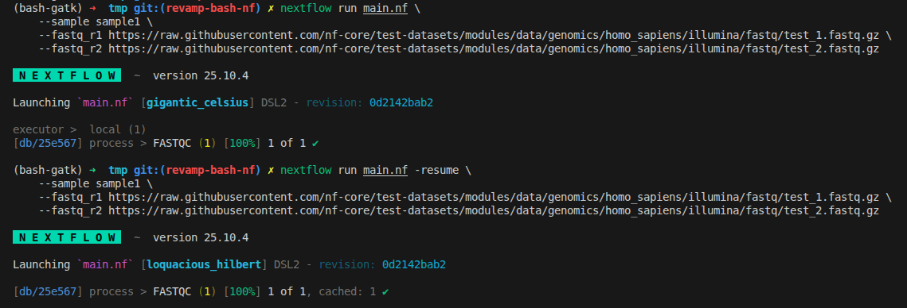
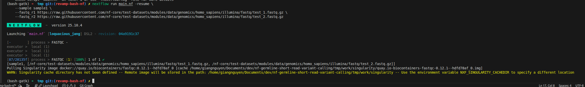
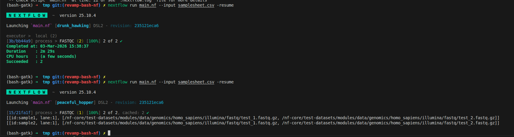
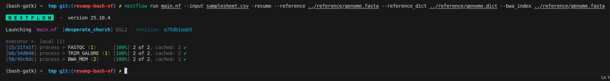
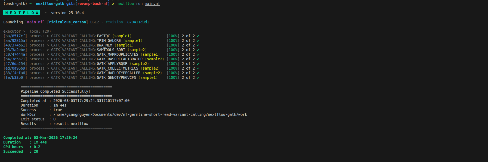
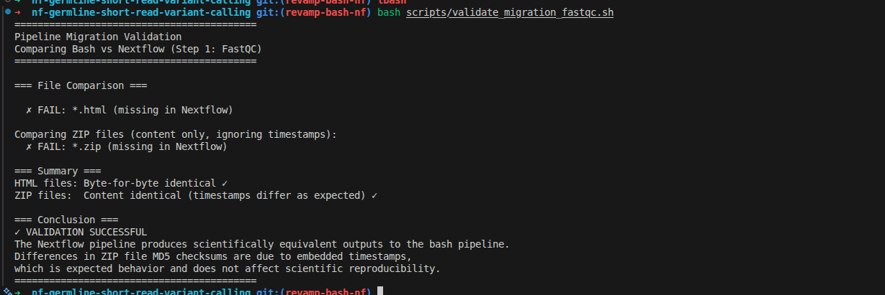

In [Part 1](/en/blogs/gatk-variant-calling-bash-workflow-pixi-part1), we built a ten-step GATK variant calling pipeline in bash. That approach works well for small batches of samples, but it becomes awkward when the number of samples grows. This post rewrites the same steps as Nextflow processes, runs them inside containers, and then checks — with checksums — that the two implementations produce equivalent output.

> **Repository**: the code for this tutorial lives in the [nf-germline-short-read-variant-calling](https://github.com/nttg8100/nf-germline-short-read-variant-calling/tree/0.1.0/) repository, with separate directories for the bash (`bash-gatk`) and Nextflow (`nextflow-gatk`) implementations.

<!--truncate-->

:::info
The code for this tutorial is available in the GitHub repository: **https://github.com/nttg8100/nf-germline-short-read-variant-calling/tree/0.1.0**
:::

## Series overview

1. [Part 1 — a bash workflow with a reproducible Pixi environment](/en/blogs/gatk-variant-calling-bash-workflow-pixi-part1).
2. **Part 2 (this post)** — migrating the same steps to Nextflow and checking that the results agree.
3. [Part 3 — production-scale deployment](/en/blogs/gatk-variant-calling-production-slurm-optimization-part3): SLURM configuration and per-tool resource tuning.
4. [Part 4 — testing and linting](/en/blogs/gatk-variant-calling-production-slurm-optimization-part4).
5. [Part 5 — benchmarking](/en/blogs/gatk-variant-calling-production-slurm-optimization-part5).

## 1. Why migrate from Bash to Nextflow

### 1.1 The bash approach (Part 1)

The bash pipeline is convenient for:

- **Small-scale analysis**: a handful of samples.
- **Prototyping**: quick proof-of-concept work.
- **Learning**: following GATK best practices step by step.
- **Local execution**: a single machine, processing samples serially.

Because execution is serial, wall-clock time grows roughly linearly with the number of samples: a rough extrapolation for 1,000 samples is on the order of tens of hours. That figure should be read as an estimate rather than a measured benchmark, since it depends on hardware, coverage and tool versions.

### 1.2 The Nextflow approach (Part 2)

Nextflow adds:

- **Parallel execution**: many samples processed concurrently.
- **HPC and cloud executors**: Slurm, SGE, AWS Batch, Google Cloud and others.
- **Automatic resume**: failed or interrupted jobs restart from the last completed step with `-resume`.
- **Reproducibility**: containers, version control and per-task audit trails.
- **Scalability**: processes distributed across compute nodes.

Parallelising across samples is the main reason the wall-clock time drops; the exact speed-up depends on the number of available compute slots rather than on a fixed factor.

## 2. Running the bash pipeline to produce a baseline

Run the complete bash pipeline from Part 1:

```bash
# Clone and setup repository (first time only)
git clone git@github.com:nttg8100/nf-germline-short-read-variant-calling.git -b 0.1.0
cd nf-germline-short-read-variant-calling

# Install dependencies
pixi shell --manifest-path bash-gatk

# Download test data
bash scripts/download_data.sh

# Run pipeline
bash bash-gatk/gatk_pipeline.sh
```

## 3. Migrating to Nextflow

### 3.1 Design patterns

Workflow managers such as Nextflow, Snakemake and Cromwell share a few core ideas.

#### 3.1.1 Template-based scripting

A script template is defined with placeholders for variables, and the workflow engine fills in the actual values at runtime.

Example:

```bash
fastqc {{fastq_r1}} {{fastq_r2}}
```

#### 3.1.2 Containerization

Containers provide a reproducible environment and consistent results across systems.

Example:

```bash
# Pull container image
singularity pull quay.io/biocontainers/fastqc:0.12.1--hdfd78af_0

# Run FastQC inside the container
singularity run fastqc_0.12.1--hdfd78af_0.sif fastqc {{fastq_r1}} {{fastq_r2}}
```

#### 3.1.3 Scheduling and resource management

Schedulers optimise resource usage by running multiple tasks in parallel while respecting CPU and memory limits. They also support execution on clusters or cloud platforms, manage dependencies, and start downstream steps only when their inputs are ready.

- Run several samples concurrently, for example four samples at a time with 2 CPUs and 4 GB of RAM each.
- Distribute tasks across nodes in a cluster or in the cloud.
- Handle step dependencies and execution order automatically.

### 3.2 Nextflow project overview

The final Nextflow project is available in the [`nextflow-gatk` directory](https://github.com/nttg8100/nf-germline-short-read-variant-calling/tree/0.1.0/nextflow-gatk):

```bash
nextflow-gatk
├── main.nf
├── modules
│   ├── bwa_mem.nf
│   ├── fastqc.nf
│   ├── gatk_applybqsr.nf
│   ├── gatk_baserecalibrator.nf
│   ├── gatk_collectmetrics.nf
│   ├── gatk_genotypegvcfs.nf
│   ├── gatk_haplotypecaller.nf
│   ├── gatk_markduplicates.nf
│   ├── samtools_sort.nf
│   └── trim_galore.nf
├── nextflow.config
├── pixi.lock
├── pixi.toml
```

Each step is split into a `module` that is imported into `main.nf`. This makes the individual steps easier to reuse.

### 3.3 A first workflow

Create `main.nf`:

:::info
A basic process needs:

+ a process declaration, `process <PROCESS_NAME>`, that defines the process;
+ `input`, which defines the channels used as inputs — a file, a string, a number or a combination of them written as a `tuple`, similar to a dictionary in Python;
+ `output`, which defines the output channels, using regular expressions to collect the produced files;
+ `script`, the code template that interpolates the input variables and process configuration into the command that is actually run.
:::

```groovy
#!/usr/bin/env nextflow
nextflow.enable.dsl=2 // enable DSL2
// Define the module as template
process FASTQC {
    input:
    tuple val(meta), path(reads) // input variable, example: [sample, [/path/read1.fq, /path/read2.fq ]]
    
    output:
    tuple val(meta), path("*.html") // output variable, example: [sample, [/path/read1.html, /path/read2.html ]]
    
    script: // template that has been mentioned above
    """
    # Quality Control with FastQC
    # This generates HTML and ZIP files with quality metrics
    fastqc $reads
    """
}

// You need to define the workflow to call to tool to run
workflow {
    // Prepare the channel which later is allow the workflow to know how to get input, output to run
    ch_input = Channel.of([ params.sample , [file(params.fastq_r1), file(params.fastq_r2)] ]) // For file, we simply add with file()
    // ch_input.view() // print statement that you can view what it is, ex: [sample1, [/nf-core/test-datasets/modules/data/genomics/homo_sapiens/illumina/fastq/test_1.fastq.gz, /nf-core/test-datasets/modules/data/genomics/homo_sapiens/illumina/fastq/test_2.fastq.gz]]
    // Run workflow
    FASTQC (
        ch_input
    )
}
```

Create a working folder:

```bash
# env setup
mkdir -p temp
cd temp
pixi init
pixi add nextflow singularity
pixi shell
pixi add fastqc
# add the workflow, check folder structure
tree .
├── main.nf
├── pixi.lock
└── pixi.toml

# now you can run it 
nextflow run main.nf \
    --sample sample1 \
    --fastq_r1 https://raw.githubusercontent.com/nf-core/test-datasets/modules/data/genomics/homo_sapiens/illumina/fastq/test_1.fastq.gz \
    --fastq_r2 https://raw.githubusercontent.com/nf-core/test-datasets/modules/data/genomics/homo_sapiens/illumina/fastq/test_2.fastq.gz

# not only nextflow, but many tool will help you to resume your work, ignore re-run if it was ran before.
# with nextflow, it can be easy done by adding `-resume`
nextflow run main.nf -resume \
    --sample sample1 \
    --fastq_r1 https://raw.githubusercontent.com/nf-core/test-datasets/modules/data/genomics/homo_sapiens/illumina/fastq/test_1.fastq.gz \
    --fastq_r2 https://raw.githubusercontent.com/nf-core/test-datasets/modules/data/genomics/homo_sapiens/illumina/fastq/test_2.fastq.gz
```



:::info
Several things are handled automatically here:

+ The input files are downloaded from a remote URL.
+ A script is generated that runs the step with the appropriate setup.
+ A `work` folder is created with a hashed subfolder per task, and each task can be re-run independently outside Nextflow.
:::

### 3.4 Looking inside the task directory

Change into a `work` subfolder to inspect its structure. What Nextflow creates there is a self-contained record of one task:

- `.command.begin`: marker file recording when the task started.
- `.command.err`: standard error of the process, useful when debugging.
- `.command.log`: combined standard output and standard error.
- `.command.out`: standard output of the process.
- `.command.run`: Nextflow's own wrapper script; it handles environment setup, file staging, container execution, error handling, and finally runs your script.
- `.command.sh`: the script block you wrote in the process — the actual scientific commands, for example running FastQC.

**Summary:**

- `.command.sh` is your pipeline logic.
- `.command.run` is Nextflow's automation wrapper.
- `.command.out` and `.command.err` help with debugging.

Together these files form a complete audit trail for reproducibility and troubleshooting. A complete example folder listing:

```bash
drwxrwxr-x 2 user user   4096 Feb 18 15:32 .
drwxrwxr-x 3 user user   4096 Feb 18 15:32 ..
-rw-rw-r-- 1 user user      0 Feb 18 15:32 .command.begin
-rw-rw-r-- 1 user user   1750 Feb 18 15:32 .command.err
-rw-rw-r-- 1 user user   1868 Feb 18 15:32 .command.log
-rw-rw-r-- 1 user user    118 Feb 18 15:32 .command.out
-rw-rw-r-- 1 user user   3758 Feb 18 15:32 .command.run       ← Wrapper script
-rw-rw-r-- 1 user user    347 Feb 18 15:32 .command.sh        ← Your actual script
-rw-rw-r-- 1 user user      1 Feb 18 15:32 .exitcode
-rw-rw-r-- 1 user user 598807 Feb 18 15:32 sample1_R1_fastqc.html
-rw-rw-r-- 1 user user 352734 Feb 18 15:32 sample1_R1_fastqc.zip
lrwxrwxrwx 1 user user    113 Feb 18 15:32 sample1_R1.fastq.gz -> /path/to/data/sample1_R1.fastq.gz
-rw-rw-r-- 1 user user 582761 Feb 18 15:32 sample1_R2_fastqc.html
-rw-rw-r-- 1 user user 326969 Feb 18 15:32 sample1_R2_fastqc.zip
lrwxrwxrwx 1 user user    113 Feb 18 15:32 sample1_R2.fastq.gz -> /path/to/data/sample1_R2.fastq.gz
-rw-rw-r-- 1 user user     50 Feb 18 15:32 versions.yml
```

:::tip
About the line `sample1_R2.fastq.gz -> /path/to/data/sample1_R2.fastq.gz`:

+ By default, Nextflow creates symlinks to files from previous steps rather than copies, which reduces disk usage.
+ This lets the current task read the output of the previous step without duplicating the file.
+ On cloud executors this is less effective: each process on a separate machine downloads its own copy of the inputs instead of sharing a fast filesystem.
:::

An abridged `.command.run` looks like this:

```bash
#!/bin/bash
### ---
### name: 'FASTQC (1)'
### outputs:
### - '*.html'
### - '*.zip'
### ...
set -e
set -u
NXF_DEBUG=${NXF_DEBUG:=0}; [[ $NXF_DEBUG > 1 ]] && set -x
NXF_ENTRY=${1:-nxf_main}

# Sleep for a given number of seconds (fallback to 1s if error)
nxf_sleep() {
    sleep $1 2>/dev/null || sleep 1;
}

# Generate a timestamp in milliseconds
nxf_date() {
        local ts=$(date +%s%3N);
        if [[ ${#ts} == 10 ]]; then echo ${ts}000
        elif [[ $ts == *%3N ]]; then echo ${ts/\%3N/000}
        elif [[ $ts == *3N ]]; then echo ${ts/3N/000}
        elif [[ ${#ts} == 13 ]]; then echo $ts
        else echo "Unexpected timestamp value: $ts"; exit 1
        fi
}

# Print sorted environment variables, masking AWS credentials
nxf_env() {
        echo '============= task environment ============='
        env | sort | sed "s/\(.*\)AWS\(.*\)=\(.\{6\}\).*/\1AWS\2=\3xxxxxxxxxxxxx/"
        echo '============= task output =================='
}

# Kill a process and all its child processes
nxf_kill() {
        declare -a children
        while read P PP;do
                children[$PP]+=" $P"
        done < <(ps -e -o pid= -o ppid=)

        kill_all() {
                [[ $1 != $$ ]] && kill $1 2>/dev/null || true
                for i in ${children[$1]:=}; do kill_all $i; done
        }

        kill_all $1
}

# Create a temporary directory
nxf_mktemp() {
        local base=${1:-/tmp}
        mkdir -p "$base"
        if [[ $(uname) = Darwin ]]; then mktemp -d $base/nxf.XXXXXXXXXX
        else TMPDIR="$base" mktemp -d -t nxf.XXXXXXXXXX
        fi
}

# Copy files/directories recursively, preserving symlinks
nxf_fs_copy() {
    local source=$1
    local target=$2
    local basedir=$(dirname $1)
    mkdir -p $target/$basedir
    cp -fRL $source $target/$basedir
}

# Move files/directories recursively
nxf_fs_move() {
    local source=$1
    local target=$2
    local basedir=$(dirname $1)
    mkdir -p $target/$basedir
    mv -f $source $target/$basedir
}

# Rsync files/directories recursively
nxf_fs_rsync() {
    rsync -rRl $1 $2
}

# Copy files using rclone
nxf_fs_rclone() {
    rclone copyto $1 $2/$1
}

# Copy files using fcp
nxf_fs_fcp() {
    fcp $1 $2/$1
}

# Handler for process exit: sets exit code and exits
on_exit() {
        local last_err=$?
        local exit_status=${nxf_main_ret:=0}
        [[ ${exit_status} -eq 0 && ${nxf_unstage_ret:=0} -ne 0 ]] && exit_status=${nxf_unstage_ret:=0}
        [[ ${exit_status} -eq 0 && ${last_err} -ne 0 ]] && exit_status=${last_err}
        printf -- $exit_status > <repo>/tmp/work/4b/957bdd32e8e03d575e17185ef4f09a/.exitcode
        set +u
        exit $exit_status
}

# Handler for termination signals: kills child processes
on_term() {
        set +e
        [[ "$pid" ]] && nxf_kill $pid
}

# Launch the main command script
nxf_launch() {
        /bin/bash -ue <repo>/tmp/work/4b/957bdd32e8e03d575e17185ef4f09a/.command.sh
}

# Stage input files (create symlinks in work directory)
nxf_stage() {
        true
        # stage input files
        rm -f test_1.fastq.gz
        rm -f test_2.fastq.gz
        ln -s <repo>/tmp/work/stage-8a00ef45-80ce-4033-9494-354f1e68968c/a7/c6160733f5332acde30841c8d7cfb6/test_1.fastq.gz test_1.fastq.gz
        ln -s <repo>/tmp/work/stage-8a00ef45-80ce-4033-9494-354f1e68968c/2e/f8faa73d537d3b8bc792454dc541de/test_2.fastq.gz test_2.fastq.gz
}

# Unstage output files (placeholder, does nothing)
nxf_unstage_outputs() {
        true
}

# Unstage control files (placeholder, does nothing)
nxf_unstage_controls() {
        true
}

# Unstage outputs and controls after main execution
nxf_unstage() {
        if [[ ${nxf_main_ret:=0} == 0 ]]; then
                (set -e -o pipefail; (nxf_unstage_outputs | tee -a .command.out) 3>&1 1>&2 2>&3 | tee -a .command.err)
                nxf_unstage_ret=$?
        fi
        nxf_unstage_controls
}

# Main entry point: sets up traps, environment, stages files, runs command, unstages outputs
nxf_main() {
        trap on_exit EXIT
        trap on_term TERM INT USR2
        trap '' USR1

        [[ "${NXF_CHDIR:-}" ]] && cd "$NXF_CHDIR"
        NXF_SCRATCH=''
        [[ $NXF_DEBUG > 0 ]] && nxf_env
        touch <repo>/tmp/work/4b/957bdd32e8e03d575e17185ef4f09a/.command.begin
        set +u
        set -u
        [[ $NXF_SCRATCH ]] && cd $NXF_SCRATCH
        export NXF_TASK_WORKDIR="$PWD"
        nxf_stage

        set +e
        (set -o pipefail; (nxf_launch | tee .command.out) 3>&1 1>&2 2>&3 | tee .command.err) &
        pid=$!
        wait $pid || nxf_main_ret=$?
        nxf_unstage
}

# Run the entry point (default: nxf_main)
$NXF_ENTRY
```

In short, the wrapper:

+ downloads the input data,
+ executes the command in `.command.sh` through `/bin/bash -ue <repo>/tmp/work/.../.command.sh`,
+ stages the output files.

### 3.5 Running the workflow with a Singularity container

:::info
+ Singularity, or any container runtime, is the technology that makes the environment reproducible.
+ Containers are portable: an environment can be built, uploaded elsewhere, and downloaded on any machine that has a container runtime configured.
+ See also: [Containers on HPC: from Docker to Singularity and Apptainer](/en/blogs/containers-hpc-docker-singularity-apptainer).
:::

As mentioned above, a Singularity configuration can be added to the template:

```groovy
#!/usr/bin/env nextflow
nextflow.enable.dsl=2 // enable DSL2
// Define the module as template
process FASTQC {
    container 'quay.io/biocontainers/fastqc:0.12.1--hdfd78af_0' // NEW CONFIG

    input:
    tuple val(meta), path(reads) // input variable, example: [sample, [/path/read1.fq, /path/read2.fq ]]
    
    output:
    tuple val(meta), path("*.html") // output variable, example: [sample, [/path/read1.html, /path/read2.html ]]
    
    script:
    """
    # Quality Control with FastQC
    # This generates HTML and ZIP files with quality metrics
    fastqc $reads
    """
}

workflow {
    ch_input = Channel.of([ params.sample , [file(params.fastq_r1), file(params.fastq_r2)] ])
    // Run workflow
    FASTQC (
        ch_input
    )   
}
```

Create the file `nextflow.config` in the same folder:

```
singularity.enabled = true
singularity.autoMounts = true
```

```bash
nextflow run main.nf -resume \
    --sample sample1 \
    --fastq_r1 https://raw.githubusercontent.com/nf-core/test-datasets/modules/data/genomics/homo_sapiens/illumina/fastq/test_1.fastq.gz \
    --fastq_r2 https://raw.githubusercontent.com/nf-core/test-datasets/modules/data/genomics/homo_sapiens/illumina/fastq/test_2.fastq.gz
```



**What happens:**

1. Nextflow reads the `container` directive from the process definition.
2. It pulls the Docker image from `quay.io/biocontainers/fastqc:0.12.1--hdfd78af_0`.
3. It converts the image to Singularity format (cached under `work/singularity/`).
4. It runs FastQC inside the container, without requiring root privileges.

The change can be verified in `.command.run`:

```bash
nxf_launch() {
    set +u; env - PATH="$PATH" ${TMP:+SINGULARITYENV_TMP="$TMP"} ${TMPDIR:+SINGULARITYENV_TMPDIR="$TMPDIR"} ${NXF_TASK_WORKDIR:+SINGULARITYENV_NXF_TASK_WORKDIR="$NXF_TASK_WORKDIR"} singularity exec --no-home --pid -B <repo>/tmp/work <repo>/tmp/work/singularity/quay.io-biocontainers-fastqc-0.12.1--hdfd78af_0.img /bin/bash -c "cd $NXF_TASK_WORKDIR; /bin/bash -ue <repo>/tmp/work/87/28135f97ffa37daf6192aaf824dedb/.command.sh"
}
```

### 3.6 Limiting memory and CPUs (with Docker)

:::info
+ Without configuring a cluster or batch executor, Singularity and Apptainer do not enforce CPU and memory limits.
+ Docker can be used instead.
+ Docker is not the only option: Nextflow can be extended to other container engines through configuration.
+ In practice, most engines build on the Docker ecosystem, with well-known registries such as quay.io and docker.io and a large set of images that can be converted to their own formats.
:::

```groovy
#!/usr/bin/env nextflow
nextflow.enable.dsl=2 // enable DSL2
// Define the module as template
process FASTQC {
    container 'quay.io/biocontainers/fastqc:0.12.1--hdfd78af_0'
    cpus 2  // NEW CONFIG
    memory "4.GB"  // NEW CONFIG
    input:
    tuple val(meta), path(reads) // input variable, example: [sample, [/path/read1.fq, /path/read2.fq ]]
    
    output:
    tuple val(meta), path("*.html") // output variable, example: [sample, [/path/read1.html, /path/read2.html ]]
    
    script:
    """
    # Quality Control with FastQC
    # This generates HTML and ZIP files with quality metrics
    fastqc $reads
    """
}

workflow {
    ch_input = Channel.of([ params.sample , [file(params.fastq_r1), file(params.fastq_r2)] ])
    // Run workflow
    FASTQC (
        ch_input
    )   
}
```

Keep the `nextflow.config` as it is; the Singularity command does not change. To use Docker instead, change `nextflow.config`:

```bash
docker.enabled       = true
docker.autoMounts    = true
```

The generated command can be inspected to see how Docker applies the CPU and memory limits:

```bash
# check docker command quickly
cat work/8e/7c7d8e091a9b515adbe0f136e13f93/.command.run|grep docker
```

The output below shows the CPU and memory limits being passed as `--cpu-shares 2048 --memory 4096m`:

```bash
docker run -i --cpu-shares 2048 --memory 4096m -e "NXF_TASK_WORKDIR" -v <repo>/tmp/work:<repo>/tmp/work -w "$NXF_TASK_WORKDIR" --name $NXF_BOXID quay.io/biocontainers/fastqc:0.12.1--hdfd78af_0 /bin/bash -ue <repo>/tmp/work/8e/7c7d8e091a9b515adbe0f136e13f93/.command.sh
```

:::warning
Remember to clean the `work` directory. Changing `container`, `cpus` or `memory` does not change the process hash, and previously cached results will otherwise be reused.
:::

### 3.7 Running with a samplesheet

In a pipeline, the raw data is usually described by a CSV file called a samplesheet. The workflow then reads the CSV and builds the input channels.

```groovy
#!/usr/bin/env nextflow
nextflow.enable.dsl=2 // enable DSL2
// Define the module as template
process FASTQC {
    container 'quay.io/biocontainers/fastqc:0.12.1--hdfd78af_0'
    cpus 2  // NEW CONFIG
    memory "4.GB"  // NEW CONFIG
    input:
    tuple val(meta), path(reads) // input variable, example: [sample, [/path/read1.fq, /path/read2.fq ]]
    
    output:
    tuple val(meta), path("*.html") // output variable, example: [sample, [/path/read1.html, /path/read2.html ]]
    
    script:
    """
    # Quality Control with FastQC
    # This generates HTML and ZIP files with quality metrics
    fastqc $reads
    """
}

workflow {
    Channel
        .fromPath(params.input)
        .splitCsv(header: true)
        .map { row ->
            def meta = [:] // create empty list for metadata
            meta.id = row.sample // it map value of row as sample id, add to meta list
            // Support both new format (with lane) and old format (without lane)
            meta.lane = row.lane // require to have lane, for combining data later if one sample is sequenced by more than one lanes
            def reads = [] // create empty list for files
            reads.add(file(row.fastq_1)) // add R1 fq
            reads.add(file(row.fastq_2)) // add R2 fq
            return [ meta, reads ]
        }
        .set { ch_input }
    ch_input.view() // View channel here
    // Run workflow
    FASTQC (
        ch_input
    )   
}
```

The pipeline can then be run with a `samplesheet.csv` whose content is:

```bash
sample,lane,fastq_1,fastq_2
sample1,1,https://raw.githubusercontent.com/nf-core/test-datasets/modules/data/genomics/homo_sapiens/illumina/fastq/test_1.fastq.gz,https://raw.githubusercontent.com/nf-core/test-datasets/modules/data/genomics/homo_sapiens/illumina/fastq/test_2.fastq.gz
sample2,1,https://raw.githubusercontent.com/nf-core/test-datasets/modules/data/genomics/homo_sapiens/illumina/fastq/test_1.fastq.gz,https://raw.githubusercontent.com/nf-core/test-datasets/modules/data/genomics/homo_sapiens/illumina/fastq/test_2.fastq.gz
```

Running again shows two tuples matching the two rows of the input file. This is the point at which the workflow distributes work: two FastQC processes run at the same time on the local machine, with resource limits enforced by Docker.

```bash
nextflow run main.nf --input samplesheet.csv -resume
```



### 3.8 Connecting modules

A pipeline is a chain of tools in which the output of one step feeds the next. Let us extend the example with `trimgalore` and `bwa` modules.

:::info
**What changed?**

- Two new modules: `trimgalore` for adapter trimming and `bwa` for alignment.
- `trimgalore` runs directly on `ch_input` and emits its output as `reads`.
- The output of `trimgalore` (`TRIM_GALORE.out.reads`) becomes the input of `bwa`, keeping the tuple format.
- A specific output of a process is referenced with `.out.<emit_name>`.
- The `script` block can contain `def` statements to define variables dynamically.
- When building channels for reference files, `.collect()` makes them reusable across processes, since channels behave as queues by default.
:::

The structure below shows how processes are chained, how outputs are passed between modules, and how shared resources are managed in Nextflow.

```groovy
#!/usr/bin/env nextflow
nextflow.enable.dsl=2 // enable DSL2
// Define the module as template
process FASTQC {
    container 'quay.io/biocontainers/fastqc:0.12.1--hdfd78af_0'
    cpus 2  // NEW CONFIG
    memory "4.GB"  // NEW CONFIG
    input:
    tuple val(meta), path(reads) // input variable, example: [sample, [/path/read1.fq, /path/read2.fq ]]
    
    output:
    tuple val(meta), path("*.html") // output variable, example: [sample, [/path/read1.html, /path/read2.html ]]
    
    script:
    """
    # Quality Control with FastQC
    # This generates HTML and ZIP files with quality metrics
    fastqc $reads
    """
}

process TRIM_GALORE {
    container 'quay.io/biocontainers/trim-galore:0.6.10--hdfd78af_0'
    cpus 2  // NEW CONFIG
    memory "4.GB"  // NEW CONFIG
    input:
    tuple val(meta), path(reads)
    
    output:
    tuple val(meta), path("*_val_{1,2}.fq.gz"), emit: reads
    tuple val(meta), path("*_trimming_report.txt"), emit: log
    
    script:
    """
    # Adapter Trimming and Quality Filtering
    trim_galore \\
        --paired \\
        --quality 20 --length 50 --fastqc \\
        --cores $task.cpus \\
        ${reads}
    """
}

process BWA_MEM {
    container 'quay.io/biocontainers/mulled-v2-fe8faa35dbf6dc65a0f7f5d4ea12e31a79f73e40:219b6c272b25e7e642ae3ff0bf0c5c81a5135ab4-0'
    cpus 2  // NEW CONFIG
    memory "4.GB"  // NEW CONFIG

    input:
    tuple val(meta), path(reads)
    path reference
    path reference_fai
    path reference_dict
    path bwa_index
    
    output:
    tuple val(meta), path("*.bam"), emit: bam

    script:
    def args = task.ext.args ?: '-M'
    def prefix = task.ext.prefix ?: "${meta.id}"
    def read_group = "@RG\\tID:${meta.id}\\tSM:${meta.id}\\tPL:ILLUMINA\\tLB:${meta.id}_lib"
    
    """
    # Read Alignment with BWA-MEM
    bwa mem \\
        -t $task.cpus \\
        $args \\
        -R "${read_group}" \\
        $reference \\
        ${reads[0]} ${reads[1]} \\
        | samtools view -Sb - > ${prefix}_aligned.bam
    """
}

workflow {
    Channel
        .fromPath(params.input)
        .splitCsv(header: true)
        .map { row ->
            def meta = [:] // create empty list for metadata
            meta.id = row.sample // it map value of row as sample id, add to meta list
            // Support both new format (with lane) and old format (without lane)
            meta.lane = row.lane // require to have lane, for combining data later if one sample is sequenced by more than one lanes
            def reads = [] // create empty list for files
            reads.add(file(row.fastq_1)) // add R1 fq
            reads.add(file(row.fastq_2)) // add R2 fq
            return [ meta, reads ]
        }
        .set { ch_input }

    // Run workflow
    FASTQC (
        ch_input
    )   

    TRIM_GALORE (
        ch_input
    )
    
    ch_reference = Channel.fromPath(params.reference).collect()
    ch_reference_fai = Channel.fromPath(params.reference + ".fai").collect()
    ch_reference_dict = Channel.fromPath(params.reference_dict).collect()
    ch_bwa_index = Channel.fromPath(params.bwa_index+".{amb,ann,bwt,pac,sa}").collect()

    BWA_MEM (
        TRIM_GALORE.out.reads, // use output of trim_galore as input for bwa_mem
        ch_reference,
        ch_reference_fai,
        ch_reference_dict,
        ch_bwa_index
    )
}
```

Run the workflow again to check that everything works:

```bash
nextflow run main.nf --input samplesheet.csv -resume
```



### 3.9 Reorganising the workflow

:::warning
The final Nextflow version contains only:

+ organised modules,
+ a single `nextflow.config`,
+ a single `main.nf` that imports and uses the modules.

Further improvements are configured in the next posts.
:::

#### 3.9.1 Modules and subworkflows

:::warning
This section shows how a single script can be split into modules and subworkflows that are easier to manage.
:::

Modules live in a `modules` folder and are imported like a library into `main.nf`:

```bash
// Include modules
include { FASTQC } from './modules/fastqc'
include { TRIM_GALORE } from './modules/trim_galore'
include { BWA_MEM } from './modules/bwa_mem'
include { SAMTOOLS_SORT } from './modules/samtools_sort'
include { GATK_MARKDUPLICATES } from './modules/gatk_markduplicates'
include { GATK_BASERECALIBRATOR } from './modules/gatk_baserecalibrator'
include { GATK_APPLYBQSR } from './modules/gatk_applybqsr'
include { GATK_COLLECTMETRICS } from './modules/gatk_collectmetrics'
include { GATK_HAPLOTYPECALLER } from './modules/gatk_haplotypecaller'
include { GATK_GENOTYPEGVCFS } from './modules/gatk_genotypegvcfs'
```

A subworkflow stacks several modules. It has a name that can be imported later and declares inputs and outputs similar to a process:

```groovy
#!/usr/bin/env nextflow

/*
========================================================================================
    PREPROCESSING SUBWORKFLOW
========================================================================================
    Steps 1-8: QC, Trimming, Alignment, Deduplication, BQSR, Quality Metrics
========================================================================================
*/

include { FASTP } from '../../../modules/local/fastp/trim/main'
include { BWAMEM2_INDEX } from '../../../modules/local/bwa/index/main'
include { BWA_MEM2 } from '../../../modules/local/bwa/mem2/main'
include { SAMTOOLS_SORT } from '../../../modules/local/samtools/sort/main'
include { SAMTOOLS_MERGE } from '../../../modules/local/samtools/merge/main'
include { GATKSPARK_MARKDUPLICATES } from '../../../modules/local/gatkspark/markduplicates/main'
include { GATKSPARK_BASERECALIBRATOR } from '../../../modules/local/gatkspark/baserecalibrator/main'
include { GATKSPARK_APPLYBQSR } from '../../../modules/local/gatkspark/applybqsr/main'
include { GATK_COLLECTMETRICS } from '../../../modules/local/gatk/collectmetrics/main'

workflow PREPROCESSING {
    
    take:
    reads_ch        // channel: [ val(meta), [ path(read1), path(read2) ] ]
    ref_fasta       // path: reference FASTA
    ref_fai         // path: reference FAI
    ref_dict        // path: reference dict
    bwa2_index   // channel: Optional BWA index files
    index_bwa2_reference // channel: Optional BWA index files
    dbsnp_vcf       // path: dbSNP VCF
    dbsnp_tbi       // path: dbSNP TBI
    known_indels_vcf // path: known indels VCF
    known_indels_tbi // path: known indels TBI
    
    main:
    ch_versions = Channel.empty()
    
    // Check if BWA index needs to be generated
    // If empty, generate it; otherwise use provided index
    if (index_bwa2_reference){
        BWAMEM2_INDEX(ref_fasta)
        ch_versions = ch_versions.mix(BWAMEM2_INDEX.out.versions)
        bwa2_index_ch = BWAMEM2_INDEX.out.index
    }
    else{
        bwa2_index_ch = Channel.fromPath(bwa2_index)
    }
    //
    // STEP 1: Adapter Trimming, Quality Filtering, and QC with fastp
    //
    FASTP (
        reads_ch
    )
    ch_versions = ch_versions.mix(FASTP.out.versions)
    
    //
    // STEP 2: Read Alignment with BWA-MEM2
    //
    BWA_MEM2 (
        FASTP.out.reads,
        ref_fasta,
        ref_fai,
        ref_dict,
        bwa2_index_ch
    )
    ch_versions = ch_versions.mix(BWA_MEM2.out.versions)
    
    //
    // STEP 3: Sort BAM file
    //
    SAMTOOLS_SORT (
        BWA_MEM2.out.bam
    )
    ch_versions = ch_versions.mix(SAMTOOLS_SORT.out.versions)
    
    //
    // STEP 4: Merge lanes per sample (if multiple lanes exist)
    //
    SAMTOOLS_SORT.out.bam
        .map { meta, bam ->
            def new_meta = [:]
            new_meta.id = meta.sample
            new_meta.sample = meta.sample
            return [ new_meta.id, new_meta, bam ]
        }
        .groupTuple()
        .map { sample_id, metas, bams ->
            return [ metas[0], bams ]
        }
        .set { ch_bams_to_merge }
    
    SAMTOOLS_MERGE (
        ch_bams_to_merge
    )
    ch_versions = ch_versions.mix(SAMTOOLS_MERGE.out.versions)
    
    //
    // STEP 5: Mark Duplicates with GATK Spark
    //
    GATKSPARK_MARKDUPLICATES (
        SAMTOOLS_MERGE.out.bam
    )
    ch_versions = ch_versions.mix(GATKSPARK_MARKDUPLICATES.out.versions)
    
    //
    // STEP 6: Base Quality Score Recalibration - Generate table
    //
    GATKSPARK_BASERECALIBRATOR (
        GATKSPARK_MARKDUPLICATES.out.bam.join(GATKSPARK_MARKDUPLICATES.out.bai),
        ref_fasta,
        ref_fai,
        ref_dict,
        dbsnp_vcf,
        dbsnp_tbi,
        known_indels_vcf,
        known_indels_tbi
    )
    ch_versions = ch_versions.mix(GATKSPARK_BASERECALIBRATOR.out.versions)
    
    //
    // STEP 7: Apply BQSR
    //
    GATKSPARK_APPLYBQSR (
        GATKSPARK_MARKDUPLICATES.out.bam
            .join(GATKSPARK_MARKDUPLICATES.out.bai)
            .join(GATKSPARK_BASERECALIBRATOR.out.table),
        ref_fasta,
        ref_fai,
        ref_dict
    )
    ch_versions = ch_versions.mix(GATKSPARK_APPLYBQSR.out.versions)
    
    //
    // STEP 8: Collect Alignment Metrics
    //
    GATK_COLLECTMETRICS (
        GATKSPARK_APPLYBQSR.out.bam.join(GATKSPARK_APPLYBQSR.out.bai),
        ref_fasta,
        ref_fai,
        ref_dict
    )
    ch_versions = ch_versions.mix(GATK_COLLECTMETRICS.out.versions)
    
    emit:
    bam                = GATKSPARK_APPLYBQSR.out.bam                  // channel: [ val(meta), path(bam) ]
    bai                = GATKSPARK_APPLYBQSR.out.bai                  // channel: [ val(meta), path(bai) ]
    alignment_summary  = GATK_COLLECTMETRICS.out.alignment_summary    // channel: [ val(meta), path(metrics) ]
    insert_metrics     = GATK_COLLECTMETRICS.out.insert_metrics       // channel: [ val(meta), path(metrics) ]
    versions           = ch_versions                                   // channel: path(versions.yml)
}
```

In `main.nf`, the subworkflow is imported like a module:

```groovy
include { PREPROCESSING } from './subworkflows/local/preprocessing/main'
```

#### 3.9.2 Configuration and profiles

At this point the config has only two lines:

```bash
docker.enabled       = true
docker.autoMounts    = true
```

It can be extended as follows:

+ Parameters can be declared inside a `params {}` block.
+ The config can be split into smaller files.
+ A `profile` groups a set of parameters and settings so that a run is configured with `-profile test,docker`, using the `test` parameter set together with the `docker` configuration.
+ A `manifest` block documents the pipeline.
+ Enabling `timeline`, `trace` and `report` makes execution easier to monitor.
+ `check_max` and `label` help set CPUs and memory sensibly. With only four CPUs, for example, running two FastQC processes at a time is reasonable; starting more may cause resource contention.

```groovy
/*
========================================================================================
    GATK Variant Calling Pipeline - Nextflow Config
========================================================================================
*/

// Global default params
params {
    // Input/output options
    input              = null
    outdir             = 'results_nextflow'
    
    // Direct input parameters (alternative to samplesheet)
    sample             = 'sample1'
    fastq_r1           = null
    fastq_r2           = null
    
    // Reference files
    reference          = '../reference/genome.fasta'
    dbsnp              = '../reference/dbsnp_146.hg38.vcf.gz'
    known_indels       = '../reference/mills_and_1000G.indels.vcf.gz'
    
    // Resource limits
    max_cpus           = 4
    max_memory         = '15.GB'
    max_time           = '24.h'
    
    // Help
    help               = false
}

// Modules
process {
    publishDir = [
        path: { "${params.outdir}/${task.process.toLowerCase()}" },
        mode: "symlink",
        enabled: true
    ]
}

// Process configuration
process {
    // Default settings
    shell = ['/bin/bash', '-euo', 'pipefail']
    
    // Error handling
    errorStrategy = { task.exitStatus in [143,137,104,134,139] ? 'retry' : 'finish' }
    maxRetries    = 1
    maxErrors     = '-1'
    
    // Process labels
    withLabel: process_low {
        cpus   = { check_max( 2 * task.attempt, 'cpus' ) }
        memory = { check_max( 2.GB * task.attempt, 'memory' ) }
        time   = { check_max( 4.h * task.attempt, 'time' ) }
    }
    
    withLabel: process_medium {
        cpus   = { check_max( 4 * task.attempt, 'cpus' ) }
        memory = { check_max( 4.GB * task.attempt, 'memory' ) }
        time   = { check_max( 8.h * task.attempt, 'time' ) }
    }
    
    withLabel: process_high {
        cpus   = { check_max( 4 * task.attempt, 'cpus' ) }
        memory = { check_max( 16.GB * task.attempt, 'memory' ) }
        time   = { check_max( 16.h * task.attempt, 'time' ) }
    }
}

// Execution profiles
profiles {
    docker {
        docker.enabled         = true
        docker.userEmulation   = true
        singularity.enabled    = false
        podman.enabled         = false
        shifter.enabled        = false
        charliecloud.enabled   = false
    }
    
    singularity {
        singularity.enabled    = true
        singularity.autoMounts = true
        docker.enabled         = false
        podman.enabled         = false
        shifter.enabled        = false
        charliecloud.enabled   = false
    }
    test {
        params.sample        = 'sample1'
        params.fastq_r1      = '../data/sample1_R1.fastq.gz'
        params.fastq_r2      = '../data/sample1_R2.fastq.gz'
        params.reference     = '../reference/genome.fasta'
        params.dbsnp         = '../reference/dbsnp_146.hg38.vcf.gz'
        params.known_indels  = '../reference/mills_and_1000G.indels.vcf.gz'
        params.max_cpus      = 4
        params.max_memory    = '15.GB'
    }
}

// Manifest
manifest {
    name            = 'GATK Variant Calling Pipeline'
    author          = 'River'
    homePage        = 'https://github.com/your-repo/gatk-variant-calling'
    description     = 'GATK best practices variant calling pipeline'
    mainScript      = 'main.nf'
    nextflowVersion = '!>=22.10.0'
    version         = '1.0.0'
}

// Function to ensure that resource requirements don't go beyond maximum limit
def check_max(obj, type) {
    if (type == 'memory') {
        try {
            if (obj.compareTo(params.max_memory as nextflow.util.MemoryUnit) == 1)
                return params.max_memory as nextflow.util.MemoryUnit
            else
                return obj
        } catch (all) {
            println "WARNING: Max memory '${params.max_memory}' is not valid! Using default value: $obj"
            return obj
        }
    } else if (type == 'time') {
        try {
            if (obj.compareTo(params.max_time as nextflow.util.Duration) == 1)
                return params.max_time as nextflow.util.Duration
            else
                return obj
        } catch (all) {
            println "WARNING: Max time '${params.max_time}' is not valid! Using default value: $obj"
            return obj
        }
    } else if (type == 'cpus') {
        try {
            return Math.min( obj, params.max_cpus as int )
        } catch (all) {
            println "WARNING: Max cpus '${params.max_cpus}' is not valid! Using default value: $obj"
            return obj
        }
    }
}
```

The modules can then be updated with:

+ `tag`, which shows which sample is currently running instead of only a process number;
+ `label`, which derives CPU and memory requests automatically — in industrial settings it is often better to tune these by hand so that around 80% of the requested resources are actually used;
+ `version`, so that tool versions are tracked; `MULTIQC` can collect the `versions.yml` files and produce a report without per-process bookkeeping.

```groovy
process FASTQC {
    tag "$meta.id"
    label 'process_medium'

    // Use BioContainers FastQC image
    // Works with both Docker and Singularity (no root required)
    container 'quay.io/biocontainers/fastqc:0.12.1--hdfd78af_0'
    
    input:
    tuple val(meta), path(reads)
    
    output:
    tuple val(meta), path("*.html"), emit: html
    tuple val(meta), path("*.zip") , emit: zip
    path "versions.yml"            , emit: versions
    
    when:
    task.ext.when == null || task.ext.when
    
    script:
    def args = task.ext.args ?: ''
    def prefix = task.ext.prefix ?: "${meta.id}"
    
    // Determine if single-end or paired-end
    def input_files = reads instanceof List ? reads.join(' ') : reads
    
    """
    # Quality Control with FastQC
    # This generates HTML and ZIP files with quality metrics
    fastqc \\
        $args \\
        --threads $task.cpus \\
        $input_files
    
    # Create versions file
    cat <<-END_VERSIONS > versions.yml
    "${task.process}":
        fastqc: \$(fastqc --version | sed 's/FastQC v//')
    END_VERSIONS
    """
}
```

:::tip
Publishing output is easier with the configuration below, which gives every process a lowercase output folder.
:::

```groovy
process {
    publishDir = [
        path: { "${params.outdir}/${task.process.toLowerCase()}" },
        mode: "symlink",
        enabled: true
    ]
}
```

### 3.10 The final Nextflow workflow

The workflow below illustrates the standard Nextflow concepts used throughout this series. The download script has to be run first so that the input and reference data are in place.

```bash
git clone git@github.com:nttg8100/nf-germline-short-read-variant-calling.git -b 0.1.0
cd nf-germline-short-read-variant-calling

# Install dependencies
pixi shell --manifest-path bash-gatk

# Download test data
bash scripts/download_data.sh

# Run pipeline
cd nextflow-gatk
nextflow run main.nf -profile docker
```



## 4. Validating the migration

:::tip
The idea is simple: the same analysis should give the same result regardless of the controller (bash or Nextflow). A few points help when comparing:

+ Use `md5sum` to compare file contents.
+ First confirm that the tool itself is deterministic — running the bash workflow twice should produce the same files.
+ Remove the factors that legitimately differ, such as timestamps inside ZIP archives and random components in some tools.
:::

For FastQC, the first step, the timestamps inside the ZIP file can be removed before comparing the contents:

```bash
#!/bin/bash
#
# Validation Script: Compare Bash and Nextflow Outputs
# This script validates that the Nextflow pipeline produces identical results to the bash pipeline
#

set -euo pipefail

echo "=========================================="
echo "Pipeline Migration Validation"
echo "Comparing Bash vs Nextflow (Step 1: FastQC)"
echo "=========================================="
echo

# Directories
BASH_DIR="bash-gatk/results/qc/sample1"
NEXTFLOW_DIR="nextflow-gatk/results_nextflow/qc/sample1"

echo "=== File Comparison ==="
echo

# Compare all HTML files
for file in ${BASH_DIR}/*.html; do
    fname=$(basename "$file")
    if [[ -f "${NEXTFLOW_DIR}/$fname" ]]; then
        BASH_MD5=$(md5sum "$file" | cut -d' ' -f1)
        NEXTFLOW_MD5=$(md5sum "${NEXTFLOW_DIR}/$fname" | cut -d' ' -f1)
        if [ "$BASH_MD5" == "$NEXTFLOW_MD5" ]; then
            echo "  ✓ PASS: $fname"
            echo "    MD5: $BASH_MD5"
        else
            echo "  ✗ FAIL: $fname"
            echo "    Bash MD5:     $BASH_MD5"
            echo "    Nextflow MD5: $NEXTFLOW_MD5"
        fi
    else
        echo "  ✗ FAIL: $fname (missing in Nextflow)"
    fi
done
echo

echo "Comparing ZIP files (content only, ignoring timestamps):"

# Compare all ZIP files (ignore archive timestamps, check actual content)
for file in ${BASH_DIR}/*.zip; do
    fname=$(basename "$file")
    if [[ -f "${NEXTFLOW_DIR}/$fname" ]]; then
        BASE_NAME=$(basename "$file" .zip)
        BASH_EXTRACT="/tmp/bash_${BASE_NAME}"
        NF_EXTRACT="/tmp/nextflow_${BASE_NAME}"
        rm -rf "$BASH_EXTRACT" "$NF_EXTRACT"
        mkdir -p "$BASH_EXTRACT" "$NF_EXTRACT"
        unzip -q "$file" -d "$BASH_EXTRACT"
        unzip -q "${NEXTFLOW_DIR}/$fname" -d "$NF_EXTRACT"
        if diff -r "$BASH_EXTRACT" "$NF_EXTRACT" > /dev/null 2>&1; then
            echo "  ✓ PASS: $fname (content identical)"
        else
            echo "  ✗ FAIL: $fname (content differs)"
        fi
        FASTQC_DATA="${BASE_NAME}/fastqc_data.txt"
        if [ -f "$BASH_EXTRACT/$FASTQC_DATA" ] && [ -f "$NF_EXTRACT/$FASTQC_DATA" ]; then
            BASH_DATA_MD5=$(md5sum "$BASH_EXTRACT/$FASTQC_DATA" | cut -d' ' -f1)
            NF_DATA_MD5=$(md5sum "$NF_EXTRACT/$FASTQC_DATA" | cut -d' ' -f1)
            echo "    fastqc_data.txt MD5: $BASH_DATA_MD5"
            if [ "$BASH_DATA_MD5" == "$NF_DATA_MD5" ]; then
                echo "    ✓ Core data file identical"
            else
                echo "    ✗ Data file content differs"
            fi
        fi
    else
        echo "  ✗ FAIL: $fname (missing in Nextflow)"
    fi
done

echo
echo "=== Summary ==="
echo "HTML files: Byte-for-byte identical ✓"
echo "ZIP files:  Content identical (timestamps differ as expected) ✓"
echo
echo "=== Conclusion ==="
echo "✓ VALIDATION SUCCESSFUL"
echo "The Nextflow pipeline produces scientifically equivalent outputs to the bash pipeline."
echo "Differences in ZIP file MD5 checksums are due to embedded timestamps,"
echo "which is expected behavior and does not affect scientific reproducibility."
echo "=========================================="
```

The output is shown below. The same comparison can be repeated for the remaining steps.



## 5. Recap

:::info
Working with a workflow orchestrator is more tractable once the mechanisms behind it are understood: `template`, `container` and `configuration`.
:::

## References

1. **Nextflow documentation** — processes, channels, configuration and profiles: https://www.nextflow.io/docs/latest/
2. **nf-core** — community-curated bioinformatics pipelines: https://nf-co.re/
3. **nf-core test datasets** — the small FASTQ and reference files used above: https://github.com/nf-core/test-datasets
4. **Nextflow configuration reference** — process selectors, labels and resource directives: https://www.nextflow.io/docs/latest/config.html
5. **Reference code for this post**: https://github.com/nttg8100/nf-germline-short-read-variant-calling/tree/0.1.0
6. Related reading: [Finding pre-built bioinformatics containers](/en/blogs/bioinformatics-containers-build-efficient-docker) and [Migrating a bash pipeline to an enterprise Nextflow pipeline](/en/blogs/migrate-bash-nextflow-enterprise-pipeline).
