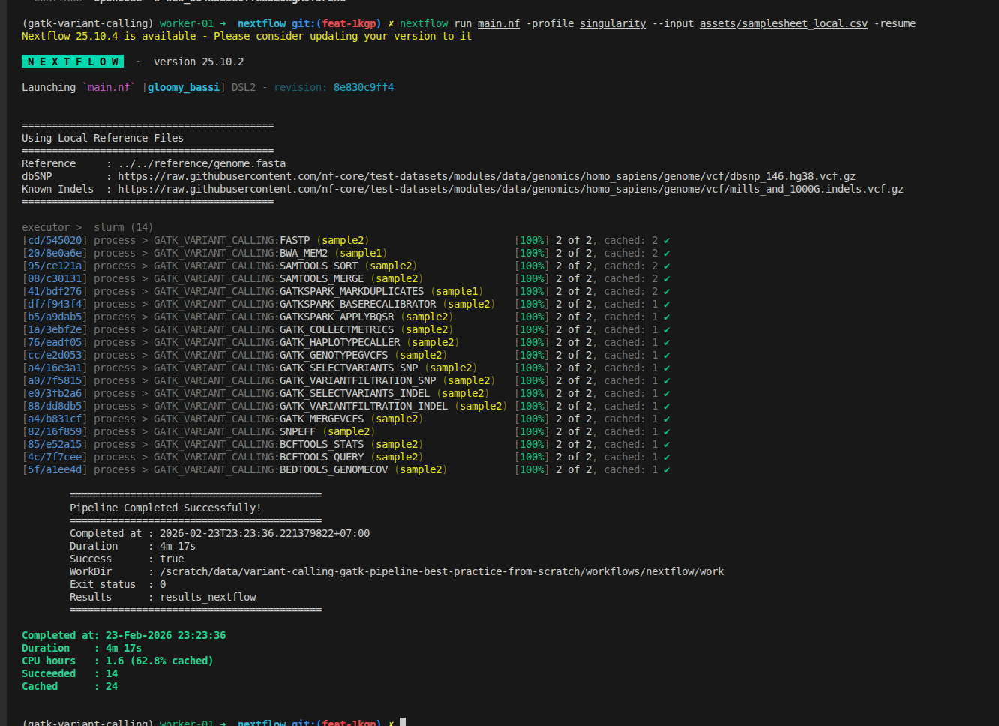
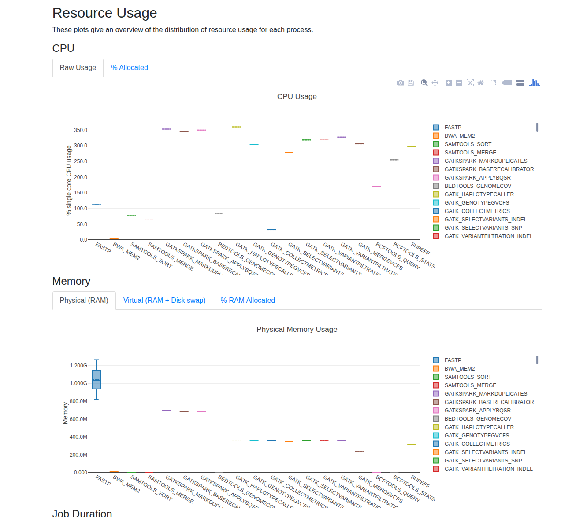

In [Part 1](/en/blogs/gatk-variant-calling-bash-workflow-pixi-part1), we built a bash baseline. In [Part 2](/en/blogs/gatk-variant-calling-bash-to-nextflow-validation-part2), we moved it to Nextflow and checked the results with checksums. This post looks at running the same pipeline on an HPC cluster: configuring executors for clusters of different sizes, tuning resources per tool, replacing the slowest steps with faster alternatives (fastp and Spark-based GATK tools), and scaling the number of samples.

<!--truncate-->

:::info
The code for this tutorial is available in the [variant-calling-gatk-pipeline-best-practice-from-scratch](https://github.com/nttg8100/variant-calling-gatk-pipeline-best-practice-from-scratch) repository.
:::

## Series overview

1. [Part 1 — a bash workflow with a reproducible Pixi environment](/en/blogs/gatk-variant-calling-bash-workflow-pixi-part1).
2. [Part 2 — migrating the same steps to Nextflow and validating the result](/en/blogs/gatk-variant-calling-bash-to-nextflow-validation-part2).
3. **Part 3 (this post)** — SLURM configuration and per-tool resource tuning.
4. [Part 4 — testing and linting](/en/blogs/gatk-variant-calling-production-slurm-optimization-part4).
5. [Part 5 — benchmarking](/en/blogs/gatk-variant-calling-production-slurm-optimization-part5).

## 1. From proof of concept to production

### 1.1 Where the series stands

**Part 1** produced a working bash pipeline suitable for a small number of samples, with a runtime on the order of tens of minutes per sample.

**Part 2** rewrote every step as a Nextflow process run inside Singularity containers, and validated the migration with MD5 checksums. In our local runs, a single sample completed in roughly three to four minutes.

**Part 3 (this post)** turns to deployment: SLURM profiles for clusters of different sizes, per-tool resource allocation, replacing slower tools with faster equivalents, and scaling progressively from 1 to 10 to 100 samples. The expected outcome is that 100 samples complete in hours rather than days; the exact figure depends on the cluster and on queue behaviour, so it should be treated as an estimate rather than a guarantee.

### 1.2 What this post covers

- Configure the Nextflow SLURM executor for different cluster sizes.
- Tune CPU, memory and walltime per GATK tool.
- Replace FastQC and Trim Galore with `fastp`, which performs trimming and quality control in a single pass.
- Use Spark-based GATK tools, which parallelise steps that are otherwise single-threaded.
- Scale progressively from 1 sample to 10 and then 100.
- Monitor execution and troubleshoot common issues.

### 1.3 Prerequisites

This post builds on Parts 1 and 2. If the series is new, it helps to start with:

1. [Part 1: a bash GATK pipeline with Pixi](/en/blogs/gatk-variant-calling-bash-workflow-pixi-part1).
2. [Part 2: from Bash to Nextflow](/en/blogs/gatk-variant-calling-bash-to-nextflow-validation-part2).
3. [Building a Slurm HPC cluster (Part 1)](/en/blogs/how-to-build-slurm-hpc-part-1).
4. [Building a Slurm HPC cluster (Part 2)](/en/blogs/how-to-build-slurm-hpc-part-2).
5. [Building a Slurm HPC cluster (Part 3)](/en/blogs/how-to-build-slurm-hpc-part-3).
6. [Containers on HPC: from Docker to Singularity and Apptainer](/en/blogs/containers-hpc-docker-singularity-apptainer).

### 1.4 Assumptions

This guide assumes a SLURM cluster with a small number of nodes and access to shared storage such as NFS. Examples are given for clusters of different sizes.

### 1.5 Supporting multiple FASTQ files per sample

In many sequencing projects, one biological sample is sequenced across several lanes or runs, producing more than one pair of FASTQ files per sample.

The pipeline described so far treats each sample as a single pair of files. A small update addresses this: add a `lane` column to the samplesheet so that each row represents a unique combination of sample and lane. The pipeline then aligns each lane as a sub-sample and merges the resulting BAM files into one per sample.

#### Samtools sort

Aligned BAM files of a sample are sorted:

```bash
process SAMTOOLS_SORT {
    tag "$meta.id"
    label 'process_medium'
    
    
    container 'quay.io/biocontainers/samtools:1.17--hd87286a_2'
    
    input:
    tuple val(meta), path(bam)
    
    output:
    tuple val(meta), path("*_sorted.bam"), emit: bam
    path "versions.yml", emit: versions
    
    when:
    task.ext.when == null || task.ext.when
    
    script:
    def args = task.ext.args ?: ''
    def prefix = task.ext.prefix ?: "${meta.id}"
    
    """
    # Sort BAM file by coordinates
    samtools sort \\
        -@ $task.cpus \\
        $args \\
        -o ${prefix}_sorted.bam \\
        $bam
    
    # Create versions file
    cat <<-END_VERSIONS > versions.yml
    "${task.process}":
        samtools: \$(samtools --version | head -1 | sed 's/samtools //')
    END_VERSIONS
    """
}
```

#### Samtools merge

The sorted BAM files are then merged:

```bash
process SAMTOOLS_MERGE {
    tag "$meta.id"
    label 'process_low'
    
    
    container 'quay.io/biocontainers/samtools:1.18--h50ea8bc_1'
    
    input:
    tuple val(meta), path(bams)
    
    output:
    tuple val(meta), path("*.bam"), emit: bam
    tuple val(meta), path("*.bai"), emit: bai
    path "versions.yml", emit: versions
    
    when:
    task.ext.when == null || task.ext.when
    
    script:
    def args = task.ext.args ?: ''
    def prefix = task.ext.prefix ?: "${meta.id}"
    
    // If only one BAM, just symlink and index it; otherwise merge
    if (bams instanceof List && bams.size() > 1) {
        """
        # Merge multiple BAM files
        samtools merge \\
            -@ $task.cpus \\
            $args \\
            ${prefix}_merged.bam \\
            ${bams.join(' ')}
        
        # Index the merged BAM
        samtools index \\
            -@ $task.cpus \\
            ${prefix}_merged.bam
        
        # Create versions file
        cat <<-END_VERSIONS > versions.yml
        "${task.process}":
            samtools: \$(samtools --version | head -1 | sed 's/samtools //')
        END_VERSIONS
        """
    } else {
        """
        # Only one BAM file, create symlink and index
        ln -s ${bams[0]} ${prefix}_merged.bam
        
        samtools index \\
            -@ $task.cpus \\
            ${prefix}_merged.bam
        
        # Create versions file
        cat <<-END_VERSIONS > versions.yml
        "${task.process}":
            samtools: \$(samtools --version | head -1 | sed 's/samtools //')
        END_VERSIONS
        """
    }
}
```

#### Updating the input logic

Example samplesheet:

```bash
sample,lane,fastq_1,fastq_2
sample1,1,data/sample1_lane1_R1.fastq.gz,data/sample1_lane1_R2.fastq.gz
sample1,2,data/sample1_lane2_R1.fastq.gz,data/sample1_lane2_R2.fastq.gz
```

The channel logic is updated to handle both single-lane and multi-lane formats:

```groovy
Channel
    .fromPath(params.input)
    .splitCsv(header: true)
    .map { row ->
        def meta = [:]
        meta.id = row.sample
        meta.sample = row.sample
        // Use lane if present, otherwise default to "L001"
        meta.lane = row.lane ?: "L001"
        meta.read_group = "${row.sample}_${meta.lane}"
        def reads = []
        reads.add(file(row.fastq_1))
        if (row.fastq_2) {
            reads.add(file(row.fastq_2))
        }
        return [ meta, reads ]
    }
    .set { ch_input }
```

Each FASTQ pair is then processed with the correct metadata, which supports downstream merging and correct read group assignment. Two steps are added to the workflow:

```bash
//
// STEP 3: Sort BAM file
//
SAMTOOLS_SORT (
    BWA_MEM.out.bam
)
ch_versions = ch_versions.mix(SAMTOOLS_SORT.out.versions)

//
// STEP 4: Merge lanes per sample (if multiple lanes exist)
// Group by sample ID and collect all BAMs for each sample
//
SAMTOOLS_SORT.out.bam
    .map { meta, bam ->
        // Create new meta with only sample ID for merging
        def new_meta = [:]
        new_meta.id = meta.sample
        new_meta.sample = meta.sample
        return [ new_meta.id, new_meta, bam ]
    }
    .groupTuple()
    .map { sample_id, metas, bams ->
        // Take the first meta (they should all have same sample info)
        return [ metas[0], bams ]
    }
    .set { ch_bams_to_merge }

SAMTOOLS_MERGE (
    ch_bams_to_merge
)
ch_versions = ch_versions.mix(SAMTOOLS_MERGE.out.versions)
```

## 2. SLURM executor configuration for Nextflow

### 2.1 Understanding the Nextflow SLURM executor

Nextflow hides much of SLURM's complexity by translating processes into SLURM jobs automatically:

```
Nextflow Process → SLURM Job Submission → Queue → Compute Node → Execution
```

For each process, Nextflow:

1. creates a job script containing the process logic;
2. submits it to SLURM with the requested resources;
3. monitors the queue and polls for job completion;
4. collects outputs and manages retries.

**Configuration settings that matter:**

- **`process.executor`** — set to `'slurm'`.
- **`executor.queueSize`** — the maximum number of concurrent jobs, which prevents the pipeline from overwhelming the cluster.
- **`executor.pollInterval`** — how often Nextflow checks job status.
- **`process.queue`** — which SLURM partition to use.

### 2.2 Small cluster configuration (2–10 nodes)

For a small research cluster with limited queue capacity:

```groovy
// Add this to workflows/nextflow/nextflow.config

profiles {
    slurm_small {
        process.executor = 'slurm'
        process.queue = 'short'           // Use "short" partition (faster jobs)
        executor.queueSize = 10           // Max 10 concurrent jobs
        executor.pollInterval = '10s'     // Check every 10 seconds
        executor.queueStatInterval = '1m' // Query queue status every 1 min
        executor.submitRateLimit = '10/1min' // Don't submit >10 jobs per minute
    }
}
```

**Why these settings?**

With 100 samples, limiting the pipeline to 10 concurrent jobs means the workflow processes samples in batches of 10. This is considerate towards other cluster users: it prevents one large job from monopolising cluster resources and delaying everyone else's workloads.

:::tip
- `queueSize = 10`: on a small cluster, submitting 100 jobs at once is not advisable. Ten concurrent jobs give reasonable parallelism without overloading the queue.
- `submitRateLimit`: keeps the number of submissions moderate and causes fewer complaints from cluster administrators.
- `queue = 'short'`: most small clusters have short, medium and long partitions, and short queues generally start sooner.
:::

### 2.3 Medium cluster configuration (10–50 nodes)

For a departmental cluster with multiple partitions:

```groovy
profiles {
    slurm_medium {
        process.executor = 'slurm'
        executor.queueSize = 50
        executor.pollInterval = '15s'
        executor.queueStatInterval = '2m'
        
        // Dynamic queue selection based on task type
        withLabel: process_low {
            queue = 'short'
        }
        withLabel: process_medium {
            queue = 'medium'
        }
        withLabel: process_high {
            queue = 'long'
        }
        withLabel: process_gpu {
            queue = 'gpu'
        }
    }
}
```

:::tip
Many bioinformatics tools run faster with GPU acceleration. Not all compute nodes have GPUs, however; the SLURM cluster posts linked above describe how to check the available partitions.
:::

**Strategy:** route different job types to different queues. Short jobs go to the short partition (fast queue, lower priority) while long jobs go to the long partition (higher latency but intended for long-running work).

### 2.4 Large cluster configuration (50+ nodes)

For production HPC centres:

```groovy
profiles {
    slurm_large {
        process.executor = 'slurm'
        executor.queueSize = 200        // More parallelism
        executor.pollInterval = '30s'   // Less frequent polling (cheaper)
        executor.queueStatInterval = '5m'
        executor.submitRateLimit = '50/1min'  // More aggressive submission
        executor.exitReadTimeout = '10min'    // Wait longer for exit status
    }
}
```

### 2.5 Process-specific SLURM directives

FastQC is primarily single-threaded and I/O-bound. In our runs, giving it more resources, for example 8 CPUs and 16 GB of RAM, did not shorten its runtime. Adding CPUs or memory to FastQC, or similar tools, does not speed up processing of an individual sample. Running two samples with 8 CPUs each is not necessarily faster than running them with 2 CPUs each; a reasonable allocation is typically 1–2 CPUs and 2–4 GB of RAM per FastQC process.

For a fuller discussion, see [Bioinformatics cost optimization for input using Nextflow (Part 2)](/en/blogs/bioinformatics-computing-resource-optimization-part2).

Once a profile has been chosen, individual processes can be customised:

```groovy
process {
    withName: FASTQC {
        cpus = 2
        memory = '4.GB'
        time = '1.h'
    }
}
```

**A useful safeguard:** a resource validation function prevents requests from exceeding cluster limits:

```groovy
def check_max(obj, type) {
    if (type == 'memory') {
        try {
            if (obj.compareTo(params.max_memory as nextflow.util.MemoryUnit) == 1)
                return params.max_memory as nextflow.util.MemoryUnit
            else
                return obj
        } catch (all) {
            println "WARNING: Memory exceeds max! Using ${params.max_memory}"
            return obj
        }
    } else if (type == 'cpus') {
        return Math.min(obj, params.max_cpus as int)
    }
}

// Then use in process definitions
withName: FASTQC {
    cpus = { check_max(4 * task.attempt, 'cpus') }
    memory = { check_max(8.GB * task.attempt, 'memory') }
}
```

## 3. Resource optimization per tool

### 3.1 Understanding pipeline bottlenecks

In our Part 2 runs (roughly 3 minutes 38 seconds for a single sample), the time was distributed approximately as follows:

| Step | Tool                               | Time | Bottleneck Type                  |
| ---- | ---------------------------------- | ---- | -------------------------------- |
| 1    | FastQC                             | 15s  | Run without threads/cores option |
| 2    | Trim Galore                        | 45s  | Has FastQC is a section          |
| 3    | BWA Align                          | 60s  | Old version                      |
| 4    | MarkDuplicates                     | 20s  | Run without threads/cores option |
| 5-7  | BQSR (Gen+Apply)                   | 40s  | Run without threads/cores option |
| 8    | QC Metrics                         | 10s  | I/O-bound                        |
| 9    | HaplotypeCaller                    | 80s  | **CPU-bound (slowest)**          |
| 10+  | GenotypeGVCFs, filters, annotation | 68s  | CPU-bound + I/O                  |

**Key observation:** steps 1 and 2 (FastQC plus Trim Galore) read the data twice, and step 9 (HaplotypeCaller) runs serially. These are the natural targets for optimization.

### 3.2 Resource tuning, tool by tool

:::tip
Points that help when optimizing each task at scale:

+ Prefer newer tools that offer better performance, lower resource usage or more features, provided they meet the workflow's requirements.
+ If a tool scales efficiently with additional CPUs, RAM or GPU resources, allocate more during development to speed up iteration. Once the workflow is stable, adjust resource requests to match production needs.
+ Remove tools that are no longer used; a leaner workflow is easier to maintain. Older versions remain accessible by checking out the corresponding `git` revision.
:::

#### Raw data preprocessing: fastp

For trimming and quality control of reads, `fastp` is a widely used modern option: it is fast and performs both steps at once, replacing the FastQC + Trim Galore pair.

:::tip
+ Parameters for this tool can be supplied through `task.ext.arg`.
+ It is generally better to expose parameters through Nextflow params. For a quick proof of concept, `qualified_quality_phred` and `length_required` are hard-coded here.
:::

```bash
process FASTP {
    tag "$meta.id"
    label 'process_medium'
    
    
    container 'quay.io/biocontainers/fastp:1.1.0--heae3180_0'
    
    input:
    tuple val(meta), path(reads)
    
    output:
    tuple val(meta), path("*_trimmed_{1,2}.fastq.gz"), emit: reads
    tuple val(meta), path("*.html"), emit: html
    tuple val(meta), path("*.json"), emit: json
    path "versions.yml", emit: versions
    
    when:
    task.ext.when == null || task.ext.when
    
    script:
    def args = task.ext.args ?: ''
    def prefix = task.ext.prefix ?: "${meta.read_group}"
    
    """
    # Adapter trimming, quality filtering, and QC with fastp
    fastp \\
        --thread $task.cpus \\
        --in1 ${reads[0]} \\
        --in2 ${reads[1]} \\
        --out1 ${prefix}_trimmed_1.fastq.gz \\
        --out2 ${prefix}_trimmed_2.fastq.gz \\
        --html ${prefix}_fastp.html \\
        --json ${prefix}_fastp.json \\
        --qualified_quality_phred 20 \\
        --length_required 50 \\
        --detect_adapter_for_pe \\
        $args
    
    # Create versions file
    cat <<-END_VERSIONS > versions.yml
    "${task.process}":
        fastp: \$(fastp --version 2>&1 | grep -oP 'fastp \\K[0-9.]+')
    END_VERSIONS
    """
}
```

#### Alignment: BWA-mem2

BWA-mem2 is a newer implementation of BWA-MEM that runs faster and scales almost linearly with the number of threads, so extra CPUs generally reduce wall-clock time at little additional cost.

Remember to re-index the genome: the BWA-MEM index cannot be used by BWA-mem2.

```bash
process BWA_MEM {
    tag "$meta.id"
    label 'process_high'
    
    conda "${moduleDir}/environment.yml"
    container "${ workflow.containerEngine == 'singularity' && !task.ext.singularity_pull_docker_container ?
        'https://community-cr-prod.seqera.io/docker/registry/v2/blobs/sha256/9a/9ac054213e67b3c9308e409b459080bbe438f8fd6c646c351bc42887f35a42e7/data' :
        'community.wave.seqera.io/library/bwa-mem2_htslib_samtools:e1f420694f8e42bd' }"
    
    input:
    tuple val(meta), path(reads)
    path reference
    path reference_fai
    path reference_dict
    path bwa_index
    
    output:
    tuple val(meta), path("*.bam"), emit: bam
    path "versions.yml", emit: versions
    
    when:
    task.ext.when == null || task.ext.when
    
    script:
    def args = task.ext.args ?: '-M'
    def prefix = task.ext.prefix ?: "${meta.read_group}"
    // Proper read group with unique ID per lane but same SM (sample) for merging
    def read_group = "@RG\\tID:${meta.read_group}\\tSM:${meta.sample}\\tPL:ILLUMINA\\tLB:${meta.sample}_lib\\tPU:${meta.lane}"
    
    """
    # Find the BWA-MEM2 index prefix
    INDEX=\$(find -L ./ -name "*.amb" | sed 's/\\.amb\$//')
    
    # Read Alignment with BWA-MEM2
    bwa-mem2 \\
        mem \\
        -t $task.cpus \\
        $args \\
        -R "${read_group}" \\
        \$INDEX \\
        ${reads[0]} ${reads[1]} \\
        | samtools view -Sb - > ${prefix}_aligned.bam
    
    # Create versions file
    cat <<-END_VERSIONS > versions.yml
    "${task.process}":
        bwamem2: \$(echo \$(bwa-mem2 version 2>&1) | sed 's/.* //')
        samtools: \$(echo \$(samtools --version 2>&1) | sed 's/^.*samtools //; s/Using.*\$//')
    END_VERSIONS
    """
    
    stub:
    def prefix = task.ext.prefix ?: "${meta.read_group}"
    
    """
    touch ${prefix}_aligned.bam
    
    cat <<-END_VERSIONS > versions.yml
    "${task.process}":
        bwamem2: \$(echo \$(bwa-mem2 version 2>&1) | sed 's/.* //')
        samtools: \$(echo \$(samtools --version 2>&1) | sed 's/^.*samtools //; s/Using.*\$//')
    END_VERSIONS
    """
}
```

#### Preprocessing aligned reads: GATK Spark

`MarkDuplicates`, `BaseRecalibrator` and `ApplyBQSR` are single-threaded tools and, in our runs, took a noticeable share of the total time. GATK provides Spark-based equivalents that spread the work over several small tasks on a single node, which is often more efficient. The module below shows what changes.

:::info
+ Container: changed from `broadinstitute/gatk:4.6.1.0` to `quay.io/biocontainers/gatk4-spark:4.6.1.0--hdfd78af_0`.
+ Label: `process_high`, which allocates more memory and CPU.
+ Memory: requesting around 80% of the allocated memory is usually enough for this memory-intensive task.
+ Syntax: a small configuration change is needed to run under Spark; the remaining arguments are unchanged.
:::

```bash
process GATKSPARK_APPLYBQSR {
    tag "$meta.id"
    label 'process_high'
    container 'quay.io/biocontainers/gatk4-spark:4.6.1.0--hdfd78af_0'
    
    input:
    tuple val(meta), path(bam), path(bai), path(recal_table)
    path reference
    path reference_fai
    path reference_dict
    
    output:
    tuple val(meta), path("*_recal.bam"), emit: bam
    tuple val(meta), path("*_recal.bam.bai"), emit: bai
    path "versions.yml", emit: versions
    
    when:
    task.ext.when == null || task.ext.when
    
    script:
    def avail_mem = (task.memory.mega * 0.8).intValue()
    """
    # Apply Base Quality Score Recalibration
    gatk --java-options "-Xmx${avail_mem}M -XX:-UsePerfData" \\
        ApplyBQSRSpark \\
        -I $bam \\
        -R $reference \\
        --bqsr-recal-file $recal_table \\
        --create-output-bam-index true \\
        -O ${meta.id}_recal.bam \\
        --spark-master local[${task.cpus}] \\
        --tmp-dir .
    
    # Create versions file
    cat <<-END_VERSIONS > versions.yml
    "${task.process}":
        gatk4: \$(gatk --version 2>&1 | grep -E 'GATK v[0-9.]+' | sed 's/.*v\\([0-9.]\\+\\).*/\\1/' || echo "4.4.0.0")
    END_VERSIONS
    """
}
```

### 3.3 Summary of the changes

:::info
Improvements in this part:

+ Support for multiple lanes per sample in the samplesheet.
+ FastQC and Trim Galore replaced by fastp for faster, all-in-one preprocessing.
+ BWA-MEM upgraded to BWA-MEM2 for improved alignment speed.
+ GATK preprocessing steps now use GATK Spark tools and a newer GATK version.
+ Configuration updated to allow input files to be read from remote sources.
:::



### 3.4 Industrial-scale optimization

In production pipelines for clinical variant calling or large cohorts, the cost of each run matters. Unlike research workflows, where file sizes vary, industrial pipelines usually operate on standardised protocols with fixed input characteristics. Each process therefore behaves predictably and can be tuned closely to the minimum resources it needs.

#### 3.4.1 Why production pipelines need per-process optimization

In an industrial setting, quality control is built into the protocol, so input files follow strict specifications:

- **File format:** always paired-end FASTQ, gzip-compressed.
- **Quality metrics:** validated at ingest by the sequencing facility.
- **File sizes:** little variation, for example within about ±10% of a baseline for WGS samples.
- **Run frequency:** thousands to millions of samples.

This predictability means each process can be tuned for efficiency without much risk of cascading failures.

#### 3.4.2 Cost optimization across the pipeline

Instead of generic resource allocations, production pipelines optimise cost per process per sample:

```
Cost per sample = Σ(cost_per_hour × hours_per_process)
```

**Example: UK Biobank-style cohort of 500,000 WGS samples**

:::warning
The costs below are illustrative assumptions, not measured figures for running this pipeline.
:::

Assumptions:

- Compute: AWS EC2 `c6i.8xlarge` at $1.35/hour (32 CPUs, 64 GB RAM)
- 500,000 samples at an average of 30× WGS coverage

**Cost per sample (original pipeline from Part 2):**

| Process                   | Time | CPUs | Memory | Cost               | Notes                    |
| ------------------------- | ---- | ---- | ------ | ------------------ | ------------------------ |
| FastQC                    | 15s  | 1    | 2GB    | $0.0006            | Single-threaded          |
| TrimGalore                | 45s  | 1    | 2GB    | $0.0017            | Single-threaded          |
| BWA Align                 | 60s  | 1    | 4GB    | $0.0023            | Serial, not parallelized |
| MarkDuplicates            | 20s  | 1    | 8GB    | $0.0008            | GATK standard            |
| BQSR                      | 40s  | 1    | 4GB    | $0.0015            | Single-threaded          |
| HaplotypeCaller           | 80s  | 1    | 8GB    | $0.0030            | **Slowest step**         |
| GenotypeGVCFs + VEP       | 68s  | 1    | 4GB    | $0.0026            | Annotation               |
| **Total (328s / sample)** |      |      |        | **$0.0125/sample** | For 500k: **$6,250**     |

**Optimized pipeline (Part 3, with CPU and memory allocation matched to each tool):**

| Process                   | Tool                 | Time | CPUs | Memory | Cost               | Savings           |
| ------------------------- | -------------------- | ---- | ---- | ------ | ------------------ | ----------------- |
| Preprocessing             | fastp                | 25s  | 8    | 4GB    | $0.0009            | -67%              |
| Alignment                 | BWA-mem2             | 35s  | 16   | 8GB    | $0.0018            | -42%              |
| Dedup+BQSR                | GATK Spark           | 28s  | 16   | 32GB   | $0.0015            | -69%              |
| Variant Calling           | HaplotypeCallerSpark | 22s  | 32   | 64GB   | $0.0013            | -57%              |
| **Total (110s / sample)** |                      |      |      |        | **$0.0055/sample** | **56% reduction** |

**For 500,000 samples:**

- Original: 500k × $0.0125 = **$6,250**
- Optimized: 500k × $0.0055 = **$2,750**
- **Modelled saving: about $3,500 per complete cohort run**

#### 3.4.3 Targeting CPU and memory per process

Nextflow provides built-in reporting — `report`, `trace` and `timeline` — that helps analyse CPU and memory usage per process. Once enabled, the generated reports can be reviewed to identify resource utilisation patterns.

For small datasets, it is common to observe that increasing the number of threads for multi-threaded tools raises CPU usage while memory stays roughly flat and well below the limit. As data size grows, the reports show whether adding CPUs or memory actually helps. A reasonable rule of thumb is to allocate up to about 80% of available memory for demanding processes, and to add CPUs for tools that scale efficiently with threads.

For more detail, see [Bioinformatics cost optimization for input using Nextflow (Part 2)](/en/blogs/bioinformatics-computing-resource-optimization-part2).



Not every process needs the same resources. `withName` can be used to fine-tune CPU and memory per process:

```groovy
process {
    withName: FASTP {
        cpus = 8          // Multi-threaded, scales well up to 8 threads
        memory = '4 GB'   // Minimal memory needs
        time = '1h'
    }
    
    withName: 'BWA.*' {
        cpus = 16         // Thread-heavy, scales with CPU count
        memory = '32 GB'  
        time = '1h'
    }
    
    withName: 'GATKSPARK.*' {
        cpus = 32         // Spark parallelism
        memory = '48 GB'  // Memory-intensive distributed processing
        time = '2h'
    }
}
```

**Rationale for these allocations:**

1. **fastp (8 CPU, 4 GB):** adapter trimming is I/O-bound. It scales roughly linearly up to around 8 threads, with diminishing returns beyond that, and needs little memory.
2. **BWA-mem2 (16 CPU, 32 GB):** alignment scales well to 16 CPUs. Memory use includes the genome index and per-thread overhead; 32 GB is a generous allocation here.
3. **GATK Spark (32 CPU, 48 GB):** duplicate marking and base quality recalibration benefit from Spark parallelism, and memory is needed to partition the work.

The configuration above can be saved as `optimized.config` and applied to a new run:

```bash
nextflow run main.nf -profile singularity --input Batch_1_100_samples_Biobank.csv -c optimized.config
```

#### 3.4.4 Production considerations

**Adaptive resource strategy for edge cases:**

Across a very large cohort, some samples fail because of data anomalies such as corrupted reads or outlier coverage. Nextflow's retry logic handles these without over-provisioning every job:

```groovy
process {
    errorStrategy = { task.exitStatus in [137,139,143,255] ? 'retry' : 'finish' }
    maxRetries = 2
    
    withLabel: process_low {
        cpus = { 2 * task.attempt }
        memory = { 2.GB * task.attempt }
    }
    
    withLabel: process_medium {
        cpus = { 4 * task.attempt }
        memory = { 8.GB * task.attempt }
    }
    
    withLabel: process_high {
        cpus = { 16 * task.attempt }
        memory = { 32.GB * task.attempt }
    }
}
```

**How escalation saves money:**

1. The first attempt uses the cost-optimised baseline resources.
2. If the task runs out of memory (exit code 137), it is retried with more CPU and memory.
3. Most samples succeed on the first attempt, so little capacity is wasted.
4. Only a small number of samples receive escalated resources.

**Example with 500,000 samples (modelled):**

- Failure rate: 0.5% ≈ 2,500 retries.
- Retry cost: about $50 of overhead in this model.
- Cost of provisioning all samples at the escalated level: $1,000 or more.
- **Modelled saving from adaptive retry: around 95%.**

## 4. Practical considerations

Building a scalable variant calling pipeline is about more than connecting tools: it is about engineering for correctness, reproducibility and maintainability.

### 4.1 Ensuring each step runs correctly

Each process — FastQC, alignment, variant calling — should be validated for the data type and sequencing platform in use. Increasing CPUs for FastQC does not improve its performance, and parameters may need adjustment for different coverage levels, such as 30× versus 100× WGS, or for different sequencing technologies. Testing with representative datasets and reviewing tool documentation for platform-specific options is advisable.

### 4.2 Knowing whether the workflow is good enough

Benchmarking against established gold standards gives an objective answer. For germline variant calling, reference datasets such as GIAB (Genome in a Bottle) allow the VCF output to be compared with known variants, producing accuracy and performance metrics. For novel analyses, criteria can be defined using in silico or wet-lab controls. See the [NIST publication on benchmarking](https://tsapps.nist.gov/publication/get_pdf.cfm?pub_id=925009) for background.

### 4.3 Organising bioinformatics pipelines

Modular design is important for maintainability and reuse. Practices from projects such as nf-core are worth adopting: break workflows into reusable modules and subworkflows, provide example datasets for testing, and add automated tests so that outputs stay consistent. This supports faster development, easier debugging and more robust production deployments. Basing a pipeline on nf-core conventions while keeping it tailored to a specific dataset is a reasonable balance.

## 5. Repository

All code and examples from this series: [variant-calling-gatk-pipeline-best-practice-from-scratch](https://github.com/nttg8100/variant-calling-gatk-pipeline-best-practice-from-scratch).

## References

1. **Nextflow documentation** — executors, configuration and reporting: https://www.nextflow.io/docs/latest/
2. **Nextflow SLURM executor** — configuration reference: https://www.nextflow.io/docs/latest/executor.html#slurm
3. **NGS101** — variant calling tutorials: https://ngs101.com/
4. **GATK forum** — troubleshooting and best practices: https://gatkforums.broadinstitute.org/
5. **Nextflow community forum**: https://forums.nextflow.io/
6. **nf-core** — production bioinformatics pipelines: https://nf-co.re/
7. **NIST benchmarking publication** — reference material on comparing variant calls against truth sets: https://tsapps.nist.gov/publication/get_pdf.cfm?pub_id=925009
8. **Reference code for this post**: https://github.com/nttg8100/variant-calling-gatk-pipeline-best-practice-from-scratch
