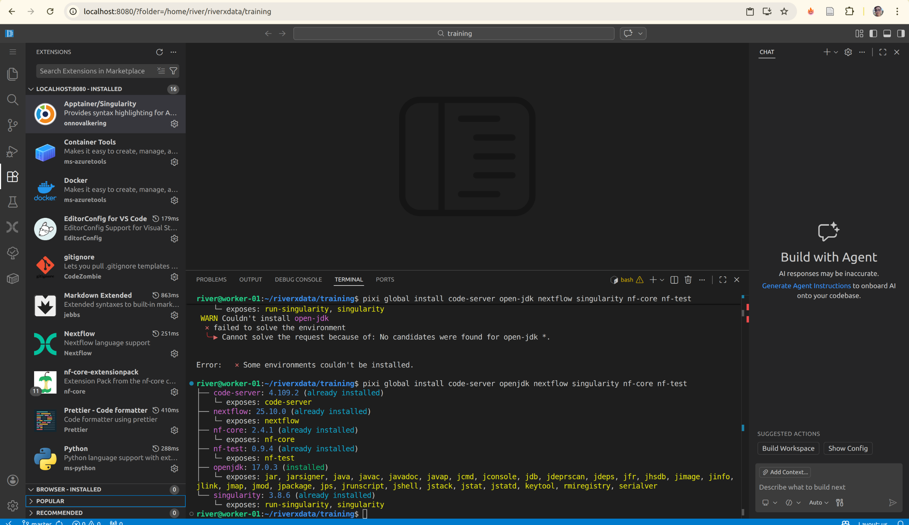
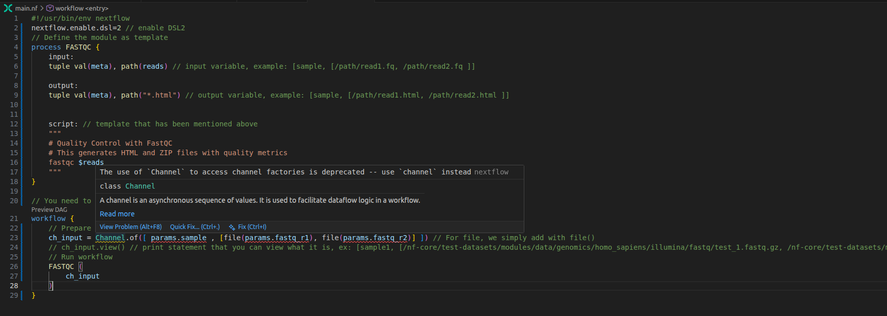
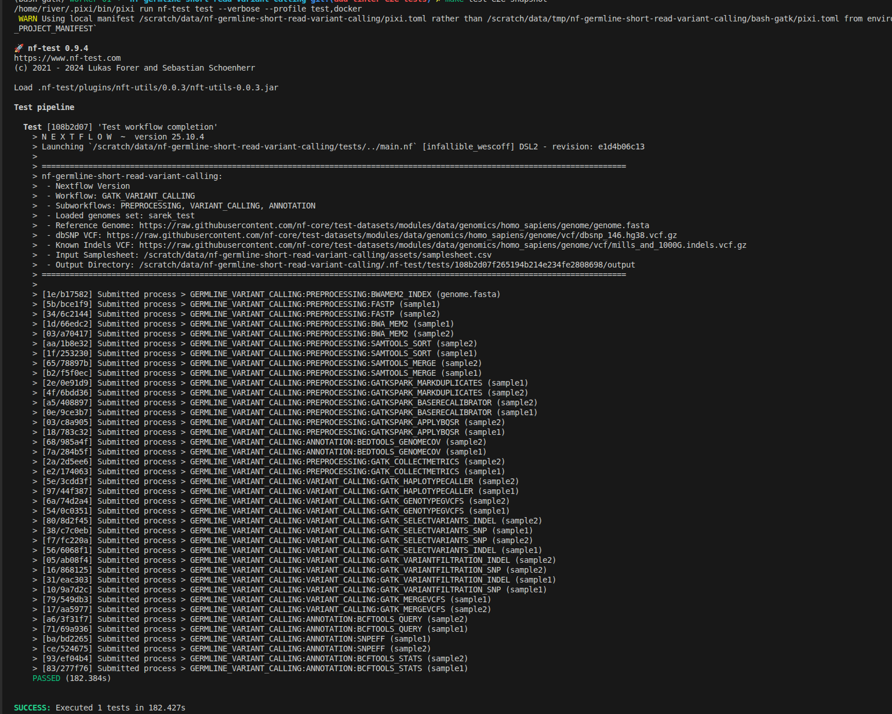

In [Part 3](/en/blogs/gatk-variant-calling-production-slurm-optimization-part3), we had a pipeline that runs on a cluster. What was still missing was a way to check, automatically, that the pipeline keeps producing the same results. This post covers linting and testing: why they matter and how to set them up.

<!--truncate-->

## Series overview

1. [Part 1 — a bash workflow with a reproducible Pixi environment](/en/blogs/gatk-variant-calling-bash-workflow-pixi-part1).
2. [Part 2 — migrating the same steps to Nextflow and validating the result](/en/blogs/gatk-variant-calling-bash-to-nextflow-validation-part2).
3. [Part 3 — production-scale deployment](/en/blogs/gatk-variant-calling-production-slurm-optimization-part3).
4. **Part 4 (this post)** — lint rules and `nf-test` snapshots.
5. [Part 5 — benchmarking](/en/blogs/gatk-variant-calling-production-slurm-optimization-part5).

## 1. Installing extensions and tools

This tutorial uses Visual Studio Code or Code Server, both common environments for Nextflow pipeline development.

### 1.1 Extension pack

In the left sidebar, open the Extensions panel and search for extensions.


Check the installed extensions:



### 1.2 nf-core and nf-test

Both can be installed with Pixi:

```bash
pixi add nf-core nf-test python==3.11
```

## 2. Getting started

### 2.1 Linting

Linting helps a script follow a previously agreed format automatically. The logic may be correct, but consistent indentation, naming conventions and process organisation still matter.

This keeps coding conventions consistent across a team, which makes collaboration easier and code easier to read. In Visual Studio Code, for example, opening a `main.nf` script highlights violations of the nf-core linting rules.

Fix these issues manually until the warnings disappear:



Indentation can also be normalised with the `nextflow` command:

```bash
nextflow lint . -format
```

:::info
+ **nf-core/tools** is a Python tool that applies stricter linting with nf-core conventions: https://github.com/nf-core/tools
+ It enforces certain rules that may not apply to every workflow, for example requiring MultiQC or a specific file structure. Whether to use it depends on the use case.
:::

### 2.2 Testing

In software development, tests are usually grouped as follows:

+ **Unit tests:** focus on individual components or functions, checking that they behave as expected in isolation. They catch bugs early and make refactoring safer.
+ **End-to-end tests:** run the entire workflow from start to finish, simulating a real scenario, and verify that the integrated parts work together correctly.
+ **Performance tests:** measure how the workflow behaves under different conditions, such as varying data sizes or system load, to confirm that it meets speed and resource requirements.

Applying these strategies to Nextflow workflows supports reliability, maintainability and reproducibility across environments.

For bioinformatics work, it is worth setting up testing tools so that reproducibility across environments can be checked. From an engineering perspective, running a small test dataset for new features and the full dataset before a release is a practical balance. Tests can be run as follows.

For small dataset tests:

```bash
nextflow run main.nf -profile test,docker
```

For full dataset tests:

```bash
nextflow run main.nf -profile test,docker
```

If both runs complete successfully, the next step is to validate the results: a workflow can finish without error yet still produce unexpected output. Running the same input twice should give identical results, and MD5 checksums are a convenient way to confirm that. The approach is the same as in the [Part 2 validation section](/en/blogs/gatk-variant-calling-bash-to-nextflow-validation-part2).

Validating every output file by hand is tedious without tooling. [nf-test](https://www.nf-test.com/) and [nft-utils](https://github.com/nf-core/nft-utils) automate this.

To set up nf-test, create the files described below.

#### 2.2.1 Prepare the workflow

Any Nextflow workflow can be used. Here we continue with the [nf-germline-short-read-variant-calling](https://github.com/nttg8100/nf-germline-short-read-variant-calling.git) repository:

```bash
git clone https://github.com/nttg8100/nf-germline-short-read-variant-calling.git -b 0.2.0
cd nf-germline-short-read-variant-calling
```

#### 2.2.2 Configuration (nf-test.config)

This file tells nf-test where to find tests and which configuration to combine with the workflow:

```groovy
config {
    // location for all nf-test tests
    testsDir = "."

    // nf-test directory including temporary files for each test
    workDir = System.getenv("NFT_WORKDIR") ?: ".nf-test"

    // location of an optional nextflow.config file specific for executing tests
    configFile = "tests/nextflow.config"

    // load the necessary plugins
    plugins {
        load "nft-utils@0.0.3"
    }
}
```

#### 2.2.3 Test workflow (default.nf.test)

This file runs the `main.nf` workflow, the parent workflow in the repository. Comments describe what each section does:

```groovy
nextflow_pipeline {

    name "Test pipeline" // name of workflow
    script "../main.nf" // run parent folder workflow
    tag "pipeline"

    test("Test workflow completion") { // name describing what you're testing; you can define multiple tests here

        when {
            params { // define your custom parameters here; I copied these from the test profile
                outdir = "$outputDir" 
                input = "$projectDir/assets/samplesheet.csv"
                genome = 'sarek_test'
            }
        }

        then {
            // stable_name: All files + folders in ${params.outdir}/ with relative paths
            def stable_name = getAllFilesFromDir(params.outdir, relative: true, includeDir: true, ignore: ['pipeline_info/*.{html,json,txt}'])
            // stable_path: All files in ${params.outdir}/ with stable content
            def stable_path = getAllFilesFromDir(params.outdir, ignoreFile: 'tests/.nftignore')
            assertAll(
                { assert workflow.success},
                { assert snapshot(
                    // All stable path names, with relative paths
                    stable_name,
                    // All files with stable contents
                    stable_path
                ).match() }
            )
        }
    }
}
```

#### 2.2.4 Ignore files (.nftignore)

Many tools write files that contain timestamps. These are excluded from validation so that results can be compared reliably, working similarly to `.gitignore`:

```bash
pipeline_info/*.{html,json,txt,yml}
germline_variant_calling:preprocessing:fastp/*.{html,fastq.gz,json}
germline_variant_calling:preprocessing:gatk_collectmetrics/*.txt
germline_variant_calling*/*.{bcf,vcf,vcf.gz,vcf.gz.tbi}
```

### 2.3 Running the test workflow with a snapshot

nf-test is run in a similar way to the `nextflow` command. The `--verbose` flag shows detailed logs, and `--update-snapshot` creates the folder structure and MD5 hashes for all output files:

```bash
nf-test test tests/default.nf.test --verbose --update-snapshot --profile docker
```



The snapshot file is created automatically as `default.nf.test.snap`:

```json
{
    "Test workflow completion": {
        "content": [
            [
                "germline_variant_calling:annotation:bcftools_query",
                "germline_variant_calling:annotation:bcftools_query/sample1_variants.bed",
                "germline_variant_calling:annotation:bcftools_query/sample2_variants.bed",
                "germline_variant_calling:annotation:bcftools_query/versions.yml",
                "germline_variant_calling:annotation:bcftools_stats",
                "germline_variant_calling:annotation:bcftools_stats/sample1_indel_count.txt",
                "germline_variant_calling:annotation:bcftools_stats/sample1_snp_count.txt",
                "germline_variant_calling:annotation:bcftools_stats/sample1_variant_stats.txt",
                "germline_variant_calling:annotation:bcftools_stats/sample2_indel_count.txt",
                "germline_variant_calling:annotation:bcftools_stats/sample2_snp_count.txt",
                "germline_variant_calling:annotation:bcftools_stats/sample2_variant_stats.txt",
                "germline_variant_calling:annotation:bcftools_stats/versions.yml",
                "germline_variant_calling:annotation:bedtools_genomecov",
                "germline_variant_calling:annotation:bedtools_genomecov/sample1_coverage.bedgraph",
                "germline_variant_calling:annotation:bedtools_genomecov/sample2_coverage.bedgraph",
                "germline_variant_calling:annotation:bedtools_genomecov/versions.yml",
                "germline_variant_calling:annotation:snpeff",
                "germline_variant_calling:annotation:snpeff/sample1_annotated.vcf",
                "germline_variant_calling:annotation:snpeff/sample1_snpeff.log",
                "germline_variant_calling:annotation:snpeff/sample2_annotated.vcf",
                "germline_variant_calling:annotation:snpeff/sample2_snpeff.log",
                "germline_variant_calling:annotation:snpeff/versions.yml",
                "germline_variant_calling:preprocessing:bwa_mem2",
                "germline_variant_calling:preprocessing:bwa_mem2/sample1_1_aligned.bam",
                "germline_variant_calling:preprocessing:bwa_mem2/sample2_1_aligned.bam",
                "germline_variant_calling:preprocessing:bwa_mem2/versions.yml",
                "germline_variant_calling:preprocessing:bwamem2_index",
                "germline_variant_calling:preprocessing:bwamem2_index/genome.fasta.0123",
                "germline_variant_calling:preprocessing:bwamem2_index/genome.fasta.amb",
                "germline_variant_calling:preprocessing:bwamem2_index/genome.fasta.ann",
                "germline_variant_calling:preprocessing:bwamem2_index/genome.fasta.bwt.2bit.64",
                "germline_variant_calling:preprocessing:bwamem2_index/genome.fasta.pac",
                "germline_variant_calling:preprocessing:bwamem2_index/versions.yml",
                "germline_variant_calling:preprocessing:fastp",
                "germline_variant_calling:preprocessing:fastp/sample1_1_fastp.html",
                "germline_variant_calling:preprocessing:fastp/sample1_1_fastp.json",
                "germline_variant_calling:preprocessing:fastp/sample1_1_trimmed_1.fastq.gz",
                "germline_variant_calling:preprocessing:fastp/sample1_1_trimmed_2.fastq.gz",
                "germline_variant_calling:preprocessing:fastp/sample2_1_fastp.html",
                "germline_variant_calling:preprocessing:fastp/sample2_1_fastp.json",
                "germline_variant_calling:preprocessing:fastp/sample2_1_trimmed_1.fastq.gz",
                "germline_variant_calling:preprocessing:fastp/sample2_1_trimmed_2.fastq.gz",
                "germline_variant_calling:preprocessing:fastp/versions.yml",
                "germline_variant_calling:preprocessing:gatk_collectmetrics",
                "germline_variant_calling:preprocessing:gatk_collectmetrics/sample1_alignment_summary.txt",
                "germline_variant_calling:preprocessing:gatk_collectmetrics/sample2_alignment_summary.txt",
                "germline_variant_calling:preprocessing:gatk_collectmetrics/versions.yml",
                "germline_variant_calling:preprocessing:gatkspark_applybqsr",
                "germline_variant_calling:preprocessing:gatkspark_applybqsr/sample1_recal.bam",
                "germline_variant_calling:preprocessing:gatkspark_applybqsr/sample1_recal.bam.bai",
                "germline_variant_calling:preprocessing:gatkspark_applybqsr/sample2_recal.bam",
                "germline_variant_calling:preprocessing:gatkspark_applybqsr/sample2_recal.bam.bai",
                "germline_variant_calling:preprocessing:gatkspark_applybqsr/versions.yml",
                "germline_variant_calling:preprocessing:gatkspark_baserecalibrator",
                "germline_variant_calling:preprocessing:gatkspark_baserecalibrator/sample1_recal.table",
                "germline_variant_calling:preprocessing:gatkspark_baserecalibrator/sample2_recal.table",
                "germline_variant_calling:preprocessing:gatkspark_baserecalibrator/versions.yml",
                "germline_variant_calling:preprocessing:gatkspark_markduplicates",
                "germline_variant_calling:preprocessing:gatkspark_markduplicates/sample1.bam",
                "germline_variant_calling:preprocessing:gatkspark_markduplicates/sample1.bam.bai",
                "germline_variant_calling:preprocessing:gatkspark_markduplicates/sample2.bam",
                "germline_variant_calling:preprocessing:gatkspark_markduplicates/sample2.bam.bai",
                "germline_variant_calling:preprocessing:gatkspark_markduplicates/versions.yml",
                "germline_variant_calling:preprocessing:samtools_merge",
                "germline_variant_calling:preprocessing:samtools_merge/sample1_merged.bam",
                "germline_variant_calling:preprocessing:samtools_merge/sample1_merged.bam.bai",
                "germline_variant_calling:preprocessing:samtools_merge/sample2_merged.bam",
                "germline_variant_calling:preprocessing:samtools_merge/sample2_merged.bam.bai",
                "germline_variant_calling:preprocessing:samtools_merge/versions.yml",
                "germline_variant_calling:preprocessing:samtools_sort",
                "germline_variant_calling:preprocessing:samtools_sort/sample1_sorted.bam",
                "germline_variant_calling:preprocessing:samtools_sort/sample2_sorted.bam",
                "germline_variant_calling:preprocessing:samtools_sort/versions.yml",
                "germline_variant_calling:variant_calling:gatk_genotypegvcfs",
                "germline_variant_calling:variant_calling:gatk_genotypegvcfs/sample1_raw.vcf.gz",
                "germline_variant_calling:variant_calling:gatk_genotypegvcfs/sample1_raw.vcf.gz.tbi",
                "germline_variant_calling:variant_calling:gatk_genotypegvcfs/sample2_raw.vcf.gz",
                "germline_variant_calling:variant_calling:gatk_genotypegvcfs/sample2_raw.vcf.gz.tbi",
                "germline_variant_calling:variant_calling:gatk_genotypegvcfs/versions.yml",
                "germline_variant_calling:variant_calling:gatk_haplotypecaller",
                "germline_variant_calling:variant_calling:gatk_haplotypecaller/sample1.g.vcf.gz",
                "germline_variant_calling:variant_calling:gatk_haplotypecaller/sample1.g.vcf.gz.tbi",
                "germline_variant_calling:variant_calling:gatk_haplotypecaller/sample2.g.vcf.gz",
                "germline_variant_calling:variant_calling:gatk_haplotypecaller/sample2.g.vcf.gz.tbi",
                "germline_variant_calling:variant_calling:gatk_haplotypecaller/versions.yml",
                "germline_variant_calling:variant_calling:gatk_mergevcfs",
                "germline_variant_calling:variant_calling:gatk_mergevcfs/sample1_filtered.vcf.gz",
                "germline_variant_calling:variant_calling:gatk_mergevcfs/sample1_filtered.vcf.gz.tbi",
                "germline_variant_calling:variant_calling:gatk_mergevcfs/sample2_filtered.vcf.gz",
                "germline_variant_calling:variant_calling:gatk_mergevcfs/sample2_filtered.vcf.gz.tbi",
                "germline_variant_calling:variant_calling:gatk_mergevcfs/versions.yml",
                "germline_variant_calling:variant_calling:gatk_selectvariants_indel",
                "germline_variant_calling:variant_calling:gatk_selectvariants_indel/sample1_raw_indels.vcf.gz",
                "germline_variant_calling:variant_calling:gatk_selectvariants_indel/sample1_raw_indels.vcf.gz.tbi",
                "germline_variant_calling:variant_calling:gatk_selectvariants_indel/sample2_raw_indels.vcf.gz",
                "germline_variant_calling:variant_calling:gatk_selectvariants_indel/sample2_raw_indels.vcf.gz.tbi",
                "germline_variant_calling:variant_calling:gatk_selectvariants_indel/versions.yml",
                "germline_variant_calling:variant_calling:gatk_selectvariants_snp",
                "germline_variant_calling:variant_calling:gatk_selectvariants_snp/sample1_raw_snps.vcf.gz",
                "germline_variant_calling:variant_calling:gatk_selectvariants_snp/sample1_raw_snps.vcf.gz.tbi",
                "germline_variant_calling:variant_calling:gatk_selectvariants_snp/sample2_raw_snps.vcf.gz",
                "germline_variant_calling:variant_calling:gatk_selectvariants_snp/sample2_raw_snps.vcf.gz.tbi",
                "germline_variant_calling:variant_calling:gatk_selectvariants_snp/versions.yml",
                "germline_variant_calling:variant_calling:gatk_variantfiltration_indel",
                "germline_variant_calling:variant_calling:gatk_variantfiltration_indel/sample1_filtered_indels.vcf.gz",
                "germline_variant_calling:variant_calling:gatk_variantfiltration_indel/sample1_filtered_indels.vcf.gz.tbi",
                "germline_variant_calling:variant_calling:gatk_variantfiltration_indel/sample2_filtered_indels.vcf.gz",
                "germline_variant_calling:variant_calling:gatk_variantfiltration_indel/sample2_filtered_indels.vcf.gz.tbi",
                "germline_variant_calling:variant_calling:gatk_variantfiltration_indel/versions.yml",
                "germline_variant_calling:variant_calling:gatk_variantfiltration_snp",
                "germline_variant_calling:variant_calling:gatk_variantfiltration_snp/sample1_filtered_snps.vcf.gz",
                "germline_variant_calling:variant_calling:gatk_variantfiltration_snp/sample1_filtered_snps.vcf.gz.tbi",
                "germline_variant_calling:variant_calling:gatk_variantfiltration_snp/sample2_filtered_snps.vcf.gz",
                "germline_variant_calling:variant_calling:gatk_variantfiltration_snp/sample2_filtered_snps.vcf.gz.tbi",
                "germline_variant_calling:variant_calling:gatk_variantfiltration_snp/versions.yml",
                "pipeline_info"
            ],
            [
                "sample1_variants.bed:md5,d41d8cd98f00b204e9800998ecf8427e",
                "sample2_variants.bed:md5,d41d8cd98f00b204e9800998ecf8427e",
                "versions.yml:md5,249943b1d5bd2ce57e04bea4d2dd8abf",
                "sample1_indel_count.txt:md5,897316929176464ebc9ad085f31e7284",
                "sample1_snp_count.txt:md5,897316929176464ebc9ad085f31e7284",
                "sample1_variant_stats.txt:md5,e8e84ea2acff4d7b5548b7ebaf2b05a4",
                "sample2_indel_count.txt:md5,897316929176464ebc9ad085f31e7284",
                "sample2_snp_count.txt:md5,897316929176464ebc9ad085f31e7284",
                "sample2_variant_stats.txt:md5,2301b862009bbf518a5f94f19103b5de",
                "versions.yml:md5,ff6ad194e0ec804b72bc83d8bf8cf019",
                "sample1_coverage.bedgraph:md5,d41d8cd98f00b204e9800998ecf8427e",
                "sample2_coverage.bedgraph:md5,d41d8cd98f00b204e9800998ecf8427e",
                "versions.yml:md5,6d58041eb279541e3a138c60826cefbb",
                "sample1_snpeff.log:md5,7137fc9f7d044314bea421ba06ca0f18",
                "sample2_snpeff.log:md5,7137fc9f7d044314bea421ba06ca0f18",
                "versions.yml:md5,1d4d4e229cfa017c03d08c73b5674b98",
                "sample1_1_aligned.bam:md5,90cf54bb11be1393f24791f2bafb81ba",
                "sample2_1_aligned.bam:md5,ecc75033f0c0c9a88497799323cd12af",
                "versions.yml:md5,f1355436d7ddd31b50858fe62e8adde4",
                "genome.fasta.0123:md5,d73300d44f733bcdb7c988fc3ff3e3e9",
                "genome.fasta.amb:md5,1891c1de381b3a96d4e72f590fde20c1",
                "genome.fasta.ann:md5,2df4aa2d7580639fa0fcdbcad5e2e969",
                "genome.fasta.bwt.2bit.64:md5,cd4bdf496eab05228a50c45ee43c1ed0",
                "genome.fasta.pac:md5,8569fbdb2c98c6fb16dfa73d8eacb070",
                "versions.yml:md5,2a4b9defcea58647c0b5b1cc8b2627f2",
                "versions.yml:md5,6c7466de4bab59e8df203424eb253fd6",
                "versions.yml:md5,5fa3be89c5df1c030acae287599419dd",
                "sample1_recal.bam:md5,92a4e508f76d8dfe7a7149ad8861feb3",
                "sample1_recal.bam.bai:md5,0d76977b2e36046cc176112776c5fa4e",
                "sample2_recal.bam:md5,4a4de50378f16f4ff1345c61c50df2fb",
                "sample2_recal.bam.bai:md5,0d76977b2e36046cc176112776c5fa4e",
                "versions.yml:md5,04197383659004cbbc3bcd59260d5bc0",
                "sample1_recal.table:md5,c38e5c25e24ced2c98c908cf89328ecf",
                "sample2_recal.table:md5,c38e5c25e24ced2c98c908cf89328ecf",
                "versions.yml:md5,c935190eb4847737950a118a8ef8ef53",
                "sample1.bam:md5,92a4e508f76d8dfe7a7149ad8861feb3",
                "sample1.bam.bai:md5,0d76977b2e36046cc176112776c5fa4e",
                "sample2.bam:md5,4a4de50378f16f4ff1345c61c50df2fb",
                "sample2.bam.bai:md5,0d76977b2e36046cc176112776c5fa4e",
                "versions.yml:md5,921b80662856f7496e4d181748b284ab",
                "sample1_merged.bam:md5,663f5532903b2fb669dc39fd58bfd387",
                "sample1_merged.bam.bai:md5,0d76977b2e36046cc176112776c5fa4e",
                "sample2_merged.bam:md5,137440788103c2ce509a89169d8e1a2c",
                "sample2_merged.bam.bai:md5,0d76977b2e36046cc176112776c5fa4e",
                "versions.yml:md5,df0d93935f80356c470858f91ee34f47",
                "sample1_sorted.bam:md5,663f5532903b2fb669dc39fd58bfd387",
                "sample2_sorted.bam:md5,137440788103c2ce509a89169d8e1a2c",
                "versions.yml:md5,f30c0e213665fdb93c19cde77cd1b967",
                "versions.yml:md5,28ef44a18a3310ca11717b590731eadc",
                "versions.yml:md5,1a07831fb1f0ee9f9248c68736c30695",
                "versions.yml:md5,8a62c99aa5d272e89ff0935055091745",
                "versions.yml:md5,d6c0b7ff8e09b3c996ef151bd5eb546a",
                "versions.yml:md5,cbda79c8ab968bd76b73fd7c739dcca3",
                "versions.yml:md5,dc9ae42e4bea47b9da0c0f9a905c0684",
                "versions.yml:md5,d3949b20e639f1016e9745b2a1126960"
            ]
        ],
        "timestamp": "2026-03-04T23:25:53.360079629",
        "meta": {
            "nf-test": "0.9.4",
            "nextflow": "25.10.4"
        }
    }
}
```

### 2.4 Running tests with existing snapshots

Once the initial snapshot has been created, there is no need to update it again. Running the test simply checks that the output still matches the stored snapshot:

```bash
nf-test test tests/default.nf.test --verbose --profile docker
```

### 2.5 Optional: manual testing

A workflow may run successfully yet produce output that is not meaningful. Tests that validate file contents address this. One approach is to simulate a dataset with specific variants in known regions and known allele frequencies, then check that the workflow calls those variants:

```bash
python validate_germline_variant_calling.py --expect-variant truth.vcf --pipeline-variant query.vcf
```

## 3. GitHub Actions with linting

### 3.1 Makefile

We introduced the Makefile in an earlier post. It sets up a consistent environment for both local development and GitHub Actions. In our experience, debugging GitHub Actions' predefined actions can be harder than running the same steps locally, so the Makefile is used to run tests quickly on a development machine, and the workflow files call the same targets rather than duplicating the logic in YAML.

:::tip
An introduction to CI/CD in bioinformatics: [Version control for reproducible bioinformatics (Part 2)](/en/blogs/how-to-version-control-git-bioinformatics-part-2).
:::

A single `Makefile` binds the `test` and `lint` targets together:

```bash
.PHONY: test-e2e clean
${HOME}/.pixi/bin/pixi:
	curl -sSL https://pixi.sh/install.sh | sh

test-e2e: ${HOME}/.pixi/bin/pixi
	${HOME}/.pixi/bin/pixi run nextflow run main.nf -profile docker,test -resume

test-e2e-snapshot: ${HOME}/.pixi/bin/pixi
	${HOME}/.pixi/bin/pixi run nf-test test --verbose --profile test,docker

test-e2e-update-snapshot: ${HOME}/.pixi/bin/pixi
	${HOME}/.pixi/bin/pixi run nf-test test tests/default.nf.test --verbose --update-snapshot --profile test,docker

lint: ${HOME}/.pixi/bin/pixi
	${HOME}/.pixi/bin/pixi run nextflow lint . -format 

clean:
	rm -rf work
```

### 3.2 GitHub workflow

Successful runs of these workflows can be seen in the project's pull request https://github.com/nttg8100/nf-germline-short-read-variant-calling/pull/7:

+ Linter: https://github.com/nttg8100/nf-germline-short-read-variant-calling/actions/runs/22679273108
+ Test: https://github.com/nttg8100/nf-germline-short-read-variant-calling/actions/runs/22679273035

#### 3.2.1 Linting

Create the file `.github/workflows/linting.yaml`. This workflow checks out the repository and runs the lint command, so that code is properly formatted before it is pushed to GitHub. It triggers on pushes and pull requests to the `main` branch:

```yaml
name: Linting

on:
  push:
    branches: [ main ]
  pull_request:
    branches: [ main ]

jobs:
  clone:
    runs-on: ubuntu-latest
    steps:
      - name: Checkout repository
        uses: actions/checkout@v4

      - name: Running linting
        run: |
          make lint
```

#### 3.2.2 Testing

Create the file `.github/workflows/e2e.yml`. This workflow checks out the repository and runs the pipeline together with the output snapshots. It triggers on pushes and pull requests to the `main` branch:

```yaml
name: Testing e2e

on:
  push:
    branches: [ main ]
  pull_request:
    branches: [ main ]

jobs:
  clone:
    runs-on: ubuntu-latest
    steps:
      - name: Checkout repository
        uses: actions/checkout@v4

      - name: Running testing
        run: |
          make test-e2e-snapshot
```

## 4. Recap

:::tip
These testing and linting principles apply not only to Nextflow but to workflow code in general.
:::

## References

1. **nf-test** — snapshot testing for Nextflow pipelines: https://www.nf-test.com/
2. **nft-utils** — helper functions used in the test file: https://github.com/nf-core/nft-utils
3. **nf-core/tools** — linting rules and pipeline scaffolding: https://github.com/nf-core/tools
4. **Nextflow documentation** — `lint` command and configuration: https://www.nextflow.io/docs/latest/cli.html
5. **GitHub Actions documentation**: https://docs.github.com/en/actions
6. **Reference repository for this post**: https://github.com/nttg8100/nf-germline-short-read-variant-calling
