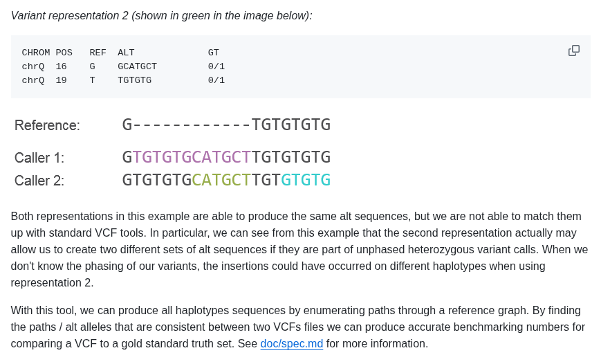

Throughout this series we have looked at how a variant calling workflow can be built, migrated and optimised. What matters at the end, however, is not how modern the tooling is but whether the calls hold up against a reference. In this post we benchmark several variant callers on the Genome in a Bottle (GIAB) HG002 sample using `nf-core/sarek`, and score the results with `hap.py` against the NIST truth set. The numbers we obtained for SNP and indel calling were consistent with those reported in the sarek publication, with recall and precision above 99% for most tools.

<!--truncate-->

:::tip
+ The environments and scripts are uploaded to [nf-germline-short-read-variant-calling](https://github.com/nttg8100/nf-germline-short-read-variant-calling).
+ Clone the repository at tag 0.3.0 to reproduce the contents of this post.
:::

## Series overview

1. [Part 1 — a bash workflow with a reproducible Pixi environment](/en/blogs/gatk-variant-calling-bash-workflow-pixi-part1).
2. [Part 2 — migrating the same steps to Nextflow and validating the result](/en/blogs/gatk-variant-calling-bash-to-nextflow-validation-part2).
3. [Part 3 — production-scale deployment](/en/blogs/gatk-variant-calling-production-slurm-optimization-part3).
4. [Part 4 — testing and linting](/en/blogs/gatk-variant-calling-production-slurm-optimization-part4).
5. **Part 5 (this post)** — benchmarking against a gold-standard truth set.

Clone the repository:

```bash
git clone git@github.com:nttg8100/nf-germline-short-read-variant-calling.git -b 0.3.0
cd nf-germline-short-read-variant-calling
cd benchmark/pipelines/sarek
```

## 1. Preparing the dataset

Prepare `input.csv` as shown below. Nextflow can download the dataset automatically.

```bash
patient,sex,status,sample,lane,fastq_1,fastq_2
HG002,XY,0,HG002,1,s3://human-pangenomics/NHGRI_UCSC_panel/HG002/hpp_HG002_NA24385_son_v1/ILMN/downsampled/HG002_HiSeq30x_subsampled_R1.fastq.gz,s3://human-pangenomics/NHGRI_UCSC_panel/HG002/hpp_HG002_NA24385_son_v1/ILMN/downsampled/HG002_HiSeq30x_subsampled_R2.fastq.gz
```

The benchmark uses the **HG002** sample from the Genome in a Bottle (GIAB) consortium. HG002 is widely used as a reference dataset for benchmarking germline variant calling because it provides:

- high-confidence truth variants,
- high-confidence confident regions,
- well-curated reference datasets for SNPs and indels.

Dataset characteristics:

- Sample: **HG002 (NA24385)**
- Sequencing: **Illumina short reads**
- Coverage: **~30X**
- Reference genome: **GRCh38**
- Truth set: **GIAB high-confidence variant calls**

The truth VCF and the confident-region BED file are used to compare predicted variants against the gold standard.

## 2. Running nf-core/sarek

We allocated more computing resources so the run would finish sooner, using the configuration `customized_labels.config` below.

```groovy
// HPC internet is quite slow, so we increase the pull timeout for singularity containers
singularity.pullTimeout="100.h"
process {
    cpus   = { 2      * task.attempt }
    memory = { 4.GB   * task.attempt }
    time   = { 4.h    * task.attempt }

    // memory errors which should be retried. otherwise error out
    errorStrategy = { task.exitStatus in ((130..145) + 104) ? 'retry' : 'finish' }
    maxRetries    = 1
    maxErrors     = '-1'

    // Process-specific resource requirements
    // See https://www.nextflow.io/docs/latest/config.html#config-process-selectors
    withLabel:error_ignore {
        errorStrategy = 'ignore'
    }
    withLabel:error_retry {
        errorStrategy = 'retry'
        maxRetries    = 2
    }
    withLabel:process_single {
        cpus   = { 3                   }
        memory = { 6.GB * task.attempt }
        time   = { 4.h  * task.attempt }
    }
    withLabel:process_low {
        cpus   = { 6     * task.attempt }
        memory = { 12.GB * task.attempt }
        time   = { 4.h   * task.attempt }
    }
    withLabel:process_medium {
        cpus   = { 64     * task.attempt }
        memory = { 120.GB * task.attempt }
        time   = { 8.h   * task.attempt }
    }
    withLabel:process_high {
        cpus   = { 64    * task.attempt }
        memory = { 120.GB * task.attempt }
        time   = { 16.h  * task.attempt }
    }
    withLabel:process_long {
        time   = { 20.h  * task.attempt }
    }
    withLabel:process_high_memory {
        memory = { 200.GB * task.attempt }
    }
}
process.executor="slurm"
```

```bash
cd benchmark/pipelines/sarek
pixi run nextflow run nf-core/sarek -r 3.7.1 -profile docker,test_full_germline \
    -c customized_labels.config \
    --input ./input.csv \
    --outdir bwamem \
    --tools "deepvariant,freebayes,strelka,manta,haplotypecaller" \
    --aligner "bwa-mem" \
    -resume
```

The results are then copied to the corresponding folder under `benchmark`:

```bash
├── pipelines
│   └── sarek
│       ├── customized_labels.config
│       ├── input.csv
│       ├── pixi.lock
│       ├── pixi.toml
│       ├── run_pipeline.sh
│       └── variant_calling
│           ├── deepvariant
│           │   └── HG002
│           │       ├── HG002.deepvariant.g.vcf.gz
│           │       ├── HG002.deepvariant.g.vcf.gz.tbi
│           │       ├── HG002.deepvariant.vcf.gz
│           │       └── HG002.deepvariant.vcf.gz.tbi
│           ├── filtered
│           │   └── HG002
│           │       ├── HG002.deepvariant.bcftools_filtered.vcf.gz
│           │       ├── HG002.deepvariant.bcftools_filtered.vcf.gz.tbi
│           │       ├── HG002.freebayes.filtered.bcftools_filtered.vcf.gz
│           │       ├── HG002.freebayes.filtered.bcftools_filtered.vcf.gz.tbi
│           │       ├── HG002.haplotypecaller.filtered.bcftools_filtered.vcf.gz
│           │       ├── HG002.haplotypecaller.filtered.bcftools_filtered.vcf.gz.tbi
│           │       ├── HG002.strelka.variants.bcftools_filtered.vcf.gz
│           │       └── HG002.strelka.variants.bcftools_filtered.vcf.gz.tbi
│           ├── freebayes
│           │   └── HG002
│           │       ├── HG002.freebayes.filtered.vcf.gz
│           │       ├── HG002.freebayes.filtered.vcf.gz.tbi
│           │       ├── HG002.freebayes.vcf.gz
│           │       └── HG002.freebayes.vcf.gz.tbi
│           ├── haplotypecaller
│           │   └── HG002
│           │       ├── HG002.haplotypecaller.filtered.vcf.gz
│           │       ├── HG002.haplotypecaller.filtered.vcf.gz.tbi
│           │       ├── HG002.haplotypecaller.vcf.gz
│           │       └── HG002.haplotypecaller.vcf.gz.tbi
│           ├── manta
│           │   └── HG002
│           │       ├── HG002.manta.diploid_sv.vcf.gz
│           │       └── HG002.manta.diploid_sv.vcf.gz.tbi
│           └── strelka
│               └── HG002
│                   ├── HG002.strelka.genome.vcf.gz
│                   ├── HG002.strelka.genome.vcf.gz.tbi
│                   ├── HG002.strelka.variants.vcf.gz
│                   └── HG002.strelka.variants.vcf.gz.tbi
```

## 3. Benchmarking with the HG002 dataset

### 3.1 Downloading the truth set and reference data

As a proof of concept, this benchmark uses a single sample. Many more samples from GIAB and other public truth datasets can be used; the `download.sh` script in the `references` folder can be extended accordingly.

```bash
# download GATK reference genome
aws s3 cp --recursive --no-sign-request s3://ngi-igenomes/igenomes/Homo_sapiens/GATK/GRCh38/Sequence/WholeGenomeFasta/  .

# download reference files for benchmarking
wget https://ftp-trace.ncbi.nlm.nih.gov/ReferenceSamples/giab/release/AshkenazimTrio/HG002_NA24385_son/NISTv4.2.1/GRCh38/HG002_GRCh38_1_22_v4.2.1_benchmark.vcf.gz
wget https://ftp-trace.ncbi.nlm.nih.gov/ReferenceSamples/giab/release/AshkenazimTrio/HG002_NA24385_son/NISTv4.2.1/GRCh38/HG002_GRCh38_1_22_v4.2.1_benchmark.vcf.gz.tbi
# download bed files for confident regions
wget https://ftp-trace.ncbi.nlm.nih.gov/ReferenceSamples/giab/release/AshkenazimTrio/HG002_NA24385_son/NISTv4.2.1/GRCh38/HG002_GRCh38_1_22_v4.2.1_benchmark_noinconsistent.bed
```

Download the data by running:

```bash
cd benchmark/references
pixi run download.sh
```

The downloaded files are laid out as follows:

```bash
benchmark/
├── Readme.md
├── benchmark.sh
├── benchmark_rewrite.sh
├── pipelines
│   └── sarek
│       ├── customized_labels.config
│       ├── input.csv
│       ├── pixi.lock
│       ├── pixi.toml
│       ├── run_pipeline.sh
│       └── variant_calling
│           ├── deepvariant
│           │   └── HG002
│           │       ├── HG002.deepvariant.g.vcf.gz
│           │       ├── HG002.deepvariant.g.vcf.gz.tbi
│           │       ├── HG002.deepvariant.vcf.gz
│           │       └── HG002.deepvariant.vcf.gz.tbi
│           ├── filtered
│           │   └── HG002
│           │       ├── HG002.deepvariant.bcftools_filtered.vcf.gz
│           │       ├── HG002.deepvariant.bcftools_filtered.vcf.gz.tbi
│           │       ├── HG002.freebayes.filtered.bcftools_filtered.vcf.gz
│           │       ├── HG002.freebayes.filtered.bcftools_filtered.vcf.gz.tbi
│           │       ├── HG002.haplotypecaller.filtered.bcftools_filtered.vcf.gz
│           │       ├── HG002.haplotypecaller.filtered.bcftools_filtered.vcf.gz.tbi
│           │       ├── HG002.strelka.variants.bcftools_filtered.vcf.gz
│           │       └── HG002.strelka.variants.bcftools_filtered.vcf.gz.tbi
│           ├── freebayes
│           │   └── HG002
│           │       ├── HG002.freebayes.filtered.vcf.gz
│           │       ├── HG002.freebayes.filtered.vcf.gz.tbi
│           │       ├── HG002.freebayes.vcf.gz
│           │       └── HG002.freebayes.vcf.gz.tbi
│           ├── haplotypecaller
│           │   └── HG002
│           │       ├── HG002.haplotypecaller.filtered.vcf.gz
│           │       ├── HG002.haplotypecaller.filtered.vcf.gz.tbi
│           │       ├── HG002.haplotypecaller.vcf.gz
│           │       └── HG002.haplotypecaller.vcf.gz.tbi
│           ├── manta
│           │   └── HG002
│           │       ├── HG002.manta.diploid_sv.vcf.gz
│           │       └── HG002.manta.diploid_sv.vcf.gz.tbi
│           └── strelka
│               └── HG002
│                   ├── HG002.strelka.genome.vcf.gz
│                   ├── HG002.strelka.genome.vcf.gz.tbi
│                   ├── HG002.strelka.variants.vcf.gz
│                   └── HG002.strelka.variants.vcf.gz.tbi
├── pixi.lock
├── pixi.toml
├── references
│   ├── HG002_GRCh38_1_22_v4.2.1_benchmark.vcf.gz
│   ├── HG002_GRCh38_1_22_v4.2.1_benchmark.vcf.gz.tbi
│   ├── HG002_GRCh38_1_22_v4.2.1_benchmark_noinconsistent.bed
│   ├── Homo_sapiens_assembly38.dict
│   ├── Homo_sapiens_assembly38.fasta
│   ├── Homo_sapiens_assembly38.fasta.fai
│   ├── download.sh
│   ├── pixi.lock
│   └── pixi.toml
```

### 3.2 The benchmarking tool

Here we use [hap.py](https://github.com/Illumina/hap.py) to benchmark germline SNP and indel calls. The original publication is available at https://www.nature.com/articles/s41587-019-0054-x.

What it does:

+ It reformats variant records to find matches between the query and the truth set in the VCF.
+ Two variants that are identical in effect may be written with different positions or alternative nucleotides; the example below shows such a pair.
+ After reformatting the records, `hap.py` computes metrics that describe how well each caller performed.



Example output table:

| Type  | Filter | TRUTH.TOTAL | TRUTH.TP | TRUTH.FN | QUERY.TOTAL | QUERY.FP | QUERY.UNK | FP.gt | FP.al | METRIC.Recall | METRIC.Precision   | METRIC.Frac_NA | METRIC.F1_Score    | TRUTH.TOTAL.TiTv_ratio | QUERY.TOTAL.TiTv_ratio | TRUTH.TOTAL.het_hom_ratio | QUERY.TOTAL.het_hom_ratio |
| ----- | ------ | ----------- | -------- | -------- | ----------- | -------- | --------- | ----- | ----- | ------------- | ------------------ | -------------- | ------------------ | ---------------------- | ---------------------- | ------------------------- | ------------------------- |
| INDEL | ALL    | 525469      | 520048   | 5421     | 908475      | 2949     | 363798    | 2010  | 455   | 0.989684      | 0.9945860000000001 | 0.400449       | 0.992129           |                        |                        | 1.528275734138537         | 1.9313187724266925        |
| INDEL | PASS   | 525469      | 520048   | 5421     | 908475      | 2949     | 363798    | 2010  | 455   | 0.989684      | 0.9945860000000001 | 0.400449       | 0.992129           |                        |                        | 1.528275734138537         | 1.9313187724266925        |
| SNP   | ALL    | 3365127     | 3344549  | 20578    | 3841759     | 5292     | 490176    | 1401  | 562   | 0.993885      | 0.9984209999999999 | 0.127592       | 0.9961479999999999 | 2.1001284867575745     | 1.9839843850083037     | 1.5811958532541182        | 1.4858796715961773        |
| SNP   | PASS   | 3365127     | 3344549  | 20578    | 3841759     | 5292     | 490176    | 1401  | 562   | 0.993885      | 0.9984209999999999 | 0.127592       | 0.9961479999999999 | 2.1001284867575745     | 1.9839843850083037     | 1.5811958532541182        | 1.4858796715961773        |

:::info
The columns produced by `hap.py` are explained in its documentation, as summarised below.
:::

`hap.py` outputs a set of stratification columns followed by metrics columns. Stratification columns may contain the placeholder `*`, which indicates that the counts in that row are aggregated over all possible values of the column. For a subtype, this means the counts have been summed across all subtypes; for `QQ`, it means the counts correspond to all variants rather than only those below a QQ threshold.

| Stratification Column | Description                                                                        |
| :-------------------- | ---------------------------------------------------------------------------------- |
| Type                  | Variant type (SNP / INDEL)                                                         |
| Subtype               | Variant Subtype (ti/tv/indel length, see above)                                    |
| Subset                | Subset of the genome/stratification region                                         |
| Filter                | Variant filters: PASS, SEL, ALL, or a particular filter from the query VCF         |
| Genotype              | Genotype of benchmarked variants (het / homalt / hetalt)                           |
| QQ.Field              | Which field from the original VCF was used to produce QQ values in truth and query |
| QQ                    | QQ threshold for ROC values                                                        |

| Metric Column             | Description                                                                                                 |
| :------------------------ | ----------------------------------------------------------------------------------------------------------- |
| METRIC.Recall             | Recall for truth variant representation = TRUTH.TP / (TRUTH.TP + TRUTH.FN)                                  |
| METRIC.Precision          | Precision of query variants = QUERY.TP / (QUERY.TP + QUERY.FP)                                              |
| METRIC.Frac_NA            | Fraction of non-assessed query calls = QUERY.UNK / QUERY.TOTAL                                              |
| METRIC.F1_Score           | Harmonic mean of precision and recall = 2*METRIC.Recall*Metric.Precision/(METRIC.Recall + METRIC.Precision) |
| TRUTH.TOTAL               | Total number of truth variants                                                                              |
| TRUTH.TP                  | Number of true-positive calls in truth representation (counted via the truth sample column)                 |
| TRUTH.FN                  | Number of false-negative calls = calls in truth without matching query call                                 |
| QUERY.TOTAL               | Total number of query calls                                                                                 |
| QUERY.TP                  | Number of true positive calls in query representation (counted via the query sample column)                 |
| QUERY.FP                  | Number of false-positive calls in the query file (mismatched query calls within the confident regions)      |
| QUERY.UNK                 | Number of query calls outside the confident regions                                                         |
| FP.gt                     | Number of genotype mismatches (alleles match, but different zygosity)                                       |
| FP.al                     | Number of allele mismatches (variants matched by position and not by haplotype)                             |
| TRUTH.TOTAL.TiTv_ratio    | Transition / Transversion ratio for all truth variants                                                      |
| TRUTH.TOTAL.het_hom_ratio | Het/Hom ratio for all truth variants                                                                        |
| TRUTH.FN.TiTv_ratio       | Transition / Transversion ratio for false-negative variants                                                 |
| TRUTH.FN.het_hom_ratio    | Het/Hom ratio for false-negative variants                                                                   |
| TRUTH.TP.TiTv_ratio       | Transition / Transversion ratio for true positive variants                                                  |
| TRUTH.TP.het_hom_ratio    | Het/Hom ratio for true positive variants                                                                    |
| QUERY.FP.TiTv_ratio       | Transition / Transversion ratio for false positive variants                                                 |
| QUERY.FP.het_hom_ratio    | Het/Hom ratio for false-positive variants                                                                   |
| QUERY.TOTAL.TiTv_ratio    | Transition / Transversion ratio for all query variants                                                      |
| QUERY.TOTAL.het_hom_ratio | Het/Hom ratio for all query variants                                                                        |
| QUERY.TP.TiTv_ratio       | Transition / Transversion ratio for true positive variants (query representation)                           |
| QUERY.TP.het_hom_ratio    | Het/Hom ratio for true positive variants (query representation)                                             |
| QUERY.UNK.TiTv_ratio      | Transition / Transversion ratio for unknown variants                                                        |
| QUERY.UNK.het_hom_ratio   | Het/Hom ratio for unknown variants                                                                          |
| Subset.Size               | When using stratification regions, this gives the number of nucleotides contained in the current subset     |
| Subset.IS_CONF.Size       | This gives the number of confident bases (`-f` regions) in the current subset                               |

### 3.3 Benchmark script and environment

#### 3.3.1 Installation and script

```bash
#!/bin/bash
# Benchmark script for HG002 with DeepVariant, FreeBayes, HaplotypeCaller, Manta, Strelka (relative paths)
set -euo pipefail

HGREF="references/Homo_sapiens_assembly38.fasta"
REF="HG002"
BED="references/${REF}_GRCh38_1_22_v4.2.1_benchmark_noinconsistent.bed"
TRUTH="references/${REF}_GRCh38_1_22_v4.2.1_benchmark.vcf.gz"
SDF="references/grch38.sdf"
THREADS=16

RESULTSDIR="results"
mkdir -p "$RESULTSDIR"

TOOLS=(deepvariant freebayes haplotypecaller manta strelka)

VCF_DEEPVARIANT="pipelines/sarek/variant_calling/deepvariant/HG002/HG002.deepvariant.vcf.gz"
VCF_FREEBAYES="pipelines/sarek/variant_calling/freebayes/HG002/HG002.freebayes.vcf.gz"
VCF_HAPLOTYPECALLER="pipelines/sarek/variant_calling/haplotypecaller/HG002/HG002.haplotypecaller.vcf.gz"
VCF_MANTA="pipelines/sarek/variant_calling/manta/HG002/HG002.manta.diploid_sv.vcf.gz"
VCF_STRELKA="pipelines/sarek/variant_calling/strelka/HG002/HG002.strelka.variants.vcf.gz"

# Path map
declare -A VCF_PATHS=(
  [deepvariant]="$VCF_DEEPVARIANT"
  [freebayes]="$VCF_FREEBAYES"
  [haplotypecaller]="$VCF_HAPLOTYPECALLER"
  [manta]="$VCF_MANTA"
  [strelka]="$VCF_STRELKA"
)

for TOOL in "${TOOLS[@]}"; do
  TOOLDIR="$RESULTSDIR/$TOOL"
  mkdir -p "$TOOLDIR"
  VCF="${VCF_PATHS[$TOOL]}"
  LOG="$TOOLDIR/${REF}_${TOOL}.log"
  SUMMARY="$TOOLDIR/${REF}_${TOOL}.summary.csv"
  FORMATTED="$TOOLDIR/${REF}_${TOOL}.formatted.summary.csv"
  OUTPUT="$TOOLDIR/${REF}_${TOOL}"

  # If the tool output folder already exists with summary file, continue from AWK formatting (line 55)
  if [[ -f "${OUTPUT}.summary.csv" ]]; then
    echo "Output for $TOOL already exists, formatting summary."
    awk -v d="${TOOL}_${REF}" -F',' 'FNR==1{a="run"} FNR>1{a=d} {print $0",\t"a}' "${OUTPUT}.summary.csv" > "$FORMATTED"
    echo "Completed $TOOL (using existing output)"
    continue
  fi

  if [[ ! -f "$VCF" ]]; then
    echo "VCF file not found for $TOOL: $VCF" >&2
    continue
  fi

  echo "Benchmarking $TOOL for $REF ..."
  hap.py "$TRUTH" "$VCF" \
    -o "$OUTPUT" \
    -V --engine=vcfeval --threads "$THREADS" --engine-vcfeval-template "$SDF" \
    -f "$BED" \
    --logfile "$LOG" \
    --scratch-prefix .

  if [[ -f "${OUTPUT}.summary.csv" ]]; then
    awk -v d="${TOOL}_${REF}" -F',' 'FNR==1{a="run"} FNR>1{a=d} {print $0",\t"a}' "${OUTPUT}.summary.csv" > "$FORMATTED"
  else
    echo "Warning: ${OUTPUT}.summary.csv not found for $TOOL" >&2
  fi

  echo "Completed $TOOL"
done

MERGED="$RESULTSDIR/merged_${REF}_benchmark.csv"
echo "Merging summaries to $MERGED ..."
awk '(NR == 1) || (FNR > 1)' "$RESULTSDIR"/*/*.formatted.summary.csv > "$MERGED"
echo "All done. Results for $REF in $MERGED"
```

#### 3.3.2 Running the benchmark

Running the script produces output laid out as follows:

```bash
├── results
│   └── sarek
│       ├── deepvariant
│       │   ├── HG002_deepvariant.extended.csv
│       │   ├── HG002_deepvariant.formatted.summary.csv
│       │   ├── HG002_deepvariant.log
│       │   ├── HG002_deepvariant.metrics.json.gz
│       │   ├── HG002_deepvariant.roc.Locations.INDEL.PASS.csv.gz
│       │   ├── HG002_deepvariant.roc.Locations.INDEL.csv.gz
│       │   ├── HG002_deepvariant.roc.Locations.SNP.PASS.csv.gz
│       │   ├── HG002_deepvariant.roc.Locations.SNP.csv.gz
│       │   ├── HG002_deepvariant.roc.all.csv.gz
│       │   ├── HG002_deepvariant.runinfo.json
│       │   ├── HG002_deepvariant.summary.csv
│       │   ├── HG002_deepvariant.vcf.gz
│       │   └── HG002_deepvariant.vcf.gz.tbi
│       ├── freebayes
│       │   ├── HG002_freebayes.extended.csv
│       │   ├── HG002_freebayes.formatted.summary.csv
│       │   ├── HG002_freebayes.log
│       │   ├── HG002_freebayes.metrics.json.gz
│       │   ├── HG002_freebayes.roc.Locations.INDEL.PASS.csv.gz
│       │   ├── HG002_freebayes.roc.Locations.INDEL.csv.gz
│       │   ├── HG002_freebayes.roc.Locations.SNP.PASS.csv.gz
│       │   ├── HG002_freebayes.roc.Locations.SNP.csv.gz
│       │   ├── HG002_freebayes.roc.all.csv.gz
│       │   ├── HG002_freebayes.runinfo.json
│       │   ├── HG002_freebayes.summary.csv
│       │   ├── HG002_freebayes.vcf.gz
│       │   └── HG002_freebayes.vcf.gz.tbi
│       ├── haplotypecaller
│       │   ├── HG002_haplotypecaller.extended.csv
│       │   ├── HG002_haplotypecaller.formatted.summary.csv
│       │   ├── HG002_haplotypecaller.log
│       │   ├── HG002_haplotypecaller.metrics.json.gz
│       │   ├── HG002_haplotypecaller.roc.Locations.INDEL.PASS.csv.gz
│       │   ├── HG002_haplotypecaller.roc.Locations.INDEL.csv.gz
│       │   ├── HG002_haplotypecaller.roc.Locations.SNP.PASS.csv.gz
│       │   ├── HG002_haplotypecaller.roc.Locations.SNP.csv.gz
│       │   ├── HG002_haplotypecaller.roc.all.csv.gz
│       │   ├── HG002_haplotypecaller.runinfo.json
│       │   ├── HG002_haplotypecaller.summary.csv
│       │   ├── HG002_haplotypecaller.vcf.gz
│       │   └── HG002_haplotypecaller.vcf.gz.tbi
│       ├── manta
│       │   ├── HG002_manta.extended.csv
│       │   ├── HG002_manta.formatted.summary.csv
│       │   ├── HG002_manta.log
│       │   ├── HG002_manta.metrics.json.gz
│       │   ├── HG002_manta.roc.Locations.INDEL.PASS.csv.gz
│       │   ├── HG002_manta.roc.Locations.INDEL.csv.gz
│       │   ├── HG002_manta.roc.Locations.SNP.PASS.csv.gz
│       │   ├── HG002_manta.roc.Locations.SNP.csv.gz
│       │   ├── HG002_manta.roc.all.csv.gz
│       │   ├── HG002_manta.runinfo.json
│       │   ├── HG002_manta.summary.csv
│       │   ├── HG002_manta.vcf.gz
│       │   └── HG002_manta.vcf.gz.tbi
│       ├── merged_HG002_benchmark.csv
│       └── strelka
│           ├── HG002_strelka.extended.csv
│           ├── HG002_strelka.formatted.summary.csv
│           ├── HG002_strelka.log
│           ├── HG002_strelka.metrics.json.gz
│           ├── HG002_strelka.roc.Locations.INDEL.PASS.csv.gz
│           ├── HG002_strelka.roc.Locations.INDEL.csv.gz
│           ├── HG002_strelka.roc.Locations.SNP.PASS.csv.gz
│           ├── HG002_strelka.roc.Locations.SNP.csv.gz
│           ├── HG002_strelka.roc.all.csv.gz
│           ├── HG002_strelka.runinfo.json
│           ├── HG002_strelka.summary.csv
│           ├── HG002_strelka.vcf.gz
│           └── HG002_strelka.vcf.gz.tbi
```

#### 3.3.3 Reading the results

We benchmarked several widely used variant callers — **DeepVariant, FreeBayes, HaplotypeCaller, Strelka and Manta** — on the **HG002** dataset, evaluating **SNPs and indels** separately with **recall, precision and F1 score**.

In these runs, **DeepVariant showed the most balanced performance**, with the **highest combination of recall and precision** for both **SNPs (F1 ≈ 0.996)** and **indels (F1 ≈ 0.992)**. **HaplotypeCaller** and **Strelka** also performed well, with slightly lower recall or precision depending on the variant type. **FreeBayes** reached comparable recall but noticeably lower precision, indicating **more false positives**.

**SNP detection was consistently strong across most tools (recall ≈ 0.99)**, while **indel calling showed more variability**, which is consistent with the greater difficulty of detecting small insertions and deletions accurately.

As expected, **Manta performed poorly on SNPs and indels**, because it is **designed for structural variant detection rather than small variants**.

Overall, these results suggest that **machine-learning-based callers such as DeepVariant provide the most balanced performance**, while **traditional callers remain competitive but may need stricter filtering to control false positives**.

:::tip
+ These observations are consistent with the results reported for an older version of sarek, published in June 2024: https://academic.oup.com/nargab/article/doi/10.1093/nargab/lqae031/7658070
:::

The aggregated results in `merged_HG002_benchmark.csv` are shown below.

| Type  | Filter | TRUTH.TOTAL | TRUTH.TP | TRUTH.FN | QUERY.TOTAL | QUERY.FP | QUERY.UNK | FP.gt | FP.al | METRIC.Recall | METRIC.Precision | METRIC.Frac_NA | METRIC.F1_Score | TRUTH.TOTAL.TiTv_ratio | QUERY.TOTAL.TiTv_ratio | TRUTH.TOTAL.het_hom_ratio | QUERY.TOTAL.het_hom_ratio | run                   |
| ----- | ------ | ----------- | -------- | -------- | ----------- | -------- | --------- | ----- | ----- | ------------- | ---------------- | -------------- | --------------- | ---------------------- | ---------------------- | ------------------------- | ------------------------- | --------------------- |
| INDEL | ALL    | 525469      | 520048   | 5421     | 908475      | 2949     | 363798    | 2010  | 455   | 0.989684      | 0.994586         | 0.400449       | 0.992129        |                        |                        | 1.528275734138537         | 1.9313187724266925        | deepvariant_HG002     |
| INDEL | PASS   | 525469      | 520048   | 5421     | 908475      | 2949     | 363798    | 2010  | 455   | 0.989684      | 0.994586         | 0.400449       | 0.992129        |                        |                        | 1.528275734138537         | 1.9313187724266925        | deepvariant_HG002     |
| SNP   | ALL    | 3365127     | 3344549  | 20578    | 3841759     | 5292     | 490176    | 1401  | 562   | 0.993885      | 0.998421         | 0.127592       | 0.996148        | 2.1001284867575745     | 1.9839843850083037     | 1.5811958532541182        | 1.4858796715961773        | deepvariant_HG002     |
| SNP   | PASS   | 3365127     | 3344549  | 20578    | 3841759     | 5292     | 490176    | 1401  | 562   | 0.993885      | 0.998421         | 0.127592       | 0.996148        | 2.1001284867575745     | 1.9839843850083037     | 1.5811958532541182        | 1.4858796715961773        | deepvariant_HG002     |
| INDEL | ALL    | 525469      | 504432   | 21037    | 881738      | 19441    | 341005    | 13873 | 1528  | 0.959965      | 0.964047         | 0.386742       | 0.962002        |                        |                        | 1.528275734138537         | 1.8211051374734122        | freebayes_HG002       |
| INDEL | PASS   | 525469      | 504432   | 21037    | 881738      | 19441    | 341005    | 13873 | 1528  | 0.959965      | 0.964047         | 0.386742       | 0.962002        |                        |                        | 1.528275734138537         | 1.8211051374734122        | freebayes_HG002       |
| SNP   | ALL    | 3365127     | 3344473  | 20654    | 4423242     | 129028   | 946030    | 3762  | 16431 | 0.993862      | 0.962893         | 0.213877       | 0.978133        | 2.1001284867575745     | 1.8132303933942775     | 1.5811958532541182        | 1.8836484571228804        | freebayes_HG002       |
| SNP   | PASS   | 3365127     | 3344473  | 20654    | 4423242     | 129028   | 946030    | 3762  | 16431 | 0.993862      | 0.962893         | 0.213877       | 0.978133        | 2.1001284867575745     | 1.8132303933942775     | 1.5811958532541182        | 1.8836484571228804        | freebayes_HG002       |
| INDEL | ALL    | 525469      | 516926   | 8543     | 895219      | 6343     | 351037    | 3797  | 436   | 0.983742      | 0.988344         | 0.392124       | 0.986038        |                        |                        | 1.528275734138537         | 1.8797119780755498        | haplotypecaller_HG002 |
| INDEL | PASS   | 525469      | 516926   | 8543     | 895219      | 6343     | 351037    | 3797  | 436   | 0.983742      | 0.988344         | 0.392124       | 0.986038        |                        |                        | 1.528275734138537         | 1.8797119780755498        | haplotypecaller_HG002 |
| SNP   | ALL    | 3365127     | 3340110  | 25017    | 3957190     | 28452    | 587714    | 2758  | 2288  | 0.992566      | 0.991556         | 0.148518       | 0.992061        | 2.1001284867575745     | 1.9560158340309197     | 1.5811958532541182        | 1.7246457081290798        | haplotypecaller_HG002 |
| SNP   | PASS   | 3365127     | 3340110  | 25017    | 3957190     | 28452    | 587714    | 2758  | 2288  | 0.992566      | 0.991556         | 0.148518       | 0.992061        | 2.1001284867575745     | 1.9560158340309197     | 1.5811958532541182        | 1.7246457081290798        | haplotypecaller_HG002 |
| INDEL | ALL    | 525469      | 8        | 525461   | 7821        | 114      | 7699      | 0     | 42    | 1.5e-05       | 0.065574         | 0.984401       | 3e-05           |                        |                        | 1.528275734138537         | 1.0282749675745784        | manta_HG002           |
| INDEL | PASS   | 525469      | 8        | 525461   | 6877        | 106      | 6763      | 0     | 36    | 1.5e-05       | 0.070175         | 0.983423       | 3e-05           |                        |                        | 1.528275734138537         | 1.060851318944844         | manta_HG002           |
| SNP   | ALL    | 3365127     | 3        | 3365124  | 1416        | 4        | 1408      | 0     | 0     | 1e-06         | 0.5              | 0.99435        | 2e-06           | 2.1001284867575745     | 0.9005524861878453     | 1.5811958532541182        | 1.002828854314003         | manta_HG002           |
| SNP   | PASS   | 3365127     | 3        | 3365124  | 1230        | 4        | 1222      | 0     | 0     | 1e-06         | 0.5              | 0.993496       | 2e-06           | 2.1001284867575745     | 0.8307692307692308     | 1.5811958532541182        | 0.9967532467532467        | manta_HG002           |
| INDEL | ALL    | 525469      | 515560   | 9909     | 875380      | 6569     | 334974    | 4149  | 572   | 0.981143      | 0.987844         | 0.382661       | 0.984482        |                        |                        | 1.528275734138537         | 1.8953993716115898        | strelka_HG002         |
| INDEL | PASS   | 525469      | 513675   | 11794    | 834212      | 3403     | 298722    | 2401  | 324   | 0.977555      | 0.993645         | 0.358089       | 0.985535        |                        |                        | 1.528275734138537         | 1.8205751890885689        | strelka_HG002         |
| SNP   | ALL    | 3365127     | 3341546  | 23581    | 4233605     | 67357    | 821358    | 4302  | 7749  | 0.992993      | 0.98026          | 0.194009       | 0.986585        | 2.1001284867575745     | 1.8583435698762165     | 1.5811958532541182        | 1.8781977072413574        | strelka_HG002         |
| SNP   | PASS   | 3365127     | 3323449  | 41678    | 3676907     | 4389     | 345864    | 909   | 758   | 0.987615      | 0.998682         | 0.094064       | 0.993118        | 2.1001284867575745     | 2.038753419553027      | 1.5811958532541182        | 1.57305061157284          | strelka_HG002         |

## 4. Recap

:::info
+ Using a modern framework helps, but what matters more is how much **accuracy and reliability** the pipeline demonstrates.
+ A pipeline should be reviewed and benchmarked against its own gold standard as it is developed.
+ Adding steps does not necessarily improve results, and may increase computing cost; that is the subject of a future post.
:::

## References

1. **hap.py** — the tool used here for benchmarking germline short-read variants: https://github.com/Illumina/hap.py
2. **Genome in a Bottle (GIAB)** — gold-standard reference datasets from NIST: https://www.nist.gov/programs-projects/genome-bottle
3. **nf-core/sarek publication** — the reference implementation and its reported accuracy: https://academic.oup.com/nargab/article/doi/10.1093/nargab/lqae031/7658070
4. **GIAB HG002 benchmark files (NISTv4.2.1, GRCh38)**: https://ftp-trace.ncbi.nlm.nih.gov/ReferenceSamples/giab/release/AshkenazimTrio/HG002_NA24385_son/NISTv4.2.1/GRCh38/
5. **nf-germline-short-read-variant-calling** — the repository used in this post: https://github.com/nttg8100/nf-germline-short-read-variant-calling
