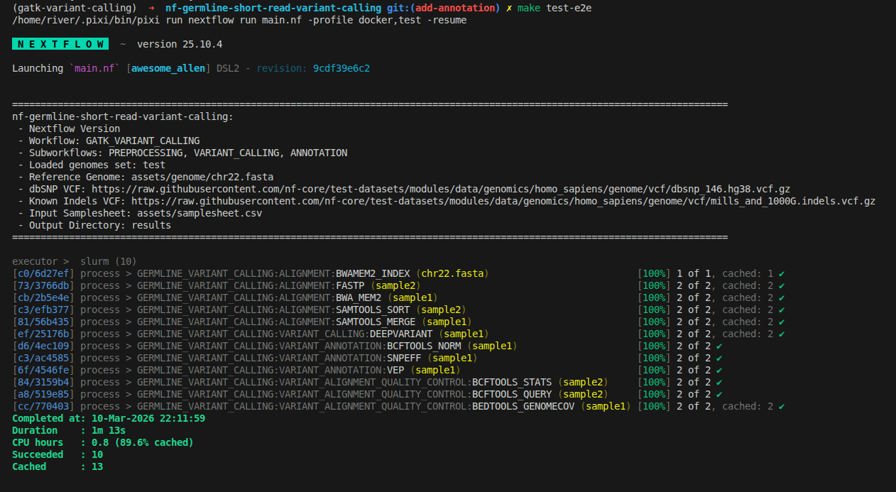

After calling variants with the accuracy reported in the previous benchmark, the next step is variant annotation — working out what each variant implies for the sample. Annotation approaches fall broadly into two groups: (1) computational prediction of a variant's functional effect, and (2) cross-referencing against databases of known variant effects. This post describes a research proof of concept that combines both in the pipeline.

<!--truncate-->
:::tip
+ The environment setups and scripts are uploaded to [**nf-germline-short-read-variant-calling**](https://github.com/nttg8100/nf-germline-short-read-variant-calling)
+ Cloning the repository with tag 0.5.1 reproduces the contents of this post
:::

:::warning
This workflow is intended for research use only. A clinical application would require a deeper review of each tool's configuration and the use of curated databases.
:::

## Series Overview

- **[Part 1](/en/blogs/gatk-variant-calling-bash-workflow-pixi-part1)**: A bash germline pipeline managed with Pixi
- **[Part 2](/en/blogs/gatk-variant-calling-bash-to-nextflow-validation-part2)**: Validating the bash workflow
- **[Part 3](/en/blogs/gatk-variant-calling-production-slurm-optimization-part3)**: From bash to Nextflow
- **[Part 4](/en/blogs/gatk-variant-calling-production-slurm-optimization-part4)**: Containerized execution and reproducibility
- **[Part 5](/en/blogs/gatk-variant-calling-production-slurm-optimization-part5)**: Benchmarking germline variant calling with nf-core/sarek
- **[Part 6](/en/blogs/gatk-variant-calling-production-slurm-optimization-part6)**: Do we need a complex pipeline for high-quality variant calling?
- **Part 7 (This Post)**: Variant annotation with SnpEff and Ensembl VEP
- **[Part 8](/en/blogs/gatk-variant-calling-production-slurm-optimization-part8)**: Structural variant calling — a short-read benchmark
- **[Part 9](/en/blogs/storage-cost-optimization-cram-format)**: Storage cost optimization with CRAM
- **[Part 10](/en/blogs/structural-variant-calling-short-reads-challenges)**: The challenges of SV calling with short reads
- **[Part 11](/en/blogs/gvcf-population-scale-genotyping)**: Population-scale genotyping with gVCF

## 1. Preparing Data and Reference Files for Annotation

### 1.1: Preparing Test Data
:::tip
+ When developing workflows, create test datasets that generate meaningful results
+ A workflow may run successfully but produce no variants in the VCF file, which makes it difficult to validate the full functionality of the pipeline
+ Use subset files smaller than 50MB that can be pushed to GitHub
:::

An earlier version adapted the test data from nf-core/sarek; however, it did not generate any variants and was only useful for validating the pipeline logic. The HG002 30X coverage dataset used for benchmarking was reused instead. To create a subset for testing, the script below was used and placed in the `assets` folder:

```bash
# raw fastq
samtools view -b HG002_merged.bam chr22:17000000-20000000 > subset.bam
samtools sort -n -o subset_name.bam subset.bam
samtools fastq \
  -1 HG002_subset_R1.fastq.gz \
  -2 HG002_subset_R2.fastq.gz \
  -0 /dev/null \
  -s /dev/null \
  -n subset_name.bam

# subset genome
# download only chr22
aws s3 ls --no-sign-request s3://ngi-igenomes/igenomes/Homo_sapiens/GATK/GRCh38/Sequence/Chromosomes/chr22.fasta .
# index
samtools faidx chr22.fasta
# get fasta dict
picard CreateSequenceDictionary \
    R=chr22.fasta \
    O=chr22.dict
```

### 1.2 Genome Configuration

The required FASTA files were updated in the `assets` folder. SnpEff and VEP cache settings are configured as below.
:::info
+ The `sarek_test` genome was renamed to `test` and replaced with the chr22 human genome configuration
:::

```groovy
params {
    genomes = [
        'test': [
            fasta: 'assets/genome/chr22.fasta',
            fasta_fai: 'assets/genome/chr22.fasta.fai',
            dict: 'assets/genome/chr22.dict',
            index_bwa2_reference: true,
            bwa2_index: 'null',
            dbsnp: 'https://raw.githubusercontent.com/nf-core/test-datasets/modules/data/genomics/homo_sapiens/genome/vcf/dbsnp_146.hg38.vcf.gz',
            dbsnp_tbi: 'https://raw.githubusercontent.com/nf-core/test-datasets/modules/data/genomics/homo_sapiens/genome/vcf/dbsnp_146.hg38.vcf.gz.tbi',
            known_indels: 'https://raw.githubusercontent.com/nf-core/test-datasets/modules/data/genomics/homo_sapiens/genome/vcf/mills_and_1000G.indels.vcf.gz',
            known_indels_tbi: 'https://raw.githubusercontent.com/nf-core/test-datasets/modules/data/genomics/homo_sapiens/genome/vcf/mills_and_1000G.indels.vcf.gz.tbi',
            snpeff_cache: "s3://annotation-cache/snpeff_cache/GRCh38.99",
            vep_cache_version : '115',
            vep_genome : 'GRCh38',
            vep_species : 'homo_sapiens',
            vep_cache: "s3://annotation-cache/vep_cache/115_GRCh38/homo_sapiens/115_GRCh38/22"
        ],
        'GRCh38': [
            fasta: "s3://ngi-igenomes/igenomes/Homo_sapiens/GATK/GRCh38/Sequence/WholeGenomeFasta/Homo_sapiens_assembly38.fasta",
            fasta_fai: "s3://ngi-igenomes/igenomes/Homo_sapiens/GATK/GRCh38/Sequence/WholeGenomeFasta/Homo_sapiens_assembly38.fasta.fai",
            dict: "s3://ngi-igenomes/igenomes/Homo_sapiens/GATK/GRCh38/Sequence/WholeGenomeFasta/Homo_sapiens_assembly38.dict",
            index_bwa2_reference: false,
            bwa2_index: "s3://ngi-igenomes/igenomes/Homo_sapiens/GATK/GRCh38/Sequence/BWAmem2Index/",
            dbsnp: "s3://ngi-igenomes/igenomes/Homo_sapiens/GATK/GRCh38/Annotation/GATKBundle/dbsnp_146.hg38.vcf.gz",
            dbsnp_tbi: "s3://ngi-igenomes/igenomes/Homo_sapiens/GATK/GRCh38/Annotation/GATKBundle/dbsnp_146.hg38.vcf.gz.tbi",
            known_indels: "s3://ngi-igenomes/igenomes/Homo_sapiens/GATK/GRCh38/Annotation/GATKBundle/Mills_and_1000G_gold_standard.indels.hg38.vcf.gz",
            known_indels_tbi: "s3://ngi-igenomes/igenomes/Homo_sapiens/GATK/GRCh38/Annotation/GATKBundle/Mills_and_1000G_gold_standard.indels.hg38.vcf.gz.tbi",
            known_indels_beta: "s3://ngi-igenomes/igenomes/Homo_sapiens/GATK/GRCh38/Annotation/GATKBundle/beta/Homo_sapiens_assembly38.known_indels.vcf.gz",
            known_indels_beta_tbi: "s3://ngi-igenomes/igenomes/Homo_sapiens/GATK/GRCh38/Annotation/GATKBundle/beta/Homo_sapiens_assembly38.known_indels.vcf.gz.tbi",
            snpeff_cache: "s3://annotation-cache/snpeff_cache/GRCh38.99",
            vep_cache_version : '115',
            vep_genome : 'GRCh38',
            vep_species : 'homo_sapiens',
            vep_cache: "s3://annotation-cache/vep_cache/115_GRCh38"
        ]
    ]
}
```

Except for the `vep_cache` parameter, which points to a public S3 bucket, the remaining VEP parameters are values that the annotation tools use later. For VEP annotation, the cache folder must be organized with subfolders for the cache version and genome. The available subfolders can be listed as shown below:
```bash
# list files in this folder (S3 prefix)
aws s3 ls --no-sign-request s3://annotation-cache/vep_cache/115_GRCh38/homo_sapiens/115_GRCh38
# PRE 115_GRCh38/
```
:::tip
+ Instead of downloading the entire database, specifying only chr22 is sufficient for testing (~300MB)
+ The module includes bash script logic to handle the subfolder structure requirement
+ **Cache Bucket Access**: Public S3 buckets can be accessed with the `--no-sign-request` flag (no credentials needed)
+ **Database Modes**: VEP supports two modes:
  - **Cache mode** (default): Pre-downloaded local cache files provide faster annotation without internet access, useful for offline pipelines
  - **SQL mode** (`--database`): Requires a live database connection (slower but always up to date), useful for single-run jobs where cache download overhead is not justified
+ Both modes can be combined with `--pick_allele_gene` to select a single transcript per variant (often more relevant for clinical interpretation)
:::

### 2. Modules and Subworkflows
#### 2.1 Bcftools Normalize Variant
Called variants need to be normalized to address common issues:
| Issue                             | Example                              | Impact on Annotation                                   |
| --------------------------------- | ------------------------------------ | ------------------------------------------------------ |
| Not left-aligned                  | chr1:1001 AT>A                       | HGVS coordinates may be incorrect                      |
| Non-minimal allele representation | chr1:2001 TTA>TA                     | Annotation tools may interpret the variant differently |
| Multiallelic site                 | chr1:3000 A>C,G                      | Annotation may mix effects across alleles              |
| Database mismatch                 | Same variant represented differently | dbSNP or gnomAD lookup may fail                        |

The new `BCFTOOLS_NORM` module:
```groovy
process BCFTOOLS_NORM {
    tag "$meta.id"
    label 'process_medium'
    container 'community.wave.seqera.io/library/bcftools:1.21--4335bec1d7b44d11' // v1.21 (wave.seqera.io pre-built)

    input:
    tuple val(meta), path(vcf), path(tbi)
    path(fasta)

    output:
    tuple val(meta), path("${meta.id}.vcf.gz"), emit: vcf
    tuple val(meta), path("${meta.id}.vcf.gz.tbi"), emit: tbi
    path "versions.yml"               , emit: versions

    script:
    """
    bcftools norm \\
        --fasta-ref ${fasta} \\
        --output ${meta.id}.vcf.gz \\
        --output-type z \\
        --threads $task.cpus \\
        ${vcf}
    tabix -p vcf ${meta.id}.vcf.gz
    cat <<-END_VERSIONS > versions.yml
    "${task.process}":
        bcftools: \$(bcftools --version 2>&1 | head -n1 | sed 's/^.*bcftools //; s/ .*\$//')
    END_VERSIONS
    """
}
```

#### 2.2 SnpEff
SnpEff combines reference gene and transcript information to predict the functional effect of variants. It supports multiple databases; the Ensembl database was used here:
```groovy
process SNPEFF {
    tag "${meta.id}"
    label 'process_medium'
    container 'quay.io/biocontainers/snpeff:5.4.0c--hdfd78af_0'

    input:
    tuple val(meta),  path(vcf), path(vcf_tbi)
    path(cache)

    output:
    tuple val(meta), path("*.ann.vcf"),     emit: vcf
    tuple val(meta), path("*.csv"),         emit: report
    tuple val(meta), path("*.html"),        emit: summary_html
    tuple val(meta), path("*.genes.txt"),   emit: genes_txt
    path "versions.yml",                    emit: versions

    when:
    task.ext.when == null || task.ext.when

    script:
    def avail_mem = 6144
    if (!task.memory) {
        log.info('[snpEff] Available memory not known - defaulting to 6GB. Specify process memory requirements to change this.')
    }
    else {
        avail_mem = (task.memory.mega * 0.8).intValue()
    }
    def prefix = task.ext.prefix ?: "${meta.id}"
    """
    snpEff \\
        -Xmx${avail_mem}M \\
        ${cache} \\
        -nodownload -canon -v \\
        -csvStats ${prefix}.csv \\
        -dataDir \${PWD}/${cache} \\
        ${vcf} \\
        > ${prefix}.ann.vcf

    cat <<-END_VERSIONS > versions.yml
    "${task.process}":
        snpeff: \$(snpEff -version 2>&1 | grep -oP 'version [0-9.]+' | sed 's/version //' || echo "5.1")
    END_VERSIONS
    """
}
```

#### 2.3 VEP
As described above, the VEP cache directory must be organized with subfolders for the cache version and genome. This can be accomplished in three steps:
+ Create a temporary cache folder with the cache version and genome structure
+ Find the `all_vars.gz` file in the cache input path and copy its subfolders to the temporary cache folder
+ Use this temporary cache folder for the VEP command-line argument

```groovy
process VEP {
    tag "${meta.id}"
    label 'process_medium'
    container 'community.wave.seqera.io/library/ensembl-vep_perl-math-cdf:1e13f65f931a6954'

    input:
    tuple val(meta), path(vcf)
    path cache
    val cache_version
    val genome
    val species
    path fasta

    output:
    tuple val(meta), path("*.vcf.gz"), emit: vcf, optional: true
    tuple val(meta), path("*.vcf.gz.tbi"), emit: tbi, optional: true
    tuple val(meta), path("*.tab.gz"), emit: tab, optional: true
    tuple val(meta), path("*.json.gz"), emit: json, optional: true
    tuple val(meta), val("${task.process}"), val('ensemblvep'), path("*.html"), topic: multiqc_files, emit: report, optional: true
    tuple val("${task.process}"), val('ensemblvep'), eval("vep --help | sed -n '/ensembl-vep/s/.*: //p'"), topic: versions, emit: versions_ensemblvep
    path "versions.yml", emit: versions
   
    script:
    def temp_vep_cache = "temp_vep_cache/${species}/${cache_version}_${genome}"
    """
    mkdir -p ${temp_vep_cache}
    cache_dirname=\$(find -L $cache -name all_vars.gz -print -quit | xargs dirname) 
    mv \$cache_dirname ${temp_vep_cache}

    vep \\
        -i ${vcf} \\
        -o ${meta.id}.vcf.gz \\
        --stats_file ${meta.id}.html --vcf --everything --filter_common --per_gene --total_length --offline --format vcf \\
        --compress_output bgzip \\
        --assembly ${genome} \\
        --species ${species} \\
        --cache \\
        --fasta ${fasta} \\
        --cache_version ${cache_version} \\
        --dir_cache \$PWD/temp_vep_cache \\
        --fork ${task.cpus}

    tabix -p vcf  ${meta.id}.vcf.gz

    cat <<-END_VERSIONS > versions.yml
    "${task.process}":
        ensembl-vep: \$(vep --version 2>&1 | grep -oP 'ensembl-vep [0-9.]+' | sed 's/ensembl-vep //' || echo "104.3")
    END_VERSIONS
    """
    
}
```

#### 2.4 New Annotation Subworkflow
The subworkflow is created as shown below and accepts input from the variant calling step:
```groovy
#!/usr/bin/env nextflow
nextflow.enable.dsl = 2

/*
========================================================================================
    ANNOTATION SUBWORKFLOW
========================================================================================
*/

// Include modules
include { BCFTOOLS_NORM } from '../../../modules/local/bcftools/norm/main'
include { SNPEFF } from '../../../modules/local/snpeff/main'
include { VEP } from '../../../modules/local/vep/main'


workflow VARIANT_ANNOTATION {
    take:
    vcf // channel: [ val(meta), path(vcf) ]
    vcf_tbi // channel: [ val(meta), path(tbi) ]
    snpeff_cache // value 
    vep_cache // value
    vep_cache_version // value
    vep_genome // value
    vep_species // value
    fasta // path to reference fasta


    main:
    ch_versions = channel.empty()
    ch_snpeff_cache_db = channel.fromPath(snpeff_cache, checkIfExists: true).collect()
    ch_vep_cache_db = channel.fromPath(vep_cache, checkIfExists: true).collect()

    BCFTOOLS_NORM(
        vcf.join(vcf_tbi),
        fasta
    )
    ch_versions = ch_versions.mix(BCFTOOLS_NORM.out.versions)

    SNPEFF(
        BCFTOOLS_NORM.out.vcf.join(BCFTOOLS_NORM.out.tbi),
        ch_snpeff_cache_db
    )
    ch_versions = ch_versions.mix(SNPEFF.out.versions)

    VEP(
        SNPEFF.out.vcf,
        ch_vep_cache_db,
        vep_cache_version,
        vep_genome,
        vep_species,
        fasta
    )
    ch_versions = ch_versions.mix(VEP.out.versions)

    emit:
    annotated_vcf = VEP.out.vcf // channel: [ val(meta), path(annotated_vcf), path(annotated_tbi) ]
    versions = ch_versions
}
```

The `main.nf` workflow now includes the new `VARIANT_ANNOTATION` step:

```groovy
...
    VARIANT_ANNOTATION(
        VARIANT_CALLING.out.vcf,
        VARIANT_CALLING.out.vcf_tbi,
        params.snpeff_cache,
        params.vep_cache,
        params.vep_cache_version,
        params.vep_genome,
        params.vep_species,
        ref_fasta
    )
...
```
## 3. Run the Updated Workflow and Evaluate Variant Annotation
### 3.1 Run the Workflow With Test Profile
```bash
make test-e2e
```


### 3.2 Validate the Variant Annotation
#### 3.2.1 Called Variants
:::tip
To view the VCF header with descriptions for columns in the VCF file, use: `bcftools view --header-only <vcf file>`
:::
The variants are called by DeepVariant:
```bash
zcat results/germline_variant_calling:variant_calling:deepvariant/sample1.vcf.gz|tail -n5
```
Example output:
```bash
chr22   21326676        .       A       G       11.2    PASS    .       GT:GQ:DP:AD:VAF:PL      1/1:11:6:0,6:1:10,19,0
chr22   32146109        .       T       A       0       RefCall .       GT:GQ:DP:AD:VAF:PL      0/0:20:7:0,6:0.857143:0,23,22
chr22   32146116        .       A       T       0.1     RefCall .       GT:GQ:DP:AD:VAF:PL      ./.:16:7:0,7:1:0,20,18
chr22   32146120        .       A       G       0.1     RefCall .       GT:GQ:DP:AD:VAF:PL      ./.:17:7:0,7:1:0,21,19
chr22   32146129        .       T       A       0.1     RefCall .       GT:GQ:DP:AD:VAF:PL      ./.:19:7:0,7:1:0,22,21
```

#### 3.2.2 SnpEff Annotation
Get the last 5 lines:
```bash
tail -n5  results/germline_variant_calling:variant_annotation:snpeff/sample1.ann.vcf
```
The additional columns show HGVS notation and indicate where the variant is located relative to nearby genes:
```bash
chr22   21326676        .       A       G       11.2    PASS    ANN=G|intergenic_region|MODIFIER|FAM230H-PPP1R26P5|ENSG00000206142-ENSG00000232771|intergenic_region|ENSG00000206142-ENSG00000232771|||n.21326676A>G||||||      GT:GQ:DP:AD:VAF:PL      1/1:11:6:0,6:1:10,19,0
chr22   32146109        .       T       A       0.0     RefCall ANN=A|downstream_gene_variant|MODIFIER|C22orf42|ENSG00000205856|transcript|ENST00000382097.4|protein_coding||c.*3431A>T|||||2897|,A|downstream_gene_variant|MODIFIER|Z83839.2|ENSG00000239674|transcript|ENST00000436294.1|pseudogene||n.*2837T>A|||||2837|,A|intergenic_region|MODIFIER|Z83839.2-C22orf42|ENSG00000239674-ENSG00000205856|intergenic_region|ENSG00000239674-ENSG00000205856|||n.32146109T>A||||||     GT:GQ:DP:AD:VAF:PL      0/0:20:7:0,6:0.857143:0,23,22
chr22   32146116        .       A       T       0.1     RefCall ANN=T|downstream_gene_variant|MODIFIER|C22orf42|ENSG00000205856|transcript|ENST00000382097.4|protein_coding||c.*3424T>A|||||2890|,T|downstream_gene_variant|MODIFIER|Z83839.2|ENSG00000239674|transcript|ENST00000436294.1|pseudogene||n.*2844A>T|||||2844|,T|intergenic_region|MODIFIER|Z83839.2-C22orf42|ENSG00000239674-ENSG00000205856|intergenic_region|ENSG00000239674-ENSG00000205856|||n.32146116A>T||||||;CSQ=T|downstream_gene_variant|MODIFIER|AP1B1P1|ENSG00000290475|Transcript|ENST00000716525|lncRNA|||||||||||2721|1||SNV|EntrezGene|HGNC:297|YES||||||||||||||||||||||||||||||||||||||||||||||||||||||,T|downstream_gene_variant|MODIFIER|C22orf42|ENSG00000205856|Transcript|ENST00000382097|protein_coding|||||||||||2890|-1||SNV|HGNC|HGNC:27160|YES|MANE_Select|NM_001010859.3||1|P1|CCDS33639.1|ENSP00000371529|Q6IC83.120||UPI00003765B0||||||||||||||||||||||||||||||||||||||||||||||||||||||||  GT:GQ:DP:AD:VAF:PL      ./.:16:7:0,7:1:0,20,18
chr22   32146120        .       A       G       0.1     RefCall ANN=G|downstream_gene_variant|MODIFIER|C22orf42|ENSG00000205856|transcript|ENST00000382097.4|protein_coding||c.*3420T>C|||||2886|,G|downstream_gene_variant|MODIFIER|Z83839.2|ENSG00000239674|transcript|ENST00000436294.1|pseudogene||n.*2848A>G|||||2848|,G|intergenic_region|MODIFIER|Z83839.2-C22orf42|ENSG00000239674-ENSG00000205856|intergenic_region|ENSG00000239674-ENSG00000205856|||n.32146120A>G||||||;CSQ=G|downstream_gene_variant|MODIFIER|AP1B1P1|ENSG00000290475|Transcript|ENST00000716525|lncRNA|||||||||||2725|1||SNV|EntrezGene|HGNC:297|YES||||||||||||||||||||||||||||||||||||||||||||||||||||||,G|downstream_gene_variant|MODIFIER|C22orf42|ENSG00000205856|Transcript|ENST00000382097|protein_coding|||||||||||2886|-1||SNV|HGNC|HGNC:27160|YES|MANE_Select|NM_001010859.3||1|P1|CCDS33639.1|ENSP00000371529|Q6IC83.120||UPI00003765B0||||||||||||||||||||||||||||||||||||||||||||||||||||||||  GT:GQ:DP:AD:VAF:PL      ./.:17:7:0,7:1:0,21,19
chr22   32146129        .       T       A       0.1     RefCall ANN=A|downstream_gene_variant|MODIFIER|C22orf42|ENSG00000205856|transcript|ENST00000382097.4|protein_coding||c.*3411A>T|||||2877|,A|downstream_gene_variant|MODIFIER|Z83839.2|ENSG00000239674|transcript|ENST00000436294.1|pseudogene||n.*2857T>A|||||2857|,A|intergenic_region|MODIFIER|Z83839.2-C22orf42|ENSG00000239674-ENSG00000205856|intergenic_region|ENSG00000239674-ENSG00000205856|||n.32146129T>A||||||;CSQ=A|downstream_gene_variant|MODIFIER|AP1B1P1|ENSG00000290475|Transcript|ENST00000716525|lncRNA|||||||||||2734|1||SNV|EntrezGene|HGNC:297|YES||||||||||||||||||||||||||||||||||||||||||||||||||||||,A|downstream_gene_variant|MODIFIER|C22orf42|ENSG00000205856|Transcript|ENST00000382097|protein_coding|||||||||||2877|-1||SNV|HGNC|HGNC:27160|YES|MANE_Select|NM_001010859.3||1|P1|CCDS33639.1|ENSP00000371529|Q6IC83.120||UPI00003765B0||||||||||||||||||||||||||||||||||||||||||||||||||||||||  GT:GQ:DP:AD:VAF:PL      ./.:19:7:0,7:1:0,22,21
```

#### 3.2.3 VEP Annotation
View the last 5 rows:
```bash
zcat results/germline_variant_calling:variant_annotation:vep/sample1.vcf.gz|tail -n5
```

The result shows the additional annotated columns in the first rows (the CSQ field for each record is long and is abbreviated here):
```bash
chr22   21326676        .       A       G       11.2    PASS    ANN=G|intergenic_region|MODIFIER|FAM230H-PPP1R26P5|ENSG00000206142-ENSG00000232771|intergenic_region|ENSG00000206142-ENSG00000232771|||n.21326676A>G||||||;CSQ=G|upstream_gene_variant|MODIFIER|FAM230H|ENSG00000206142|Transcript|ENST00000447720|lncRNA|||||||||||1634|-1||SNV|HGNC|HGNC:53977|YES||||5||||||||||||||||||||||||||||||||||||||||||||||||||,G|upstream_gene_variant|MODIFIER||ENSG00000303017|Transcript|ENST00000791156|lncRNA|||||||||||50|1||SNV|||YES||||||||||||||||||||||||||||||||||||||||||||||||||||||        GT:GQ:DP:AD:VAF:PL     1/1:11:6:0,6:1:10,19,0
chr22   32146109        .       T       A       0.0     RefCall ANN=A|downstream_gene_variant|MODIFIER|C22orf42|ENSG00000205856|transcript|ENST00000382097.4|protein_coding||c.*3431A>T|||||2897|,A|downstream_gene_variant|MODIFIER|Z83839.2|ENSG00000239674|transcript|ENST00000436294.1|pseudogene||n.*2837T>A|||||2837|,A|intergenic_region|MODIFIER|Z83839.2-C22orf42|ENSG00000239674-ENSG00000205856|intergenic_region|ENSG00000239674-ENSG00000205856|||n.32146109T>A||||||;CSQ=A|downstream_gene_variant|MODIFIER|AP1B1P1|ENSG00000290475|Transcript|ENST00000716525|lncRNA|||||||||||2714|1||SNV|EntrezGene|HGNC:297|YES||||||||||||||||||||||||||||||||||||||||||||||||||||||,A|downstream_gene_variant|MODIFIER|C22orf42|ENSG00000205856|Transcript|ENST00000382097|protein_coding|||||||||||2897|-1||SNV|HGNC|HGNC:27160|YES|MANE_Select|NM_001010859.3||1|P1|CCDS33639.1|ENSP00000371529|Q6IC83.120||UPI00003765B0||||||||||||||||||||||||||||||||||||||||||||  GT:GQ:DP:AD:VAF:PL      0/0:20:7:0,6:0.857143:0,23,22
...
```

The variant annotation is generated by combining results from SnpEff (ANN field) and Ensembl VEP (CSQ field).
Each annotation describes the predicted functional consequence of the variant relative to known genes and transcripts in the GRCh38 reference genome.
Because a variant may overlap multiple transcripts or nearby genes, multiple annotations can appear for a single variant.

| Field                | Example value           | Source    | Description                                     |
| -------------------- | ----------------------- | --------- | ----------------------------------------------- |
| Allele               | A                       | ANN / CSQ | Alternate allele being annotated                |
| Consequence          | downstream_gene_variant | ANN / CSQ | Predicted effect relative to gene structure     |
| Impact               | MODIFIER                | ANN / CSQ | Impact category (HIGH, MODERATE, LOW, MODIFIER) |
| Gene symbol          | C22orf42                | ANN / CSQ | Gene name                                       |
| Gene ID              | ENSG00000205856         | ANN / CSQ | Ensembl gene identifier                         |
| Feature type         | transcript              | ANN / CSQ | Type of genomic feature                         |
| Transcript ID        | ENST00000382097         | ANN / CSQ | Ensembl transcript identifier                   |
| Biotype              | protein_coding          | ANN / CSQ | Transcript functional class                     |
| Rank                 | -                       | ANN       | Exon/intron rank within transcript              |
| HGVS.c               | c.*3411A>T              | ANN       | HGVS coding DNA notation                        |
| Distance             | 2877                    | ANN / CSQ | Distance to the nearest gene feature (bp)       |
| Variant class        | SNV                     | CSQ       | Type of variant (single nucleotide variant)     |
| Strand               | -1                      | CSQ       | Gene strand orientation                         |
| Gene source          | HGNC                    | CSQ       | Gene symbol authority                           |
| HGNC ID              | HGNC:27160              | CSQ       | HGNC gene identifier                            |
| Canonical transcript | YES                     | CSQ       | Transcript considered canonical by Ensembl      |
| MANE Select          | MANE_Select             | CSQ       | Matched RefSeq/Ensembl transcript               |
| RefSeq ID            | NM_001010859.3          | CSQ       | Corresponding RefSeq transcript                 |
| CCDS                 | CCDS33639.1             | CSQ       | Consensus CDS identifier                        |
| Protein ID           | ENSP00000371529         | CSQ       | Ensembl protein identifier                      |
| UniProt              | Q6IC83                  | CSQ       | Protein identifier in UniProt                   |
| Population frequency | gnomAD fields           | CSQ       | Allele frequency in population datasets         |

## Recap
:::info
This post presents a proof-of-concept variant annotation workflow using SnpEff and Ensembl VEP. It is functional for research and discovery purposes, but a clinical implementation would require additional considerations:

### Clinical Application & ACMG/AMP Guidelines
+ **ACMG/AMP Classification**: Variants must be classified according to ACMG/AMP standards (benign, likely benign, uncertain significance, likely pathogenic, pathogenic)
+ **Evidence aggregation**: Combine computational predictions, population frequencies, and literature evidence
+ **Quality control**: Implement variant filtering based on quality scores, depth, and allele balance
+ **Validation**: Independent validation through orthogonal methods (Sanger sequencing, PCR)

### Database Integration
The annotation workflow can be expanded to integrate additional clinical databases:
+ **ClinVar**: Clinically relevant variants with evidence levels and assertions
+ **gnomAD/ExAC**: Population allele frequencies for benign variant filtering
+ **COSMIC**: Cancer-associated somatic variants
+ **dbSNP/rs IDs**: Known polymorphisms
+ **OMIM**: Gene-phenotype associations
+ **UniProt/Protein databases**: Functional protein annotations
+ **HGMD**: Human Gene Mutation Database for inherited disease variants
+ **PharmGKB**: Pharmacogenomic variants for drug response prediction

### Future Enhancements
+ Implement automated ACMG/AMP classification algorithms
+ Add functional prediction scores (PolyPhen, SIFT, ConservationScores)
+ Integrate pathway and network analysis
+ Implement variant filtering pipelines for clinical reporting
+ Add real-time database synchronization for the latest evidence
+ Develop multi-sample cohort analysis capabilities

This foundation can be extended toward more comprehensive clinical genomics workflows while maintaining reproducibility and version control through containerization and infrastructure-as-code practices.
:::

## References
1. SnpEff — https://pcingola.github.io/SnpEff/
2. Ensembl VEP — https://www.ensembl.org/info/docs/tools/vep/index.html
3. ACMG/AMP Standards and Guidelines (Richards et al., 2015) — https://www.ncbi.nlm.nih.gov/pmc/articles/PMC4544753/
4. ClinVar — https://www.ncbi.nlm.nih.gov/clinvar/
5. gnomAD — https://gnomad.broadinstitute.org/
6. COSMIC — https://cancer.sanger.ac.uk/cosmic
7. bcftools norm — https://samtools.github.io/bcftools/bcftools.html
- Cover image: [Bioinformatics workflow systems have built-in functionality that facilitates and simplifies running analysis pipelines](https://commons.wikimedia.org/wiki/File:Bioinformatics_workflow_systems_have_built-in_functionality_that_facilitates_and_simplifies_running_analysis_pipelines.jpg) — Matthew D Young, Sam Behjati, Wikimedia Commons, CC BY 4.0
