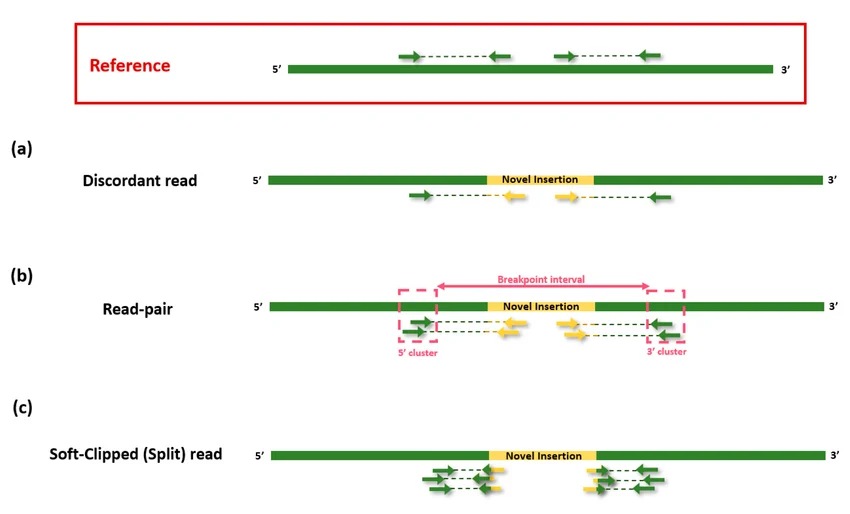

Structural variants (SVs) are large-scale genomic alterations (≥50 bp) including deletions, duplications, inversions, and translocations. While short-read sequencing made SNP and small indel detection routine, **structural variant calling remains a significant challenge**. This post explores SV calling tools for germline samples with 30X short reads, benchmarks five commonly used callers (Manta, TIDDIT, Delly, Smoove, CNVnator), and describes limitations in both the detection tools and the evaluation methods. In our benchmark, the best-performing tool (Manta) reached only 36.8% precision when evaluated with Truvari, while a 2019 benchmark study using a different evaluation method reported more than 80% precision for similar callers — a difference that highlights the complexity and ambiguity inherent in SV analysis.

<!--truncate-->

:::tip

- The structural variant calling subworkflow and benchmark scripts are available in [**nf-germline-short-read-variant-calling**](https://github.com/nttg8100/nf-germline-short-read-variant-calling)
- Clone the repository with tag **0.8.0** to reproduce the contents of this post
- Benchmark results are in `benchmark/structural/`
  :::

## Series Overview

- **[Part 1](/en/blogs/gatk-variant-calling-bash-workflow-pixi-part1)**: A bash germline pipeline managed with Pixi
- **[Part 2](/en/blogs/gatk-variant-calling-bash-to-nextflow-validation-part2)**: Validating the bash workflow
- **[Part 3](/en/blogs/gatk-variant-calling-production-slurm-optimization-part3)**: From bash to Nextflow
- **[Part 4](/en/blogs/gatk-variant-calling-production-slurm-optimization-part4)**: Containerized execution and reproducibility
- **[Part 5](/en/blogs/gatk-variant-calling-production-slurm-optimization-part5)**: Benchmarking germline variant calling with nf-core/sarek
- **[Part 6](/en/blogs/gatk-variant-calling-production-slurm-optimization-part6)**: Do we need a complex pipeline for high-quality variant calling?
- **[Part 7](/en/blogs/gatk-variant-calling-production-slurm-optimization-part7)**: Variant annotation with SnpEff and Ensembl VEP
- **[Part 8](/en/blogs/gatk-variant-calling-production-slurm-optimization-part8)**: Structural variant calling — a short-read benchmark
- **[Part 9](/en/blogs/storage-cost-optimization-cram-format)**: Storage cost optimization with CRAM
- **Part 10 (This Post)**: The challenges of SV calling with short reads
- **[Part 11](/en/blogs/gvcf-population-scale-genotyping)**: Population-scale genotyping with gVCF

Clone the repository:

```bash
# clone and run the structural variant calling workflow
git clone git@github.com:nttg8100/nf-germline-short-read-variant-calling.git -b 0.8.0
cd nf-germline-short-read-variant-calling
```

## 1. Introduction to Structural Variants

### 1.1. What are Structural Variants?


Structural variants are genomic alterations that affect DNA segments larger than 50 base pairs. Unlike SNPs (single nucleotide changes) or small indels (insertions/deletions \<50 bp), SVs can span thousands to millions of bases and have substantial effects on gene function.

**Major SV Types:**

| SV Type                             | Description                            | Reference Example                             | Reads Example                                 | Example Impact                 |
| ----------------------------------- | -------------------------------------- | --------------------------------------------- | --------------------------------------------- | ------------------------------ |
| **Deletion (DEL)**                  | Loss of genomic sequence               | ATCG **GGGTTT** AACC                          | ATCG AACC                                     | Loss of tumor suppressor genes |
| **Duplication (DUP)**               | Copy of a genomic region               | ATCG **GGGTTT** AACC                          | ATCG GGGTTT **GGGTTT** AACC                   | Gene dosage imbalance          |
| **Insertion (INS)**                 | Addition of new sequence               | ATCG AACC                                     | ATCG **GGGTTT** AACC                          | Mobile element insertions      |
| **Inversion (INV)**                 | Reversal of sequence orientation       | ATCG **GGGTTT** AACC                          | ATCG **TTTGGG** AACC                          | Disrupted gene structure       |
| **Tandem Duplication (TDUP)**       | Adjacent duplication of a region       | ATCG **GGGTTT** AACC                          | ATCG **GGGTTT GGGTTT** AACC                   | Gene amplification             |
| **Interspersed Duplication (IDUP)** | Duplicated sequence inserted elsewhere | ATCG **GGGTTT** AACC ... TTTAAA               | ATCG GGGTTT AACC ... **GGGTTT** TTTAAA        | Complex rearrangements         |
| **Translocation (TRA)**             | Sequence moved between chromosomes     | chr1: ATCG **GGGTTT** AACC \<br> chr2: TTTAAA | chr1: ATCG AACC \<br> chr2: TTTAAA **GGGTTT** | Oncogenic gene fusions         |

**Clinical Significance:**

- **Cancer:** BCR-ABL1 fusion in chronic myeloid leukemia
- **Neurological disorders:** Large deletions in the DMD gene cause Duchenne muscular dystrophy
- **Copy number variants:** Duplications of the APP gene in early-onset Alzheimer's
- **Population diversity:** ~0.5% of the genome differs due to SVs between individuals

### 1.2. Why Short Reads Struggle with SVs

Short-read sequencing (typically 150 bp from Illumina) faces fundamental limitations for SV detection:

**Challenge 1: Limited Span**
A deletion can be larger than the length of a single read, so no individual read spans the whole event, and the breakpoints must be inferred from pairs of reads rather than observed directly.

**Challenge 2: Repetitive Regions**
Many SVs occur in repetitive genomic regions where short reads cannot map uniquely:

- **Segmental duplications:** >90% sequence identity spanning >1kb
- **Tandem repeats:** VNTR, STR regions
- **Mobile elements:** Alu, LINE elements make up ~45% of the human genome

For more detail:

| Repetitive Region Type                   | Description                                                  | Reference Example                                                 | Reads Example                                 | Example Impact                                 |
| ---------------------------------------- | ------------------------------------------------------------ | ----------------------------------------------------------------- | --------------------------------------------- | ---------------------------------------------- |
| **Segmental Duplication**                | Large duplicated regions (>1kb, >90% identity) across genome | chr1: ATCG **GGGTTTAAA** AACC \<br> chr9: TTAA **GGGTTTAAA** GGCC | ATCG **GGGTTTAAA**                            | Multi-mapping reads, ambiguous SV breakpoints  |
| **Short Tandem Repeat (STR)**            | Short motif (1–6 bp) repeated consecutively                  | ATCG **CACACACA** AACC                                            | ATCG **CACACACACACA** AACC                    | Repeat expansion causing ambiguous indel calls |
| **STR Contraction**                      | Reduced repeat number in tandem repeat region                | ATCG **CACACACA** AACC                                            | ATCG **CACA** AACC                            | Inaccurate deletion detection                  |
| **Variable Number Tandem Repeat (VNTR)** | Longer motif repeated multiple times (10–100 bp)             | ATCG **ATCGTGA ATCGTGA ATCGTGA** AACC                             | ATCG **ATCGTGA ATCGTGA ATCGTGA ATCGTGA** AACC | Copy number variation mis-estimation           |
| **VNTR Contraction**                     | Reduced VNTR repeat count                                    | ATCG **ATCGTGA ATCGTGA ATCGTGA** AACC                             | ATCG **ATCGTGA** AACC                         | Imprecise breakpoint detection                 |
| **Alu Insertion (Mobile Element)**       | Short interspersed mobile element (~300 bp)                  | ATCG AACC                                                         | ATCG **ALU_ELEMENT** AACC                     | False insertion or missed detection            |
| **LINE-1 Insertion**                     | Long interspersed element (~6kb) inserted into genome        | ATCG AACC                                                         | ATCG **LINE1_INSERTION** AACC                 | Large insertion missed by short reads          |
| **Repeat-Rich Region**                   | Highly repetitive sequence causing ambiguous mapping         | ATCG **ATATATATATAT** AACC                                        | ATCG **ATATATATATATATAT** AACC                | Alignment ambiguity                            |
| **Low Complexity Region**                | Homopolymer or simple repeats                                | ATCG **AAAAAAAAAA** AACC                                          | ATCG **AAAAAAAAAAAAAA** AACC                  | False indels                                   |
| **Microsatellite Instability Region**    | Highly unstable STR region                                   | ATCG **TATATATA** AACC                                            | ATCG **TATATATATATATA** AACC                  | High false positive SV calls                   |

**Challenge 3: Ambiguous Alignment**
A 150 bp read spanning a complex rearrangement may have multiple equally valid alignments, making SV detection uncertain.

### 1.3. Evidence Types Used by SV Callers

#### 1.3.1. Discordant read pairs: Abnormal insert size or orientation

:::info

- Insert size is the distance between two paired-end reads in a sequencing fragment.

- In paired-end sequencing (such as Illumina sequencing), DNA is first broken into fragments, then both ends of each fragment are sequenced:
  :::

Structural variant (SV) callers use discordant read pairs by identifying paired-end reads that align to the reference genome with unexpected distance or orientation. In normal sequencing, paired reads align facing each other (→ ←) within an expected insert size.

- When a **deletion** exists in the sample, the reads map **farther apart** than expected because a segment is missing in the sample relative to the reference.

- For a **duplication**, reads map **closer together** because additional sequence exists in the sample.

- In an **inversion**, read pairs align in the **same direction (→ → or ← ←) instead of facing inward**, indicating the DNA segment is reversed.

- For **translocations**, read pairs map to different chromosomes or distant genomic regions. SV callers such as Manta, DELLY, LUMPY, and GRIDSS cluster multiple discordant read pairs supporting the same abnormal pattern to infer structural variant breakpoints and classify the SV type.

  

#### 1.3.2. Split reads: Reads aligned in two parts (breakpoint junction)

Split reads are reads that align to two different genomic locations, indicating they span a structural variant breakpoint. For example, part of a read maps before a deletion and the remaining part maps after it, so the aligner (such as BWA-MEM or minimap2) splits the read into two alignments. This helps SV callers such as Manta or DELLY identify precise breakpoints for deletions, insertions, inversions, and translocations.

In alignment files, split reads can be identified through soft-clipped or hard-clipped alignments. These reads are partially aligned to a genomic region, while the remaining portion is clipped instead of being penalized as mismatches, indicating that the read may span a structural variant breakpoint.

#### 1.3.3. Read depth: Coverage changes indicate copy number alterations

Read depth simply indicates that more reads are aligned to a specific region. However, this could also result from bias introduced by the DNA amplification protocol used during sample preparation.

#### 1.3.4. De novo assembly: Local reassembly of reads into contigs

In such cases, reassembling the reads in that region can help clarify the underlying signal. By performing local reassembly, the reads are reconstructed into longer contiguous sequences, which can reduce alignment artifacts, resolve ambiguous mappings, and improve variant detection. This process helps distinguish whether the increased read depth reflects a true biological signal or is merely a technical bias introduced during amplification.

## 2. The nf-core/sarek Pipeline and TIDDIT

### 2.1. nf-core/sarek Structural Variant Support

The [nf-core/sarek pipeline](https://nf-co.re/sarek) (version 3.7.1) is a widely-used Nextflow workflow for germline and somatic variant calling. While sarek works well for SNP/indel calling with GATK HaplotypeCaller and DeepVariant, its structural variant support is limited:

**Sarek SV Callers:**

- **Manta** (Illumina) - Primary SV caller using paired-end and split-read evidence
- **TIDDIT** - Added in recent versions for comprehensive SV detection
- **CNVkit/ASCAT** - Copy number variation tools (primarily for somatic analysis)

The original motivation for this work came from exploring TIDDIT's performance after seeing it integrated into sarek. TIDDIT's paper describes an algorithm combining:

- Discordant read pairs
- Split reads (supplementary alignments)
- Local de novo assembly with fermi2
- DBSCAN clustering for signal aggregation

### 2.2. TIDDIT Algorithm Overview

Based on the [TIDDIT repository](https://github.com/SciLifeLab/TIDDIT), the algorithm works as follows:

```bash
TIDDIT Algorithm Pipeline:
1. Extract signals from BAM:
   ├── Discordant pairs (abnormal insert size/orientation)
   ├── Split reads (supplementary alignments)
   └── Coverage depth analysis

2. Local assembly (optional):
   └── Assemble reads with supplementary alignments using fermi2

3. DBSCAN clustering:
   └── Group signals within distance threshold (-e parameter)
       Default: sqrt(insert_size * 2) * 12

4. Filter and annotate clusters:
   ├── Minimum support (-p: pairs, -r: split reads)
   ├── Quality scoring via non-parametric sampling
   └── Coverage-based filters

5. Output VCF with SV calls
```

**TIDDIT Parameters for Sensitivity/Precision Tuning:**

- `-p`: Minimum supporting pairs (default: 3)
- `-r`: Minimum supporting split reads (default: 3)
- `-q`: Minimum mapping quality (default: 5)
- `-e`: Clustering distance threshold
- `--p_ratio`: Discordant pair ratio at breakpoint (default: 0.1)
- `--r_ratio`: Split read ratio at breakpoint (default: 0.1)

The algorithm is theoretically sound, but as the benchmark results below show, short-read limitations affect real-world performance.

## 3. Expanding the SV Calling Toolkit

### 3.1. Five SV Callers Implemented

To evaluate SV calling on short reads, the **nf-germline-short-read-variant-calling** pipeline was extended with five SV callers:

| Tool         | Algorithm                      | Evidence Types                    | Strengths                      |
| ------------ | ------------------------------ | --------------------------------- | ------------------------------ |
| **Manta**    | Illumina's production caller   | Paired-end, split reads           | Fast, widely validated         |
| **TIDDIT**   | DBSCAN clustering + assembly   | Paired-end, split reads, assembly | Local assembly for complex SVs |
| **Delly**    | Integrated paired-end analysis | Paired-end, split reads           | Accurate breakpoint resolution |
| **Smoove**   | Lumpy wrapper with genotyping  | Paired-end, split reads           | Probabilistic scoring          |
| **CNVnator** | Read-depth based               | Coverage depth                    | Best for large CNVs (>1kb)     |

**Implementation in nf-germline-short-read-variant-calling:**

The pipeline structure for structural variant calling:

```groovy
subworkflows/local/structural_variant_calling.nf:
├── MANTA          // Illumina Manta (paired-end + split reads)
├── TIDDIT         // SciLifeLab TIDDIT (assembly + clustering)
├── DELLY          // Delly2 (integrated PE analysis)
├── SMOOVE         // Smoove/Lumpy wrapper
└── CNVNATOR       // Read-depth CNV caller
```

Each tool runs independently on the same input BAM file (HG002 sample, 30X coverage, GRCh38), producing VCF outputs with structural variant calls.

### 3.2. Running the Structural Variant Calling Pipeline

```bash
cd nf-germline-short-read-variant-calling

# Input: Aligned BAM file from alignment workflow
# Configuration in: conf/customized_labels.config

# Run the pipeline with SV callers enabled
nextflow run main.nf \
  -profile docker \
  -c benchmark/structural/variant_calling/nf-germline-short-read-variant-calling/customized_labels.config \
  --input benchmark/structural/variant_calling/nf-germline-short-read-variant-calling/input.csv \
  --outdir results/structural_variants \
  --sv_callers "manta,tiddit,delly,smoove,cnvnator"
```

The pipeline outputs VCF files for each caller:

```
results/structural_variants/
├── manta/HG002.manta.vcf.gz
├── tiddit/HG002.tiddit.vcf.gz
├── delly/HG002.delly.vcf.gz
├── smoove/HG002-smoove.vcf.gz
└── cnvnator/HG002.cnvnator.vcf.gz
```

## 4. Benchmarking Methodology

### 4.1. Truth Set and Reference Genome Conversion

**Truth Set:** Genome in a Bottle (GIAB) HG002 Tier 1 v0.6 structural variants

- **Sample:** Ashkenazi Jewish trio child (HG002/NA24385)
- **Truth set:** ~ 14K high-confidence SVs (deletions, insertions, duplications)
- **Confidence regions:** ~2.66 Gb of genome with confident SV calls
- **Reference:** hg19/GRCh37 coordinates

**Challenge:** Our pipeline calls variants in GRCh38, but the GIAB truth set is in hg19 coordinates.

**Solution:** Use CrossMap to lift over called variants from hg38 to hg19:

```bash
# Benchmark script: benchmark/structural/benchmark/benchmark_and_summary.sh

# 1. Normalize VCF (split multi-allelic sites)
bcftools norm -m -any -o normalized.vcf sample.vcf.gz

# 2. Convert hg38 → hg19 using CrossMap
CrossMap vcf \
  hg38ToHg19.over.chain.gz \
  normalized.vcf \
  human_g1k_v37_decoy.fasta \
  output_hg19.vcf

# 3. Remove 'chr' prefix and sort
sed -e 's/chr//g' output_hg19.vcf | bcftools sort > final.vcf
bgzip final.vcf && tabix final.vcf.gz
```

### 4.2. Truvari Benchmarking

[Truvari](https://github.com/ACEnglish/truvari) is the current standard tool for SV benchmarking. It compares a "baseline" (truth set) VCF against a "comparison" (called variants) VCF:

```bash
# Run Truvari benchmark for each tool
truvari bench \
  -b HG002_SVs_Tier1_v0.6.vcf.gz \  # Truth set (baseline)
  -c tool_calls_hg19.vcf.gz \        # Tool calls (comparison)
  -o output.truvari \                 # Output directory
  -f human_g1k_v37_decoy.fasta \      # Reference genome
  --includebed HG002_SVs_Tier1_v0.6.bed  # Confident regions
```

**Truvari Matching Strategy:**

1. **Reciprocal overlap:** Variants must overlap by ≥50% (default)
2. **Size similarity:** Within 50% relative size difference
3. **Sequence similarity:** Align variant sequences, require ≥70% identity
4. **Breakpoint proximity:** Allow small breakpoint shifts

**Truvari Metrics:**

- **TP-base:** True positives in truth set (baseline calls matched)
- **FP:** False positives (comparison calls not in truth set)
- **FN:** False negatives (truth set calls not found by tool)
- **Precision:** TP / (TP + FP) - What fraction of calls are correct?
- **Recall:** TP / (TP + FN) - What fraction of true SVs were found?
- **F1 score:** Harmonic mean of precision and recall

## 5. Benchmark Results

### 5.1. Performance Comparison Across Five Tools

The benchmark shows large differences in performance, with **Manta performing best** among the tools tested:

| Tool         | TP    | FP    | FN     | Precision (%) | Recall (%) | F1 Score | Total Calls |
| ------------ | ----- | ----- | ------ | ------------- | ---------- | -------- | ----------- |
| **Manta**    | 1,082 | 1,862 | 12,650 | **36.8%**     | **7.9%**   | 0.130    | 2,944       |
| **Delly**    | 123   | 4,722 | 13,609 | **2.5%**      | **0.9%**   | 0.013    | 4,845       |
| **TIDDIT**   | 13    | 9,497 | 13,719 | **0.14%**     | **0.09%**  | 0.001    | 9,510       |
| **Smoove**   | 6     | 3,137 | 13,726 | **0.19%**     | **0.04%**  | 0.001    | 3,143       |
| **CNVnator** | 3     | 248   | 13,729 | **1.2%**      | **0.02%**  | 0.0004   | 251         |

**Truth set:** 13,732 high-confidence structural variants (HG002 Tier 1 v0.6)

**Key Observations:**

1. **Manta performed best:**
   - Found 1,082 true SVs (10× more than the next best tool)
   - Achieved 36.8% precision (but still \<40%)
   - Recall remains low at 7.9% (only ~8% of true SVs detected)

2. **TIDDIT underperformed in this run:**
   - Despite a sophisticated algorithm (assembly + DBSCAN), precision was only 0.14%
   - Called 9,510 variants, but 9,497 are false positives (99.86% FP rate)
   - Likely issue: default parameters too sensitive for 30X WGS data

3. **Read-depth caller (CNVnator) is ultra-conservative:**
   - Only 251 calls total, but higher precision (1.2%) than most tools
   - Misses 99.98% of true SVs (recall 0.02%)
   - Suited for large CNVs (>50kb), struggles with smaller SVs

4. **Overall low recall:**
   - Even Manta finds \<8% of true SVs
   - Most SVs occur in repetitive regions where short reads fail to map uniquely

### 5.2. Analysis of Manta's Performance

While Manta achieves the best results, it is worth examining what "36.8% precision" actually means:

**Manta's Results Breakdown:**

```
True Positives:  1,082 SVs correctly identified
False Positives: 1,862 SVs incorrectly called
False Negatives: 12,650 SVs missed

Precision: 1,082 / (1,082 + 1,862) = 36.8%
Recall:    1,082 / (1,082 + 12,650) = 7.9%
```

**Interpretation:**

- For every 3 SVs Manta calls, only ~1 is real (64% are false positives)
- Manta misses >92% of true structural variants in the genome
- This represents the current state of the art for short-read SV calling

**Why is Manta better?**

- Conservative filtering: requires both paired-end AND split-read support
- Probabilistic scoring: Bayesian model accounts for mapping uncertainty
- Industrial validation: used in Illumina DRAGEN and clinical pipelines
- Active development: continuously refined by Illumina for production use

### 5.3. What Went Wrong with TIDDIT?

TIDDIT's low precision (0.14%) was unexpected given its sophisticated algorithm. Potential reasons:

**1. Parameter Tuning for WGS Data:**
TIDDIT's defaults may be optimized for targeted sequencing or mate-pair libraries:

- `-p 3` (minimum 3 supporting pairs) may be too low for 30X WGS
- `-q 5` (MAPQ threshold) is low and includes many ambiguous alignments
- `--p_ratio 0.1` and `--r_ratio 0.1` may be too permissive

**2. Assembly-Induced False Positives:**
Local assembly with fermi2 can create artificial SVs:

- Misassembled contigs in repetitive regions
- Assembly artifacts from PCR duplicates or sequencing errors
- Alignment of contigs back to reference introduces ambiguity

**3. DBSCAN Clustering Over-sensitivity:**
The clustering distance parameter (`-e = sqrt(insert_size*2)*12`) may be too large:

- Groups unrelated discordant pairs into spurious SV clusters
- For 350bp insert size: `e = sqrt(700)*12 ≈ 318bp` clustering radius

**Recommendation for TIDDIT users:**

- Increase `-p` to 10-20 for WGS data
- Increase `-q` to 20 (higher mapping quality threshold)
- Consider `--skip_assembly` to avoid assembly artifacts
- Use `--p_ratio 0.3` and `--r_ratio 0.3` for stricter filtering

## 6. The Evaluation Problem: Truvari vs. Alternative Methods

### 6.1. Truvari's Matching Criteria

Truvari's default matching requires:

1. **≥50% reciprocal overlap** between variant coordinates
2. **Size within 50% relative difference**
3. **≥70% sequence similarity** after alignment

**Why this is strict for SVs:**

- Breakpoint uncertainty: short reads give imprecise breakpoint locations
- Representation ambiguity: the same SV can be represented multiple ways in VCF
- Reference bias: alignment artifacts near complex genomic regions

**Example: Ambiguous Deletion**

```
Truth set:  DEL chr1:1000-1500 (500bp deletion)
Manta call: DEL chr1:1005-1505 (500bp deletion, shifted 5bp)

Truvari evaluation:
- Overlap: 495bp / 500bp = 99%
- Size match: 500bp vs 500bp
- Breakpoint shift: 5bp (acceptable)
→ MATCH (True Positive)

Alternative caller:
DEL chr1:995-1490 (495bp deletion, shifted -5bp, 1% size diff)

Truvari evaluation:
- Overlap: 490bp / 495bp = 98.9%
- Size match: 495bp vs 500bp (1% diff)
→ MATCH (True Positive)

But a deletion called as:
DEL chr1:1020-1480 (460bp deletion, breakpoint shift >10bp)

Truvari evaluation:
- Overlap: 460bp / 500bp = 92%
- Size match: 460bp vs 500bp (8% diff)
- But: Breakpoint shift >10bp may fail matching
→ Potential MISMATCH (False Positive/False Negative)
```

This strictness leads to **lower precision/recall scores** even when calls are biologically correct.

### 6.2. The 2019 Benchmark Study Approach

The [2019 structural variant benchmarking paper](https://www.ncbi.nlm.nih.gov/pmc/articles/PMC6642177/) by Cameron et al. used a different evaluation methodology that reported **much higher precision** for SV callers including Manta (>80% precision).

**Key Differences in Evaluation:**

| Aspect                  | Truvari                               | 2019 Paper Method                            |
| ----------------------- | ------------------------------------- | -------------------------------------------- |
| **Matching tolerance**  | 50% overlap, 50% size similarity      | Relaxed breakpoint tolerance (±100-500bp)    |
| **Complex SV handling** | Each VCF record matched independently | Graph-based merging of overlapping calls     |
| **Representation**      | Requires similar VCF representation   | Normalizes representations before comparison |
| **Truth set**           | Single high-confidence call set       | Ensemble of multiple orthogonal callers      |
| **Evaluation method**   | Direct VCF comparison                 | BEDPE overlap + statistical validation       |

**Why the 2019 Method Shows Higher Precision:**

1. **Relaxed breakpoint tolerance:**
   - Allows ±100-500bp breakpoint shifts (vs. Truvari's stricter matching)
   - Accounts for alignment ambiguity in repetitive regions

2. **Ensemble truth sets:**
   - Truth calls validated by ≥2 orthogonal methods (e.g., long-read + short-read)
   - Reduces false negatives from single-method limitations

3. **Graph-based consolidation:**
   - Multiple overlapping calls merged into a single SV event
   - Reduces "double-counting" of complex SVs

4. **Context-aware evaluation:**
   - Considers genomic context (repeat regions, segmental duplications)
   - Adjusts expectations for difficult-to-call regions

**Example Comparison:**

```
Scenario: Manta calls a 5kb deletion

Truvari evaluation:
- Truth set breakpoint: chr1:100,000-105,000
- Manta call: chr1:100,050-105,100 (50bp shift at both ends)
- Overlap: 4,900bp / 5,000bp = 98%
- But: 50bp breakpoint shift may trigger mismatch
→ Classified as FP (precision decreases)

2019 Paper evaluation:
- ±500bp breakpoint tolerance
- 50bp shift is within tolerance
- Same SV class (deletion)
- Size within 10%
→ Classified as TP (precision higher)
```

This explains why **Manta shows 36.8% precision (Truvari) vs. >80% precision (2019 paper)** despite similar underlying performance.

### 6.3. Which Evaluation Method is "Correct"?

**Both methods are valid but serve different purposes:**

**Truvari (Strict Matching):**

- **Goal:** Clinical-grade precision - high confidence in exact variant calls
- **Use case:** Diagnostic applications where false positives are costly
- **Philosophy:** Conservative matching ensures the variant is truly there
- **Trade-off:** May penalize biologically correct but imprecisely defined calls

**2019 Paper Method (Relaxed Matching):**

- **Goal:** Biological discovery - capture SV events even with breakpoint uncertainty
- **Use case:** Research, population studies, SV method development
- **Philosophy:** Focus on whether an SV event is real, not exact coordinates
- **Trade-off:** May inflate precision by accepting ambiguous matches

**The Fundamental Problem:**
SV calling with short reads has **inherent ambiguity** due to:

- Limited read span (150 bp vs. kb-sized SVs)
- Repetitive genome regions (~45% of the human genome)
- Multiple valid alignments for the same read
- Reference genome limitations (does not capture all human variation)

**Implication for Users:**

- For **clinical diagnostics:** Use Truvari-style strict benchmarks (conservative)
- For **research discovery:** Use relaxed benchmarks (sensitive)
- For **pipeline development:** Report both metrics to show the full performance spectrum

## 7. Summary

This post explored the challenges of structural variant calling with short-read sequencing:

**Key Findings:**

1. **Manta outperformed the other short-read SV callers tested** (36.8% precision, 7.9% recall)
2. **TIDDIT underperformed with default parameters** (0.14% precision) despite its sophisticated algorithm
3. **Low recall was universal** - even the best tool missed >92% of true SVs
4. **Evaluation methods strongly affect reported performance** (36.8% vs. >80% precision)
5. **The SV calling problem is tied to short-read limitations**, not just to the software

**Practical Recommendations:**

- Use **Manta** for short-read SV calling (the best available option in this benchmark)
- Apply **strict filtering** (PASS only, high GQ, multiple evidence types)
- Consider **ensemble methods** (Manta + Delly) for improved sensitivity
- **Validate clinically relevant SVs** with orthogonal methods (PCR, long reads)
- Transition to **long-read sequencing** when budget allows (PacBio HiFi, ONT)

**The Bottom Line:**
Short-read structural variant calling remains a challenging problem in genomics. While tools such as Manta provide clinically useful results, the field is increasingly moving toward long-read sequencing for comprehensive SV detection. For now, users should understand the limitations, apply appropriate quality filters, and validate important findings.

## References

- [SV types](https://github.com/eldariont/svim-asm): Type of variants, figure illustrated by svim-asm
- [nf-germline-short-read-variant-calling Pipeline](https://github.com/nttg8100/nf-germline-short-read-variant-calling) - Structural variant calling subworkflow
- [Manta Paper](https://doi.org/10.1093/bioinformatics/btv710) - Chen et al. 2016, Bioinformatics
- [TIDDIT GitHub](https://github.com/SciLifeLab/TIDDIT) - SciLifeLab structural variant caller
- [Truvari GitHub](https://github.com/ACEnglish/truvari) - SV benchmarking toolkit
- [2019 SV Benchmark Paper](https://www.ncbi.nlm.nih.gov/pmc/articles/PMC6642177/) - Cameron et al. 2019, Nature Communications
- [GIAB HG002 Truth Set](https://ftp-trace.ncbi.nlm.nih.gov/ReferenceSamples/giab/release/) - Genome in a Bottle structural variants
- [nf-core/sarek](https://nf-co.re/sarek) - Nextflow germline/somatic variant calling pipeline
- [Delly Paper](https://doi.org/10.1093/bioinformatics/bts378) - Rausch et al. 2012, Bioinformatics
- [CNVnator Paper](https://doi.org/10.1101/gr.114876.110) - Abyzov et al. 2011, Genome Research
- [sv_benchmark](https://github.com/PapenfussLab/sv_benchmark): Comprehensive evaluation and characterisation of short-read general-purpose structural variant calling software
- Cover image: [Y Chromosome](https://commons.wikimedia.org/wiki/File:Y_Chromosome.png) — Christinelmiller, Wikimedia Commons, CC BY-SA 4.0
