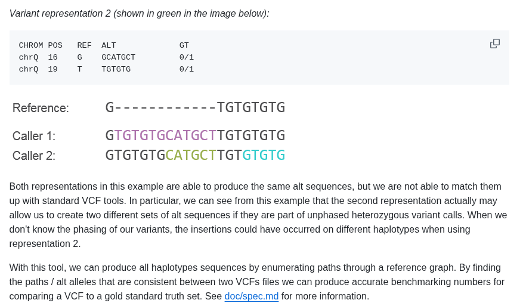
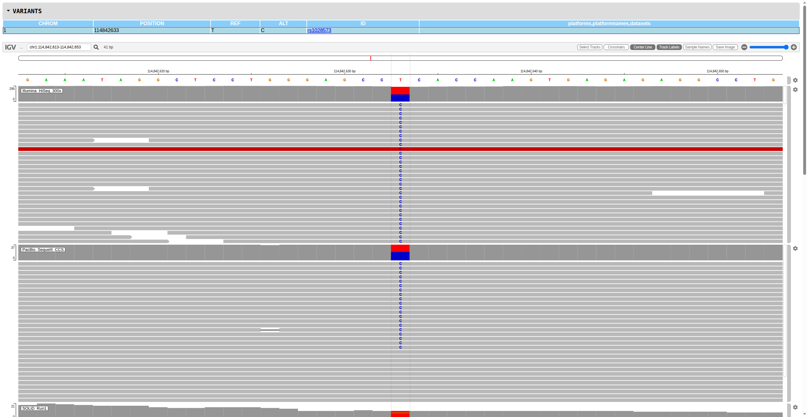

The Genome in a Bottle (GIAB) Consortium is widely used as a benchmark resource in clinical and research genomics, yet the methodological reasoning behind its reference call sets is less commonly discussed than the call sets themselves. This review looks at the foundational 2014 pilot study by Zook et al., which established the technical infrastructure and integration strategy that later GIAB releases have continued to build on.

<!--truncate-->

:::warning
**Note on figures**: the original publication is not open access. The figures reproduced here are derived from alternative public materials and community resources and are used for educational purposes.
:::

## 1. Motivation and objectives

:::info
**Principles underlying the GIAB pilot study:**

- Use an immortalized cell line (NA12878) so that DNA material can be regrown, giving an effectively unlimited and consistent input across laboratories and time points
- Sequence the same genome with orthogonal technologies, diverse library preparation protocols, and independent analysis pipelines
- Define high-confidence variants by multi-platform consensus, requiring support from more than one independent technology
- Systematically classify and exclude regions with conflicting calls or insufficient evidence
- Apply arbitration and manual curation to resolve discordances in difficult genomic regions
:::

Clinical use of whole-genome sequencing depends on quality-control frameworks that can characterize genotypes at scale, from millions to billions of positions. At the time of the study, inter-method discordance among sequencing technologies and bioinformatics pipelines was a barrier to clinical translation, and the field lacked a consensus reference standard for systematic performance assessment.

Zook et al. (2014) addressed this gap by defining one of the first comprehensive, high-confidence benchmarks for NA12878, a well-characterized HapMap/1000 Genomes CEU female sample that was later adopted as a NIST reference material. Their integration method was designed to reduce platform-specific and algorithmic bias through multi-technology arbitration, and it has continued to inform how reference materials are developed.

## 2. Methodological framework

:::info
**Why NA12878 was chosen as reference material:**

- **Cell type**: an EBV-transformed B-lymphocyte line that immortalizes readily and scales in culture
- **Biological stability**: immortalized cells provide a renewable DNA source and reduce batch-to-batch variability
- **Reproducibility**: repeated sequencing experiments use identical genomic input, which enables cross-platform and cross-laboratory comparison
:::

To build an unbiased, high-confidence call set, the study used an integration and arbitration framework based on orthogonal sequencing technologies and independent bioinformatics methods. The multi-platform consensus approach is intended to identify and reduce technology-specific systematic errors and algorithmic biases.

### 2.1 Multi-platform data integration

:::warning
**Historical context**: this pilot study was published in 2014. Some of the technologies used (for example 454 and SOLiD) are no longer supported, but the integration principles remain relevant to benchmarking efforts that incorporate platforms such as PacBio HiFi and Oxford Nanopore.
:::

The integration strategy covered **14 independent datasets** spanning different sequencing chemistries and analysis approaches:

- **5 sequencing platforms**: Illumina (several instrument generations), Complete Genomics, Roche 454, Applied Biosystems SOLiD, and Ion Torrent
- **7 read alignment algorithms**: BWA, BWA-MEM, Novoalign, SSAHA2, LifeScope, CGTools, and CASAVA
- **3 variant calling methods**: GATK UnifiedGenotyper, GATK HaplotypeCaller, and Cortex (de novo assembly-based)
- **Coverage**: 11 whole-genome datasets (16-190× coverage) and 3 exome datasets (30-80× coverage)

### 2.2 Integration and arbitration pipeline

The study used a multi-stage workflow to resolve discordance between datasets:

1. **Variant discovery**: collect every position with evidence for a SNP or indel in any input dataset, giving a complete set of candidate variants

2. **Forced genotyping at union sites**: generate genotype calls from every dataset at all candidate loci, so that each technology is evaluated even at sites with marginal evidence

3. **Bias detection with machine learning**: train GATK Variant Quality Score Recalibration (VQSR) on concordant calls to build Gaussian mixture models that flag technology-specific systematic errors, using annotations such as strand bias, mapping quality, allele balance, and positional bias

4. **Sequential arbitration of discordances**: apply hierarchical filtering to resolve conflicting genotype calls, and exclude datasets that show:
   - systematic sequencing errors (SSEs) characteristic of platform-specific artifacts
   - local alignment ambiguity in repetitive or low-complexity sequence
   - reduced mapping quality, which can indicate paralogous mapping
   - atypical allele balance suggestive of technical artifacts or somatic mosaicism

5. **Definition of uncertain regions**: exclude genomic intervals where confident genotype assignment was not possible, including:
   - sites with persistent discordance after arbitration
   - simple repeats not spanned by the available read lengths
   - known segmental duplications and tandem repeat expansions
   - sequence paralogous to GRCh37 decoy contigs
   - reported structural variant breakpoints and complex rearrangements

## 3. Results

The final integrated call set covered **87.6%** of non-N bases across chromosomes 1-22 and X:

- **2,484,884,293** high-confidence homozygous reference positions
- **3,137,725** SNP calls
- **201,629** indel calls (predominantly \<40 bp)

Excluding regions with reported structural variants reduced the callable set to **77% of the reference genome**, retaining 2,741,014 SNPs and 174,718 indels. As the study notes, this conservative threshold favors specificity over sensitivity, which is appropriate for precision-focused applications.

## 4. Orthogonal validation

The integrated call set was checked against several independent technologies:

- **Sanger sequencing** (treated as a gold standard): **100% concordance** across 551 SNPs and 79 indels (XPrize: 124 SNPs, 37 indels; GeT-RM: 427 SNPs, 42 indels)
- **Fosmid clone sequencing**: high concordance across about 5% of the genome, with manual curation attributing most discordances to fosmid false negatives in complex variant contexts
- **Microarray genotyping**: systematic comparison showed that microarrays call variants poorly in low-complexity regions, where probe hybridization is compromised
- **Independent variant calling (FreeBayes on WES)**: manual inspection indicated that WES-specific calls absent from the WGS benchmark were mostly false positives driven by exome capture bias and systematic mapping errors, which supports the WGS integration

The study also reports that the transition/transversion (Ti/Tv) ratio for novel variants exceeded that of the individual datasets, which is consistent with a lower false positive rate. Ti/Tv is an imperfect metric, since novel variants can have a different mutational spectrum, so the authors present the elevated ratio as supporting rather than conclusive evidence.

## 5. Technical challenges and limitations

### 5.1 Ambiguity in complex variant representation

A recurring problem in variant integration is that representation is not unique: indels and complex variants (clustered SNPs and indels within about 20 bp) can be written in several valid VCF forms. Different alignment algorithms produce divergent but equivalent representations of the same underlying variant, which complicates cross-platform comparison.

To reduce this, the study used VCF normalization (vcflib `vcfallelicprimitives` for left-alignment and allelic decomposition) and standardized representation to the GATK HaplotypeCaller format, which performs local de novo assembly to produce consistent representations. Manual inspection of discordant sites remained necessary to separate genuine variant differences from representation artifacts.


_Figure: illustration of representation ambiguity. A single biological variant can be encoded in multiple equivalent VCF formats depending on alignment algorithm and variant caller conventions._

### 5.2 Platform-specific systematic errors

Each sequencing technology showed characteristic error profiles in particular genomic contexts:

- **Illumina**: strand-specific substitution errors adjacent to GGT motifs, attributable to known cluster phasing issues in earlier sequencing chemistries
- **Coverage heterogeneity**: technology-dependent GC bias and differences in capture efficiency produce platform-specific low-coverage regions
- **Mapping ambiguity**: repetitive and paralogous sequence is harder to map for some technologies than others, and this correlates with read length and paired-end insert size distributions

**Example**: in the Illumina data, the study observed strand-biased calls near GGT trinucleotide motifs. These putative variants showed systematic allele balance distortions and directional strand bias in paired-end reads, which are hallmarks of sequencing artifacts rather than genuine polymorphisms.

These calls were absent in orthogonal platforms (454, SOLiD, Complete Genomics), which the study presents as evidence that they were platform-specific false positives. This illustrates the value of multi-technology arbitration: technology-specific systematic errors are identified and filtered through orthogonal validation, while true variants receive multi-platform support.

The same principle is used in more recent benchmark development, where long-read platforms (PacBio HiFi, ONT) provide error profiles orthogonal to Illumina short reads.

### 5.3 Limits of microarray validation

Microarray genotyping, once commonly used for sequencing validation, proved inadequate for comprehensive benchmark validation:

- **Biased genomic sampling**: only 0.0117% of microarray probe sites interrogate low-complexity regions, compared with 0.7847% of the integrated sequencing variants, which introduces ascertainment bias
- **Probe interference**: nearby indels and phased variants affect probe hybridization kinetics and can produce erroneous genotype calls
- **High false positive rate**: manual curation indicated that approximately 50% of microarray-specific variant calls were in fact homozygous reference across all sequencing datasets

The study concludes that microarray data, while useful for common variants in mappable regions, cannot serve as a comprehensive truth set for whole-genome benchmarking.

### 5.4 Indel calling

Indel detection was considerably harder than SNP calling across platforms:

- **Homopolymer sensitivity**: indels within homopolymer tracts and low-complexity sequence are difficult to resolve because of alignment ambiguity and polymerase slippage errors
- **Reduced accuracy**: all platforms showed higher false positive and false negative rates for indels than for SNPs, which required more stringent filtering
- **More complex arbitration**: resolving discordant indel calls required local realignment, de novo assembly, and extensive manual curation

These difficulties persist in modern variant calling, although long-read technologies such as PacBio HiFi have improved indel accuracy in repetitive contexts.

### 5.5 Coverage limitations

Despite the multi-platform integration, about **23% of the reference genome** was classified as uncertain or excluded from the high-confidence regions:

- **Structural variant breakpoints** (roughly 10% of the genome): regions with SVs reported in dbVar were excluded conservatively
- **Segmental duplications**: high-identity paralogous sequence prevents confident short-read calling
- **Low-complexity regions**: homopolymers, tandem repeats, and simple sequence repeats cause alignment and calling difficulties
- **Low mappability**: regions without enough uniqueness for unambiguous short-read alignment
- **Simple tandem repeats**: STR loci require specialized genotyping approaches

Indel calls were also mostly limited to **\<40 bp**, leaving larger insertions, deletions, and complex structural variants uncharacterized. Later GIAB releases have extended coverage into these difficult regions using long-read sequencing and dedicated SV calling methods.

## 6. Impact and continuing relevance

The GIAB pilot study set out principles for benchmark development that remain in use. By integrating 14 datasets across five sequencing platforms, seven alignment algorithms, and three variant calling strategies, the consortium produced high-confidence genotype calls for NA12878; the study reports that these had better sensitivity, specificity, and lower bias than any single-technology approach.

### Methodological contributions

- **Multi-technology arbitration**: a principled way to identify and reduce platform-specific systematic errors through orthogonal validation
- **Broad coverage**: high-confidence calls across 77-87% of the reference genome, with validated SNP and indel genotypes
- **Empirical demonstration**: multi-platform consensus substantially outperformed single-platform calling
- **Characterization of difficult regions**: documented genomic intervals where short-read technologies cannot reliably call variants

### Community impact

The benchmark resources, publicly distributed via [genomeinabottle.org](https://www.genomeinabottle.org) and NCBI FTP sites, have supported:

- **Pipeline validation**: standardized assessment of variant calling sensitivity and precision
- **Technology benchmarking**: comparison of sequencing platforms and library preparation protocols
- **Clinical validation**: reference materials recognized by the FDA to support diagnostic assay validation
- **Algorithm development**: ground-truth datasets for variant caller optimization and machine learning

### Evolution and future directions

The framework from this pilot study continues to guide GIAB refinement. Later releases have progressively added:

- long-read sequencing (PacBio HiFi, Oxford Nanopore), extending characterization into previously intractable regions
- dedicated structural variant calling methods, expanding coverage beyond small indels
- additional reference genomes representing diverse populations
- improved coverage of medically relevant genes and difficult genomic regions

The study showed that well-characterized, technology-agnostic reference materials are useful infrastructure for clinical genomics, a principle that remains central to quality control in precision medicine.

## 7. A practical tool: multi-platform variant inspection

Since the original publication is not open access, the review above can only go part of the way. To apply the same reasoning in practice, we built a small genomics toolkit around `igv-reports` for interactive browser-based visualization of variant calls across multiple datasets.

The toolkit automates subsetting BAM/VCF files for regions of interest and generating integrated IGV reports, which makes rapid manual curation of discordant calls more practical. Manual review of this kind remains a routine step in benchmark development and variant validation.

### Usage example

```bash
# Clone the genomics toolkit
git clone git@github.com:gianglabs/gkit.git
cd gkit/igv-report

# Test with example data (1 BAM + 1 VCF)
make test

# For custom analyses: subset BAM/VCF files to regions of interest
bash scripts/remote_subset.sh \
    <region_of_interest> \
    <flanking_size> \
    <input_data_path> \
    <output_directory>

# Generate interactive IGV report
create_report <vcf_file> \
    --genome <reference_genome> \
    --flanking <flanking_size> \
    --track-config ./output/tracks_config.json \
    --output <output.html> \
    --standalone \
    --title "Multi-Platform Variant Review"
```

### A suggested workflow

1. **Identify discordant variants** between your pipeline and the GIAB benchmarks
2. **Extract regions** with the subsetting script and a suitable flanking size (500-1000 bp is a common starting point)
3. **Include several BAM tracks** representing different platforms or pipelines
4. **Review systematically** for platform-specific bias, mapping artifacts, and representation issues


_Figure: an example IGV report showing multi-platform alignment tracks for systematic variant review. Browser-based visualization makes it faster to assess variant support across technologies._

## References

**Primary publication:**

Zook, J. M., Chapman, B., Wang, J., Mittelman, D., Hofmann, O., Hide, W., & Salit, M. (2014). Integrating human sequence data sets provides a resource of benchmark SNP and indel genotype calls. _Nature Biotechnology_, 32(3), 246-251. https://doi.org/10.1038/nbt.2835

**Resources:**

- GIAB Consortium: https://www.genomeinabottle.org
- GIAB Data Repository: https://ftp.ncbi.nlm.nih.gov/giab/ftp/
- IGV Reports: https://github.com/igvteam/igv-reports
- Genomics toolkit (gkit): https://github.com/gianglabs/gkit
- Cover image: [Laboratory pipettes](https://commons.wikimedia.org/wiki/File:Laboratory_pipettes.jpg) — J.N. Eskra, Wikimedia Commons, CC BY-SA 4.0
