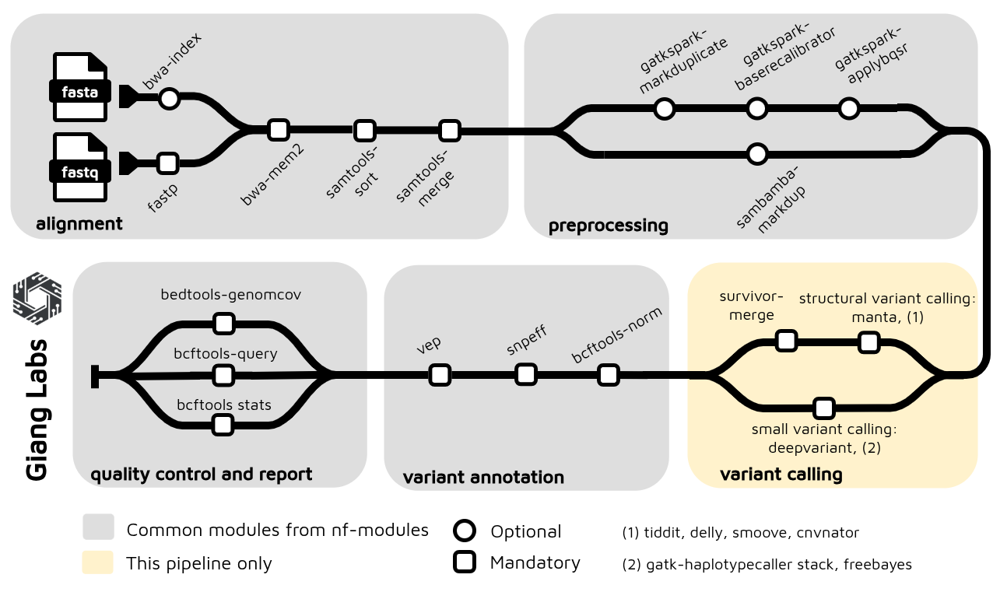
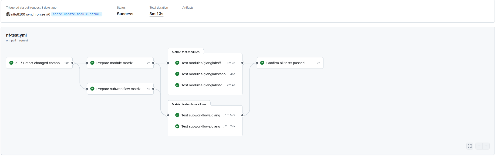

While nf-core provides a well-maintained library of Nextflow modules for bioinformatics, organizations often need domain-specific variants tailored to their analysis pipelines and computational infrastructure. The **gianglabs/nf-modules** repository is one example: it extends the nf-core framework by combining shared nf-core modules with custom, organization-specific modules focused on genomic data processing, particularly variant discovery and annotation. This post looks at how the gianglabs implementation differs from standard nf-core modules—in its module variants, domain-focused subworkflows, and adapted CI/CD practices.

<!--truncate-->

After reorganizing the modules and subworkflows, the [**nf-germline-short-read-variant-calling**](https://github.com/gianglabs/nf-germline-short-read-variant-calling?tab=readme-ov-file) pipeline can now integrate with `gianglabs/nf-modules`.



## 1. Understanding the differences

### 1.1. What is nf-core/modules?

The standard **nf-core/modules** repository provides:

- A curated, community-maintained collection of Nextflow processes
- Modules with standardized structure, testing, and documentation
- Official nf-core-branded modules (e.g., `bwa/mem`, `samtools/sort`, `fastqc`)
- Shared infrastructure available to all nf-core pipelines
- Strict quality standards and peer review

### 1.2. Why create an organization-specific repository?

Custom repositories like gianglabs/nf-modules extend nf-core by adding:

- **Domain-specific modules** not available in nf-core (e.g., specialized GATK variants)
- **Tool variants** adapted to local infrastructure (e.g., Spark-based GATK)
- **Pre-configured subworkflows** combining multiple modules into domain pipelines
- **Organizational standardization** across pipelines in a research group or company
- **Faster iteration** on modules without going through the community review process
- **Cross-organization workflows** mixing nf-core and custom modules

### 1.3. Architecture: a multi-organization module repository

```
gianglabs/nf-modules/
│
├── modules/
│   ├── nf-core/              # Shared nf-core modules (dependencies)
│   │   ├── fastqc/
│   │   ├── samtools/
│   │   ├── bwa/
│   │   └── ... (installed as dependencies)
│   │
│   └── gianglabs/            # Custom organization-specific modules
│       ├── bwamem2/          # Customized alignment (local optimization)
│       ├── gatk/             # Standard GATK tools
│       ├── gatkspark/        # Spark-based GATK variants (HPC optimized)
│       ├── fastp/            # Customized QC/trimming
│       ├── samtools/         # Custom samtools variants
│       ├── bcftools/         # Variant processing
│       ├── vep/              # Variant annotation
│       ├── snpeff/           # Variant annotation
│       └── ... (other custom modules)
│
├── subworkflows/
│   ├── nf-core/              # Shared nf-core subworkflows
│   │
│   └── gianglabs/            # Domain-focused composite workflows
│       ├── alignment/                        # QC → Alignment → Sorting
│       ├── alignment_preprocessing/          # Pre-alignment QC
│       ├── variant_alignment_quality_control/ # BAM validation
│       └── variant_annotation/               # VEP/snpEff annotation
│
└── Pixi + GitHub Actions CI/CD
    ├── Reusable workflows (detect-changes)
    └── Matrix-based testing (modules × subworkflows)
```

---

## 2. Core differences: a pragmatic testing strategy

### 2.1. The nf-core approach: comprehensive but resource-heavy

The standard **nf-core/modules** testing philosophy emphasizes broad compatibility:

```yaml
# nf-core approach (complex)
testing:
  - conda environment # Full dependency management
  - docker container # Platform-agnostic testing
  - singularity image # HPC cluster compatibility
  - GPU variant tests # Accelerated compute scenarios
  - Multiple shards # Distributed test execution
```

**Requirements:**

- Several runtime environments configured in CI/CD
- Docker images plus Singularity conversions
- GPU runners for GPU tests
- Higher CI/CD cost and complexity
- Longer feedback loops

**Problem:** if the target HPC environment does not use GPUs, maintaining conda + docker + singularity testing adds complexity without benefit for that specific use case.

### 2.2. The gianglabs approach: environment-aware

The customized **gianglabs/nf-modules** testing strategy is more environment-aware and cost-conscious:

```yaml
# gianglabs approach (focused)
Testing Strategy:
  GitHub Actions CI/CD:
    - docker container only # Fast, resource-efficient validation
    - CPU tests only # Matches actual HPC production
    - Quick feedback (<5 min) # Faster iteration

  Local HPC Development:
    - singularity/apptainer # Native HPC runtime
    - Manual testing before push # Comprehensive validation
    - Real-world execution profile # True performance testing
```

**Guiding ideas:**

- **Docker for CI/CD validation**: quickly catch obvious issues (syntax, imports, basic logic)
- **Singularity for real testing**: run on the actual HPC environment with real data patterns
- **Single source of truth**: one Docker container that converts to Singularity
- **No redundant multi-environment testing**: if the Docker→Singularity conversion fails, it is a container issue, not a test design issue

### 2.3. Practical benefits

**Before (nf-core style):**

```
Pull Request
  ├─ Test conda env (10 min)      → May pass but conda not used in production
  ├─ Test docker (10 min)         → May pass but HPC uses singularity
  ├─ Test singularity (15 min)    → HPC-relevant but slow
  ├─ Test GPU (20 min)            → Unnecessary for CPU-only HPC
  └─ Total CI time: ~45 min       (wasted on irrelevant scenarios)
```

**After (gianglabs pragmatic):**

```
Pull Request
  ├─ Test docker (10 min)          → Validates code quickly
  └─ Total CI time: ~10 min        (focused feedback)

Developer (Local HPC):
  ├─ Manual singularity test      → Comprehensive validation
  ├─ Test with actual data        → Real-world performance
  ├─ Push when confident
  └─ CI catches edge cases in 10 min
```

**What this saves:**

- Lower GitHub Actions costs
- Focus on the actual execution environment (Singularity on HPC)
- Docker→Singularity conversion is treated as a container concern, not a test design concern

### 2.4. Module container specification

To keep Docker and Singularity environments consistent, the gianglabs approach uses a **single Docker image as the source of truth**. Nextflow converts this image to Singularity at runtime, which avoids maintaining dual container definitions.

**Simple container specification:**

```groovy
// Module specifies ONLY Docker - Nextflow handles Singularity conversion
process EXAMPLEMODULE {
    container "quay.io/biocontainers/bwamem2:2.0--h1296002_0"

    script:
    """
    bwa-mem2 mem ...
    """
}
```

This contrasts with nf-core's `fastp` module, which maintains conditional logic for multiple container engines:

```groovy
process FASTP {
    tag "$meta.id"
    label 'process_medium'

    conda "${moduleDir}/environment.yml"
    container "${ workflow.containerEngine == 'singularity' && !task.ext.singularity_pull_docker_container ?
        'https://community-cr-prod.seqera.io/docker/registry/v2/blobs/sha256/55/556474e164daf5a5e218cd5d497681dcba0645047cf24698f88e3e078eacbd09/data' :
        'community.wave.seqera.io/library/fastp:1.1.0--08aa7c5662a30d57' }"

    input:
    tuple val(meta), path(reads), path(adapter_fasta)
    val   discard_trimmed_pass
    val   save_trimmed_fail
    val   save_merged

    output:
    tuple val(meta), path('*.fastp.fastq.gz') , optional:true, emit: reads
    tuple val(meta), path('*.json')           , emit: json
    tuple val(meta), path('*.html')           , emit: html
    tuple val(meta), path('*.log')            , emit: log
    tuple val(meta), path('*.fail.fastq.gz')  , optional:true, emit: reads_fail
    tuple val(meta), path('*.merged.fastq.gz'), optional:true, emit: reads_merged
    tuple val("${task.process}"), val('fastp'), eval('fastp --version 2>&1 | sed -e "s/fastp //g"'), emit: versions_fastp, topic: versions

    when:
    task.ext.when == null || task.ext.when

    script:
    def args = task.ext.args ?: ''
    def prefix = task.ext.prefix ?: "${meta.id}"
    def adapter_list = adapter_fasta ? "--adapter_fasta ${adapter_fasta}" : ""
    def fail_fastq = save_trimmed_fail && meta.single_end ? "--failed_out ${prefix}.fail.fastq.gz" : save_trimmed_fail && !meta.single_end ? "--failed_out ${prefix}.paired.fail.fastq.gz --unpaired1 ${prefix}_R1.fail.fastq.gz --unpaired2 ${prefix}_R2.fail.fastq.gz" : ''
    def out_fq1 = discard_trimmed_pass ?: ( meta.single_end ? "--out1 ${prefix}.fastp.fastq.gz" : "--out1 ${prefix}_R1.fastp.fastq.gz" )
    def out_fq2 = discard_trimmed_pass ?: "--out2 ${prefix}_R2.fastp.fastq.gz"
    // Added soft-links to original fastqs for consistent naming in MultiQC
    // Use single ended for interleaved. Add --interleaved_in in config.
    if ( task.ext.args?.contains('--interleaved_in') ) {
        """
        [ ! -f  ${prefix}.fastq.gz ] && ln -sf $reads ${prefix}.fastq.gz

        fastp \\
            --stdout \\
            --in1 ${prefix}.fastq.gz \\
            --thread $task.cpus \\
            --json ${prefix}.fastp.json \\
            --html ${prefix}.fastp.html \\
            $adapter_list \\
            $fail_fastq \\
            $args \\
            2>| >(tee ${prefix}.fastp.log >&2) \\
        | gzip -c > ${prefix}.fastp.fastq.gz
        """
    } else if (meta.single_end) {
        """
        [ ! -f  ${prefix}.fastq.gz ] && ln -sf $reads ${prefix}.fastq.gz

        fastp \\
            --in1 ${prefix}.fastq.gz \\
            $out_fq1 \\
            --thread $task.cpus \\
            --json ${prefix}.fastp.json \\
            --html ${prefix}.fastp.html \\
            $adapter_list \\
            $fail_fastq \\
            $args \\
            2>| >(tee ${prefix}.fastp.log >&2)
        """
    } else {
        def merge_fastq = save_merged ? "-m --merged_out ${prefix}.merged.fastq.gz" : ''
        """
        [ ! -f  ${prefix}_R1.fastq.gz ] && ln -sf ${reads[0]} ${prefix}_R1.fastq.gz
        [ ! -f  ${prefix}_R2.fastq.gz ] && ln -sf ${reads[1]} ${prefix}_R2.fastq.gz
        fastp \\
            --in1 ${prefix}_R1.fastq.gz \\
            --in2 ${prefix}_R2.fastq.gz \\
            $out_fq1 \\
            $out_fq2 \\
            --json ${prefix}.fastp.json \\
            --html ${prefix}.fastp.html \\
            $adapter_list \\
            $fail_fastq \\
            $merge_fastq \\
            --thread $task.cpus \\
            --detect_adapter_for_pe \\
            $args \\
            2>| >(tee ${prefix}.fastp.log >&2)
        """
    }

    stub:
    def prefix              = task.ext.prefix ?: "${meta.id}"
    def is_single_output    = task.ext.args?.contains('--interleaved_in') || meta.single_end
    def touch_reads         = (discard_trimmed_pass) ? "" : (is_single_output) ? "echo '' | gzip > ${prefix}.fastp.fastq.gz" : "echo '' | gzip > ${prefix}_R1.fastp.fastq.gz ; echo '' | gzip > ${prefix}_R2.fastp.fastq.gz"
    def touch_merged        = (!is_single_output && save_merged) ? "echo '' | gzip >  ${prefix}.merged.fastq.gz" : ""
    def touch_fail_fastq    = (!save_trimmed_fail) ? "" : meta.single_end ? "echo '' | gzip > ${prefix}.fail.fastq.gz" : "echo '' | gzip > ${prefix}.paired.fail.fastq.gz ; echo '' | gzip > ${prefix}_R1.fail.fastq.gz ; echo '' | gzip > ${prefix}_R2.fail.fastq.gz"
    """
    $touch_reads
    $touch_fail_fastq
    $touch_merged
    touch "${prefix}.fastp.json"
    touch "${prefix}.fastp.html"
    touch "${prefix}.fastp.log"
    """
}
```

**gianglabs simplification:** domain-focused modules prioritize clarity and maintainability. Where nf-core's `fastp` supports single-end, paired-end, and interleaved modes, the gianglabs `FASTP_TRIM` module handles only paired-end reads—the production use case:

```groovy
process FASTP_TRIM {
    tag "${meta.id}"
    label 'process_medium'
    container 'quay.io/biocontainers/fastp:1.1.0--heae3180_0'

    input:
    tuple val(meta), path(reads)

    output:
    tuple val(meta), path("*_trimmed_{1,2}.fastq.gz"), emit: reads
    tuple val(meta), path("*.html"), emit: html
    tuple val(meta), path("*.json"), emit: json
    path "versions.yml", emit: versions

    when:
    task.ext.when == null || task.ext.when

    script:
    def args = task.ext.args ?: ''
    def prefix = task.ext.prefix ?: "${meta.read_group}"

    """
    # Adapter trimming, quality filtering, and QC with fastp
    fastp \\
        --thread ${task.cpus} \\
        --in1 ${reads[0]} \\
        --in2 ${reads[1]} \\
        --out1 ${prefix}_trimmed_1.fastq.gz \\
        --out2 ${prefix}_trimmed_2.fastq.gz \\
        --html ${prefix}_fastp.html \\
        --json ${prefix}_fastp.json \\
        --qualified_quality_phred 20 \\
        --length_required 50 \\
        --detect_adapter_for_pe \\
        ${args}

    # Create versions file
    cat <<-END_VERSIONS > versions.yml
    "${task.process}":
        fastp: \$(fastp --version 2>&1 | grep -oP 'fastp \\K[0-9.]+')
    END_VERSIONS
    """
}
```

## 3. CI/CD and core implementation details

### 3.1. Multi-language linting via Makefile and Pixi

**Challenge:** bioinformatics modules often combine code from several programming languages:

- **Nextflow/Groovy**: workflow orchestration
- **Python**: data processing, utility scripts
- **R**: statistical analysis, visualization

**gianglabs solution:** a unified linting workflow via Makefile + Pixi environment.

#### Pixi configuration for multi-language support

```toml
# pixi.toml - Reproducible environment with language tools
[dependencies]
python = "3.11.*"
nf-test = ">=0.9.5,<0.10"
nextflow = ">=25.10.4,<26"
ruff = ">=0.1.0"              # Python linter + formatter
r = ">=4.0"                   # R interpreter
r-lintr = ">=3.0.0"           # R linter

[pypi-dependencies]
nf-core = ">=3.5.2, <4"
pre-commit = ">=3.0.0"
```

**Benefits:**

- All language runtimes in one reproducible environment
- No system dependencies scattered across machines
- `pixi shell` activates the complete dev environment

#### Makefile: convenient linting commands

```makefile
# Makefile - Centralized development commands

.PHONY: lint lint-python lint-r lint-nf test clean

# Run all linters
lint: lint-python lint-r pre-commit

# Python linting (Ruff)
lint-python:
	@echo "Linting Python files with Ruff..."
	ruff check modules/ subworkflows/ --fix
	ruff format modules/ subworkflows/

# R linting (lintr)
lint-r:
	@echo "Linting R files with lintr..."
	Rscript -e "lintr::lint_dir('modules/', recurse = TRUE)"
	Rscript -e "lintr::lint_dir('subworkflows/', recurse = TRUE)"

# Pre-commit hooks
pre-commit:
	@echo "Running pre-commit checks..."
	pre-commit run --all-files

# Run tests
test:
	@echo "Running nf-test..."
	nf-test test --profile docker

# Clean artifacts
clean:
	rm -rf .nf-test work/
```

#### Developer workflow

```bash
# Activate Pixi environment (installs Python, R, Nextflow, lintr, ruff)
pixi shell

# Run all linters in one command
make lint

# Or run specific language linters
make lint-python    # Check Python code
make lint-r         # Check R code
make pre-commit     # YAML, Nextflow syntax, JSON schemas

# Run tests
make test

# Clean artifacts
make clean
```

#### Language-specific tools

**Python (Ruff):**

```bash
# Check imports, undefined variables, and style violations
ruff check modules/gianglabs/ --select I,E1,E4,E7,E9,F,UP,N

# Auto-format code
ruff format modules/gianglabs/
```

**R (lintr):**

```bash
# Check naming conventions, style, and unused variables
Rscript -e "lintr::lint_dir('modules/gianglabs/', recurse = TRUE)"
```

**Nextflow/Groovy (pre-commit hooks):**

```yaml
# .pre-commit-config.yaml
- repo: https://github.com/pre-commit/mirrors-prettier
  hooks:
    - id: prettier
      files: \.(nf|groovy)$
```

### 3.2. Reusable workflow pattern: detect-changes.yml

To keep CI/CD efficient, gianglabs uses a **reusable GitHub Actions workflow** that detects which modules or subworkflows changed in a pull request, then triggers tests only for the affected components. This avoids unnecessary test runs while keeping validation comprehensive:

```yaml
# .github/workflows/detect-changes.yml
name: Detect changed components

on:
  workflow_call:
    outputs:
      modules:
        description: "Space-separated list of changed modules"
        value: ${{ jobs.detect-changes.outputs.modules }}
      subworkflows:
        description: "Space-separated list of changed subworkflows"
        value: ${{ jobs.detect-changes.outputs.subworkflows }}

jobs:
  detect-changes:
    runs-on: ubuntu-latest
    outputs:
      modules: ${{ steps.changed-modules.outputs.all_changed_files }}
      subworkflows: ${{ steps.changed-subworkflows.outputs.all_changed_files }}
    steps:
      - name: Get changed modules
        uses: tj-actions/changed-files@v46.0.5
        with:
          dir_names: "true"
          dir_names_max_depth: 4
          files: modules/gianglabs/**
          base_sha: ${{ github.event.pull_request.base.ref || 'origin/main' }}

      - name: Get changed subworkflows
        uses: tj-actions/changed-files@v46.0.5
        with:
          dir_names: "true"
          dir_names_max_depth: 3
          files: subworkflows/gianglabs/**
          base_sha: ${{ github.event.pull_request.base.ref || 'origin/main' }}
```

### 3.3. Matrix-based testing

The `detect-changes.yml` workflow outputs a list of changed modules, which is then transformed into a GitHub Actions matrix for parallel testing. Each module runs independently:

**Dynamic matrix generation from changed modules:**

```yaml
# .github/workflows/nf-test.yml
prepare-modules:
  name: Prepare module matrix
  needs: detect-changes
  if: needs.detect-changes.outputs.modules != ''
  runs-on: ubuntu-latest
  outputs:
    matrix: ${{ steps.set-matrix.outputs.matrix }}
  steps:
    - name: Set matrix
      id: set-matrix
      run: |
        MODULES="${{ needs.detect-changes.outputs.modules }}"
        # Convert space-separated string to JSON array
        MATRIX=$(echo $MODULES | jq -cR 'split(" ") | map(select(length > 0))')
        echo "matrix=$MATRIX" >> $GITHUB_OUTPUT

# Use the matrix for parallel jobs
nf-test-modules:
  needs: [detect-changes, prepare-modules]
  strategy:
    matrix:
      module: ${{ fromJson(needs.prepare-modules.outputs.matrix) }}
  steps:
    - name: Run nf-test with Docker
      run: nf-test test modules/gianglabs/${{ matrix.module }}/ --profile docker
```



### 3.4. Practical application: reorganizing an existing pipeline

This approach is useful when migrating modules from an existing pipeline. As an example, the [**nf-germline-short-read-variant-calling**](https://github.com/gianglabs/nf-germline-short-read-variant-calling?tab=readme-ov-file) pipeline was reorganized to extract reusable modules and subworkflows into gianglabs/nf-modules. Other pipelines can then install these components directly:

```bash
# Install a specific module from gianglabs/nf-modules
nf-core modules --git-remote https://github.com/gianglabs/nf-modules.git install bcftools/index

# Install a reusable subworkflow
nf-core subworkflows --git-remote https://github.com/gianglabs/nf-modules.git install alignment
```

**Repository structure after reorganization:**

```bash
# Reorganized modules directory (v1.0.0)
modules/
├── gianglabs/           # Optimized for production use
│   ├── bcftools
│   ├── bedtools
│   ├── bwamem2
│   ├── fastp
│   ├── gatk
│   ├── gatkspark
│   ├── sambamba
│   ├── samtools
│   ├── snpeff
│   └── vep
└── local/               # Pipeline-specific modules
    ├── cnvnator
    ├── deepvariant
    ├── delly
    ├── freebayes
    ├── gatk
    ├── manta
    ├── smoove
    ├── survivor
    └── tiddit

# Reusable subworkflows
subworkflows/
├── gianglabs/           # Domain-specific composition
│   ├── alignment
│   ├── alignment_preprocessing
│   ├── variant_alignment_quality_control
│   └── variant_annotation
└── local/               # Pipeline-specific logic
    └── variant_calling
```

This separation enables code reuse across pipelines while keeping pipeline-specific customizations in the `local` namespace.

## References

- [nf-core/modules](https://github.com/nf-core/modules) — official shared module repository
- [gianglabs/nf-modules](https://github.com/gianglabs/nf-modules) — example custom modules
- [nf-core/tools](https://github.com/nf-core/tools) — module management CLI tool
- [nf-test Documentation](https://www.nf-test.com) — testing framework
- [Pixi Documentation](https://pixi.sh) — reproducible environment management
- [GATK Documentation](https://gatk.broadinstitute.org) — Genome Analysis Toolkit
- [GitHub Actions Reusable Workflows](https://docs.github.com/en/actions/using-workflows/reusing-workflows) — workflow composition
