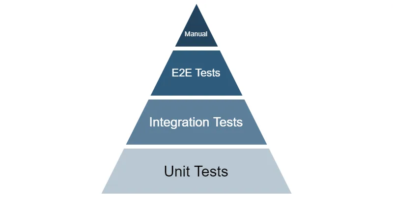

In [Part 2 of our CI/CD series](/en/blogs/how-to-version-control-git-bioinformatics-part-2), we showed how to set up automated testing with `make test-e2e`—running a workflow with test data and checking that it produces results. If the script runs without crashing, it is tempting to conclude that everything works. The uncomfortable part is that a pipeline which runs successfully does not necessarily produce correct results.

This post looks at why testing goes beyond "run the code and check it does not crash," and at the kinds of tests that help catch bugs a simple end-to-end test would miss.

<!--truncate-->



## The problem: why "it runs" is not enough

Consider a quality control pipeline (like the one from Part 2) that:

1. Downloads data ✓
2. Runs FastQC ✓
3. Runs MultiQC ✓
4. Finishes without errors ✓

**Does this mean everything is correct?** Not necessarily. A few scenarios that occur in practice:

**Scenario 1: silent parameter changes**

```bash
# Your original script
fastqc --qual-threshold 30 sample.fastq.gz -o result/

# A colleague modifies it (accidentally)
fastqc --qual-threshold 10 sample.fastq.gz -o result/

# The pipeline still runs successfully!
# But now you're accepting lower quality reads without realizing it
```

**Scenario 2: data corruption**

```bash
# Your QC output looks fine visually
# But internally, MultiQC may have corrupted data:
# - Missing sample names in reports
# - Incorrect statistics calculations
# - Incomplete HTML output

# A simple "did it run?" test won't catch this
```

**Scenario 3: edge-case failures**

```bash
# Your pipeline works with 100 samples
# But when you try with 1,000 samples:
# - Memory usage explodes
# - Temporary file naming conflicts
# - Processes timeout unexpectedly
```

These are not hypothetical—they are the kinds of bugs that appear in real bioinformatics projects. The lesson is that tests need to go beyond execution alone.

---

## 1. Types of tests bioinformaticians need

### 1.1. Four layers of testing

Instead of one monolithic end-to-end test, it helps to think of testing in layers:

```
┌────────────────────────────────────────────────┐
│ Layer 4: End-to-End Tests                      │
│ "Does the full pipeline work with real data?"  │
├────────────────────────────────────────────────┤
│ Layer 3: Integration Tests                     │
│ "Do components work together correctly?"       │
├────────────────────────────────────────────────┤
│ Layer 2: Contract Tests (Output Validation)    │
│ "Are the results in the expected format?"      │
├────────────────────────────────────────────────┤
│ Layer 1: Unit Tests (Individual Functions)     │
│ "Does this logic work correctly?"              │
└────────────────────────────────────────────────┘
```

Let us look at each layer with concrete examples.

### 1.2. Layer 1: unit tests (individual functions)

These test small, isolated pieces of code—usually Python functions that parse or validate data.

**Example: validating QC metrics**

A validator that reads quality control metrics from a JSON file may accept bad data without complaint:

```python
# parse_qc_metrics.py
def parse_fastqc_json(json_file):
    """Parse FastQC JSON output."""
    with open(json_file) as f:
        data = json.load(f)

    # BUG: What if 'summary' key is missing? Crashes silently
    q30_rate = data['summary']['q30_rate']

    # BUG: What if q30_rate is 0? No error checking
    return q30_rate
```

Unit tests catch these bugs early:

```python
# test_parse_qc_metrics.py
def test_parse_fastqc_missing_summary():
    """Should handle missing summary section."""
    invalid_json = '{"other": "data"}'

    with pytest.raises(KeyError):
        parse_fastqc_json(invalid_json)

def test_parse_fastqc_zero_rate():
    """Should handle zero quality rate."""
    result = parse_fastqc_json('{"summary": {"q30_rate": 0}}')
    assert result == 0  # Not False or None—explicitly 0
```

### 1.3. Layer 2: contract tests (output validation)

These verify that tools produce output in the expected format. A pipeline might run without errors but still produce corrupted output.

**Example: validating BAM file structure**

```bash
# Layer 2 test: Is the BAM file valid?
test_validate_bam_output() {
    # Run samtools sort
    samtools sort -o sorted.bam input.bam

    # Check: Does the output file exist?
    test -f sorted.bam || exit 1

    # Check: Is it actually a valid BAM file?
    samtools view -H sorted.bam > /dev/null || exit 1

    # Check: Does it have the expected number of reads?
    read_count=$(samtools view -c sorted.bam)
    test $read_count -gt 0 || exit 1
}
```

This matters because MultiQC might run successfully on a corrupted BAM while the downstream analysis fails silently.

### 1.4. Layer 3: integration tests

These verify that multiple components work together—for example, testing an entire subworkflow (QC → trimming → alignment).

```bash
# Layer 3 test: Do all steps work together?
test_full_qc_trimming_workflow() {
    # Download test data
    make data

    # Run: FastQC → Trimming → FastQC again
    bash workflow.sh data/sample_1.fastq.gz data/sample_2.fastq.gz result/

    # Validate: All expected outputs exist
    test -f result/trimming_report.html
    test -f result/trimmed_1.fastq.gz
    test -f result/trimmed_2.fastq.gz

    # Validate: Output files are non-empty
    test -s result/trimmed_1.fastq.gz
    test -s result/trimmed_2.fastq.gz
}
```

### 1.5. Layer 4: end-to-end tests

The `make test-e2e` test from Part 2 is a Layer 4 test. It is useful, but not sufficient on its own.

---

## 2. Real-world bug examples

The following are bugs that Layer 4 (end-to-end) tests would miss but other layers would catch.

### Bug 1: silent parameter error

```bash
# Original script
fastqc --qual-threshold 30 input.fastq.gz

# Developer accidentally changes it
fastqc --qual-threshold 5 input.fastq.gz
```

**Layer 4 test (end-to-end):**

- ✅ Passes—FastQC runs without crashing
- ❌ Does not catch the lower threshold

**Layer 2 test (contract):**

- ✅ Would catch this if quality thresholds are validated in the output

```bash
# Contract test for quality thresholds
q_threshold=$(grep "Passed filters:" result.html | grep -oP '\d+')
test $q_threshold -ge 20 || (echo "Quality threshold too low"; exit 1)
```

### Bug 2: data corruption in intermediate files

```bash
# Trimming tool runs successfully, but outputs wrong number of reads

original_reads=$(samtools view -c input.bam)
trimmed_reads=$(samtools view -c trimmed.bam)

# Bug: trimmed_reads should be LESS than original_reads
# If trimmed_reads > original_reads, something is wrong!
```

**Layer 4 test (end-to-end):**

- ✅ Passes—pipeline finishes without error
- ❌ Does not validate read counts

**Layer 3 test (integration):**

- ✅ Would catch this:

```bash
# Integration test: Validate trimming removes reads
test $original_reads -gt $trimmed_reads || \
    (echo "ERROR: Trimming removed no reads"; exit 1)
```

### Bug 3: missing input data

```bash
# Your script doesn't check if input exists
fastqc $input_file  # What if $input_file doesn't exist?
```

**Layer 4 test (end-to-end):**

- ✅ Passes (test data exists)
- ❌ Does not test what happens with missing input

**Layer 1 test (unit):**

- ✅ Catches this:

```python
def test_fastqc_missing_input():
    """Should fail gracefully with missing input."""
    with pytest.raises(FileNotFoundError):
        run_fastqc("nonexistent.fastq.gz")
```

---

## 3. Practical: adding layer tests to your Makefile

As described in Part 2, the Makefile originally had:

```makefile
test-e2e: data/GSE110004
	${HOME}/.pixi/bin/pixi run bash main.sh ...
```

Validation layers can be added alongside it:

```makefile
# Layer 1: Unit tests (validate Python parsing functions)
test-unit:
	pytest tests/unit/ -v

# Layer 2: Contract tests (validate output formats)
test-contract: data/GSE110004
	bash tests/contract/validate_fastqc_output.sh result/

# Layer 3: Integration tests (validate multi-step workflows)
test-integration: data/GSE110004
	bash tests/integration/test_qc_pipeline.sh

# Layer 4: End-to-end test (run full pipeline)
test-e2e: data/GSE110004
	${HOME}/.pixi/bin/pixi run bash main.sh data/GSE110004/*_1.fastq.gz data/GSE110004/*_2.fastq.gz result

# Run all tests
test-all: test-unit test-contract test-integration test-e2e
	@echo "All tests passed!"
```

### Example: Layer 2 contract test

```bash
# tests/contract/validate_fastqc_output.sh
#!/bin/bash

RESULT_DIR=$1

echo "Validating FastQC outputs..."

# Check 1: HTML reports exist
test -f "$RESULT_DIR"/*.html || {
    echo "ERROR: No FastQC HTML reports found"
    exit 1
}

# Check 2: Check required sections exist in HTML
for html_file in "$RESULT_DIR"/*.html; do
    # FastQC must have these sections
    grep -q "Per base sequence quality" "$html_file" || {
        echo "ERROR: Missing quality metrics in $html_file"
        exit 1
    }
    grep -q "Per base sequence content" "$html_file" || {
        echo "ERROR: Missing content metrics in $html_file"
        exit 1
    }
done

# Check 3: MultiQC report exists and has content
test -s "$RESULT_DIR/multiqc_report.html" || {
    echo "ERROR: MultiQC report is empty or missing"
    exit 1
}

# Check 4: MultiQC HTML contains sample names
grep -q "General Statistics" "$RESULT_DIR/multiqc_report.html" || {
    echo "ERROR: MultiQC missing summary statistics"
    exit 1
}

echo "✓ All contract tests passed!"
```

### Example: Layer 3 integration test

```bash
# tests/integration/test_qc_pipeline.sh
#!/bin/bash

echo "Testing QC → Trimming → QC pipeline..."

# Step 1: Run first FastQC
fastqc input.fastq.gz -o tmp_qc1/
count1=$(samtools view -c tmp_qc1/input_fastqc.zip)

# Step 2: Run trimming
trimmomatic SE input.fastq.gz trimmed.fastq.gz LEADING:3 TRAILING:3

# Step 3: Run second FastQC
fastqc trimmed.fastq.gz -o tmp_qc2/
count2=$(samtools view -c tmp_qc2/trimmed_fastqc.zip)

# Integration check: Second QC should show improvement
# (This is a behavior test: does trimming actually improve quality?)
if [ "$count2" -lt "$count1" ]; then
    echo "✓ Integration test passed: Quality improved after trimming"
else
    echo "ERROR: Trimming did not improve quality metrics"
    exit 1
fi

rm -rf tmp_qc1 tmp_qc2
```

---

## 4. What about Nextflow pipelines?

For Nextflow pipelines, testing is similar but uses the `nf-test` framework:

```bash
# Layer 2: Contract test for a Nextflow process
test("samtools sort produces valid BAM") {
    when {
        input[0] = [ [id: 'test'], file('test.bam') ]
    }

    then {
        assert process.success

        // Layer 2: Validate BAM structure
        def bam_file = process.out.bam[0][1]
        assert shell("samtools view -H ${bam_file}").exitStatus == 0
    }
}
```

---

## 5. Summary: the testing pyramid

```
                    ▲
                   ╱ ╲
                  ╱   ╲          Layer 4: End-to-End (5%)
                 ╱ E2E ╲         "Did the pipeline finish?"
                ╱───────╲
               ╱         ╲
              ╱Integration╲    Layer 3 (15%)
             ╱ (Contract)  ╲   "Do outputs have correct format?"
            ╱───────────────╲
           ╱                 ╲
          ╱      Unit Tests   ╲ Layer 2 + 1 (80%)
         ╱    (Validation)     ╲ "Does this logic work? Handle errors?"
        ╱───────────────────────╲

Each layer catches different types of bugs that the layer above might miss.
```

**Key insight:** a pipeline that "runs successfully" (Layer 4 ✓) might still have:

- silently corrupted data (caught by Layer 2)
- parameter errors (caught by Layer 1 and 2)
- broken intermediate steps (caught by Layer 3)

---

## 6. Getting started

Starting simple:

1. **Add Layer 1** (unit tests):

   ```bash
   pytest tests/unit/ --cov  # If you have Python code
   ```

2. **Add Layer 2** (contract tests):

   ```bash
   bash tests/contract/*.sh  # Validate outputs
   ```

3. **Keep your Layer 4** (end-to-end):

   ```bash
   make test-e2e  # From Part 2
   ```

4. **Run them all before pushing:**
   ```bash
   make test-all
   ```

---

## References

- [Version control with Git for bioinformatics (Part 2)](/en/blogs/how-to-version-control-git-bioinformatics-part-2) — previous post on automated testing
- [pytest Documentation](https://docs.pytest.org) — Python testing framework
- [nf-test Documentation](https://www.nf-test.com) — Nextflow testing framework
- [GitHub Actions: About continuous integration](https://docs.github.com/en/actions/guides/about-continuous-integration) — CI/CD practices
- [Google Testing Blog](https://testing.googleblog.com/) — software testing insights
- Cover image: [Codex CLI screenshot](https://commons.wikimedia.org/wiki/File:Codex_CLI_screenshot.png) — OpenAI / Codex CLI GitHub repository, Wikimedia Commons, Apache License 2.0
