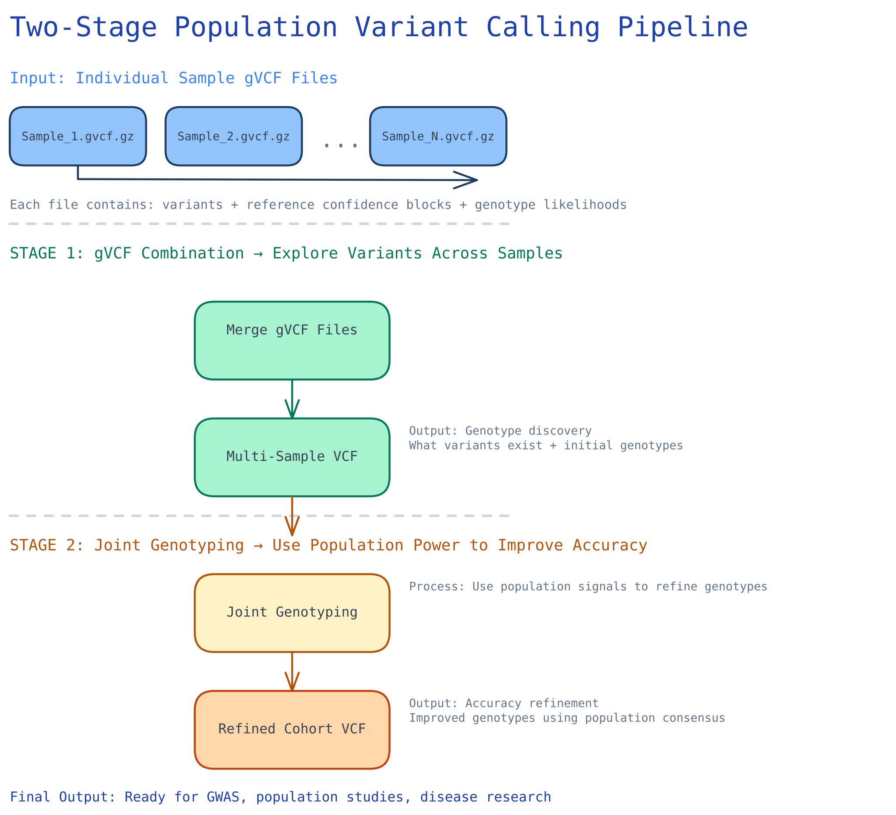
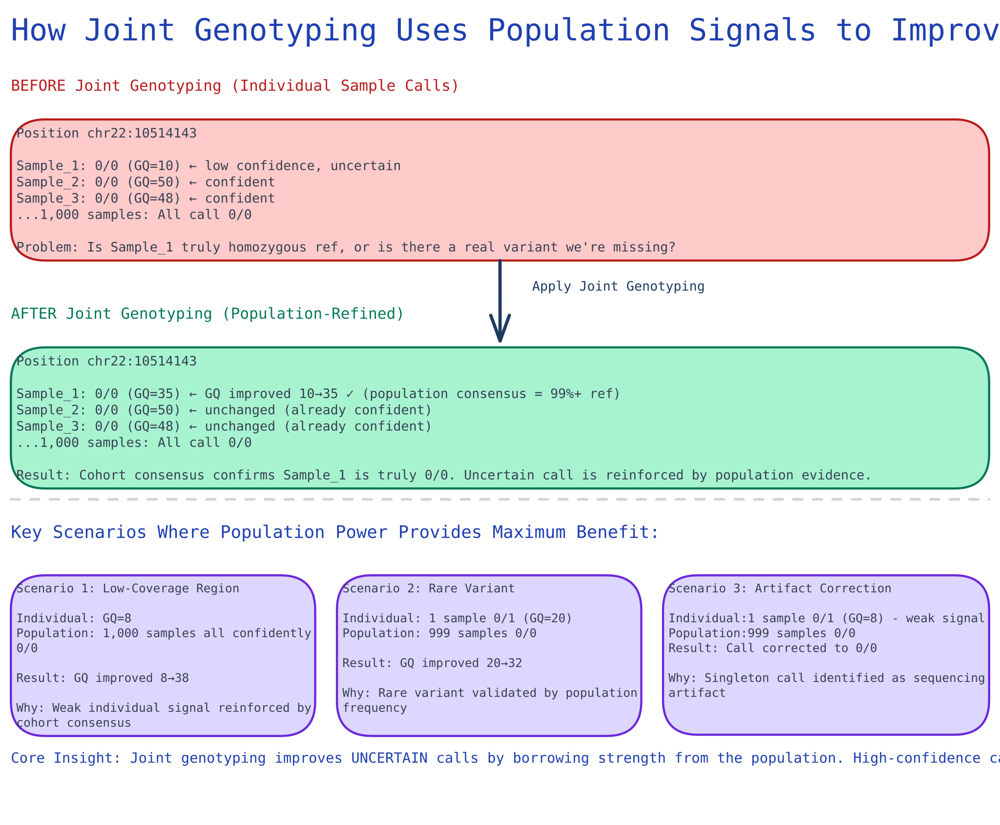

Population-scale variant calling is a critical step in building genomic population projects. Single-sample variant calling is well established, but scaling joint genotyping to thousands of WGS samples introduces challenges in performance, storage, and incremental updates. In this post we look at gVCF-based joint variant calling approaches, evaluate scalable options with modern open-source tools, and discuss practical architecture considerations for population-scale genomics projects.

<!--truncate-->

In [Parts 1-8](/en/blogs/gatk-variant-calling-production-slurm-optimization-part8) of the variant calling series, we built a complete short-read germline variant calling pipeline — from raw reads through variant annotation using [**nf-germline-short-read-variant-calling**](https://github.com/gianglabs/nf-germline-short-read-variant-calling?tab=readme-ov-file). In [Part 6](/en/blogs/gatk-variant-calling-production-slurm-optimization-part6), we showed that modern variant callers such as **DeepVariant** can produce gVCF files directly — output files that capture both variant AND reference confidence information.

But there is a next step that many tutorials skip: **how do you combine hundreds or thousands of these gVCF files to explore and compare variants across multiple samples?** And more importantly, **how do you use population-level information to improve variant accuracy across your cohort?**

This article explores two complementary concepts:

1. **gVCF Combination** → Aggregating gVCF files to systematically explore variants across multiple samples, enabling population-level analysis and discovery
2. **Joint Variant Calling** → Using cohort-wide population information to improve genotype accuracy, correct individual sample errors, and refine variant quality scores

We demonstrate the technical journey from single-sample gVCF files (created by DeepVariant or GATK) to a population-scale multi-sample VCF using **DRAGEN gVCF Genotyper**, and show how joint genotyping uses population signals to refine accuracy without re-calling variants. Real data from the 1000 Genomes Project is used for practical examples.

:::info Series Context
This is **Part 11** of the Variant Calling series:

- **Parts 1-3**: Building a production-grade variant calling pipeline (bash → Nextflow → HPC)
- **Parts 4-8**: Workflow quality, benchmarking, annotation, and structural variants
- **Part 11 (This Post)**: Population-scale joint genotyping and cohort aggregation

**Prerequisites**: Familiarity with the gVCF format from Part 6 and a basic understanding of variant calling pipelines.
:::

## Series Overview

- **[Part 1](/en/blogs/gatk-variant-calling-bash-workflow-pixi-part1)**: A bash germline pipeline managed with Pixi
- **[Part 2](/en/blogs/gatk-variant-calling-bash-to-nextflow-validation-part2)**: Validating the bash workflow
- **[Part 3](/en/blogs/gatk-variant-calling-production-slurm-optimization-part3)**: From bash to Nextflow
- **[Part 4](/en/blogs/gatk-variant-calling-production-slurm-optimization-part4)**: Containerized execution and reproducibility
- **[Part 5](/en/blogs/gatk-variant-calling-production-slurm-optimization-part5)**: Benchmarking germline variant calling with nf-core/sarek
- **[Part 6](/en/blogs/gatk-variant-calling-production-slurm-optimization-part6)**: Do we need a complex pipeline for high-quality variant calling?
- **[Part 7](/en/blogs/gatk-variant-calling-production-slurm-optimization-part7)**: Variant annotation with SnpEff and Ensembl VEP
- **[Part 8](/en/blogs/gatk-variant-calling-production-slurm-optimization-part8)**: Structural variant calling — a short-read benchmark
- **[Part 9](/en/blogs/storage-cost-optimization-cram-format)**: Storage cost optimization with CRAM
- **[Part 10](/en/blogs/structural-variant-calling-short-reads-challenges)**: The challenges of SV calling with short reads
- **Part 11 (This Post)**: Population-scale genotyping with gVCF

## 1. Two Concepts: gVCF Combination and Joint Variant Calling

### 1.1. Understanding the Distinction

Before diving into population-scale workflows, it is worth clarifying two distinct (but complementary) processes that are often confused:

**gVCF Combination:**

- **Purpose**: Aggregating reference confidence information from multiple samples to systematically explore which variants exist across your cohort
- **Process**: Merging gVCF files while preserving per-sample genotype likelihoods and reference confidence
- **Output**: A multi-sample VCF showing what variants each sample carries (genotype discovery)
- **Accuracy Improvement**: Minimal—primarily enables cross-sample exploration and discovery

**Joint Variant Calling:**

- **Purpose**: Using population-level signals to improve genotype accuracy and refine quality scores at each site
- **Process**: Probabilistically re-evaluating each sample's genotype using cohort-wide allele frequency priors and genotype patterns
- **Output**: Refined genotypes with improved quality scores leveraging population consensus
- **Accuracy Improvement**: Significant—especially for low-confidence sites, rare variants, and low-coverage regions

### 1.2. Where We Left Off: gVCF from DeepVariant

In Part 6, our **nf-germline-short-read-variant-calling** pipeline produces:

**Per-sample outputs:**

- **single-sample VCF**: Variants only (positions with alternate alleles)
- **single-sample gVCF** (created by DeepVariant): Variants + reference blocks with quality scores

**Example file structure:**

```bash
sample-1/
  ├── sample1.vcf.gz          # Hard-filtered variants only
  ├── sample1.vcf.gz.tbi      # Index for VCF
  ├── sample1.gvcf.gz         # gVCF with reference blocks ← KEY FILE
  └── sample1.gvcf.gz.tbi     # Index for gVCF

sample-2/
  ├── sample2.vcf.gz
  ├── sample2.gvcf.gz         # ← combine these to explore variants
  └── ...
```

**Why gVCF enables exploration:** Unlike standard VCF files, gVCF captures:

- Variant sites (same as VCF)
- Reference confidence blocks (`<NON_REF>` entries) showing where samples are likely non-variant
- Quality scores for non-variant positions
- Complete genotype likelihoods per sample

This richer information allows us to **systematically explore variants across samples**—comparing not just which variants each sample has, but also the confidence level at every genomic position.

### 1.3. Two-Stage Pipeline: Combination then Refinement


_Figure 1: Two-Stage Population Variant Calling Pipeline_

Many workflows combine these stages into one tool (such as GATK Joint Genotyping), but conceptually they are two distinct operations.

---

## 2. The Three-Stage Genomic Data Journey: VCF → gVCF → Joint Cohort VCF

:::warning

- Various statistical and machine learning models can be applied to improve individual variant calling using information from multiple samples.
- The variant re-calling model below is presented for proof-of-concept purposes only.
  :::

This section traces the data transformation pipeline from individual variant calls to population-scale cohorts. Each stage adds value: a variant-only VCF enables basic discovery, a gVCF enables cross-sample exploration, and a joint cohort VCF applies population knowledge for accuracy refinement.

**What makes this workflow useful:**

1. **gVCF preserves reference confidence** → You can explore not just variants, but confidence at every genomic position
2. **Multi-sample VCF enables discovery** → See which variants are present in your cohort
3. **Joint genotyping refines accuracy** → Population consensus improves genotype quality scores across all samples

---

### 2.1. Stage 1: Single-Sample VCF (from DRAGEN)

**What it contains:**

- Only variant sites (positions with alternate alleles)
- Genotype information for ONE sample
- No information about non-variant positions
- File size: ~100-500 MB per sample

**Example command (using bcftools on S3):**

:::info

- Illumina, with the 1000 Genomes Project, has released the individual gVCF and cohort gVCF that can be used for exploration in this post
- The files are stored on an S3 bucket, where the latest bcftools, based on htslib, supports reading the file randomly. Read more in the post on [remote files with htslib](/en/blogs/remote-files-htslib-bcftools-samtools)
  :::

```bash
# View DRAGEN hard-filtered VCF for single sample
bcftools view s3://1000genomes-dragen-v4-2-7/data/individuals/hg38_alt_masked_graph_v3/NA21144/NA21144.final.hard-filtered.vcf.gz \
  | grep -v "contig" \
  | head -n80
```

Output showing VCF header and variant records:

```bash
##fileformat=VCFv4.2
##FILTER=<ID=PASS,Description="All filters passed">
##FORMAT=<ID=AD,Number=R,Type=Integer,Description="Allelic depths for ref and alt alleles in the order listed">
##FORMAT=<ID=GQ,Number=1,Type=Integer,Description="Genotype Quality">
##FORMAT=<ID=GT,Number=1,Type=String,Description="Genotype">
##FORMAT=<ID=PL,Number=G,Type=Integer,Description="Normalized, Phred-scaled likelihoods for genotypes">
...
#CHROM  POS     ID      REF     ALT     QUAL    FILTER  INFO    FORMAT  NA21144
chr1    10616   .       CCGCCGTTGCAAAGGCGCGCCG  C       8.83    PASS    AC=2;AF=1;AN=2;DP=15;...  GT:AD:GQ:PL  1/1:2,13:4:38,6,0
chr1    10927   .       A       G       10.2    PASS    AC=2;AF=1;AN=2;DP=2;...  GT:AD:GQ:PL  1/1:0,2:3:45,5,0
chr1    11022   .       G       A       10.54   PASS    AC=2;AF=1;AN=2;DP=4;...  GT:AD:GQ:PL  1/1:1,3:5:47,7,0
```

**Key observation:** Position chr1:15000 is NOT in this file—there is no way to know if the sample is confidently homozygous reference or just not sequenced.

---

### 2.2. Stage 2: Single-Sample gVCF (output from DeepVariant in Part 6 is similar)

**What it contains:**

- Both variant sites AND reference blocks (homozygous reference regions)
- Genotype likelihoods for each position
- Quality scores for non-variant positions
- File size: ~200-800 MB per sample (larger than VCF due to reference blocks)

**Example command:**

```bash
# View gVCF with reference blocks and quality scores from Dragen pipeline
bcftools view s3://1000genomes-dragen-v4-2-7/data/individuals/hg38_alt_masked_graph_v3/NA21144/NA21144.final.hard-filtered.gvcf.gz \
  | grep -v "contig" \
  | head -n100
```

Key difference from VCF: the `<NON_REF>` entries and `END` field mark reference blocks:

```bash
##fileformat=VCFv4.2
##ALT=<ID=NON_REF,Description="Represents any possible alternative allele at this location">
##FORMAT=<ID=GQ,Number=1,Type=Integer,Description="Genotype Quality">
##FORMAT=<ID=MIN_DP,Number=1,Type=Integer,Description="Minimum DP observed within the GVCF block">
##GVCFBlock=minGQ=0(inclusive),maxGQ=1(exclusive)
##GVCFBlock=minGQ=1(inclusive),maxGQ=10(exclusive)
##GVCFBlock=minGQ=10(inclusive),maxGQ=20(exclusive)
...
#CHROM  POS     ID      REF     ALT     QUAL    FILTER  INFO    FORMAT  NA21144
chr1    9998    .       N       <NON_REF>       .       LowGQ   END=10003       GT:GQ:MIN_DP  ./.:0:1
chr1    10004   .       C       <NON_REF>       .       PASS    END=10025       GT:GQ:MIN_DP  0/0:3:12
chr1    10026   .       A       <NON_REF>       .       PASS    END=10026       GT:GQ:MIN_DP  0/0:15:32
chr1    10027   .       A       <NON_REF>       .       PASS    END=10044       GT:GQ:MIN_DP  0/0:21:35
chr1    10045   .       A       <NON_REF>       .       PASS    END=10048       GT:GQ:MIN_DP  0/0:21:44
```

**Key insights:**

- `<NON_REF>`: Symbolic ALT meaning "reference confidence"
- `END=10025`: This reference block spans chr1:10004-10025
- `GT:GQ:MIN_DP`: Genotype (0/0 = homozygous reference), Quality (GQ=3 = low confidence), Min depth in block

**Now we know:** Sample NA21144 is confidently homozygous reference at chr1:10004-10025 with GQ=3 (low confidence) and chr1:10026 with GQ=15 (higher confidence).

#### 2.2.1. Understanding Genotype Quality (GQ) Calculation

**What is GQ?**

Genotype Quality (GQ) is a **Phred-scaled probability** that measures confidence in the genotype call. It is defined as:

`GQ = -10 × log10(P(genotype is wrong))`

**Interpretation:**

- **GQ = 3**: Probability of error = 10^(-3/10) ≈ 50% (essentially a coin flip—not confident)
- **GQ = 10**: Probability of error = 10^(-10/10) = 0.1 = 10% (one in ten chance of error)
- **GQ = 20**: Probability of error = 10^(-20/10) = 0.01 = 1% (one in a hundred chance)
- **GQ = 30**: Probability of error = 10^(-30/10) = 0.001 = 0.1% (one in a thousand—high confidence)
- **GQ ≥ 60**: Near-certain confidence in the genotype

**Real-world example from the gVCF above:**

```
chr1    10004   .   C   <NON_REF>   .   PASS   END=10025   GT:GQ:MIN_DP   0/0:3:12
                                                            ↑ GQ=3 (LOW confidence)
chr1    10026   .   A   <NON_REF>   .   PASS   END=10026   GT:GQ:MIN_DP   0/0:15:32
                                                            ↑ GQ=15 (HIGHER confidence)
```

**Why the difference?**

- Position chr1:10004-10025 has **MIN_DP=12** (moderate depth, but probably a low-complexity region with ambiguous reads)
- Position chr1:10026 has **MIN_DP=32** (higher depth, clearer reference call)

**The problem with low GQ calls:**

When GQ is low (≤3), it is not possible to distinguish between:

- "This position really is homozygous reference" (GQ low due to sequencing noise)
- "This position might have a rare variant I cannot see" (GQ low due to insufficient coverage)

This ambiguity cascades when building cohort call sets—if 1,000 samples have GQ=3 at the same position, should their consensus that it is a non-variant be trusted? Or should the region be flagged as suspicious?

#### 2.2.2. How Joint Genotyping Improves Variant Calls Using Population Signals

**The Single-Sample Problem: Decisions in Isolation**

When calling variants on a single sample, low-confidence calls must be decided with only that sample's data:

```
Single Sample 1 at position chr22:10514143:
- Reads support: 95% for genotype 0/0 (ref/ref), 5% for genotype 0/1 (ref/alt)
- Confidence: GQ=10 (1 in 10 chance this call is wrong)
- Decision: Call 0/0, but confidence is LOW

Without population context:
- Is this truly a homozygous reference call?
- Or is this a real but very rare variant being missed?
- I cannot know without additional information
```

**The Joint Genotyping Solution: Borrowing Strength from the Population**

When a cohort is available, **population patterns can improve accuracy**. Joint genotyping uses cohort-wide signals to reassess individual sample genotypes:

```
Cohort of 1,000 samples at chr22:10514143:
┌─────────────────────────────────────────────────────┐
│ Sample 1:    0/0 (GQ=10)   ← questionable call      │
│ Sample 2:    0/0 (GQ=50)   ← very confident         │
│ Sample 3:    0/0 (GQ=48)   ← very confident         │
│ Sample 4:    0/0 (GQ=52)   ← very confident         │
│ Samples 5-1000: All 0/0 (GQ>40) ← strong consensus │
└─────────────────────────────────────────────────────┘

Population signal:
- 999 samples independently call 0/0 with high confidence
- Only 1 sample has uncertain confidence
- Statistical analysis: Probability this position is truly 0/0 = 99%+ (allele frequency ≈ 0)
- Conclusion: Sample 1's uncertain call is REINFORCED by population consensus

Result: Sample 1's GQ improved from 10 → 35 (borrowing confidence from the cohort)
```



**Real-world impact - Concrete examples of accuracy improvement:**

_Example 1: Low-coverage region_

```
Position chr1:45000000 (low sequencing depth in Sample 1):

Before joint genotyping:
Sample_1  0/0:8   (uncertain due to only 3 reads, noisy region)
Sample_2  0/0:60  (30 reads, clear reference)
...
Sample_1000  0/0:58

After joint genotyping:
Sample_1  0/0:38  ← GQ improved 8→38 using 999 samples' consensus
          (Population evidence: 1,000/1,000 samples call 0/0, so position is likely not variant)
```

_Example 2: Rare variant validation_

```
Position chr5:12000000:

Before joint genotyping:
Sample_1   0/1:20  (one read supports alt, one ref—uncertain heterozygous call)
Sample_2   0/0:55  (confidently reference)
...
Sample_1000  0/0:52

After joint genotyping:
Sample_1   0/1:32  ← GQ improved 20→32 (population consensus confirms this is a real rare variant)
           (Calculation: "This heterozygous call in one sample + homozygous refs in 999 others = likely a real rare variant worth believing")
```

_Example 3: Correcting false positives_

```
Position chr19:88000000:

Before joint genotyping:
Sample_1   0/1:9   (weak evidence for alt, GQ very low)
Sample_2   0/0:51  (reference)
...
Sample_1000  0/0:49

After joint genotyping:
Sample_1   0/0:28  ← Corrected from 0/1→0/0 (population consensus suggests this was artifact)
           (Rationale: "Only 1 sample heterozygous out of 1,000 with weak signal + 999 homozygous refs = likely sequencing artifact")
```

**How the Math Works - The Probabilistic Framework**

Joint genotyping combines three pieces of information:

1. **Single-sample likelihood**: P(reads | genotype) ← What the reads in this one sample support
2. **Population prior**: P(genotype | cohort allele frequency) ← What is expected based on 999 other samples
3. **Posterior probability**: P(genotype | reads + cohort) ← Final refined estimate combining both

**Simplified equation:**

```
Refined GQ = single_sample_confidence
           + population_evidence
           - conflict_penalty
```

**When population-level information is most valuable:**

| Scenario                          | Individual GQ | Population GQ | Improvement | Why                                        |
| --------------------------------- | ------------- | ------------- | ----------- | ------------------------------------------ |
| **Low-coverage region**           | 6             | 35            | +29         | Cohort consensus compensates for low depth |
| **Rare variant (1/1000 samples)** | 15            | 28            | +13         | Population signals confirm it's real       |
| **Artifact in one sample**        | 8             | 2 (filtered)  | -6          | 999 samples say it's wrong                 |
| **Common variant**                | 45            | 48            | +3          | Minimal improvement (already confident)    |

**Critical insight: Why this matters for your cohort**

The key realization is that **population-level information specifically helps uncertain calls**:

- High-confidence individual calls stay high-confidence (no change needed)
- Low-confidence individual calls gain confidence from cohort agreement
- Erroneous singleton calls are identified and corrected by population patterns

This is why joint genotyping can simultaneously:

- Improve accuracy across the cohort
- Reduce false positives (artifact calls corrected)
- Increase true positive detection (weak real calls boosted)

---

### 2.3. Stage 3: Multi-Sample Cohort VCF (after DRAGEN gVCF Genotyper)

**What it contains:**

- All variants discovered ACROSS the entire cohort (3,202 samples in 1KGP)
- Genotypes for all samples at each variant site
- Population-level metrics (allele counts, frequencies, Hardy-Weinberg statistics)
- Local alleles representation (memory-efficient FORMAT/LPL and FORMAT/LAA fields)

**Example command:**

```bash
# View the cohort VCF from 3,202 samples on chromosome 22
# Note: showing only the first 12 columns (CHROM to first few samples)
bcftools view s3://1000genomes-dragen-v4-2-7/data/cohorts/gvcf-genotyper-dragen-4.2.7/hg38/3202-samples-cohort/3202_samples_cohort_gg_chr22.vcf.gz \
  | grep -v "contig" \
  | head -n60 \
  | cut -f1-12
```

**Key metrics added by DRAGEN gVCF Genotyper:**

```bash
##INFO=<ID=AC,Number=A,Type=Integer,Description="Allele count in genotypes">
##INFO=<ID=AN,Number=1,Type=Integer,Description="Total number of alleles in called genotypes">
##INFO=<ID=NS,Number=1,Type=Integer,Description="Total number of samples">
##INFO=<ID=NS_GT,Number=1,Type=Integer,Description="Total number of samples with called genotypes">
##INFO=<ID=NS_NOGT,Number=1,Type=Integer,Description="Samples with unknown genotypes ./.">
##INFO=<ID=NS_NODATA,Number=1,Type=Integer,Description="Samples with no coverage">
##INFO=<ID=IC,Number=1,Type=Float,Description="The inbreeding coefficient">
##INFO=<ID=HWE,Number=A,Type=Float,Description="Hardy-Weinberg Equilibrium P-value">
##FORMAT=<ID=LPL,Number=.,Type=Integer,Description="Local Phred-scaled likelihoods (memory efficient)">
##FORMAT=<ID=LAA,Number=.,Type=String,Description="Local alternate allele indices">
```

**Example variant in the cohort:**

```
chr22   10514143   .   G   A   17.92   PASS   AC=16;AN=1452;NS=3202;NS_GT=726;NS_NOGT=33;NS_NODATA=2443;IC=0.75;HWE=2.1e-12
GT:GQ:AD:LPL:LAA  .:.:.:.:.   .:.:.:.:.   ...
```

**What this tells us:**

- **AC=16, AN=1452**: 16 copies of A allele out of 1,452 total alleles genotyped
- **NS=3202**: All 3,202 samples in the cohort
- **NS_GT=726**: 726 samples have a genotype call at this site
- **NS_NODATA=2443**: 2,443 samples had no coverage at this position
- **IC=0.75**: High inbreeding coefficient (excess homozygotes—potential population structure)
- **HWE=2.1e-12**: Highly significant deviation from Hardy-Weinberg equilibrium

## 3. Joint Genotyping Solutions

:::info
For implementing joint genotyping with practical results, the ideal tool would have:

- **Open-source**: Accessible to deploy on any platform without licensing barriers
- **Accuracy**: Effectively uses population signals to improve genotype quality
- **Scalability**: Handles growing cohort sizes efficiently with distributed computing
  :::

Once gVCF files have been combined into a multi-sample VCF, the next step is applying joint genotyping to improve accuracy using population signals. Different tools offer different trade-offs between accuracy improvement, computational cost, scalability, and operational flexibility.

### 3.1. Comprehensive Tool Comparison

| **Tool**                          | **Performance**                      | **Scalability**                                  | **Open-Source** | **Key Pros**                                                    | **Key Cons**                                                                    |
| --------------------------------- | ------------------------------------ | ------------------------------------------------ | --------------- | --------------------------------------------------------------- | ------------------------------------------------------------------------------- |
| **GATK Joint Genotyping**         | Slow (single thread)                 | Poor (reprocess entire cohort on new samples)    | Yes             | Mature, well-documented; Robust VQSR recalibration               | Must re-run full pipeline; Complex parameter tuning; Tightly coupled to GATK     |
| **GLnexus**                       | Fast (specialized C++ backend)       | Medium (splitted by regions)                     | Yes             | Faster than GATK; Incremental updates possible                   | Tightly coupled to DeepVariant; scale by regions splitting                       |
| **Genomic Variant Store (Terra)** | Very Fast (BigQuery-based)           | Excellent (cloud-native)                         | No              | Scalable to millions; Managed service                            | Terra platform lock-in; Licensing; No local control                              |
| **DRAGEN IGG**                    | Very Fast (specialized hardware)     | Excellent (splitted by regions + sample batches) | No              | Incremental processing; High performance; Enterprise support     | Licensing; Hardware dependency; Vendor lock-in                                   |
| **DPGT**                          | Very Fast (Apache Spark distributed) | Excellent (splitted by regions + sample batches) | Yes             | Open-source; Incremental processing; High performance            | Less mature; Limited documentation; setup                                        |

### 3.2. Decision Matrix: Which Tool Should You Choose?

| **Your Situation**                                                                                                        | **Recommended Tool**                                       | **Why**                                                       |
| ------------------------------------------------------------------------------------------------------------------------- | ---------------------------------------------------------- | ------------------------------------------------------------- |
| **Academic/research, small cohort (\<1K samples), rare variant discovery and variants are called by GATK HaplotypeCaller** | GATK Joint Genotyping                                      | Mature, well-documented, best accuracy for non-DRAGEN callers |
| **Growing biobank, need incremental updates, variant is called by DRAGEN**                                                | DRAGEN IGG (if already using DRAGEN) or DPGT (open-source) | Incremental processing critical for operational efficiency    |
| **Large consortium (100K+ samples)**                                                                                      | Genomic Variant Store or DRAGEN IGG                        | Massive scalability; cost acceptable at this scale            |
| **Open-source, scale up to million samples**                                                                              | DPGT                                                       | Best open-source option; excellent scaling; no vendor lock-in |
| **Academic/research, small cohort (\<1K samples), variant is called by DeepVariant**                                       | GLnexus                                                    | Good speed/accuracy trade-off; cloud-friendly                 |

---

### 3.3. Practical Implementation: Open-Source Joint Variant Calling with GKit

:::info
This section demonstrates how to implement joint variant calling using open-source tools integrated in the **GKit** repository ([github.com/gianglabs/gkit](https://github.com/gianglabs/gkit)). Both the **GLnexus** and **DPGT** implementations are shown with real workflows.
:::

#### 3.3.1. GATK Joint Genotyping (Already Integrated in nf-germline)

**Note:** GATK GenomicsDBImport/GenotypeGVCFs is already implemented in the production pipeline at [nf-germline-short-read-variant-calling](https://github.com/gianglabs/nf-germline-short-read-variant-calling). The pipeline includes the `GATK_GENOTYPEGVCFS` process that:

- Takes individual gVCF files from DeepVariant or GATK
- Performs population-aware genotype refinement
- Outputs a joint VCF with population-level metrics

For academic research projects with small cohorts calling variants with GATK HaplotypeCaller, this integrated approach is the recommended starting point.

---

#### 3.3.2. GLnexus Implementation

**What GLnexus does:**

- High-performance joint variant calling optimized for DeepVariant gVCF output
- Efficient region-based processing (splittable by genomic regions)
- Produces a cohort VCF with improved genotype quality scores

**Quick Start with GKit:**

```bash
cd <repo>/gkit/glnexus

# Install dependencies with Pixi
pixi install

# Run joint genotyping on test data (GIAB + 1KGP samples)
make test
```

**Output:**

```
cohort_vcf/GIAB/data/GIAB_ALDH2_5kb.vcf.gz
cohort_vcf/1KGP/data/1KGP_ALDH2_5kb.vcf.gz
```

**Configuration Details:**

The pipeline downloads gVCF files from public cloud storage and runs GLnexus:

```bash
glnexus_cli \
  --config DeepVariant \        # Config optimized for DeepVariant output
  --threads 4 \                 # Parallel processing
  --bed ALDH2_5kb.bed \         # Limit to region of interest
  *.g.vcf.gz > cohort.bcf       # Input gVCF files
```

**Key parameters:**

- **--config DeepVariant**: Uses DeepVariant-optimized settings
- **--threads**: CPU cores for parallel processing (adjust based on available resources)
- **--bed**: Region file to limit analysis (enables incremental processing across the genome)

**Customization:**

1. Change the analysis region by editing the BED file
2. Add more samples by including their gVCF files
3. Reduce memory usage by lowering the thread count

**Pipeline features:**

- Automatically downloads GIAB and 1000 Genomes Project samples from cloud storage
- Converts BCF output to gzip-compressed VCF format
- Reproducible environment via Pixi

---

#### 3.3.3. DPGT Implementation (Distributed Population Genetics Tool)

**What DPGT does:**

- Open-source distributed joint variant calling using Apache Spark
- Handles both sample-level and region-level parallelization
- Comparable accuracy to GATK with better scalability for large cohorts (10K+ samples)

**Quick Start with GKit:**

```bash
cd <repo>/gkit/dpgt

# Install and build DPGT locally
pixi install
bash scripts/clone_DPGT.sh
bash scripts/build_cpp.sh

# Run joint genotyping
bash run_dpgt.sh
```

**Default output:**

```
results_verify_1kgp_run_dpgt/result.chr12_111760000_111765000.0.vcf.gz
```

**Configuration with Environment Variables:**

```bash
INPUT_LIST=inputs/1kgp_3samples.list \
REFERENCE_FASTA=reference/Homo_sapiens_assembly38.fasta \
OUTPUT_DIR=results/my_run \
TARGET_REGION=chr12:111760000-111765000 \
JOBS=4 \
bash run_dpgt.sh
```

**Key parameters:**

- **INPUT_LIST**: File listing paths to input gVCF files
- **REFERENCE_FASTA**: Reference genome in FASTA format
- **OUTPUT_DIR**: Output directory for results
- **TARGET_REGION**: Genomic region in format `chr:start-end`
- **JOBS**: Number of Spark executors for parallel processing

**Pipeline workflow:**

1. Checks DPGT JAR and native library compilation
2. Validates input files and reference
3. Runs joint genotyping using a local Spark cluster
4. Outputs a cohort VCF with population statistics

**Scalability Notes:**

- **Local mode**: Suitable for test/validation (as shown here with 3 samples)
- **Cluster mode**: DPGT integrates with Spark on SLURM (see `spark-on-slurm/` in GKit)
- Can scale to 10K+ samples by distributing jobs across Spark executors

**Known limitations:**

- GIAB inputs may fail due to `<NON_REF>` compatibility; 1KGP samples are validated
- Requires Apache Spark infrastructure setup
- Spark cluster management needed for large-scale processing

---

#### 3.3.4. Spark on SLURM for Large-Scale DPGT Processing

For biobank-scale analysis (1K-100K+ samples), DPGT can run on a **Spark cluster deployed within SLURM jobs** using the `spark-on-slurm` configuration in GKit:

```bash
cd <repo>/gkit/spark-on-slurm

# Setup environment
make setup

# Test Spark cluster on SLURM
make example
```

**What this enables:**

- Standalone Spark cluster launches inside a SLURM allocation (no Docker required)
- Reproducible environment via Pixi
- A PySpark driver can submit DPGT jobs to distributed workers
- Automatic cleanup after job completion

**Architecture:**

1. SLURM batch job allocation
2. Spark master starts on first node
3. Spark workers start via `srun` across allocated nodes
4. PySpark driver connects to master and runs genotyping jobs
5. Results written to a shared filesystem

This approach enables **horizontal scalability** for population-scale joint genotyping without vendor lock-in.

:::warning

- Due to licensing limitations, the accuracy of these tools is expected to be similar, and scalability should be prioritized when choosing between them.
  :::

---

## Thought

Based on the investigations above and the previous posts, building a population genomics project with fewer than 10,000 WGS samples appears achievable with existing technologies.

GATK (Genome Analysis Toolkit) tends to have slower performance for both single-sample variant calling and joint genotyping at large cohort scale. In contrast, DPGT is a promising open-source option that supports scaling through sample batching and genomic region splitting using BED files, while maintaining accuracy comparable to GLnexus.

GLnexus performs well for joint genotyping, but one limitation is that when new samples are added, the cohort may need to be recomputed. This could potentially be improved by introducing features or plugins that split samples into batches, preserve intermediate cohort metrics, and incrementally aggregate results as new data arrives. Such an approach would improve scalability and reduce recomputation costs. GLnexus can be integrated into common workflow systems such as Nextflow, WDL, or Snakemake. In addition, individual gVCF files can be accessed using HTSlib to enable random access to specific genomic regions, avoiding the need to download whole files and improving efficiency when working with BED-defined regions.

Overall, with approximately two full-time engineers, adequate computing infrastructure, and high-quality raw sequencing data, a population-scale WGS variant calling pipeline for fewer than 10,000 samples could realistically be implemented in under one month.

## References

1. Caetano-Anolles, D. (2022). "Calling variants on cohorts of samples using the HaplotypeCaller in GVCF mode." GATK Documentation. https://gatk.broadinstitute.org/hc/en-us/articles/360035531812-GVCF-Genomic-Variant-Call-Format

2. Lin, M. F. et al. (2018). "GLnexus: joint variant calling for large cohort sequencing." bioRxiv. https://www.biorxiv.org/content/10.1101/343970v1

3. GLnexus repository. https://github.com/dnanexus-rnd/GLnexus

4. Kousathanas, A. et al. (2022). "Whole-genome sequencing reveals host factors underlying critical COVID-19." Nature, 607, 97–103. https://doi.org/10.1038/s41586-022-04576-6

5. Byrska-Bishop, M. et al. (2022). "High-coverage whole-genome sequencing of the expanded 1000 Genomes Project cohort including 602 trios." Cell, 185. https://doi.org/10.1016/j.cell.2022.08.004

6. Illumina. "DRAGEN Bio-IT Platform: gVCF Genotyper." https://www.illumina.com/science/genomics-research/articles/gVCF-Genotyper.html

7. "Scaling variant discovery to a million genomes with the Genomic Variant Store." Terra. https://terra.bio/scaling-variant-discovery-to-a-million-genomes-with-the-genomic-variant-store/

8. DPGT (Distributed Population Genetics Tool). https://github.com/BGI-flexlab/DPGT
- Cover image: [DNA Double Helix by NHGRI](https://commons.wikimedia.org/wiki/File:DNA_Double_Helix_by_NHGRI.jpg) — National Human Genome Research Institute, Wikimedia Commons, Public domain
