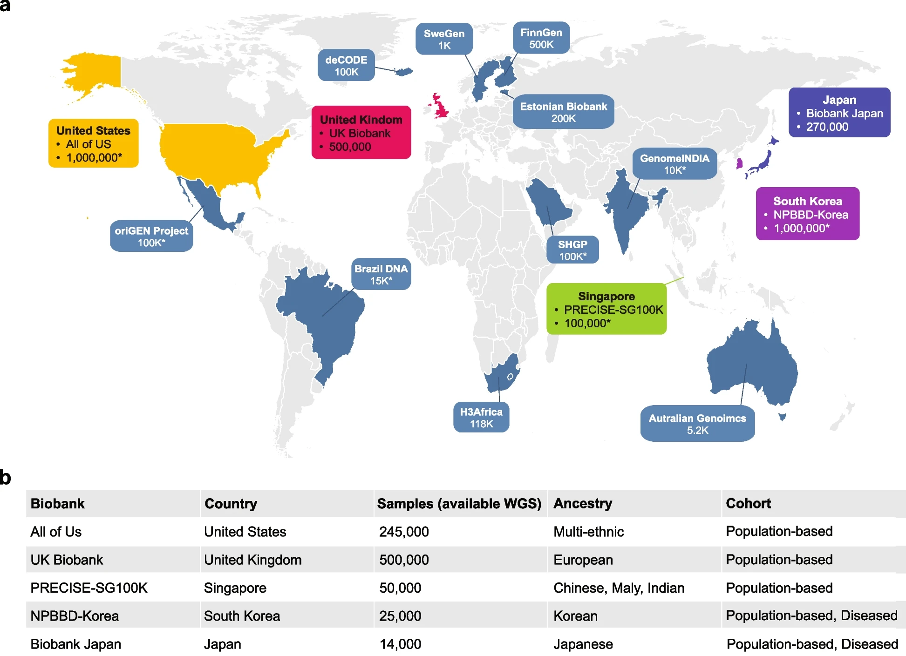
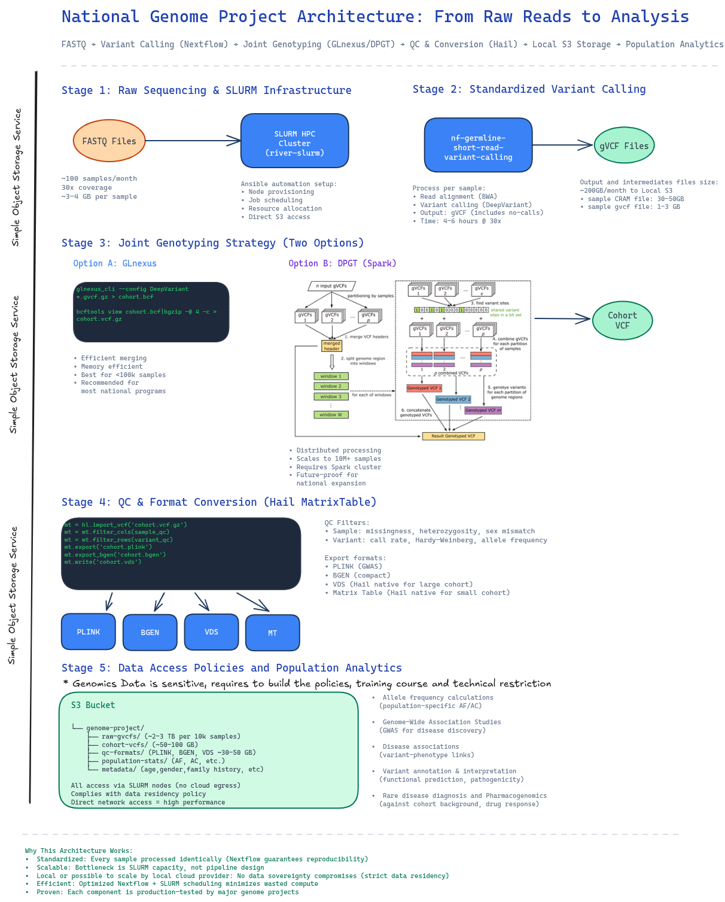
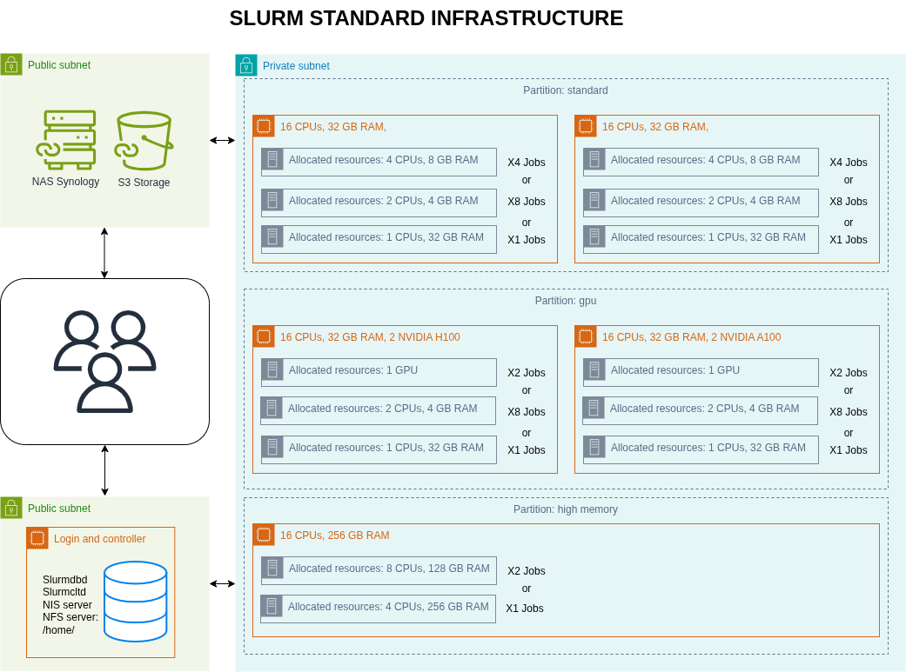
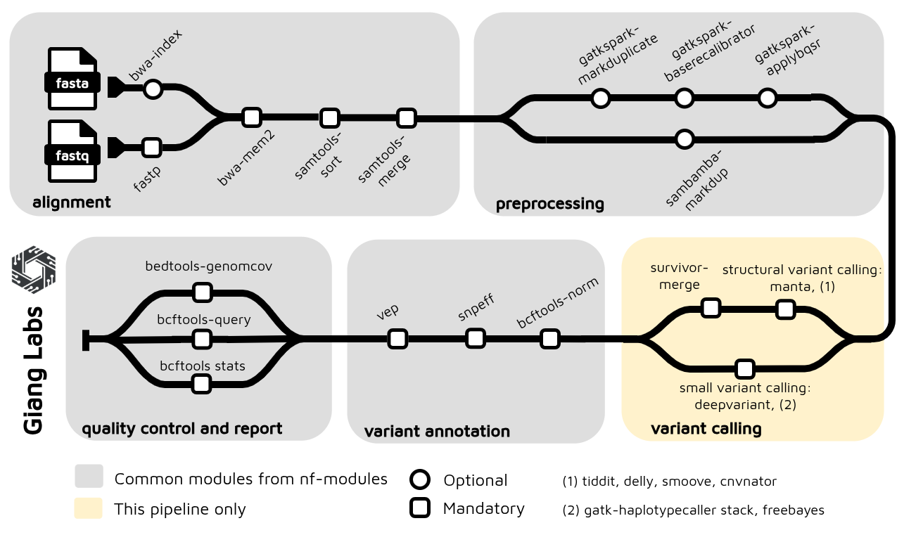
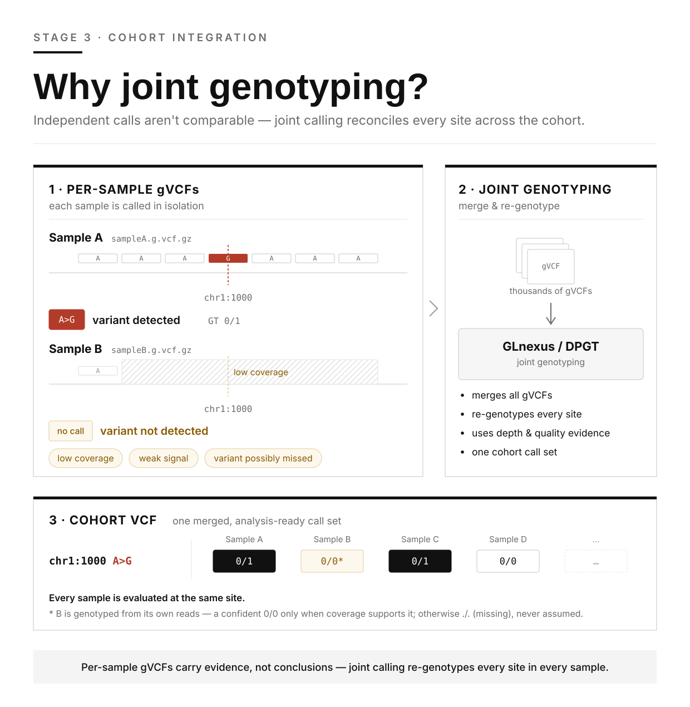

Recent national genome initiatives highlight the growing need for population-specific genomic resources. After reading [**_VN1K: a genome graph-based and function-driven multi-omics and phenomics resource for the Vietnamese population_**](https://www.biorxiv.org/content/10.1101/2025.04.15.648991v1) and [**_EGP1K: Whole-Genome Sequencing of 1,024 Egyptians Characterizes Population Structure and Genetic Diversity_**](https://www.biorxiv.org/content/10.64898/2026.04.02.715521v1), it becomes clear that building a national-scale 1000-genome project is increasingly important for understanding genetic diversity, improving disease research, and enabling precision medicine.

Special credit goes to the VN1K team at the Vingroup Big Data Institute and their collaborators. Building the first comprehensive resource for the Vietnamese population — 1,011 individuals, nearly 40 million variants with 8.5 million of them novel, and multi-omics layers including long-read methylation — came with enormous challenges, from sample collection and high-depth sequencing at scale to multi-omics integration and data accessibility. Their work paved the way for what this series describes.

In this series, I outline how a country can design and implement a project at a similar scale — from sample collection to cohort-level genomic analysis. This discussion focuses on the technical and architectural aspects of building the 1000-genome resource. It does not cover the downstream data platform or user portal for accessing processed data, which will be explored in a separate article.

The goal is to provide a practical, scalable roadmap that countries — especially those with emerging genomics infrastructure — can adapt to their own national genome initiatives.

:::note{title="About the author"}
**Giang Nguyen — Founder @ Vieomics.** During my time at **DNAnexus**, I worked on bioinformatics infrastructure and large-scale genomic data analysis, including workloads involving hundreds of thousands of samples. Here, I'll show how it should be done using **open-source tools only** — validated on real samples, with small datasets for proof of concepts.
:::

## Series Overview

- **Part 1 (This Post)**: Vision and end-to-end architecture
- **[Part 2](/en/blogs/how-can-a-country-build-its-own-1000-genome-project-part-2)**: Design principles and implementation roadmap
- **[Part 3](/en/blogs/how-can-a-country-build-its-own-1000-genome-project-part-3)**: Variant calling, cohort analytics, and data organization
- **[Part 4](/en/blogs/how-can-a-country-build-its-own-1000-genome-project-part-4)**: Infrastructure, talent, and government support: 2018 → 2026
- **[Part 5](/en/blogs/how-can-a-country-build-its-own-1000-genome-project-part-5)**: Summary, extensions, and the questions ahead
## 1. The Vision — Why Countries Need Their Own 1000 Genomes Project

:::info
The original [1000 Genomes Project](https://www.internationalgenome.org/) (2008-2015) was a watershed moment in human genomics—it created the first comprehensive catalog of global genetic variation, providing a reference map that democratized variant calling and population genetics. But here's the catch: that data, while invaluable globally, doesn't fully represent your country's population, healthcare challenges, or genetic landscape.
:::

### 1.1. The Global Reference Isn't Enough

Modern genome analysis relies heavily on population-specific variant frequencies. When you're doing variant interpretation, rare disease diagnosis, or pharmacogenomics, you need to know: _How common is this variant in the population I'm treating?_ The 1000 Genomes Project surveyed ~2,500 individuals across diverse populations, but the genetic variation in your local population—shaped by unique migration histories, founder effects, and evolutionary pressures—may differ significantly.

**Clinical implications are real:**

- A variant marked as "rare" globally might be common in your population
- Disease association studies require local allele frequency data
- Precision medicine strategies must account for population-specific risk alleles
- Rare disease diagnosis becomes more accurate with local context

### 1.2. Sovereignty and Data Ownership

Large-scale genomic projects generate not just data—they generate _infrastructure_, _expertise_, and _economic value_. Countries that build their own projects gain:

- **Data sovereignty**: Complete control over sensitive health data rather than relying on international consortiums
- **Research leadership**: Ability to conduct population-specific studies without external dependencies
- **Economic opportunity**: Local biotech ecosystems can leverage the data for drug discovery and diagnostics
- **Healthcare innovation**: Direct pathway from research insights to clinical practice

### 1.3. Learning from Existing National Programs Led By Government

The good news: many countries have already built or are building large-scale genome projects. Here's what they've taught us:

- **UK Biobank** sequenced 500k+ genomes linked to longitudinal health records, demonstrating how genomic data at scale enables population-wide disease discovery and precision medicine
- **All of Us Research Program** (US) demonstrates how to scale to 1 million+ genomes with data governance and participant engagement
- **Biobank Japan** shows how to integrate genomic data with longitudinal health records for disease association studies
- **Singapore's National Precision Medicine Program** illustrates how population-specific allele frequencies improve diagnosis and treatment in resource-constrained settings
- **China's BGI and national initiatives** showcase infrastructure for processing massive cohorts at scale
- **Australia's Australian Genomics** demonstrates federated governance across multiple institutions and states
- **Others** many more population biobanks are being established to support their own countries: South Korea, Sweden, Finland, and others

These programs share common patterns: they all standardized variant calling, implemented joint genotyping strategies, built cohort-wide analytics layers, and invested heavily in data governance. **The technical blueprint has been demonstrated across these programs—now it's about adapting it to your country's resources, population, and healthcare priorities.**



_Figure 1: Overview of genomic resources in the national biobanks. a Geographical distribution of the biobanks, with the sample numbers representing the total cohort size targeted or achieved by each biobank. Major biobanks possessing large-scale WGS datasets exceeding 10,000 individuals are highlighted. An asterisk (“\*”) indicates the targeted cohort size. b Detailed information on WGS sample sizes, ancestry composition, and health conditions of the respective biobank datasets were recently disclosed_

Reference: https://link.springer.com/article/10.1186/s44342-025-00040-9

### 1.4. Learning from Existing Programs Led By Private Companies

While national and government-funded programs dominate the landscape, private companies and organizations have also built impressive large-scale genomic initiatives. Understanding their approach offers valuable lessons on infrastructure, scaling, and data governance.

**Direct-to-Consumer (DTC) Companies**

- **23andMe** - 15M+ genotyped users with proprietary research database and health insights. Demonstrates consumer engagement at massive scale, though with privacy considerations
- **AncestryDNA** - 20M+ genotyped users focused on ancestry and family connections. Shows how genealogical context drives adoption and participation

**Pharmaceutical & Drug Development**

- **Regeneron Genetics Center (DiscovEHR)** - Exomes of ~50k patients linked to electronic health records. Reference model for pharma-healthcare collaboration; suggests that clinical data integration can increase research value
- **Genentech/Roche** - Built internal genomic databases from clinical trials and partner networks. Focus on precision oncology and rare diseases
- **GSK (GlaxoSmithKline)** - Genomics partnerships acquiring genetic databases for target identification. Demonstrates how pharma funds large-scale infrastructure

**Clinical Genomics & Diagnostic Companies**

- **Invitae** - ~5M genetic testing records (largest clinical genetics lab). Standardized variant calling across millions of diagnostic samples shows how clinical labs maintain quality at scale
- **Tempus** - 10M+ de-identified genomic records with AI-powered analysis. Cancer-focused platform demonstrates the value of unified analytics layers
- **Foundation Medicine (Roche)** - 1.5M+ patient profiles. Precision oncology at scale—shows that focused cohorts can drive clinical impact

**Global Infrastructure & Sequencing**

- **Illumina (US)** - Provides an end-to-end solution for genomics: sequencing devices, the platform around them, and its own tools for analysis at population scale (DRAGEN, Illumina Connected Analytics). Demonstrates how one vendor can own the path from instrument to insight
- **BGI (China)** - Largest sequencing company globally with massive internal database and hospital partnerships. Demonstrates infrastructure and cost efficiency at large scale

**Key Insight from Private Programs:**

Private organizations succeed because they:

1. **Link genomics to actionable outcomes** (diagnosis, treatment, drug discovery)—not just research
2. **Invest heavily in data standardization** (consistent variant calling, annotation pipelines)
3. **Build cloud-native infrastructure** early for scalability
4. **Integrate with clinical workflows** directly, creating network effects

For national programs, the private sector model teaches us that **data utility drives participation**. People contribute samples when they see immediate clinical benefit (diagnosis, health insights) or participate when aligned with personal incentives (ancestry, precision medicine).

### 1.5. The Technical Challenge

Building a 1000 Genomes-scale project requires:

- Thousands of high-quality genome sequences
- Standardized variant calling across all samples
- Unified genotyping across cohorts
- Storage and query infrastructure for tens of terabytes of data
- Population statistics and annotation pipelines
- Governance and ethics frameworks

But here's the key insight from existing programs: **the software, the pipelines, and the infrastructure are mature enough** to make this achievable for any well-resourced national program.

This series walks you through the architecture, design decisions, and implementation strategy for building a national genome project—from variant calling to cohort analytics.

## 2. The Big Picture Architecture

A national genome project is fundamentally a data transformation pipeline: raw sequencing reads → standardized variants → cohort-wide genotypes → research-ready analytics. The architecture must handle massive scale, enforce consistency across thousands of samples, and satisfy strict data governance requirements.

Here's the architecture we'll build around, anchored in real, proven components:



_Figure 2: End-to-end architecture showing data flow from raw sequencing through population analytics, with concrete tools and storage at each stage._

### 2.1. Stage 1: Core Infrastructure with SLURM HPC Cluster

:::tip
**Why SLURM?**

- **Common usage:** it is the most widely adopted scheduler in HPC and bioinformatics, so expertise, documentation, and tooling are readily available — and it scales from dozens to thousands of nodes.
- **Batch processing:** per-sample work — alignment, QC, variant calling — runs as batch jobs distributed across the cluster.
- **Distributed cohort aggregation:** joint genotyping, cohort QC, and population statistics run as distributed jobs on the same cluster, without a separate orchestration layer — a setup that also suits small and medium-sized teams and companies, not only national programs.
- **Spark on SLURM:** where Spark is needed (for example in large-cohort joint genotyping), this series runs [Spark on top of SLURM](https://github.com/vieomics/omicslab-kit/tree/main/spark-on-slurm) instead of a dedicated Spark cluster — a practical trick that removes a whole layer of setup and operations.
- **Right-sized for 1k, with a path beyond:** a 1,000-genome project fits comfortably on a SLURM cluster. For substantially larger cohorts, cloud is the recommended direction — and the same workflows can move there when needed.
- It also integrates easily with domestic cloud and S3 providers.
:::

:::info

- Proof of Concept for Building the Typical SLURM Cluster Bioinformatics Analysis: https://github.com/vieomics/omicslab-hpc
:::

The foundation is a high-performance computing cluster managed by SLURM.



_Figure 3: SLURM HPC cluster and Simple Object Storage S3 architecture_

**Key setup:**

- **Ansible automation**: Use the proven [**omicslab-hpc**](https://github.com/vieomics/omicslab-hpc) Ansible playbook to configure SLURM from scratch
  - Automatic node provisioning and job scheduling
  - Resource allocation policies tuned for bioinformatics workloads
  - Network and storage integration
- **Local compute**: All processing happens on-site, no data egress to cloud
- **Direct S3 access**: SLURM nodes can directly read/write to local/domestic S3 storage

### 2.2. Stage 2: Standardized Variant Calling

:::info

- Proof of Concept for Short Read Germline Variant Calling: https://github.com/vieomics/nf-germline-short-read-variant-calling
- The common modules and subworkflows are developed and maintained with customization at: https://github.com/vieomics/nf-modules
:::

Every genome must go through identical variant calling logic. This is non-negotiable for cohort analyses.

**The pipeline: `nf-germline-short-read-variant-calling`**

- Built on Nextflow for reproducibility and portability
- Carefully benchmarked for accuracy and efficiency
- Benchmarked to compare options for a large-scale variant calling genomics project
- Optimized to run efficiently on SLURM clusters
- Outputs individual gVCF files (genome VCF format—raw variants per sample)

**Why gVCF?** It includes not just called variants, but also "confident no-calls" at each genomic position. This is crucial for joint genotyping later—without it, you lose information about coverage depth and genotype quality.

**Scale:** Processing 100 samples/month at 30x coverage:

- Individual variant calling: ~4-6 hours per genome on a standard node. Faster with GPU for variant calling using DeepVariant
- Parallelizable across SLURM queue



_Figure 4: The nextflow pipeline for short read variant calling using Illumina platform, optimized for 30X WGS. The pipeline is integrated with **nf-modules** where it standardizes to share the common components between pipelines_

### 2.3. Stage 3: Joint Genotyping — Cohort Integration

:::info

- Proof of Concept for Joint Genotyping using GLnexus: https://github.com/vieomics/omicslab-kit/tree/main/glnexus
- Proof of Concept for Joint Genotyping using DPGT: https://github.com/vieomics/omicslab-kit/tree/main/dpgt
- Spark on SLURM that DPGT can submit job to https://github.com/vieomics/omicslab-kit/tree/main/spark-on-slurm
:::

After variant calling, you have thousands of individual gVCF files, each called independently. But independent calling is not enough for population-scale genomics. You must combine them into a cohort VCF using joint variant calling.



_Figure 5: Joint genotyping reconciles per-sample calls. At chr1:1000, Sample A's gVCF records an A>G variant while Sample B records no variant at all — which may reflect low coverage or a signal below the calling threshold rather than true homozygosity. Joint calling re-genotypes every site in every sample using the depth and quality evidence each gVCF carries, producing one cohort VCF with genotypes that are comparable across the whole cohort._

**Four options at a glance**

All four tools take per-sample gVCFs and produce a cohort call set, but they differ in method, license, and — critically — what happens when new samples arrive:

| Tool | Method | Adding new samples | Scale |
| --- | --- | --- | --- |
| **GLnexus** (Apache-2.0) | Joint genotyping | ❌ Full re-run | ~100k samples |
| **DPGT** (GPL-3.0) | Joint genotyping (Spark) | ❌ Full re-run (resumable) | Millions of samples |
| **DRAGEN iGG** — Illumina (proprietary) | Joint genotyping | ✅ Incremental batches | Population cohorts |
| **Hail VDS combiner** (MIT) | Combination only (no re-genotyping) | ✅ Incremental, restartable | 150k+ genomes (gnomAD) |

_Only the first three tools re-genotype every site from gVCF evidence. The Hail VDS combiner merges call sets without revisiting per-sample genotypes, so it cannot improve variant calls the way joint genotyping does._

**Option A: GLnexus (Efficient, Recommended for under 100k samples)**
:::warning

- Joint calling can be run in parallel based on the region of a BED file
- Flanking regions are required mainly because variant representation and normalization can extend beyond the target window, especially for indels and complex variants.
:::

```bash
# GLnexus merges gVCFs into a cohort VCF
glnexus_cli --config DeepVariant_h37 --bed <bed file> *.gvcf.gz > cohort.bcf
bcftools view cohort.bcf -O z > cohort.vcf.gz
```

- Substantially faster than GATK GenotypeGVCFs
- Quality well suited to medium-scale cohorts
- Memory efficient (can run on modest hardware)
- ⚠️ **No incremental mode:** adding a new batch — say 200 samples to an existing 1,000 — means re-running joint genotyping across the whole cohort

**Option B: DPGT with Spark (Open Source, Built for Scale)**

```bash
#!/bin/bash
# DPGT runner for joint genotyping cohort VCF

set -euo pipefail

PROJECT_ROOT="$(cd "$(dirname "${BASH_SOURCE[0]}")/.." && pwd)"
BUILD_LIB_PATH="${PROJECT_ROOT}/build/lib"
DPGT_JAR="${PROJECT_ROOT}/DPGT/target/dpgt-1.3.2.0.jar"

# Defaults (override with env vars if needed)
INPUT_LIST="${INPUT_LIST:-${PROJECT_ROOT}/cohort_vcf/1KGP/gvcf_input.list}"
REFERENCE_FASTA="${REFERENCE_FASTA:-${PROJECT_ROOT}/reference/Homo_sapiens_assembly38.fasta}"
OUTPUT_DIR="${OUTPUT_DIR:-${PROJECT_ROOT}/cohort_vcf/1KGP/results}"
TARGET_REGION="${TARGET_REGION:-chr12:111760000-111763759}"
JOBS="${JOBS:-4}"
ALLOW_OVERWRITE="${ALLOW_OVERWRITE:-0}"

echo "================================"
echo "DPGT Cohort VCF Runner"
echo "================================"
echo ""

# Check prerequisites
echo "Checking prerequisites..."
if [ -z "$DPGT_JAR" ] || [ ! -f "$DPGT_JAR" ]; then
    echo "ERROR: DPGT JAR not found at $DPGT_JAR"
    echo "Run 'make build' to compile DPGT first"
    exit 1
fi

if [ ! -f "$BUILD_LIB_PATH/libcdpgt.so" ]; then
    echo "ERROR: libcdpgt.so not found at $BUILD_LIB_PATH"
    echo "Run 'make build-cpp' to compile C++ libraries"
    exit 1
fi

if [ ! -f "$INPUT_LIST" ]; then
    echo "ERROR: input list not found: $INPUT_LIST"
    echo "Create it with one gVCF path per line (3-sample trio supported)."
    echo "Example existing list: ${PROJECT_ROOT}/gvcf_input.list"
    exit 1
fi

if [ ! -f "$REFERENCE_FASTA" ]; then
    echo "ERROR: reference fasta not found: $REFERENCE_FASTA"
    exit 1
fi

if [ -d "$OUTPUT_DIR" ] && [ "$(ls -A "$OUTPUT_DIR" 2>/dev/null || true)" != "" ]; then
    if [ "$ALLOW_OVERWRITE" = "1" ]; then
        echo "Output exists. Removing: $OUTPUT_DIR"
        rm -rf "$OUTPUT_DIR"
    else
        echo "ERROR: output directory exists and is not empty: $OUTPUT_DIR"
        echo "Set ALLOW_OVERWRITE=1 or choose another OUTPUT_DIR"
        exit 1
    fi
fi

echo "DPGT JAR: $DPGT_JAR"
echo "C++ Library: $BUILD_LIB_PATH/libcdpgt.so"
echo "Input List: $INPUT_LIST"
echo "Reference: $REFERENCE_FASTA"
echo "Output Dir: $OUTPUT_DIR"
echo "Region: $TARGET_REGION"
echo ""
echo "Note: default region is a small smoke-test interval."
echo ""

# Runtime environment
export LD_LIBRARY_PATH="$BUILD_LIB_PATH:${LD_LIBRARY_PATH:-}"

echo "Running DPGT joint genotyping..."
echo ""

# Some environments need explicit local filesystem implementations for Spark/Hadoop
java \
  -Dspark.hadoop.fs.file.impl=org.apache.hadoop.fs.LocalFileSystem \
  -Dspark.hadoop.fs.AbstractFileSystem.file.impl=org.apache.hadoop.fs.local.LocalFs \
  -cp "$DPGT_JAR" \
  org.bgi.flexlab.dpgt.jointcalling.JointCallingSpark \
  -i "$INPUT_LIST" \
  -r "$REFERENCE_FASTA" \
  -o "$OUTPUT_DIR" \
  -j "$JOBS" \
  -l "$TARGET_REGION" \
  --local

echo ""
echo "Run complete."
echo "Output files in: $OUTPUT_DIR"
find "$OUTPUT_DIR" -maxdepth 1 -type f -name "result*.vcf.gz" -print || true
```

- Open source (GPL-3.0) and built on Apache Spark for distributed computing
- Linear scaling with sample count — designed for cohorts up to millions of samples
- Resumes tasks after interruption, so a failure late in a long run doesn't start over
- Requires a Spark cluster (can run on the same SLURM infrastructure)
- ➕ Adding new samples still means a full re-run — DPGT does not support incremental joint calling

**Option C: Illumina DRAGEN Iterative gVCF Genotyper (Proprietary)**

[Illumina's DRAGEN iterative gVCF Genotyper (iGG)](https://help.dragen.illumina.com/dragen-v4.5/product-guides/dragen-v4.5/dragen-dna-pipeline/iterative-gvcf-genotyper) attacks the re-run problem directly: it aggregates gVCFs batch by batch, so adding new samples means running only the new batch through the first step and re-aggregating the cohort census — not redoing the analysis end to end. The trade-offs: it is a **licensed, closed-source feature metered per gigabase** of input, and the input gVCFs must come from the DRAGEN ecosystem.

**Option D: Hail VDS Combiner (Combination Only)**

If you only need to combine call sets — not re-genotype them — Hail's [VariantDatasetCombiner](https://hail.is/docs/0.2/vds/index.html) is the open-source choice: restartable and failure-tolerant, it can incrementally combine GVCFs and existing VDS datasets (gnomAD's 150,000 genomes were built this way). The catch: it **combines** datasets and preserves each sample's existing calls — it does not run a joint re-genotyping pass, so it cannot improve variant quality across samples the way GLnexus, DPGT, or iGG do.

**Output:** A single `cohort.vcf.gz` with all samples and all variants. For a ~1000-sample project, it can reach 200–500 GB (it depends on the diversity of variants and samples)

### 2.4. Stage 4: Cohort QC and Format Conversion (Hail)

:::tip

- Proof of Concept for Hail: https://github.com/vieomics/omicslab-kit/hail
- Hail should be run on the Spark Cluster on the top of SLURM: https://github.com/vieomics/omicslab-kit/spark-on-slurm
:::

The raw cohort VCF isn't analysis-ready. It needs QC and must be converted to efficient formats. QC should be adjusted according to the quality of the ingested data

**Using Hail's MatrixTable:**

```python
# Load cohort VCF into Hail
mt = hl.import_vcf('cohort.vcf.gz')

# Sample-level QC
mt = mt.filter_cols(hl.agg.count_where(mt.GT.is_non_ref()) > 100)

# Variant-level QC
mt = mt.filter_rows(hl.agg.count_where(mt.GT.is_non_ref()) > 0)

# Export to multiple formats for different tools
mt.export('cohort.plink')      # PLINK format for association studies
mt.export_bgen('cohort.bgen')  # BGEN format (more efficient)
mt.write('cohort.vds')         # Hail VDS (best for Hail)
```

**Export formats for different use cases:**

- **PLINK (.bed/.bim/.fam)**: Standard format for GWAS, linkage analysis
- **BGEN**: Compact binary format, efficient for large cohorts
- **VDS (Hail format)**: Native Hail format, fastest for downstream Hail analyses
- **Hail MatrixTable**: In-memory representation for interactive analysis

**QC filtering removes:**

- Samples with excessive missing data
- Samples with unexpected heterozygosity or sex mismatches
- Variants with low call rates or Hardy-Weinberg violations
- Variants with extreme allele frequency outliers

### 2.5. Stage 5: Long-term Data Storage & Access Policies

:::tip
**Data Sovereignty Strategy:** Rather than building on-premises storage infrastructure, partner with a **domestic S3 provider** (cloud or government-backed) for long-term data residency. This keeps data in-country while avoiding large capital investment in storage hardware.
:::

:::info
Nowadays, the data should be accessed via the data platform where users need to:

- Learn and pass the training courses where users are allowed only to use the data for analysis on the controlled platform. They are not allowed to download the data or intermediate data that can reveal/identify personality.
- Not only restrict by policies, the data platform should be able to restrict users according to the data platform architect
:::

**Architecture:**

The system architecture consists of:

- **SLURM Cluster (on-premises)** with direct S3 access via local network peering
- **S3 Bucket (domestic provider)** containing:
  - Raw gVCFs (archived, immutable, 10 years)
  - Cohort VCFs (versioned releases)
  - Cohort MatrixTables (Hail-native)
  - Final analytics formats (PLINK/BGEN/VDS/MT)

**Why this partnership model?**

- **Data sovereignty**: In the deployment described here, genomic data is kept within the selected domestic S3 provider rather than transferred abroad
- **No capital burden**: Pay-as-you-go storage
- **Scalability**: Expand from 10TB to 100TB+ without hardware refresh
- **Performance**: Direct network access from SLURM cluster (local peering, not internet)
- **Compliance**: Meets strict data residency policies and regulatory requirements
- **Integration**: Nextflow, Hail, and SLURM all have native S3 support
- **Longevity**: Partner contract supports data availability beyond project timeline (5-10 years)

**Long-term value:** After the 1k-sample project completes, this S3 infrastructure remains available for future extensions (multi-omics storage, disease cohort data, long-term archival)

:::tip
In [Part 2](/en/blogs/how-can-a-country-build-its-own-1000-genome-project-part-2), we cover the design principles — standardization, region-based parallelization, storage tiers, and federated governance — plus the five-phase implementation roadmap.
:::

## References

### Series repositories

1. **omicslab-hpc** — Ansible automation to build the SLURM HPC cluster. https://github.com/vieomics/omicslab-hpc
2. **nf-germline-short-read-variant-calling** — standardized short-read germline variant-calling pipeline. https://github.com/vieomics/nf-germline-short-read-variant-calling
3. **nf-modules** — Nextflow modules and subworkflows shared across the series pipelines. https://github.com/vieomics/nf-modules
4. **omicslab-kit** — gkit proof-of-concept implementations (GLnexus, DPGT, Spark-on-SLURM, Hail). https://github.com/vieomics/omicslab-kit

### Sources and further reading

5. **VN1K (2025)** — VN1K: a genome graph-based and function-driven multi-omics and phenomics resource for the Vietnamese population (bioRxiv). https://www.biorxiv.org/content/10.1101/2025.04.15.648991v1
6. **EGP1K (2026)** — Whole-Genome Sequencing of 1,024 Egyptians Characterizes Population Structure and Genetic Diversity (bioRxiv). https://www.biorxiv.org/content/10.64898/2026.04.02.715521v1
7. **1000 Genomes Project** — international reference for human genetic variation. https://www.internationalgenome.org/
8. **Lee et al. (2025)** — Lessons from national biobank projects utilizing whole-genome sequencing for population-scale genomics (Genomics & Informatics). https://link.springer.com/article/10.1186/s44342-025-00040-9
9. **GLnexus joint genotyping (PoC)** — https://github.com/vieomics/omicslab-kit/tree/main/glnexus
10. **DPGT joint genotyping (PoC)** — https://github.com/vieomics/omicslab-kit/tree/main/dpgt
11. **Spark on SLURM (PoC)** — https://github.com/vieomics/omicslab-kit/tree/main/spark-on-slurm
12. **Hail cohort QC (PoC)** — https://github.com/vieomics/omicslab-kit/hail
13. **DPGT (2026)** — "DPGT: A spark based high-performance joint variant calling tool for large cohort sequencing" (bioRxiv). https://www.biorxiv.org/content/10.64898/2026.03.02.709184v1
14. **Illumina DRAGEN iterative gVCF Genotyper** — population genotyping with incremental batch aggregation (licensed feature). https://help.dragen.illumina.com/dragen-v4.5/product-guides/dragen-v4.5/dragen-dna-pipeline/iterative-gvcf-genotyper
15. **Hail VariantDatasetCombiner** — restartable, failure-tolerant combination of GVCFs and Variant Datasets. https://hail.is/docs/0.2/vds/index.html

_This is Part 1 of the series on building a national 1000-genome project. Continue to [Part 2](/en/blogs/how-can-a-country-build-its-own-1000-genome-project-part-2) for the design principles and roadmap._
