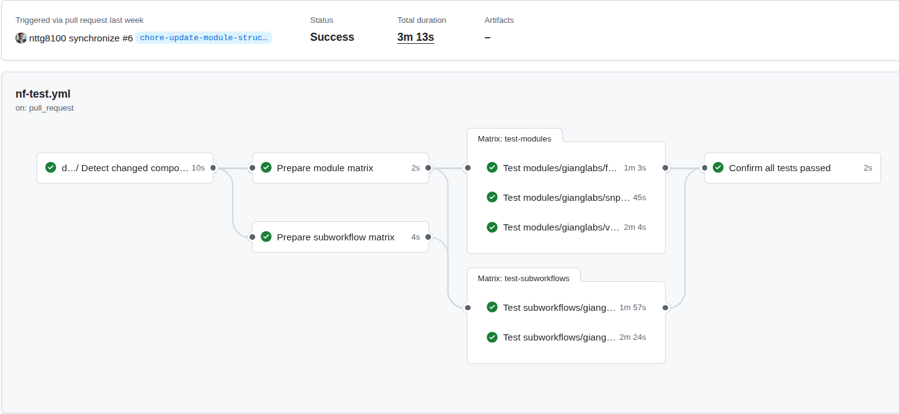
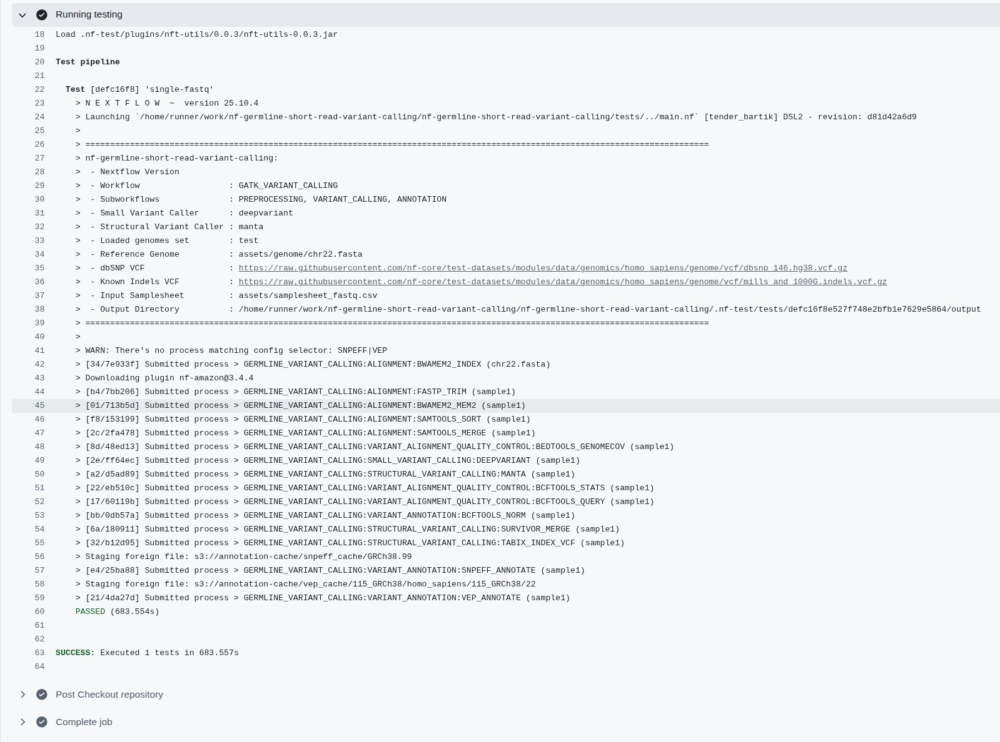
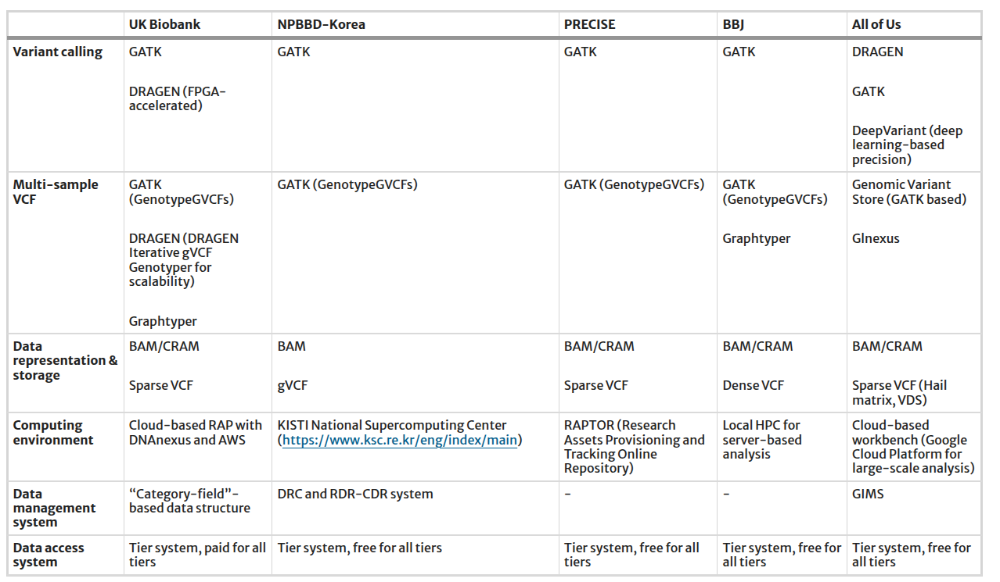
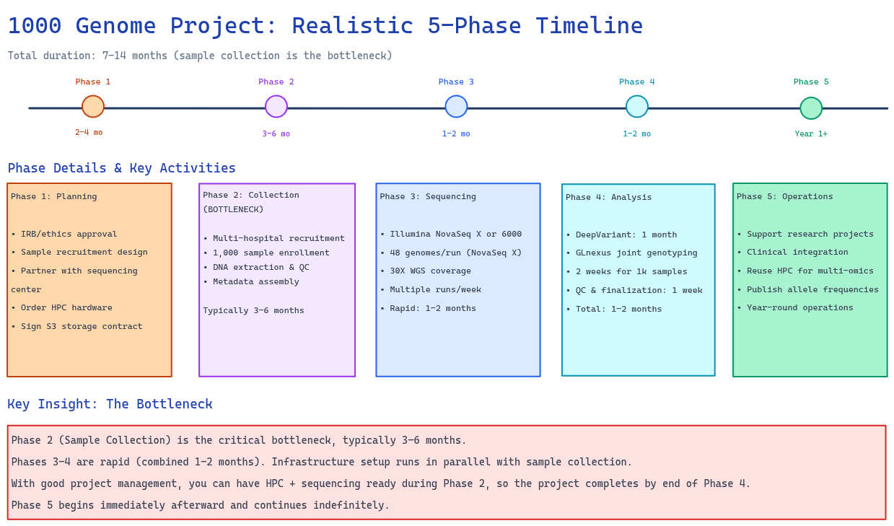
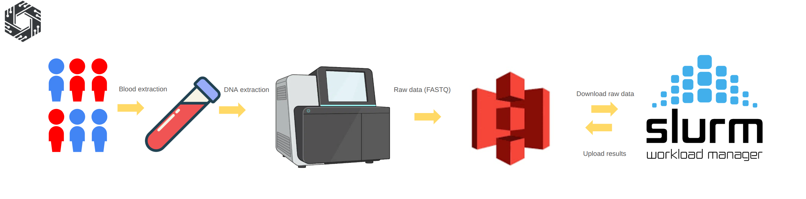

In [Part 1](/en/blogs/how-can-a-country-build-its-own-1000-genome-project-part-1), we covered why countries need their own genome project and the end-to-end architecture from raw sequencing to cohort VCFs. This part covers the design principles that keep everything standardized, scalable, and governed — plus a realistic five-phase implementation roadmap.

## Series Overview

- **[Part 1](/en/blogs/how-can-a-country-build-its-own-1000-genome-project-part-1)**: Vision and end-to-end architecture
- **Part 2 (This Post)**: Design principles and implementation roadmap
- **[Part 3](/en/blogs/how-can-a-country-build-its-own-1000-genome-project-part-3)**: Variant calling, cohort analytics, and data organization
- **[Part 4](/en/blogs/how-can-a-country-build-its-own-1000-genome-project-part-4)**: Infrastructure, talent, and government support: 2018 → 2026
- **[Part 5](/en/blogs/how-can-a-country-build-its-own-1000-genome-project-part-5)**: Summary, extensions, and the questions ahead
## 1. Design Principles

### 1.1. Standardization as the Foundation

:::warning
Without CI/CD integration, "standardization" is just a claim, not a guarantee.

- No CI/CD = manual testing = inconsistent results across developers/environments
- With CI/CD = automated testing = identical results every time, on HPC or Cloud
:::

Every sample must go through identical processing—this is non-negotiable for population-scale analyses.

**Why standardization matters:**

- **Reproducibility**: Same input data + same pipeline = same results every time
- **Quality assurance**: Systematic issues caught early and applied uniformly across all samples
- **Cross-cohort comparisons**: Different batches and timepoints can be compared without systematic bias
- **Joint analyses**: Cohort-wide statistics are only valid when all samples processed identically

**Implementation:**

- Use Nextflow for pipeline versioning and reproducibility
- gVCF format enforces standardized output across all samples
- Version control (Github, Gitlab, Gitea, etc): Track pipeline versions, reference genome versions, annotation database versions



_Figure 1: CI/CD for nf-modules, showing how common patterns (modules, subworkflows) stay identical, reproducible, and reusable across multiple pipelines._



_Figure 2: CI/CD for nf-germline-short-read-variant-calling — identical inputs produce identical outputs, and the workflows can be deployed on HPC or cloud._

### 1.2. Scalability Through Region-Based Parallelization

**Joint variant calling works on the entire cohort simultaneously, not sample-by-sample.** The key to scaling is splitting the genome into smaller, independent regions (windows) and processing all samples together within each region in parallel.

**The Parallelization Strategy:**

1. **All samples in each region**: For region 1, call variants across ALL samples simultaneously; for region 2, call variants across ALL samples; etc.
2. **Region-based parallelization**: Each genomic region runs on a separate SLURM job, enabling horizontal scaling
3. **Failure isolation**: If one region fails, you only re-run that region—not the entire genome for all samples

**Bed File Strategy (Chromosome-Based with Intervals):**

**For small-to-medium cohorts (under 10k samples):** Use simple chromosome-based BED files (one per chromosome):

- chr1.bed covering chr1:1-248956422
- chr2.bed covering chr2:1-242193529
- ... and so on for all 22 autosomes
- chrX.bed and chrY.bed for sex chromosomes

**For large cohorts (>10k samples):** Split each chromosome into 100kb intervals for finer-grained parallelization:

- chr1_region_1.bed: chr1:1-100000
- chr1_region_2.bed: chr1:100001-200000
- chr1_region_3.bed: chr1:200001-300000
- ... continuing across all chromosomes with thousands of regions

**Why this interval-based approach scales:**

- **Memory efficiency**: Each region holds only ~100kb of genomic data per sample, not entire chromosomes
- **Job parallelization**: 22 chromosomes × 24,000 intervals = 528,000 potential SLURM jobs (realistic for 50k+ sample cohorts)
- **Failure recovery**: Failed region only requires re-running 100kb interval, not entire chromosome
- **SLURM queue optimization**: Small jobs (100kb regions) fit better into queue scheduling than large jobs

**Example workflow with GLnexus (chromosome-based for \<10k):**

```bash
# For each chromosome in parallel:
glnexus_cli --config DeepVariant_h37 \
  --bed chr1.bed \
  sample1.gvcf.gz sample2.gvcf.gz ... sampleN.gvcf.gz \
  > cohort_chr1.bcf

# For chr2, chr3, etc. (run in parallel across SLURM cluster)

# Merge all chromosomal BCF files
bcftools concat cohort_chr*.bcf -O z > cohort.vcf.gz
```

**Example for large cohorts (interval-based for >10k):**

```bash
# For each 100kb interval in parallel:
glnexus_cli --config DeepVariant_h37 \
  --bed chr1_region_1.bed \
  sample1.gvcf.gz sample2.gvcf.gz ... sample10000.gvcf.gz \
  > cohort_chr1_region_1.bcf

# Across all regions simultaneously (SLURM schedules thousands of jobs)

# Final merge (can be done hierarchically: chr1 regions → chr1.bcf, then merge all chr*.bcf)
bcftools concat cohort_chr*_region_*.bcf -O z > cohort.vcf.gz
```

**Why this is fundamentally different from:**

- ❌ Single-sample variant calling: Cannot be used for joint genotyping (loses population information)
- ❌ Whole-genome per-cohort in one job: No parallelization, no failure recovery, memory explosion at scale
- **Region-based cohort calling**: Scales linearly, fails gracefully, maximizes SLURM parallelization

### 1.3. Data Storage and Sharing

For data storage, standardize on storing only the data that is needed:

- Data should be stored and access should be granted with the appropriate permissions.
- BAM/CRAM files should be kept in a form that can be restored to the original format (FASTQ), while saving storage and remaining usable as inputs for tools that extract more information from the data.
- Hail MatrixTable, VDS, PLINK, and BGEN are pre-processed, high-quality data ready for analysis.
- Users do not need to re-ingest data, repeating the pre-processing and quality-control steps.



_Table 1: Pipelines and bioinformatics tools utilized in genomic resources in the national biobank_

Reference: https://link.springer.com/article/10.1186/s44342-025-00040-9

Don't just store raw data; design storage tiers for downstream analysis from the start.

**Three-Tier Storage:**

| Tier          | Format           | Purpose                                       | Size (10k samples) |
| ------------- | ---------------- | --------------------------------------------- | ------------------ |
| **Raw**       | gVCF             | Source data, immutable, archival              | 2-3 TB             |
| **Processed** | Cohort VCF       | QC baseline, joint-called, version-controlled | 50-100 GB          |
| **Analytics** | PLINK, BGEN, VDS | Analysis-ready, indexed, compressed           | 30-50 GB           |

_Table 2: Three-tier storage architecture for genome project data_

**Analytics formats enable different use cases:**

- **PLINK**: GWAS, linkage analysis, PCA (de facto standard in genetics)
- **BGEN**: Compact binary format, excellent for large-scale population studies
- **VDS (Hail)**: Columnar format, best for Hail analytics and machine learning pipelines

### 1.4. Federated Governance and Multi-Institutional Collaboration

Most national genomic projects involve multiple hospitals, universities, and research centers contributing samples.

**Federated Model:**

- Each institution contributes samples independently
- Central joint genotyping ensures consistency: all samples called together, not separately per institution
- Shared infrastructure: multiple SLURM clusters and S3 storage, with a centralized data analytics platform

**Privacy-Preserving Architecture:**

- Raw data: restricted access (only institution that contributed it)
- QC'd cohort data: institutional researchers + project leadership
- Aggregated statistics (allele frequencies, QC metrics): publicly shared (no individual-level data)
- Compute-to-data: Analysis runs on the secure cluster; results exported, not raw data

**Role-Based Access Control:**

```
Raw gVCF data
  ├─ Accessible to: Original institution + data stewards
  └─ Access: read-only, audit-logged

Cohort VCF (QC'd)
  ├─ Accessible to: Project researchers
  └─ Access: for analysis with ethics approval

Public allele frequencies
  ├─ Accessible to: General public
  └─ Download from website
```

This design principle enables nations to collaborate across institutions while maintaining strict data governance and participant privacy.

## 2. Infrastructure Layer & Implementation Roadmap

Building a national genome project requires careful sequencing of phases. This section outlines both the infrastructure requirements and a realistic implementation timeline.

### 2.1. Infrastructure Requirements Overview

A national genome project infrastructure stack consists of three core layers:

| Layer         | Component      | Technology                  | Purpose                                      |
| ------------- | -------------- | --------------------------- | -------------------------------------------- |
| **Compute**   | HPC Cluster    | SLURM + compute nodes       | Variant calling, joint genotyping, analytics |
| **Storage**   | Object Storage | S3-compatible (on-premises) | gVCFs, VCFs, analytics formats               |
| **Analytics** | Data Platform  | Hail, Python, Spark         | Population statistics, GWAS, QC              |

_Table 3: Core infrastructure layers for national genome project_



_Figure 3: Realistic 6–12 month implementation roadmap showing all five phases. Key insight: Phase 2 (Sample Collection) is the bottleneck (3–6 months). Phase 3 (Sequencing) and Phase 4 (Variant Calling + QC) are rapid (1–2 months each). Infrastructure setup runs in parallel with sample collection._

### 2.2. Phase 1: Planning & Ethics (2–4 months)

**Goals:**

- Secure institutional approvals (IRB/ethics)
- Design sample recruitment strategy
- Establish sequencing partnerships
- Begin infrastructure procurement

**Timeline:**

- IRB/ethics approval: 1–2 months
- Sample recruitment design & partnership agreements: 1–2 months
- Parallel: Order HPC hardware and establish S3 partnership contracts

**Outcomes at End of Phase 1:**

- IRB/ethics approval obtained
- Recruitment strategy finalized
- Sequencing capacity confirmed (partner with sequencing center or in-house)
- HPC hardware ordered (delivery 4–8 weeks)
- S3 partnership contract signed

---

### 2.3. Phase 2: Sample Collection (3–6 months)

**Goals:**

- Recruit and enroll 1,000 participants
- Perform DNA extraction
- Establish data governance protocols

**Timeline:**

- Multi-hospital recruitment: 3–6 months (usually the slowest phase)
- DNA extraction & quality control: Parallel to recruitment
- Cohort metadata assembly: Concurrent

**Key Challenge:** Sample collection is typically the bottleneck. Plan for:

- Hospital coordination across multiple sites
- Participant compliance and scheduling
- DNA quality control (ensure >95% pass-through)
- Metadata standardization

**Outcomes at End of Phase 2:**

- 1,000 samples collected, extracted, and QC'd
- Metadata database established
- Samples ready for sequencing

---

### 2.4. Phase 3: Sequencing (1–2 months)



_Figure 4: Sequencing procedure: Blood samples are collected from participants and genomic DNA is extracted using standard laboratory protocols. The DNA is then prepared for sequencing and processed on high-throughput platforms, generating raw sequencing data in FASTQ format. The raw data is uploaded to object storage such as Amazon S3 or an S3-compatible partner. The HPC system downloads the data from S3, performs alignment and variant calling, and uploads the processed outputs back to S3 for long-term storage and downstream population analysis._

**Goals:**

- Sequence all 1,000 samples at 30X WGS depth
- Deliver FASTQ files to HPC cluster
- Begin variant calling immediately as data arrives

**HPC Cluster Setup (Parallel to Sequencing):**

Reference: [omicslab-hpc Ansible playbook](https://github.com/vieomics/omicslab-hpc)

**Minimum viable cluster:**

- 1 head node (Slurm controller, login node)
- 4-8 compute nodes (2-socket, 32-64 CPU each)
- 100TB local SSD for scratch space
- 1Gbps network connectivity

**Optional enhancement (for faster variant calling):**

- 2 GPU nodes with NVIDIA GPU (for DeepVariant acceleration)
  - Reduces per-sample variant calling from 4-6 hours (CPU-only) to 1-2 hours per sample
  - Optional optimization (not required for 1k-sample target)

**Using Ansible for Infrastructure Automation:**

```bash
# Deploy entire SLURM cluster from scratch
ansible-playbook -i inventory.ini cluster_slurm.yml

# Validates:
- 1. All nodes can submit/run jobs
- 2. Job scheduling policies working
- 3. Network connectivity stable
```

**Domestic S3 Storage Partnership (Initiated)**

:::tip

- Industry-standard storage: Object storage such as Amazon S3, Google Cloud Storage, or Azure Blob Storage or Local compatible S3 provider is widely used across industries, ensuring scalability, compatibility, and long-term sustainability beyond bioinformatics use cases.
- High availability requires dedicated expertise: Population genomics projects generate hundreds of TB to PB-scale data. Maintaining high availability, throughput, backup, and security requires a dedicated infrastructure team, which increases operational complexity.
- Reduced operational cost and complexity: Partnering with an S3 provider shifts infrastructure management to experienced teams, reducing maintenance overhead and allowing the project to focus on analysis and scientific outcomes.
:::

Using the external S3 provider is a feasible approach

Options:

1. Commercial domestic cloud provider (with local data residency)
2. Government-backed infrastructure (if available in your country)
3. Academic cloud partnership (university data center)

Key requirements:

- Data never leaves the country (sovereignty requirement)
- On-premise SLURM nodes have direct network access (low latency)
- Contract negotiated for 5-10 year commitment
- Scalable from this project while opening the possibility to extend the storage volume

**Quality Control For Raw Data**

After sequencing, the raw FASTQ data should undergo quality control to ensure it is suitable for downstream analysis. This step typically includes checking sequencing quality scores, read length distribution, GC content, adapter contamination, and duplication levels using tools such as FastQC and MultiQC.

Samples that do not meet quality thresholds may require re-sequencing or additional preprocessing such as adapter trimming and filtering. Performing quality control at this stage ensures that the data is reliable and ready for subsequent alignment and variant calling steps.

**Outcomes at End of Phase 3:**

- All 1,000 samples sequenced (FASTQ files delivered)
- FASTQ files transferred to HPC cluster and archived in S3
- Ready for variant calling in Phase 4

---

### 2.5. Phase 4: Variant Calling + QC (1–2 months)

**Goals:**

- Call variants on all 1,000 samples using DeepVariant
- Perform joint genotyping with GLnexus
- Complete cohort QC and finalization

**Variant Calling Pipeline (Parallel to Sequencing):**

Deploy [nf-germline-short-read-variant-calling](https://github.com/vieomics/nf-germline-short-read-variant-calling)

Using DeepVariant for high-accuracy variant calling:

- Per-sample variant calling: 4-6 hours (CPU-only)
  1-2 hours (with GPU acceleration)
- Chromosome-based parallelization: 22 concurrent jobs

Timeline for 1,000 samples:

- With 4-8 CPU nodes: ~1-2 weeks for all gVCF generation
- With optional 2 GPU nodes: ~1 week for all gVCF generation

**Joint Genotyping:**

GLnexus performs joint genotyping by:

- Combining all 1,000 gVCFs into a cohort VCF
- Using chromosome-based processing with 22 parallel jobs
- Completing in 2–5 days (depending on variant density)
- Producing a single cohort VCF with all variants

**QC + Cohort Assembly:**

After joint genotyping, perform quality control checks:

- Sample-level QC: contamination, depth, relatedness
- Variant-level QC: allele frequency distribution, Hardy-Weinberg equilibrium
- Population structure analysis: PCA
- Prepare final release cohort VCF

Timeline: approximately 1 week for QC and finalization

**Total Phase 4 Duration: 1–2 months**

- Variant calling: 1–2 weeks
- Joint genotyping: 2–5 days
- QC & finalization: 1 week
- **Combined: 1–2 months total**

**Outcomes at End of Phase 4:**

- All 1,000 samples processed through variant calling
- 1,000 high-quality gVCF files generated
- Cohort VCF finalized (joint genotyping complete)
- Population-level QC passed
- Ready for analytics and research

---

### 2.6. Phase 5: Operations & Research Enablement (Year 1+)

**Goals:**

- Establish steady-state operations
- Enable population-level research
- Support clinical diagnostics and precision medicine

**Infrastructure Maturity:**

- Maintain 4-8 compute nodes (core infrastructure)
- Optional 2 GPU nodes for accelerated variant calling

Key Reuse Opportunity:
This infrastructure was built for 1k-genome analysis, but can be repurposed:

- Multi-omics processing (proteomics, metabolomics, RNA-seq)
- Rare disease interpretation pipelines
- Clinical genomics workflows
- Advanced bioinformatics research platform

Capacity at 1k-sample scale:

- GWAS analyses: minutes to hours
- Variant annotation pipelines: hours
- Population statistics: minutes
- Spare capacity: available for other research

**Analytics Platform:**
Hail MatrixTable (for population analytics):

- All 1,000 samples + variants in single analysis object
- Per-sample QC: compute ancestry, relatedness, sample-specific statistics
- Per-variant QC: allele frequency distribution, population structure
- Rapid queries: filter by allele frequency, population, phenotype

Research enablement:

- Export to PLINK for GWAS
- Export to BGEN for imputation studies
- Direct analysis via Hail Batch for distributed computing

**Data Access & Governance:**
Domestic S3 Storage (Long-term):

- Established contract: 5-10 year commitment
- Data residency: All data stays in-country
- Pay-as-you-grow model: ~$0.02-0.05/GB/month
- Direct SLURM access: low-latency queries

Data access policies:

- Researchers access data via controlled analytics platform
- Training required before data access
- Audit trails for all data access
- No raw data downloads (aggregate statistics only)

**Outcomes at End of Phase 5:**

- Production-grade operations established
- Research projects supported
- Clinical integration pathways clear
- Infrastructure reusable for future projects

---

### 2.7. Overall Timeline Summary

**Total Project Duration: 6–12 months** (realistic range accounting for sample collection bottleneck)

| Phase       | Activity                         | Duration   | Bottleneck                     |
| ----------- | -------------------------------- | ---------- | ------------------------------ |
| **Phase 1** | Planning & Ethics                | 2–4 months | IRB approval                   |
| **Phase 2** | Sample Collection                | 3–6 months | **Multi-hospital recruitment** |
| **Phase 3** | Sequencing                       | 1–2 months | Sample delivery speed          |
| **Phase 4** | Variant Calling + QC             | 1–2 months | Computational throughput       |
| **Phase 5** | Operations & Research Enablement | Year 1+    | Ongoing                        |

_Table 4: Project timeline summary with phase durations and bottlenecks_

**Key Insight:** The critical path is **Phase 2 (Sample Collection)**, which typically takes 3-6 months. Phases 3 and 4 are rapid (1–2 months each). Infrastructure (Phase 1 planning and Phase 3 implementation) runs in parallel with sample collection.

---

### 2.8. Critical Success Factors

**Technical:**

- Robust variant calling (validated benchmarking)
- Reliable joint genotyping (tested thoroughly)
- Automated QC (catches errors before publication)
- CI/CD integration (ensures reproducibility)

**Organizational:**

- Dedicated team (at least 2-3 full-time staff, stable)
- Clear governance (who decides on data access, pipeline changes)
- Institutional buy-in (hospital systems, university commitment)
- Sustainable funding (multi-year commitment, not grant-dependent)

**Strategic:**

- Population engagement (transparent about data use)
- Research partnerships (early collaboration with universities)
- Clinical integration (demonstrate direct patient benefit)
- International standards (align with 1000 Genomes, GA4GH, etc.)

### 2.9. Risk Mitigation & Contingencies

**Risk: Pipeline bugs causing systematic errors in 1k samples**

- Mitigation: Comprehensive CI/CD testing; region-based processing with checkpoints; ability to re-run any region

**Risk: Data loss or corruption**

- Mitigation: Multi-site backup; immutable gVCFs archived; version control on all code/configs

**Risk: Key staff turnover**

- Mitigation: Documentation, runbooks, training; knowledge transfer; open-source code (no vendor lock-in)

**Risk: Regulatory changes affecting data sharing**

- Mitigation: Privacy-by-design (local storage, role-based access); clear consent forms; regular legal review

**Risk: Funding interruption**

- Mitigation: Demonstrate research value early; publish results; engage stakeholders; seek multi-year commitments

:::tip
In [Part 3](/en/blogs/how-can-a-country-build-its-own-1000-genome-project-part-3), we start with variant calling and joint genotyping, then go deep into the Hail cohort analytics layer and the storage architecture.
:::

## References

### Series repositories

1. **omicslab-hpc** — Ansible automation to build the SLURM HPC cluster. https://github.com/vieomics/omicslab-hpc
2. **nf-germline-short-read-variant-calling** — standardized short-read germline variant-calling pipeline. https://github.com/vieomics/nf-germline-short-read-variant-calling
3. **nf-modules** — Nextflow modules and subworkflows shared across the series pipelines. https://github.com/vieomics/nf-modules
4. **omicslab-kit** — gkit proof-of-concept implementations (GLnexus, DPGT, Spark-on-SLURM, Hail). https://github.com/vieomics/omicslab-kit

### Sources and further reading

5. **Lee et al. (2025)** — Lessons from national biobank projects utilizing whole-genome sequencing for population-scale genomics (Genomics & Informatics). https://link.springer.com/article/10.1186/s44342-025-00040-9
6. **GLnexus** — efficient joint genotyping of gVCFs into cohort call sets. https://github.com/dnanexus-rnd/GLnexus
7. **DeepVariant** — deep-learning variant caller used in the pipeline examples. https://github.com/google/deepvariant
8. **Nextflow** — workflow engine behind the series pipelines. https://www.nextflow.io/
9. **Hail** — platform for population-scale genetic analysis. https://hail.is/

_This is Part 2 of the series. Continue to [Part 3](/en/blogs/how-can-a-country-build-its-own-1000-genome-project-part-3) for cohort analytics and data organization._
