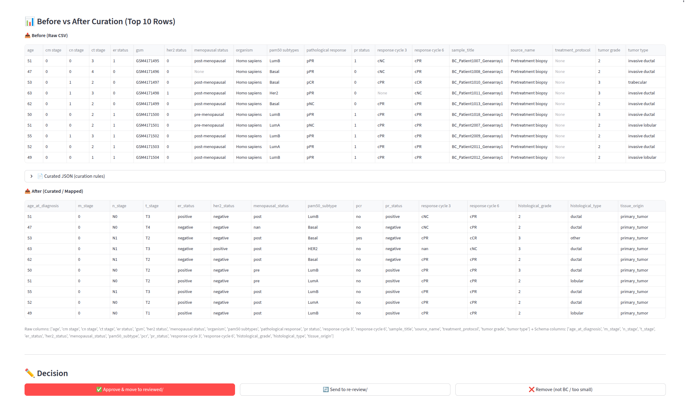
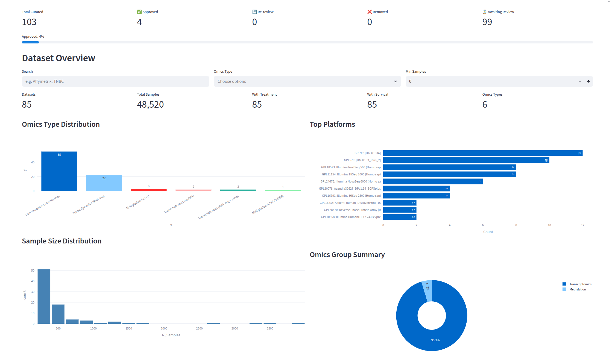
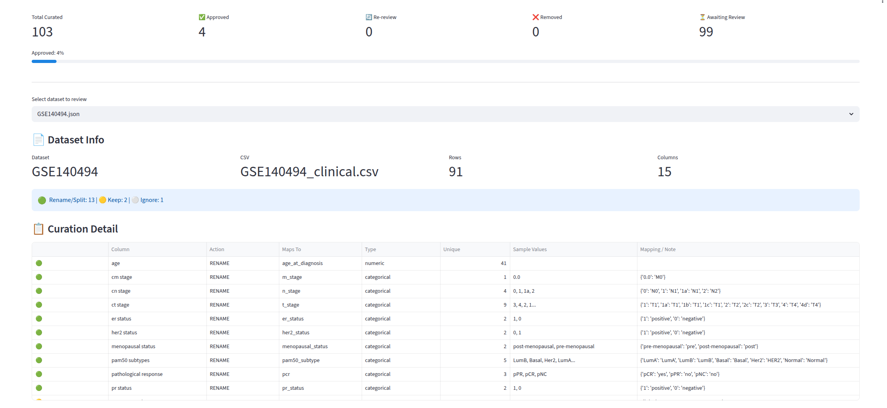
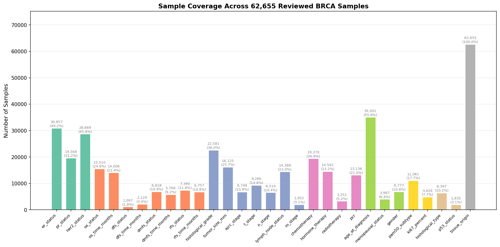

## Key Takeaways

- **The problem.** NCBI GEO holds 8M+ samples with inconsistent clinical metadata. Manual curation does not scale, and full AI curation is not reliable enough on its own for complex clinical variables.
- **The solution.** A config-driven, five-stage pipeline that filters, fetches, auto-curates, harmonizes, and summarizes GEO datasets into standardized cancer cohorts.
- **Case study.** [BRCA-mini](https://github.com/vieomics/omicslab-datasets/tree/main/cohorts/BRCA-mini) — 785 breast cancer GSE accessions filtered from GEO and harmonized against a YAML schema covering receptor status, survival endpoints, treatment, and tumor characteristics.
- **Stack.** OmicIDX Parquet backend, DuckDB queries, LLM auto-curation (DeepSeek v4 flash), and a Streamlit review UI.
- **Reusable.** The same generic pipeline is designed to work across other cancer types — only the cohort-specific regex patterns and the YAML schema change.

---

Public omics repositories like [NCBI GEO](https://www.ncbi.nlm.nih.gov/geo/) hold millions of datasets with rich clinical annotations, but leveraging this data for large-scale cancer genomics meta-analysis is still hard. Three persistent problems stand in the way:

- **Inconsistent metadata.** The same clinical variable is encoded differently across studies — `er_status`, `ER Status`, `estrogen_receptor`, and `ER_IHC` all refer to the same estrogen receptor status.
- **Noisy annotations.** Studies mix clinical, technical, and administrative metadata in unstructured formats that are hard to parse programmatically.
- **Scale mismatch.** GEO hosts 8M+ samples across thousands of studies. Manual curation does not scale, and fully automated AI curation is not yet reliable enough for complex clinical variables.

In this post we walk through a config-driven pipeline that helps address these problems for cancer genomics cohorts, using breast cancer (BRCA-mini) as a worked example.

## Architecture


The pipeline operates in five stages, cleanly separating **cohort-specific logic** (regex patterns, schema YAML) from **generic, reusable tooling** (fetchers, harmonizer, review UI):

:::info
The full implementation is open source: [omicslab-datasets on GitHub](https://github.com/vieomics/omicslab-datasets/tree/main/cohorts/BRCA-mini).
:::

### Stage 1: Dataset Filtering

The entry point is a cohort-specific Python script that queries OmicIDX Parquet files via DuckDB to identify relevant GEO studies. For BRCA-mini, it filters for:

- Studies matching breast cancer regex patterns (BRCA, TNBC, mammary carcinoma, etc.)
- Human samples with at least 200 patients per study
- Both treatment and survival keywords in the study description
- Excludes cell-line, xenograft, and in vitro models

The regex sets are cohort-specific and live next to the script (`cohorts/BRCA-mini/scripts/filtering_datasets.py`). An abridged view:

```python
# cohorts/BRCA-mini/scripts/filtering_datasets.py
BREAST_CANCER_RE = (
    r"breast\s?cancer|breast\s?carcinoma|breast\s?tumou?r"
    r"|mammary\s?cancer|mammary\s?carcinoma"
    r"|triple.negative\s?breast|invasive\s?breast"
    r"|ductal\s?carcinoma|lobular\s?carcinoma"
    r"|TNBC|BRCA.mutant|BRCA1|BRCA2"
)

TREATMENT_RE = (
    r"treatment|chemotherapy|adjuvant|neoadjuvant"
    r"|tamoxifen|trastuzumab|radiotherapy"
    r"|hormone\s?therapy|aromatase\s?inhibitor"
    r"|pembrolizumab|immunotherapy"
)

SURVIVAL_RE = (
    r"survival|outcome|prognosis|recurrence"
    r"|overall\s?survival|disease\s?free"
    r"|kaplan\s?meier|cox\s?regression|hazard\s?ratio"
    r"|death|mortality|relapse|metastasis"
)
```

The full sets (with around 30 drug names, 20 survival terms, and 40 cell-line patterns) are combined into a single DuckDB query that joins `geo_series` and `geo_samples` Parquet files. The query returns 785 GSE accessions written to `gse_ids.txt`.

### Stage 2: Metadata Fetching

:::tip
Filtering on a single platform helps harmonize the datasets into a coherent cohort by reducing technical batch effects.
:::

Two generic scripts consume the filtered GSE list and pull raw clinical data:

**`fetch_platforms.py`** — Resolves platform accession, technology, and manufacturer for each GSE from the OmicIDX Parquet store. Outputs `gse_platforms.csv` with platform frequency summaries across the cohort. Also supports optional platform-based filtering via `--platform-ids` (comma-separated GPL accessions) or `--platform-pattern` (regex matching platform title), writing a filtered `gse_ids_filtered.txt`.

**`fetch_clinical.py`** — Downloads raw clinical metadata for all GSM samples in each GSE, writing per-study CSV files (`<GSE>_clinical.csv`). Uses DuckDB's HTTPFS extension to query remote Parquet files directly without local downloads.

### Stage 3: LLM Curation

:::info
The LLM auto-curator is not yet published on the repository.
:::

Curation transforms raw, inconsistent column names and values into a standardized format. The pipeline supports two paths:

- **LLM Auto-Curation** using DeepSeek v4 flash — the model reads each dataset's column dictionary and proposes a column mapping against the cohort schema.
- **Manual Curation** via the Streamlit review UI in Stage 4 — humans approve, reject, or edit the LLM's proposals.



### Stage 4: Harmonization

:::info
This section covers harmonizing the **metadata**. Combining the omics measurements themselves introduces batch effects and requires a separate step (ComBat, limma, or a deep-learning method). We will cover batch-effect correction in the next post in this series.
:::

The pipeline ships two complementary tools for the harmonization step:

**Interactive Review UI** (`curation_app.py`) — a Streamlit dashboard with two pages:

- **Overview and Progress** — KPIs (datasets, samples, treatment/survival counts), omics type distribution charts, platform usage, and curation progress with approve, re-review, and remove counts.



- **Review Board** — side-by-side before and after preview for each curated dataset, showing which columns were mapped, how values were transformed, and one-click approve, re-review, and remove actions.



**Harmonizer** (embedded in `curation_app.py` as `build_after_df`) — consumes the LLM-generated `column_mappings.json` and produces standardized output datasets. It:

- Renames columns to schema variable names
- Normalizes categorical values using regex patterns defined in the schema YAML
- Converts units (days to months, cm to mm) via post-processing rules
- Validates types (numeric fields contain only numbers, binary events contain only 0, 1, FALSE, or TRUE)

A typical `column_mappings.json` for one curated dataset looks like this (excerpt from `GSE103091.json`):

```json
{
  "file": "GSE103091_clinical.csv",
  "n_rows": 238,
  "n_cols": 16,
  "columns": {
    "adjuvant chemotherapy": {
      "curation": {
        "action": "rename",
        "maps_to": "chemotherapy",
        "type": "categorical",
        "value_mapping": { "1.0": "yes", "0.0": "no" }
      }
    },
    "age at diag": {
      "curation": {
        "action": "rename",
        "maps_to": "age_at_diagnosis",
        "type": "numeric"
      }
    },
    "os (days)": {
      "curation": {
        "action": "rename",
        "maps_to": "os_time_months",
        "type": "numeric",
        "post_process": "to_months"
      }
    },
    "er-ihc": {
      "curation": {
        "action": "rename",
        "maps_to": "er_status",
        "type": "categorical",
        "value_mapping": { "0": "negative", "1": "positive" }
      }
    }
  }
}
```

The `action`, `maps_to`, and `value_mapping` keys are the contract between the LLM auto-curator and the `build_after_df` function in `curation_app.py` — schemas for new cancer types only need to declare new target variables, not new mapping logic.

### Stage 5: Summarization

Automated quality reports provide:

- Per-variable coverage statistics (percentage of datasets with each harmonized variable)
- Distributions of categorical variables across the cohort
- Platform and omics type summaries
- Data completeness heatmaps

The full BRCA-mini pipeline (785 datasets, 238K+ samples) produces a harmonized cohort with per-variable coverage shown below:



## The Standardized BRCA Schema

Each cancer type defines a YAML schema with variable groups. The BRCA schema covers:

| Group | Variables |
| --- | --- |
| Receptor Status | ER, PR, HER2 status |
| Survival Endpoints | OS, DFS, DMFS, RFS (event plus time in months) |
| Tumor Characteristics | Histological grade, tumor size (mm), AJCC, T, N, M stage, lymph node status |
| Treatment | Chemotherapy, hormone therapy, radiotherapy, pathologic complete response |
| Demographics | Age at diagnosis, menopausal status, gender |
| Molecular | PAM50 subtype, Ki67 proliferation index |
| Other | Histological type, p53 status, tissue origin |

The YAML schema lives at `cohorts/BRCA-mini/config/brca_schema.yaml` and is the single source of truth for both the LLM curator and the harmonizer.

## OmicIDX: The Data Backend

Underpinning the curation pipeline is [OmicIDX](https://github.com/omicidx/omicidx), a cloud-native replacement for the legacy SRAdb and GEOmetadb. It comprises:

- **Parsers** (`omicidx-parsers`) — type-safe XML and SOFT format parsers for NCBI SRA, GEO, BioSample, and PubMed, producing Pydantic v2 models.
- **ETL** (`omicidx-etl`) — extract-transform-load pipelines that convert raw NCBI data to partitioned Parquet files on S3-compatible storage (Cloudflare R2), accessible via DuckDB with HTTPFS.
- **API** (`omicidx-api`) — read-only FastAPI REST API deployed at `api-omicidx.cancerdatasci.org` with keyset cursor pagination and consistent response envelopes.
- **Orchestrator** (`omicidx-dagster`) — Dagster assets scheduling daily ETL runs, syncing to both DuckDB (for querying) and PostgreSQL (for the API).

This architecture enables querying 80M+ SRA runs and 8M+ GEO samples in milliseconds using local DuckDB, without requiring a running database server — well suited to offline and reproducible research workflows.

## Quick Start

### Prerequisites

```bash
git clone --recursive https://github.com/vieomics/omicslab-datasets.git
cd omicslab-datasets
pixi shell
```

### Run the Full BRCA-mini Pipeline

```bash
# 1. Filter datasets for breast cancer (cohort-specific)
pixi run python cohorts/BRCA-mini/scripts/filtering_datasets.py \
    --parquet-dir cohorts/BRCA-mini/parquet \
    --output cohorts/BRCA-mini/datasets/gse_ids.txt

# 2. Fetch platform and clinical data
pixi run python apps/fetch_platforms.py \
    --parquet-dir cohorts/BRCA-mini/parquet \
    --gse-ids cohorts/BRCA-mini/datasets/gse_ids.txt \
    --output-dir cohorts/BRCA-mini/datasets/raw

pixi run python apps/fetch_clinical.py \
    -i cohorts/BRCA-mini/datasets/gse_ids.txt \
    -o cohorts/BRCA-mini/datasets/raw \
    --parquet-dir cohorts/BRCA-mini/parquet

# 3. LLM auto-curation (requires OPENAI_API_KEY)
pixi run python apps/agent_curate.py BRCA-mini

# 4. Launch interactive curation review UI
pixi run streamlit run apps/curation_app.py -- \
    --raw-dir cohorts/BRCA-mini/datasets/raw \
    --curated-dir cohorts/BRCA-mini/datasets/curated_json \
    --output-dir cohorts/BRCA-mini/output/json
```

### Adding a New Cancer Type

To add support for a new cancer type, for example LUAD (lung adenocarcinoma):

1. Add a new entry in `cohorts/cancers.yaml` with regex patterns for cancer type, treatment keywords, survival keywords, and exclusion patterns.
2. Create `cohorts/LUAD/config/luad_schema.yaml` defining target variables and value mappings.
3. Create `cohorts/LUAD/scripts/filtering_datasets.py` with the LUAD-specific regex filters.
4. Run the same generic pipeline steps — all other scripts are cancer-agnostic.

## When to Use This Pipeline

This pipeline is a good fit if you are:

- Building a **cancer-specific meta-analysis cohort** (BRCA, LUAD, COAD, and so on) from public GEO data.
- Needing to **harmonize heterogeneous clinical metadata** across dozens or hundreds of studies.
- Wanting a **reproducible, version-controlled curation process** that runs in CI.
- Comfortable with **Python, DuckDB, and LLM-assisted curation**.

It is **not** the right tool if you only need a single dataset, or if your data is already in a clean tabular format with a known schema.

## Frequently Asked Questions

### What is the difference between curation and harmonization in this pipeline?

**Curation** maps raw, dataset-specific column names to standardized variable names defined in the cohort schema (for example, `er-ihc` to `er_status`). **Harmonization** then normalizes the values themselves (for example, `0/1` to `negative/positive`) and converts units (for example, days to months). The pipeline keeps these as two distinct stages so the LLM can focus on the harder mapping problem while the deterministic harmonizer handles unit conversions.

### Why DuckDB instead of PostgreSQL for the filtering stage?

DuckDB reads Parquet files directly via HTTPFS without loading them into a database server, which means the entire 8M-sample GEO index is queryable from a laptop in seconds. The same query that takes minutes in PostgreSQL runs in under a second in DuckDB for this workload. PostgreSQL is still used for the OmicIDX API tier, where transactional pagination matters more than raw scan speed.

### Can I use a different LLM for the auto-curation step?

Yes. The curator reads its configuration from the schema YAML's `llm_config` block (`provider`, `model`, `api_key_env`, `max_columns_per_batch`). Swap the provider and model to point at OpenAI, Anthropic, or a local model — the contract is the column-mapping JSON, which is model-agnostic.

### How long does the full BRCA-mini pipeline take end-to-end?

On a single laptop the five stages take roughly: filtering 30 seconds, platform fetch 1 minute, clinical fetch 5 to 10 minutes (depending on batch size), LLM curation 10 to 30 minutes (depending on token limits and approval rate), and harmonization 1 minute. Most of the time is the LLM step, which can be parallelized across datasets.

### How do you handle batch effects between datasets?

This pipeline focuses on **metadata harmonization**, not measurement-level batch correction. Combining the omics matrices themselves (for example, expression counts) requires additional steps such as ComBat, limma, or a more recent deep-learning method.

The next post in this series will cover how to harmonize the omics data (expression matrices, methylation beta values, and so on) across the curated cohort — addressing batch-effect removal without losing biological signal, preserving group structure for downstream AI/ML modeling, and producing analysis-ready merged datasets.

### Is the output suitable for survival analysis?

Yes. The harmonized schema includes `os_status` and `os_time_months`, `dfs_status` and `dfs_time_months`, `dmfs_status` and `dmfs_time_months`, and `rfs_status` and `rfs_time_months` in the standard `(event, time)` format expected by `lifelines`, the R `survival` package, and scikit-survival.

## Related Articles

- Browse more posts on [data curation and harmonization](/blogs?tag=data-curation-harmonization) and [cancer genomics](/blogs?tag=cancer-genomics).
- See our [data platform solutions](/solutions/data-platform) for managed OmicIDX deployments.
- Need a custom pipeline for your cohort? [Contact us](/contact) to scope a project.

## References

1. [OmicIDX](https://github.com/omicidx/omicidx) — cloud-native replacement for SRAdb and GEOmetadb, with parsers, ETL pipelines, API, and Dagster orchestration.
2. [omicslab-datasets](https://github.com/vieomics/omicslab-datasets) — the curation pipeline monorepo with cohort configs and generic tooling.
3. [NCBI GEO](https://www.ncbi.nlm.nih.gov/geo/) — Gene Expression Omnibus, the public functional genomics data repository.
4. [DuckDB](https://duckdb.org/) — in-process analytical database enabling local queries over remote Parquet files.
