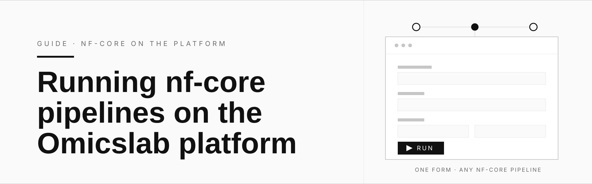
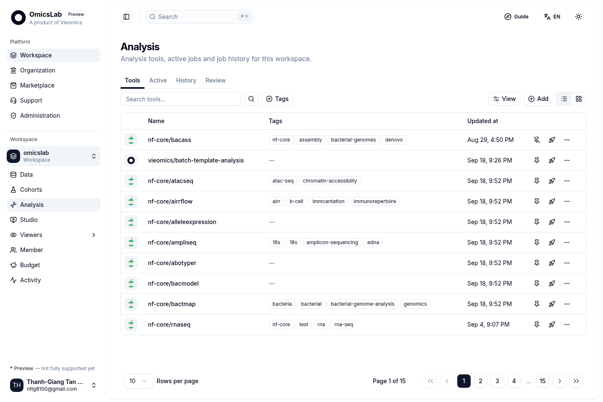
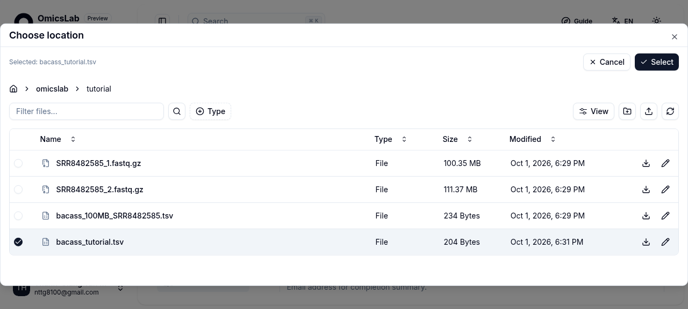
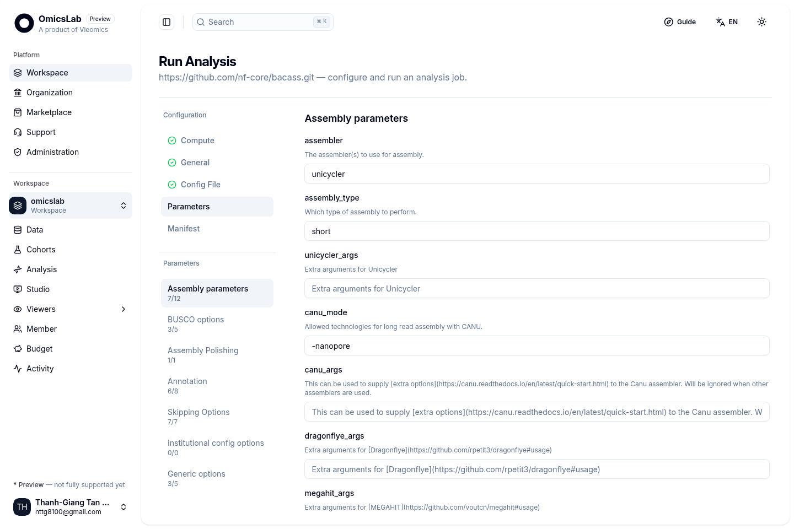
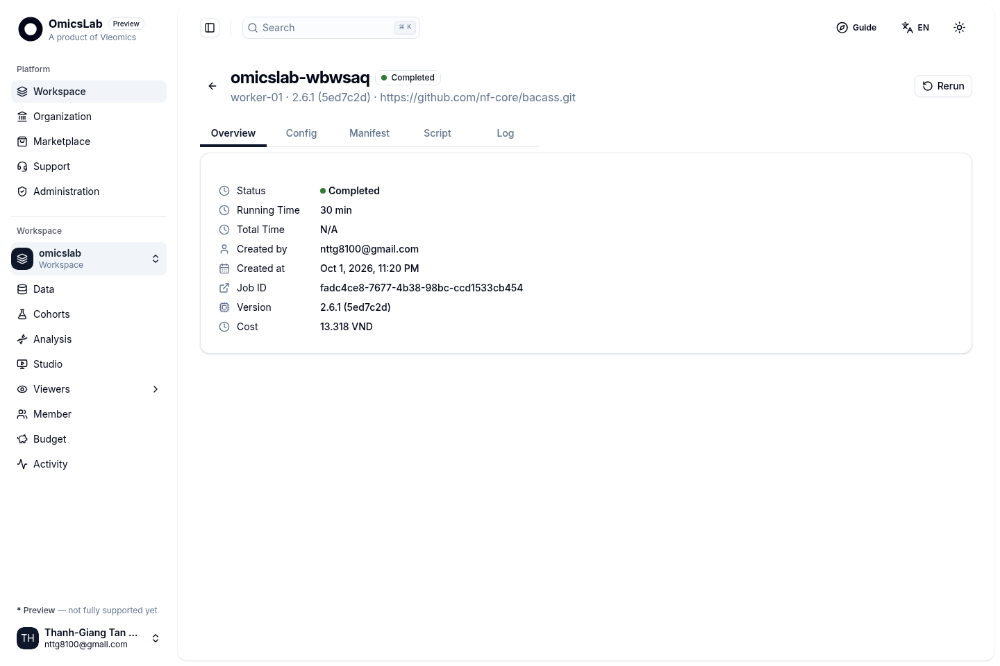
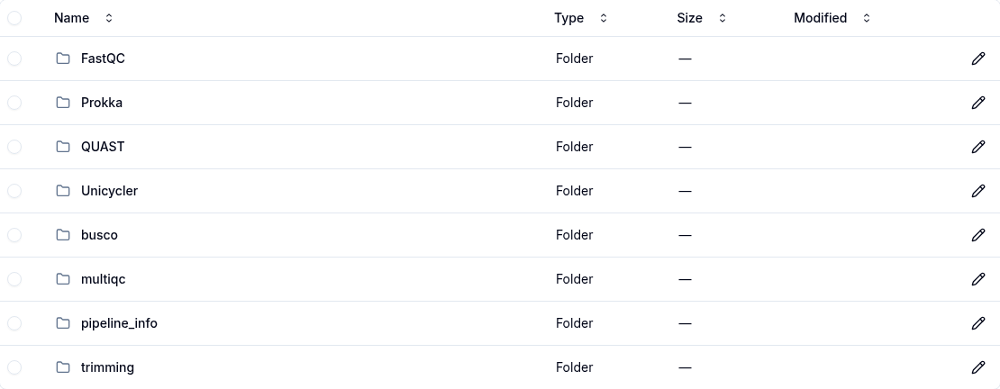

:::info
**This is the general guide to running nf-core pipelines on the Omicslab platform.** Running an nf-core pipeline normally means installing Nextflow and Docker or Singularity, choosing a scheduler profile and typing commands. Here you run the very same pipelines from a browser form — nothing to install, no commands to type, no cluster to configure. All screenshots use `nf-core/bacass` as the example; the companion post [Building a Bacterial Genome Without Writing Code](/en/blogs/bacterial-genome-assembly-without-coding) puts this guide to work on a real genome.
:::

## 1. What is nf-core?

**nf-core** is an international community that builds, reviews and maintains analysis pipelines under shared standards. A **pipeline** is a chain of analysis steps — quality control, trimming, alignment, assembly, variant calling — packaged as a single unit you can run from end to end.

nf-core pipelines are the community's reference implementations: free and open source, documented, versioned and covered by automated tests. Instead of installing a dozen tools and writing glue code to connect them, you run `nf-core/<name>` and get a standard set of results and reports.

Published pipelines span genomics, transcriptomics, metagenomics, proteomics and imaging. A few examples:

| Pipeline | What it is for |
| --- | --- |
| `nf-core/rnaseq` | RNA-seq: quality control, trimming and quantification |
| `nf-core/sarek` | Germline or somatic variant calling from WGS/WES data |
| `nf-core/bacass` | Bacterial genome assembly and annotation |
| `nf-core/mag` | Metagenome assembly and binning |
| `nf-core/fetchngs` | Downloading public sequencing data from SRA, ENA or GEO |

If your question fits one of them, a community pipeline saves you from rebuilding a well-tested workflow from scratch — and it makes your results comparable with everyone else's.

## 2. The moving parts, in plain words

Three names appear in every nf-core tutorial. Here is what they actually do.

### 2.1. GitHub — where the pipelines live

**GitHub** is where source code and pipelines are stored on the internet. Think of it as a versioned "code locker": every past version is kept, and everyone can see which version you are using. All nf-core pipelines live on GitHub.

### 2.2. Nextflow — the coordinator

**Nextflow** describes an analysis made of many steps, then runs those steps automatically — even across several machines at once. Each step runs in its own isolated environment, and Nextflow keeps track of what has already finished, so long analyses do not fall apart when one step fails. You do not have to wire the tools together yourself; Nextflow handles that.

### 2.3. Containers — why results repeat

Every tool in a pipeline is packaged inside a **container**: a "box" holding the exact software and the exact version required. So no matter which machine runs it, or in which year, the result stays consistent — and you never install tools by hand.

## 3. Why you type no commands: the platform reads the pipeline's schema

Every nf-core pipeline ships with a machine-readable description of its parameters (`nextflow_schema.json`). The Omicslab platform reads that description and **renders it as a form in your browser** — like an automatic car: the engine (the analysis tools) is unchanged, but you drive with buttons.

In other words:

- The tools still run **exactly as designed**, in the correct containers.
- You **type no commands**; you fill in parameters on a form.
- The form is generated from the pipeline itself, so it always matches the version you selected.
- The only thing you really change is the **input data**.

*The platform reads `nextflow_schema.json` and renders it as a parameter form — here `nf-core/bacass` in the `omicslab` workspace, with `input` pointing at an uploaded samplesheet.*

## 4. What a pipeline needs before it can run

Three things: data, a description of that data, and compute.

- **Input data** — FASTQ, BAM, VCF or a folder, depending on the pipeline.
- **A samplesheet** — the input list most nf-core pipelines expect. It is a plain table (CSV or TSV) in which each row is one sample and the columns point at that sample's files. Because every pipeline defines its own columns, always take the header from that pipeline's documentation (`nf-co.re/<name>`). [nf-core/bacass](/en/blogs/bacterial-genome-assembly-without-coding), for example, asks for `ID`, `R1`, `R2`, `LongFastQ`, `Fast5` and `GenomeSize`.
- **Compute** — how much CPU, memory and disk the run gets. You pick this at run time on the platform.

*A real samplesheet in the `omicslab` workspace, opened on the platform — each row is one sample, with `R1`/`R2` pointing at the FASTQ files. This one belongs to `nf-core/bacass`; other pipelines use their own columns.*

No data yet? Every nf-core pipeline comes with a small free test dataset, collected in the [nf-core/test-datasets](https://github.com/nf-core/test-datasets) repository. Finding the right table and files for your pipeline is the easiest way to make a first run — then you swap in your own data.

## 5. Running a pipeline on the platform — step by step

The Omicslab platform is a web interface for running Nextflow/nf-core pipelines — similar in model to Seqera Platform, but it can place both the compute and the data inside Vietnam. The platform docs cover [quickstart](https://docs.omicslab.io/en/quickstart), [organizations](https://docs.omicslab.io/en/organizations/overview) and the [marketplace](https://docs.omicslab.io/en/marketplace/overview) in detail. The screenshots below follow `nf-core/bacass`, but the steps are the same for any pipeline.

**Step 1 — Create an account and a workspace.** Create an account at [platform.omicslab.io](https://platform.omicslab.io) and open a workspace — it keeps data, pipelines and run history in one place.

**Step 2 — Upload your data.** Upload your files to S3-compatible storage (or connect your own existing bucket). For a samplesheet-based pipeline, upload both the samplesheet and the files it points to.

**Step 3 — Add the pipeline.** Pick it from the workspace's Git catalog — for nf-core, look under `nf-core/<name>`. If a pipeline is not listed, add it from its Git repository; the platform reads its schema and shows the run form.

**Step 4 — Point `input` at your data.** Select the samplesheet (or data folder) straight from the workspace data browser.

**Step 5 — Choose parameters.** The form shows every parameter from the pipeline, with descriptions and sensible defaults. Usually the only field you must fill is `input`; everything else can stay as it is until you need it.

**Step 6 — Choose compute, review the manifest, press Run.** Pick where the run executes — CloudFly, GreenNode or your own Slurm HPC cluster — and how much CPU, memory and disk it gets. The form estimates the price before you commit. The manifest records exactly what will run, including the parameters and the pipeline version.

**Step 7 — Watch the logs and the cost.** The Nextflow log streams into the browser, step by step. When the run finishes, open it from History to see its status, running time and cost. (The 100 MB bacterial dataset used in these screenshots finished in about 30 minutes for **13,318 VND**.)

**Step 8 — Read the results and reports.** Results land in a tidy output folder alongside the standard reports: MultiQC summarises quality control in one page, and `pipeline_info` records the versions of the pipeline and software used. Both open directly in the browser, with nothing to install.

:::tip
For a first run, use **one sample** with the pipeline's test data. Once it works, add more rows to the samplesheet — the platform runs samples in parallel.
:::

## 6. Small things worth knowing

- **More samples, same run.** One samplesheet row per sample; the platform schedules them in parallel over the compute you chose.
- **Every run is recorded.** Parameters, pipeline version and software versions are kept with the job, so a result can be traced back and reproduced later.
- **You pay for compute and storage only.** Community pipelines such as nf-core are free; the price estimate appears before you press Run.
- **Any Nextflow pipeline can be added.** As long as its repository provides a run script and a parameter schema, the platform can turn it into a form.

## 7. A worked example: from FASTQ to a bacterial genome

The best way to see the pieces fit together is a complete example. In the companion post, [Building a Bacterial Genome Without Writing Code](/en/blogs/bacterial-genome-assembly-without-coding), the pipeline is `nf-core/bacass`, the input is a 100 MB set of bacterial FASTQ files, and the output is an assembled, quality-checked and annotated genome — the same kind of run behind a real melioidosis study from Ha Tinh, Vietnam.

## 8. Get started

1. Create an account at [platform.omicslab.io](https://platform.omicslab.io) — no credit card required.
2. Create a workspace and add the pipeline you need from its Git repository.
3. Try it with the pipeline's test data, then swap in your own.
4. Need help or a fully managed run? Write to [contact@omicslab.io](mailto:contact@omicslab.io).

## 9. References

- **nf-core** — pipeline catalogue and docs: [nf-co.re](https://nf-co.re/) and [nf-co.re/pipelines](https://nf-co.re/pipelines)
- **Nextflow** — workflow language and runtime: [nextflow.io](https://www.nextflow.io/)
- **Test data** — small free datasets for every pipeline: [github.com/nf-core/test-datasets](https://github.com/nf-core/test-datasets)
- **Platform docs** — [Quickstart](https://docs.omicslab.io/en/quickstart), [Organizations](https://docs.omicslab.io/en/organizations/overview) and [Marketplace](https://docs.omicslab.io/en/marketplace/overview)

## 10. Related Articles

- Worked example: [Building a Bacterial Genome Without Writing Code](/en/blogs/bacterial-genome-assembly-without-coding).
- More posts on [nf-core](/en/blogs?tag=nf-core) and [platform](/en/blogs?tag=platform).
- Features and pricing on the [Omicslab Platform](/en/solutions/data-platform) page.
- Need a fully managed service? See [Custom Solutions](/en/solutions/custom-solutions).
