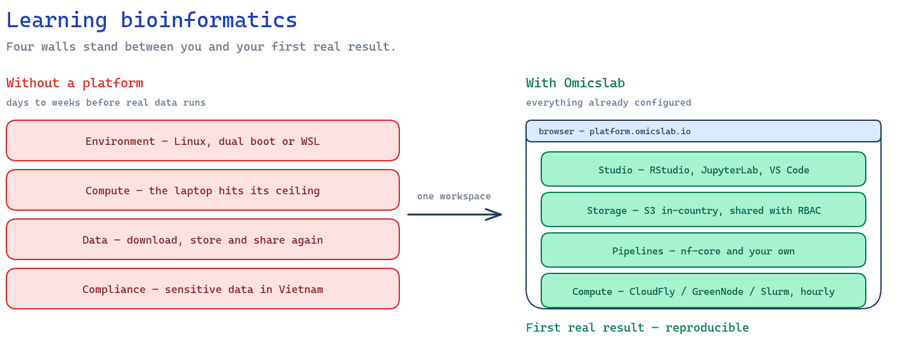

### 1. How do I start with bioinformatics?

There are many areas in bioinformatics, and you can use software with a graphical interface to analyse data. Learning to program, however, is always the most fundamental path — and it usually demands a high-spec machine.

**👉 Solution:** Our platform lets you manage and store your data, rent a high-spec machine, and comes with the tools already configured — including the Linux operating system and programming software — so you can begin learning and practising right away. It provides JupyterLab, RStudio, VS Code and Galaxy on infrastructure in Vietnam; lets you adjust CPUs and memory as needed; and stores the environment you configure yourself.

### 2. How do I analyse to industry standards?

Industry standards come down to reproducibility and management. The traditional approach — internal or personal machines — carries a lot of risk: no source control, no synchronised management and storage of data, so running one sample or many at once easily drifts out of sync and produces errors.

**👉 Solution:**

- Use GitHub for source control, so the code always stays consistent.
- Use environment packaging to spin up analysis machines with identical configuration and setup.
- Guarantee that whether you run one sample or many at once, the environment does not change and results stay consistent.
- Scale flexibly on the cloud, with regional infrastructure for reliability — especially in Vietnam, using Vietnam cloud compute and Vietnam cloud storage.

### 3. How do I optimise cost and hardware-operating risk?

Many groups buy internal machines to analyse data, but the real cost is high because of depreciation. Consider this: to analyse a single WGS (whole-genome sequencing) sample, you already need a machine with at least 16 CPUs and 32 GB RAM.

On top of that, internal machines are often configured individually. When a machine fails or you move to a new one, the system breaks easily if it was not properly designed from the start.

**👉 Solution:** The Vieomics platform solves this with flexible compute infrastructure:

- No purchase or depreciation cost: pay for the resources you use, with no large up-front hardware spend.
- No fear of machine failure or environment drift: the infrastructure is standardised, so moving machines or scaling resources keeps the setup 100% intact, with no disruption to your work.

## Get started

1. Create an account at [platform.omicslab.io](https://platform.omicslab.io) — no credit card required.
2. Create a workspace and open a Studio.
3. Run a small dataset through an nf-core pipeline.
4. Stuck or want a trial? Write to [contact@omicslab.io](mailto:contact@omicslab.io).

## Related Articles

- More posts on [bioinformatics](/en/blogs?tag=bioinformatics) and [getting started](/en/blogs?tag=getting-started).
- Features and pricing on the [Omicslab Platform](/en/solutions/data-platform) page.
- Need a fully managed service? See [Custom Solutions](/en/solutions/custom-solutions).
