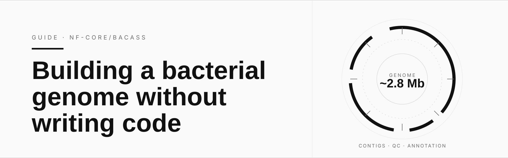

:::info
**Never written a line of code? That is fine.** This post explains the core ideas (genome assembly, GitHub, Nextflow, nf-core), then walks you through assembling and annotating a bacterial genome with the **nf-core/bacass** pipeline on the Omicslab platform. All you change is the input data — the software is already packaged for you.
:::

## First: what is the point of rebuilding a genome?

Imagine you are writing a thesis about an antibiotic-resistant bacterial strain. You need to answer two questions: **which antibiotics does it resist**, and **why does it resist them** — so you can explain the mechanism and suggest what to do about it.

The fastest test, PCR, cannot help you here.

### Why PCR is not enough

PCR works on a "know it first, then look for it" principle. To run a PCR, you must **already know the sequence you are looking for** in order to design a primer. In other words:

- PCR only detects what you **already know**: a familiar resistance gene, a mutation already described in the literature.
- If the bacterium resists through a **novel mechanism** — a gene never seen before, a new mutation, or an unfamiliar plasmid — you have no primer to probe with, and PCR returns a misleading negative result.

That is when you need to read the **whole genome** instead of probing a single spot. You do not have to know in advance what to look for, because all the information is already there in the sequence data.

### What is genome assembly?

A sequencing machine cannot read a whole chromosome in one go. It returns millions of **reads** — short fragments of sequence (Illumina data) or long ones (Oxford Nanopore, PacBio) — like a book torn into millions of tiny slips of paper, each slip with its text overlapping the slips next to it.

**Genome assembly** is the job of finding those overlaps and piecing the slips back into a continuous text. The result is an almost complete genome: every gene, mutation and plasmid in the strain — including things nobody has seen before. Then **annotation** labels the genome, so you know which stretches are genes, what proteins they encode, and what mechanism lies behind the resistance.


*Illustrated with a 9-nucleotide genome (3 amino acids): sequencing, de novo assembly, then comparison against a reference — one nucleotide change alters an amino acid.*

There are three biological stages:

1. **Sequencing** — the machine reads the DNA and cuts it into millions of short fragments called reads. Each read is a very short stretch, not enough on its own to conclude anything.
2. **De novo assembly** — using the overlapping pieces between reads to stitch them into continuous stretches (contigs). This step does **not need to know** what the genome looks like in advance, so it can reveal regions that never appeared in any database.
3. **Comparison against a reference genome** — lining your genome up against a known genome of the same species to find the positions that differ (variants such as SNPs), and to confirm the species. It is the quick way to answer "where does this strain differ from the reference?". If a differing position falls inside a gene, it can change the amino acid — in the figure, a single nucleotide at position 5 turns Lys (K) into Arg (R).

:::tip
The key point for the PCR story above: comparison against a reference only finds differences **from what is already known**. A completely new gene will not be in the reference — so we need **de novo assembly followed by annotation** to find it.
:::

| Term | In plain words |
| --- | --- |
| **Read** | One fragment of sequence the machine produced |
| **Coverage** | How many times, on average, each position in the genome was read — higher is safer |
| **Contig** | A continuous stretch of assembled sequence |
| **N50** | A number describing how long the contigs are; a larger N50 means a more contiguous assembly |
| **Short-read** | Short, accurate, cheap reads (e.g. Illumina) |
| **Long-read** | Long reads that bridge repeated regions (e.g. Nanopore, PacBio) |
| **Hybrid** | Using both short and long reads for the best result |
| **Annotation** | Labelling the genome: where the genes are and what they do |

:::note
A bacterial genome is small — usually just 2–8 million base pairs and often a single circular chromosome. That makes bacterial assembly far easier than the human genome, and an ideal place to start.
:::

## Four concepts to know before you begin

You will meet these four names in every bioinformatics tutorial. A short explanation is enough to get going.

### GitHub — an online "code locker"

**GitHub** is where source code and pipelines are stored on the internet. Think of it as a versioned "code locker": every past version is kept, and everyone can see which version you are using. All nf-core pipelines live on GitHub.

### Nextflow — the coordinator of the analysis steps

**Nextflow** describes an analysis made of many steps, then runs those steps automatically — even across several machines at once. You do not have to wire the tools together yourself; Nextflow handles that.

### nf-core — the community's standard pipelines

**nf-core** is an international community that builds and tests analysis pipelines to one shared standard. Each pipeline, such as `nf-core/rnaseq`, `nf-core/sarek` or `nf-core/bacass`, is packaged, documented and ready to run. This is "best practice" — the way the community agrees is right.

### Pipelines and containers — why results repeat

Every tool in a pipeline is packaged inside a **container**: a "box" holding the exact software and the exact version required. So no matter which machine runs it, or in which year, the result stays consistent — and you never install tools by hand.

## nf-core/bacass: the box that is already assembled

**nf-core/bacass** is the standard pipeline for **bacterial genome assembly and annotation**. It takes raw data (FASTQ) and automatically runs every step you need: quality control, trimming, assembly, contamination screening, assembly quality assessment and annotation.

It supports three kinds of data:

- **Short-read** — short reads only (Illumina).
- **Long-read** — long reads only (Nanopore/PacBio).
- **Hybrid** — both together, for the most contiguous assembly.


*Source: nf-core/bacass (metromap), MIT licence.*

On the **metromap** above, the whole journey looks like a metro line with stations:

| Stage | What runs automatically |
| --- | --- |
| **QC & trimming** | FastQC, FastP for short reads; NanoPlot/PycoQC, PoreChop/Filtlong for long reads |
| **Assembly** | Unicycler, MEGAHIT (short); Flye, Canu, Raven, Miniasm, Dragonflye, Autocycler (long) |
| **Contamination screening** | Kraken2 and Kmerfinder confirm the sample is not mixed with another species |
| **Assembly QC** | QUAST and BUSCO — how good the assembly is |
| **Annotation** | Prokka, Bakta or DFAST — labelling genes and their functions |

Each stage can be switched on or off with a simple parameter, so you never run steps you do not need.

## Why "no coding"? — The interface wraps the tools

This is the key point. Every nf-core pipeline ships with a machine-readable description (`nextflow_schema.json`) listing all of its parameters. The Omicslab platform reads that description and **renders it as a form in your browser** — like an automatic car: the engine (the analysis tools) is unchanged, but you drive with buttons.

In other words:

- The tools still run **exactly as designed**, in the correct containers.
- You **type no commands**; you fill in parameters on a form.
- The only thing you really change is the **input data**.

<!--
  TODO (figure 1): screenshot of adding the nf-core/bacass pipeline to a workspace,
  showing the platform reading nextflow_schema.json and rendering the parameter form.
  Suggested path: ./imgs/platform-add-pipeline.png
-->

<!--
  TODO (video 1): screen capture of selecting the pipeline, filling parameters and pressing Run.
  Suggested: <video controls src="./videos/...mp4"></video> or an animated GIF.
-->

## Preparing your input data

bacass needs a **samplesheet**: a simple table (TSV, tab-separated) saying which files belong to each sample. Six columns:

| Column | Meaning |
| --- | --- |
| `ID` | Sample name, no spaces |
| `R1`, `R2` | Forward and reverse short reads; use `NA` if absent |
| `LongFastQ` | Long reads; use `NA` if absent |
| `Fast5` | Fast5 folder (only if polishing the assembly); usually `NA` |
| `GenomeSize` | Estimated genome size, e.g. `2.8m` for 2.8 million base pairs |

An example samplesheet covering all three data types:

```tsv
ID	R1	R2	LongFastQ	Fast5	GenomeSize
shortreads	./data/S1_R1.fastq.gz	./data/S1_R2.fastq.gz	NA	NA	NA
longreads	NA	NA	./data/S1_long_fastq.gz	NA	2.8m
shortNlong	./data/S1_R1.fastq.gz	./data/S1_R2.fastq.gz	./data/S1_long_fastq.gz	NA	2.8m
```

:::tip
No data yet? The next section shows how to download **nf-core's free sample dataset** and try the pipeline first.
:::

## Try it with nf-core's free sample data

nf-core provides a small bacterial dataset to test the pipeline. Download it and upload it to the platform:

- Sample samplesheet: [bacass_short_reseq.tsv](https://raw.githubusercontent.com/nf-core/test-datasets/bacass/bacass_short_reseq.tsv)
- Full sample data repository: [nf-core/test-datasets › bacass](https://github.com/nf-core/test-datasets/tree/bacass)

The fastest way to try it on the platform is to run with the **sample data** first: choose the sample samplesheet, set `assembly_type = short` and `assembler = unicycler`, then turn on `skip_kraken2` and `skip_kmerfinder` to skip contamination screening while you get familiar. Once comfortable, turn everything back on.

## Running on the Omicslab platform — step by step

The Omicslab platform is a web interface for running Nextflow/nf-core pipelines — similar in model to Seqera Platform, but it can place both the compute and the data inside Vietnam.

1. **Create an account** at [platform.omicslab.io](https://platform.omicslab.io) and open a workspace.
2. **Upload your data** to S3-compatible storage (or connect your own existing bucket).
3. **Add the pipeline**: choose `nf-core/bacass` from its Git repository. The platform reads the schema and shows the parameter form.
4. **Point `input`** at the samplesheet you uploaded.
5. **Choose the main parameters**:
   - `assembly_type`: `short`, `long` or `hybrid`
   - `assembler`: `unicycler`, `megahit`, `flye`, `canu`, `raven`, `miniasm`, `dragonflye`, `autocycler`
   - `annotation_tool`: `prokka`, `bakta` or `dfast`
   - `busco_lineage`: defaults to `bacteria_odb10`
   - `kraken2db`: path to the Kraken2 database (if screening contamination)
6. **Pick your compute** (CloudFly, GreenNode or your own Slurm HPC cluster) and the CPU/RAM level.
7. **Press Run** and watch per-step logs in the browser; you are notified when it finishes.
8. **Open the reports**: MultiQC and the Nextflow report render directly, with nothing to install.

<!--
  TODO (figure/video 2): illustrate the platform flow — uploading data,
  choosing the pipeline, filling parameters, running and viewing reports.
  Suggested path: ./imgs/platform-run-bacass.png or ./videos/platform-run-bacass.mp4
-->

:::tip
For your first run, use **a single sample** with nf-core's sample dataset. Once it works, add more samples to the same samplesheet — the platform will run them in parallel.
:::

## Reading the results

When the pipeline finishes, you get one tidy results folder:

| Output | What it tells you |
| --- | --- |
| `*_assembly.fasta` | The assembled genome sequence |
| **QUAST** report | Contig count, N50, total length — assembly quality |
| **BUSCO** report | Share of essential genes found — completeness |
| **Kraken2 / Kmerfinder** report | Whether the sample is contaminated by another species |
| Annotation files (`.gff`, `.gbk`) | Gene locations and predicted functions |
| **MultiQC** report | One page summarising every other report |

## A real case study from Vietnam

To see how far this pipeline can go, look at a real study. In 2026, a Vietnamese and international research team published in *PLOS Neglected Tropical Diseases* the sequencing of 47 **Burkholderia pseudomallei** strains — the bacterium that causes melioidosis. The strains were collected at Ha Tinh Provincial General Hospital in 2020, together with soil samples and two animal samples.

The notable part: they assembled the genomes with **exactly the nf-core/bacass workflow this post walks through** — FastP trimming, Unicycler assembly, Prokka annotation — before going further.

From the assembled genomes, the team:

- Typed the strains with **MLST and cgMLST** (matching gene sequences against public databases).
- Built a **whole-genome SNP phylogeny** to trace transmission and compare against nearly 1,500 other strains from Southeast Asia and Australia.
- Found a **gene region specific** to the dominant strain group (ST 41) and proposed it as a new diagnostic target.

The headline result: 60% of cases belonged to a single strain (ST 41), and those strains were closely linked to soil samples from the same area — pointing to an environment-to-human transmission route.

The lesson: this is exactly the kind of question PCR struggles with. Nobody knew the "ST 41 gene region" existed in advance to design a primer — it only surfaced once the whole genome was read.

> Norris MH, Au La TH, Metrailer MC, et al. (2026). *Expanding the molecular epidemiology of melioidosis in North Central Vietnam.* PLOS Neglected Tropical Diseases, 20(2), e0013945. [doi.org/10.1371/journal.pntd.0013945](https://doi.org/10.1371/journal.pntd.0013945)

All data from the study is public at NCBI SRA under **PRJNA1180080**.

## Open ending: your turn

There are two ways to start right now:

1. **Re-run it on this very dataset.** Download the FASTQ files from SRA under `PRJNA1180080` (or use nf-core's sample data), upload them to the platform and run nf-core/bacass. You will walk the same path the research team did — and you can verify the result yourself.
2. **Explore deeper tools on the platform.** Once you have a genome, you can find and add other pipelines from their Git repositories — as long as they provide a run script and a parameter schema. A few directions:
   - **Species identification** and comparison against reference strains.
   - **MLST / cgMLST** to type the strain.
   - **Whole-genome SNP** analysis and **phylogenetic trees** for epidemiology.
   - **Pan-genome** analysis to find genes specific to a strain group.
   - **Submit the data** to a public database (e.g. NCBI) to share it.

There is no single correct pipeline for every question. Try things, compare them, and work out what fits — the platform does not lock you into one fixed toolset.

Got a result or a question? Share it with us at [contact@omicslab.io](mailto:contact@omicslab.io).

## Get started

1. Create an account at [platform.omicslab.io](https://platform.omicslab.io) — no credit card required.
2. Create a workspace and add the `nf-core/bacass` pipeline.
3. Try it with nf-core's sample data, then swap in your own.
4. Need help or a fully managed run? Write to [contact@omicslab.io](mailto:contact@omicslab.io).

## References

- **nf-core/bacass** — documentation, parameters and example results: [nf-co.re/bacass](https://nf-co.re/bacass)
- **Case study** — Norris MH, et al. (2026), *Expanding the molecular epidemiology of melioidosis in North Central Vietnam*, PLOS Neglected Tropical Diseases 20(2): e0013945. [doi.org/10.1371/journal.pntd.0013945](https://doi.org/10.1371/journal.pntd.0013945)
- **Public data** — NCBI SRA BioProject [PRJNA1180080](https://www.ncbi.nlm.nih.gov/bioproject/PRJNA1180080)

## Related Articles

- More posts on [bioinformatics](/en/blogs?tag=bioinformatics) and [pipelines](/en/blogs?tag=pipeline).
- Features and pricing on the [Omicslab Platform](/en/solutions/data-platform) page.
- Need a fully managed service? See [Custom Solutions](/en/solutions/custom-solutions).
- Official pipeline documentation: [nf-co.re/bacass](https://nf-co.re/bacass).
