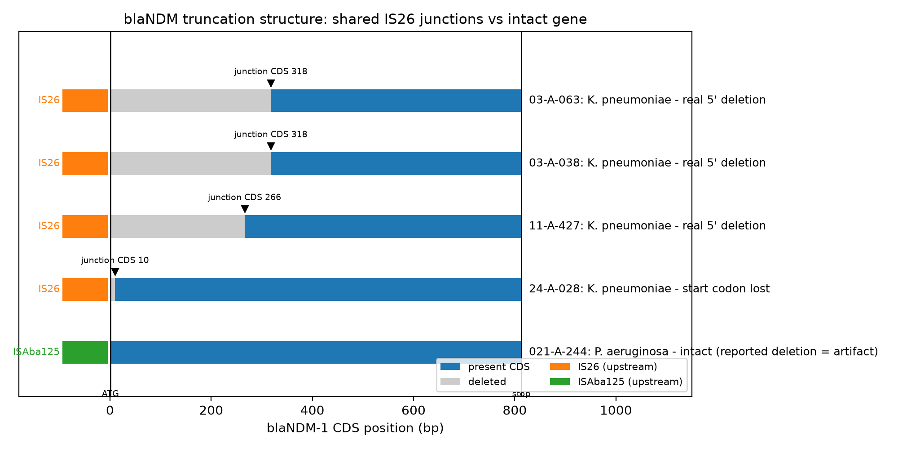

:::info
**The two previous posts showed how to run nf-core pipelines on the Omicslab platform.** This post is the field note that follows: a real investigation, from public data to figures, using the same platform pieces — **Analysis jobs** for the nf-core part and **Studio** for the interactive part. The study is Dung et al. 2025 on `blaNDM` in a Vietnamese lower-respiratory-infection cohort, and the code behind this reanalysis is public: [vieomics/solutions](https://github.com/vieomics/solutions), branch [`topic/ndm-truncation`](https://github.com/vieomics/solutions/tree/topic/ndm-truncation).
:::

## 1. The question

In 2025, Dung et al. reported a set of `blaNDM`-positive but ceftazidime–avibactam (CAZ-AVI) susceptible isolates from a lower-respiratory-infection cohort in Vietnam. Some of the `blaNDM` genes appeared truncated in the genome assemblies — a plausible explanation for why the isolates stayed susceptible despite carrying the gene. The finding came from short-read assemblies plus BLASTn.

That leaves a natural follow-up question: **do the raw reads support the same picture?**

Public data makes the question easy to ask. All five runs are in ENA project [PRJEB86571](https://www.ebi.ac.uk/ena/browser/view/PRJEB86571). We downloaded them again, reassembled them, and then audited the gene base by base in the reads themselves.

## 2. The investigation, mapped to the platform

Almost everything in this analysis is one of two kinds of work on the Omicslab platform:

| Stage | What runs | Platform feature |
| --- | --- | --- |
| Download public reads | `nf-core/fetchngs` | **Analysis job** — a non-interactive pipeline |
| Assemble the genomes | `nf-core/bacass` (Unicycler) | **Analysis job** |
| Read-level audit of `blaNDM` | custom Nextflow pipeline | **Analysis job** (custom Git tool) or a Studio terminal |
| Typing, plasmids, IS context | AMRFinderPlus, MOB-suite, Kleborate, BLAST | **Studio** — interactive session, pixi environment |
| Figures | matplotlib scripts | **Studio** — pixi environment + code-server |

- **Analysis jobs** are the non-interactive side: pick a tool, fill in the form, choose compute, press run. nf-core pipelines run this way directly — the platform reads the pipeline schema and renders its parameters as a form, and the same form works for any pipeline version. The workflow is covered step by step in [How to Run nf-core Pipelines on the Omicslab Platform](/en/blogs/how-to-run-nf-core-pipelines-on-omicslab); the reference pages are [Analysis jobs](https://docs.omicslab.io/en/tools/analysis/overview) and [Quickstart §3](https://docs.omicslab.io/en/quickstart#3-analysis).
- **Studio** is the interactive side: long-running sessions you open in the browser — RStudio, Jupyter, or VS Code Server (`code-server`). This is where the downstream exploration happens ([Studio sessions](https://docs.omicslab.io/en/tools/studio/overview), [Quickstart §4](https://docs.omicslab.io/en/quickstart#4-studio)).

The rest of the post follows both sides of that table.

## 3. Step 1 — Download the reads with nf-core/fetchngs

The only input is a list of accessions (`ids.csv`):

```
ERR14693661
ERR14693662
ERR14693663
ERR14693664
ERR14693665
```

On the platform, choose `nf-core/fetchngs` from the workspace catalog, point `input` at the file, and run it as an Analysis job. The equivalent command, if you want to reproduce it yourself with the repository's [pixi](https://pixi.sh) environment, is:

```bash
pixi run fetchngs
# equivalent to:
pixi run nextflow run nf-core/fetchngs -r 1.13.0 -profile apptainer \
    --download_method sratools --input ids.csv --outdir results/fetchngs -resume
```

Two small engineering notes from the run:

- Downloads go through the NCBI SRA mirror (`sratools`) because the ENA mirror throttled to below 1 MB/s and stalled on compute nodes; the SRA path measured around 10 MB/s.
- `fetchngs` verifies the FASTQ files by MD5, so a run that reports success has intact data.

The output is the five read sets plus a `samplesheet.csv` ready to feed the next pipeline.

## 4. Step 2 — Assemble the genomes with nf-core/bacass

`nf-core/bacass` takes the samplesheet, assembles with Unicycler and optionally annotates. On the platform it is a second Analysis job; the repository keeps its parameters in `params/bacass.json` and pins the pipeline version (`2.6.1`), so the run can be repeated years later with the same inputs.

```bash
pixi run bacass
# equivalent to:
pixi run nextflow run nf-core/bacass -r 2.6.1 -profile apptainer \
    -c conf/resources.config -params-file params/bacass.json -resume
```

The five short-read datasets fit in one job, with the samples scheduled in parallel over the compute you choose.

Once the assemblies exist, a set of small, fast tools answers the "what exactly is this isolate?" questions:

- **AMRFinderPlus** — resistance gene calls, with contig locations.
- **MOB-suite** — plasmid reconstruction and replicon typing.
- **Kleborate** — *K. pneumoniae* sequence type, capsule and lipopolysaccharide types, virulence and resistance.
- **IS context** — where IS26 / ISAba125 copies sit relative to the gene (ISfinder sequences as queries).
- **Co-location** — whether `blaNDM` and the OXA-48-like gene sit on the same contig.

None of these is a pipeline run in the nf-core sense; they are interactive, one-off tools, so they belong on the Studio side. More on that in section 7.

## 5. Step 3 — Audit the gene at read level

An assembly is a model of the genome, not the genome itself. Two classic assembly behaviours matter for a claim about a truncated gene:

- a gene that straddles a **contig boundary** can come out partially assembled;
- **repeated mobile elements** can collapse or be misplaced, making it hard to tell which copy carries what.

So before concluding anything from an assembly, it is worth asking the reads directly. Our audit maps every read against a full-length NDM-1 reference (LC928496) and counts, per isolate:

- **per-base depth** across the gene;
- **reads spanning** each region reported as deleted;
- **reads carrying a deletion** that overlaps it.

It is a small Nextflow pipeline (`analysis/ndm_audit.nf`), so all five isolates run in parallel. On the platform you can register it as a custom tool by pointing at its Git repository ([Analysis schema & manifest](https://docs.omicslab.io/en/tools/analysis/schema)), or simply start it from a terminal inside a Studio session.

The audit is deliberately hypothesis-neutral. Four possibilities are on the table for each isolate:

| Hypothesis | What it means |
| --- | --- |
| H1 | A true deletion in the gene |
| H2 | The assembly is incomplete rather than the gene (boundary or coverage effect) |
| H3 | A mobile-element remnant, or a second silent copy |
| H4 | An intact gene that is not expressed (for example, a disrupted promoter) |

## 6. What the reads showed

The headline supports the original observation: the `blaNDM` genes in the *K. pneumoniae* isolates are genuinely disrupted at the 5′ end, and the disruption is mobile-element-driven. The read-level view adds detail at a few points.


*Figure 1 — Read depth across full-length NDM-1 (reference LC928496) for the five isolates. Three K. pneumoniae isolates show zero depth over the left shaded region; one loses only the very start of the gene; the P. aeruginosa isolate is covered across the whole gene.*

| Isolate | Species | Read-level picture |
| --- | --- | --- |
| 03-A-063 | *K. pneumoniae* | 5′ truncation; an IS26-family element joined at CDS 318 |
| 03-A-038 | *K. pneumoniae* | 5′ truncation; an IS26-family element joined at CDS 318 |
| 11-A-427 | *K. pneumoniae* | 5′ truncation; an IS26-family element joined at CDS 266 |
| 24-A-028 | *K. pneumoniae* | full CDS present, but the start codon is missing (IS26 joined at CDS 10) |
| 021-A-244 | *P. aeruginosa* | full-length gene covered by the reads; the partial assembly call fits a contig boundary at the gene's 5′ end |



*Figure 2 — Junction structure. In the four K. pneumoniae isolates an IS26-family element sits immediately upstream of the remaining gene; in the P. aeruginosa isolate an ISAba125 element sits upstream of an intact CDS — the usual context of `blaNDM`.*

The mechanism now has a name. A shared **IS26-family element** has landed at the 5′ end of `blaNDM` in the four *K. pneumoniae* isolates, at slightly different positions, joined to an otherwise conserved gene. This does not look like four independent gene losses: it looks like the same mobile-element event seen in four descendants.

### 6.1. The clone behind the isolates

The typing data agrees. All four *K. pneumoniae* isolates are **ST16** — the clone previously associated with hospital outbreaks in southern Vietnam — and their plasmid profiles are nearly identical (IncFIB, IncFIB+IncFII, IncFII/rep\_2183, IncX3/rep\_1195). The resistance-typing step also resolves the OXA-48-like signal to **`blaOXA-181`** (same family, sharper allele call); in the draft assemblies it sits on a different contig from `blaNDM`.

### 6.2. What the deployed PCR can and cannot see

A practical question follows: can the deployed NDM PCR distinguish these alleles — the intact gene from the disrupted ones?


*Figure 3 — The deployed NDM amplicon (CDS 574–686) sits outside both reported deletion regions, so it is intact in every allele, truncated or not.*

It cannot. The amplicon lies in a part of the gene that all these alleles share, so a positive PCR is exactly what you expect even when the enzyme is disrupted. This is not a defect of the assay — it is a blind spot worth knowing about. The molecular result and the susceptibility result need each other, and read-level evidence is what makes the pair interpretable.

### 6.3. One gene worth a second look

One isolate deserves a closer reading.


*Figure 4 — The P. aeruginosa isolate (021-A-244): every base of the gene is covered (mean depth around 180×), 154 reads span the region reported as deleted, and no read carries a deletion there. The partial assembly call is consistent with a contig boundary cutting the gene's 5′ end.*

At read level this gene looks full-length: about 180× mean depth across the CDS, 154 reads crossing the region reported as deleted, zero reads carrying a deletion. The partial call in the draft assembly fits a contig boundary that stops inside the gene's 5′ end — the first ~20 bases, including the start codon, sit on the other side of the boundary. Same dataset, two views. It is precisely the case where a read-level check is worth the extra run, and it is why the audit reports spanning reads and deletion reads separately instead of only a depth average.

## 7. Step 4 — Explore downstream with pixi in Studio

Everything after the assemblies is exploratory work: open a depth file, inspect a junction, adjust a figure. That is what Studio is for.

Open a **VS Code Server** session (`code-server`) in the workspace, attach the repository, and open a terminal — the whole downstream toolchain is one command away:

```bash
pixi install          # create the pinned environments
pixi run -e analysis  # AMRFinderPlus, MOB-suite, Kleborate, bwa, samtools, BLAST, spades, ISEScan, seqkit
pixi run -e plots     # matplotlib
```

Then, inside the session:

```bash
pixi run -e analysis nextflow run analysis/ndm_audit.nf   # the read-level audit
pixi run -e plots python3 bin/plot_coverage.py            # Figure 1
pixi run -e plots python3 bin/plot_pa_artifact.py         # Figure 4
```

`pixi.toml` and `pixi.lock` pin the tools, so the environment is the same today and next year. Nobody has to install half of bioconda by hand, and the data never leaves the workspace: the session runs next to the storage instead of on a laptop that may not have the files at all.

When the session is finished, a **Snapshot** archives its home directory back into the workspace, so the state can be picked up again later ([Studio sessions](https://docs.omicslab.io/en/tools/studio/overview)).

:::tip
The same pixi environments work on a local machine or on your own Slurm cluster — `pixi install` reads the lock file and reproduces the toolchain anywhere. The platform does not lock you in; it moves the work into the browser and next to the data.
:::

## 8. What the platform adds to a workflow like this

- **nf-core runs directly.** `fetchngs` and `bacass` are Analysis jobs: catalog tools, form parameters, logs, cost estimate and results in the browser. No Nextflow install, no container engine, no scheduler configuration.
- **Custom work fits beside it.** A Nextflow pipeline like the read-level audit is registered from its Git URL; non-pipeline tools live in a Studio session.
- **Interactive analysis is first-class.** pixi environments slot into a code-server session, so "downstream analysis" stays reproducible work with pinned versions instead of a pile of manually installed packages.
- **Every run is recorded.** The job manifest keeps parameters, pipeline version and the exact command that ran; a rerun overrides what it needs and records what changed.
- **Locality is configurable.** Compute and storage can stay in Vietnam (CloudFly, GreenNode) or on your own Slurm cluster — a real consideration for clinical isolate data.

## 9. Reproduce it yourself

- **Reads**: ENA project [PRJEB86571](https://www.ebi.ac.uk/ena/browser/view/PRJEB86571)
- **Code, parameters and figures**: [vieomics/solutions](https://github.com/vieomics/solutions), branch [`topic/ndm-truncation`](https://github.com/vieomics/solutions/tree/topic/ndm-truncation)
- **The two platform guides**: [How to Run nf-core Pipelines on the Omicslab Platform](/en/blogs/how-to-run-nf-core-pipelines-on-omicslab) and [Building a Bacterial Genome Without Writing Code](/en/blogs/bacterial-genome-assembly-without-coding)

On the platform: upload `ids.csv`, run `nf-core/fetchngs` as an Analysis job, adapt its samplesheet for `nf-core/bacass` and run that as the second job, then open a Studio session on the repository for the typing and the read-level audit.

## 10. References

- Dung et al. (2025), *Annals of Clinical Microbiology and Antimicrobials* — [doi:10.1186/s12941-025-00818-3](https://doi.org/10.1186/s12941-025-00818-3)
- `nf-core/fetchngs` — [nf-co.re/fetchngs](https://nf-co.re/fetchngs); `nf-core/bacass` — [nf-co.re/bacass](https://nf-co.re/bacass)
- Platform docs — [Analysis jobs](https://docs.omicslab.io/en/tools/analysis/overview), [Studio sessions](https://docs.omicslab.io/en/tools/studio/overview), [Quickstart](https://docs.omicslab.io/en/quickstart)
- pixi — reproducible environments: [pixi.sh](https://pixi.sh)
- Tools — [AMRFinderPlus](https://github.com/ncbi/amr), [MOB-suite](https://github.com/mob-suite/mob-suite), [Kleborate](https://github.com/klebgenomics/Kleborate), [ISfinder](https://isfinder.biotoul.fr/)

## 11. Related Articles

- Platform guide: [How to Run nf-core Pipelines on the Omicslab Platform](/en/blogs/how-to-run-nf-core-pipelines-on-omicslab).
- Worked example: [Building a Bacterial Genome Without Writing Code](/en/blogs/bacterial-genome-assembly-without-coding).
- More posts on [nf-core](/en/blogs?tag=nf-core) and [platform](/en/blogs?tag=platform).
- Features and pricing on the [Omicslab Platform](/en/solutions/data-platform) page.
