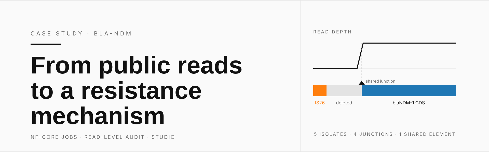
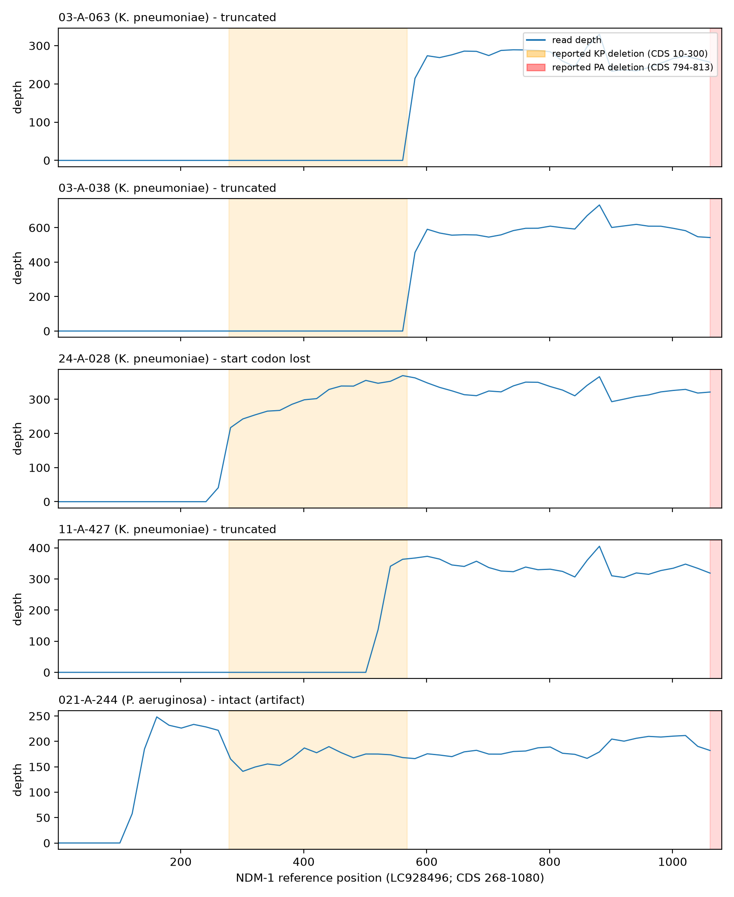
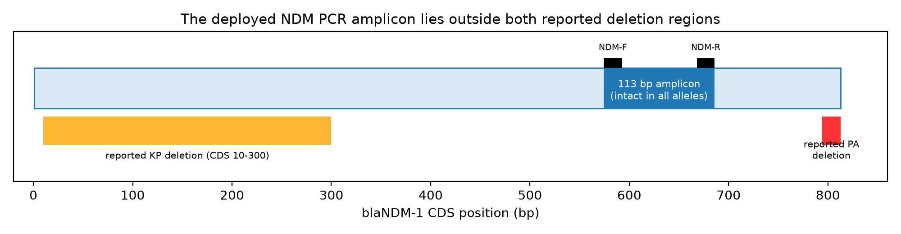
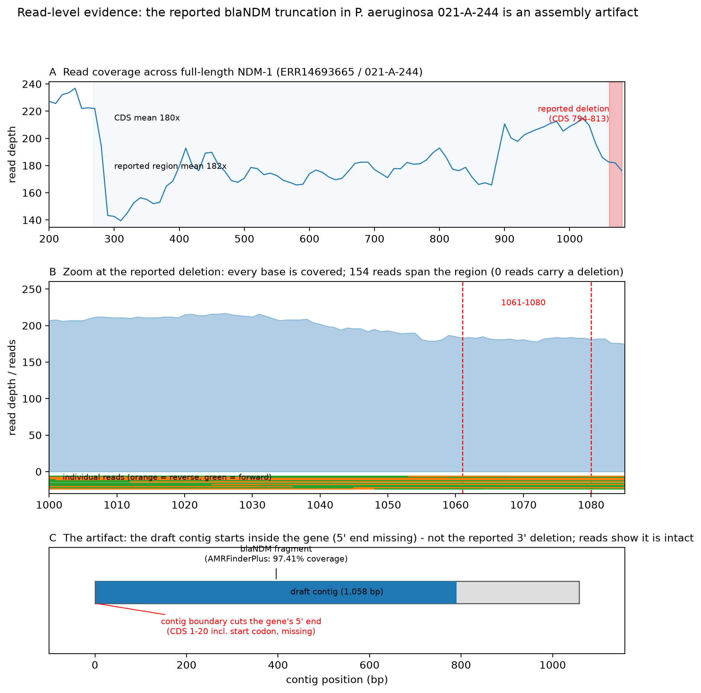

:::info
**Research story first, technical details second.** The first half of this article explains the question, what we found and why it matters, in plain language. The second half is for bioinformaticians who want to reproduce the analysis. The groundwork is covered in two companion posts: [How to Run nf-core Pipelines on the Omicslab Platform](/en/blogs/how-to-run-nf-core-pipelines-on-omicslab) and [Building a Bacterial Genome Without Writing Code](/en/blogs/bacterial-genome-assembly-without-coding).
:::

## The research question

Some *Klebsiella pneumoniae* and *Pseudomonas aeruginosa* isolates carried `blaNDM`, yet showed susceptibility to ceftazidime–avibactam (CAZ-AVI).

**Could the genome assembly explain this apparently contradictory result?**

The data comes from Dung et al. (2025), who reported the isolates from a lower-respiratory-infection cohort in Vietnam. Some `blaNDM` genes appeared truncated in the genome assemblies — a plausible explanation for the susceptibility — based on short-read assemblies plus BLASTn. All five runs are public in ENA project [PRJEB86571](https://www.ebi.ac.uk/ena/browser/view/PRJEB86571): four *K. pneumoniae* and one *P. aeruginosa*. We reconstructed them from the raw reads and audited the gene base by base.

## Our approach

Omicslab reconstructed the publicly available datasets and combined:

- **Genome assembly** — rebuilding each isolate from the raw reads with `nf-core/bacass`.
- **AMR gene detection** — cataloguing resistance genes and their contig locations with AMRFinderPlus.
- **Plasmid analysis** — reconstructing and typing plasmids with MOB-suite.
- **Bacterial typing** — sequence type and capsule/lipopolysaccharide types with Kleborate.
- **Read-level validation** — auditing `blaNDM` directly against the reads with a custom Nextflow pipeline.
- **Visualization** — coverage profiles, junction maps and assay maps from the audit outputs.

Everything ran on the Omicslab platform: the standard pipelines as **Analysis jobs**, the custom analysis and figures in a **Studio** code-server session. The exact commands and versions are in the [technical details](#technical-details).

## What we found



*Figure 1 — Read depth across full-length NDM-1 (reference LC928496) for the five isolates. Three K. pneumoniae isolates show zero depth over the left shaded region; one loses only the very start of the gene; the P. aeruginosa isolate is covered across the whole gene.*

The assembly suggested a truncated gene, so we went back to the raw reads to determine whether the apparent truncation was supported by the sequencing evidence.

This is important because an assembly is an interpretation of the sequencing reads, not the reads themselves.

At read level the main observation holds — and gets sharper:

- In four *K. pneumoniae* isolates, a shared **IS26-family mobile element** sits at the 5′ end of `blaNDM`. The disruption is real, and it looks like one mobile-element event seen in four descendants rather than four independent losses.
- One of the four keeps the full CDS but loses only the **start codon** — the element joins at CDS 10.
- All four belong to the **ST16 clone** with nearly identical plasmid profiles; the OXA-48-like signal resolves to **`blaOXA-181`**.
- In the *P. aeruginosa* isolate the reads cover every base of the gene: at read level it is full-length, and the partial assembly call is consistent with a **contig boundary** cutting the gene's 5′ end.
- The deployed NDM PCR amplicon sits outside both deletion regions, so it is intact in every allele — a positive PCR does not tell you whether the enzyme is functional.


*Figure 2 — Junction structure. In the four K. pneumoniae isolates an IS26-family element sits immediately upstream of the remaining gene; in the P. aeruginosa isolate an ISAba125 element sits upstream of an intact CDS — the usual context of `blaNDM`.*

## Why this matters

A resistance gene identified from an assembly should sometimes be validated at the read level, particularly when structural context or assembly boundaries could affect interpretation.

Here the read-level check did three things: it **named the mechanism** (an IS26-family element at the 5′ end), **resolved the resistance allele** (OXA-181, not just an OXA-48-like signal), and showed that one flagged gene was a **contig-boundary effect** rather than a truncation. For clinical interpretation the molecular test and the susceptibility result need each other; the reads are what make the pair interpretable.

## What this means for researchers

The same workflow can support:

- **Antimicrobial-resistance research** — linking resistance genotypes to observed phenotypes.
- **Bacterial genome characterization** — assembling, annotating and typing isolates of interest.
- **Genomic surveillance** — tracking clones and mobile elements across cases and time.
- **Outbreak investigation** — testing whether cases share a strain or a plasmid.
- **Resistance-mechanism studies** — resolving how a gene was disrupted, acquired or silenced.

## How Omicslab supports this analysis

**Standard pipelines + custom analysis + scalable compute + reproducible environments**, in one place:

- **Standard pipelines.** `nf-core/fetchngs` and `nf-core/bacass` ran as Analysis jobs — catalog tools, parameters as a form, logs, cost estimate and results in the browser.
- **Custom analysis.** The read-level audit and the typing tools ran straight from the project's Git repository, in a Studio terminal.
- **Scalable compute.** Samples are scheduled in parallel on CloudFly, GreenNode or your own Slurm cluster, next to the storage.
- **Reproducible environments.** `pixi` environments pinned by `pixi.lock`; every job keeps a manifest with versions and parameters, ready to rerun.

Want a quick visual tour of what jobs in Analysis and Studio can do? The demo below walks through it.

<div class="mt-10 border border-line">
  <div class="relative aspect-video">
    <iframe width="1840" height="1035" src="https://www.youtube.com/embed/j6f85vfLEIs" title="Omicslab platform demo: jobs in Analysis and Studio" frameborder="0" allow="accelerometer; autoplay; clipboard-write; encrypted-media; gyroscope; picture-in-picture; web-share" referrerpolicy="strict-origin-when-cross-origin" allowfullscreen class="absolute inset-0 h-full w-full"></iframe>
  </div>
</div>

*Video — a quick tour of what you can do with jobs in Analysis and Studio on the Omicslab platform.*

New to the platform? The companion posts cover the mechanics step by step: [How to Run nf-core Pipelines on the Omicslab Platform](/en/blogs/how-to-run-nf-core-pipelines-on-omicslab) and [Building a Bacterial Genome Without Writing Code](/en/blogs/bacterial-genome-assembly-without-coding).

## Technical details

*For bioinformaticians who want to reproduce the analysis. Everything below is public — no private data is needed.*

### Data and repository

- **Reads**: ENA project [PRJEB86571](https://www.ebi.ac.uk/ena/browser/view/PRJEB86571) — `ERR14693661` to `ERR14693665` (four *K. pneumoniae*, one *P. aeruginosa*).
- **Code, parameters and figures**: [vieomics/solutions](https://github.com/vieomics/solutions), branch [`topic/ndm-truncation`](https://github.com/vieomics/solutions/tree/topic/ndm-truncation).

Everything the analysis needs lives in that repository. You do not have to read it end to end, but a two-minute tour makes the steps below easier to follow:

```
solutions/
├── README.md                        # setup and run instructions
├── ids.csv                          # the five ENA run accessions (PRJEB86571)
├── bacass_samplesheet.tsv           # one row per isolate; input to nf-core/bacass
├── pixi.toml                        # pixi environments and tasks
├── pixi.lock                        # pinned versions for every tool
├── params/
│   └── bacass.json                  # bacass parameters and database locations
├── conf/
│   ├── fetchngs.config              # download retry/throttle settings
│   └── resources.config             # CPU:RAM policy for the runs
├── analysis/
│   ├── ndm_audit.nf                 # read-level audit pipeline (Nextflow)
│   └── ndm_audit_samplesheet.tsv    # isolates + FASTQ paths for the audit
├── bin/
│   ├── fetchngs_to_bacass.py        # converts the fetchngs sheet for bacass
│   ├── ndm_audit_summary.py         # depth / spanning / deletion summary
│   ├── assembly_analysis.sh         # AMRFinderPlus, MOB-suite, Kleborate, IS context
│   └── plot_*.py                    # the four figure scripts
├── docs/
│   ├── blog.md                      # the write-up
│   └── figures/                     # result figures (PNG + SVG)
└── results/, work/, logs/           # generated by the runs (git-ignored)
```

How to read it:

- **Input files** at the root — `ids.csv` (what to download) and `bacass_samplesheet.tsv` (what to assemble). These are the two files you touch first.
- **`pixi.toml` + `pixi.lock`** — the environments used throughout: `default` (Nextflow + Apptainer), `analysis` (AMRFinderPlus, MOB-suite, Kleborate, bwa, samtools…) and `plots` (matplotlib). The lock file is what makes the toolchain reproducible.
- **`params/` and `conf/`** — the knobs: pipeline parameters plus the resource and download settings for the cluster.
- **`analysis/` and `bin/`** — the custom code. The Nextflow pipeline does the read-level audit; the Python and shell scripts convert samplesheets, summarise the audit and draw the figures.
- **`docs/`** — the write-up and the figures, including the four used in this article.
- **`results/`, `work/`, `logs/`** — created when you run something, and never committed: the repository holds code and inputs, not outputs.

### Pipelines, versions and resources

| Component | What it does | Version / setting |
| --- | --- | --- |
| `nf-core/fetchngs` | downloads the public runs, MD5-verified | 1.13.0 |
| `nf-core/bacass` | short-read assembly (Unicycler) | 2.6.1 |
| `analysis/ndm_audit.nf` | read-level audit of `blaNDM` | custom Nextflow |
| pixi environments | `default` (Nextflow + Apptainer), `analysis` (typing tools), `plots` (matplotlib) | pinned by `pixi.lock` |
| `conf/resources.config` | CPU:RAM policy for the cluster | 2 GB per CPU; `process_medium` at 16 CPUs / 32 GB |

### Step 1 — Download the reads with nf-core/fetchngs

The only input is a list of accessions (`ids.csv`):

```
ERR14693661
ERR14693662
ERR14693663
ERR14693664
ERR14693665
```

On the platform, choose `nf-core/fetchngs` from the workspace catalog, point `input` at the file, and run it as an Analysis job. The equivalent command, if you want to reproduce it yourself with the repository's [pixi](https://pixi.sh) environment, is:

```bash
pixi run fetchngs
# equivalent to:
pixi run nextflow run nf-core/fetchngs -r 1.13.0 -profile apptainer \
    --download_method sratools --input ids.csv --outdir results/fetchngs -resume
```

Two small engineering notes from the run:

- Downloads go through the NCBI SRA mirror (`sratools`) because the ENA mirror throttled to below 1 MB/s and stalled on compute nodes; the SRA path measured around 10 MB/s.
- `fetchngs` verifies the FASTQ files by MD5, so a run that reports success has intact data.

The output is the five read sets plus a `samplesheet.csv` ready to feed the next pipeline.

### Step 2 — Assemble the genomes with nf-core/bacass

`nf-core/bacass` takes the samplesheet, assembles with Unicycler and optionally annotates. On the platform it is a second Analysis job; the repository keeps its parameters in `params/bacass.json` and pins the pipeline version (`2.6.1`), so the run can be repeated years later with the same inputs.

```bash
pixi run bacass
# equivalent to:
pixi run nextflow run nf-core/bacass -r 2.6.1 -profile apptainer \
    -c conf/resources.config -params-file params/bacass.json -resume
```

The five short-read datasets fit in one job, with the samples scheduled in parallel over the compute you choose.

Once the assemblies exist, a set of small, fast tools answers the "what exactly is this isolate?" questions. They run inside a Studio session — in the VS Code Server (`code-server`) terminal, with the repository's `analysis` pixi environment:

- **AMRFinderPlus** — resistance gene calls, with contig locations.
- **MOB-suite** — plasmid reconstruction and replicon typing.
- **Kleborate** — *K. pneumoniae* sequence type, capsule and lipopolysaccharide types, virulence and resistance.
- **IS context** — where IS26 / ISAba125 copies sit relative to the gene (ISfinder sequences as queries).
- **Co-location** — whether `blaNDM` and the OXA-48-like gene sit on the same contig.

### Step 3 — Audit the gene at read level

An assembly is a model of the genome, not the genome itself. Two classic assembly behaviours matter for a claim about a truncated gene:

- a gene that straddles a **contig boundary** can come out partially assembled;
- **repeated mobile elements** can collapse or be misplaced, making it hard to tell which copy carries what.

So before concluding anything from an assembly, it is worth asking the reads directly. Our audit maps every read against a full-length NDM-1 reference (LC928496) and counts, per isolate:

- **per-base depth** across the gene;
- **reads spanning** each region reported as deleted;
- **reads carrying a deletion** that overlaps it.

The pipeline itself (`analysis/ndm_audit.nf`) is small enough to read in one sitting. It takes the samplesheet (`analysis/ndm_audit_samplesheet.tsv`: one isolate with its R1/R2 paths per row) and runs one task per isolate, so all five run in parallel. Each task does five things:

1. **Index the reference** — `bwa index` on the full-length NDM-1 sequence (LC928496).
2. **Align the reads** — `bwa mem` maps the paired FASTQs against that reference.
3. **Sort and index the BAM** — `samtools sort` and `samtools index`, so the later steps can query alignments quickly.
4. **Measure depth** — `samtools depth -a` records the depth at every position of the reference.
5. **Summarise** — a Python helper (`bin/ndm_audit_summary.py`) reads the BAM and the depth file and writes one row per isolate: mean depth across the CDS, mean depth over each reported deletion region, the number of reads spanning each region, and the number of reads carrying a deletion there.

The audit is deliberately hypothesis-neutral. Four possibilities are on the table for each isolate:

| Hypothesis | What it means |
| --- | --- |
| H1 | A true deletion in the gene |
| H2 | The assembly is incomplete rather than the gene (boundary or coverage effect) |
| H3 | A mobile-element remnant, or a second silent copy |
| H4 | An intact gene that is not expressed (for example, a disrupted promoter) |

On the platform you can register the pipeline as a custom tool by pointing at its Git repository ([Analysis schema & manifest](https://docs.omicslab.io/en/tools/analysis/schema)), or start it from a terminal inside a Studio session.

### Read-level results in detail

| Isolate | Species | Read-level picture |
| --- | --- | --- |
| 03-A-063 | *K. pneumoniae* | 5′ truncation; an IS26-family element joined at CDS 318 |
| 03-A-038 | *K. pneumoniae* | 5′ truncation; an IS26-family element joined at CDS 318 |
| 11-A-427 | *K. pneumoniae* | 5′ truncation; an IS26-family element joined at CDS 266 |
| 24-A-028 | *K. pneumoniae* | full CDS present, but the start codon is missing (IS26 joined at CDS 10) |
| 021-A-244 | *P. aeruginosa* | full-length gene covered by the reads; the partial assembly call fits a contig boundary at the gene's 5′ end |

The outputs are one `<isolate>.summary.tsv` plus one `.depth` file per isolate under `results/ndm_audit/` — the numbers behind Figure 1 and Figure 4.



*Figure 3 — The deployed NDM amplicon (CDS 574–686) sits outside both reported deletion regions, so it is intact in every allele, truncated or not.*



*Figure 4 — The P. aeruginosa isolate (021-A-244): every base of the gene is covered (mean depth around 180×), 154 reads span the region reported as deleted, and no read carries a deletion there. The partial assembly call is consistent with a contig boundary cutting the gene's 5′ end.*

### Step 4 — Explore and plot in Studio

Everything after the assemblies is exploratory work: open a depth file, inspect a junction, adjust a figure — including the typing tools from Step 2. Open a **VS Code Server** session (`code-server`) in the workspace, attach the repository, and open a terminal — the whole downstream toolchain is one command away:

```bash
pixi install          # create the pinned environments
pixi run -e analysis  # AMRFinderPlus, MOB-suite, Kleborate, bwa, samtools, BLAST, spades, ISEScan, seqkit
pixi run -e plots     # matplotlib
```

Then, inside the session:

```bash
pixi run -e analysis nextflow run analysis/ndm_audit.nf   # the read-level audit
pixi run -e plots python3 bin/plot_coverage.py            # Figure 1
pixi run -e plots python3 bin/plot_pa_artifact.py         # Figure 4
```

`pixi.toml` and `pixi.lock` pin the tools, so the environment is the same today and next year. Nobody has to install half of bioconda by hand, and the data does not have to leave the workspace: the session runs next to the storage rather than on a laptop that may not have the files at all. When the session is finished, a **Snapshot** archives its home directory back into the workspace, so the state can be picked up again later ([Studio sessions](https://docs.omicslab.io/en/tools/studio/overview)).

:::tip
The same pixi environments work on a local machine or on your own Slurm cluster — `pixi install` reads the lock file and reproduces the toolchain anywhere. The platform does not lock you in; it moves the work into the browser and next to the data.
:::

### Outputs

- `results/fetchngs/` — downloaded FASTQs and the fetchngs samplesheet.
- `results/bacass/` — assemblies and assembly QC.
- `results/ndm_audit/` — per-isolate audit summaries (`.summary.tsv`) and depth files (`.depth`).
- `docs/figures/` — the four figures used in this article.
- `work/`, `logs/` — Nextflow working files and run logs (git-ignored).

## References

- Dung et al. (2025), *Annals of Clinical Microbiology and Antimicrobials* — [doi:10.1186/s12941-025-00818-3](https://doi.org/10.1186/s12941-025-00818-3)
- `nf-core/fetchngs` — [nf-co.re/fetchngs](https://nf-co.re/fetchngs); `nf-core/bacass` — [nf-co.re/bacass](https://nf-co.re/bacass)
- Platform docs — [Analysis jobs](https://docs.omicslab.io/en/tools/analysis/overview), [Studio sessions](https://docs.omicslab.io/en/tools/studio/overview), [Quickstart](https://docs.omicslab.io/en/quickstart)
- Platform demo video — jobs in Analysis and Studio: [YouTube](https://www.youtube.com/watch?v=j6f85vfLEIs)
- pixi — reproducible environments: [pixi.sh](https://pixi.sh)
- Tools — [AMRFinderPlus](https://github.com/ncbi/amr), [MOB-suite](https://github.com/mob-suite/mob-suite), [Kleborate](https://github.com/klebgenomics/Kleborate), [ISfinder](https://isfinder.biotoul.fr/)

## Related Articles

- Platform guide: [How to Run nf-core Pipelines on the Omicslab Platform](/en/blogs/how-to-run-nf-core-pipelines-on-omicslab).
- Worked example: [Building a Bacterial Genome Without Writing Code](/en/blogs/bacterial-genome-assembly-without-coding).
- More posts on [nf-core](/en/blogs?tag=nf-core) and [platform](/en/blogs?tag=platform).
- Features and pricing on the [Omicslab Platform](/en/solutions/data-platform) page.
