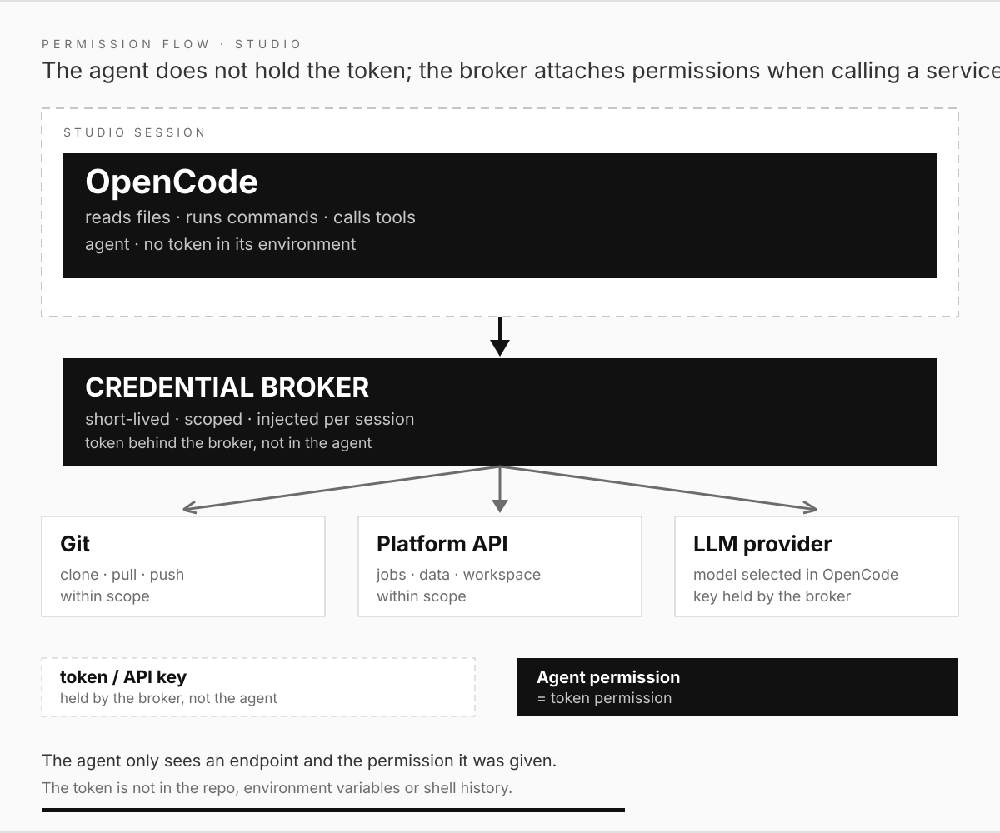

:::info
**This post explains how Studio and OpenCode handle permissions; it is not an installation guide.** If you are new to Studio, [Chapter 06 of the platform guide](/en/guide#studio) covers starting a session, connecting and saving a snapshot. The screenshots show the Vietnamese interface; the same controls appear in the English interface.
:::

## A coding agent needs permissions, but should not hold the token

A coding agent such as OpenCode can read a repository, edit files, run commands and check the result. To do that, it needs access to Git, sometimes the platform API and an LLM model. The usual approach is to put a token in an environment variable or a configuration file inside the container. That is convenient, but it leaves a long-lived token next to the agent: the token can be read, written to a log, copied into a repository, or used for something outside the intended task.

Studio handles this with a **credential broker**. The agent still has permission to work, but it does not hold the token. The token stays with the broker and is attached only when a service is called, within the permissions of that token.

## Studio in one paragraph

**Studio** opens an interactive application on workspace compute and displays it in the browser. Data stays in the workspace bucket; the session exists only while the job runs. When the session ends, a **snapshot** can save the home directory back to the workspace so work can continue later.

The point for this post: Studio is not just a terminal. It is an environment where data, compute and access permissions sit in one place. The credential broker is the layer between the agent and external services.

## The credential broker: permission through a narrow door

The diagram below shows the permission flow inside a Studio session:

*Figure 1 — The agent calls the broker inside the session; the broker attaches the credential when calling Git, Platform API or an LLM provider. The token does not enter the agent's environment.*

How it works, at the level needed here:

- **The broker runs inside the Studio session.** OpenCode calls a local endpoint and does not need to know the token.
- **The broker attaches the credential behind the scenes.** When the agent clones, pulls or pushes with Git, calls the Platform API or calls a model provider, the broker adds the credential to the request.
- **The token is short-lived and session-scoped.** It is not a long-lived key embedded in the container.
- **The agent sees only the endpoint and the result.** It cannot read the token value from environment variables, `.git-credentials`, `.netrc`, `.git/config` or shell history.

One detail can be confusing: in the check below, the agent calls the broker directly and receives `HTTP 200` without carrying a credential. That does not mean the broker is publicly open. The broker listens only inside the session; the session boundary authenticates the request, and the token is attached when the broker reaches an external service.

## OpenCode: choose the model, do not hold the key

OpenCode is a coding agent that runs in the Studio terminal. It can read files, search a codebase, edit code, run commands and inspect errors. In the screenshot below, the `opencode` tab is open in the terminal:

*Figure 2 — OpenCode runs in the Studio terminal. The agent can read files and run commands; the token is not in its environment.*

OpenCode is where you choose the **provider and model**. Configuration can live in `opencode.json` or be selected through OpenCode's model interface. On the managed Studio path, the provider credential is supplied by the broker; you do not paste the key into the chat, terminal or repository. The agent only sees the provider and model name. This applies to the provider API token, the platform token and the Git token.

For now, start with a **free model** in OpenCode. The screenshot uses a free model; no provider account is needed to become familiar with the workflow. Free models have limits on quality and speed, so they fit experimentation, learning and non-sensitive tasks.

## What the agent sees and does not see

| Component | Agent sees | Note |
| --- | --- | --- |
| Files in the workspace | Yes | Within the session's access |
| Terminal and shell commands | Yes | Within the session |
| Git remote | Broker endpoint | Not the token |
| Platform API | Through the broker | Within the platform token's scope |
| LLM provider | Provider and model | Key held by the broker/Studio |
| Token value | No | Not in env, files or repo |
| `.git-credentials`, `.netrc` | No token | The broker replaces these files |

The screenshot below is the agent checking its own environment:

*Figure 3 — The agent checks `.git/config`, `.git-credentials`, `.netrc`, environment variables and token-like strings in the repo. Result: no token; the Git remote is routed through the broker.*

## Agent permission equals token permission

The broker does not expand permissions. If a token can only read one repository, the agent cannot push to another repository. If a platform token has one scope, the agent can only do what that scope allows. For tighter limits, issue a read-only token or a token for one repository.

That is why token permissions still need review before running an agent. The broker reduces token exposure; it does not replace permission review. A broad token still gives the agent broad permission, even when the token never appears in the terminal.

:::tip
**Working rule:** grant the least permission and the shortest lifetime that still lets the job run; use a separate token per repository or purpose; revoke it when it is no longer needed. The agent should only work with the data and repositories that token actually needs.
:::

## Why this matters for a research group

A coding agent is most useful when it sits next to the data and the code. In Studio, the agent can:

- Read and explain an existing pipeline or script.
- Fix a bug, write a test, update documentation.
- Inspect a repository before opening a pull request.
- Run a small check in the terminal and report the result.

None of these need the agent to hold a long-lived token. They need the agent to have just enough permission, in a session that can end and be revoked. The credential broker makes access a property of the session, rather than a key left behind in the container.

## Start with a free model

1. Open a **Studio** session in the workspace.
2. Open the terminal and run `opencode`.
3. Choose a free model in OpenCode.
4. Give it a small task — read the repository, summarise a file, run a quick check — and watch it work within the current permissions.

For Git or the Platform API, the agent uses the broker instead of a token in the environment. If an action is refused, check the token's scope before widening it.

:::info
**Coming soon: an LLM provider in Vietnam and a full sandbox.** Vieomics is working with an LLM provider in Vietnam. When that is complete, Studio will move toward a full sandbox with new features, designed to keep prompts and data within Vietnam's legal scope. We will announce when it is available.

Until then, the free model is the right way to become familiar with the workflow. Avoid putting sensitive or personal data into an external provider before the configuration and agreements are in place. The compliance scope depends on the provider, the data and the configuration; we will publish it clearly when the service launches.
:::

## Common questions

**Can the agent read the token by running `env`?**  
No. The token is not placed in the agent's environment variables.

**Can the agent use the token to push code?**  
Yes, if the token has push permission. The broker passes the permission through; it does not expand it. To block pushes, issue a read-only token.

**Does the broker replace token permission review?**  
No. The broker reduces the chance of token exposure; the token still decides what the agent can do. Review its scope and lifetime.

**Is the free model enough?**  
It is enough to try the workflow and learn how the agent behaves. For long tasks, higher quality or sensitive data, wait for the in-country provider and the full sandbox.

## Get started

1. Create an account at [platform.omicslab.io](https://platform.omicslab.io). The steps are in the [registration guide](/en/guide#bat-dau-dang-nhap).
2. Open **Studio**, start a session and follow [Chapter 06](/en/guide#studio).
3. Run `opencode`, choose a free model and try a small task.
4. Need help? Write to [contact@omicslab.io](mailto:contact@omicslab.io).

## References

- OpenCode — [opencode.ai/docs](https://opencode.ai/docs/); providers — [opencode.ai/docs/providers](https://opencode.ai/docs/providers/); permissions — [opencode.ai/docs/permissions](https://opencode.ai/docs/permissions/)
- Studio guide — [Chapter 06: Studio](/en/guide#studio), [credential broker](/en/guide#studio-token)
- Platform docs — [Studio sessions](https://docs.omicslab.io/en/tools/studio/overview), [Quickstart](https://docs.omicslab.io/en/quickstart)
- Related posts — [A full nf-core/bacass run in the browser](/en/blogs/bacass-test-full-19-minutes), [How to Run nf-core Pipelines on the Omicslab Platform](/en/blogs/how-to-run-nf-core-pipelines-on-omicslab)
