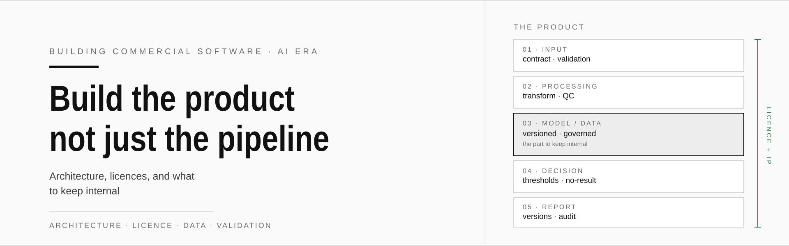
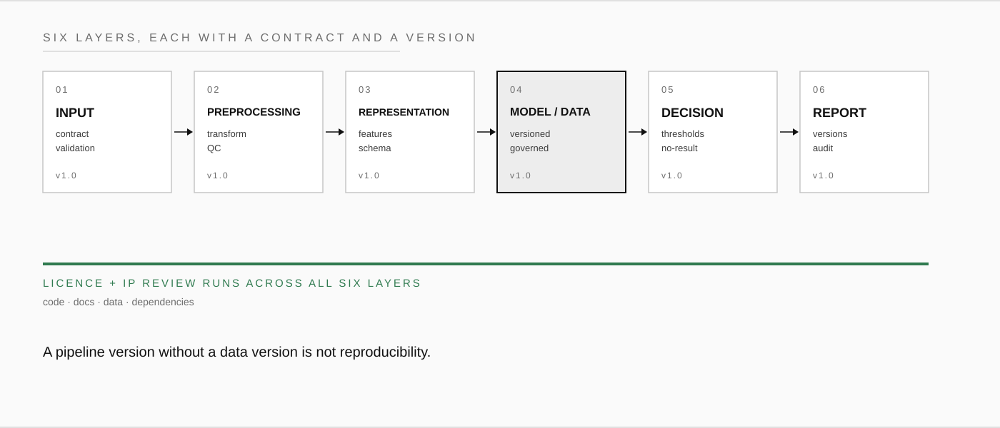
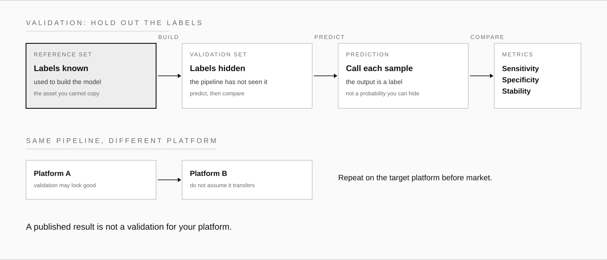

:::info
**TLDR.** AI is making implementation very fast, so the idea matters more than the code. Publishing everything with open source used to be a good way to prove a method; now reverse engineering is quick, so that strategy carries risk. In my opinion, keep the important parts internal — the data and the key algorithm idea — and register the trademark/patent in the right market.
:::

## 1. The product is a result, not a pipeline

Customers do not pay for code. They pay for a result they can reproduce, explain and defend in front of an expert panel or a regulator. That changes what you build first.

| | Research pipeline | Commercial pipeline |
|---|---|---|
| Contract | Loose files, manual edits | Samplesheet or API with a schema and validation |
| Reference | Rebuilt each run, no version | Versioned, with a manifest, QC and consent |
| Output | A raw table | A report with QC, no-result status and versions |
| Error handling | Abrupt stop, rerun by hand | Graceful failure with a clear cause |
| Licence | Usually ignored | SPDX registry and legal review |
| Validation evidence | None | Independent labels and pre-specified endpoints |
| Operations and support | Handled ad hoc | Audit trail, version management and support |

The gap is not the algorithm. It is the product wrapper: a defined input contract, a versioned reference, a report that records what happened, a no-result policy, a licence that permits commercial use, and validation evidence. A score table is not a product; a report with QC, version and a clear no-result reason is.

## 2. Architecture: separate the layers, then version them

A commercial pipeline is easier to validate and maintain when each layer has an explicit data contract. The six-layer pattern is a useful template:

*Figure 1 — Six layers, each with a contract and a version. The model/data layer is the part to keep internal; the licence and IP review runs across all six.*

The pattern is general. The model/data layer decides whether the result is trustworthy; the licence layer decides whether it can be sold. A pipeline version without a data version is not reproducibility — it is a snapshot of the code.

## 3. Runtime: lock the licence before choosing a framework

The first architecture decision is usually not the language or the workflow engine. It is the licence. A runtime that cannot be sold is a prototype.

| Layer | Covers | What to check |
|---|---|---|
| Code | Source, binaries, containers | Permissive? Copyleft? Non-commercial? |
| Docs | Text, figures, examples | Can you reuse them commercially? |
| Data | Reference data, training data, test data | Consent, terms, redistribution |
| Dependencies | Libraries, base images, system packages | The whole container is a distribution |

The four layers answer different questions. A permissive code licence does not grant the right to reuse a paper's figures. A paper's CC licence does not grant the right to use the code. A data repository's terms do not provide a clinical or commercial validation. A container is a distribution: a GPL tool inside an image can trigger obligations even when your own code is proprietary.

"Open source" is not "commercially usable". GPL-2.0 is open source and copyleft; CC BY-NC-SA is non-commercial; CC BY-NC-ND adds a no-derivatives term. A practical policy is to allow MIT, BSD-2/3, Apache-2.0, PSF-2.0 and ISC in the runtime, and to block CC BY-NC-*, GPL/AGPL/LGPL, SSPL/BUSL and unknown licences.

<strong>Public publication is not a commercial licence.</strong> A pipeline rarely has a single component: it also depends on libraries, containers and system tools. <strong>The main component may permit commercial use, but one restricted dependency is enough to block the product.</strong> Review the whole dependency tree and replace restricted components before packaging.

The code is replaceable; the licence constraint is not.

## 4. Validation: hide the label, predict it, and check stability

A published pipeline is not automatically right for your platform. A credible validation hides the label, lets the pipeline predict it, and compares the prediction with the truth; then it repeats this across cohorts and platforms to see whether performance is stable.

*Figure 2 — Validation: hold out the labels, predict, compare, and repeat on another platform. Report sensitivity, specificity and stability.*

For example, a pipeline may perform well on Platform A but not hold on Platform B. AI can generate a plausible pipeline in hours; it cannot generate the evidence that the pipeline works in your setting. There is no absolute right or wrong; the question is whether the evaluation is strong enough to show that the product is stable when it goes to market.

## 5. From validation to market

A mature commercial pipeline knows when to stop: too few valid inputs, poor input quality after filtering, or poor alignment or joining means the data has failed QC. In a regulated setting, a wrong result causes far more harm than no result. If the original sample is still available, regenerating the input is usually better than forcing an answer out of bad data.

To go to market, the validation result must sit in an evidence package that can be checked: independent labels, pre-specified endpoints, versions of data and code, a legal pathway, and a publication that states what the method can do and where its limits are. The practical build order is: product contract → licence → data asset → decision layer → reproducibility → evidence → publication. Lock down the contract and the licence first; those two eliminate more wrong designs than any algorithm.

Code is easy now, but the work still needs AI together with a domain expert — not AI alone.
