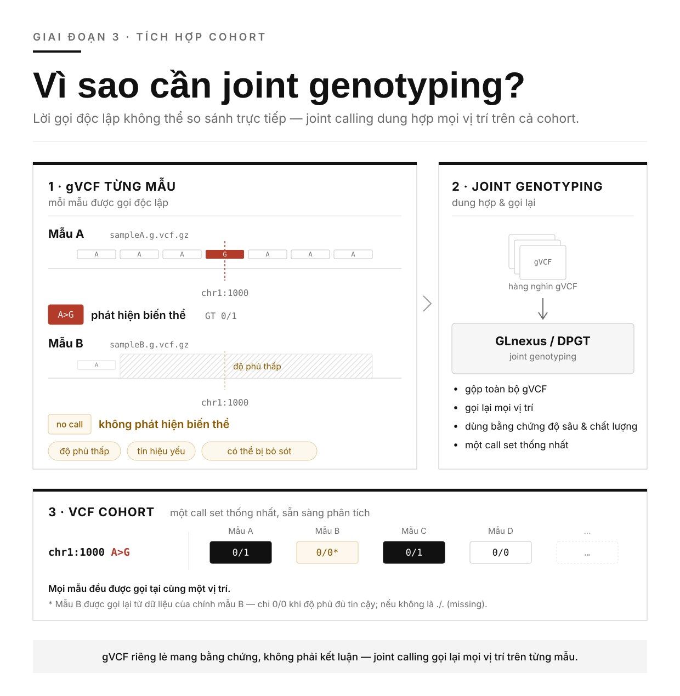

Các sáng kiến hệ gen quốc gia gần đây cho thấy nhu cầu ngày càng lớn về nguồn tài nguyên hệ gen đặc thù cho từng quần thể. Sau khi đọc [**_VN1K: a genome graph-based and function-driven multi-omics and phenomics resource for the Vietnamese population_**](https://www.biorxiv.org/content/10.1101/2025.04.15.648991v1) và [**_EGP1K: Whole-Genome Sequencing of 1,024 Egyptians Characterizes Population Structure and Genetic Diversity_**](https://www.biorxiv.org/content/10.64898/2026.04.02.715521v1), có thể thấy rõ việc xây dựng một dự án 1000 hệ gen quy mô quốc gia ngày càng quan trọng để hiểu về đa dạng di truyền, cải thiện nghiên cứu bệnh học và thúc đẩy y học chính xác.

Xin dành sự ghi nhận đặc biệt cho nhóm VN1K tại Viện Dữ liệu lớn Vingroup và các cộng sự. Việc xây dựng nguồn tài nguyên toàn diện đầu tiên cho quần thể người Việt — 1.011 cá nhân, gần 40 triệu biến thể với 8,5 triệu biến thể mới, cùng các lớp đa omics bao gồm methyl hóa từ dữ liệu đọc dài — đi kèm vô vàn thách thức, từ thu thập mẫu, giải trình tự độ sâu cao ở quy mô lớn đến tích hợp đa omics và khả năng truy cập dữ liệu. Công trình của họ đã mở đường cho những gì chuỗi bài này trình bày.

Trong chuỗi bài này, tôi phác thảo cách một quốc gia có thể thiết kế và triển khai một dự án ở quy mô tương tự — từ thu thập mẫu đến phân tích hệ gen cấp cohort. Nội dung tập trung vào khía cạnh kỹ thuật và kiến trúc để xây dựng nguồn tài nguyên 1000 hệ gen. Chuỗi bài không đề cập đến nền tảng dữ liệu hay cổng người dùng để truy cập dữ liệu đã xử lý; chủ đề đó sẽ được trình bày trong một bài riêng.

Mục tiêu là cung cấp một lộ trình thực tế, có khả năng mở rộng để các quốc gia — đặc biệt là những nước có hạ tầng genomics đang phát triển — có thể điều chỉnh cho sáng kiến hệ gen quốc gia của mình.

:::note{title="Về tác giả"}
**Giang Nguyen — Founder @ Vieomics.** Trong thời gian làm việc tại **DNAnexus**, tôi đã tham gia xây dựng hạ tầng bioinformatics và phân tích dữ liệu hệ gen quy mô lớn, bao gồm các khối lượng công việc với hàng trăm nghìn mẫu. Trong chuỗi bài này, tôi sẽ trình bày cách làm điều đó chỉ với **công cụ mã nguồn mở** — được kiểm chứng trên các mẫu thực tế, với những bộ dữ liệu nhỏ dùng cho proof of concept.
:::

## Tổng quan chuỗi bài

- **Phần 1 (bài này)**: Tầm nhìn và kiến trúc tổng thể
- **[Phần 2](/blogs/how-can-a-country-build-its-own-1000-genome-project-part-2)**: Nguyên tắc thiết kế và lộ trình triển khai
- **[Phần 3](/blogs/how-can-a-country-build-its-own-1000-genome-project-part-3)**: Gọi biến thể, phân tích cohort và tổ chức dữ liệu
- **[Phần 4](/blogs/how-can-a-country-build-its-own-1000-genome-project-part-4)**: Hạ tầng, nhân lực và hỗ trợ của Chính phủ: 2018 → 2026
- **[Phần 5](/blogs/how-can-a-country-build-its-own-1000-genome-project-part-5)**: Tóm tắt, mở rộng và những câu hỏi phía trước
## 1. Tầm nhìn — Vì sao mỗi quốc gia cần dự án 1000 Genomes của riêng mình

:::info
[Dự án 1000 Genomes](https://www.internationalgenome.org/) gốc (2008-2015) là một dấu mốc quan trọng của ngành hệ gen người — dự án đã tạo ra danh mục toàn diện đầu tiên về biến thể di truyền toàn cầu, cung cấp bản đồ tham chiếu giúp việc gọi biến thể và di truyền học quần thể trở nên phổ biến. Nhưng vấn đề nằm ở đây: dù vô cùng giá trị trên phạm vi toàn cầu, dữ liệu đó không đại diện đầy đủ cho quần thể, thách thức y tế hay bối cảnh di truyền của từng quốc gia.
:::

### 1.1. Hệ gen tham chiếu toàn cầu vẫn chưa đủ

Phân tích hệ gen hiện đại phụ thuộc rất nhiều vào tần số biến thể đặc thù của từng quần thể. Khi thực hiện giải nghĩa biến thể, chẩn đoán bệnh hiếm hay dược di truyền học, bạn cần biết: _Biến thể này phổ biến đến mức nào trong quần thể mà tôi đang điều trị?_ Dự án 1000 Genomes khảo sát khoảng 2.500 cá nhân thuộc nhiều quần thể khác nhau, nhưng biến thể di truyền trong quần thể địa phương của bạn — được định hình bởi lịch sử di cư, hiệu ứng sáng lập (founder effect) và áp lực tiến hóa riêng — có thể khác biệt đáng kể.

**Ý nghĩa lâm sàng là có thật:**

- Một biến thể được xem là "hiếm" trên toàn cầu có thể lại phổ biến trong quần thể của bạn
- Các nghiên cứu liên kết bệnh cần dữ liệu tần số allele tại địa phương
- Chiến lược y học chính xác phải tính đến các allele nguy cơ đặc thù của quần thể
- Chẩn đoán bệnh hiếm trở nên chính xác hơn khi có bối cảnh địa phương

### 1.2. Chủ quyền và quyền sở hữu dữ liệu

Các dự án hệ gen quy mô lớn không chỉ tạo ra dữ liệu — chúng tạo ra _hạ tầng_, _chuyên môn_ và _giá trị kinh tế_. Những quốc gia tự xây dựng dự án của mình sẽ có được:

- **Chủ quyền dữ liệu**: kiểm soát hoàn toàn dữ liệu sức khỏe nhạy cảm thay vì phụ thuộc vào các liên minh quốc tế
- **Vị thế dẫn dắt nghiên cứu**: khả năng thực hiện các nghiên cứu đặc thù cho quần thể mà không phụ thuộc bên ngoài
- **Cơ hội kinh tế**: hệ sinh thái công nghệ sinh học trong nước có thể khai thác dữ liệu cho phát triển thuốc và chẩn đoán
- **Đổi mới y tế**: con đường trực tiếp từ kết quả nghiên cứu đến thực hành lâm sàng

### 1.3. Học hỏi từ các dự án quốc gia do nhà nước dẫn dắt

Tin tốt là: nhiều quốc gia đã và đang xây dựng các dự án hệ gen quy mô lớn. Dưới đây là những bài học từ họ:

- **UK Biobank** giải trình tự hơn 500 nghìn hệ gen gắn với hồ sơ sức khỏe theo thời gian, chứng minh cách dữ liệu hệ gen ở quy mô lớn thúc đẩy khám phá bệnh học toàn dân và y học chính xác
- **All of Us Research Program** (Mỹ) cho thấy cách mở rộng lên hơn 1 triệu hệ gen với quản trị dữ liệu và sự tham gia tích cực của người tham gia
- **Biobank Japan** minh họa cách tích hợp dữ liệu hệ gen với hồ sơ sức khỏe theo thời gian cho các nghiên cứu liên kết bệnh
- **Chương trình Y học Chính xác Quốc gia của Singapore** cho thấy tần số allele đặc thù quần thể cải thiện chẩn đoán và điều trị trong điều kiện nguồn lực hạn chế
- **BGI và các sáng kiến quốc gia của Trung Quốc** thể hiện hạ tầng xử lý cohort khổng lồ ở quy mô lớn
- **Australian Genomics của Úc** minh họa mô hình quản trị liên kết giữa nhiều tổ chức và bang
- **Nhiều quốc gia khác** đang xây dựng các ngân hàng sinh học quần thể để hỗ trợ đất nước mình: Hàn Quốc, Thụy Điển, Phần Lan và nhiều nước khác

Các chương trình này có những điểm chung: đều chuẩn hóa gọi biến thể, triển khai chiến lược joint genotyping, xây dựng tầng phân tích toàn cohort và đầu tư mạnh vào quản trị dữ liệu. **Bản thiết kế kỹ thuật đã được các chương trình này kiểm chứng — giờ là lúc điều chỉnh nó cho nguồn lực, quần thể và ưu tiên y tế của từng quốc gia.**


_Hình 1: Tổng quan các nguồn tài nguyên hệ gen trong những ngân hàng sinh học quốc gia. a Phân bố địa lý của các ngân hàng sinh học, với số mẫu thể hiện tổng quy mô cohort mà mỗi ngân hàng hướng tới hoặc đã đạt được. Các ngân hàng sinh học lớn sở hữu bộ dữ liệu WGS quy mô trên 10.000 cá nhân được làm nổi bật. Dấu hoa thị (“\*”) biểu thị quy mô cohort mục tiêu. b Thông tin chi tiết về kích thước mẫu WGS, thành phần tổ tiên và tình trạng sức khỏe của các bộ dữ liệu ngân hàng sinh học tương ứng đã được công bố gần đây_

Tham khảo: https://link.springer.com/article/10.1186/s44342-025-00040-9

### 1.4. Học hỏi từ các dự án do công ty tư nhân dẫn dắt

Trong khi các chương trình quốc gia và nhà nước chiếm ưu thế, các công ty và tổ chức tư nhân cũng đã xây dựng những sáng kiến hệ gen quy mô lớn đáng chú ý. Hiểu cách họ làm mang lại bài học giá trị về hạ tầng, khả năng mở rộng và quản trị dữ liệu.

**Công ty cung cấp dịch vụ trực tiếp cho người tiêu dùng (DTC)**

- **23andMe** - hơn 15 triệu người dùng đã genotyped với cơ sở dữ liệu nghiên cứu độc quyền và thông tin sức khỏe. Cho thấy khả năng thu hút người tiêu dùng ở quy mô khổng lồ, dù vẫn còn lo ngại về quyền riêng tư
- **AncestryDNA** - hơn 20 triệu người dùng đã genotyped, tập trung vào nguồn gốc tổ tiên và kết nối gia đình. Cho thấy bối cảnh phả hệ thúc đẩy mức độ chấp nhận và tham gia như thế nào

**Dược phẩm & phát triển thuốc**

- **Regeneron Genetics Center (DiscovEHR)** - exome của khoảng 50 nghìn bệnh nhân gắn với hồ sơ sức khỏe điện tử. Mô hình tham chiếu cho hợp tác dược phẩm - y tế; cho thấy việc tích hợp dữ liệu lâm sàng có thể làm tăng giá trị nghiên cứu
- **Genentech/Roche** - xây dựng cơ sở dữ liệu hệ gen nội bộ từ các thử nghiệm lâm sàng và mạng lưới đối tác. Tập trung vào ung thư học chính xác và bệnh hiếm
- **GSK (GlaxoSmithKline)** - các quan hệ đối tác genomics nhằm thu thập cơ sở dữ liệu di truyền để xác định đích tác dụng. Cho thấy cách các công ty dược tài trợ cho hạ tầng quy mô lớn

**Công ty genomics lâm sàng & chẩn đoán**

- **Invitae** - khoảng 5 triệu hồ sơ xét nghiệm di truyền (phòng xét nghiệm di truyền lâm sàng lớn nhất). Việc chuẩn hóa gọi biến thể trên hàng triệu mẫu chẩn đoán cho thấy các phòng xét nghiệm lâm sàng duy trì chất lượng ở quy mô lớn như thế nào
- **Tempus** - hơn 10 triệu hồ sơ hệ gen đã khử nhận dạng với phân tích hỗ trợ AI. Nền tảng tập trung vào ung thư cho thấy giá trị của các tầng phân tích thống nhất
- **Foundation Medicine (Roche)** - hơn 1,5 triệu hồ sơ bệnh nhân. Ung thư học chính xác ở quy mô lớn — cho thấy các cohort tập trung có thể tạo ra tác động lâm sàng

**Hạ tầng toàn cầu & giải trình tự**

- **Illumina (Mỹ)** - cung cấp giải pháp đầu-cuối cho genomics: thiết bị giải trình tự, nền tảng đi kèm và bộ công cụ riêng cho phân tích ở quy mô quần thể (DRAGEN, Illumina Connected Analytics). Cho thấy một nhà cung cấp có thể nắm trọn con đường từ thiết bị đến kết quả
- **BGI (Trung Quốc)** - công ty giải trình tự lớn nhất toàn cầu với cơ sở dữ liệu nội bộ khổng lồ và quan hệ đối tác bệnh viện. Thể hiện hạ tầng và hiệu quả chi phí ở quy mô lớn

**Bài học chính từ các chương trình tư nhân:**

Các tổ chức tư nhân thành công vì họ:

1. **Gắn genomics với kết quả có thể hành động** (chẩn đoán, điều trị, phát triển thuốc) — không chỉ nghiên cứu
2. **Đầu tư mạnh vào chuẩn hóa dữ liệu** (gọi biến thể nhất quán, pipeline chú giải)
3. **Xây dựng hạ tầng cloud-native** từ sớm để đảm bảo khả năng mở rộng
4. **Tích hợp trực tiếp với quy trình lâm sàng**, tạo hiệu ứng mạng

Với các chương trình quốc gia, mô hình khu vực tư nhân dạy chúng ta rằng **tính hữu dụng của dữ liệu thúc đẩy sự tham gia**. Mọi người đóng góp mẫu khi thấy lợi ích lâm sàng trực tiếp (chẩn đoán, thông tin sức khỏe) hoặc khi việc tham gia phù hợp với động lực cá nhân (nguồn gốc tổ tiên, y học chính xác).

### 1.5. Thách thức kỹ thuật

Xây dựng một dự án quy mô 1000 Genomes đòi hỏi:

- Hàng nghìn trình tự hệ gen chất lượng cao
- Gọi biến thể chuẩn hóa trên tất cả các mẫu
- Genotyping thống nhất giữa các cohort
- Hạ tầng lưu trữ và truy vấn cho hàng chục terabyte dữ liệu
- Pipeline thống kê quần thể và chú giải biến thể
- Khung quản trị và đạo đức

Nhưng đây là điểm mấu chốt từ các chương trình hiện có: **phần mềm, pipeline và hạ tầng đã đủ trưởng thành** để điều này trở nên khả thi với bất kỳ chương trình quốc gia nào có đủ nguồn lực.

Chuỗi bài này dẫn bạn đi qua kiến trúc, các quyết định thiết kế và chiến lược triển khai để xây dựng một dự án hệ gen quốc gia — từ gọi biến thể đến phân tích cohort.

## 2. Kiến trúc tổng thể

Về bản chất, một dự án hệ gen quốc gia là một pipeline biến đổi dữ liệu: reads giải trình tự thô → biến thể chuẩn hóa → kiểu gen toàn cohort → dữ liệu sẵn sàng cho nghiên cứu. Kiến trúc phải xử lý quy mô khổng lồ, đảm bảo tính nhất quán trên hàng nghìn mẫu và đáp ứng các yêu cầu nghiêm ngặt về quản trị dữ liệu.

Dưới đây là kiến trúc chúng ta sẽ xây dựng, dựa trên những thành phần thực tế, đã được chứng minh:


_Hình 2: Kiến trúc đầu-cuối thể hiện dòng dữ liệu từ giải trình tự thô đến phân tích quần thể, với các công cụ và tầng lưu trữ cụ thể ở từng bước._

### 2.1. Giai đoạn 1: Hạ tầng lõi với cụm HPC SLURM

:::tip
**Vì sao chọn SLURM?**

- **Được dùng phổ biến:** đây là scheduler được dùng rộng rãi nhất trong HPC và bioinformatics, nên chuyên môn, tài liệu và công cụ luôn sẵn có — và nó mở rộng từ vài chục đến hàng nghìn node.
- **Xử lý theo lô (batch):** các bước theo từng mẫu — alignment, QC, gọi biến thể — chạy thành các job batch trải trên toàn cụm.
- **Tổng hợp cohort phân tán:** joint genotyping, QC cohort và thống kê quần thể chạy phân tán trên chính cụm đó, không cần thêm tầng điều phối riêng — cách làm này cũng phù hợp với các nhóm và công ty vừa và nhỏ, không chỉ các chương trình quốc gia.
- **Spark trên SLURM:** khi cần Spark (ví dụ cho joint genotyping cohort lớn), chuỗi bài này chạy [Spark trên nền SLURM](https://github.com/vieomics/omicslab-kit/tree/main/spark-on-slurm) thay vì dựng một cụm Spark riêng — một cách làm giúp giảm hẳn một tầng thiết lập và vận hành.
- **Vừa vặn với quy mô 1k, kèm đường mở rộng:** dự án 1000 hệ gen nằm gọn trong một cụm SLURM. Với cohort lớn hơn nhiều, cloud là hướng được khuyến nghị — và cùng bộ workflow có thể chuyển lên đó khi cần.
- Đồng thời dễ dàng tích hợp với nhà cung cấp cloud và S3 trong nước.
:::

:::info

- Proof of Concept xây dựng cụm SLURM điển hình cho phân tích bioinformatics: https://github.com/vieomics/omicslab-hpc
:::

Nền tảng là một cụm tính toán hiệu năng cao được quản lý bởi SLURM.


_Hình 3: Kiến trúc cụm HPC SLURM và lưu trữ đối tượng đơn giản S3_

**Thiết lập chính:**

- **Tự động hóa bằng Ansible**: dùng playbook Ansible [**omicslab-hpc**](https://github.com/vieomics/omicslab-hpc) đã được kiểm chứng để cấu hình SLURM từ đầu
  - Tự động cấp phát node và lập lịch job
  - Chính sách phân bổ tài nguyên tối ưu cho khối lượng công việc bioinformatics
  - Tích hợp mạng và lưu trữ
- **Tính toán tại chỗ**: mọi xử lý diễn ra tại chỗ, không đẩy dữ liệu ra ngoài cloud
- **Truy cập S3 trực tiếp**: các node SLURM có thể đọc/ghi trực tiếp vào lưu trữ S3 nội địa

### 2.2. Giai đoạn 2: Gọi biến thể chuẩn hóa

:::info

- Proof of Concept gọi biến thể germline từ dữ liệu đọc ngắn: https://github.com/vieomics/nf-germline-short-read-variant-calling
- Các module và subworkflow chung được phát triển và duy trì với phần tùy biến tại: https://github.com/vieomics/nf-modules
:::

Mỗi hệ gen phải trải qua cùng một logic gọi biến thể. Đây là điều không thể thương lượng đối với phân tích cohort.

**Pipeline: `nf-germline-short-read-variant-calling`**

- Xây dựng trên Nextflow để đảm bảo khả năng tái lập và tính di động
- Được benchmark kỹ lưỡng về độ chính xác và hiệu quả
- Được benchmark để so sánh các lựa chọn cho một dự án gọi biến thể quy mô lớn
- Tối ưu để chạy hiệu quả trên các cụm SLURM
- Xuất ra các tệp gVCF riêng cho từng mẫu (định dạng genome VCF — biến thể thô theo mẫu)

**Vì sao dùng gVCF?** Định dạng này không chỉ chứa các biến thể được gọi mà còn cả "no-call đáng tin cậy" tại từng vị trí hệ gen. Điều này rất quan trọng cho joint genotyping về sau — nếu thiếu, bạn sẽ mất thông tin về độ sâu bao phủ và chất lượng kiểu gen.

**Quy mô:** xử lý 100 mẫu/tháng ở độ phủ 30x:

- Gọi biến thể từng mẫu: khoảng 4-6 giờ mỗi hệ gen trên một node tiêu chuẩn. Nhanh hơn với GPU khi dùng DeepVariant
- Có thể song song hóa qua hàng đợi SLURM


_Hình 4: Pipeline Nextflow gọi biến thể từ dữ liệu đọc ngắn trên nền tảng Illumina, tối ưu cho WGS 30X. Pipeline tích hợp với **nf-modules** để chuẩn hóa và chia sẻ các thành phần chung giữa các pipeline_

### 2.3. Giai đoạn 3: Joint genotyping — tích hợp cohort

:::info

- Proof of Concept joint genotyping bằng GLnexus: https://github.com/vieomics/omicslab-kit/tree/main/glnexus
- Proof of Concept joint genotyping bằng DPGT: https://github.com/vieomics/omicslab-kit/tree/main/dpgt
- Spark trên SLURM để DPGT có thể submit job: https://github.com/vieomics/omicslab-kit/tree/main/spark-on-slurm
:::

Sau khi gọi biến thể, bạn có hàng nghìn tệp gVCF riêng lẻ, mỗi mẫu được gọi độc lập. Nhưng gọi độc lập chưa đủ cho genomics quy mô quần thể. Bạn phải kết hợp chúng thành một VCF cohort bằng joint variant calling.



_Hình 5: Joint genotyping dung hợp các lời gọi riêng lẻ. Tại chr1:1000, gVCF của mẫu A ghi nhận biến thể A>G trong khi mẫu B không ghi nhận biến thể — có thể do độ phủ thấp hoặc tín hiệu dưới ngưỡng gọi biến thể, chứ không có nghĩa là đồng hợp tử reference. Joint calling gọi lại kiểu gen tại mọi vị trí trên từng mẫu dựa trên bằng chứng độ sâu và chất lượng mà mỗi gVCF lưu giữ, tạo ra một VCF cohort với kiểu gen có thể so sánh trên toàn bộ cohort._

**Bốn phương án trong một bảng**

Cả bốn công cụ đều nhận gVCF theo từng mẫu và tạo ra call set cohort, nhưng khác nhau về phương pháp, giấy phép và — quan trọng nhất — điều gì xảy ra khi có mẫu mới:

| Công cụ | Phương pháp | Thêm mẫu mới | Quy mô |
| --- | --- | --- | --- |
| **GLnexus** (Apache-2.0) | Joint genotyping | ❌ Chạy lại toàn bộ | ~100k mẫu |
| **DPGT** (GPL-3.0) | Joint genotyping (Spark) | ❌ Chạy lại toàn bộ (tiếp tục được sau gián đoạn) | Hàng triệu mẫu |
| **DRAGEN iGG** — Illumina (độc quyền) | Joint genotyping | ✅ Tổng hợp tăng dần theo lô | Cohort quy mô quần thể |
| **Hail VDS combiner** (MIT) | Chỉ kết hợp (không gọi lại kiểu gen) | ✅ Tăng dần, khởi động lại được | Hơn 150k hệ gen (gnomAD) |

_Chỉ ba công cụ đầu gọi lại kiểu gen từ bằng chứng gVCF. Hail VDS combiner dung hợp các call set mà không xem lại kiểu gen từng mẫu, nên không thể cải thiện chất lượng biến thể như joint genotyping._

**Phương án A: GLnexus (hiệu quả, khuyến nghị cho dưới 100k mẫu)**
:::warning

- Joint calling có thể chạy song song theo từng vùng của tệp BED
- Cần các vùng lân cận (flanking region) chủ yếu vì cách biểu diễn và chuẩn hóa biến thể có thể vượt ra ngoài cửa sổ mục tiêu, đặc biệt với indel và biến thể phức tạp.
:::

```bash
# GLnexus merges gVCFs into a cohort VCF
glnexus_cli --config DeepVariant_h37 --bed <bed file> *.gvcf.gz > cohort.bcf
bcftools view cohort.bcf -O z > cohort.vcf.gz
```

- Nhanh hơn đáng kể so với GATK GenotypeGVCFs
- Chất lượng phù hợp cho cohort quy mô trung bình
- Tiết kiệm bộ nhớ (có thể chạy trên phần cứng khiêm tốn)
- ⚠️ **Không có chế độ tăng dần:** thêm một lô mẫu mới — ví dụ 200 mẫu vào 1.000 mẫu hiện có — đồng nghĩa phải chạy lại joint genotyping cho toàn bộ cohort

**Phương án B: DPGT với Spark (mã nguồn mở, dựng cho quy mô lớn)**

```bash
#!/bin/bash
# DPGT runner for joint genotyping cohort VCF

set -euo pipefail

PROJECT_ROOT="$(cd "$(dirname "${BASH_SOURCE[0]}")/.." && pwd)"
BUILD_LIB_PATH="${PROJECT_ROOT}/build/lib"
DPGT_JAR="${PROJECT_ROOT}/DPGT/target/dpgt-1.3.2.0.jar"

# Defaults (override with env vars if needed)
INPUT_LIST="${INPUT_LIST:-${PROJECT_ROOT}/cohort_vcf/1KGP/gvcf_input.list}"
REFERENCE_FASTA="${REFERENCE_FASTA:-${PROJECT_ROOT}/reference/Homo_sapiens_assembly38.fasta}"
OUTPUT_DIR="${OUTPUT_DIR:-${PROJECT_ROOT}/cohort_vcf/1KGP/results}"
TARGET_REGION="${TARGET_REGION:-chr12:111760000-111763759}"
JOBS="${JOBS:-4}"
ALLOW_OVERWRITE="${ALLOW_OVERWRITE:-0}"

echo "================================"
echo "DPGT Cohort VCF Runner"
echo "================================"
echo ""

# Check prerequisites
echo "Checking prerequisites..."
if [ -z "$DPGT_JAR" ] || [ ! -f "$DPGT_JAR" ]; then
    echo "ERROR: DPGT JAR not found at $DPGT_JAR"
    echo "Run 'make build' to compile DPGT first"
    exit 1
fi

if [ ! -f "$BUILD_LIB_PATH/libcdpgt.so" ]; then
    echo "ERROR: libcdpgt.so not found at $BUILD_LIB_PATH"
    echo "Run 'make build-cpp' to compile C++ libraries"
    exit 1
fi

if [ ! -f "$INPUT_LIST" ]; then
    echo "ERROR: input list not found: $INPUT_LIST"
    echo "Create it with one gVCF path per line (3-sample trio supported)."
    echo "Example existing list: ${PROJECT_ROOT}/gvcf_input.list"
    exit 1
fi

if [ ! -f "$REFERENCE_FASTA" ]; then
    echo "ERROR: reference fasta not found: $REFERENCE_FASTA"
    exit 1
fi

if [ -d "$OUTPUT_DIR" ] && [ "$(ls -A "$OUTPUT_DIR" 2>/dev/null || true)" != "" ]; then
    if [ "$ALLOW_OVERWRITE" = "1" ]; then
        echo "Output exists. Removing: $OUTPUT_DIR"
        rm -rf "$OUTPUT_DIR"
    else
        echo "ERROR: output directory exists and is not empty: $OUTPUT_DIR"
        echo "Set ALLOW_OVERWRITE=1 or choose another OUTPUT_DIR"
        exit 1
    fi
fi

echo "DPGT JAR: $DPGT_JAR"
echo "C++ Library: $BUILD_LIB_PATH/libcdpgt.so"
echo "Input List: $INPUT_LIST"
echo "Reference: $REFERENCE_FASTA"
echo "Output Dir: $OUTPUT_DIR"
echo "Region: $TARGET_REGION"
echo ""
echo "Note: default region is a small smoke-test interval."
echo ""

# Runtime environment
export LD_LIBRARY_PATH="$BUILD_LIB_PATH:${LD_LIBRARY_PATH:-}"

echo "Running DPGT joint genotyping..."
echo ""

# Some environments need explicit local filesystem implementations for Spark/Hadoop
java \
  -Dspark.hadoop.fs.file.impl=org.apache.hadoop.fs.LocalFileSystem \
  -Dspark.hadoop.fs.AbstractFileSystem.file.impl=org.apache.hadoop.fs.local.LocalFs \
  -cp "$DPGT_JAR" \
  org.bgi.flexlab.dpgt.jointcalling.JointCallingSpark \
  -i "$INPUT_LIST" \
  -r "$REFERENCE_FASTA" \
  -o "$OUTPUT_DIR" \
  -j "$JOBS" \
  -l "$TARGET_REGION" \
  --local

echo ""
echo "Run complete."
echo "Output files in: $OUTPUT_DIR"
find "$OUTPUT_DIR" -maxdepth 1 -type f -name "result*.vcf.gz" -print || true
```

- Mã nguồn mở (GPL-3.0), xây dựng trên Apache Spark cho tính toán phân tán
- Mở rộng gần như tuyến tính theo số lượng mẫu — thiết kế cho cohort tới hàng triệu mẫu
- Có thể tiếp tục tác vụ sau khi bị gián đoạn, nên lỗi giữa một run dài không phải chạy lại từ đầu
- Cần cụm Spark (có thể chạy trên chính hạ tầng SLURM)
- ➕ Thêm mẫu mới vẫn phải chạy lại toàn bộ — DPGT không hỗ trợ joint calling tăng dần

**Phương án C: Illumina DRAGEN Iterative gVCF Genotyper (độc quyền)**

[DRAGEN iterative gVCF Genotyper (iGG)](https://help.dragen.illumina.com/dragen-v4.5/product-guides/dragen-v4.5/dragen-dna-pipeline/iterative-gvcf-genotyper) của Illumina giải quyết trực tiếp vấn đề chạy lại: công cụ tổng hợp gVCF theo từng lô, nên khi thêm mẫu mới chỉ cần chạy lô mới qua bước đầu tiên rồi tổng hợp lại census của cohort — không phải làm lại toàn bộ từ đầu. Đánh đổi: đây là **tính năng có phí, mã nguồn đóng, tính theo gigabase** dữ liệu đầu vào, và gVCF đầu vào phải đến từ hệ sinh thái DRAGEN.

**Phương án D: Hail VDS Combiner (chỉ kết hợp)**

Nếu bạn chỉ cần kết hợp các call set — không cần gọi lại kiểu gen — [VariantDatasetCombiner](https://hail.is/docs/0.2/vds/index.html) của Hail là lựa chọn mã nguồn mở: có thể khởi động lại, chịu lỗi và kết hợp tăng dần gVCF với các VDS hiện có (150.000 hệ gen của gnomAD được xây theo cách này). Hạn chế: công cụ **kết hợp** dữ liệu và giữ nguyên lời gọi hiện có của từng mẫu — không chạy bước gọi lại kiểu gen chung, nên không cải thiện chất lượng biến thể như GLnexus, DPGT hay iGG.

**Đầu ra:** một tệp `cohort.vcf.gz` duy nhất chứa tất cả mẫu và tất cả biến thể. Với dự án khoảng 1000 mẫu, tệp có thể lên tới 200–500 GB (tùy thuộc vào mức đa dạng của biến thể và mẫu)

### 2.4. Giai đoạn 4: QC cohort và chuyển đổi định dạng (Hail)

:::tip

- Proof of Concept cho Hail: https://github.com/vieomics/omicslab-kit/hail
- Hail nên được chạy trên cụm Spark đặt trên SLURM: https://github.com/vieomics/omicslab-kit/spark-on-slurm
:::

VCF cohort thô chưa sẵn sàng cho phân tích. Nó cần được QC và chuyển đổi sang các định dạng hiệu quả. Việc QC cần được điều chỉnh theo chất lượng của dữ liệu đầu vào

**Dùng MatrixTable của Hail:**

```python
# Load cohort VCF into Hail
mt = hl.import_vcf('cohort.vcf.gz')

# Sample-level QC
mt = mt.filter_cols(hl.agg.count_where(mt.GT.is_non_ref()) > 100)

# Variant-level QC
mt = mt.filter_rows(hl.agg.count_where(mt.GT.is_non_ref()) > 0)

# Export to multiple formats for different tools
mt.export('cohort.plink')      # PLINK format for association studies
mt.export_bgen('cohort.bgen')  # BGEN format (more efficient)
mt.write('cohort.vds')         # Hail VDS (best for Hail)
```

**Các định dạng xuất cho từng mục đích sử dụng:**

- **PLINK (.bed/.bim/.fam)**: định dạng chuẩn cho GWAS, phân tích liên kết
- **BGEN**: định dạng nhị phân gọn nhẹ, hiệu quả cho cohort lớn
- **VDS (định dạng của Hail)**: định dạng gốc của Hail, nhanh nhất cho các phân tích Hail về sau
- **Hail MatrixTable**: biểu diễn trong bộ nhớ cho phân tích tương tác

**Lọc QC loại bỏ:**

- Các mẫu có quá nhiều dữ liệu thiếu
- Các mẫu có mức dị hợp tử bất thường hoặc sai lệch giới tính
- Các biến thể có call rate thấp hoặc vi phạm cân bằng Hardy-Weinberg
- Các biến thể có tần số allele ngoại lệ

### 2.5. Giai đoạn 5: Lưu trữ dữ liệu dài hạn & chính sách truy cập

:::tip
**Chiến lược chủ quyền dữ liệu:** thay vì tự xây dựng hạ tầng lưu trữ tại chỗ, hãy hợp tác với một **nhà cung cấp S3 trong nước** (cloud hoặc do nhà nước hậu thuẫn) để lưu trú dữ liệu dài hạn. Cách này giữ dữ liệu trong nước mà không cần đầu tư vốn lớn vào phần cứng lưu trữ.
:::

:::info
Ngày nay, dữ liệu nên được truy cập qua nền tảng dữ liệu, nơi người dùng cần:

- Học và vượt qua các khóa đào tạo; chỉ khi đó người dùng mới được phép dùng dữ liệu để phân tích trên nền tảng được kiểm soát. Họ không được phép tải xuống dữ liệu hoặc dữ liệu trung gian có thể làm lộ/nhận dạng cá nhân.
- Không chỉ ràng buộc bằng chính sách, nền tảng dữ liệu cũng cần có khả năng giới hạn người dùng theo kiến trúc của chính nền tảng
:::

**Kiến trúc:**

Kiến trúc hệ thống gồm:

- **Cụm SLURM (tại chỗ)** truy cập S3 trực tiếp qua peering mạng nội bộ
- **Bucket S3 (nhà cung cấp trong nước)** chứa:
  - gVCF thô (lưu trữ, bất biến, 10 năm)
  - VCF cohort (các bản phát hành có phiên bản)
  - MatrixTable cohort (định dạng gốc Hail)
  - Các định dạng phân tích cuối cùng (PLINK/BGEN/VDS/MT)

**Vì sao chọn mô hình hợp tác này?**

- **Chủ quyền dữ liệu**: trong mô hình triển khai được mô tả ở đây, dữ liệu hệ gen được giữ trong nhà cung cấp S3 trong nước đã chọn, không chuyển ra nước ngoài
- **Không gánh nặng vốn**: lưu trữ trả phí theo mức sử dụng
- **Khả năng mở rộng**: mở rộng từ 10TB lên hơn 100TB mà không cần thay phần cứng
- **Hiệu năng**: truy cập mạng trực tiếp từ cụm SLURM (peering nội bộ, không qua internet)
- **Tuân thủ**: đáp ứng các chính sách lưu trú dữ liệu nghiêm ngặt và yêu cầu pháp lý
- **Tích hợp**: Nextflow, Hail và SLURM đều hỗ trợ S3 gốc
- **Tuổi thọ**: hợp đồng đối tác giúp dữ liệu vẫn sẵn sàng vượt thời gian dự án (5-10 năm)

**Giá trị dài hạn:** sau khi dự án 1k mẫu hoàn thành, hạ tầng S3 này vẫn sẵn sàng cho các mở rộng trong tương lai (lưu trữ đa omics, dữ liệu cohort bệnh học, lưu trữ dài hạn)

:::tip
Ở [Phần 2](/blogs/how-can-a-country-build-its-own-1000-genome-project-part-2), chúng ta đi vào các nguyên tắc thiết kế — chuẩn hóa, song song hóa theo vùng, phân tầng lưu trữ và quản trị liên kết — cùng lộ trình triển khai 5 giai đoạn.
:::

## Tài liệu tham khảo

### Repository của chuỗi bài

1. **omicslab-hpc** — tự động hóa Ansible để dựng cụm SLURM HPC. https://github.com/vieomics/omicslab-hpc
2. **nf-germline-short-read-variant-calling** — pipeline gọi biến thể germline chuẩn hóa từ dữ liệu đọc ngắn. https://github.com/vieomics/nf-germline-short-read-variant-calling
3. **nf-modules** — module và subworkflow Nextflow dùng chung giữa các pipeline trong chuỗi bài. https://github.com/vieomics/nf-modules
4. **omicslab-kit** — các triển khai gkit (GLnexus, DPGT, Spark-on-SLURM, Hail). https://github.com/vieomics/omicslab-kit

### Nguồn & đọc thêm

5. **VN1K (2025)** — VN1K: nguồn tài nguyên đa omics và phenomics dựa trên genome graph cho quần thể người Việt (bioRxiv). https://www.biorxiv.org/content/10.1101/2025.04.15.648991v1
6. **EGP1K (2026)** — giải trình tự toàn hệ gen của 1.024 người Ai Cập: cấu trúc quần thể và đa dạng di truyền (bioRxiv). https://www.biorxiv.org/content/10.64898/2026.04.02.715521v1
7. **Dự án 1000 Genomes** — nguồn tham chiếu quốc tế về biến thể di truyền người. https://www.internationalgenome.org/
8. **Lee et al. (2025)** — bài học từ các dự án ngân hàng sinh học quốc gia sử dụng giải trình tự toàn hệ gen (Genomics & Informatics). https://link.springer.com/article/10.1186/s44342-025-00040-9
9. **PoC joint genotyping với GLnexus** — https://github.com/vieomics/omicslab-kit/tree/main/glnexus
10. **PoC joint genotyping với DPGT** — https://github.com/vieomics/omicslab-kit/tree/main/dpgt
11. **PoC Spark trên SLURM** — https://github.com/vieomics/omicslab-kit/tree/main/spark-on-slurm
12. **PoC Hail** — https://github.com/vieomics/omicslab-kit/hail
13. **DPGT (2026)** — "DPGT: A spark based high-performance joint variant calling tool for large cohort sequencing" (bioRxiv). https://www.biorxiv.org/content/10.64898/2026.03.02.709184v1
14. **Illumina DRAGEN iterative gVCF Genotyper** — genotyping quần thể với tổng hợp tăng dần theo lô (tính năng có phí). https://help.dragen.illumina.com/dragen-v4.5/product-guides/dragen-v4.5/dragen-dna-pipeline/iterative-gvcf-genotyper
15. **Hail VariantDatasetCombiner** — kết hợp gVCF và Variant Dataset có thể khởi động lại và chịu lỗi. https://hail.is/docs/0.2/vds/index.html

_Đây là Phần 1 của chuỗi bài về xây dựng dự án 1000 hệ gen quốc gia. Tiếp tục đến [Phần 2](/blogs/how-can-a-country-build-its-own-1000-genome-project-part-2) để tìm hiểu các nguyên tắc thiết kế và lộ trình triển khai._
