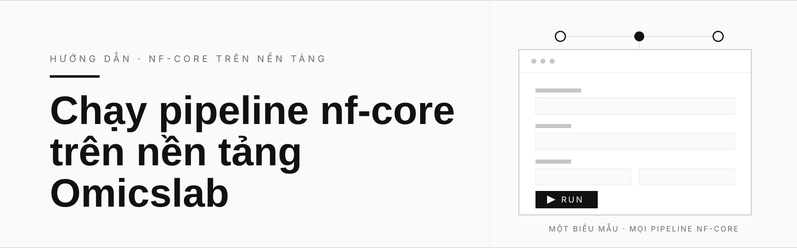

:::info
**Đây là bài hướng dẫn chung để chạy pipeline nf-core trên nền tảng Omicslab.** Bình thường, chạy một pipeline nf-core đòi hỏi cài Nextflow cùng Docker hoặc Singularity, chọn profile cho hệ thống tính toán và gõ lệnh. Ở đây, bạn chạy đúng những pipeline đó bằng một biểu mẫu trên trình duyệt — không cài đặt, không gõ lệnh, không cấu hình cụm máy. Các hình minh hoạ dùng `nf-core/bacass` làm ví dụ; bài đồng hành [Xây dựng bộ genome vi khuẩn không cần lập trình](/blogs/bacterial-genome-assembly-without-coding) sẽ đưa hướng dẫn này vào một bộ genome thật.
:::

## 1. nf-core là gì?

**nf-core** là một cộng đồng quốc tế cùng xây dựng, duyệt và vận hành các pipeline phân tích theo tiêu chuẩn chung. Một **pipeline** là chuỗi các bước phân tích — kiểm tra chất lượng, cắt tỉa, căn chỉnh, lắp ráp, gọi biến thể — được đóng gói thành một khối và chạy từ đầu đến cuối.

Pipeline nf-core là bản tham chiếu của cộng đồng: miễn phí, mã nguồn mở, có tài liệu, có phiên bản và được kiểm thử tự động. Thay vì cài hàng chục công cụ rồi tự viết script để nối chúng lại, bạn chạy `nf-core/<tên>` và nhận về một bộ kết quả, báo cáo theo chuẩn chung.

Các pipeline đã công bố trải khắp genomics, transcriptomics, metagenomics, proteomics và hình ảnh. Vài ví dụ:

| Pipeline | Dùng để làm gì |
| --- | --- |
| `nf-core/rnaseq` | RNA-seq: kiểm tra chất lượng, cắt tỉa và định lượng |
| `nf-core/sarek` | Gọi biến thể germline hoặc somatic từ dữ liệu WGS/WES |
| `nf-core/bacass` | Lắp ráp và chú giải hệ gen vi khuẩn |
| `nf-core/mag` | Lắp ráp và phân nhóm (binning) metagenome |
| `nf-core/fetchngs` | Tải dữ liệu giải trình tự công khai từ SRA, ENA hoặc GEO |

Nếu câu hỏi của bạn khớp với một trong số đó, dùng pipeline cộng đồng giúp bạn không phải dựng lại một quy trình đã được kiểm chứng từ đầu — và kết quả của bạn có thể so sánh được với các lần chạy khác cùng pipeline.

## 2. Các mảnh ghép, hiểu đơn giản

Ba cái tên này xuất hiện trong hầu hết hướng dẫn nf-core. Hiểu ngắn gọn như sau là đủ để bắt đầu.

### 2.1. GitHub — "kho chứa mã" trực tuyến

**GitHub** là nơi lưu mã nguồn và quy trình trên internet. Hãy nghĩ nó như một "kho chứa mã" có phiên bản: mọi phiên bản cũ đều được lưu, ai cũng nhìn thấy bạn đang dùng bản nào. Các pipeline nf-core nằm trên GitHub.

### 2.2. Nextflow — người điều phối các bước phân tích

**Nextflow** mô tả một phân tích gồm nhiều bước, rồi tự động chạy các bước đó — kể cả trên nhiều máy cùng lúc. Mỗi bước chạy trong môi trường riêng, và Nextflow ghi nhớ phần nào đã hoàn tất, nên một phân tích dài không sụp đổ khi một bước gặp lỗi. Bạn không cần tự nối từng công cụ lại; Nextflow lo việc đó.

### 2.3. Container — vì sao kết quả làm lại được

Mỗi công cụ trong pipeline được đóng gói trong một **container**: một "hộp" chứa đúng phần mềm và đúng phiên bản cần thiết. Nhờ vậy, bộ phần mềm được giữ nhất quán giữa các máy và theo thời gian — và không cần cài đặt thủ công từng công cụ.

## 3. Vì sao bạn không phải gõ lệnh: nền tảng đọc schema của pipeline

Mỗi pipeline nf-core đi kèm một bản mô tả máy đọc được (`nextflow_schema.json`) liệt kê toàn bộ tham số. Nền tảng Omicslab đọc bản mô tả đó và **dựng thành một biểu mẫu trên trình duyệt** — giống như một chiếc xe số tự động: động cơ (các công cụ phân tích) vẫn giữ nguyên, nhưng bạn chỉ điều khiển bằng các nút bấm.

Nói cách khác:

- Các công cụ vẫn chạy **y hệt như thiết kế**, trong đúng container chuẩn.
- Bạn **không gõ lệnh**, chỉ điền tham số vào biểu mẫu.
- Biểu mẫu được dựng từ chính pipeline, nên khớp với phiên bản bạn chọn.
- Việc duy nhất bạn thực sự thay đổi là **dữ liệu đầu vào**.

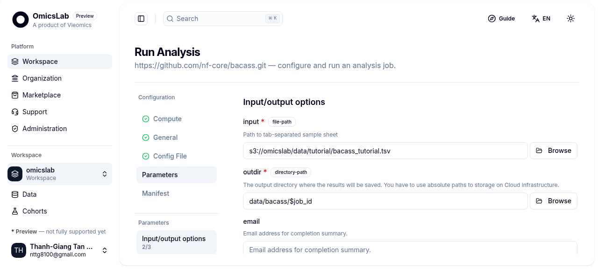

*Nền tảng đọc `nextflow_schema.json` và dựng thành biểu mẫu tham số — ở đây là `nf-core/bacass` trong workspace `omicslab`, với `input` đã trỏ tới samplesheet bạn tải lên.*

## 4. Pipeline cần gì trước khi chạy?

Ba thứ: dữ liệu, mô tả dữ liệu, và hạ tầng tính toán.

- **Dữ liệu đầu vào** — FASTQ, BAM, VCF hoặc một thư mục, tùy pipeline.
- **Samplesheet** — danh sách đầu vào mà hầu hết pipeline nf-core cần. Đây là một bảng đơn giản (CSV hoặc TSV) trong đó mỗi dòng là một mẫu, các cột trỏ tới tệp của mẫu đó. Mỗi pipeline tự định nghĩa bộ cột của mình, nên hãy lấy tiêu đề cột từ tài liệu của chính pipeline (`nf-co.re/<tên>`). Ví dụ, [nf-core/bacass](/blogs/bacterial-genome-assembly-without-coding) cần `ID`, `R1`, `R2`, `LongFastQ`, `Fast5` và `GenomeSize`.
- **Hạ tầng tính toán** — chạy với bao nhiêu CPU, RAM và dung lượng đĩa. Bạn chọn ngay lúc chạy trên nền tảng.

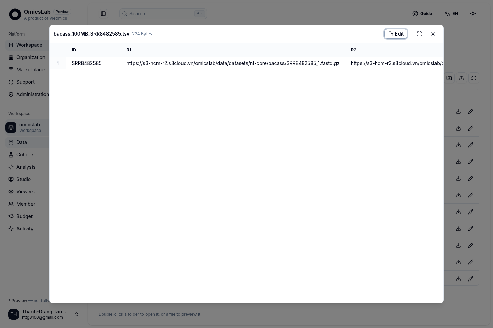

*Một samplesheet thật đã có sẵn trong workspace `omicslab` — nhấp đúp tệp `.tsv` để xem nội dung: mỗi dòng là một mẫu, `R1`/`R2` trỏ tới các tệp FASTQ. Đây là samplesheet của `nf-core/bacass`; các pipeline khác dùng bộ cột riêng.*

Chưa có dữ liệu? Phần lớn các pipeline nf-core đi kèm một bộ dữ liệu thử miễn phí, được tập hợp tại kho [nf-core/test-datasets](https://github.com/nf-core/test-datasets). Tìm đúng bảng và tệp cho pipeline của bạn là một cách đơn giản để chạy lần đầu — sau đó thay bằng dữ liệu thật.

## 5. Chạy pipeline trên nền tảng — từng bước

Nền tảng Omicslab là một giao diện web để chạy các pipeline Nextflow/nf-core — tương tự mô hình của Seqera Platform, nhưng có thể đặt hạ tầng và dữ liệu ngay tại Việt Nam. Tài liệu nền tảng có hướng dẫn chi tiết về [bắt đầu nhanh](https://docs.omicslab.io/quickstart), [tổ chức](https://docs.omicslab.io/organizations/overview) và [marketplace](https://docs.omicslab.io/marketplace/overview). Các hình dưới đây đi theo `nf-core/bacass`, nhưng các bước tương tự với các pipeline khác.

**Bước 1 — Tạo tài khoản và workspace.** Tạo tài khoản tại [platform.omicslab.io](https://platform.omicslab.io) và mở một workspace — nơi lưu dữ liệu, pipeline và lịch sử chạy.

**Bước 2 — Đưa dữ liệu lên.** Tải dữ liệu lên vùng lưu trữ tương thích S3 (hoặc kết nối bucket có sẵn của bạn). Với pipeline dùng samplesheet, hãy tải lên cả samplesheet lẫn các tệp mà nó trỏ tới.

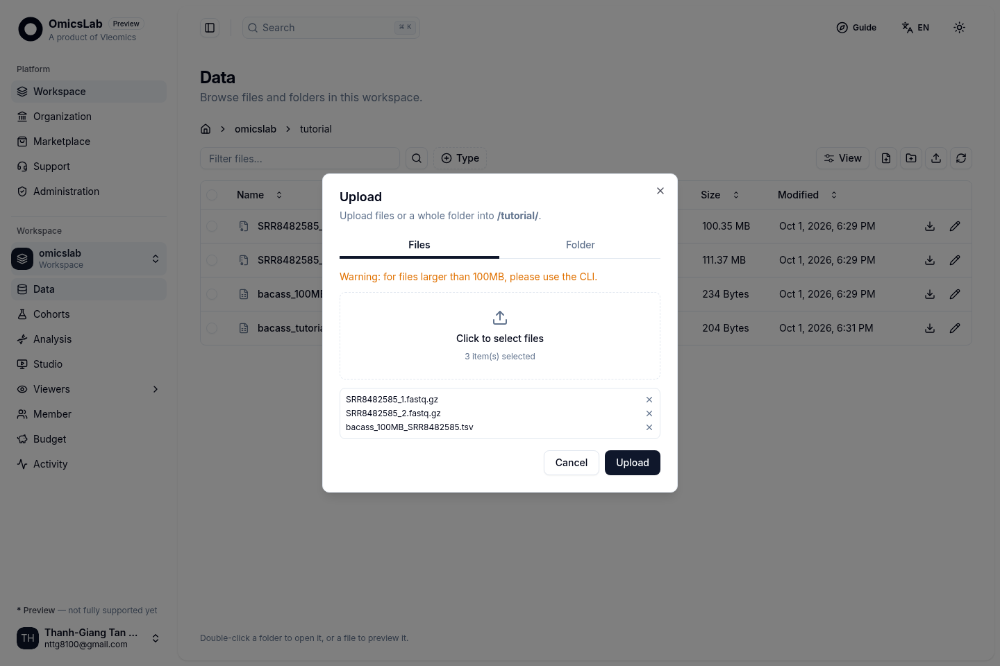

**Bước 3 — Thêm pipeline.** Chọn pipeline từ kho Git của workspace — với nf-core, tìm dưới `nf-core/<tên>`. Nếu chưa có trong danh sách, thêm từ kho Git của nó; nền tảng đọc schema và hiển thị biểu mẫu chạy.

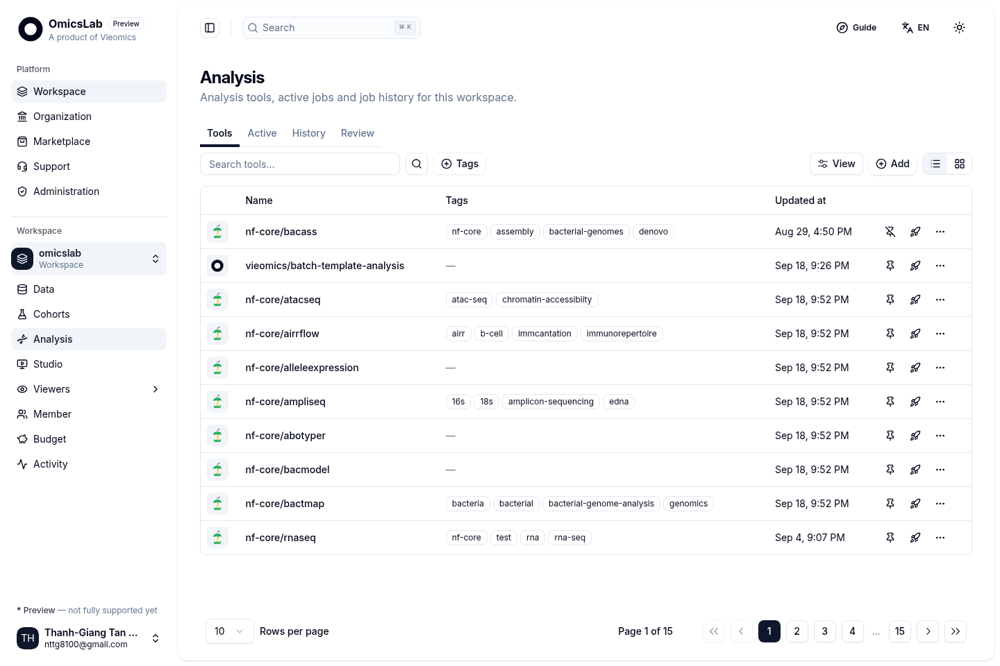

**Bước 4 — Trỏ `input`** tới dữ liệu — chọn samplesheet (hoặc thư mục dữ liệu) trực tiếp trong trình duyệt dữ liệu của workspace.

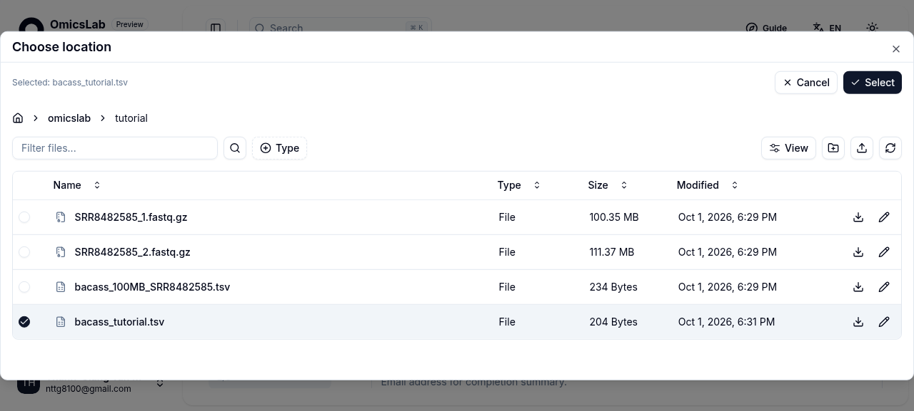

**Bước 5 — Chọn tham số.** Biểu mẫu hiển thị mọi tham số của pipeline, kèm mô tả và giá trị mặc định hợp lý. Thường thì `input` là trường duy nhất bạn bắt buộc phải điền; các tham số khác cứ để nguyên cho tới khi bạn cần.

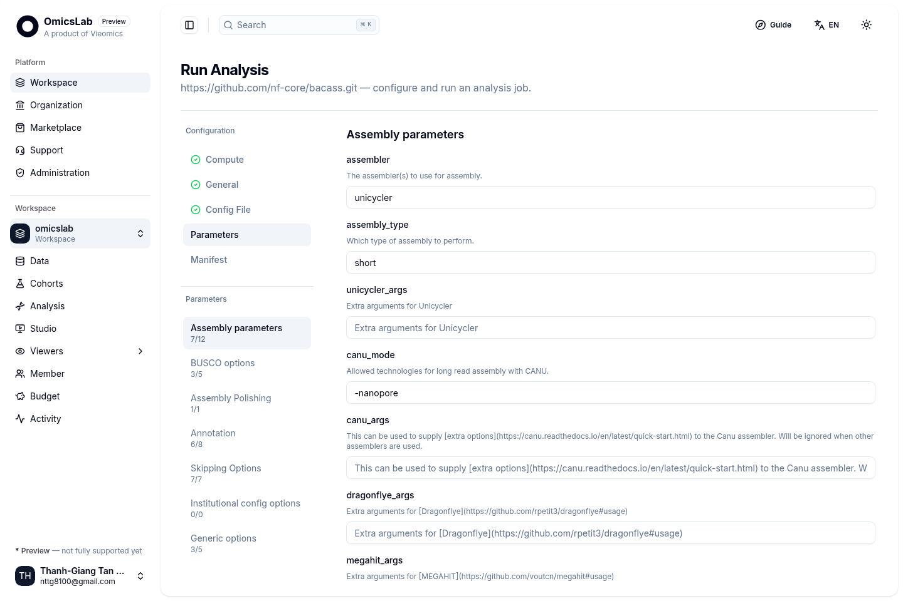

**Bước 6 — Chọn hạ tầng, xem lại manifest, bấm Run.** Chọn nơi chạy — CloudFly, GreenNode hoặc cụm HPC Slurm của bạn — và mức CPU, RAM, dung lượng đĩa. Biểu mẫu ước tính chi phí trước khi bạn xác nhận. Manifest ghi lại chính xác những gì sẽ chạy, gồm cả tham số và phiên bản pipeline.

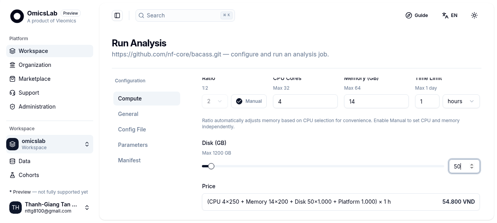

**Bước 7 — Theo dõi log và chi phí.** Log Nextflow hiển thị trực tiếp trên trình duyệt theo từng bước. Khi chạy xong, mở lại job trong Lịch sử để xem trạng thái, thời gian và chi phí. (Bộ dữ liệu vi khuẩn 100 MB trong các hình này hoàn tất sau khoảng 30 phút với **13.318 VND**.)

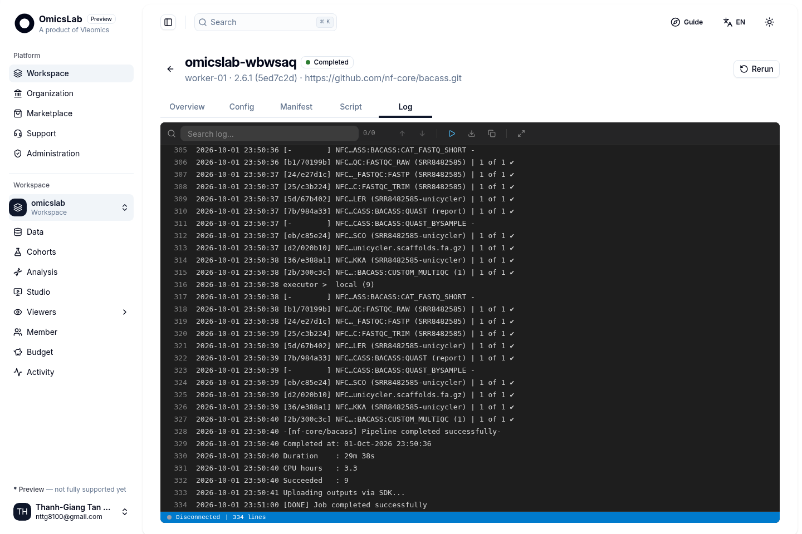

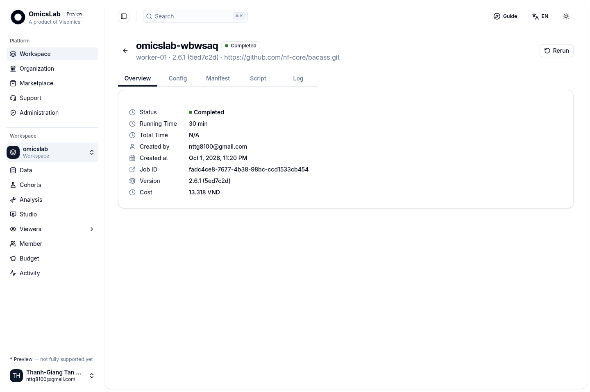

**Bước 8 — Xem kết quả và báo cáo.** Kết quả nằm trong một thư mục gọn gàng cùng các báo cáo chuẩn: MultiQC tổng hợp kiểm tra chất lượng vào một trang, còn `pipeline_info` ghi lại phiên bản pipeline và phần mềm đã dùng. Cả hai mở trực tiếp trên trình duyệt, không cần tải công cụ về máy.

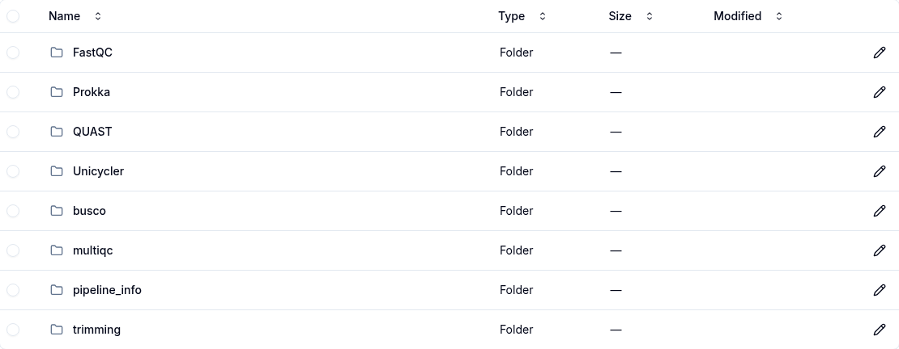

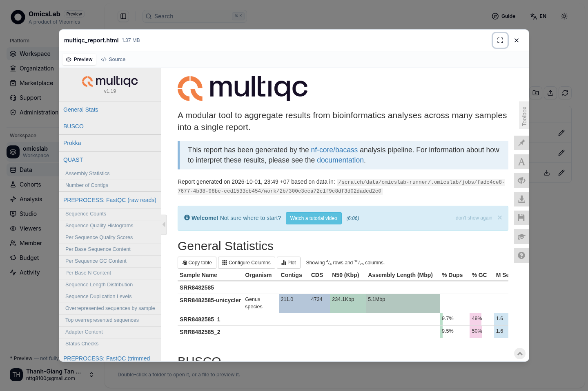

:::tip
Lần đầu chạy, hãy dùng **một mẫu duy nhất** với bộ dữ liệu thử của pipeline. Khi mọi thứ trơn tru, hãy thêm nhiều dòng vào samplesheet — nền tảng sẽ tự chạy song song.
:::

## 6. Vài điều nhỏ nên biết

- **Thêm mẫu, vẫn một lần chạy.** Mỗi mẫu một dòng trong samplesheet; nền tảng xếp chúng chạy song song trên hạ tầng bạn chọn.
- **Mọi lần chạy đều được ghi lại.** Tham số, phiên bản pipeline và phiên bản phần mềm đi kèm job, nên kết quả có thể lần lại và tái lập về sau.
- **Bạn chỉ trả chi phí tính toán và lưu trữ.** Pipeline cộng đồng như nf-core là miễn phí; chi phí được ước tính trước khi bạn bấm Run.
- **Mọi pipeline Nextflow đều có thể thêm vào.** Miễn là kho của nó có script chạy và schema tham số, nền tảng có thể dựng thành biểu mẫu.

## 7. Ví dụ trọn vẹn: từ FASTQ đến bộ genome vi khuẩn

Một ví dụ hoàn chỉnh cho thấy các mảnh ghép khớp với nhau như thế nào. Trong bài đồng hành, [Xây dựng bộ genome vi khuẩn không cần lập trình](/blogs/bacterial-genome-assembly-without-coding), pipeline là `nf-core/bacass`, dữ liệu vào là bộ FASTQ vi khuẩn 100 MB, và kết quả là một bộ genome đã lắp ráp, kiểm định và chú giải — cùng kiểu quy trình đứng sau một nghiên cứu melioidosis thật tại Hà Tĩnh, Việt Nam.

## 8. Bắt đầu

1. Tạo tài khoản tại [platform.omicslab.io](https://platform.omicslab.io) — không cần thẻ tín dụng.
2. Tạo workspace và thêm pipeline bạn cần từ kho Git của nó.
3. Chạy thử với bộ dữ liệu thử của pipeline, sau đó thay bằng dữ liệu của bạn.
4. Cần hỗ trợ hoặc muốn dùng thử trọn gói? Gửi email tới [contact@omicslab.io](mailto:contact@omicslab.io).

## 9. Tài liệu tham khảo

- **nf-core** — danh mục pipeline và tài liệu: [nf-co.re](https://nf-co.re/) và [nf-co.re/pipelines](https://nf-co.re/pipelines)
- **Nextflow** — ngôn ngữ và runtime: [nextflow.io](https://www.nextflow.io/)
- **Dữ liệu thử** — bộ dữ liệu nhỏ, miễn phí cho các pipeline nf-core: [github.com/nf-core/test-datasets](https://github.com/nf-core/test-datasets)
- **Tài liệu nền tảng** — [Bắt đầu nhanh](https://docs.omicslab.io/quickstart), [Tổ chức](https://docs.omicslab.io/organizations/overview) và [Marketplace](https://docs.omicslab.io/marketplace/overview)

## 10. Bài viết liên quan

- Ví dụ trọn vẹn: [Xây dựng bộ genome vi khuẩn không cần lập trình](/blogs/bacterial-genome-assembly-without-coding).
- Xem thêm bài về [nf-core](/blogs?tag=nf-core) và [nền tảng](/blogs?tag=platform).
- Tính năng và bảng giá trên trang [Nền tảng Omicslab](/solutions/data-platform).
- Cần dịch vụ trọn gói? Xem [Giải pháp tùy chỉnh](/solutions/custom-solutions).
