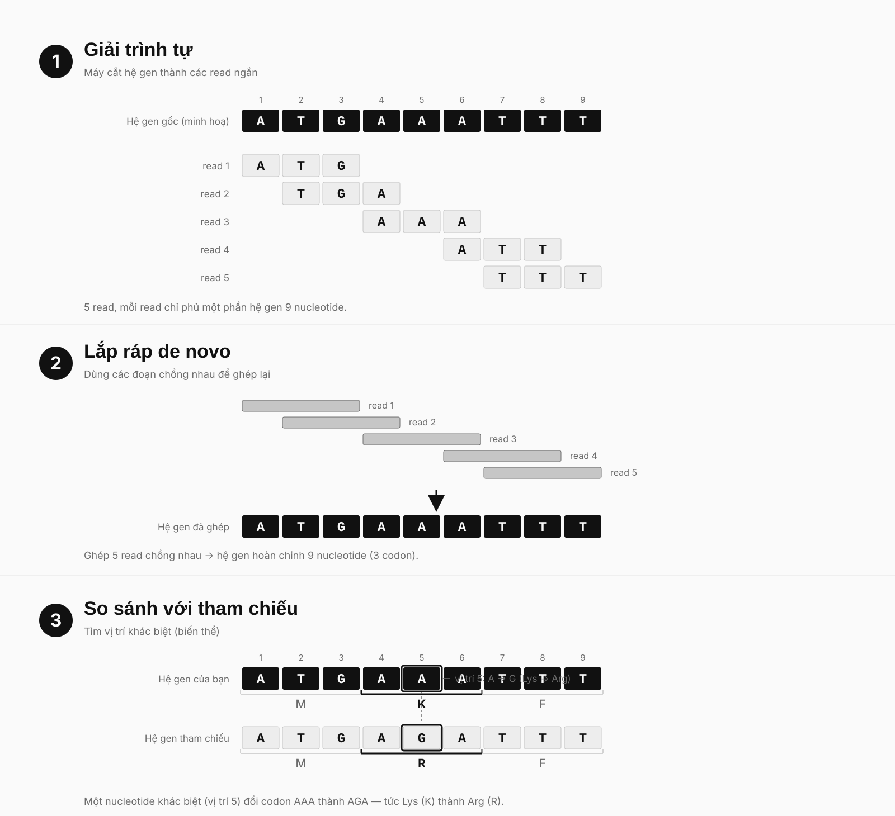
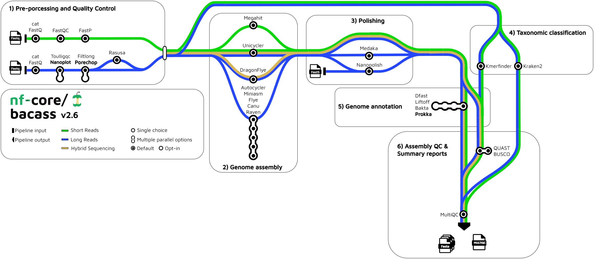

:::info
**Chưa từng viết một dòng lệnh nào? Không sao.** Bài này giải thích các khái niệm nền tảng (lắp ráp hệ gen, GitHub, Nextflow, nf-core), rồi chỉ bạn cách lắp ráp và chú giải một bộ genome vi khuẩn bằng quy trình **nf-core/bacass** trên nền tảng Omicslab. Bạn chỉ cần thay dữ liệu đầu vào — phần mềm đã được đóng gói sẵn.
:::

## Trước hết: dựng lại hệ gen để làm gì?

Hãy tưởng tượng bạn đang làm luận văn về một chủng vi khuẩn kháng kháng sinh. Bạn cần trả lời hai câu hỏi: **nó kháng loại kháng sinh nào**, và **vì sao nó kháng được** — để từ đó giải thích cơ chế và đề xuất hướng xử lý.

Cách kiểm tra nhanh nhất, PCR, lại không giúp được trong tình huống này.

### Vì sao PCR không đủ?

PCR hoạt động theo nguyên tắc "phải biết trước, rồi mới dò". Muốn chạy một phản ứng PCR, bạn phải **đã biết trình tự cần tìm** để thiết kế mồi (primer). Nói cách khác:

- PCR chỉ phát hiện những gì bạn **đã biết trước**: một gene kháng kháng sinh quen thuộc, một đột biến đã được mô tả trong tài liệu.
- Nếu vi khuẩn kháng thuốc bằng một **cơ chế mới** — một gene chưa từng thấy, một đột biến mới, hay một plasmid lạ — bạn không có mồi để dò, và PCR trả về kết quả âm tính một cách sai lệch.

Lúc đó, giải pháp thay thế là **đọc toàn bộ hệ gen** thay vì chỉ dò một điểm. Bạn không cần biết trước phải tìm gì, vì toàn bộ thông tin đã nằm trong dữ liệu trình tự.

### Lắp ráp hệ gen là gì?

Máy giải trình tự không đọc được cả nhiễm sắc thể trong một lần. Nó trả về hàng triệu **reads** — những mảnh trình tự ngắn (dữ liệu Illumina) hoặc dài (Oxford Nanopore, PacBio) — giống như một cuốn sách bị xé thành hàng triệu mảnh giấy nhỏ, mỗi mảnh lại có phần chữ chồng lên mảnh bên cạnh.

**Lắp ráp hệ gen (genome assembly)** là việc tìm những đoạn chồng nhau đó để ghép các mảnh thành câu chữ liền mạch. Kết quả là một bộ genome gần như hoàn chỉnh: toàn bộ gene, đột biến và plasmid của chủng vi khuẩn — kể cả những thứ chưa ai từng biết. Sau đó, **chú giải (annotation)** gắn nhãn cho hệ gen để biết đoạn nào là gene, gene nào mã cho protein gì, và từ đó truy ra cơ chế kháng thuốc.



*Từ DNA đến biến thể: giải trình tự, lắp ráp de novo, rồi đối chiếu với hệ gen tham chiếu.*

Quá trình sinh học này gồm ba bước:

1. **Giải trình tự (sequencing)** — máy đọc DNA và cắt nó thành hàng triệu mảnh ngắn gọi là reads. Mỗi read chỉ là một đoạn rất ngắn, tự nó không đủ để kết luận điều gì.
2. **Lắp ráp de novo** — dựa vào những đoạn chồng nhau giữa các reads để ghép chúng thành các đoạn liền mạch (contig). Bước này **không cần biết trước** hệ gen trông thế nào, nên nó phát hiện được cả những vùng chưa từng có trong cơ sở dữ liệu.
3. **So sánh với hệ gen tham chiếu** — xếp bộ genome của bạn lên một hệ gen đã biết của cùng loài để tìm các vị trí khác biệt (biến thể như SNP), đồng thời xác nhận loài. Đây là cách nhanh để trả lời "chủng này khác tham chiếu ở đâu".

:::tip
Điểm quan trọng cho câu chuyện PCR ở trên: so sánh với tham chiếu chỉ tìm được khác biệt **so với cái đã biết**. Một gene hoàn toàn mới sẽ không nằm trong tham chiếu — nên ta cần **lắp ráp de novo rồi chú giải** để phát hiện nó.
:::

| Thuật ngữ | Hiểu đơn giản là |
| --- | --- |
| **Read** | Một mảnh trình tự máy đọc được |
| **Độ phủ (coverage)** | Trung bình mỗi vị trí trong hệ gen được đọc bao nhiêu lần — càng cao càng chắc |
| **Contig** | Một đoạn trình tự liền mạch đã ghép xong |
| **N50** | Chỉ số cho biết các contig dài ngắn ra sao; N50 càng lớn, bộ lắp ráp càng liền mạch |
| **Short-read** | Đọc ngắn, chính xác, rẻ (ví dụ Illumina) |
| **Long-read** | Đọc dài, giúp ghép qua các vùng lặp (ví dụ Nanopore, PacBio) |
| **Hybrid** | Dùng cả đọc ngắn lẫn đọc dài cho kết quả tốt nhất |
| **Chú giải** | Gắn nhãn cho hệ gen: đâu là gene, chức năng gì |

:::note
Hệ gen vi khuẩn nhỏ — thường chỉ 2–8 triệu cặp base và thường chỉ có một nhiễm sắc thể vòng. Vì vậy việc lắp ráp vi khuẩn dễ hơn nhiều so với hệ gen người, và đây là bài toán lý tưởng để bắt đầu.
:::

## Bốn khái niệm cần biết trước khi bắt đầu

Bạn sẽ gặp bốn cái tên này ở mọi hướng dẫn tin sinh học. Hiểu ngắn gọn như sau là đủ để bắt đầu.

### GitHub — "kho chứa mã" trực tuyến

**GitHub** là nơi lưu mã nguồn và quy trình trên internet. Hãy nghĩ nó như một "kho chứa mã" có phiên bản: mọi phiên bản cũ đều được lưu, ai cũng nhìn thấy bạn đang dùng bản nào. Các pipeline nf-core đều nằm trên GitHub.

### Nextflow — người điều phối các bước phân tích

**Nextflow** là công cụ mô tả một phân tích gồm nhiều bước, rồi tự động chạy các bước đó — kể cả trên nhiều máy cùng lúc. Bạn không cần tự nối từng công cụ lại; Nextflow lo việc đó.

### nf-core — bộ quy trình chuẩn của cộng đồng

**nf-core** là một cộng đồng quốc tế xây dựng và kiểm định các quy trình phân tích theo chuẩn thống nhất. Mỗi pipeline như `nf-core/rnaseq`, `nf-core/sarek` hay `nf-core/bacass` đều được đóng gói sẵn, có tài liệu và chạy được ngay. Đây là "best practice" — cách làm được cộng đồng thống nhất là đúng.

### Pipeline và container — vì sao kết quả làm lại được

Mỗi công cụ trong pipeline được đóng gói trong một **container**: một "hộp" chứa đúng phần mềm và đúng phiên bản cần thiết. Nhờ vậy, dù chạy trên máy nào, năm nào, kết quả vẫn nhất quán — và không cần cài đặt thủ công từng công cụ.

## nf-core/bacass: chiếc hộp đã được lắp sẵn

**nf-core/bacass** là quy trình chuẩn để **lắp ráp và chú giải hệ gen vi khuẩn**. Nó nhận dữ liệu thô (FASTQ) và tự động chạy mọi bước cần thiết: kiểm tra chất lượng, cắt tỉa, lắp ráp, kiểm tra nhiễm chéo, đánh giá chất lượng bộ lắp ráp và chú giải.

Quy trình hỗ trợ ba kiểu dữ liệu:

- **Short-read** — chỉ có dữ liệu đọc ngắn (Illumina).
- **Long-read** — chỉ có dữ liệu đọc dài (Nanopore/PacBio).
- **Hybrid** — kết hợp cả hai, cho bộ lắp ráp liền mạch nhất.



*Nguồn: nf-core/bacass (metromap), giấy phép MIT.*

Nhìn vào **metromap** (bản đồ quy trình) ở trên, bạn có thể hình dung toàn bộ hành trình như một tuyến tàu điện với các ga:

| Chặng | Việc được làm tự động |
| --- | --- |
| **Kiểm tra & cắt tỉa** | FastQC, FastP cho đọc ngắn; NanoPlot/PycoQC, PoreChop/Filtlong cho đọc dài |
| **Lắp ráp** | Unicycler, MEGAHIT (ngắn); Flye, Canu, Raven, Miniasm, Dragonflye, Autocycler (dài) |
| **Kiểm tra nhiễm chéo** | Kraken2 và Kmerfinder để xác nhận mẫu không lẫn loài khác |
| **Đánh giá bộ lắp ráp** | QUAST và BUSCO — cho biết bộ lắp ráp tốt đến đâu |
| **Chú giải** | Prokka, Bakta hoặc DFAST — gắn nhãn gene và chức năng |

Mỗi chặng có thể được bật/tắt bằng các tham số đơn giản, nên bạn không phải chạy những bước chưa cần.

## Vì sao nói "không cần lập trình"? — Giao diện bọc lấy công cụ

Đây là điểm mấu chốt. Mỗi pipeline nf-core đi kèm một bản mô tả máy đọc được (`nextflow_schema.json`) liệt kê toàn bộ tham số. Nền tảng Omicslab đọc bản mô tả đó và **dựng thành một biểu mẫu trên trình duyệt** — giống như một chiếc xe số tự động: động cơ (các công cụ phân tích) vẫn là động cơ xịn, nhưng bạn chỉ điều khiển bằng các nút bấm.

Nói cách khác:

- Các công cụ vẫn chạy **y hệt như thiết kế**, trong đúng container chuẩn.
- Bạn **không gõ lệnh**, chỉ điền tham số vào biểu mẫu.
- Việc duy nhất bạn thực sự thay đổi là **dữ liệu đầu vào**.

<!--
  TODO (hình 1): ảnh chụp màn hình trang thêm pipeline nf-core/bacass vào workspace,
  cho thấy nền tảng đọc nextflow_schema.json và hiển thị biểu mẫu tham số.
  Gợi ý đường dẫn: ./imgs/platform-add-pipeline.png
-->

<!--
  TODO (video 1): video thao tác chọn pipeline, điền tham số và bấm chạy.
  Gợi ý: chèn thẻ <video controls src="./videos/...mp4"></video> hoặc ảnh GIF.
-->

## Chuẩn bị dữ liệu đầu vào

bacass cần một **samplesheet**: một bảng đơn giản (định dạng TSV, phân tách bằng dấu tab) cho biết mỗi mẫu có những tệp nào. Sáu cột:

| Cột | Ý nghĩa |
| --- | --- |
| `ID` | Tên mẫu, không dấu cách |
| `R1`, `R2` | Đọc ngắn xuôi và ngược; điền `NA` nếu không có |
| `LongFastQ` | Đọc dài; điền `NA` nếu không có |
| `Fast5` | Thư mục Fast5 (nếu cần đánh bóng bộ lắp ráp); thường để `NA` |
| `GenomeSize` | Kích thước hệ gen ước tính, ví dụ `2.8m` cho 2,8 triệu cặp base |

Ví dụ một samplesheet trộn đủ ba kiểu dữ liệu:

```tsv
ID	R1	R2	LongFastQ	Fast5	GenomeSize
shortreads	./data/S1_R1.fastq.gz	./data/S1_R2.fastq.gz	NA	NA	NA
longreads	NA	NA	./data/S1_long_fastq.gz	NA	2.8m
shortNlong	./data/S1_R1.fastq.gz	./data/S1_R2.fastq.gz	./data/S1_long_fastq.gz	NA	2.8m
```

:::tip
Chưa có dữ liệu? Xem mục dưới để tải **bộ dữ liệu mẫu miễn phí của nf-core** và chạy thử trước.
:::

## Chạy thử với dữ liệu mẫu miễn phí của nf-core

nf-core cung cấp sẵn một bộ dữ liệu vi khuẩn nhỏ để thử quy trình. Bạn có thể tải về rồi tải lên nền tảng:

- Samplesheet mẫu: [bacass_short_reseq.tsv](https://raw.githubusercontent.com/nf-core/test-datasets/bacass/bacass_short_reseq.tsv)
- Kho dữ liệu mẫu đầy đủ: [nf-core/test-datasets › bacass](https://github.com/nf-core/test-datasets/tree/bacass)

Cách nhanh nhất để thử trên nền tảng là chạy với **dữ liệu mẫu** trước: chọn samplesheet mẫu, để `assembly_type = short`, `assembler = unicycler`, rồi bật các tuỳ chọn `skip_kraken2` và `skip_kmerfinder` để bỏ qua bước kiểm tra nhiễm chéo lúc mới làm quen. Khi đã quen, hãy bật lại đầy đủ.

## Chạy trên nền tảng Omicslab — từng bước

Nền tảng Omicslab là một giao diện web để chạy các pipeline Nextflow/nf-core — tương tự mô hình của Seqera Platform, nhưng có thể đặt hạ tầng và dữ liệu ngay tại Việt Nam.

1. **Tạo tài khoản** tại [platform.omicslab.io](https://platform.omicslab.io) và mở một workspace.
2. **Đưa dữ liệu lên** vùng lưu trữ tương thích S3 (hoặc kết nối bucket có sẵn của bạn).
3. **Thêm pipeline**: chọn `nf-core/bacass` từ kho Git. Nền tảng đọc schema và hiển thị biểu mẫu tham số.
4. **Trỏ `input`** tới tệp samplesheet bạn đã tải lên.
5. **Chọn tham số chính**:
   - `assembly_type`: `short`, `long` hoặc `hybrid`
   - `assembler`: `unicycler`, `megahit`, `flye`, `canu`, `raven`, `miniasm`, `dragonflye`, `autocycler`
   - `annotation_tool`: `prokka`, `bakta` hoặc `dfast`
   - `busco_lineage`: mặc định `bacteria_odb10`
   - `kraken2db`: đường dẫn cơ sở dữ liệu Kraken2 (nếu kiểm tra nhiễm chéo)
6. **Chọn hạ tầng tính toán** (CloudFly, GreenNode hoặc cụm HPC Slurm của bạn) cùng mức CPU/RAM.
7. **Bấm chạy** và theo dõi log từng bước ngay trên trình duyệt; hệ thống báo khi hoàn tất.
8. **Xem báo cáo**: MultiQC và báo cáo Nextflow hiển thị trực tiếp, không cần tải công cụ về máy.

<!--
  TODO (hình/video 2): minh hoạ luồng thao tác trên nền tảng — tải dữ liệu,
  chọn pipeline, điền tham số, chạy và xem báo cáo.
  Gợi ý đường dẫn: ./imgs/platform-run-bacass.png hoặc ./videos/platform-run-bacass.mp4
-->

:::tip
Lần đầu chạy, hãy dùng **một mẫu duy nhất** với bộ dữ liệu mẫu của nf-core. Khi mọi thứ trơn tru, hãy thêm nhiều mẫu vào cùng samplesheet — nền tảng sẽ tự chạy song song.
:::

## Đọc kết quả trả về

Sau khi quy trình hoàn tất, bạn nhận được một thư mục kết quả gọn gàng:

| Kết quả | Cho bạn biết điều gì |
| --- | --- |
| `*_assembly.fasta` | Trình tự bộ genome đã lắp ráp |
| Báo cáo **QUAST** | Số contig, N50, tổng độ dài — chất lượng bộ lắp ráp |
| Báo cáo **BUSCO** | Tỉ lệ gene thiết yếu được tìm thấy — độ hoàn chỉnh |
| Báo cáo **Kraken2 / Kmerfinder** | Mẫu có bị lẫn loài khác không |
| Tệp chú giải (`.gff`, `.gbk`) | Vị trí gene và chức năng dự đoán |
| Báo cáo **MultiQC** | Bản tổng hợp tất cả báo cáo trong một trang |

## Ví dụ thực tế từ Việt Nam

Để thấy quy trình này mạnh đến đâu, hãy xem một nghiên cứu có thật. Năm 2026, một nhóm nghiên cứu Việt Nam và quốc tế công bố trên *PLOS Neglected Tropical Diseases* kết quả giải trình tự 47 chủng vi khuẩn **Burkholderia pseudomallei** — tác nhân gây bệnh melioidosis. Các chủng được thu thập tại Bệnh viện Đa khoa tỉnh Hà Tĩnh năm 2020, cùng với mẫu đất và hai mẫu từ động vật.

Điểm đáng chú ý: họ dựng hệ gen bằng **đúng quy trình nf-core/bacass mà bài này hướng dẫn** — FastP cắt tỉa, Unicycler lắp ráp, Prokka chú giải — rồi mới phân tích sâu hơn.

Từ bộ genome đã lắp ráp, nhóm nghiên cứu:

- Phân loại chủng bằng **MLST và cgMLST** (so khớp trình tự gene với cơ sở dữ liệu công khai).
- Dựng **cây phát sinh loài từ SNP toàn hệ gen** để truy nguồn lây, so sánh với gần 1.500 chủng khác ở Đông Nam Á và Australia.
- Tìm **vùng gene đặc trưng** của nhóm chủng chiếm ưu thế (ST 41) và đề xuất nó như một mục tiêu chẩn đoán mới.

Kết quả nổi bật: 60% ca bệnh thuộc một chủng duy nhất (ST 41), và các chủng này liên hệ chặt chẽ với mẫu đất cùng khu vực — gợi ý con đường lây từ môi trường sang người.

Điều đáng học: đây chính là kiểu câu hỏi mà PCR khó trả lời. Không ai biết trước "vùng gene ST 41" tồn tại để thiết kế mồi — nó chỉ lộ ra sau khi đọc toàn bộ hệ gen.

> Norris MH, Au La TH, Metrailer MC, và cộng sự (2026). *Expanding the molecular epidemiology of melioidosis in North Central Vietnam.* PLOS Neglected Tropical Diseases, 20(2), e0013945. [doi.org/10.1371/journal.pntd.0013945](https://doi.org/10.1371/journal.pntd.0013945)

Toàn bộ dữ liệu của nghiên cứu được công khai tại NCBI SRA, mã **PRJNA1180080**.

## Kết mở: đến lượt bạn

Bạn có hai cách để bắt đầu ngay từ đây:

1. **Chạy lại trên chính bộ dữ liệu này.** Tải các tệp FASTQ từ SRA với mã `PRJNA1180080` (hoặc dùng bộ dữ liệu mẫu của nf-core), đưa lên nền tảng và chạy nf-core/bacass. Bạn sẽ đi đúng con đường nhóm nghiên cứu đã đi — và có thể tự kiểm chứng kết quả.
2. **Khám phá các công cụ sâu hơn trên nền tảng.** Sau khi có genome, bạn có thể tìm và thêm những pipeline khác từ kho Git — miễn là chúng có script chạy và schema tham số. Vài hướng gợi ý:
   - **Định danh loài** và so sánh với chủng tham chiếu.
   - **MLST / cgMLST** để định type chủng.
   - **SNP toàn hệ gen** và **cây phát sinh loài** cho nghiên cứu dịch tễ.
   - **Pan-genome** để tìm gene đặc trưng giữa các nhóm chủng.
   - **Gửi dữ liệu lên cơ sở dữ liệu công khai** (ví dụ NCBI) để chia sẻ.

Không có một quy trình duy nhất đúng cho mọi câu hỏi. Hãy thử, so sánh và tự rút ra cách làm phù hợp — nền tảng không khóa bạn vào một danh sách công cụ cố định.

Có kết quả hay thắc mắc? Chia sẻ với chúng tôi tại [contact@omicslab.io](mailto:contact@omicslab.io).

## Bắt đầu

1. Tạo tài khoản tại [platform.omicslab.io](https://platform.omicslab.io) — không cần thẻ tín dụng.
2. Tạo workspace và thêm pipeline `nf-core/bacass`.
3. Chạy thử với dữ liệu mẫu của nf-core, sau đó thay bằng dữ liệu của bạn.
4. Cần hỗ trợ hoặc muốn dùng thử trọn gói? Gửi email tới [contact@omicslab.io](mailto:contact@omicslab.io).

## Tài liệu tham khảo

- **nf-core/bacass** — tài liệu, tham số và kết quả mẫu: [nf-co.re/bacass](https://nf-co.re/bacass)
- **Nghiên cứu điển hình** — Norris MH và cộng sự (2026), *Expanding the molecular epidemiology of melioidosis in North Central Vietnam*, PLOS Neglected Tropical Diseases 20(2): e0013945. [doi.org/10.1371/journal.pntd.0013945](https://doi.org/10.1371/journal.pntd.0013945)
- **Dữ liệu công khai** — NCBI SRA BioProject [PRJNA1180080](https://www.ncbi.nlm.nih.gov/bioproject/PRJNA1180080)

## Bài viết liên quan

- Xem thêm bài về [tin sinh học](/blogs?tag=bioinformatics) và [pipeline](/blogs?tag=pipeline).
- Tính năng và bảng giá trên trang [Nền tảng Omicslab](/solutions/data-platform).
- Cần dịch vụ trọn gói? Xem [Giải pháp tùy chỉnh](/solutions/custom-solutions).
- Tài liệu chính thức của quy trình: [nf-co.re/bacass](https://nf-co.re/bacass).
