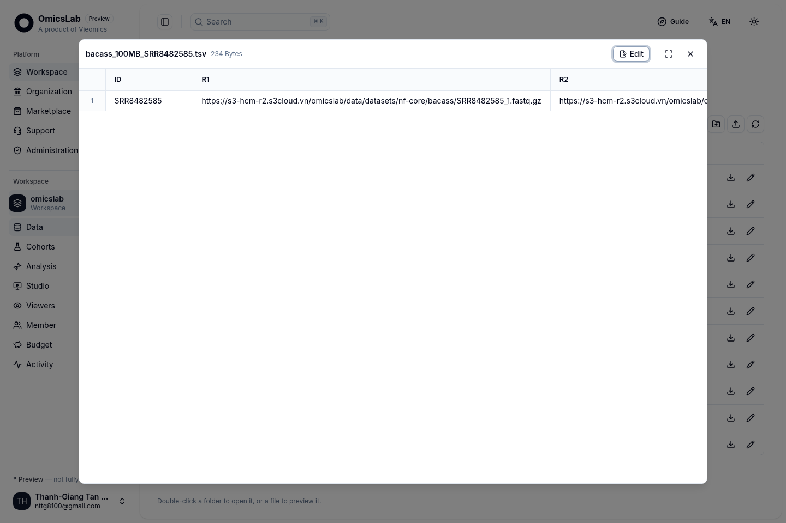
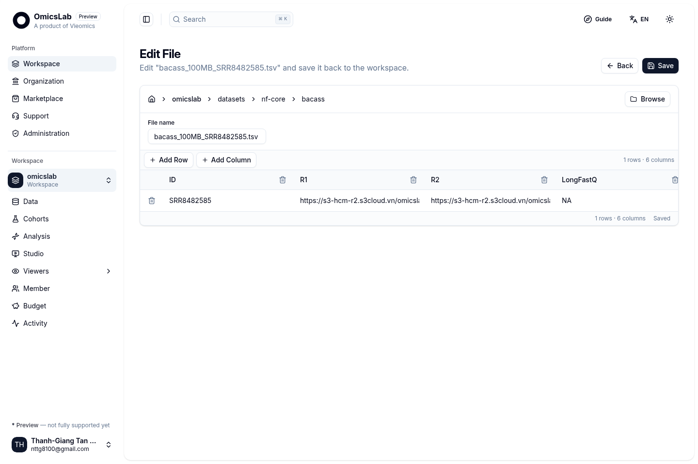
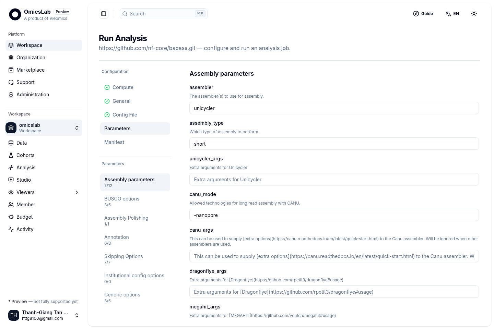
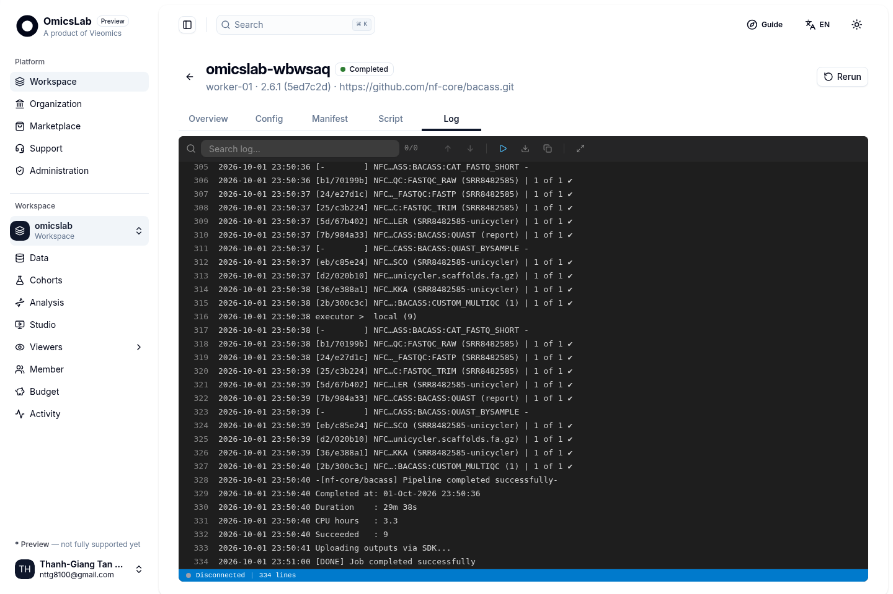
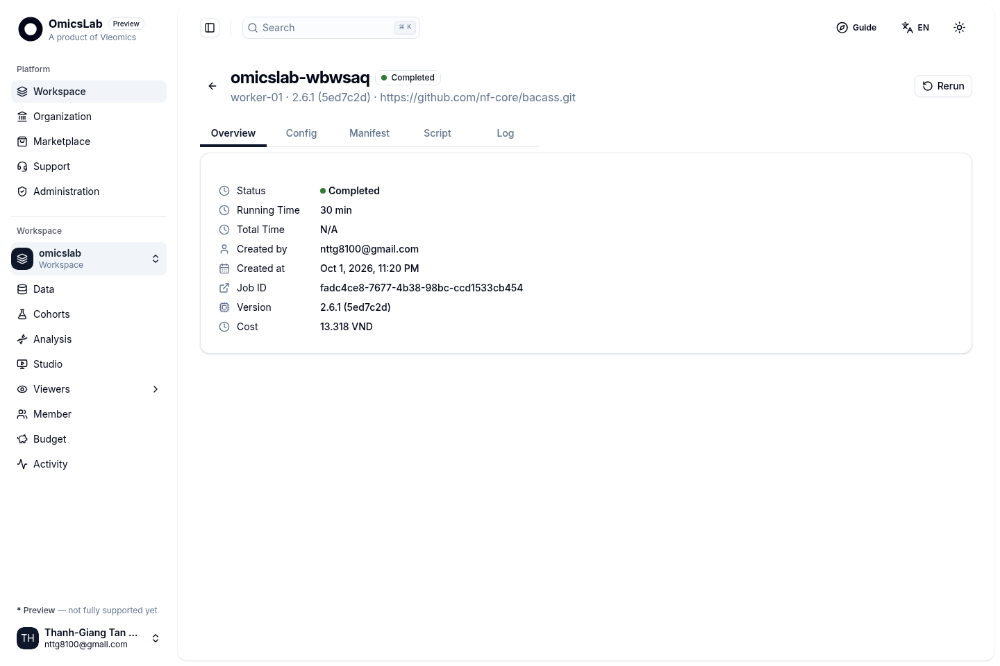

:::info
**Không cần viết code.** Bài này nói về sinh học và về pipeline: vì sao đọc toàn bộ hệ gen trả lời được những câu hỏi mà PCR không thể, lắp ráp và chú giải nghĩa là gì, và **nf-core/bacass** biến FASTQ thô thành một bộ genome hoàn chỉnh như thế nào. Pipeline được chạy trên nền tảng Omicslab — nếu bạn chưa từng chạy pipeline nf-core ở đó, hãy đọc trước bài đồng hành [Cách chạy pipeline nf-core trên nền tảng Omicslab](/blogs/how-to-run-nf-core-pipelines-on-omicslab).
:::

## 1. Trước hết: dựng lại hệ gen để làm gì?

Hãy tưởng tượng bạn đang làm luận văn về một chủng vi khuẩn kháng kháng sinh. Bạn cần trả lời hai câu hỏi: **nó kháng loại kháng sinh nào**, và **vì sao nó kháng được** — để từ đó giải thích cơ chế và đề xuất hướng xử lý.

Cách kiểm tra nhanh nhất, PCR, lại không giúp được trong tình huống này.

### 1.1. Vì sao PCR không đủ?

PCR hoạt động theo nguyên tắc "phải biết trước, rồi mới dò". Muốn chạy một phản ứng PCR, bạn phải **đã biết trình tự cần tìm** để thiết kế mồi (primer). Nói cách khác:

- PCR chỉ phát hiện những gì bạn **đã biết trước**: một gene kháng kháng sinh quen thuộc, một đột biến đã được mô tả trong tài liệu.
- Nếu vi khuẩn kháng thuốc bằng một **cơ chế mới** — một gene chưa từng được mô tả, một đột biến mới, hay một plasmid lạ — bạn không có mồi để dò, và PCR trả về kết quả âm tính một cách sai lệch.

Lúc đó, giải pháp thay thế là **đọc toàn bộ hệ gen** thay vì chỉ dò một điểm. Bạn không cần biết trước phải tìm gì, vì toàn bộ thông tin đã nằm trong dữ liệu trình tự.

### 1.2. Lắp ráp hệ gen là gì?

Máy giải trình tự không đọc được cả nhiễm sắc thể trong một lần. Nó trả về hàng triệu **reads** — những mảnh trình tự ngắn (dữ liệu Illumina) hoặc dài (Oxford Nanopore, PacBio) — giống như một cuốn sách bị xé thành hàng triệu mảnh giấy nhỏ, mỗi mảnh lại có phần chữ chồng lên mảnh bên cạnh.

**Lắp ráp hệ gen (genome assembly)** là việc tìm những đoạn chồng nhau đó để ghép các mảnh thành câu chữ liền mạch. Kết quả là một bộ genome gần như hoàn chỉnh: các gene, đột biến và plasmid của chủng vi khuẩn — kể cả những yếu tố chưa từng được mô tả. Sau đó, **chú giải (annotation)** gắn nhãn cho hệ gen để biết đoạn nào là gene, gene nào mã cho protein gì, và từ đó truy ra cơ chế kháng thuốc.

*Minh hoạ với hệ gen 9 nucleotide (3 amino acid): giải trình tự, lắp ráp de novo, rồi đối chiếu với tham chiếu — một nucleotide đổi làm đổi amino acid.*

Quá trình sinh học này gồm ba bước:

1. **Giải trình tự (sequencing)** — máy đọc DNA và cắt nó thành hàng triệu mảnh ngắn gọi là reads. Mỗi read chỉ là một đoạn rất ngắn, tự nó không đủ để kết luận điều gì.
2. **Lắp ráp de novo** — dựa vào những đoạn chồng nhau giữa các reads để ghép chúng thành các đoạn liền mạch (contig). Bước này **không cần biết trước** hệ gen trông thế nào, nên nó có thể phát hiện những vùng không có trong cơ sở dữ liệu tham chiếu.
3. **So sánh với hệ gen tham chiếu** — xếp bộ genome của bạn lên một hệ gen đã biết của cùng loài để tìm các vị trí khác biệt (biến thể như SNP), đồng thời xác nhận loài. Đây là cách nhanh để trả lời "chủng này khác tham chiếu ở đâu". Nếu vị trí khác biệt nằm trong một gene, nó có thể làm đổi luôn amino acid — trong hình, chỉ một nucleotide ở vị trí 5 đổi Lys (K) thành Arg (R).

:::tip
Điểm quan trọng cho câu chuyện PCR ở trên: so sánh với tham chiếu chỉ tìm được khác biệt **so với cái đã biết**. Một gene hoàn toàn mới sẽ không nằm trong tham chiếu — nên ta cần **lắp ráp de novo rồi chú giải** để phát hiện nó.
:::

| Thuật ngữ | Hiểu đơn giản là |
| --- | --- |
| **Read** | Một mảnh trình tự máy đọc được |
| **Độ phủ (coverage)** | Trung bình mỗi vị trí trong hệ gen được đọc bao nhiêu lần — càng cao càng chắc |
| **Contig** | Một đoạn trình tự liền mạch đã ghép xong |
| **N50** | Chỉ số cho biết các contig dài ngắn ra sao; N50 càng lớn, bộ lắp ráp càng liền mạch |
| **Short-read** | Đọc ngắn, chính xác, rẻ (ví dụ Illumina) |
| **Long-read** | Đọc dài, giúp ghép qua các vùng lặp (ví dụ Nanopore, PacBio) |
| **Hybrid** | Dùng cả đọc ngắn lẫn đọc dài cho kết quả đầy đủ hơn |
| **Chú giải** | Gắn nhãn cho hệ gen: đâu là gene, chức năng gì |

:::note
Hệ gen vi khuẩn nhỏ — thường chỉ 2–8 triệu cặp base và thường chỉ có một nhiễm sắc thể vòng. Vì vậy việc lắp ráp vi khuẩn dễ hơn nhiều so với hệ gen người, và đây là bài toán lý tưởng để bắt đầu.
:::

## 2. nf-core/bacass: chiếc hộp đã được lắp sẵn

**nf-core/bacass** là một quy trình chung được cộng đồng xây dựng để **lắp ráp và chú giải hệ gen vi khuẩn**.

### 2.1. Quy trình gồm những chặng nào?

Nó nhận dữ liệu thô (FASTQ) và tự động chạy mọi bước cần thiết: kiểm tra chất lượng, cắt tỉa, lắp ráp, kiểm tra nhiễm chéo, đánh giá chất lượng bộ lắp ráp và chú giải.

*Nguồn: nf-core/bacass (metromap), giấy phép MIT.*

Nhìn vào **metromap** (bản đồ quy trình) ở trên, bạn có thể hình dung toàn bộ hành trình như một tuyến tàu điện với các ga:

| Chặng | Việc được làm tự động |
| --- | --- |
| **Kiểm tra & cắt tỉa** | FastQC, FastP cho đọc ngắn; NanoPlot/PycoQC, PoreChop/Filtlong cho đọc dài |
| **Lắp ráp** | Unicycler, MEGAHIT (ngắn); Flye, Canu, Raven, Miniasm, Dragonflye, Autocycler (dài) |
| **Kiểm tra nhiễm chéo** | Kraken2 và Kmerfinder để xác nhận mẫu không lẫn loài khác |
| **Đánh giá bộ lắp ráp** | QUAST và BUSCO — cho biết bộ lắp ráp tốt đến đâu |
| **Chú giải** | Prokka, Bakta hoặc DFAST — gắn nhãn gene và chức năng |

Mỗi chặng có thể được bật/tắt bằng các tham số đơn giản, nên bạn không phải chạy những bước chưa cần.

### 2.2. Ba kiểu dữ liệu: short, long, hybrid

Quy trình hỗ trợ ba kiểu dữ liệu:

- **Short-read** — chỉ có dữ liệu đọc ngắn (Illumina).
- **Long-read** — chỉ có dữ liệu đọc dài (Nanopore/PacBio).
- **Hybrid** — kết hợp cả hai, cho bộ lắp ráp liền mạch hơn.

## 3. Chuẩn bị dữ liệu đầu vào

bacass cần một **samplesheet**: một bảng đơn giản (định dạng TSV, phân tách bằng dấu tab) cho biết mỗi mẫu có những tệp nào.

### 3.1. Samplesheet gồm những cột nào?

Sáu cột:

| Cột | Ý nghĩa |
| --- | --- |
| `ID` | Tên mẫu, không dấu cách |
| `R1`, `R2` | Đọc ngắn xuôi và ngược; điền `NA` nếu không có |
| `LongFastQ` | Đọc dài; điền `NA` nếu không có |
| `Fast5` | Thư mục Fast5 (nếu cần đánh bóng bộ lắp ráp); thường để `NA` |
| `GenomeSize` | Kích thước hệ gen ước tính, ví dụ `2.8m` cho 2,8 triệu cặp base |

*Một samplesheet thật đã có sẵn trong workspace `omicslab` — nhấp đúp tệp `.tsv` để xem nội dung: mỗi dòng là một mẫu, `R1`/`R2` trỏ tới các tệp FASTQ.*

*Cần chỉnh sửa? Bấm **Edit** để mở bảng tính ngay trên nền tảng — thêm dòng, thêm cột và lưu lại thẳng vào workspace.*

### 3.2. Ví dụ một samplesheet

Ví dụ một samplesheet trộn đủ ba kiểu dữ liệu:

| ID | R1 | R2 | LongFastQ | Fast5 | GenomeSize |
| --- | --- | --- | --- | --- | --- |
| `shortreads` | `./data/S1_R1.fastq.gz` | `./data/S1_R2.fastq.gz` | NA | NA | NA |
| `longreads` | NA | NA | `./data/S1_long_fastq.gz` | NA | `2.8m` |
| `shortNlong` | `./data/S1_R1.fastq.gz` | `./data/S1_R2.fastq.gz` | `./data/S1_long_fastq.gz` | NA | `2.8m` |

:::tip
Chưa có dữ liệu? Xem mục sau để tải **bộ dữ liệu mẫu miễn phí của nf-core** và chạy thử trước.
:::

## 4. Chạy nf-core/bacass trên nền tảng

Bài đồng hành [Cách chạy pipeline nf-core trên nền tảng Omicslab](/blogs/how-to-run-nf-core-pipelines-on-omicslab) mô tả từng bước phần cơ học — tạo workspace, tải dữ liệu, thêm pipeline, xem log và chi phí. Riêng với bacass, điều bạn cần quyết định là dữ liệu đầu vào và các lựa chọn dưới đây.

**Bắt đầu với bộ dữ liệu mẫu miễn phí của nf-core.** nf-core cung cấp sẵn một bộ dữ liệu vi khuẩn nhỏ cho chính pipeline này:

- Samplesheet mẫu: [bacass_short_reseq.tsv](https://raw.githubusercontent.com/nf-core/test-datasets/bacass/bacass_short_reseq.tsv)
- Kho dữ liệu mẫu đầy đủ: [nf-core/test-datasets › bacass](https://github.com/nf-core/test-datasets/tree/bacass)

Tải samplesheet cùng các tệp FASTQ mà nó trỏ tới lên nền tảng, rồi chọn:

| Tham số | Chọn gì cho lần chạy đầu |
| --- | --- |
| `input` | Samplesheet bạn đã tải lên |
| `assembly_type` | `short` cho dữ liệu Illumina, `long` cho Nanopore/PacBio, `hybrid` khi có cả hai |
| `assembler` | `unicycler` (đọc ngắn), `flye` (đọc dài), `dragonflye` (hybrid) — hoặc bộ lắp ráp khác mà pipeline hỗ trợ |
| `annotation_tool` | `prokka` (nhanh, quen thuộc), `bakta` hoặc `dfast` |
| `busco_lineage` | `bacteria_odb10` (mặc định) |
| `kraken2db` | Chỉ cần khi giữ bước kiểm tra nhiễm chéo |
| `skip_kraken2`, `skip_kmerfinder` | Bật cho lần chạy thử đầu tiên; khi đã quen hãy bật lại đầy đủ |

Bấm **Run**, theo dõi log Nextflow chạy trực tiếp trên trình duyệt, và mở lại job trong Lịch sử khi hoàn tất. Bộ dữ liệu mẫu 100 MB dùng cho các hình dưới đây hoàn tất trong khoảng 30 phút với chi phí **13.318 VND**.

:::tip
Lần đầu chạy, hãy dùng **một mẫu duy nhất** với bộ dữ liệu mẫu của nf-core. Khi mọi thứ trơn tru, hãy thêm nhiều mẫu vào cùng samplesheet — nền tảng sẽ tự chạy song song.
:::

## 5. Đọc kết quả trả về

Sau khi quy trình hoàn tất, bạn nhận được một thư mục kết quả gọn gàng:

| Kết quả | Cho bạn biết điều gì |
| --- | --- |
| `*_assembly.fasta` | Trình tự bộ genome đã lắp ráp |
| Báo cáo **QUAST** | Số contig, N50, tổng độ dài — chất lượng bộ lắp ráp |
| Báo cáo **BUSCO** | Tỉ lệ gene thiết yếu được tìm thấy — độ hoàn chỉnh |
| Báo cáo **Kraken2 / Kmerfinder** | Mẫu có bị lẫn loài khác không |
| Tệp chú giải (`.gff`, `.gbk`) | Vị trí gene và chức năng dự đoán |
| Báo cáo **MultiQC** | Bản tổng hợp tất cả báo cáo trong một trang |

## 6. Ví dụ thực tế từ Việt Nam

### 6.1. Nghiên cứu melioidosis tại Hà Tĩnh

Để thấy quy trình này mạnh đến đâu, hãy xem một nghiên cứu có thật. Năm 2026, một nhóm nghiên cứu Việt Nam và quốc tế công bố trên *PLOS Neglected Tropical Diseases* kết quả giải trình tự 47 chủng vi khuẩn **Burkholderia pseudomallei** — tác nhân gây bệnh melioidosis. Các chủng được thu thập tại Bệnh viện Đa khoa tỉnh Hà Tĩnh năm 2020, cùng với mẫu đất và hai mẫu từ động vật.

Điểm đáng chú ý: họ dựng hệ gen bằng **đúng quy trình nf-core/bacass mà bài này hướng dẫn** — FastP cắt tỉa, Unicycler lắp ráp, Prokka chú giải — rồi mới phân tích sâu hơn.

### 6.2. Kết quả và bài học

Từ bộ genome đã lắp ráp, nhóm nghiên cứu:

- Phân loại chủng bằng **MLST và cgMLST** (so khớp trình tự gene với cơ sở dữ liệu công khai).
- Dựng **cây phát sinh loài từ SNP toàn hệ gen** để truy nguồn lây, so sánh với gần 1.500 chủng khác ở Đông Nam Á và Australia.
- Tìm **vùng gene đặc trưng** của nhóm chủng chiếm ưu thế (ST 41) và đề xuất nó như một mục tiêu chẩn đoán mới.

Kết quả nổi bật: 60% ca bệnh thuộc một chủng duy nhất (ST 41), và các chủng này liên hệ chặt chẽ với mẫu đất cùng khu vực — gợi ý con đường lây từ môi trường sang người.

Điều đáng học: đây chính là kiểu câu hỏi mà PCR khó trả lời. Không ai biết trước "vùng gene ST 41" tồn tại để thiết kế mồi — nó chỉ lộ ra sau khi đọc toàn bộ hệ gen.

> Norris MH, Au La TH, Metrailer MC, và cộng sự (2026). *Expanding the molecular epidemiology of melioidosis in North Central Vietnam.* PLOS Neglected Tropical Diseases, 20(2), e0013945. [doi.org/10.1371/journal.pntd.0013945](https://doi.org/10.1371/journal.pntd.0013945)

Toàn bộ dữ liệu của nghiên cứu được công khai tại NCBI SRA, mã **PRJNA1180080**.

## 7. Kết mở: đến lượt bạn

Bạn có hai cách để bắt đầu ngay từ đây:

1. **Chạy lại trên chính bộ dữ liệu này.** Tải các tệp FASTQ từ SRA với mã `PRJNA1180080` (hoặc dùng bộ dữ liệu mẫu của nf-core), đưa lên nền tảng và chạy nf-core/bacass theo [hướng dẫn nền tảng](/blogs/how-to-run-nf-core-pipelines-on-omicslab). Bạn sẽ đi đúng con đường nhóm nghiên cứu đã đi — và có thể tự kiểm chứng kết quả.
2. **Khám phá các công cụ sâu hơn trên nền tảng.** Sau khi có genome, bạn có thể tìm và thêm những pipeline khác từ kho Git — miễn là chúng có script chạy và schema tham số. Vài hướng gợi ý:
   - **Định danh loài** và so sánh với chủng tham chiếu.
   - **MLST / cgMLST** để định type chủng.
   - **SNP toàn hệ gen** và **cây phát sinh loài** cho nghiên cứu dịch tễ.
   - **Pan-genome** để tìm gene đặc trưng giữa các nhóm chủng.
   - **Gửi dữ liệu lên cơ sở dữ liệu công khai** (ví dụ NCBI) để chia sẻ.

Không có một quy trình duy nhất đúng cho mọi câu hỏi. Hãy thử, so sánh và tự rút ra cách làm phù hợp — nền tảng không khóa bạn vào một danh sách công cụ cố định.

Có kết quả hay thắc mắc? Chia sẻ với chúng tôi tại [contact@omicslab.io](mailto:contact@omicslab.io).

## 8. Bắt đầu

1. Tạo tài khoản tại [platform.omicslab.io](https://platform.omicslab.io) — không cần thẻ tín dụng.
2. Tạo workspace và thêm pipeline `nf-core/bacass`.
3. Chạy thử với dữ liệu mẫu của nf-core, sau đó thay bằng dữ liệu của bạn.
4. Cần hỗ trợ hoặc muốn dùng thử trọn gói? Gửi email tới [contact@omicslab.io](mailto:contact@omicslab.io).

## 9. Tài liệu tham khảo

- **nf-core/bacass** — tài liệu, tham số và kết quả mẫu: [nf-co.re/bacass](https://nf-co.re/bacass)
- **Tài liệu nền tảng** — [Bắt đầu nhanh](https://docs.omicslab.io/quickstart), [Tổ chức](https://docs.omicslab.io/organizations/overview) và [Marketplace](https://docs.omicslab.io/marketplace/overview)
- **Nghiên cứu điển hình** — Norris MH và cộng sự (2026), *Expanding the molecular epidemiology of melioidosis in North Central Vietnam*, PLOS Neglected Tropical Diseases 20(2): e0013945. [doi.org/10.1371/journal.pntd.0013945](https://doi.org/10.1371/journal.pntd.0013945)
- **Dữ liệu công khai** — NCBI SRA BioProject [PRJNA1180080](https://www.ncbi.nlm.nih.gov/bioproject/PRJNA1180080)

## 10. Bài viết liên quan

- Hướng dẫn nền tảng: [Cách chạy pipeline nf-core trên nền tảng Omicslab](/blogs/how-to-run-nf-core-pipelines-on-omicslab).
- Xem thêm bài về [tin sinh học](/blogs?tag=bioinformatics) và [pipeline](/blogs?tag=pipeline).
- Tính năng và bảng giá trên trang [Nền tảng Omicslab](/solutions/data-platform).
- Cần dịch vụ trọn gói? Xem [Giải pháp tùy chỉnh](/solutions/custom-solutions).
- Tài liệu chính thức của quy trình: [nf-co.re/bacass](https://nf-co.re/bacass).
