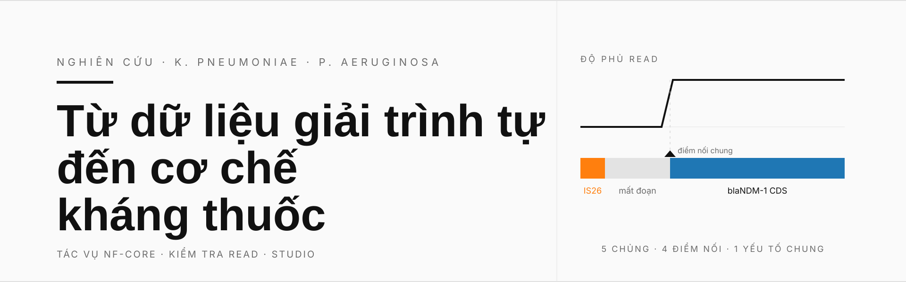
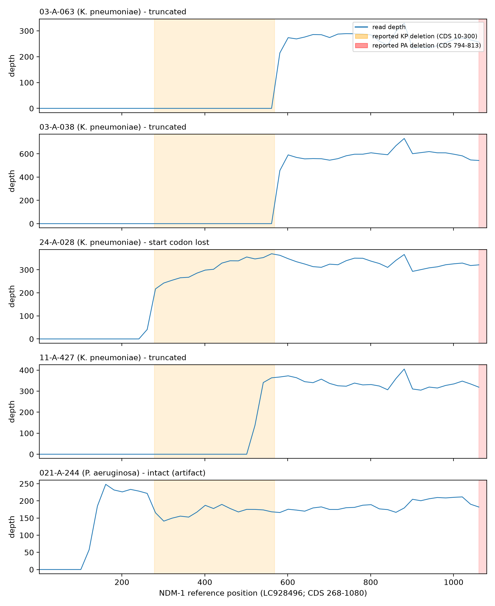
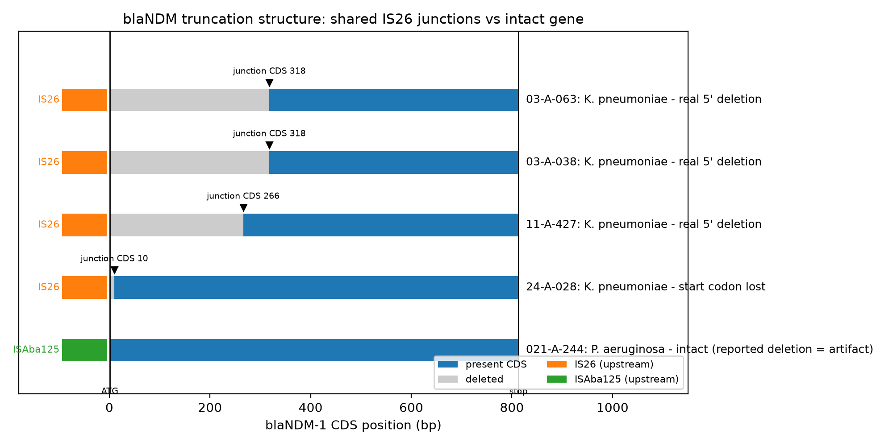
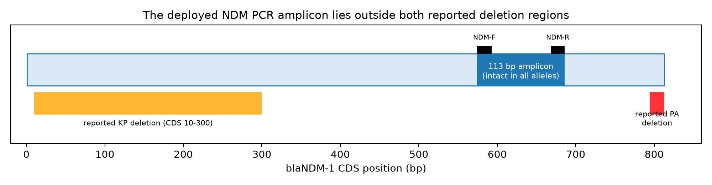
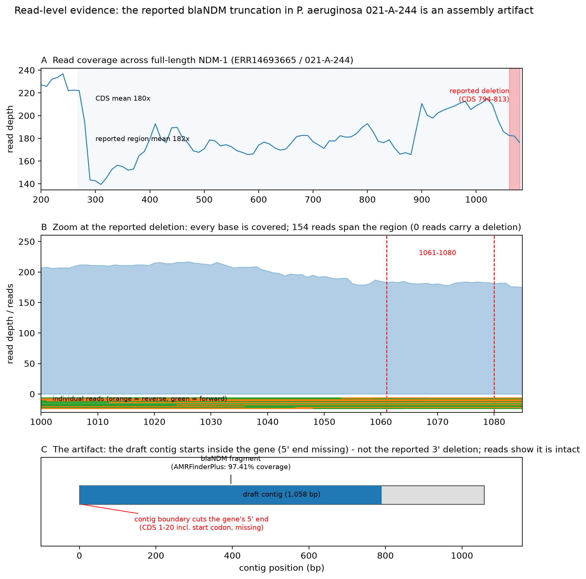

:::info
**Đây là một bài hướng dẫn thực hành.** Một nghiên cứu thực tế, dữ liệu công khai, và mọi bước — tải read, lắp ráp hệ gen, kiểm tra gene kháng thuốc ở mức read, vẽ hình — đều có thể làm trên nền tảng Omicslab. Bạn có thể làm theo từ đầu đến cuối và tái lập toàn bộ phân tích, không cần nền tảng lập trình.
:::

## 1. Một phân tích trọn vẹn để bạn làm theo

Bài này là một ví dụ hoàn chỉnh của một phân tích bioinformatics. Câu hỏi là thật, dữ liệu là công khai, và mọi bước đều chạy trên nền tảng Omicslab. Bạn có thể làm theo từ đầu đến cuối và tái lập toàn bộ phân tích.

| Bước | Chạy bằng gì | Tính năng nền tảng |
| --- | --- | --- |
| Tải reads công khai | `nf-core/fetchngs` | **Tác vụ phân tích** — pipeline không tương tác |
| Lắp ráp hệ gen | `nf-core/bacass` (Unicycler) | **Tác vụ phân tích** |
| Kiểm tra `blaNDM` ở mức read | pipeline Nextflow tự viết | **Tác vụ phân tích** (công cụ Git tự thêm) hoặc terminal trong Studio |
| Typing, plasmid, ngữ cảnh IS | AMRFinderPlus, MOB-suite, Kleborate, BLAST | **Studio** — phiên tương tác, môi trường pixi |
| Hình vẽ | script matplotlib | **Studio** — môi trường pixi + code-server |

- **Tác vụ phân tích** là phần không tương tác: chọn công cụ, điền biểu mẫu, chọn hạ tầng, bấm chạy. Pipeline nf-core chạy trực tiếp theo cách này — nền tảng đọc schema của pipeline và dựng tham số thành biểu mẫu, dùng được với bất kỳ phiên bản pipeline nào. Các trang tham khảo là [Tác vụ phân tích](https://docs.omicslab.io/tools/analysis/overview) và [Bắt đầu nhanh §3](https://docs.omicslab.io/quickstart#3-analysis).
- **Studio** là phần tương tác: những phiên chạy dài, kết nối từ trình duyệt — RStudio, Jupyter, hoặc VS Code Server (`code-server`). Đây là nơi diễn ra phần khám phá dữ liệu phía sau ([Phiên Studio](https://docs.omicslab.io/tools/studio/overview), [Bắt đầu nhanh §4](https://docs.omicslab.io/quickstart#4-studio)).

Phần kỹ thuật nhập môn nằm ở hai bài đồng hành:

- [Cách chạy pipeline nf-core trên nền tảng Omicslab](/blogs/how-to-run-nf-core-pipelines-on-omicslab) — nf-core, Nextflow và container là gì, và cách chạy bất kỳ pipeline nào như một tác vụ phân tích.
- [Hướng dẫn xây dựng bộ genome vi khuẩn không cần lập trình](/blogs/bacterial-genome-assembly-without-coding) — lắp ráp và chú giải hệ gen nghĩa là gì, và cách đọc kết quả `nf-core/bacass`.

Hai bài đó giải thích phần cơ chế; bài này ghép chúng thành một phân tích hoàn chỉnh, và thêm những phần không nằm trong pipeline chuẩn: kiểm tra ở mức read, typing và hình vẽ. Cứ để hai bài đó bên cạnh khi đọc — và vì toàn bộ dữ liệu đầu vào là công khai, bạn có thể tự chạy mọi bước.

## 2. Dữ liệu và câu hỏi

Nghiên cứu đứng sau phân tích này là Dung và cộng sự (2025) trên *Annals of Clinical Microbiology and Antimicrobials*. Nhóm tác giả báo cáo các chủng dương tính với `blaNDM` nhưng vẫn nhạy cảm với ceftazidime–avibactam (CAZ-AVI), trong một nhóm bệnh nhân nhiễm khuẩn hô hấp dưới tại Việt Nam. Một số gene `blaNDM` trông như bị cắt cụt trong bộ lắp ráp hệ gen — một lời giải thích hợp lý cho việc các chủng này vẫn nhạy cảm dù mang gene. Kết luận đó được xây dựng từ bộ lắp ráp đọc ngắn cùng BLASTn.

Cả năm lần chạy đứng sau bài báo đều công khai trong dự án ENA [PRJEB86571](https://www.ebi.ac.uk/ena/browser/view/PRJEB86571): bốn chủng *Klebsiella pneumoniae* và một chủng *Pseudomonas aeruginosa*. Chúng tôi tải lại, lắp ráp lại, rồi kiểm tra gene này đến từng base trên các read — với một câu hỏi đơn giản: **các read thô có khớp với bức tranh đó không?**

Câu hỏi đó là sợi chỉ xuyên suốt bài hướng dẫn này. Mã nguồn và tham số của lần phân tích lại cũng công khai: [vieomics/solutions](https://github.com/vieomics/solutions), nhánh [`topic/ndm-truncation`](https://github.com/vieomics/solutions/tree/topic/ndm-truncation). Không cần dữ liệu riêng để làm theo bất kỳ bước nào dưới đây.

## 3. Một vòng qua kho mã

Mọi thứ phân tích cần — mã truy cập, tham số, code pipeline và script vẽ hình — nằm trong một kho mã công khai. Bạn không cần đọc hết, nhưng một vòng hai phút sẽ giúp các phần sau dễ theo hơn:

```
solutions/
├── README.md                        # hướng dẫn cài đặt và chạy
├── ids.csv                          # năm mã truy cập ENA (PRJEB86571)
├── bacass_samplesheet.tsv           # mỗi dòng một chủng; đầu vào của nf-core/bacass
├── pixi.toml                        # môi trường và tác vụ pixi
├── pixi.lock                        # phiên bản ghim của mọi công cụ
├── params/
│   └── bacass.json                  # tham số bacass và vị trí database
├── conf/
│   ├── fetchngs.config              # cấu hình tải lại / chống throttle
│   └── resources.config             # chính sách CPU:RAM cho các lần chạy
├── analysis/
│   ├── ndm_audit.nf                 # pipeline kiểm tra mức read (Nextflow)
│   └── ndm_audit_samplesheet.tsv    # chủng + đường dẫn FASTQ cho phần kiểm tra
├── bin/
│   ├── fetchngs_to_bacass.py        # chuyển samplesheet fetchngs cho bacass
│   ├── ndm_audit_summary.py         # tổng hợp độ phủ / read bắc qua / mất đoạn
│   ├── assembly_analysis.sh         # AMRFinderPlus, MOB-suite, Kleborate, ngữ cảnh IS
│   └── plot_*.py                    # bốn script vẽ hình
├── docs/
│   ├── blog.md                      # bản viết
│   └── figures/                     # hình kết quả (PNG + SVG)
└── results/, work/, logs/           # sinh ra khi chạy (không đưa vào git)
```

Cách đọc:

- **Tệp đầu vào** ở thư mục gốc — `ids.csv` (tải gì) và `bacass_samplesheet.tsv` (lắp ráp gì). Đây là hai tệp bạn chạm vào đầu tiên.
- **`pixi.toml` + `pixi.lock`** — các môi trường dùng xuyên suốt: `default` (Nextflow + Apptainer), `analysis` (AMRFinderPlus, MOB-suite, Kleborate, bwa, samtools…) và `plots` (matplotlib). Tệp lock là thứ khiến chuỗi công cụ tái lập được.
- **`params/` và `conf/`** — các nút vặn: tham số pipeline cùng cấu hình tài nguyên và tải dữ liệu cho cụm.
- **`analysis/` và `bin/`** — phần code tự viết. Pipeline Nextflow làm phần kiểm tra mức read; các script Python và shell chuyển samplesheet, tổng hợp kết quả và vẽ hình.
- **`docs/`** — bản viết và hình, gồm bốn hình dùng trong bài này.
- **`results/`, `work/`, `logs/`** — được tạo khi bạn chạy; không bao giờ được commit: kho mã giữ code và đầu vào, không giữ kết quả.

Bốn phần tiếp theo đi qua cây thư mục này từ trên xuống.

## 4. Bước 1 — Tải reads bằng nf-core/fetchngs

Đầu vào duy nhất là một danh sách mã truy cập (`ids.csv`):

```
ERR14693661
ERR14693662
ERR14693663
ERR14693664
ERR14693665
```

Trên nền tảng, chọn `nf-core/fetchngs` trong kho công cụ của workspace, trỏ `input` vào tệp rồi chạy như một tác vụ phân tích. Câu lệnh tương đương, nếu bạn muốn tự chạy với môi trường [pixi](https://pixi.sh) của kho mã:

```bash
pixi run fetchngs
# tương đương:
pixi run nextflow run nf-core/fetchngs -r 1.13.0 -profile apptainer \
    --download_method sratools --input ids.csv --outdir results/fetchngs -resume
```

Hai ghi chú kỹ thuật nhỏ từ lần chạy:

- Dữ liệu được tải qua gương NCBI SRA (`sratools`) vì gương ENA bị bóp băng thông xuống dưới 1 MB/s và hay đứng ở các node tính toán; đường SRA đo được khoảng 10 MB/s.
- `fetchngs` kiểm tra các tệp FASTQ bằng MD5, nên một lần chạy báo thành công nghĩa là dữ liệu nguyên vẹn.

Kết quả là năm bộ read cùng một tệp `samplesheet.csv` sẵn sàng cho pipeline kế tiếp.

## 5. Bước 2 — Lắp ráp hệ gen bằng nf-core/bacass

`nf-core/bacass` nhận samplesheet, lắp ráp bằng Unicycler và chú giải nếu cần. Trên nền tảng, đây là tác vụ phân tích thứ hai; kho mã giữ tham số trong `params/bacass.json` và ghim phiên bản pipeline (`2.6.1`), nên nhiều năm sau vẫn có thể chạy lại với đúng đầu vào đó.

```bash
pixi run bacass
# tương đương:
pixi run nextflow run nf-core/bacass -r 2.6.1 -profile apptainer \
    -c conf/resources.config -params-file params/bacass.json -resume
```

Năm bộ dữ liệu đọc ngắn nằm gọn trong một job, các mẫu được xếp chạy song song trên hạ tầng bạn chọn.

Khi đã có bộ lắp ráp, một nhóm công cụ nhỏ và nhanh trả lời câu hỏi "chủng này chính xác là gì?":

- **AMRFinderPlus** — gọi gene kháng kháng sinh kèm vị trí trên contig.
- **MOB-suite** — tái dựng plasmid và định type replicon.
- **Kleborate** — sequence type của *K. pneumoniae*, type capsule và lipopolysaccharide, độc lực và kháng thuốc.
- **Ngữ cảnh IS** — vị trí các bản sao IS26 / ISAba125 so với gene (dùng trình tự từ ISfinder làm truy vấn).
- **Đồng vị trí** — `blaNDM` và gene họ OXA-48 có nằm trên cùng một contig không.

Đây không phải những pipeline kiểu nf-core; chúng là công cụ tương tác, chạy một lần, nên thuộc về phía Studio. Phần này ở mục 8.

## 6. Bước 3 — Kiểm tra gene ở mức read

Bộ lắp ráp là một mô hình của hệ gen, không phải chính hệ gen. Có hai hành vi kinh điển của lắp ráp ảnh hưởng trực tiếp đến một kết luận "gene bị cắt cụt":

- gene nằm vắt qua **ranh giới contig** có thể bị lắp ráp ra ở dạng thiếu;
- **các yếu tố di động lặp lại** có thể bị gộp hoặc đặt nhầm chỗ, khiến khó biết bản sao nào mang cái gì.

Nên trước khi kết luận từ bộ lắp ráp, ta nên hỏi thẳng các read. Phần kiểm tra của chúng tôi ánh xạ toàn bộ read lên trình tự NDM-1 đầy đủ (LC928496) và đếm, cho từng chủng:

- **độ phủ từng base** trên khắp gene;
- **số read bắc qua** mỗi vùng được báo là mất đoạn;
- **số read mang đột biến mất đoạn** chồng lên vùng đó.

Đây là một pipeline Nextflow nhỏ (`analysis/ndm_audit.nf`), để cả năm chủng chạy song song. Trên nền tảng, bạn có thể đăng ký nó như công cụ tự thêm bằng Git URL ([Lược đồ phân tích & manifest](https://docs.omicslab.io/tools/analysis/schema)), hoặc chỉ cần khởi chạy từ terminal trong một phiên Studio.

Phần kiểm tra được thiết kế trung lập với giả thuyết. Bốn khả năng được đặt lên bàn cho mỗi chủng:

| Giả thuyết | Nghĩa là gì |
| --- | --- |
| H1 | Gene thật sự mất đoạn |
| H2 | Bộ lắp ráp thiếu chứ không phải gene (ranh giới contig hoặc độ phủ) |
| H3 | Tàn dư của yếu tố di động, hoặc một bản sao thứ hai im lặng |
| H4 | Gene nguyên vẹn nhưng không được biểu hiện (ví dụ promoter bị gián đoạn) |

## 7. Reads cho thấy gì

Kết quả chính ủng hộ quan sát ban đầu: các gene `blaNDM` ở nhóm *K. pneumoniae* thật sự bị gián đoạn ở đầu 5′, và sự gián đoạn do yếu tố di động gây ra. Góc nhìn ở mức read bổ sung thêm vài chi tiết.



*Hình 1 — Độ phủ read trên toàn bộ NDM-1 (tham chiếu LC928496) của năm chủng. Ba chủng K. pneumoniae có độ phủ bằng 0 trên vùng tô cam bên trái; một chủng chỉ mất đúng phần đầu của gene; chủng P. aeruginosa được phủ suốt cả gene.*

| Chủng | Loài | Bức tranh ở mức read |
| --- | --- | --- |
| 03-A-063 | *K. pneumoniae* | mất đoạn 5′; yếu tố họ IS26 nối vào vị trí CDS 318 |
| 03-A-038 | *K. pneumoniae* | mất đoạn 5′; yếu tố họ IS26 nối vào vị trí CDS 318 |
| 11-A-427 | *K. pneumoniae* | mất đoạn 5′; yếu tố họ IS26 nối vào vị trí CDS 266 |
| 24-A-028 | *K. pneumoniae* | CDS còn nguyên nhưng mất codon mở đầu (IS26 nối vào vị trí CDS 10) |
| 021-A-244 | *P. aeruginosa* | gene dài đầy đủ được read phủ khắp; kết quả lắp ráp thiếu khớp với ranh giới contig ở đầu 5′ của gene |



*Hình 2 — Cấu trúc điểm nối. Ở bốn chủng K. pneumoniae, một yếu tố họ IS26 nằm ngay trước phần gene còn lại; ở chủng P. aeruginosa, ISAba125 nằm trước một CDS nguyên vẹn — đúng ngữ cảnh thường thấy của `blaNDM`.*

Cơ chế giờ đã gọi được tên. Một **yếu tố họ IS26** chung đã xen vào đầu 5′ của `blaNDM` ở cả bốn chủng *K. pneumoniae*, ở các vị trí hơi khác nhau, nối với một gene gần như được bảo toàn. Đây không giống bốn lần mất gene độc lập: nó giống cùng một sự kiện di động được nhìn thấy ở bốn hậu duệ.

### 7.1. Bối cảnh dòng và plasmid

Dữ liệu typing đồng tình. Cả bốn chủng *K. pneumoniae* đều là **ST16** — dòng từng gắn với các đợt bùng phát bệnh viện ở miền Nam Việt Nam — với hồ sơ plasmid gần như giống hệt nhau (IncFIB, IncFIB+IncFII, IncFII/rep\_2183, IncX3/rep\_1195). Bước typing kháng thuốc còn phân giải tín hiệu họ OXA-48 thành **`blaOXA-181`** (cùng họ, gọi allele chính xác hơn); trong bộ lắp ráp nháp, nó nằm trên contig khác với `blaNDM`.

### 7.2. PCR đang dùng thấy được gì và không thấy được gì

Câu hỏi thực tế kéo theo: PCR phát hiện NDM đang dùng có phân biệt được các allele này không — gene nguyên vẹn với các gene đã gián đoạn?



*Hình 3 — Đoạn khuếch đại của PCR NDM đang dùng (CDS 574–686) nằm ngoài cả hai vùng được báo mất đoạn, nên nó nguyên vẹn ở mọi allele, dù gene có bị cắt cụt hay không.*

Không phân biệt được. Đoạn khuếch đại nằm ở phần gene mà mọi allele đều chia sẻ, nên PCR dương tính là kết quả hoàn toàn đúng như mong đợi kể cả khi enzyme đã bị gián đoạn. Đây không phải lỗi của xét nghiệm — đó là một điểm mù đáng biết. Kết quả phân tử và kết quả kháng sinh đồ cần đến nhau, và bằng chứng ở mức read là thứ giúp cặp kết quả đó có thể luận giải được.

### 7.3. Một gene đáng xem lại

Có một chủng đáng đọc kỹ hơn.



*Hình 4 — Chủng P. aeruginosa (021-A-244): mọi base của gene đều được phủ (độ phủ trung bình khoảng 180×), 154 read bắc qua vùng được báo mất đoạn, và không read nào mang đột biến mất đoạn ở đó. Kết quả lắp ráp thiếu khớp với một ranh giới contig cắt vào đầu 5′ của gene.*

Ở mức read, gene này trông dài đầy đủ: độ phủ trung bình khoảng 180× trên CDS, 154 read bắc qua vùng được báo mất đoạn, không read nào mang đột biến mất đoạn. Kết quả lắp ráp thiếu khớp với một ranh giới contig dừng bên trong đầu 5′ của gene — khoảng 20 base đầu, gồm cả codon mở đầu, nằm ở phía bên kia ranh giới. Cùng một bộ dữ liệu, hai góc nhìn. Đây chính là trường hợp mà một lần kiểm tra ở mức read đáng để chạy thêm, và cũng là lý do phần kiểm tra báo riêng số read bắc qua và số read mang mất đoạn, thay vì chỉ nhìn độ phủ trung bình.

## 8. Bước 4 — Khám phá downstream với pixi trong Studio

Mọi việc sau bước lắp ráp đều mang tính khám phá: mở một tệp độ phủ, xem một điểm nối, chỉnh một hình vẽ. Đó là việc của Studio.

Mở một phiên **VS Code Server** (`code-server`) trong workspace, gắn kho mã vào, và mở terminal — toàn bộ chuỗi công cụ downstream chỉ cách một câu lệnh:

```bash
pixi install          # tạo các môi trường đã ghim phiên bản
pixi run -e analysis  # AMRFinderPlus, MOB-suite, Kleborate, bwa, samtools, BLAST, spades, ISEScan, seqkit
pixi run -e plots     # matplotlib
```

Rồi trong phiên đó:

```bash
pixi run -e analysis nextflow run analysis/ndm_audit.nf   # kiểm tra ở mức read
pixi run -e plots python3 bin/plot_coverage.py            # Hình 1
pixi run -e plots python3 bin/plot_pa_artifact.py         # Hình 4
```

`pixi.toml` và `pixi.lock` ghim các công cụ, nên môi trường hôm nay và sang năm vẫn như nhau. Không ai phải cài nửa phần mềm bioconda bằng tay, và dữ liệu không rời khỏi workspace: phiên chạy ngay cạnh vùng lưu trữ, thay vì trên một chiếc laptop có thể không có sẵn tệp.

Khi phiên làm việc kết thúc, **Snapshot** lưu thư mục home của phiên trở lại workspace, để sau này tiếp tục đúng trạng thái đó ([Phiên Studio](https://docs.omicslab.io/tools/studio/overview)).

:::tip
Cùng những môi trường pixi đó chạy được trên máy cá nhân hoặc trên cụm Slurm của riêng bạn — `pixi install` đọc tệp lock và tái tạo chuỗi công cụ ở bất cứ đâu. Nền tảng không khóa bạn lại; nó chỉ đưa công việc lên trình duyệt và đến cạnh dữ liệu.
:::

## 9. Nền tảng giúp được gì cho một quy trình như thế này

- **nf-core chạy trực tiếp.** `fetchngs` và `bacass` là các tác vụ phân tích: công cụ trong kho, tham số trên biểu mẫu, log, ước tính chi phí và kết quả ngay trên trình duyệt. Không cần cài Nextflow, không cần container engine, không cần cấu hình scheduler.
- **Phần tự viết nằm cạnh đó.** Một pipeline Nextflow như phần kiểm tra mức read được đăng ký từ Git URL; các công cụ không phải pipeline nằm trong một phiên Studio.
- **Phân tích tương tác là công dân hạng nhất.** Môi trường pixi gắn thẳng vào phiên code-server, nên "phân tích downstream" vẫn là công việc tái lập được với phiên bản ghim, thay vì một đống gói cài bằng tay.
- **Mọi lần chạy đều được ghi lại.** Manifest của job giữ tham số, phiên bản pipeline và câu lệnh chính xác đã chạy; lần chạy lại chỉ ghi đè những gì cần và ghi nhận những gì đã đổi.
- **Vị trí linh hoạt.** Hạ tầng tính toán và lưu trữ có thể ở lại Việt Nam (CloudFly, GreenNode) hoặc trên cụm Slurm của bạn — điều đáng cân nhắc với dữ liệu chủng bệnh phẩm lâm sàng.

## 10. Tự chạy lại

- **Reads**: dự án ENA [PRJEB86571](https://www.ebi.ac.uk/ena/browser/view/PRJEB86571)
- **Mã nguồn, tham số và hình vẽ**: [vieomics/solutions](https://github.com/vieomics/solutions), nhánh [`topic/ndm-truncation`](https://github.com/vieomics/solutions/tree/topic/ndm-truncation)
- **Hai bài hướng dẫn nền tảng**: [Cách chạy pipeline nf-core trên nền tảng Omicslab](/blogs/how-to-run-nf-core-pipelines-on-omicslab) và [Hướng dẫn xây dựng bộ genome vi khuẩn không cần lập trình](/blogs/bacterial-genome-assembly-without-coding)

Trên nền tảng: tải `ids.csv` lên, chạy `nf-core/fetchngs` như một tác vụ phân tích, chỉnh samplesheet của nó cho `nf-core/bacass` rồi chạy tác vụ thứ hai, sau đó mở một phiên Studio trên kho mã để làm phần typing và kiểm tra mức read.

## 11. Tài liệu tham khảo

- Dung và cộng sự (2025), *Annals of Clinical Microbiology and Antimicrobials* — [doi:10.1186/s12941-025-00818-3](https://doi.org/10.1186/s12941-025-00818-3)
- `nf-core/fetchngs` — [nf-co.re/fetchngs](https://nf-co.re/fetchngs); `nf-core/bacass` — [nf-co.re/bacass](https://nf-co.re/bacass)
- Tài liệu nền tảng — [Tác vụ phân tích](https://docs.omicslab.io/tools/analysis/overview), [Phiên Studio](https://docs.omicslab.io/tools/studio/overview), [Bắt đầu nhanh](https://docs.omicslab.io/quickstart)
- pixi — môi trường tái lập được: [pixi.sh](https://pixi.sh)
- Công cụ — [AMRFinderPlus](https://github.com/ncbi/amr), [MOB-suite](https://github.com/mob-suite/mob-suite), [Kleborate](https://github.com/klebgenomics/Kleborate), [ISfinder](https://isfinder.biotoul.fr/)

## 12. Bài viết liên quan

- Hướng dẫn nền tảng: [Cách chạy pipeline nf-core trên nền tảng Omicslab](/blogs/how-to-run-nf-core-pipelines-on-omicslab).
- Ví dụ trọn vẹn: [Hướng dẫn xây dựng bộ genome vi khuẩn không cần lập trình](/blogs/bacterial-genome-assembly-without-coding).
- Thêm bài viết theo tag [nf-core](/blogs?tag=nf-core) và [platform](/blogs?tag=platform).
- Tính năng và bảng giá tại trang [Nền tảng Omicslab](/solutions/data-platform).
