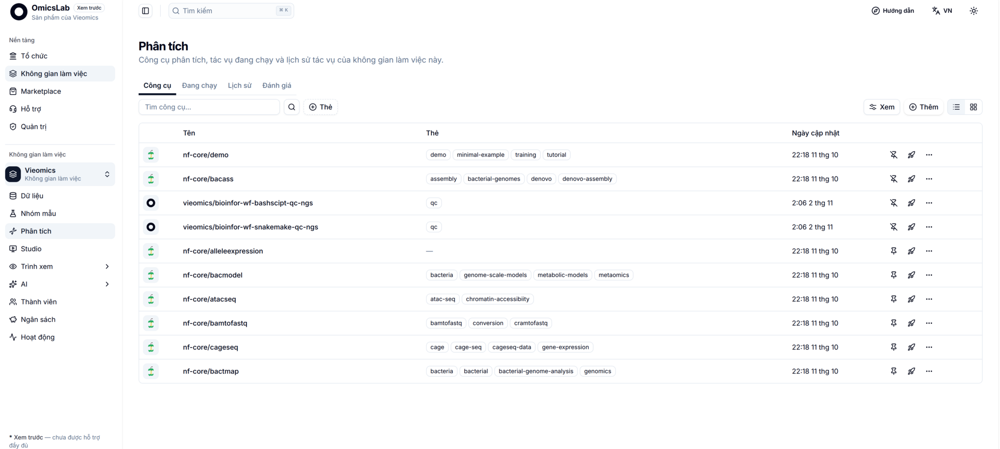
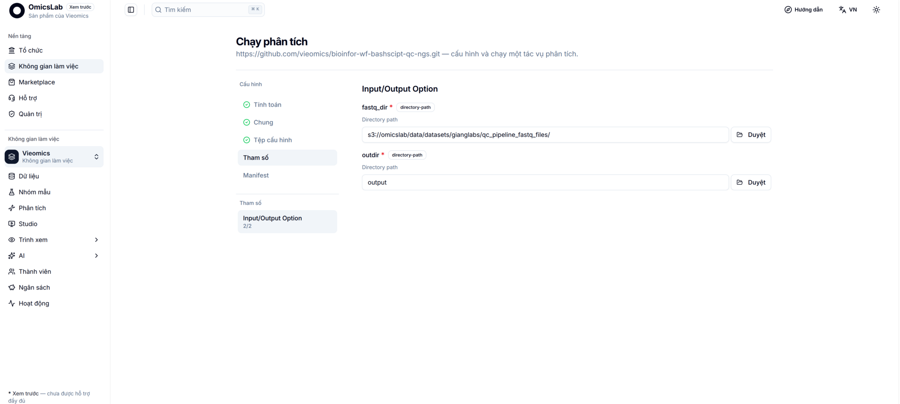

:::info
**Bài này dành cho người đã có một pipeline chạy được trên GitHub và muốn đưa nó lên nền tảng.** Bạn không cần viết lại pipeline bằng Nextflow, không cần tự dựng giao diện và không cần sửa nền tảng cho từng công cụ. Nếu bạn chưa quen nền tảng, [Cách chạy pipeline nf-core trên Omicslab](/blogs/how-to-run-nf-core-pipelines-on-omicslab) là điểm bắt đầu; bài hiện tại đi vào phần tích hợp một pipeline tự viết.
:::

## Một pipeline, nhiều engine

Một pipeline phân tích thường bắt đầu bằng một script Bash, một Snakefile, một workflow Nextflow hoặc một chuỗi Python. Khi đưa lên nền tảng, câu hỏi không phải là "engine nào được hỗ trợ?" mà là "nền tảng cần biết gì để chạy pipeline này?".

Câu trả lời khá nhỏ: một **schema** mô tả đầu vào, một **entrypoint** để chạy pipeline, và một **môi trường** để chạy nó. Khi ba phần đó khớp, nền tảng có thể dựng biểu mẫu, chạy job, lưu log và trả kết quả — bất kể bên trong là Bash, Snakemake hay Nextflow.

## Hợp đồng nhỏ của một pipeline

Một repo đủ điều kiện để tích hợp thường có cấu trúc như sau:

```
my-pipeline/
├── schema.json          # biểu mẫu và các trường bắt buộc
├── omicslab/
│   └── main.sh          # entrypoint; nhận tham số qua biến môi trường
├── pixi.toml
├── pixi.lock            # phiên bản công cụ được ghim
├── README.md
└── tests/               # tùy chọn: dữ liệu và script chạy thử
```

Ba phần chính:

- **`schema.json`** — mô tả những gì người dùng cần nhập. Nền tảng đọc tệp này và dựng biểu mẫu; trường bắt buộc có dấu `*`, trường có `format: directory-path` mở hộp chọn thư mục.
- **`omicslab/main.sh`** — điểm vào. Nền tảng gọi script này sau khi chuẩn bị repo, môi trường và tham số. Script có thể gọi Bash, Snakemake, Python, R hoặc một workflow khác.
- **`pixi.toml` + `pixi.lock`** — môi trường chạy. Entrypoint kích hoạt môi trường bằng `pixi shell-hook`; tệp lock giữ phiên bản công cụ ổn định.

:::note
**Tên thư mục:** `omicslab/` là tên hiện tại. Các repo cũ dùng `river/` vẫn chạy được: nền tảng tự tạo một symlink từ `river` sang `omicslab`. Nếu bạn tạo repo mới, hãy dùng `omicslab/main.sh`.
:::

## Schema: biểu mẫu bắt đầu từ đây

Ví dụ dưới đây là schema của hai pipeline QC trong bài. Nó có một section `input_output_options` với hai trường bắt buộc:

```json
{
  "$defs": {
    "input_output_options": {
      "title": "Input/Output Option",
      "type": "object",
      "required": ["fastq_dir", "outdir"],
      "properties": {
        "fastq_dir": {
          "type": "string",
          "default": "workspace",
          "format": "directory-path",
          "description": "Directory path"
        },
        "outdir": {
          "type": "string",
          "default": "output",
          "format": "directory-path",
          "description": "Directory path"
        }
      }
    }
  }
}
```

Cách đọc:

- **`required`** quyết định trường nào phải có trước khi chạy. Trong ảnh chụp bên dưới, `fastq_dir` và `outdir` đều có dấu `*`.
- **`type`** cho biết kiểu dữ liệu; `string` là văn bản hoặc đường dẫn.
- **`format: directory-path`** biến trường thành bộ chọn thư mục, thay vì một ô text tự do.
- **`default`** điền sẵn giá trị; người dùng có thể đổi.
- **`description`** là dòng hướng dẫn dưới trường.

Bạn có thể thêm nhiều section trong `$defs` cho các nhóm tham số khác — ví dụ `assembly_options` hoặc `annotation_options`. Nền tảng hiển thị mỗi section thành một mục trong biểu mẫu.

## Entrypoint: nơi pipeline thực sự chạy

Schema chỉ mô tả đầu vào. Phần chạy nằm trong `omicslab/main.sh`. Nền tảng truyền các tham số đã nhập vào script dưới dạng biến môi trường; script đọc `$fastq_dir`, `$outdir` và gọi công cụ.

Ví dụ với Bash và FastQC/MultiQC:

```bash
#!/bin/bash
set -euo pipefail

eval "$(pixi shell-hook --manifest-path analysis)"
mkdir -p "$outdir"

fastqc "$fastq_dir"/*fq -o "$outdir"
multiqc "$outdir" -o "$outdir" --force
```

Ví dụ với Snakemake:

```bash
#!/bin/bash
set -euo pipefail

eval "$(pixi shell-hook --manifest-path analysis)"
mkdir -p "$outdir"

snakemake --snakefile analysis/Snakefile --directory analysis \
  --config fastq_dir="$fastq_dir" qc_dir="$outdir" --cores all
```

Hai script khác nhau ở engine, nhưng cùng một schema và cùng một biểu mẫu. Đó là điểm chính: nền tảng không cần biết bên trong là Bash hay Snakemake; nó chỉ cần entrypoint và các tham số.

Hai repo ví dụ:

- **Bash + FastQC/MultiQC** — [vieomics/bioinfor-wf-bashscipt-qc-ngs](https://github.com/vieomics/bioinfor-wf-bashscipt-qc-ngs)
- **Snakemake + FastQC/MultiQC** — [vieomics/bioinfor-wf-snakemake-qc-ngs](https://github.com/vieomics/bioinfor-wf-snakemake-qc-ngs)

Cả hai là ví dụ proof-of-concept, không phải pipeline production. Chúng đủ nhỏ để đọc và đủ thật để kiểm tra hợp đồng tích hợp. Trong hai repo hiện tại, entrypoint vẫn nằm ở `river/main.sh` (tên cũ); khi tạo repo mới, đặt cùng nội dung vào `omicslab/main.sh`.

## Thêm pipeline vào nền tảng

1. **Đưa repo lên GitHub** với `schema.json`, `omicslab/main.sh`, `pixi.toml` và `pixi.lock`.
2. Mở **Phân tích → Công cụ → Thêm**, dán URL Git của repo và chọn tag hoặc commit.
3. Nền tảng đọc schema và dựng biểu mẫu chạy.
4. Chạy với dữ liệu thử, xem log và kiểm tra thư mục `outdir`.
5. Lưu manifest để lần sau chạy lại với cùng tham số và phiên bản.

Trong ảnh dưới, hai pipeline QC tự viết nằm cạnh các pipeline nf-core trong cùng danh mục công cụ:



*Hình 1 — `vieomics/bioinfor-wf-bashscipt-qc-ngs` và `vieomics/bioinfor-wf-snakemake-qc-ngs` nằm trong cùng danh mục với các pipeline nf-core. Thẻ `qc` giúp lọc hai công cụ QC trong danh mục.*

Khi mở một trong hai công cụ, biểu mẫu chỉ có hai trường — đúng như schema mô tả:



*Hình 2 — Biểu mẫu được dựng từ `schema.json`: `fastq_dir` và `outdir`, cả hai bắt buộc và đều là bộ chọn thư mục. Cùng một biểu mẫu cho Bash và Snakemake.*

## Repo giữ pipeline, nền tảng giữ phần vận hành

| Thành phần | Thuộc về repo | Nền tảng xử lý |
| --- | --- | --- |
| Thuật toán và công cụ | Có | Chạy trong môi trường của job |
| `schema.json` | Có | Dựng biểu mẫu và kiểm tra trường bắt buộc |
| `omicslab/main.sh` | Có | Gọi entrypoint với tham số |
| `pixi.lock` | Có | Tái tạo môi trường |
| Compute, storage | Không | Cấp theo cấu hình |
| Log, manifest, lịch sử | Không | Lưu và hiển thị trong workspace |
| `outdir` | Không | Thu kết quả, cho xem và tải về |

Cách chia này giữ pipeline là tài sản của nhóm bạn. Nền tảng không cần biết chi tiết từng bước; nó chỉ cần một entrypoint và một schema.

## Không chỉ là QC

Hai ví dụ trong bài là QC vì chúng dễ đọc và dễ chạy. Cùng một hợp đồng có thể dùng cho:

- Pipeline variant calling hoặc annotation.
- Pipeline RNA-seq, metagenomics hoặc single-cell.
- Một script Python/R xử lý dữ liệu và ghi kết quả vào `outdir`.
- Một workflow Snakemake hoặc Nextflow tự viết.

Điều kiện là pipeline chạy được bằng dòng lệnh trong môi trường của repo và ghi kết quả vào `outdir`. Nếu pipeline cần một môi trường đặc biệt, hãy đưa môi trường đó vào `omicslab/main.sh` hoặc vào `pixi.toml`.

:::tip
**Chạy thử trước khi tích hợp.** Cả hai repo đều có `tests/run_local.sh` để mô phỏng job cục bộ. Nếu pipeline chạy được ở đó, nó là ứng viên tốt để đưa lên nền tảng.
:::

## Câu hỏi thường gặp

**Pipeline phải là Nextflow à?**  
Không. Bash, Snakemake, Python, R hoặc một CLI khác đều được, miễn là có entrypoint và schema. nf-core/Nextflow có xử lý riêng, nhưng không phải điều kiện để tích hợp.

**Tôi có phải viết lại pipeline không?**  
Không. Bạn giữ nguyên workflow, thêm `schema.json` và `omicslab/main.sh` làm lớp tích hợp.

**Repo riêng tư có dùng được không?**  
Có, nếu tài khoản của bạn có quyền truy cập repo. Cấu hình Git credential trong **Cài đặt → Quản lý phiên bản**; xem thêm [Chương 06](/guide#studio-token).

**Pipeline có nhiều bước thì sao?**  
Entrypoint có thể gọi cả workflow. Nền tảng quản lý nó như một job; các bước bên trong do pipeline tự điều phối.

**Tôi có cần container không?**  
Không bắt buộc. Ví dụ dùng pixi để ghim môi trường; nếu pipeline dùng conda, venv hoặc container, hãy kích hoạt môi trường đó trong entrypoint.

## Bắt đầu

1. Tạo tài khoản tại [platform.omicslab.io](https://platform.omicslab.io) — xem [hướng dẫn đăng ký](/guide#bat-dau-dang-nhap).
2. Đưa repo lên GitHub với `schema.json` và `omicslab/main.sh`.
3. Thêm công cụ trong **Phân tích → Công cụ**, chạy thử với dữ liệu nhỏ.
4. Cần hỗ trợ tích hợp? Viết đến [contact@omicslab.io](mailto:contact@omicslab.io).

## Tài liệu tham khảo

- Schema phân tích — [Analysis schema & manifest](https://docs.omicslab.io/tools/analysis/schema)
- Ví dụ Bash — [vieomics/bioinfor-wf-bashscipt-qc-ngs](https://github.com/vieomics/bioinfor-wf-bashscipt-qc-ngs)
- Ví dụ Snakemake — [vieomics/bioinfor-wf-snakemake-qc-ngs](https://github.com/vieomics/bioinfor-wf-snakemake-qc-ngs)
- Hướng dẫn nền tảng — [Cách chạy pipeline nf-core trên Omicslab](/blogs/how-to-run-nf-core-pipelines-on-omicslab), [Tác vụ phân tích](https://docs.omicslab.io/tools/analysis/overview)
- JSON Schema — [json-schema.org](https://json-schema.org/)

## Bài viết liên quan

- [Chạy toàn bộ nf-core/bacass trên trình duyệt: 19 phút, 3.184 VND](/blogs/bacass-test-full-19-minutes)
- [Studio + OpenCode: cấp quyền cho coding agent mà không đưa token cho nó](/blogs/studio-opencode-credential-broker)
- [Cách chạy pipeline nf-core trên nền tảng Omicslab](/blogs/how-to-run-nf-core-pipelines-on-omicslab)
