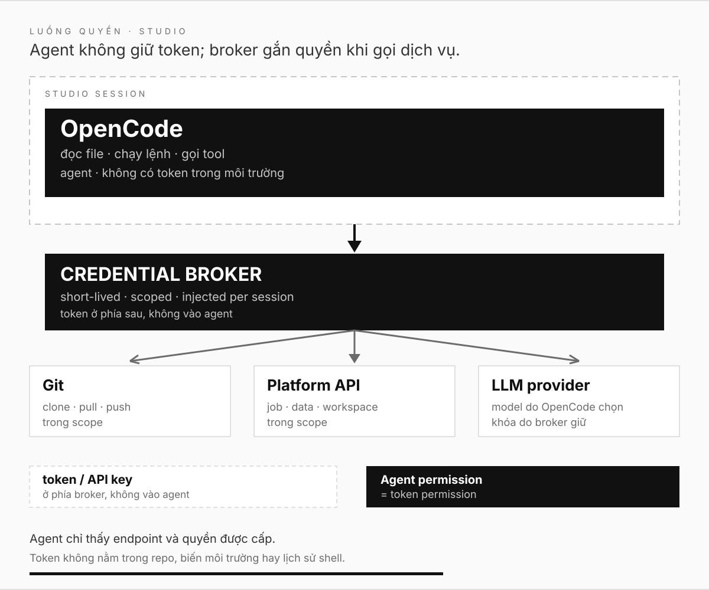
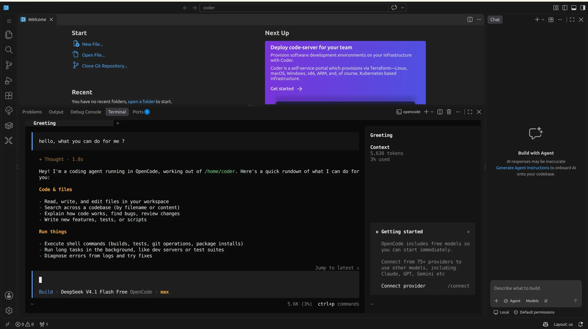
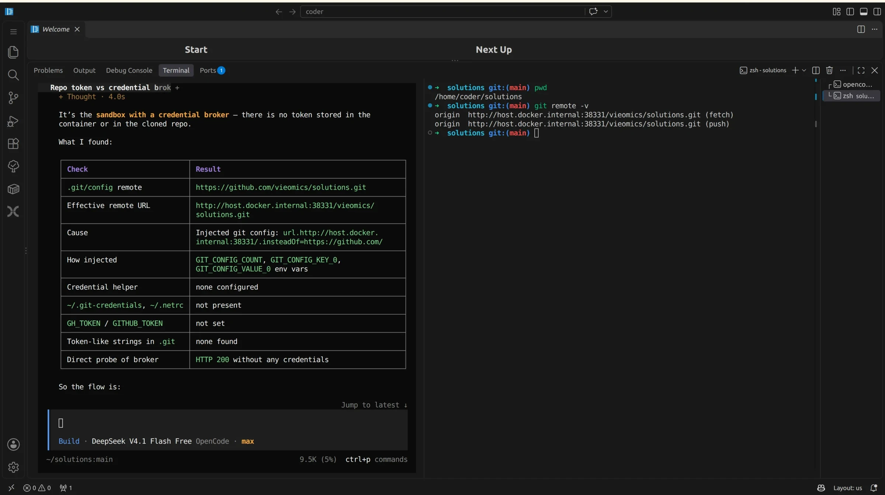

:::info
**Bài này giải thích cách Studio và OpenCode xử lý quyền, không phải hướng dẫn cài đặt.** Nếu bạn chưa quen Studio, [Chương 06 của Hướng dẫn sử dụng](/guide#studio) đi qua cách mở phiên, kết nối và lưu snapshot. Ảnh chụp dùng giao diện tiếng Việt; các nút tương ứng ở giao diện tiếng Anh nằm cùng vị trí.
:::

## Coding agent cần quyền, nhưng không nên giữ token

Một coding agent như OpenCode có thể đọc repository, sửa file, chạy lệnh và kiểm tra kết quả. Để làm được những việc đó, nó cần quyền truy cập Git, đôi khi cả API của nền tảng và một model LLM. Cách phổ biến là đặt token vào biến môi trường hoặc tệp cấu hình trong container. Cách đó tiện, nhưng token dài hạn nằm ngay cạnh agent: nó có thể bị đọc, bị ghi vào log, bị copy vào repository, hoặc được dùng cho một việc ngoài ý muốn.

Studio xử lý phần này bằng một **credential broker**. Agent vẫn có quyền làm việc, nhưng không cầm token. Token được giữ ở phía broker và chỉ được gắn vào lúc gọi dịch vụ, trong phạm vi quyền của token đó.

## Studio trong một đoạn

**Studio** mở một ứng dụng tương tác trên compute của workspace và hiển thị trong trình duyệt. Dữ liệu vẫn nằm trong bucket của workspace; phiên làm việc chỉ tồn tại trong thời gian job chạy. Khi phiên kết thúc, một **snapshot** có thể lưu thư mục home trở lại workspace để lần sau tiếp tục.

Điểm quan trọng với bài này: Studio không chỉ là nơi mở terminal. Nó là môi trường mà dữ liệu, compute và quyền truy cập nằm cùng một chỗ. Credential broker là lớp nằm giữa agent và các dịch vụ bên ngoài.

## Credential broker: quyền đi qua một cửa hẹp

Hình dưới mô tả luồng quyền trong một phiên Studio:

*Hình 1 — Agent gọi broker trong phiên; broker gắn credential khi gọi Git, Platform API hoặc LLM provider. Token không đi vào môi trường của agent.*

Cách hoạt động, ở mức đủ để hiểu:

- **Broker chạy trong phiên Studio.** OpenCode gọi một endpoint nội bộ, không cần biết token.
- **Broker gắn credential ở phía sau.** Khi agent clone/pull/push Git, gọi Platform API hoặc gọi model provider, broker thêm credential vào request.
- **Token là short-lived và theo phiên.** Token không phải một khóa dài hạn được nhúng vào container.
- **Agent chỉ thấy endpoint và kết quả.** Nó không đọc được giá trị token từ biến môi trường, `.git-credentials`, `.netrc`, `.git/config` hay lịch sử shell.

Có một chi tiết dễ gây nhầm: trong ảnh kiểm tra bên dưới, agent gọi thẳng broker và nhận `HTTP 200` dù không mang credential. Điều đó không có nghĩa broker mở công khai. Broker chỉ nghe trong phiên; thứ xác thực request là ranh giới phiên, còn token được gắn khi broker đi ra dịch vụ bên ngoài.

## OpenCode: chọn model, không cầm khóa

OpenCode là coding agent chạy trong terminal của Studio. Nó có thể đọc file, tìm trong codebase, sửa code, chạy lệnh và kiểm tra lỗi. Trong ảnh dưới, tab `opencode` đang mở trong terminal:

*Hình 2 — OpenCode chạy trong terminal của Studio. Agent có thể đọc file và chạy lệnh; token không nằm trong môi trường của nó.*

OpenCode là nơi bạn chọn **provider và model**. Cấu hình có thể đặt trong `opencode.json` hoặc chọn qua giao diện model của OpenCode. Với đường quản lý của Studio, khóa provider do broker cấp; bạn không cần dán khóa vào chat, terminal hay repository. Agent chỉ thấy tên provider và model. Điều này áp dụng cho cả API token của provider, platform token và Git token.

Hiện tại, để bắt đầu, nên chọn một **model miễn phí** trong OpenCode. Ảnh chụp dùng một model miễn phí; không cần tài khoản provider để làm quen với quy trình. Model miễn phí có giới hạn về chất lượng và tốc độ, nên phù hợp cho việc thử, học và các tác vụ không nhạy cảm.

## Agent thấy gì và không thấy gì

| Thành phần | Agent thấy | Ghi chú |
| --- | --- | --- |
| File trong workspace | Có | Theo quyền của phiên |
| Terminal, lệnh shell | Có | Trong giới hạn của phiên |
| Git remote | Endpoint broker | Không phải token |
| Platform API | Qua broker | Theo scope của platform token |
| LLM provider | Provider và model | Khóa do broker/Studio giữ |
| Giá trị token | Không | Không có trong env, file hay repo |
| `.git-credentials`, `.netrc` | Không có token | Broker thay thế các tệp này |

Ảnh dưới là kết quả agent tự kiểm tra môi trường của nó:

*Hình 3 — Agent kiểm tra `.git/config`, `.git-credentials`, `.netrc`, biến môi trường và các chuỗi giống token trong repo. Kết quả: không có token; Git remote được chuyển qua broker.*

## Quyền của agent bằng quyền của token

Broker không mở rộng quyền. Nếu token chỉ được phép đọc một repository, agent không thể push sang repository khác. Nếu platform token chỉ có một scope, agent chỉ làm được những gì scope đó cho phép. Muốn giới hạn hơn, hãy cấp token read-only hoặc token chỉ cho đúng repository đang dùng.

Đây là lý do nên xem lại quyền của từng token trước khi chạy agent. Broker giảm việc lộ token, nhưng không thay thế việc review quyền. Một token có quyền rộng vẫn cho agent quyền rộng, kể cả khi token không hiện ra trong terminal.

:::tip
**Nguyên tắc thực hành:** cấp token ít quyền nhất có thể, thời hạn ngắn nhất có thể; dùng token riêng cho từng repository hoặc từng mục đích; thu hồi khi không còn dùng. Agent chỉ nên làm việc với dữ liệu và repository mà token đó thực sự cần.
:::

## Vì sao điều này quan trọng với nhóm nghiên cứu

Coding agent hữu ích nhất khi nó ở gần dữ liệu và code. Trong Studio, agent có thể:

- Đọc và giải thích một pipeline hoặc script có sẵn.
- Sửa lỗi, viết test, cập nhật tài liệu.
- Kiểm tra cấu trúc repository trước khi mở pull request.
- Chạy lệnh kiểm tra nhỏ trong terminal, rồi báo lại kết quả.

Những việc này không cần agent cầm token dài hạn. Chúng cần agent có quyền vừa đủ, trong một phiên có thể kết thúc và thu hồi. Credential broker biến quyền truy cập thành thứ đi kèm phiên, thay vì một khóa nằm lại trong container.

## Bắt đầu với model miễn phí

1. Mở một phiên **Studio** trong workspace.
2. Mở terminal và chạy `opencode`.
3. Chọn một model miễn phí trong OpenCode.
4. Giao một việc nhỏ — đọc repository, tóm tắt một file, chạy một lệnh kiểm tra — để xem agent làm việc trong phạm vi quyền hiện có.

Với Git hoặc Platform API, agent dùng broker thay vì token trong môi trường. Nếu một thao tác bị từ chối, kiểm tra scope của token trước khi mở rộng quyền.

:::info
**Sắp tới: provider LLM tại Việt Nam và full sandbox.** Vieomics đang làm việc với một nhà cung cấp LLM tại Việt Nam. Khi hoàn tất, Studio sẽ tiến tới một full sandbox với các tính năng mới, hướng tới việc giữ prompt và dữ liệu trong phạm vi pháp lý Việt Nam. Chúng tôi sẽ thông báo khi tính năng sẵn sàng.

Cho đến lúc đó, model miễn phí là cách phù hợp để làm quen. Không nên đưa dữ liệu nhạy cảm hoặc dữ liệu cá nhân vào provider bên ngoài khi chưa có cấu hình và thỏa thuận phù hợp. Phạm vi tuân thủ phụ thuộc vào provider, loại dữ liệu và cách cấu hình; chúng tôi sẽ công bố rõ khi dịch vụ ra mắt.
:::

## Câu hỏi thường gặp

**Agent có thể đọc token nếu nó chạy lệnh `env` không?**  
Không. Token không được đặt trong biến môi trường của agent.

**Agent có thể dùng token để push code không?**  
Có, nếu token có quyền push. Broker chỉ chuyển quyền, không tự mở rộng quyền. Muốn chặn push, cấp token read-only.

**Broker có thay thế việc kiểm tra quyền token không?**  
Không. Broker giảm khả năng lộ token; quyền vẫn do token quyết định. Cần review scope và thời hạn của token.

**Model miễn phí có đủ dùng không?**  
Đủ để thử quy trình và học cách agent làm việc. Với công việc dài, yêu cầu chất lượng cao hoặc dữ liệu nhạy cảm, nên chờ provider trong nước và full sandbox.

## Bắt đầu

1. Tạo tài khoản tại [platform.omicslab.io](https://platform.omicslab.io). Các bước có trong [Hướng dẫn đăng ký](/guide#bat-dau-dang-nhap).
2. Mở **Studio**, chạy một phiên và làm theo [Chương 06](/guide#studio).
3. Chạy `opencode`, chọn model miễn phí và thử một việc nhỏ.
4. Cần hỗ trợ? Viết đến [contact@omicslab.io](mailto:contact@omicslab.io).

## Tài liệu tham khảo

- OpenCode — [opencode.ai/docs](https://opencode.ai/docs/); provider — [opencode.ai/docs/providers](https://opencode.ai/docs/providers/); permissions — [opencode.ai/docs/permissions](https://opencode.ai/docs/permissions/)
- Hướng dẫn Studio — [Chương 06: Studio](/guide#studio), [credential broker](/guide#studio-token)
- Tài liệu nền tảng — [Studio sessions](https://docs.omicslab.io/tools/studio/overview), [Bắt đầu nhanh](https://docs.omicslab.io/quickstart)
- Bài viết liên quan — [Chạy toàn bộ nf-core/bacass trên trình duyệt](/blogs/bacass-test-full-19-minutes), [Cách chạy pipeline nf-core trên nền tảng Omicslab](/blogs/how-to-run-nf-core-pipelines-on-omicslab)
