:::info
**Đây là bài thực hành có ảnh chụp, không phải tài liệu kỹ thuật.** Mục tiêu là để một người mới tự chạy full profile của `nf-core/bacass`, đọc được kết quả và biết chi phí thực tế. Nếu chưa có tài khoản, phần **Đăng nhập** trong [Hướng dẫn sử dụng nền tảng](/guide#bat-dau-dang-nhap) đi qua các bước tạo tài khoản, xác nhận email và tạo tổ chức đầu tiên. Ảnh chụp dùng giao diện tiếng Việt; các nút tương ứng ở giao diện tiếng Anh nằm cùng vị trí.
:::

## Một lần chạy đầy đủ, không cài gì

Chúng tôi giữ nguyên profile `test_full` của `nf-core/bacass` — cấu hình dùng để chạy thử toàn bộ quy trình short-read, gồm kiểm tra chất lượng, cắt adapter, sàng lọc nhiễm, lắp ráp, chú giải và báo cáo — rồi thay samplesheet mặc định bằng một bộ read công khai từ dự án ENA [PRJEB86571](https://www.ebi.ac.uk/ena/browser/view/PRJEB86571). Đây là dự án dữ liệu của bài [blaNDM trên Omicslab](/blogs/bla-ndm-on-omicslab); bộ read được dùng là `ERR14693665` (mẫu `021-A-244`).

Kết quả của lần chạy:

- **19 phút** thời gian chạy của job, theo trang tổng quan.
- **16 CPU, 32 GB RAM và 100 GB đĩa** trên GreenNode HCM.
- **3.184 VND**, gồm 2.841 VND chi phí cloud và 343 VND phí nền tảng.
- Không cài Nextflow, không cài container, không mở terminal, không cần cụm HPC.
- Đầu vào là một tệp TSV vài trăm byte; read và database đã có sẵn trong workspace công khai.

Đây là lần chạy kiểm tra trên dữ liệu công khai, không phải benchmark cho mọi bộ dữ liệu. Thời gian và chi phí thay đổi theo kích thước dữ liệu, cấu hình máy và vùng hạ tầng; các con số dưới đây là của lần chạy này.

## Vì sao nên chạy full profile?

`nf-core/bacass` có nhiều profile. Profile `test` rất nhỏ, chạy nhanh để kiểm tra pipeline có hoạt động không. Profile `test_full` đi qua toàn bộ các bước trên dữ liệu lớn hơn, gần với một lần phân tích thật hơn. Với người mới, đây là cách thấy được pipeline làm gì trước khi đưa dữ liệu của mình vào.

Chúng tôi dùng **một mẫu** thay vì hai mẫu mặc định. Một mẫu đủ để đi qua mọi bước và giữ lần chạy ngắn; khi cần, chỉ việc thêm dòng vào samplesheet. Các bước của pipeline không đổi.

Nếu bạn muốn hiểu nf-core, Nextflow và container trước khi bắt tay, bài [Cách chạy pipeline nf-core trên nền tảng Omicslab](/blogs/how-to-run-nf-core-pipelines-on-omicslab) giải thích các khái niệm đó. Bài hiện tại chỉ tập trung vào thao tác.

## Trước khi bắt đầu

Bạn cần ba thứ:

1. **Một tài khoản** trên [platform.omicslab.io](https://platform.omicslab.io). Đăng ký không cần thẻ; bạn trả khi chạy phân tích. Các bước tạo tài khoản nằm trong [Hướng dẫn sử dụng, Chương 01](/guide#bat-dau-dang-nhap).
2. **Một workspace** — nơi giữ dữ liệu, pipeline và lịch sử chạy.
3. **Một tệp samplesheet** — bảng TSV mô tả mẫu nào dùng những tệp read nào.

Trong lần chạy này, bộ read `PRJEB86571` đã có trong không gian công khai của Omicslab. Chúng tôi không tải FASTQ lên; chỉ tạo một tệp TSV trỏ đến read có sẵn. Đó là lý do phần chuẩn bị mất vài phút thay vì vài giờ.

## Bước 1 — Lấy samplesheet mẫu của test_full

Profile `test_full` trỏ đến một tệp mẫu trong kho `nf-core/test-datasets`: [bacass_full.tsv](https://raw.githubusercontent.com/nf-core/test-datasets/bacass/bacass_full.tsv). Tệp này có hai dòng, mỗi dòng là một bộ read công khai:

| ID | R1 | R2 | LongFastQ | Fast5 | GenomeSize |
| --- | --- | --- | --- | --- | --- |
| `SRR8482585` | `…/SRR8482585_1.fastq.gz` | `…/SRR8482585_2.fastq.gz` | `NA` | `NA` | `NA` |
| `SRR10093029` | `…/SRR10093029_1.fastq.gz` | `…/SRR10093029_2.fastq.gz` | `NA` | `NA` | `NA` |

*Bảng 1 — Hai dòng mẫu trong `bacass_full.tsv`. Đường dẫn đầy đủ nằm trong tệp gốc; ở đây rút gọn. Với short-read, `LongFastQ` và `Fast5` để `NA`. Chúng tôi giữ lại một dòng và thay bằng bộ read trong PRJEB86571.*

Bạn không cần dùng đúng hai mẫu này. Điều cần giữ là **cấu trúc cột**: `ID`, `R1`, `R2`, `LongFastQ`, `Fast5`, `GenomeSize`. Với short-read, `LongFastQ` và `Fast5` để `NA`.

## Bước 2 — Tạo samplesheet một dòng trong trình duyệt

Tải tệp TSV lên workspace, rồi mở nó bằng trình soạn bảng của nền tảng:

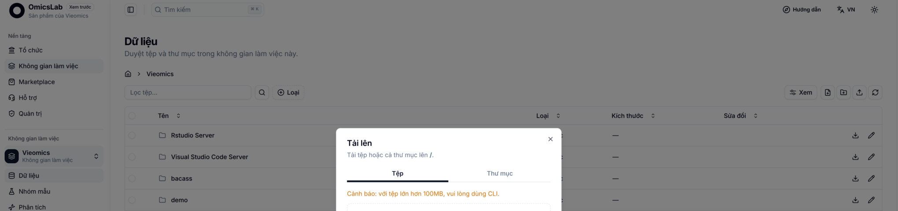

*Hình 1 — Tải tệp TSV lên workspace. Tệp mẫu chỉ vài trăm byte; không có FASTQ nào được tải lên ở bước này.*

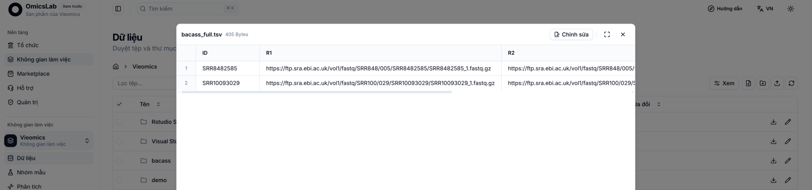

*Hình 2 — Samplesheet mở dưới dạng bảng. Có thể xoá dòng, sửa tên mẫu và thay đường dẫn `R1`/`R2` mà không cần Excel.*

Chúng tôi giữ một dòng, đổi `ID` thành mã mẫu mong muốn, rồi trỏ `R1` và `R2` đến hai tệp FASTQ trong không gian công khai:

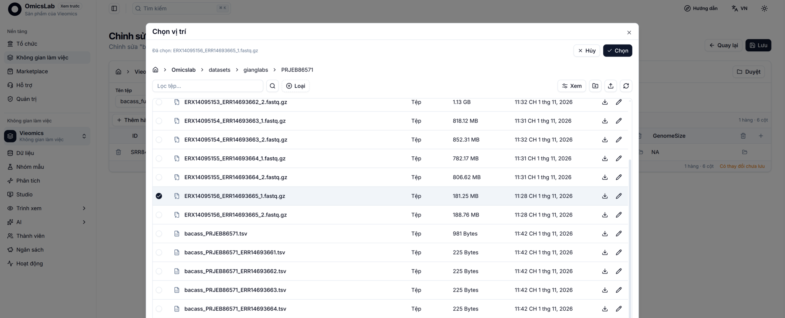

*Hình 3 — Hộp chọn tệp mở thẳng không gian công khai `Omicslab → datasets → PRJEB86571`. Chọn `R1`; bước tiếp theo chọn `R2`. Không cần tải read về máy.*

Sau khi lưu, samplesheet chỉ còn một dòng và hai đường dẫn bắt đầu bằng `s3://...`. Đó là địa chỉ trong kho dữ liệu của nền tảng, không phải câu lệnh cần gõ:

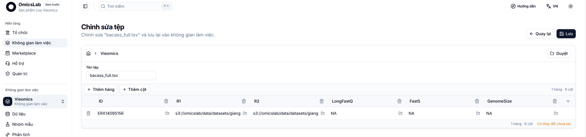

*Hình 4 — Samplesheet hoàn chỉnh: một mẫu, `R1` và `R2` trỏ đến read trong workspace. Tệp này là toàn bộ phần chuẩn bị dữ liệu.*

:::tip
Nếu dữ liệu của bạn nằm trên máy, hãy tải FASTQ lên workspace trước rồi chọn chúng trong cùng hộp thoại. Với các bộ dữ liệu công khai đã có trong workspace, chỉ cần trỏ samplesheet đến đúng đường dẫn.
:::

## Bước 3 — Chọn pipeline, phiên bản và profile

Mở **Phân tích → Công cụ**, tìm `nf-core/bacass`:

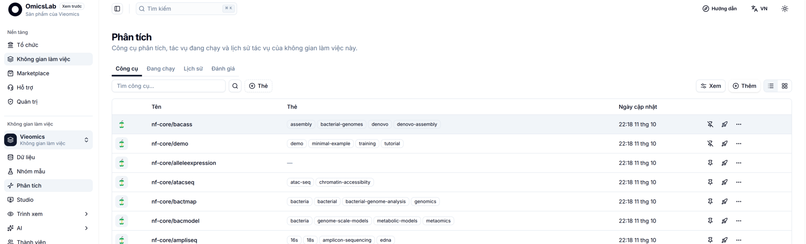

*Hình 5 — `nf-core/bacass` nằm trong danh mục công cụ của workspace, cùng các pipeline nf-core khác.*

Trong màn hình cấu hình, chọn:

- **Tag** `2.6.1` — phiên bản pipeline sẽ chạy.
- **Profile** `test_full` — bộ cấu hình short-read đầy đủ.

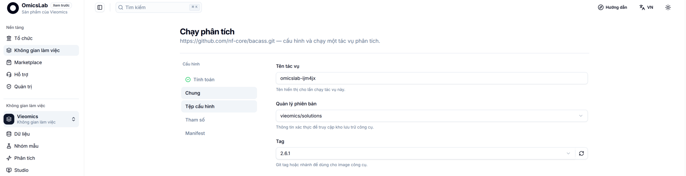

*Hình 6 — Phiên bản `2.6.1` và profile `test_full`. Cả hai được ghi vào manifest, nên lần chạy có thể được tái lập.*

Nền tảng đọc schema của pipeline và dựng biểu mẫu tham số. Bạn không phải nhớ tên tham số hay gõ lệnh; chỉ cần chọn đúng phiên bản, profile và tệp đầu vào.

## Bước 4 — Trỏ input vào samplesheet

Mở mục **Input/output options**, chọn tệp samplesheet vừa tạo. Giữ `outdir` mặc định (`data/bacass/$job_id`) và bỏ trống email nếu không cần nhận thông báo:

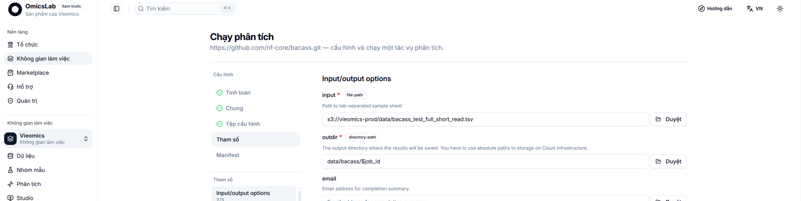

*Hình 7 — `input` trỏ đến samplesheet một dòng; `outdir` dùng thư mục mặc định. Các tham số khác giữ nguyên cho lần chạy đầu tiên.*

Các tab bên trái (`QC and Trim`, `Assembly parameters`, `BUSCO options`, `Annotation`...) cho phép thay đổi tham số khi cần. Với một lần chạy kiểm tra, mặc định là đủ. Nếu bạn thay đổi gì, manifest sẽ ghi lại.

## Bước 5 — Dùng database đã được chuẩn bị

`nf-core/bacass` dùng Kraken2 và KmerFinder để sàng lọc nhiễm. Hai database này thường rất lớn; tải từ AWS hoặc Zenodo có thể mất nhiều thời gian hơn cả lần lắp ráp.

Trong lần chạy này, chúng tôi chọn bản đã có trong không gian công khai của Omicslab:

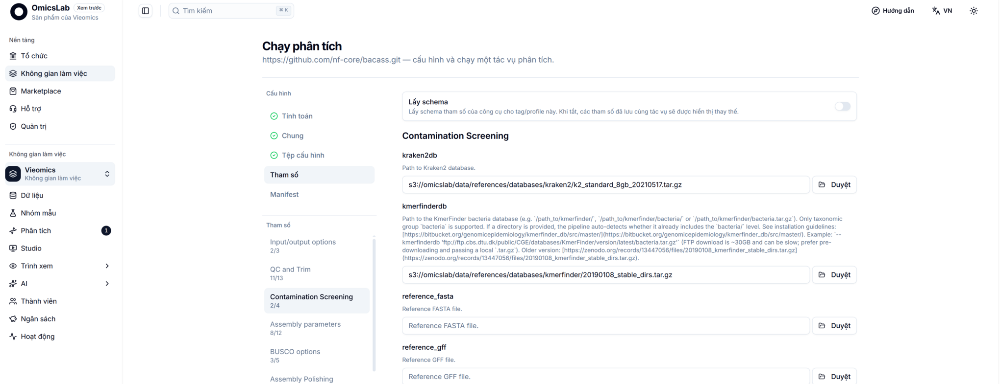

*Hình 8 — `kraken2db` và `kmerfinderdb` trỏ đến bản đã chuẩn bị trong workspace, thay vì URL tải từ nước ngoài. Trong lần chạy này, database nằm cạnh compute.*

Đây là một trong những khác biệt thực tế của việc chạy trên nền tảng: dữ liệu tham chiếu và compute ở cùng một nơi, nên job không phải chờ tải 30 GB trước khi bắt đầu. Nếu pipeline của bạn cần database khác, bạn có thể trỏ đến bản của mình hoặc liên hệ hỗ trợ.

## Bước 6 — Xem manifest, chọn compute và chạy

Chọn compute ở tab **Tính toán**. Trong lần chạy này: GreenNode HCM, 16 CPU, 32 GB RAM và 100 GB đĩa. Biểu mẫu hiển thị ước tính **9.284 VND** cho mức trần một giờ; số cuối cùng phụ thuộc thời gian chạy thực tế.

Đặt tên cho manifest để lần sau dễ tìm, rồi bấm **Chạy**:

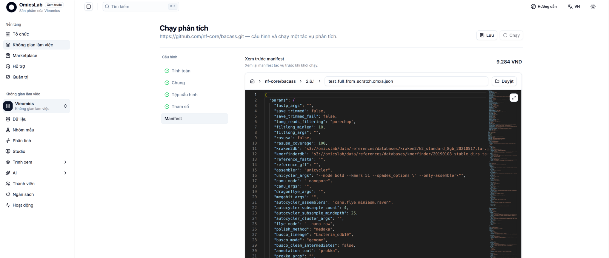

*Hình 9 — Manifest ghi lại toàn bộ tham số, phiên bản và tài nguyên. Đặt tên `test_full_from_scratch.omxa.json` rồi bấm Chạy. Không cần sửa nội dung JSON.*

Manifest là bản ghi đầy đủ của lần chạy. Giữ lại tệp này là cách đơn giản nhất để tái lập kết quả hoặc so sánh hai phiên bản pipeline.

## Bước 7 — Theo dõi job

Log chạy hiện trực tiếp trong trình duyệt. Ở đầu log, bạn thấy phiên bản pipeline, đường dẫn input và các bước đang chạy. Không cần mở terminal hay theo dõi một cụm riêng.

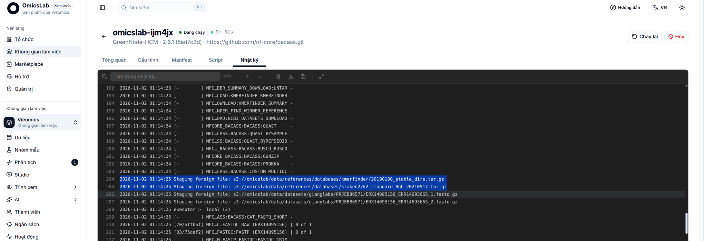

*Hình 10 — Log cho thấy read từ `PRJEB86571` và hai database được đưa vào job từ workspace. Trong lần chạy này, dữ liệu được phục vụ từ hạ tầng lưu trữ của nền tảng tại Việt Nam.*

Các image Apptainer cho pipeline cũng đã được Omicslab chuẩn bị sẵn, nên job không phải kéo image từ registry quốc tế. Bạn có thể đóng tab; job vẫn chạy và bạn quay lại xem sau.

## Bước 8 — Đọc kết quả

Khi job hoàn tất, mở thư mục `outdir` trong **Dữ liệu**. Kết quả được chia theo công cụ:

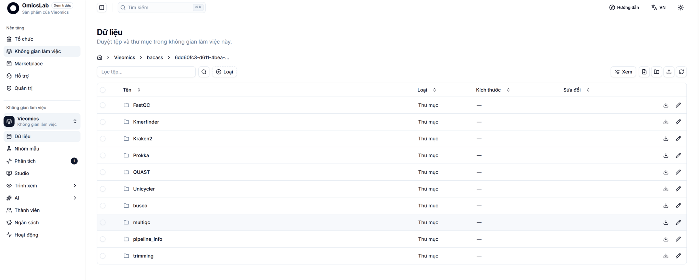

*Hình 11 — Kết quả gồm FastQC, Kmerfinder, Kraken2, Prokka, QUAST, Unicycler, busco, multiqc, pipeline_info và trimming.*

Cách đọc nhanh:

| Thư mục | Nội dung |
| --- | --- |
| `FastQC`, `trimming` | Chất lượng read trước và sau khi cắt adapter |
| `Kraken2`, `Kmerfinder` | Kiểm tra nhiễm và loài |
| `Unicycler` | Bộ lắp ráp hệ gen |
| `Prokka` | Chú giải gene |
| `QUAST`, `busco` | Chất lượng và độ đầy đủ của bộ lắp ráp |
| `multiqc` | Báo cáo tổng hợp trong một trang HTML |
| `pipeline_info` | Phiên bản pipeline, công cụ và báo cáo thực thi |

Mở `multiqc/multiqc_report.html` trực tiếp trong trình duyệt:

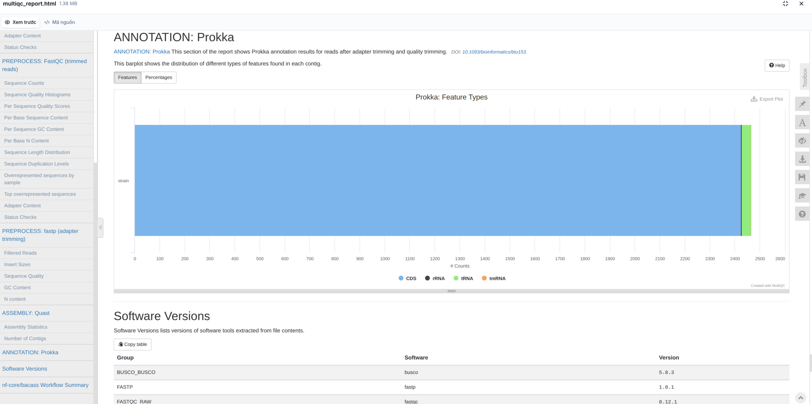

*Hình 12 — MultiQC mở trong trình duyệt, không cần tải về hay cài thêm công cụ. Có thể phóng to để đọc từng biểu đồ.*

Nếu cần lưu kết quả về máy, chọn thư mục và tải xuống; nền tảng đóng gói thành tệp zip:

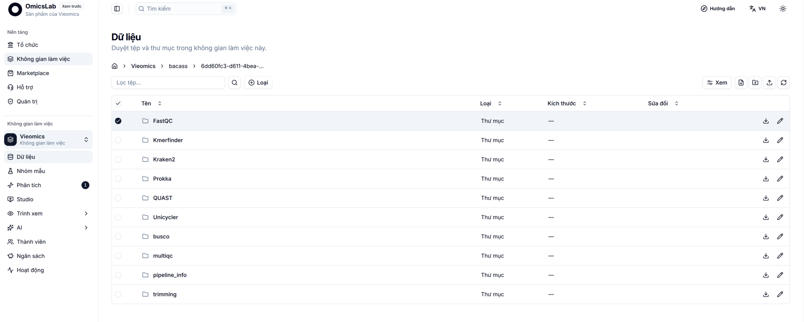

*Hình 13 — Chọn thư mục kết quả và tải xuống. Với một mẫu, thư mục FastQC khoảng vài MB; toàn bộ kết quả lớn hơn tuỳ pipeline.*

## Bước 9 — Chạy lại với manifest đã lưu

Manifest nằm trong **Dữ liệu → nf-core/bacass → 2.6.1**. Từ đây có thể khởi chạy lại đúng cấu hình cũ:

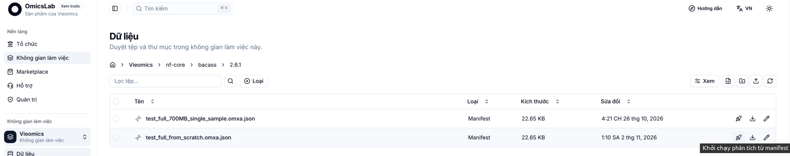

*Hình 14 — Manifest của lần chạy này nằm cạnh các manifest cũ. Chọn biểu tượng khởi chạy để mở lại cấu hình, rồi thay samplesheet nếu cần.*

Với một lô mẫu mới, chỉ cần thay tệp samplesheet và giữ nguyên phần còn lại. Đây là cách một nhóm có thể chuẩn hoá cùng một quy trình cho nhiều đợt dữ liệu mà không phải cấu hình lại từ đầu.

## Chi phí thật của lần chạy

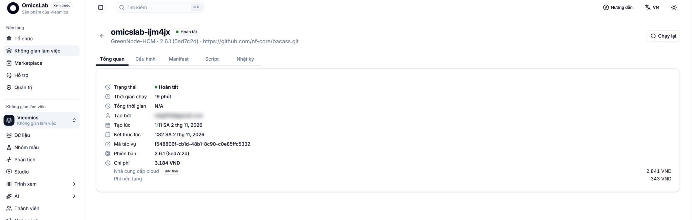

*Hình 15 — Job `omicslab-ijm4jx` hoàn tất trong 19 phút. Tổng chi phí 3.184 VND: 2.841 VND cloud và 343 VND phí nền tảng.*

| Hạng mục | Kết quả |
| --- | --- |
| Thời gian chạy | 19 phút |
| Compute | GreenNode HCM, 16 CPU / 32 GB RAM / 100 GB đĩa |
| Chi phí cloud | 2.841 VND |
| Phí nền tảng | 343 VND |
| **Tổng** | **3.184 VND** |

**16 CPU và 32 GB RAM, thuê trong 19 phút, tổng 3.184 VND.** Đây là cấu hình của một workstation hoặc một node HPC nhỏ; điều khác biệt là bạn chỉ trả cho thời gian job chạy, không phải mua máy hay duy trì cụm.

Biểu mẫu trước khi chạy hiển thị 9.284 VND cho mức trần một giờ. Job kết thúc sau 19 phút, nên hóa đơn thực tế là 3.184 VND. Đây là giá của lần chạy này, tại thời điểm này, với cấu hình này; không phải báo giá cho mọi bộ dữ liệu.

`nf-core/bacass` là phần mềm mã nguồn mở, không có phí license. Bạn trả cho compute và lưu trữ.

## Điều này có nghĩa gì với người mới?

Một lần chạy full profile thường là bước khó nhất khi làm quen với nf-core: cài Nextflow, cài container, chọn profile, tải database, sắp xếp tài nguyên. Trên nền tảng, những phần đó nằm sau một biểu mẫu. Việc còn lại là chuẩn bị samplesheet và đọc kết quả.

Với một nhóm nghiên cứu, cùng một manifest có thể dùng để:

- **Kiểm tra pipeline trước khi chạy dữ liệu thật** — biết pipeline chạy được với dữ liệu đầu vào của mình.
- **So sánh phiên bản** — chạy lại cùng dữ liệu với tag khác và so sánh kết quả.
- **Đào tạo** — người mới thấy được toàn bộ quy trình mà không phải dựng môi trường.
- **Chuẩn hoá quy trình** — mỗi lô mẫu chỉ thay samplesheet, phần còn lại giữ nguyên.

Đây là lần chạy kiểm tra trên dữ liệu công khai, không phải quy trình chẩn đoán. Với dữ liệu người hoặc dữ liệu lâm sàng, cần kiểm tra phạm vi dịch vụ và các yêu cầu pháp lý trước khi tải lên nền tảng công khai.

## Bắt đầu

1. Tạo tài khoản tại [platform.omicslab.io](https://platform.omicslab.io). Các bước chi tiết nằm trong [Hướng dẫn sử dụng, Chương 01: Đăng nhập](/guide#bat-dau-dang-nhap).
2. Tạo workspace, chọn `nf-core/bacass` từ danh mục công cụ.
3. Dùng thử với samplesheet của pipeline, sau đó thay bằng dữ liệu của bạn.
4. Cần hỗ trợ hoặc muốn chạy trọn gói? Viết đến [contact@omicslab.io](mailto:contact@omicslab.io).

## Tài liệu tham khảo

- `nf-core/bacass` — [nf-co.re/bacass](https://nf-co.re/bacass); dữ liệu thử — [nf-core/test-datasets](https://github.com/nf-core/test-datasets)
- Dự án ENA PRJEB86571 — [ebi.ac.uk/ena/browser/view/PRJEB86571](https://www.ebi.ac.uk/ena/browser/view/PRJEB86571)
- Dung và cộng sự (2025), *Annals of Clinical Microbiology and Antimicrobials* — [doi:10.1186/s12941-025-00818-3](https://doi.org/10.1186/s12941-025-00818-3)
- Hướng dẫn sử dụng nền tảng — [Đăng nhập và tạo tài khoản](/guide#bat-dau-dang-nhap), [toàn bộ hướng dẫn](/guide)
- Tài liệu kỹ thuật — [Bắt đầu nhanh](https://docs.omicslab.io/quickstart), [Tác vụ phân tích](https://docs.omicslab.io/tools/analysis/overview)

## Bài viết liên quan

- Nền tảng nf-core: [Cách chạy pipeline nf-core trên nền tảng Omicslab](/blogs/how-to-run-nf-core-pipelines-on-omicslab).
- Ví dụ sinh học: [Xây dựng bộ genome vi khuẩn không cần lập trình](/blogs/bacterial-genome-assembly-without-coding).
- Câu chuyện dữ liệu: [Từ dữ liệu giải trình tự đến cơ chế kháng thuốc](/blogs/bla-ndm-on-omicslab).
- Thêm bài viết theo tag [nf-core](/blogs?tag=nf-core) và [platform](/blogs?tag=platform).
