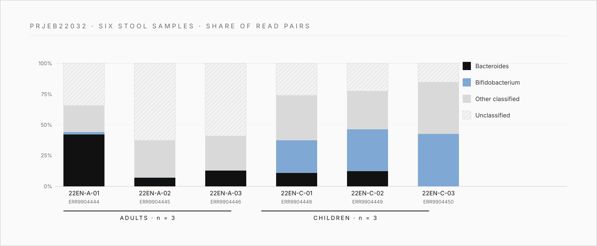
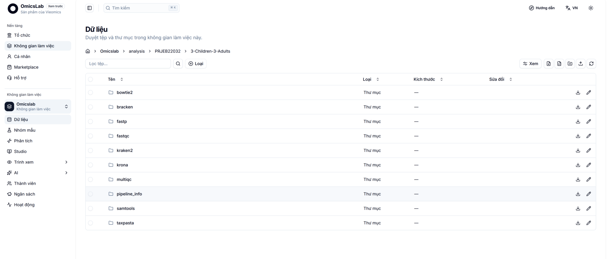

:::info
**Đây là bước xử lý dữ liệu đầu tiên của một quy trình shotgun metagenomics** — cắt và lọc read, loại read của vật chủ, rồi định danh phân loại — chạy trọn trên nền tảng Omicslab. Ví dụ dùng sáu mẫu phân từ một nghiên cứu công khai, với bộ dữ liệu và cơ sở dữ liệu tham chiếu có sẵn.

Bạn muốn chạy shotgun metagenomics cho dữ liệu của mình? Omicslab đã chuẩn bị sẵn **bộ dữ liệu mẫu để chạy thử, cơ sở dữ liệu tham chiếu, và hạ tầng để lưu dữ liệu, kết quả và chạy pipeline**.

Kết quả mở công khai sau khi đăng ký: [xem trên nền tảng](https://platform.omicslab.io/workspace/c669cc81-d096-4679-a9a2-03329167b71f/data?prefix=analysis%2FPRJEB22032%2F3-Children-3-Adults%2F).
:::

## Chưa biết bắt đầu thế nào? Đây là kết quả của một lần chạy thật

*Hình 1 — Tỉ lệ read theo nhóm chính trong 6 mẫu. Trục dọc tính trên tổng read, gồm cả phần chưa phân loại.*

Ba mẫu trẻ em có **Bifidobacterium** chiếm 26,5–42,7% tổng read; ba mẫu người lớn gần như không có (0–1,9%). Ngược lại, **Bacteroides** chiếm 7,1–42,3% ở người lớn và 0–12,4% ở trẻ em. Ở mức loài, ba mẫu trẻ em nổi bật với *Bifidobacterium longum*, *B. bifidum* và *B. catenulatum*; ba mẫu người lớn với *Bacteroides thetaiotaomicron*, *B. fragilis* và *Phocaeicola vulgatus*.

Hướng của khác biệt này trùng với nghiên cứu gốc, nơi Bacteroidetes cao hơn ở người lớn còn trẻ nhỏ có nhiều Actinobacteria. Đây là phép kiểm tra cho thấy quy trình chạy đúng, không phải một kết luận mới: ba mẫu mỗi nhóm, nhãn nhóm lấy từ tiêu đề mẫu của đơn vị gửi dữ liệu (ENA không có trường tuổi), và một cơ sở dữ liệu duy nhất.

*Hình 2 — Thư mục kết quả trong workspace: `bowtie2`, `bracken`, `fastp`, `fastqc`, `kraken2`, `krona`, `multiqc`, `pipeline_info`, `samtools`, `taxpasta`. Đăng nhập là mở được đúng thư mục này.*

## Chạy thử sáu mẫu thật từ bài báo, chỉ cần kéo thả

| Hạng mục | Kết quả |
| --- | --- |
| Mẫu | 6 mẫu phân — 3 trẻ em, 3 người lớn |
| Dữ liệu vào | 1,7–1,9 GB FASTQ mỗi mẫu; 73,6 triệu cặp read, 125 bp |
| Pipeline | `nf-core/taxprofiler` 2.0.1 |
| Cơ sở dữ liệu | Kraken2 standard 8 GB (bản 2021) |
| Tác vụ tự động | 76, chạy tự động sau khi bạn kéo tệp samplesheet vào |
| Chạy lại | 1 manifest |

*Bảng 1 — Số đo của lần chạy, lấy từ `pipeline_info/execution_trace` và báo cáo MultiQC.*

Điều đáng chú ý không nằm ở cấu hình. Lần chạy thử này cho thấy quy trình có thể đi hết từ read thô đến định danh phân loại với một samplesheet và một manifest. Với dữ liệu sâu hơn hoặc cohort lớn hơn, tài nguyên được chọn theo dữ liệu.

## Chạy quy mô lớn, mở rộng lên 1.200 mẫu hoặc hơn mà vẫn giữ khả năng tái lặp

Lần chạy trong bài là **một batch 6 mẫu**. Với cohort vài nghìn mẫu, nền tảng có **LIMS/Cohort**: mẫu được nhóm theo cohort, samplesheet sinh ra từ danh sách mẫu, và pipeline tự kích hoạt theo cấu hình đã đặt — giữ nguyên tham số, chỉ thay dữ liệu thô của từng mẫu. Dữ liệu cũng có thể được đồng bộ từ máy giải trình tự.

Ví dụ: **1.200 mẫu chia thành 200 batch 6 mẫu**, mỗi batch dùng cùng một manifest. Con số 200 batch là phép nhân của lần chạy này, không phải cam kết về thời gian — batch lớn hơn, dữ liệu sâu hơn hoặc cơ sở dữ liệu 200 GB sẽ cần nhiều tài nguyên hơn.

Pipeline vẫn là `nf-core/taxprofiler`, không sửa mã nguồn. Manifest của mỗi batch ghi phiên bản, tham số và tài nguyên — đủ để người phản biện chạy lại đúng cấu hình đó.

## Phân tích tổng hợp và mở rộng

Định danh phân loại trả lời câu hỏi "trong mẫu có những loài nào". Đó là bước mở đường cho mọi thứ sau đó: so sánh nhóm, tìm gene đề kháng, phân tích chức năng, dựng chủng. Ba điều cần biết trước khi dùng kết quả này cho một dự án thật:

- **Cơ sở dữ liệu đang ở mức tối thiểu.** Bộ 8 GB là bản nhỏ nhất trong các bản chuẩn của Kraken2, và bản dùng ở đây được xây từ 2021. Bộ đầy đủ có thể lên tới 200 GB, và bộ chuyên cho hệ vi sinh vật đường ruột (UHGG, GTDB) cần cập nhật phiên bản mới. Đây là lý do 34–63% read ở nhóm người lớn chưa phân loại được.
- **Dữ liệu trong bài là dữ liệu nông.** Mỗi mẫu chỉ 1,7–1,9 GB, tương đương ~12 triệu cặp read. Cohort thật thường sâu hơn, nhiều mẫu hơn, và có metadata đi kèm.
- **Nhu cầu tài nguyên thay đổi theo đầu vào.** Ba yếu tố quyết định là số mẫu và độ sâu dữ liệu, kích thước cơ sở dữ liệu, và cấu hình máy. Sáu mẫu nông như trong bài không đại diện cho một cohort.

Một cohort đầy đủ cần thêm: chọn cơ sở dữ liệu theo loại mẫu, chạy theo lô, hiếm hoá và thống kê đa dạng, mô-đun gene đề kháng và chức năng, cùng phần bàn giao cho bản thảo.

**Omicslab nhận xây quy trình phân tích riêng cho từng đơn vị** — từ bước định danh này đến toàn bộ cohort. Gửi số mẫu, loại mẫu và câu hỏi nghiên cứu đến [contact@omicslab.io](mailto:contact@omicslab.io); chúng tôi trao đổi phạm vi và cách triển khai trước khi chạy.

## Chạy thử trên dữ liệu của bạn

1. Tạo tài khoản tại [platform.omicslab.io](https://platform.omicslab.io) — các bước nằm trong [Hướng dẫn sử dụng](/guide).
2. Mở [kết quả của lần chạy này](https://platform.omicslab.io/workspace/c669cc81-d096-4679-a9a2-03329167b71f/data?prefix=analysis%2FPRJEB22032%2F3-Children-3-Adults%2F) để xem MultiQC, Krona và bảng Bracken (cần đăng ký).
3. Chọn `nf-core/taxprofiler` trong **Phân tích → Công cụ**, trỏ samplesheet vào read của bạn và chạy.

Nếu chưa quen nf-core và Nextflow, bài [Cách chạy pipeline nf-core trên nền tảng Omicslab](/blogs/how-to-run-nf-core-pipelines-on-omicslab) đi qua các khái niệm trước khi vào thao tác.

## Câu hỏi thường gặp

**Có phải cài đặt gì trên máy không?**
Không, và cũng không cần máy mạnh. Pipeline, container và cơ sở dữ liệu chạy trong workspace; máy của bạn chỉ cần trình duyệt.

**Có thể dùng cơ sở dữ liệu lớn hơn không?**
Có. Bộ 8 GB trong bài là mức tối thiểu để thử; bộ 200 GB hoặc bộ chuyên cho đường ruột dùng được trên cùng quy trình, chỉ cần thêm dung lượng lưu trữ và thời gian nạp lần đầu.

**Một cohort lớn được chạy thế nào?**
Theo batch, qua LIMS/Cohort: 1.200 mẫu là 200 batch 6 mẫu, cùng cấu hình và cùng manifest. Nhu cầu tài nguyên phụ thuộc số mẫu, độ sâu và kích thước cơ sở dữ liệu, nên cần ước lượng trên dữ liệu cụ thể.

**Dữ liệu của tôi có chạy được không?**
Dữ liệu không chứa dữ liệu cá nhân nhạy cảm thì được. Với dữ liệu người hoặc lâm sàng, cần kiểm tra phạm vi dịch vụ trước; hình thức phù hợp thường là triển khai tự vận hành trên hạ tầng của đơn vị — xem [Giải pháp tùy chỉnh](/solutions/custom-solutions).

:::note
**Một lỗi của MultiQC.** Panel Kraken/Bracken trong MultiQC báo `% Top 1 = 0,04%` cho `ERR9904444`, trong khi bảng Bracken của cùng mẫu ghi *B. thetaiotaomicron* ở 35,3%. Vì vậy mọi con số trong bài được đọc từ `bracken/*.bracken.tsv`; khi báo cáo, giữ MultiQC cho phần QC (fastp, FastQC, Bowtie2).
:::

## Tài liệu tham khảo

- **Nghiên cứu gốc** — Pereira-Dias J, Nguyen Ngoc Minh C, Tran Thi Hong C, và cộng sự (2021). *The Gut Microbiome of Healthy Vietnamese Adults and Children Is a Major Reservoir for Resistance Genes Against Critical Antimicrobials.* J Infect Dis 224(Suppl 7):S840–S847. [doi:10.1093/infdis/jiab398](https://doi.org/10.1093/infdis/jiab398)
- **Dữ liệu** — ENA, dự án PRJEB22032. [ebi.ac.uk/ena/browser/view/PRJEB22032](https://www.ebi.ac.uk/ena/browser/view/PRJEB22032)
- **Pipeline** — `nf-core/taxprofiler` 2.0.1. [nf-co.re/taxprofiler](https://nf-co.re/taxprofiler)
- **Kraken2** — Wood DE, Lu J, Langmead B (2019). *Improved metagenomic analysis with Kraken 2.* Genome Biology 20:257. [doi:10.1186/s13059-019-1891-0](https://doi.org/10.1186/s13059-019-1891-0)
- **Bracken** — Lu J, Breitwieser FP, Thielen P, Salzberg SL (2017). *Bracken: estimating species abundance in metagenomics data.* PeerJ Comput Sci 3:e104. [doi:10.7717/peerj-cs.104](https://doi.org/10.7717/peerj-cs.104)

## Bài viết liên quan

- [Cách chạy pipeline nf-core trên nền tảng Omicslab](/blogs/how-to-run-nf-core-pipelines-on-omicslab)
- [Chạy toàn bộ nf-core/bacass trên 16 CPU, 32 GB RAM](/blogs/bacass-test-full-19-minutes)
- [Giải pháp tùy chỉnh](/solutions/custom-solutions)
