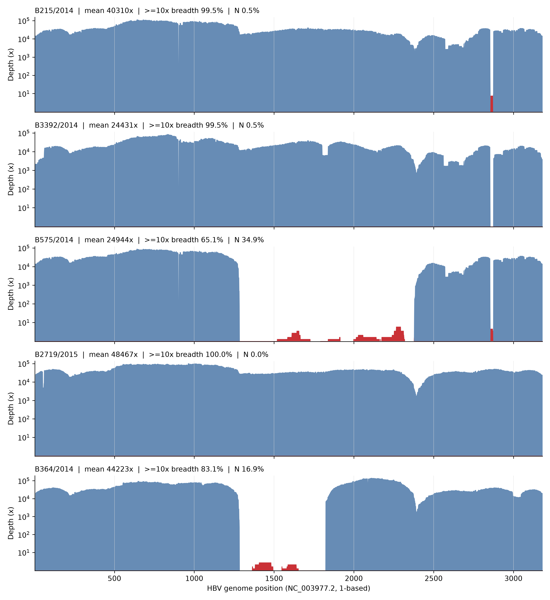
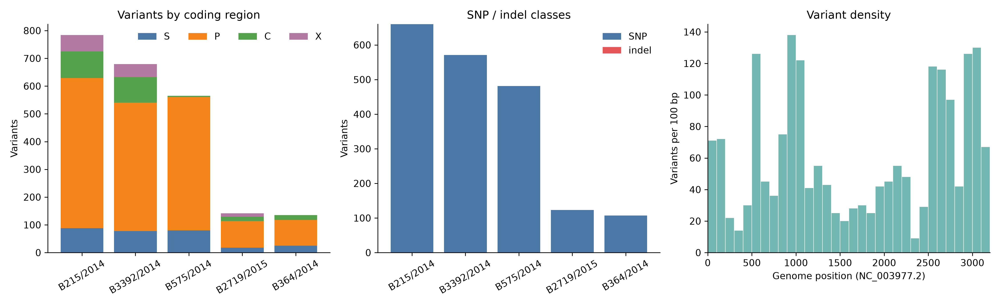
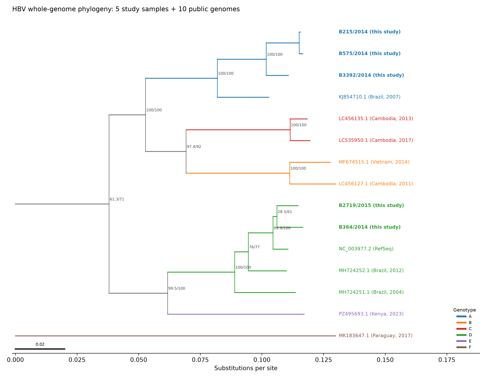

:::info
**Đây là bài thứ hai trong hai bài về phân tích HBV từ dữ liệu NGS.** [Bài đầu](/blogs/hbv-ngs-analysis-guide) giải thích sinh học của hệ gen và quy trình từ read thô đến consensus và cây. Bài này đi qua từng con số của một bộ dữ liệu công khai: coverage, `N`, biến thể, cây phát sinh và tín hiệu tái tổ hợp. Mục tiêu là phân biệt quan sát với giả thuyết, và nói rõ dữ liệu không thể kết luận điều gì.

Mã, bảng summary và kết quả tham chiếu nằm trong [vieomics/solutions](https://github.com/vieomics/solutions/tree/main/hbv-genome-short-read-analysis).
:::

## Năm mẫu, mười tham chiếu: bộ dữ liệu có thể và không thể nói gì

Bộ dữ liệu ví dụ gồm năm mẫu từ NCBI BioProject [PRJNA659786](https://www.ncbi.nlm.nih.gov/bioproject/PRJNA659786) — ba genotype A và hai genotype D, đều từ Brazil — và mười hệ gen hoàn chỉnh từ GenBank. Năm mẫu được chọn trong số các run genotype A và D có số read lớn nhất, không phải mẫu ngẫu nhiên. Panel tham chiếu cũng được chọn có chủ đích: một A2 Brazil, ba D (gồm RefSeq), hai B và hai C từ Việt Nam/Campuchia, một E và một F làm outgroup.

| Mẫu | Genotype | Map được (Bowtie2) | Độ sâu trung bình | Breadth ≥10× | `N` |
|---|---|---:|---:|---:|---:|
| B215/2014 | A | 84,3% | 40.310× | 99,5% | 0,5% |
| B3392/2014 | A | 76,8% | 24.431× | 99,5% | 0,5% |
| B575/2014 | A | 71,2% | 24.944× | 65,1% | 34,9% |
| B2719/2015 | D | 99,6% | 48.467× | 100,0% | 0,0% |
| B364/2014 | D | 99,2% | 44.223× | 83,1% | 16,9% |

Năm mẫu và mười tham chiếu đủ để kiểm tra quy trình, so sánh vị trí genotype và mô tả một số đặc điểm của hệ gen. Chúng không đủ để kết luận về phân bố toàn cầu, nguồn gốc địa lý, chuỗi lây truyền hay hiệu quả điều trị. Các tham chiếu công khai cũng không phải một mẫu đại diện cho sự đa dạng của HBV.

## Coverage: độ sâu trung bình và breadth

Độ sâu trung bình trong bộ dữ liệu này rất cao — 24.431× đến 48.467× — vì hệ gen chỉ khoảng 3,2 kb và mỗi mẫu có hàng trăm nghìn đến hàng triệu read. Nhưng độ sâu trung bình cao không có nghĩa là mọi vị trí đều được phủ đều. Chỉ số hữu ích hơn là **breadth**: tỉ lệ vị trí đạt một ngưỡng độ sâu tối thiểu, ở đây là 10×.

*Hình 1 — Độ phủ theo vị trí trên hệ gen HBV. Trục dọc là độ sâu (thang log); vùng đỏ là vị trí dưới 10×. B215/2014 và B3392/2014 gần đủ; B575/2014 và B364/2014 có vùng phủ thấp rõ rệt. Hình do quy trình trong repo kỹ thuật tạo ra.*

Hai mẫu không hoàn chỉnh:

- **B575/2014** chỉ đạt 65,1% breadth ≥10× và có 34,9% `N`. Vùng phủ thấp kéo dài khoảng 1.285–2.376, cộng thêm một đoạn ngắn quanh 2.856–2.872.
- **B364/2014** đạt 83,1% breadth ≥10× và có 16,9% `N`, với vùng phủ thấp khoảng 1.285–1.821.

Ngay cả B215/2014 và B3392/2014, dù breadth ≥10× khoảng 99,5%, vẫn có một đoạn `N` ngắn 16–17 bp quanh 2.856–2.872. Đây là chi tiết dễ bị bỏ qua nếu chỉ nhìn độ sâu trung bình.

Một lưu ý về nguồn số: bảng trên dùng kết quả map bằng Bowtie2 của quy trình viralrecon. Repo kỹ thuật còn một lần map BWA độc lập để kiểm tra; breadth và độ sâu của hai lần map không giống nhau. Khi báo cáo, nên chọn một nguồn và ghi rõ, thay vì trộn các con số từ hai pipeline.

## `N` không phải gap

Consensus trong ví dụ này là consensus dựa trên tham chiếu, giữ khung 3.182 bp của NC_003977.2. Vị trí dưới 10× hoặc không có read được ghi thành `N`; indel không được áp dụng. Vì vậy, `N` không có nghĩa là virus mất base, và độ dài consensus không phải độ dài bộ lắp ráp.

Các deletion tương đối so với tham chiếu gần nhất được báo riêng. Trong bộ dữ liệu này có sáu ứng viên, tất cả đều là deletion in-frame:

| Mẫu | Vị trí | Độ dài | Loại |
|---|---:|---:|---|
| B215/2014 | 2.356 | 6 bp | in-frame deletion |
| B215/2014 | 2.854 | 33 bp | in-frame deletion |
| B3392/2014 | 2.356 | 6 bp | in-frame deletion |
| B3392/2014 | 2.854 | 33 bp | in-frame deletion |
| B575/2014 | 1.285 | 6 bp | in-frame deletion |
| B575/2014 | 2.854 | 33 bp | in-frame deletion |

Các deletion này không được vẽ thành gap trong consensus. Vùng 33 bp ở 2.854 chồng lấn với đoạn phủ thấp quanh 2.856–2.872, nhưng hai khái niệm không đồng nhất: `N` là vị trí không đủ bằng chứng trong khung tham chiếu; deletion là thay đổi cấu trúc so với tham chiếu gần nhất. Muốn xác nhận deletion, cần đọc bằng chứng read, PCR định hướng hoặc long-read; short-read consensus một mình không đủ.

## Biến thể: 1.942 SNP, 633 dòng, 473 vị trí

VCF so với tham chiếu map NC_003977.2 có 1.942 vị trí SNP: 660 ở B215/2014, 571 ở B3392/2014, 481 ở B575/2014, 123 ở B2719/2015 và 107 ở B364/2014. VCF không có indel. Nhưng với các mẫu genotype A, phần lớn 660–571 thay đổi này là khác biệt genotype so với tham chiếu D, không phải đột biến phát sinh trong mẫu.

Vì vậy, bảng thứ hai so sánh mỗi consensus với **hệ gen công khai gần nhất** — KJ854710.1 cho các mẫu A (độ tương đồng 94,9–95,5%) và NC_003977.2 cho các mẫu D (98,3–98,5%). Cách so sánh này cho 633 dòng nucleotide theo vùng, tương ứng 473 vị trí duy nhất, và 593 dòng amino acid. Con số dòng lớn hơn số vị trí vì các ORF chồng lấp: một nucleotide trong vùng S có thể đồng thời nằm trong khung P, nên được chú giải hai lần.

*Hình 2 — Biến thể theo vùng ORF (trái), lớp SNP/indel (giữa) và mật độ dọc hệ gen (phải). Cột theo vùng cộng lại lớn hơn 1.942 vì một vị trí có thể nằm trong nhiều ORF. Đây là số đếm, không phải tỉ lệ đột biến.*

Ba con số này — 1.942, 633 và 473 — trả lời ba câu hỏi khác nhau. 1.942 là số vị trí khác tham chiếu map; 633 là số dòng sau khi chú giải theo vùng; 473 là số vị trí duy nhất sau khi gộp các ORF chồng lấp. Không nên dùng con số nào như “số đột biến” mà không nói rõ tham chiếu và cách đếm.

Không có biến thể nào trong phân tích này được gán là kháng thuốc hay thoát miễn dịch. Một danh mục biến thể lâm sàng của HBV không được tra cứu; các nhãn synonymous/nonsynonymous/stop chỉ mô tả hậu quả trên khung đọc, không phải kết luận chức năng.

## Cây phát sinh: 15 taxon

Cây được dựng từ alignment 15 trình tự (5 consensus + 10 tham chiếu) bằng IQ-TREE 2, model TVM+F+I+G4, 1.000 UFBoot và 1.000 SH-aLRT. Alignment có 3.221 cột, 845 vị trí biến đổi, 535 vị trí parsimony-informative và 39 cột gap-rich.

*Hình 3 — Cây maximum-likelihood của 15 trình tự HBV. Nhãn trong là SH-aLRT/UFBoot. Ba mẫu genotype A nằm trong nhánh A với KJ854710.1 (100/100); hai mẫu D nằm trong nhánh D, nhưng cặp D chỉ có 28,5/61 support. Hình do quy trình trong repo kỹ thuật tạo ra.*

Các quan sát chính:

- Ba mẫu genotype A tạo thành một nhánh với tham chiếu A2 KJ854710.1, support 100/100. Trong nhánh này, B215 và B575 là cặp gần nhau; B3392 tách ra trước.
- Hai mẫu genotype D nằm trong nhánh D với NC_003977.2 và các tham chiếu D Brazil. Cặp D chỉ có 28,5/61 support, phù hợp với dữ liệu thiếu của B364/2014 và số vị trí biến đổi không nhiều.
- Nhánh B/C có support 97,4/92; B và C mỗi nhánh là monophyletic với 100/100. E và F làm outgroup.

Một cây như vậy là giả thuyết về quan hệ. Nó không cho biết ai lây cho ai, không cho biết thời điểm lây nhiễm và không đủ để suy ra nguồn gốc địa lý. Với hai genome không hoàn chỉnh và các vùng gap-rich, độ bất định của một số nhánh là đáng kể; support thấp phải được báo cáo chứ không nên bị lược bỏ.

## Tái tổ hợp: tín hiệu, không phải breakpoint

PhiPack được chạy trên alignment 15 trình tự để sàng lọc tái tổ hợp. Kết quả trong repo là từ phiên bản alignment trước đó (533 vị trí informative; alignment hiện tại có 535). Các test permutation cho PHI và NSS đều dưới ngưỡng phân giải 1.000 hoán vị (p < 0,001); Max χ² cho p = 0,028. Breakpoint tốt nhất mà Max χ² báo cáo nằm giữa NC_003977.2 và B364/2014, cả hai đều genotype D.

Đây là một tín hiệu thống kê, không phải bằng chứng về một sự kiện tái tổ hợp cụ thể. Có ít nhất ba lý do để thận trọng:

- **Panel trải rộng genotype A–F.** Các test của PhiPack giả định một quần thể tái tổ hợp tương đối đồng nhất. Ở đây độ đa dạng cặp khoảng 8,9%, phần lớn đến từ khác biệt giữa các genotype; tín hiệu có thể phản ánh cấu trúc quần thể.
- **Hai genome không hoàn chỉnh.** B575/2014 có 34,9% `N` và B364/2014 có 16,9% `N`; missing data có thể làm tăng các thống kê tái tổ hợp.
- **Hai vùng gap-rich.** Các vị trí 2.356–2.361 và 2.863–2.895 có hơn 50% gap; chúng được giữ lại, nên alignment quanh đó là bất định.

Vì vậy, kết luận phù hợp là: bộ dữ liệu có tín hiệu cần kiểm tra thêm, không phải một breakpoint đã được xác định. Muốn kiểm tra chắc hơn, có thể chạy test trong từng genotype, che các vùng gap-rich, dùng phương pháp có mô hình tái tổ hợp và xác nhận bằng long-read hoặc dòng vô tính.

## Những gì không thể kết luận

- **Không phải phân tích dịch tễ.** Năm mẫu không đủ để suy ra chuỗi lây truyền, nguồn gốc địa lý hay thời điểm lây nhiễm.
- **Không phải báo cáo lâm sàng.** Không có dữ liệu lâm sàng, không tra cứu cơ sở dữ liệu biến thể kháng thuốc, và không đưa ra khuyến nghị điều trị.
- **Không phải mutation rate.** 1.942 SNP là khác biệt so với một tham chiếu cụ thể, không phải tốc độ đột biến.
- **Không phải hệ gen hoàn chỉnh cho mọi mẫu.** B575/2014 và B364/2014 là genome không hoàn chỉnh; các mẫu còn lại vẫn có thể có `N` cục bộ.
- **Không phải breakpoint tái tổ hợp.** Tín hiệu PhiPack là một giả thuyết cần kiểm tra, không phải kết luận.

## Checklist khi đọc kết quả HBV

1. **Kiểm tra dạng hệ gen và cách tạo consensus.** Consensus dựa trên tham chiếu khác với lắp ráp de novo; `N` khác gap; indel có thể không được áp dụng.
2. **Đọc breadth và `N`, không chỉ độ sâu trung bình.** Độ sâu cao có thể che các vùng phủ thấp.
3. **Tách số đếm theo tham chiếu.** 1.942 SNP so với NC_003977.2 khác 473 vị trí so với tham chiếu gần nhất.
4. **Kiểm tra ORF chồng lấp.** Một vị trí có thể được đếm hai lần trong hai khung đọc.
5. **Đọc support của cây.** Support thấp và missing data phải được nói ra; cây không phải chuỗi lây truyền.
6. **Coi tái tổ hợp là giả thuyết.** Kiểm tra cấu trúc quần thể, missing data và vùng gap-rich trước khi diễn giải.
7. **Nói rõ giới hạn của bộ dữ liệu.** Năm mẫu và một panel tham chiếu chọn lọc không đại diện cho HBV toàn cầu.

## Tái lập và truy cập

Toàn bộ phân tích có thể tái lập trên nền tảng Omicslab. Bước upstream `nf-core/viralrecon` chạy như một analysis job; các bước alignment, phylogeny và variant annotation chạy trong môi trường `pixi` ghim phiên bản. Input công khai, kết quả tham chiếu và manifest nằm trong [repo vieomics/solutions](https://github.com/vieomics/solutions/tree/main/hbv-genome-short-read-analysis); workspace có thể mở lại để xem dữ liệu và kết quả.

Nếu bạn muốn áp dụng cho dữ liệu của mình, hãy bắt đầu từ [bài hướng dẫn phân tích](/blogs/hbv-ngs-analysis-guide), sau đó giữ nguyên các bước kiểm tra chất lượng, xử lý vòng và báo cáo coverage.

## Tài liệu tham khảo

- Seeger C, Mason WS. Hepatitis B virus biology. *Microbiol Mol Biol Rev.* 2000;64(1):51–68. [doi:10.1128/MMBR.64.1.51-68.2000](https://doi.org/10.1128/MMBR.64.1.51-68.2000)
- Nassal M. HBV cccDNA: viral persistence reservoir and key obstacle for a cure of chronic hepatitis B. *Gut.* 2015;64(12):1972–1984. [doi:10.1136/gutjnl-2015-309809](https://doi.org/10.1136/gutjnl-2015-309809)
- Revill PA, Tu T, Netter HJ, Yuen LKW, Locarnini SA, Littlejohn M. The evolution and clinical impact of hepatitis B virus genome diversity. *Nat Rev Gastroenterol Hepatol.* 2020;17(10):618–634. [doi:10.1038/s41575-020-0296-6](https://doi.org/10.1038/s41575-020-0296-6)
- Tu T, Zhang H, Urban S. Hepatitis B virus DNA integration: in vitro models for investigating viral pathogenesis and persistence. *Viruses.* 2021;13(2):180. [doi:10.3390/v13020180](https://doi.org/10.3390/v13020180)
- Dữ liệu nghiên cứu: NCBI BioProject [PRJNA659786](https://www.ncbi.nlm.nih.gov/bioproject/PRJNA659786).
- `nf-core/viralrecon`: [doi:10.5281/zenodo.3901628](https://doi.org/10.5281/zenodo.3901628). MAFFT: [doi:10.1093/molbev/mst010](https://doi.org/10.1093/molbev/mst010). IQ-TREE 2: [doi:10.1093/molbev/msaa015](https://doi.org/10.1093/molbev/msaa015). PhiPack: [doi:10.1093/molbev/msj092](https://doi.org/10.1093/molbev/msj092).
