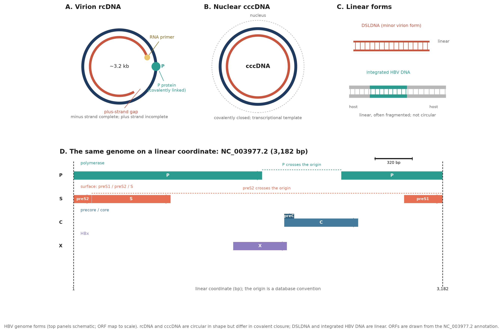
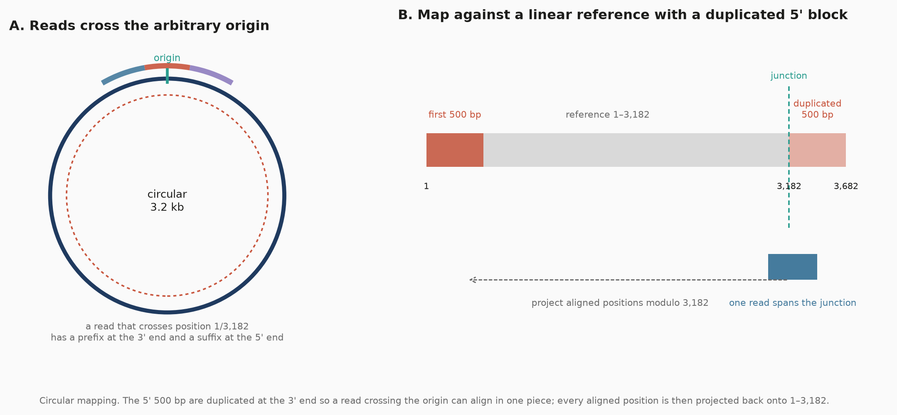

:::info
**Đây là bài đầu trong hai bài về phân tích HBV từ dữ liệu NGS.** Bài này đi qua sinh học của hệ gen và quy trình từ read thô đến consensus và cây phát sinh. [Bài thứ hai](/blogs/reading-hbv-ngs-results) đi sâu vào cách đọc kết quả — coverage, `N`, biến thể, tái tổ hợp — và những giới hạn của một bộ dữ liệu nhỏ.

Dữ liệu dùng làm ví dụ là năm mẫu HBV công khai từ Brazil (PRJNA659786) và mười hệ gen hoàn chỉnh từ GenBank. Mã, tham số và kết quả tham chiếu nằm trong [vieomics/solutions](https://github.com/vieomics/solutions/tree/main/hbv-genome-short-read-analysis).
:::

## Vì sao phân tích HBV không giống phân tích vi khuẩn

HBV là một virus DNA nhỏ, hệ gen khoảng 3,2 kb, thường được mô tả là “vòng tròn”. Nhưng “vòng tròn” ở đây không giống nhiễm sắc thể của vi khuẩn. Vi khuẩn thường có một phân tử DNA vòng, sợi đôi, đóng vòng bằng liên kết cộng hóa trị và sao chép theo cơ chế bán bảo tồn. HBV có ít nhất bốn dạng hệ gen khác nhau, và dạng nào đang có mặt trong mẫu phụ thuộc vào giai đoạn nhiễm và loại mô.

*Hình 1 — Các dạng hệ gen HBV. rcDNA và cccDNA đều có hình vòng nhưng khác nhau ở mức đóng vòng cộng hóa trị; dslDNA và DNA tích hợp là dạng tuyến tính. Bản đồ ORF dùng tọa độ NC_003977.2: P 2.309–3.182 + 1–1.625; S 157–837, với preS1 2.850–3.173 và preS2 3.174–3.182 + 1–156; C 1.816–2.454, với preC 1.816–1.902; X 1.376–1.840. Phần trên là sơ đồ; bản đồ ORF đúng tỉ lệ. Nguồn: Seeger & Mason (2000), Nassal (2015), Revill và cộng sự (2020), Tu và cộng sự (2021), và chú giải GenBank NC_003977.2.*

- **rcDNA trong virion.** Phần lớn virion có DNA vòng thư giãn, sợi đôi không hoàn chỉnh (relaxed circular DNA, rcDNA). Sợi âm dài đầy đủ và gắn cộng hóa trị với polymerase của virus (P) ở đầu 5′. Sợi dương ngắn hơn, có một đoạn hở. Hai sợi không đóng vòng cộng hóa trị, nên phân tử có hình vòng nhưng không phải một vòng kín.
- **cccDNA trong nhân.** Trong nhân tế bào, rcDNA được sửa chữa thành DNA vòng đóng cộng hóa trị (covalently closed circular DNA, cccDNA). Đây là khuôn phiên mã dạng episome, tồn tại lâu trong tế bào gan bị nhiễm.
- **Dạng tuyến tính.** Một phần nhỏ virion mang DNA sợi đôi tuyến tính (double-stranded linear DNA, dslDNA). HBV cũng có thể tích hợp vào hệ gen vật chủ; phần tích hợp thường là tuyến tính và có thể bị cắt ngắn. Cả hai dạng này đều không phải vòng.
- **Trình tự trong cơ sở dữ liệu.** Một bản ghi “complete genome” trên GenBank/RefSeq thường là biểu diễn tuyến tính của hệ gen vòng. Gốc tọa độ là quy ước của cơ sở dữ liệu, không phải một điểm khởi đầu sao chép duy nhất. Trong NC_003977.2, ORF polymerase vắt qua gốc tọa độ (2.309–3.182 + 1–1.625), nên nếu map hoặc align tuyến tính một cách máy móc, ORF P sẽ bị cắt làm hai đoạn.

Sao chép của HBV cũng khác vi khuẩn. cccDNA được phiên mã thành pregenomic RNA (pgRNA), rồi pgRNA được phiên mã ngược thành rcDNA mới. Virion mang DNA, nhưng bước sao chép hệ gen lại phụ thuộc RNA. Đây là lý do các công cụ và giả định dành cho DNA vi khuẩn không thể áp dụng nguyên xi cho HBV.

## Bốn ORF chồng lấp và gốc tọa độ tùy ý

Hệ gen HBV chỉ khoảng 3,2 kb nhưng chứa bốn ORF chính, và chúng chồng lấp đáng kể:

| ORF | Tọa độ trên NC_003977.2 | Sản phẩm |
|---|---|---|
| P | 2.309–3.182 + 1–1.625 | Polymerase / reverse transcriptase |
| S | 157–837; preS1 2.850–3.173; preS2 3.174–3.182 + 1–156 | Ba protein bề mặt (L, M, S) từ các codon mở đầu khác nhau |
| C | 1.816–2.454; preC 1.816–1.902 | Precore / core |
| X | 1.376–1.840 | HBx |

P chồng lên S, C và X; C cũng chồng lên X. Vì vậy một nucleotide thay đổi có thể đồng nghĩa trong khung đọc này nhưng khác nghĩa trong khung đọc khác. Khi chú giải biến thể, cần dịch từng khung đọc riêng và ghi rõ vị trí đang xét thuộc ORF nào. Nếu chỉ dịch một khung, con số “synonymous” và “nonsynonymous” sẽ không có ý nghĩa nhất quán.

Gốc tọa độ cũng là một cái bẫy. Trong NC_003977.2, vị trí 1 không phải điểm khởi đầu sao chép sinh học; đó là quy ước của bản ghi. ORF P bắt đầu ở 2.309, chạy đến 3.182 rồi tiếp tục từ 1 đến 1.625. preS2 cũng vắt qua gốc. Vì vậy, nếu bạn map read vào một tham chiếu tuyến tính mà không xử lý vòng, các read bắt đầu gần cuối hệ gen sẽ không map được trọn vẹn, và các đoạn cuối của P hoặc preS2 có thể trông như bị mất.

## Đưa hệ gen vòng tròn vào một tham chiếu tuyến tính

Có nhiều cách xử lý hệ gen vòng. Trong ví dụ này, chúng tôi dùng cách đơn giản và dễ kiểm tra: nối thêm 500 bp đầu của tham chiếu vào cuối tham chiếu, tạo thành một tham chiếu dài 3.682 bp. Read nào vắt qua gốc sẽ map được liền mạch qua điểm nối. Sau khi map, mọi vị trí được chiếu modulo 3.182 để quay về hệ tọa độ gốc.

*Hình 2 — Circular mapping. 500 bp đầu của tham chiếu được lặp lại ở cuối; read vắt qua gốc map được trong một mảnh, sau đó vị trí được chiếu modulo 3.182. Cách này giữ được các read mà một tham chiếu tuyến tính sẽ bỏ qua.*

Trong bước circular mapping của ví dụ này, số read vắt qua gốc dao động khoảng 7.312–47.710 read mỗi mẫu. Con số này cho thấy bước xử lý vòng không phải là chi tiết trang trí: nếu bỏ qua, một phần read — và đặc biệt là bằng chứng cho các đoạn cuối của P — sẽ không được dùng. Một số công cụ hiện đại có chế độ tham chiếu vòng; nguyên tắc vẫn là bảo đảm read vắt qua gốc được map nguyên vẹn và tọa độ được chiếu nhất quán.

## Quy trình phân tích từ read thô

Quy trình trong ví dụ này đi theo các bước sau. Đây là khung tối thiểu cho một phân tích hệ gen HBV; tùy câu hỏi, bạn có thể thêm bước phát hiện cccDNA, phân tích dạng tích hợp hoặc xác định kiểu gene kháng thuốc.

| Bước | Công cụ / cách làm | Điều cần kiểm tra |
|---|---|---|
| Kiểm soát chất lượng và cắt adapter | `fastp` | Số read giữ lại, Q30, tỉ lệ trùng lặp |
| Map read | Bowtie2 với tham chiếu HBV có xử lý vòng | Tỉ lệ map, độ phủ, read vắt qua gốc |
| Gọi biến thể | BCFtools mpileup/call, lọc theo độ sâu và tần số allele | SNP, indel, vị trí trong từng ORF |
| Gọi consensus | BCFtools consensus, ngưỡng độ sâu | `N` ở vị trí thấp, indel có được áp dụng hay không |
| Align đa trình tự | MAFFT | Số cột, gap, `N`, vùng gap-rich |
| Cây phát sinh | IQ-TREE 2, ModelFinder, UFBoot và SH-aLRT | Model, support, độ bất định do missing data |
| Sàng lọc tái tổ hợp (tùy chọn) | PhiPack | Giả định quần thể, missing data, không overclaim |

Trong ví dụ công khai, bước upstream dùng `nf-core/viralrecon` (Illumina/metagenomic, tham chiếu HBV tùy chỉnh) và các bước downstream dùng MAFFT 7.526, IQ-TREE 2.4.0, BCFtools và Python/Biopython. Toàn bộ lệnh và phiên bản được ghim trong `pixi.lock` và manifest của repo kỹ thuật.

## Consensus: điều được ghi lại và điều không

Consensus trong ví dụ này là **consensus dựa trên tham chiếu**, không phải lắp ráp de novo. Nó giữ khung tọa độ 3.182 bp của NC_003977.2. Ở mỗi vị trí, base được gọi từ read map; vị trí dưới 10× hoặc không có read được ghi thành `N`. Indel không được áp dụng vào consensus. Vì vậy:

- `N` không phải gap. `N` cho biết vị trí đó không đủ bằng chứng để gọi base, không phải rằng virus mất base đó.
- Độ dài consensus không phải độ dài bộ lắp ráp. Nó bị cố định bởi tham chiếu.
- Các đoạn mất base tương đối so với tham chiếu gần nhất được báo riêng. Trong ví dụ này có sáu ứng viên deletion; chúng không được vẽ thành gap trong consensus.

Điều này đặc biệt quan trọng với các mẫu có vùng phủ thấp. Trong bộ dữ liệu ví dụ, B575/2014 có 34,9% `N` và B364/2014 có 16,9% `N`; đó là các genome không hoàn chỉnh. Ngay cả B215/2014 và B3392/2014, dù chỉ có khoảng 0,5% `N`, cũng có một đoạn `N` ngắn 16–17 bp quanh vị trí 2.856–2.872. Đọc consensus mà bỏ qua các đoạn này sẽ dễ hiểu sai rằng mẫu có hệ gen hoàn chỉnh.

## Cây phát sinh: một giả thuyết về quan hệ

Với 5 consensus và 10 hệ gen công khai, chúng tôi align 15 trình tự bằng MAFFT và dựng cây bằng IQ-TREE 2. Alignment có 3.221 cột, 845 vị trí biến đổi và 535 vị trí mang tính informative theo parsimony. Ba mươi chín cột có hơn 50% gap, tập trung ở hai vùng; chúng tôi giữ lại thay vì cắt bỏ, nên vùng đó cần được xem là bất định.

IQ-TREE chọn model TVM+F+I+G4 và chạy 1.000 UFBoot cùng 1.000 SH-aLRT. Trong cây hiển thị, ba mẫu genotype A tạo thành một nhánh với tham chiếu A2 KJ854710.1 (100/100); hai mẫu genotype D nằm trong nhánh D với NC_003977.2 và các tham chiếu D Brazil, nhưng cặp D chỉ có support 28,5/61 — phù hợp với dữ liệu thiếu của B364/2014. Nhánh B/C có support 97,4/92; E và F làm outgroup.

Một cây như vậy là một giả thuyết về quan hệ, không phải bằng chứng về chuỗi lây truyền. Với 15 trình tự, hai genome không hoàn chỉnh và một panel tham chiếu được chọn có chủ đích, cây đủ để kiểm tra vị trí genotype và phát hiện bất thường, nhưng không đủ để kết luận về nguồn gốc địa lý hay thời điểm lây nhiễm.

## Một ví dụ công khai, để bạn đối chiếu

Bộ dữ liệu ví dụ gồm năm mẫu từ PRJNA659786 (Brazil; ba genotype A, hai genotype D) và mười hệ gen hoàn chỉnh từ GenBank (A, B, C, D, E, F). Tham chiếu map là NC_003977.2, genotype D, 3.182 bp.

| Hạng mục | Kết quả trong ví dụ |
|---|---|
| Số taxon trên cây | 15 |
| Alignment | 3.221 cột; 845 biến đổi; 535 parsimony-informative |
| Biến thể so với NC_003977.2 | 1.942 vị trí SNP; không có indel trong VCF |
| So với tham chiếu gần nhất | 633 dòng nucleotide theo vùng; 473 vị trí duy nhất; 593 dòng amino acid |
| Deletion ứng viên | 6 |
| Genome không hoàn chỉnh | B575/2014, B364/2014 |

Các con số này được giải thích kỹ ở [bài thứ hai](/blogs/reading-hbv-ngs-results): vì sao 1.942 SNP không phải 1.942 đột biến, vì sao `N` không phải gap, và vì sao tín hiệu tái tổ hợp không phải breakpoint.

## Tái lập và truy cập

Toàn bộ phân tích có thể tái lập trên nền tảng Omicslab. Bước upstream `nf-core/viralrecon` chạy như một analysis job với tham chiếu HBV tùy chỉnh; các bước alignment, phylogeny và variant annotation chạy trong môi trường `pixi` ghim phiên bản. Input công khai, kết quả tham chiếu và manifest nằm trong [repo vieomics/solutions](https://github.com/vieomics/solutions/tree/main/hbv-genome-short-read-analysis), nên bạn có thể mở lại workspace, tải dữ liệu hoặc chạy lại từ đầu.

Nếu bạn chỉ muốn kiểm tra nhanh, repo có sẵn consensus, VCF, alignment, cây và các bảng summary. Nếu bạn muốn chạy trên dữ liệu của mình, hãy bắt đầu từ samplesheet và cấu hình tham chiếu, sau đó giữ nguyên các bước kiểm tra chất lượng và xử lý vòng.

## Những điểm cần nhớ

- **HBV không phải vi khuẩn.** rcDNA, cccDNA, dslDNA và dạng tích hợp là bốn dạng khác nhau; đừng giả định mẫu chỉ có một phân tử vòng duy nhất.
- **Gốc tọa độ là quy ước.** P và preS2 vắt qua gốc; map read mà không xử lý vòng sẽ làm mất bằng chứng ở hai đầu hệ gen.
- **Bốn ORF chồng lấp.** Một nucleotide có thể nằm trong hai khung đọc; chú giải phải dịch từng khung.
- **Consensus dựa trên tham chiếu.** `N` không phải gap; indel không tự động được áp dụng; độ dài consensus không phải độ dài bộ lắp ráp.
- **Coverage phải đọc cùng breadth.** Độ sâu trung bình cao không bảo đảm toàn hệ gen được phủ đều; hãy báo cáo cả breadth và `N`.
- **Cây là giả thuyết.** Support thấp và missing data phải được nói ra; một cây 15 taxon không phải phân tích dịch tễ.

## Tài liệu tham khảo

- Seeger C, Mason WS. Hepatitis B virus biology. *Microbiol Mol Biol Rev.* 2000;64(1):51–68. [doi:10.1128/MMBR.64.1.51-68.2000](https://doi.org/10.1128/MMBR.64.1.51-68.2000)
- Nassal M. HBV cccDNA: viral persistence reservoir and key obstacle for a cure of chronic hepatitis B. *Gut.* 2015;64(12):1972–1984. [doi:10.1136/gutjnl-2015-309809](https://doi.org/10.1136/gutjnl-2015-309809)
- Revill PA, Tu T, Netter HJ, Yuen LKW, Locarnini SA, Littlejohn M. The evolution and clinical impact of hepatitis B virus genome diversity. *Nat Rev Gastroenterol Hepatol.* 2020;17(10):618–634. [doi:10.1038/s41575-020-0296-6](https://doi.org/10.1038/s41575-020-0296-6)
- Tu T, Zhang H, Urban S. Hepatitis B virus DNA integration: in vitro models for investigating viral pathogenesis and persistence. *Viruses.* 2021;13(2):180. [doi:10.3390/v13020180](https://doi.org/10.3390/v13020180)
- Dữ liệu nghiên cứu: NCBI BioProject [PRJNA659786](https://www.ncbi.nlm.nih.gov/bioproject/PRJNA659786).
- `nf-core/viralrecon`: [doi:10.5281/zenodo.3901628](https://doi.org/10.5281/zenodo.3901628). MAFFT: [doi:10.1093/molbev/mst010](https://doi.org/10.1093/molbev/mst010). IQ-TREE 2: [doi:10.1093/molbev/msaa015](https://doi.org/10.1093/molbev/msaa015). PhiPack: [doi:10.1093/molbev/msj092](https://doi.org/10.1093/molbev/msj092).
