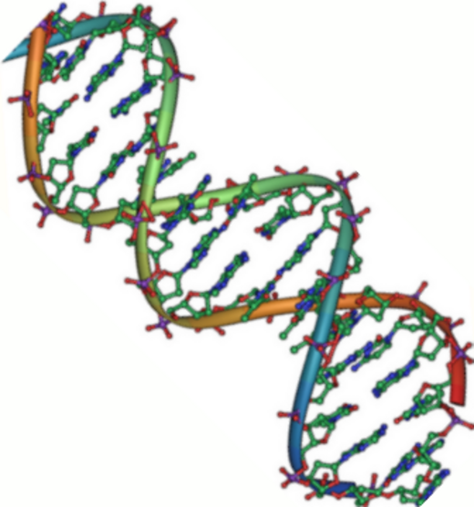
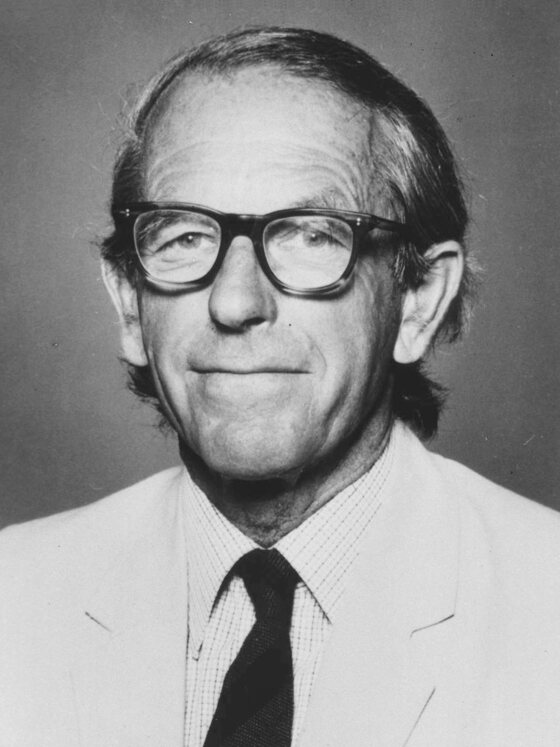
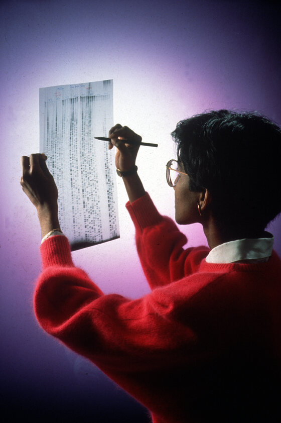

Bioinformatics is often described as a young field, and in its present form it is. In about seventy years, biology moved from reading one protein at a time to producing millions of genomes, and computing moved with it. This lesson follows that arc, and the methods underneath it, because the shape of the field today — pipelines, containers, enormous datasets — comes from them.

## The first sequences

The starting point is chemical, not digital. In 1955 Frederick Sanger reported the first complete protein sequence, insulin. DNA sequencing followed in 1977, with the Sanger method and, independently, the Maxam–Gilbert method. For the first time, biology had strings that could be stored, copied and compared by machine. The word *bioinformatics* itself is usually traced to Paulien Hogeweg and Ben Hesper, who used it around 1970 for the study of information processes in biological systems.

What is worth keeping is *how* these first sequences were read. Neither was a single measurement; both were puzzles solved by breaking a molecule into pieces and putting the pieces back in order — the same idea that returns, decades later, in genome assembly.

### Reading a protein, one end at a time

A protein is a chain of amino acids, and reading it means finding their order. In the 1950s there was no machine for this; the order was inferred chemically, in two moves.

The first move identifies one end. Sanger's reagent (1-fluoro-2,4-dinitrobenzene) attaches to the free amino group at the start of the chain; after the protein is broken down, the labelled first amino acid can be separated and identified. A related idea, Edman degradation (1950), removes the first amino acid, identifies it, and repeats, one residue per cycle.

The second move puts the pieces in order. A whole protein is too long to read in one pass, so it is cut into shorter peptides by partial hydrolysis. Each fragment is read, then the fragments are ordered by the overlaps between them. Working this way, Sanger and colleagues determined the sequence of insulin in 1955 — a result recognised with the 1958 Nobel Prize in Chemistry.

### Reading DNA by stopping it

DNA posed a different problem: it uses only four letters, so adjacent positions look very similar chemically. The Sanger method (1977) sidestepped this by turning "which letter is here" into "how long is this fragment".

The reaction copies a DNA template with a polymerase that extends a short primer. Alongside the normal building blocks, a small amount of a modified one is added — a *dideoxynucleotide* — which lacks the group needed to continue the chain. Wherever it is inserted, copying stops. Because insertion is random, the reaction becomes a mixture of fragments that end at every position where that letter occurs.

Run four such reactions, one per letter, and separate the fragments by size: classically on a gel, later in fine capillaries. The order of the fragments by length then gives the order of the letters. Maxam and Gilbert's method (also 1977) reached the same goal from the other direction, cutting the DNA at specific letters and separating the result by size.

Both methods reduce a chemical question to a measurement — fragment length — that a machine can perform. That reduction is what made sequencing something that could be automated and, eventually, scaled up.

## Comparing sequences becomes a discipline

Once sequences existed, the natural question was: is this one like that one? Early answers came as algorithms and databases:

- Margaret Dayhoff's *Atlas of Protein Sequence and Structure* (1965) collected sequences and introduced substitution matrices — a way to score how likely one amino acid is to replace another.
- Needleman and Wunsch (1970) described an algorithm for aligning two sequences end to end; Smith and Waterman (1981) added a local version that finds the best matching region rather than aligning everything.
- Public databases appeared alongside: the Protein Data Bank (1971), EMBL's nucleotide database (1980) and GenBank (1982).

Alignment scoring and public databases are the two ideas the rest of the field still rests on.

## Searching at scale

Searching every database entry slowly was the next problem. FASTA (1985) and then **BLAST** (1990, Altschul and colleagues) made it practical to search a sequence against a large database quickly, by trading completeness for speed. When the web arrived, these tools became available to anyone with a browser.

## Reading a whole genome

The Human Genome Project (1990–2003) set out to read roughly 3.2 billion base pairs. With reads of a few hundred to about a thousand letters, this was not a larger version of reading one gene; it was a problem of strategy and of assembly.

Two approaches ran in parallel:

- **Clone by clone (the public consortium).** The genome was first broken into large pieces carried in bacterial artificial chromosomes. Each piece was mapped to a position and then sequenced, so the assembly could lean on an existing map.
- **Whole-genome shotgun (Celera).** The genome was shredded entirely and sequenced at random; the order was reconstructed afterwards, by computation, from overlaps between the reads.

The project delivered a draft in 2001 and an essentially complete reference in 2003, with gaps closed over the following years. A detail worth remembering: that reference is not one person's genome but a mosaic. Many later analyses report variants "against the reference", and it helps to know what the reference actually is.

, CC BY 2.0, via Wikimedia Commons.")

## The data explosion

Around 2005, so-called next-generation sequencing changed the economics of reading DNA. Reads became shorter per run but vastly more numerous, and the cost per base fell far faster than computing improved. Bioinformatics had to adapt:

- new aligners such as Bowtie and BWA (both 2009) mapped reads to a reference at scale;
- SAM/BAM became the standard way to store those alignments;
- variant calling moved from a research topic to a routine step.

The bottleneck shifted from *producing* data to *storing, moving and processing* it.

## From scripts to infrastructure

The most recent shift is organisational. Work that once ran as a personal script now runs as a pipeline:

- **Containers** (Docker, released 2013; Apptainer on shared clusters) package a tool with its environment.
- **Workflow managers** — Snakemake (2012), Nextflow (2013), and later WDL and CWL — describe a chain of steps and run them across many machines.
- **Community pipelines** such as nf-core (from 2018) package tested analyses that others can run without rebuilding them.
- Long-read sequencing, biobanks and national genome programmes pushed dataset sizes into the petabytes.

## What the history leaves us with

Two things stay constant across the whole arc. Biology keeps producing data, and computing keeps having to catch up. And one idea recurs from the very first protein sequence to the largest genome projects: read what you can, then reconstruct the whole from overlapping pieces. That meeting point between biology and computation is where this course continues, and the next lesson looks at how the field is practised today.

## References

Dates and details above follow the commonly cited references below. Where a date is approximate, it is phrased as such.

- Sanger, F. (1955). *The amino-acid sequence in the phenylalanyl chain of insulin.* [Biochemical Journal](https://doi.org/10.1042/bj0490463).
- Edman, P. (1950). *Method for determination of the amino acid sequence in peptides.* [Acta Chemica Scandinavica](https://doi.org/10.3891/acta.chem.scand.04-0283).
- Sanger, F., Nicklen, S. & Coulson, A. R. (1977). *DNA sequencing with chain-terminating inhibitors.* [PNAS](https://doi.org/10.1073/pnas.74.12.5463).
- Maxam, A. M. & Gilbert, W. (1977). *A new method for sequencing DNA.* [PNAS](https://doi.org/10.1073/pnas.74.2.560).
- Hogeweg, P. (2011). *The roots of bioinformatics in theoretical biology.* [PLoS Computational Biology](https://doi.org/10.1371/journal.pcbi.1002021) — on the term and its origins.
- Dayhoff, M. O. (1965). *Atlas of Protein Sequence and Structure.* National Biomedical Research Foundation.
- Needleman, S. B. & Wunsch, C. D. (1970). *A general method applicable to the search for similarities in the amino acid sequence of two proteins.* [Journal of Molecular Biology](https://doi.org/10.1016/0022-2836(70)90057-4).
- Smith, T. F. & Waterman, M. S. (1981). *Identification of common molecular subsequences.* [Journal of Molecular Biology](https://doi.org/10.1016/0022-2836(81)90087-5).
- Altschul, S. F., Gish, W., Miller, W., Myers, E. W. & Lipman, D. J. (1990). *Basic local alignment search tool.* [Journal of Molecular Biology](https://doi.org/10.1016/S0022-2836(05)80360-2).
- International Human Genome Sequencing Consortium (2001). *Initial sequencing and analysis of the human genome.* [Nature](https://doi.org/10.1038/35057062).
- Langmead, B., Trapnell, C., Pop, M. & Salzberg, S. L. (2009). *Ultrafast and memory-efficient alignment of short DNA sequences to the human genome.* [Genome Biology](https://doi.org/10.1186/gb-2009-10-3-r25) (Bowtie).
- Li, H. & Durbin, R. (2009). *Fast and accurate short read alignment with the Burrows–Wheeler transform.* [Bioinformatics](https://doi.org/10.1093/bioinformatics/btp324) (BWA).
- Di Tommaso, P. et al. (2017). *Nextflow enables reproducible computational workflows.* [Nature Biotechnology](https://doi.org/10.1038/nbt.3820).
- Ewels, P. A. et al. (2020). *The nf-core framework for community-curated bioinformatics pipelines.* [Nature Biotechnology](https://doi.org/10.1038/s41587-020-0439-x).

**Image credits.** Figure 1: DNA double helix, Jerome Walker and Dennis Myts, public domain. Figure 2: Frederick Sanger, public domain. Figure 3: sequencing DNA, CSIRO, CC BY 3.0. Figure 4: Human Genome Project timeline, National Human Genome Research Institute (NHGRI), CC BY 2.0. Figure 5: Illumina MiSeq sequencer, Konrad Förstner, CC0. All via [Wikimedia Commons](https://commons.wikimedia.org).
