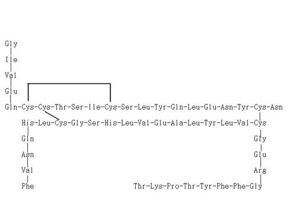
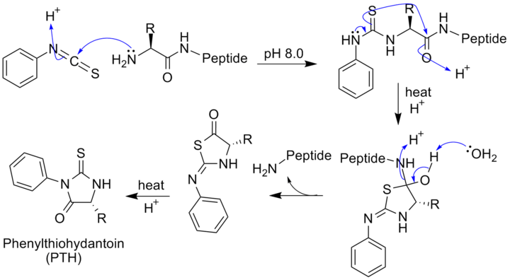
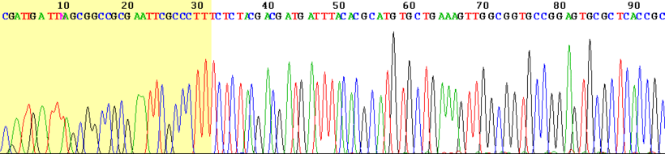
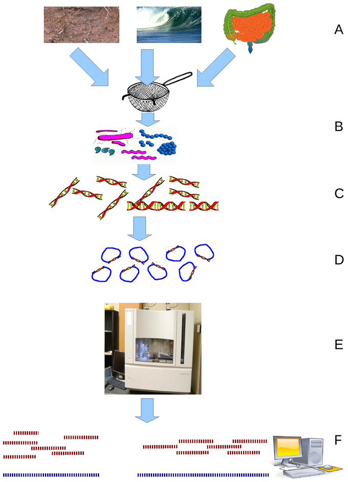
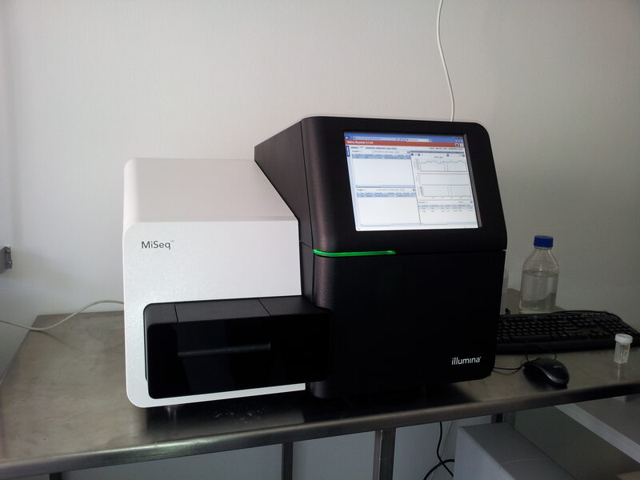

Bioinformatics is often described as a young field, and in its present form it is. In about seventy years, biology moved from reading one protein at a time to producing millions of genomes, and computing moved with it. This lesson follows that arc and the methods underneath it, because the shape of the field today — pipelines, containers, enormous datasets — comes from them.

## The first sequences

The starting point is chemical, not digital. In 1955 Frederick Sanger reported the first complete protein sequence, insulin. DNA sequencing followed in 1977, with the Sanger method and, independently, the Maxam–Gilbert method. For the first time, biology had strings that could be stored, copied and compared by machine. The word *bioinformatics* itself is usually traced to Paulien Hogeweg and Ben Hesper, who used it around 1970 for the study of information processes in biological systems.

What is worth keeping is *how* these first sequences were read. Neither was a single measurement; both were puzzles solved by breaking a molecule into pieces and putting the pieces back in order. That idea — read the pieces, then reassemble by overlaps — returns decades later in genome assembly.

### Reading a protein, one end at a time

A protein is a chain of amino acids, joined by peptide bonds. There are about twenty common amino acids, and their order — the *primary structure* — determines how the chain folds and what it does. Reading a protein therefore means finding that order.

Insulin was a favourable first target. It is small (51 amino acids, in two chains joined by disulfide bonds), it is abundant in the pancreas, and it could be purified. Its sequence, once known, showed something important: a protein has one defined order, not a vague average. Sequence is information.

Two chemical tricks were enough to read it.

**Finding one end.** Sanger's reagent, 1-fluoro-2,4-dinitrobenzene, reacts with the free amino group at the start of the chain. After the protein is hydrolysed, the labelled first amino acid is released and identified by chromatography. This gives the first residue, and only the first.

**Getting the rest.** Because a whole chain is too long to read in one pass, the protein is cut by partial hydrolysis into overlapping peptides. Each fragment is sequenced or partly read, and the fragments are then ordered by the overlaps between them — like reconstructing a sentence from overlapping pieces of it.

A second method works incrementally. In **Edman degradation** (1950), phenyl isothiocyanate couples to the N-terminal residue; mild acid then cleaves that residue off as a derivative that can be identified, and the cycle repeats, one residue per round. It reads a peptide step by step, reliably up to a few tens of residues; a blocked or modified N-terminus stops it, which is why longer proteins are first cut into fragments.

Working this way, Sanger and colleagues finished the insulin sequence in 1955, and also placed its disulfide bonds. It earned the 1958 Nobel Prize in Chemistry. The practical lesson stands for the whole field: to read a long molecule, cut it into readable pieces and order the pieces afterwards.

### Reading DNA by stopping it

DNA is simpler in alphabet but harder to read: it uses only four letters, so neighbouring positions look almost identical chemically. The double helix had been described in 1953, but reading the order of the letters still needed a method.

The Sanger method (1977) solved it with an elegant trick: it turns "which letter is here" into "how long is this fragment".

The reaction copies a DNA template. A short primer binds the template, and a DNA polymerase extends it, adding nucleotides one by one. Along with the normal building blocks, a small amount of a modified one is included — a **dideoxynucleotide** — which lacks the 3′ hydroxyl group needed to attach the next nucleotide. Wherever it is inserted, the chain stops. Since insertion is random, the reaction becomes a nested set of fragments, each ending at one position where that letter occurs.

Run four such reactions, one per letter, and load them side by side. The fragments are separated by size on a polyacrylamide gel, which can tell apart lengths that differ by a single base; the bands are then read from shortest to longest. The four lanes give the sequence directly.

: each band is a fragment stopping at that letter, and reading the lanes bottom-to-top gives the sequence. Image: Tiadestyle, CC0, via Wikimedia Commons.")

Later the four reactions were merged into one by labelling each ddNTP with a different fluorescent dye, and the gel was replaced by fine capillaries with laser detection. The output became a chromatogram — a peak for every base, colour-coded by letter — which can be read automatically. This is the form in which Sanger sequencing did most of its work.

The rival Maxam–Gilbert method (also 1977) reached the same goal from the other side: it cut the DNA chemically at particular letters and separated the resulting fragments by size. It worked, but it was harder to automate, and the Sanger method became the standard for the next three decades.

Notice the shared idea between protein and DNA sequencing: reduce an unreadable chemical question to a measurable physical one — here, fragment length — that a machine can handle.

## Comparing sequences becomes a discipline

Once sequences existed, the natural question was: is this one like that one? Early answers came as algorithms and databases:

- Margaret Dayhoff's *Atlas of Protein Sequence and Structure* (1965) collected sequences and introduced substitution matrices — a way to score how likely one amino acid is to replace another.
- Needleman and Wunsch (1970) described an algorithm for aligning two sequences end to end; Smith and Waterman (1981) added a local version that finds the best matching region rather than aligning everything.
- Public databases appeared alongside: the Protein Data Bank (1971), EMBL's nucleotide database (1980) and GenBank (1982).

Alignment scoring and public databases are the two ideas the rest of the field still rests on.

## Searching at scale

Searching every database entry slowly was the next problem. FASTA (1985) and then **BLAST** (1990, Altschul and colleagues) made it practical to search a sequence against a large database quickly, by trading completeness for speed. When the web arrived, these tools became available to anyone with a browser.

## Reading a whole genome

The Human Genome Project set out to read roughly 3.2 billion base pairs. With reads of a few hundred to about a thousand letters, this was not a larger version of reading one gene; it was a problem of strategy and of assembly. The public effort and the company Celera ran from 1990 to a draft in 2000 and an essentially complete reference in 2003; the public effort alone is commonly cited at around US$2.7 billion over that period.

Two strategies were used, and they are worth understanding because the same choice returns whenever a genome is sequenced:

- **Clone by clone (the public consortium).** The genome was first broken into large pieces carried in bacterial artificial chromosomes. Each piece was mapped to a position in the genome — by fingerprinting and sequence-tagged sites — and a minimal set of overlapping pieces was chosen to cover it. Each piece was then sequenced in smaller fragments and assembled locally. The map constrains the assembly, which helps with repeats, but mapping is slow.
- **Whole-genome shotgun (Celera).** The genome was shredded entirely and sequenced at random, and the order was reconstructed afterwards from overlaps between the reads. This leans heavily on computation and struggles where the genome repeats itself, because identical repeats produce ambiguous overlaps.

Both strategies end the same way: an assembly problem. Short reads must be ordered into long stretches, the repeated parts of the genome are the hard cases, and some regions are left as gaps.

, CC BY 2.0, via Wikimedia Commons.")

, public domain, via Wikimedia Commons.")

Two details are worth remembering for later work. First, the reference genome is not one person's genome, but a mosaic assembled from a small number of donors; analyses that report variants "against the reference" are comparing to that mosaic. Second, the first human reference was never truly finished: the repetitive regions at centromeres and the like were left as gaps, and a genuinely complete, telomere-to-telomere human sequence was only reported much later, in 2022.

## The data explosion

Around 2005, so-called next-generation sequencing changed the economics of reading DNA. Instead of hundreds of reads per run, machines produced millions; reads became shorter per run but vastly more numerous, and the cost per base fell far faster than computing improved. Bioinformatics had to adapt:

- new aligners such as Bowtie and BWA (both 2009) mapped reads to a reference at scale;
- SAM/BAM became the standard way to store those alignments;
- variant calling moved from a research topic to a routine step.

The bottleneck shifted from *producing* data to *storing, moving and processing* it.

## From scripts to infrastructure

The most recent shift is organisational. Work that once ran as a personal script now runs as a pipeline:

- **Containers** (Docker, released 2013; Apptainer on shared clusters) package a tool with its environment.
- **Workflow managers** — Snakemake (2012), Nextflow (2013), and later WDL and CWL — describe a chain of steps and run them across many machines.
- **Community pipelines** such as nf-core (from 2018) package tested analyses that others can run without rebuilding them.
- Long-read sequencing, biobanks and national genome programmes pushed dataset sizes into the petabytes.

## What the history leaves us with

Two things stay constant across the whole arc. Biology keeps producing data, and computing keeps having to catch up. And one idea recurs from the very first protein sequence to the largest genome projects: read what you can, then reconstruct the whole from overlapping pieces. That meeting point between biology and computation is where this course continues, and the next lesson looks at how the field is practised today.

## References

Dates and details above follow the commonly cited references below. Where a date is approximate, it is phrased as such.

- Sanger, F. (1955). *The amino-acid sequence in the phenylalanyl chain of insulin.* [Biochemical Journal](https://doi.org/10.1042/bj0490463).
- Edman, P. (1950). *Method for determination of the amino acid sequence in peptides.* [Acta Chemica Scandinavica](https://doi.org/10.3891/acta.chem.scand.04-0283).
- Watson, J. D. & Crick, F. H. C. (1953). *Molecular structure of nucleic acids.* [Nature](https://doi.org/10.1038/171737a0).
- Sanger, F., Nicklen, S. & Coulson, A. R. (1977). *DNA sequencing with chain-terminating inhibitors.* [PNAS](https://doi.org/10.1073/pnas.74.12.5463).
- Maxam, A. M. & Gilbert, W. (1977). *A new method for sequencing DNA.* [PNAS](https://doi.org/10.1073/pnas.74.2.560).
- Hogeweg, P. (2011). *The roots of bioinformatics in theoretical biology.* [PLoS Computational Biology](https://doi.org/10.1371/journal.pcbi.1002021) — on the term and its origins.
- Dayhoff, M. O. (1965). *Atlas of Protein Sequence and Structure.* National Biomedical Research Foundation.
- Needleman, S. B. & Wunsch, C. D. (1970). *A general method applicable to the search for similarities in the amino acid sequence of two proteins.* [Journal of Molecular Biology](https://doi.org/10.1016/0022-2836(70)90057-4).
- Smith, T. F. & Waterman, M. S. (1981). *Identification of common molecular subsequences.* [Journal of Molecular Biology](https://doi.org/10.1016/0022-2836(81)90087-5).
- Altschul, S. F., Gish, W., Miller, W., Myers, E. W. & Lipman, D. J. (1990). *Basic local alignment search tool.* [Journal of Molecular Biology](https://doi.org/10.1016/S0022-2836(05)80360-2).
- International Human Genome Sequencing Consortium (2001). *Initial sequencing and analysis of the human genome.* [Nature](https://doi.org/10.1038/35057062).
- Venter, J. C. et al. (2001). *The sequence of the human genome.* [Science](https://doi.org/10.1126/science.1058040).
- Nurk, S. et al. (2022). *The complete sequence of a human genome.* [Science](https://doi.org/10.1126/science.abj6987).
- Langmead, B., Trapnell, C., Pop, M. & Salzberg, S. L. (2009). *Ultrafast and memory-efficient alignment of short DNA sequences to the human genome.* [Genome Biology](https://doi.org/10.1186/gb-2009-10-3-r25) (Bowtie).
- Li, H. & Durbin, R. (2009). *Fast and accurate short read alignment with the Burrows–Wheeler transform.* [Bioinformatics](https://doi.org/10.1093/bioinformatics/btp324) (BWA).
- Di Tommaso, P. et al. (2017). *Nextflow enables reproducible computational workflows.* [Nature Biotechnology](https://doi.org/10.1038/nbt.3820).
- Ewels, P. A. et al. (2020). *The nf-core framework for community-curated bioinformatics pipelines.* [Nature Biotechnology](https://doi.org/10.1038/s41587-020-0439-x).

**Image credits.** Figure 1: DNA double helix, Jerome Walker and Dennis Myts, public domain. Figure 2: Frederick Sanger, public domain. Figure 3: insulin primary structure, Jmstaube, CC BY 3.0. Figure 4: Edman degradation, Choij, public domain. Figure 5: Sanger sequencing gel, Tiadestyle, CC0. Figure 6: Sanger sequencing chromatogram, Loris, public domain. Figure 7: shotgun sequencing, Wooley, Godzik & Friedberg, CC BY 2.5. Figure 8: Human Genome Project timeline, National Human Genome Research Institute (NHGRI), CC BY 2.0. Figure 9: draft genome announcement, NHGRI, public domain. Figure 10: Illumina MiSeq sequencer, Konrad Förstner, CC0. All via [Wikimedia Commons](https://commons.wikimedia.org).
