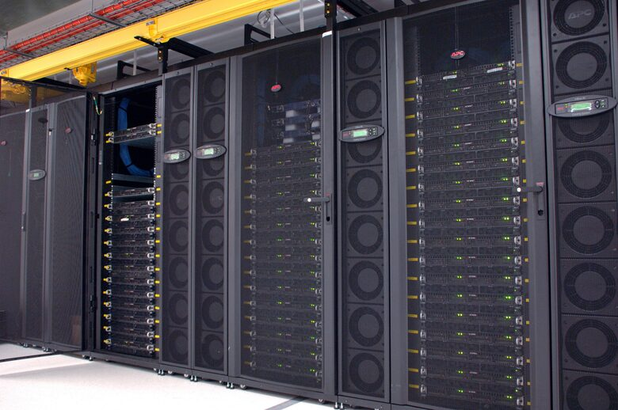

A newcomer might imagine bioinformatics as writing programs to read DNA. In practice, a fair amount of it is now assembling existing, tested pieces and knowing how to read them. That change is recent, and it came from software and infrastructure rather than from biology: the same sequencing data now moves through shared pipelines on shared or rented machines. This lesson looks at that stack.

## From one-off scripts to pipelines

A first analysis is usually a series of commands run in order: filter the reads, map them, call variants. That works well once. It becomes fragile the moment something changes, because the steps and their connections live only in the analyst's notes and memory. Change one input and the whole run is repeated by hand; if the fourth step fails after an hour, there is nothing that lets it resume where it stopped.

A **pipeline** makes the steps and their connections explicit, as a graph where each step's output feeds the next. A **workflow manager** then reads that graph and does the bookkeeping a person would otherwise do: run the steps in the right order, in parallel where possible, restart after a failure, and reuse results that are still valid (a step whose inputs have not changed need not run again).

Nextflow (released 2013) and Snakemake (2012) are two common managers; WDL and CWL are language-style alternatives with the same idea. The practical payoff is a shift of effort — from running and re-running commands to *describing* the analysis once, which is what makes reruns, sharing and scaling-up possible.

## Each step in its own container

A pipeline still has to run real programs, and real programs have opinions about their environment: which libraries, which versions, which system. This is the origin of the familiar "works on my machine" problem — the same tool, installed two ways, can behave two ways.

A **container** addresses this by packing a tool together with everything it needs into one *image*. The same image then runs the same way on a laptop, a cluster or the cloud. Docker, released in 2013, made this format widespread. On shared clusters, Docker is usually replaced by Singularity or Apptainer, which run without administrator rights and fit the security rules of a multi-user machine.

This is why modern pipelines run each step inside its own container. Each step gets a fixed environment, and the tool version becomes part of the description of the analysis rather than an accident of the machine it happened to run on.

## Installing the tools reproducibly

Underneath the pipeline, the tools still have to be installed. The workhorse is conda, with the **bioconda** channel for biological software; it resolves dependencies so the analyst does not have to.

Conda alone is not enough for reproducibility, because "install it" tends to mean "install the latest". A tool updated last week can give a different answer than the one it replaced. The remedy is a **lockfile**: a record of the exact versions and builds used, written once and then replayed. Pixi and conda-lock produce these files; a colleague, or the same analyst a year later, can then rebuild the exact environment instead of a moving target.

## Where the work runs

The compute itself is increasingly shared rather than sitting under a desk, and the choice has practical consequences:

- A **laptop** is fine for learning and for small tests.
- A shared **HPC cluster**, usually with a scheduler such as Slurm, is common in labs and institutes: many users queue for a pool of machines that is paid for once and amortised.
- **Cloud** providers offer on-demand machines and object storage (such as S3), billed by use. This suits work that is bursty or very large, where paying for idle capacity the rest of the time makes no sense.

A detail that surprises newcomers is that the expensive part is often moving the data, not computing on it. This is why object storage and streaming have become common: read what a step needs, where it already lives, instead of copying terabytes to a local disk first.

Platforms such as Omicslab sit on top of this layer. They connect storage and compute once, then let an analyst choose a packaged pipeline, declare the inputs and the resources, and follow the run — the plumbing between the pipeline and the machine is handled for them.

## Community pipelines and standards

The most visible change of the last decade is that analyses are shared. **nf-core** (from 2018) is a community collection of curated pipelines with a consistent structure, documentation and tests, so a tested analysis can be run without being rebuilt. **Bioconda** distributes the underlying tools. Alongside them, efforts such as GA4GH, ELIXIR, and the CWL and WDL languages work on standards so that a workflow, and the data it consumes, can move between institutions without being rewritten.

## What this means for a newcomer

Because the pieces are packaged and shared, the skill that pays off is not memorising tools. It is being able to:

- read a pipeline and say what each step does;
- know where to look for a step that already exists;
- understand what makes a result reproducible, and where an analysis can silently go wrong.

Those three skills are the subject of the rest of the course. The next lesson turns to the boundary all of this acts on: the point where biological material becomes data a computer can read.

## References

- Köster, J. & Rahmann, S. (2012). *Snakemake — a scalable bioinformatics workflow engine.* [Bioinformatics](https://doi.org/10.1093/bioinformatics/bts480).
- Di Tommaso, P. et al. (2017). *Nextflow enables reproducible computational workflows.* [Nature Biotechnology](https://doi.org/10.1038/nbt.3820).
- Ewels, P. A. et al. (2020). *The nf-core framework for community-curated bioinformatics pipelines.* [Nature Biotechnology](https://doi.org/10.1038/s41587-020-0439-x).
- Kurtzer, G. M., Sochat, V. & Bauer, M. W. (2017). *Singularity: Scientific containers for mobility of compute.* [PLOS ONE](https://doi.org/10.1371/journal.pone.0177459).
- Grüning, B. et al. (2018). *Bioconda: sustainable and comprehensive software distribution for the life sciences.* [Nature Methods](https://doi.org/10.1038/s41592-018-0046-7).
- Yoo, A. B., Jette, M. A. & Grondona, M. (2003). *SLURM: Simple Linux Utility for Resource Management.* [Lecture Notes in Computer Science](https://doi.org/10.1007/978-3-540-39727-4_2).
- Amstutz, P. et al. (2016). *Common Workflow Language, v1.0.* [Figshare](https://doi.org/10.6084/m9.figshare.3115156).
- Docker. *Docker documentation.* [https://docs.docker.com](https://docs.docker.com) — the container format referenced here.

**Image credits.** Figure 1: Athena supercomputer cluster, NASA, public domain. Figure 2: CSIRO GPU cluster at the data centre, CSIRO, CC BY 3.0. Figure 3: cloud computing stack, SamJohnston, CC0. All via [Wikimedia Commons](https://commons.wikimedia.org).
