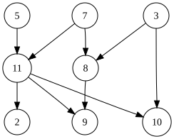

A newcomer might imagine bioinformatics as writing programs to read DNA. In practice, a fair amount of it is now assembling existing, tested pieces and knowing how to read them. That change is recent, and it came from software and infrastructure rather than from biology: the same sequencing data now moves through shared pipelines on shared or rented machines. This lesson looks at that stack, layer by layer, because the layers explain most of what a newcomer sees in a real project.

## From commands to a pipeline

A first analysis is usually a series of commands run in order. For a simple germline example it might be: check the reads, trim them, map them to a reference, sort and index the mapping, mark duplicate reads, call variants, and filter the calls. That works well once. It becomes fragile the moment something changes, because the steps and their connections live only in the analyst's notes and memory:

- change one input, and the run is repeated by hand from the start;
- if the fifth step fails after an hour, nothing lets it resume where it stopped;
- the same analysis on a second sample means editing and rerunning every command;
- two people running "the same" analysis may quietly choose different parameters.

A **pipeline** makes the steps and their connections explicit, as a graph in which each step's output feeds the next. The formal name for that graph is a *directed acyclic graph*: a set of steps with a direction, and no loops. Once the graph is written down, a program can execute it, and many of the fragile points above disappear.

### What a workflow manager actually does

A **workflow manager** is the program that runs the graph. Its job is the bookkeeping a person would otherwise do by hand:

- **Ordering and dependencies.** It knows that sorting must finish before variant calling starts, and refuses to start a step whose inputs are missing.
- **Parallelism and scatter–gather.** Twenty samples can be processed at once, then brought back together for a step that needs all of them.
- **Restart and caching.** If a run fails, it continues from the failed step rather than from the beginning; results whose inputs have not changed are reused. In Nextflow this is the `-resume` switch.
- **Resource allocation per step.** Each step declares how much CPU, memory and time it needs, which matters when steps differ by orders of magnitude.
- **Execution environment per step.** Each step can name its own container, so different tools with conflicting dependencies coexist in one pipeline.
- **Declared outputs.** The manager knows which files are the result and collects them, instead of leaving them scattered across working directories.

Nextflow (released 2013) and Snakemake (2012) are two common managers; WDL and CWL are language-style alternatives built on the same idea. The practical payoff is a shift of effort: from *running* commands to *describing* the analysis once, which is what makes reruns, sharing and scaling-up possible.

It is worth being clear about what a pipeline does *not* fix. It does not choose the right reference genome for your organism, does not know that a tool version changed its default, and does not check that the input sample was what you thought. A pipeline removes mechanical error and makes an analysis repeatable; it does not make it correct.

## Each step in its own container

A pipeline still has to run real programs, and real programs have opinions about their environment: which libraries, which versions, which system. This is the origin of the familiar "works on my machine" problem — the same tool, installed two ways, can behave two ways.

### What is inside a container

A **container** packs a tool together with everything it needs into one *image*. An image is essentially a snapshot of a filesystem — the program, its libraries, its configuration — plus a little metadata that says how to start it. Running the image starts a process that sees that filesystem instead of the machine's.

Two details matter in practice. First, a container shares the host's kernel, unlike a virtual machine, so it is light and starts quickly. Second, images live in **registries** (Docker Hub, quay.io and others) and are identified either by a **tag**, such as `1.2`, which can be moved, or by a **digest**, a hash that always refers to the same bytes. Pinning a digest is how a container becomes a fixed, reproducible dependency.

Docker, released in 2013, made this format widespread. On shared clusters, Docker is usually replaced by Singularity or Apptainer, which run without administrator rights and without a background daemon, fitting the security rules of a multi-user machine. The trade-offs are real and worth knowing: images can be large, user and file permissions inside a container can surprise you, and a step that needs a network or a GPU may need extra configuration.

This is why modern pipelines run each step inside its own container. Each step gets a fixed environment, and the tool version becomes part of the description of the analysis rather than an accident of the machine it happened to run on.

## Installing the tools reproducibly

Underneath the pipeline, the tools still have to be installed. The workhorse is conda, with the **bioconda** channel for biological software. Conda packages a tool with its dependencies and works for languages and binaries beyond Python, which is why bioconda became the common distribution point for command-line biology tools.

Conda alone is not enough for reproducibility, because the default behaviour tends to install the newest compatible versions. A tool updated last week can give a different answer than the one it replaced; a solver can also pick a different but equally valid set of dependencies on a different day.

The remedy is a **lockfile**: a record of the exact versions, build strings and channels used, written once and then replayed. `conda-lock` and **Pixi** produce these for conda environments; Python and R have their own equivalents (`requirements.txt` with pinned versions, `renv.lock`). A container is in effect a stronger lockfile: the whole environment is frozen as an image, so nothing is re-solved on the next machine.

The practical habit is simple even if the tooling is not: pin versions, record them, and update deliberately rather than by accident.

## Where the work runs

The compute itself is increasingly shared rather than sitting under a desk, and the choice has consequences.

A **laptop** is fine for learning and for small tests. Beyond that, two environments dominate:

- A shared **HPC cluster**, usually with a scheduler such as Slurm. Users log in to a small *login node* to prepare their work, then submit *jobs* to a scheduler that places them on powerful *compute nodes* as resources free up. The vocabulary is worth learning: a job asks for some CPUs, memory and a maximum time (*walltime*) on a named *partition*; a *job array* runs the same job once per sample. Data usually lives on a shared filesystem large enough to be visible from every node, while temporary files go to a faster local *scratch*. The whole cluster is paid for once and then amortised across many users, which is why jobs may wait in a queue.
- **Cloud** providers offer on-demand machines and object storage (such as S3), billed by use. This suits work that is bursty or very large, where paying for idle capacity the rest of the time makes no sense. It brings its own ideas: machines that scale up and down automatically, cheaper *spot* or *preemptible* instances that can be reclaimed, and *egress* charges for moving data out.

A rough comparison:

| | Shared HPC | Cloud |
| --- | --- | --- |
| How it is paid for | Institutionally, amortised | Pay per use |
| Typical strength | Steady, large jobs; data already on site | Bursty work; no local cluster needed |
| Data handling | Shared filesystem, local scratch | Object storage; egress costs |
| Main friction | Queueing; shared modules and quotas | Provisioning; cost management |

A detail that surprises newcomers is that the expensive part is often moving the data rather than computing on it, and this is why *data locality* shapes the design. Object storage and streaming have become common: read what a step needs, where it already lives, instead of copying terabytes to a local disk first. The same reason drives *hybrid* setups, where a local cluster handles routine work and cloud capacity is added when demand spikes.

Platforms such as Omicslab sit on top of this layer. They connect storage and compute once, then let an analyst choose a packaged pipeline, declare the inputs and the resources, and follow the run; the plumbing between the pipeline and the machine, and the choice of executor, is handled for them.

## Community pipelines and standards

The most visible change of the last decade is that analyses are shared.

**nf-core** (from 2018) is a community collection of curated pipelines with a consistent structure, documentation and tests. A pipeline written to its conventions comes with a samplesheet schema that says which columns are required, `-profile` settings that adapt it to different executors, and a summary report collected in one place. Its pipelines are versioned and tested automatically, so a tested analysis can be run without being rebuilt. **Bioconda** distributes the tools those pipelines depend on.

Alongside the pipelines, several efforts work on portability and sharing. The **Common Workflow Language** and **WDL** describe workflows so they can run on different engines. **GA4GH** develops standards for exchanging genomic data and running analyses across sites, and **ELIXIR** coordinates bioinformatics infrastructure across Europe. Behind much of this is the *FAIR* idea — that data and tools should be Findable, Accessible, Interoperable and Reusable — which is the same reproducibility goal stated as a principle.

## What this means for a newcomer

Because the pieces are packaged and shared, the skill that pays off is not memorising tools. It is being able to:

- read a pipeline and say what each step does;
- know where to look for a step that already exists, and how to tell whether it is maintained;
- understand what makes a result reproducible, and where an analysis can silently go wrong.

Those three skills are the subject of the rest of the course. The next lesson turns to the boundary all of this acts on: the point where biological material becomes data a computer can read.

## References

- Köster, J. & Rahmann, S. (2012). *Snakemake — a scalable bioinformatics workflow engine.* [Bioinformatics](https://doi.org/10.1093/bioinformatics/bts480).
- Di Tommaso, P. et al. (2017). *Nextflow enables reproducible computational workflows.* [Nature Biotechnology](https://doi.org/10.1038/nbt.3820).
- Ewels, P. A. et al. (2020). *The nf-core framework for community-curated bioinformatics pipelines.* [Nature Biotechnology](https://doi.org/10.1038/s41587-020-0439-x).
- Kurtzer, G. M., Sochat, V. & Bauer, M. W. (2017). *Singularity: Scientific containers for mobility of compute.* [PLOS ONE](https://doi.org/10.1371/journal.pone.0177459).
- Grüning, B. et al. (2018). *Bioconda: sustainable and comprehensive software distribution for the life sciences.* [Nature Methods](https://doi.org/10.1038/s41592-018-0046-7).
- Yoo, A. B., Jette, M. A. & Grondona, M. (2003). *SLURM: Simple Linux Utility for Resource Management.* [Lecture Notes in Computer Science](https://doi.org/10.1007/978-3-540-39727-4_2).
- Amstutz, P. et al. (2016). *Common Workflow Language, v1.0.* [Figshare](https://doi.org/10.6084/m9.figshare.3115156).
- Wilkinson, M. D. et al. (2016). *The FAIR Guiding Principles for scientific data management and stewardship.* [Scientific Data](https://doi.org/10.1038/sdata.2016.18).
- Docker. *Docker documentation.* [https://docs.docker.com](https://docs.docker.com) — the container format referenced here.

**Image credits.** Figure 1: Athena supercomputer cluster, NASA, public domain. Figure 2: directed acyclic graph, public domain. Figure 3: CSIRO GPU cluster at the data centre, CSIRO, CC BY 3.0. Figure 4: cable racks at a computing centre, Fermilab, public domain. Figure 5: cloud computing stack, SamJohnston, CC0. All via [Wikimedia Commons](https://commons.wikimedia.org).
